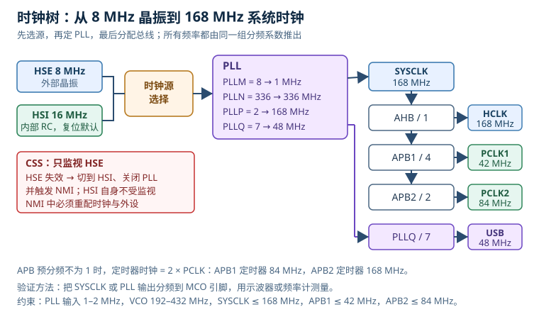

# 时钟树与低层初始化：从 HSE 到 SysTick

时钟不是“给 CPU 供一个频率”这么简单。它决定了 Flash 要插几个等待周期、串口波特率能不能对上、USB 能不能枚举、定时器分辨率是多少、休眠时哪些外设还在耗电。很多“串口乱码”“USB 不认识”“程序一提高主频就 HardFault”的问题，最后都落在时钟树上，而不是串口库或 USB 协议栈里。

这一篇以 STM32F407 的 168 MHz 配置为主线，把高速外部振荡器（High-Speed External，HSE）、高速内部振荡器（High-Speed Internal，HSI）、锁相环（Phase-Locked Loop，PLL）、系统时钟（SYSCLK）、总线时钟（HCLK）、外设时钟（PCLK）、波特率寄存器（Baud Rate Register，BRR）、系统节拍定时器（SysTick）、外设时钟门控和时钟安全系统（Clock Security System，CSS）串成一条可复算的链。算例会算出 PLL 每个分频/倍频值、UART 波特率误差、SysTick 重装值，以及 HSE 失效后系统会偏到什么程度。其他 Cortex-M 芯片的寄存器名和 PLL 结构可能不同，但“源—倍频—分频—门控—验证”的顺序和误差计算方法是一样的。

## 1. 动机（设计动机）

**现场一：串口在实验室正常，到了现场偶发乱码。** 板子用 HSI 16 MHz 直接给 UART，115200 波特率在常温下误差很小，老化测试也过了。到了低温或高温，HSI 偏差变大，累计到 10 位帧的最后一个采样点，接收方采到错误的停止位，出现帧错误。工程师换了三根线、两个 USB 转串口，问题依旧。根因不是线，而是时钟源精度没有纳入预算。

**现场二：主频从 16 MHz 提到 168 MHz，程序一跑就进 HardFault。** PLL 配置、分频系数、GPIO 都改了，唯独没有改 Flash 等待周期。Flash 在 168 MHz 下需要 5 个等待周期，代码仍按 0 等待周期访问，取指读到错误数据，最终跳飞。这个错误在启动阶段就可能发生，调试器甚至来不及连上。

**现场三：通用串行总线（Universal Serial Bus，USB）设备插上不枚举。** USB 全速设备需要 48 MHz 时钟，精度通常在 ±0.25% 量级。板子为了省晶振，用 HSI 经 PLL 产生 48 MHz；HSI 常温偏差约 ±1%，已经超出 USB 允许范围。看起来“频率是 48 MHz”，实际上协议层无法稳定同步。

**现场四：HSE 晶振失效，设备没有复位，但所有时序都变了。** HSE 停振后 CSS 把系统切到 HSI，PLL 被关闭，UART 的波特率、定时器的 PWM 周期、ADC 的采样节拍全部变化。固件没有处理 NMI，设备继续“带病运行”，直到看门狗复位。现场记录里只有“偶发重启”，没有“时钟故障”。

| 你看到的现象 | 先查什么 | 判据（本手册建议值，非标准强制） |
|---|---|---|
| 串口偶发帧错误 | 实际 PCLK、BRR、时钟源精度 | 总波特率误差小于 2% |
| 提高主频后死机 | Flash 等待周期、PLL 锁定、总线超频 | 每个总线都不超过手册上限 |
| USB 不枚举 | 48 MHz 来源与精度 | 满足 USB 全速时钟精度要求 |
| HSE 起振失败 | 晶振、负载电容、ESR、启动时间 | HSERDY 在超时内置位 |
| 休眠电流偏大 | 外设时钟门控、GPIO 状态 | 未用外设时钟关闭 |
| HSE 故障后时序全乱 | CSS/NMI 处理、时钟回退 | NMI 能记录并重配时钟 |

不算清楚会怎样？115200 波特率下，1% 的时钟误差会让 10 位帧的最后一个采样点偏移约 0.095 个位时间；叠加 BRR 量化误差和接收方时钟误差，噪声容限会被吃掉。168 MHz 下，5 个 Flash 等待周期意味着一次取指可能要 6 个周期，若按 1 个周期估算性能，实时预算会差出数倍。48 MHz 时钟偏 1%，USB 全速的位时间就偏 1%，协议层无法靠重同步完全弥补。

## 2. 直观（原理图）



### 2.1 时钟源：RC 与晶振的取舍

Cortex-M 芯片通常提供几类时钟源：

- **HSI**：内部 RC 振荡器，STM32F407 为 16 MHz。优点是上电即有、无需外部器件、成本低；缺点是精度和温漂不如晶振，适合作为复位后的默认时钟或 HSE 失效后的备份。
- **HSE**：外部晶体或外部时钟输入，常见 8 MHz。精度由晶振和负载电容决定，适合 UART、USB、CAN 等对时序有要求的接口。
- **LSE**：低速外部振荡器（Low-Speed External），常见 32.768 kHz 晶体，主要给实时时钟（Real-Time Clock，RTC）。
- **LSI**：低速内部振荡器（Low-Speed Internal），常见约 32 kHz RC，精度较差，常用于独立看门狗或低功耗唤醒。

复位后，STM32F4 默认使用 HSI，PLL 关闭，HSE 关闭，外设时钟门控大多关闭。也就是说，启动代码刚开始跑时，系统是一个 16 MHz、没有 PLL、没有外设时钟的“最小系统”。低层初始化要做的第一件事，就是决定继续用 HSI，还是打开 HSE 并切到 PLL。

### 2.2 PLL：把低频参考变成高频系统时钟

PLL 不是简单的“乘法器”，它由相位频率检测器、电荷泵、环路滤波器、压控振荡器和反馈分频器组成。对软件工程师来说，只需要记住四个可编程分频/倍频系数：

- **PLLM**：PLL 输入分频，把 HSE 或 HSI 分到 1–2 MHz 的参考频率；
- **PLLN**：VCO 倍频，把参考频率乘到 192–432 MHz 的 VCO 频率；
- **PLLP**：系统时钟分频，取值 2、4、6、8，把 VCO 分到 SYSCLK；
- **PLLQ**：USB/SDIO 等专用时钟分频，把 VCO 分到 48 MHz。

以 8 MHz HSE、M=8、N=336、P=2、Q=7 为例：

$$f_{\text{PLLin}} = \frac{8\ \text{MHz}}{8} = 1\ \text{MHz}$$

$$f_{\text{VCO}} = 1\ \text{MHz} \times 336 = 336\ \text{MHz}$$

$$f_{\text{SYSCLK}} = \frac{336\ \text{MHz}}{2} = 168\ \text{MHz}$$

$$f_{\text{USB}} = \frac{336\ \text{MHz}}{7} = 48\ \text{MHz}$$

这四个结果必须同时满足芯片手册的约束，而不是只看 SYSCLK 是否为 168 MHz。PLL 输入太低会降低环路增益和抗噪能力，太高会超出鉴相器范围；VCO 超出范围可能失锁；PLLQ 不是整数或超出范围，USB 时钟就不对。

### 2.3 分频链：SYSCLK、HCLK、PCLK 与定时器时钟

PLL 输出只是 SYSCLK。它还要经过高级高性能总线（Advanced High-performance Bus，AHB）预分频器得到 HCLK，再经过高级外设总线（Advanced Peripheral Bus，APB）的 APB1/APB2 预分频器得到 PCLK1/PCLK2。对 STM32F407：

- SYSCLK 最高 168 MHz；
- AHB 预分频器设为 /1，HCLK = 168 MHz；
- APB1 预分频器设为 /4，PCLK1 = 42 MHz（APB1 上限 42 MHz）；
- APB2 预分频器设为 /2，PCLK2 = 84 MHz（APB2 上限 84 MHz）。

这里有一个容易漏掉的规则：**当 APB 预分频器不为 1 时，定时器时钟是 PCLK 的 2 倍**。所以：

$$f_{\text{TIM,APB1}} = 2 \times 42\ \text{MHz} = 84\ \text{MHz}$$

$$f_{\text{TIM,APB2}} = 2 \times 84\ \text{MHz} = 168\ \text{MHz}$$

如果按 PCLK1=42 MHz 去算 TIM2 的预分频，实际定时器会快一倍，PWM 频率和超时时间全部偏一半。这个“定时器倍频”不是额外打开了什么开关，而是总线桥在 APB 预分频不为 1 时自动给定时器提供的时钟。

| 时钟域 | 典型频率 | 主要使用者 | 常见错误 |
|---|---|---|---|
| SYSCLK | 168 MHz | 内核、SysTick | 忘记 Flash 等待周期 |
| HCLK | 168 MHz | DMA、GPIO（通用输入输出）、AHB 外设 | 超过 AHB 上限 |
| PCLK1 | 42 MHz | USART2/3、I2C、TIM2–5 | 把 42 当定时器时钟 |
| PCLK2 | 84 MHz | USART1/6、SPI1、TIM1/8 | 把 84 当定时器时钟 |
| USB | 48 MHz | USB FS、SDIO | 用 HSI 直接供 USB |

### 2.4 门控：时钟不是“打开了就一直在跑”

STM32 的每个外设都有时钟门控位。以 GPIOA 和 USART2 为例：

- GPIOA 挂在 AHB1，使能位是 `RCC_AHB1ENR_GPIOAEN`（bit 0）；
- USART2 挂在 APB1，使能位是 `RCC_APB1ENR_USART2EN`（bit 17）。

复位与时钟控制（Reset and Clock Control，RCC）模块的基址是 0x40023800，AHB1ENR 偏移 0x30，APB1ENR 偏移 0x40，APB2ENR 偏移 0x44。访问 GPIOA 之前不开 GPIOA 时钟，读回全是 0 或触发总线错误；配置 USART2 之前不开 USART2 时钟，写寄存器没有效果。使能后建议回读一次寄存器，确认写操作已经到达外设，特别是在低功耗唤醒后。

门控不仅影响功能，也影响功耗。CMOS 动态功耗近似为：

$$P_{\text{dyn}} = \alpha C V^{2} f$$

其中 $\alpha$ 是翻转活动因子，$C$ 是负载电容（F），$V$ 是电源电压（V），$f$ 是时钟频率（Hz）。关闭一个外设的时钟，$f$ 变为 0，动态功耗随之下降；但漏电流仍然存在。所以“关时钟”能省动态功耗，不能把外设的静态漏电也当成 0。

### 2.5 CSS：HSE 的保险丝

时钟安全系统只监视 HSE。HSE 因晶振损坏、焊点开裂、负载电容错误或外部时钟源消失而停振时，CSS 会：

1. 把 SYSCLK 切换到 HSI；
2. 关闭 HSE 和 PLL；
3. 产生不可屏蔽中断（Non-Maskable Interrupt，NMI）。

不同系列的具体动作要以手册为准，但核心事实是：**CSS 不监视 HSI，也不监视 PLL 锁定**。HSI 自身失效时没有同等的硬件保护；PLL 失锁也不会自动触发 CSS，需要软件检查锁定标志或靠看门狗兜底。NMI 处理程序必须尽快记录故障、把输出置于安全状态，并重新配置时钟和依赖时钟的外设。仅在 NMI 里清标志然后返回，系统会继续用 HSI 运行，UART（Universal Asynchronous Receiver/Transmitter，通用异步收发器）、USB、PWM（Pulse Width Modulation，脉冲宽度调制）的时序仍然是错的。

## 3. 定量（静态分析）

### 3.1 PLL 与总线公式

PLL 输入频率：

$$f_{\text{PLLin}} = \frac{f_{\text{src}}}{M}$$

VCO 频率：

$$f_{\text{VCO}} = f_{\text{PLLin}} \times N = \frac{f_{\text{src}} \times N}{M}$$

系统时钟：

$$f_{\text{SYSCLK}} = \frac{f_{\text{VCO}}}{P}$$

USB 时钟：

$$f_{\text{USB}} = \frac{f_{\text{VCO}}}{Q}$$

其中 $f_{\text{src}}$ 是 HSE 或 HSI 频率（Hz），$M$、$N$、$P$、$Q$ 是整数分频/倍频系数。STM32F407 的约束是：

| 项目 | 约束 | 说明 |
|---|---|---|
| PLL 输入 | 1–2 MHz | $f_{\text{src}}/M$ 落在这个范围 |
| VCO 输出 | 192–432 MHz | $f_{\text{PLLin}} \times N$ |
| SYSCLK | ≤ 168 MHz | 系统时钟上限 |
| APB1 | ≤ 42 MHz | PCLK1 上限 |
| APB2 | ≤ 84 MHz | PCLK2 上限 |
| USB | 48 MHz，精度满足 USB 要求 | 由 PLLQ 产生 |
| PLLM | 2–63 | 输入分频 |
| PLLN | 192–432 | VCO 倍频 |
| PLLP | 2、4、6、8 | 系统时钟分频 |
| PLLQ | 2–15 | USB/SDIO 分频 |

总线频率：

$$f_{\text{HCLK}} = \frac{f_{\text{SYSCLK}}}{\text{HPRE}}$$

$$f_{\text{PCLK1}} = \frac{f_{\text{HCLK}}}{\text{PPRE1}},\qquad f_{\text{PCLK2}} = \frac{f_{\text{HCLK}}}{\text{PPRE2}}$$

其中 HPRE、PPRE1、PPRE2 是预分频系数（1、2、4、8、16 等），不是寄存器里的二进制编码。配置时要查参考手册的编码表，不能把“写 4”当成“除以 4”。

### 3.2 Flash 等待周期

Flash 的访问速度跟不上 168 MHz 内核，必须插入等待周期。STM32F407 在 2.7–3.6 V、普通模式下，常见的对应关系是：

| HCLK 范围 | 等待周期 |
|---|---|
| ≤ 30 MHz | 0 WS |
| 30–60 MHz | 1 WS |
| 60–90 MHz | 2 WS |
| 90–120 MHz | 3 WS |
| 120–150 MHz | 4 WS |
| 150–168 MHz | 5 WS |

“5 WS”意味着一次 Flash 访问需要 6 个时钟周期（1 个基本周期加 5 个等待）。Flash 预取、指令缓存和数据缓存可以掩盖一部分等待，但不能改变“先设置等待周期、再提高主频”的顺序。正确顺序是：保持 HSI 运行 → 配置 Flash 等待周期 → 配置 PLL → 等 PLL 锁定 → 切换 SYSCLK → 再提高外设时钟。顺序反过来，CPU 可能在 Flash 还没准备好时就去取指。

### 3.3 时钟精度与 UART 波特率

UART 的波特率由外设时钟和波特率寄存器（Baud Rate Register，BRR）的分频值决定。在 16 倍过采样下：

$$\text{USARTDIV} = \frac{f_{\text{PCLK}}}{16 \times \text{baud}}$$

BRR 用 4 位小数表示 USARTDIV，所以：

$$\text{BRR} = \text{round}\left(\frac{f_{\text{PCLK}}}{\text{baud}}\right)$$

实际波特率：

$$\text{baud}_{\text{actual}} = \frac{f_{\text{PCLK}}}{\text{BRR}}$$

相对误差：

$$\epsilon = \frac{\text{baud}_{\text{actual}}}{\text{baud}_{\text{nom}}} - 1$$

一个 10 位 UART 帧包含 1 个起始位、8 个数据位和 1 个停止位。接收方在停止位中心采样，最晚的采样点距离起始边沿约 9.5 个位时间；若允许半个位时间的累计偏差，几何上限是：

$$\epsilon_{\max} \approx \frac{0.5}{9.5} = 5.26\%$$

这是理想几何上限，不含起始边沿检测抖动、噪声、三取二采样和发送方误差。工程上通常把总误差控制在 2% 以内，保守项目按 1.5% 预算。1% 的时钟偏差本身就可能吃掉一半以上的余量，不能只看“串口还能出字符”。

### 3.4 SysTick 与定时器

SysTick 是 24 位递减计数器。给定 SysTick 时钟 $f_{\text{tick}}$ 和目标周期 $T$（s），重装值：

$$\text{LOAD} = f_{\text{tick}} \times T - 1$$

如果 SysTick 使用 HCLK=168 MHz，1 ms 对应：

$$\text{LOAD} = 168 \times 10^{6} \times 1 \times 10^{-3} - 1 = 167999$$

24 位最大值是 $2^{24}-1 = 16777215$，所以最长周期：

$$T_{\max} = \frac{16777216}{168 \times 10^{6}} = 99.86\ \text{ms}$$

超过这个周期必须软件累计，不能直接写更大的 LOAD。通用定时器则受 PCLK 和倍频规则影响：APB1 定时器 84 MHz，APB2 定时器 168 MHz；同样 ARR 下，两者的计数步长差一倍。

### 3.5 CSS 的定量后果

假设系统原本：HSE 8 MHz、PLL 168 MHz、APB1 /4=42 MHz，UART BRR 按 42 MHz 算得 365。HSE 失效后 CSS 切到 HSI 16 MHz，AHB/APB 预分频器保持原值：

- SYSCLK = 16 MHz；
- HCLK = 16 MHz；
- PCLK1 = 16/4 = 4 MHz；
- PCLK2 = 16/2 = 8 MHz。

UART 仍使用旧 BRR=365，实际波特率变成：

$$\text{baud}_{\text{actual}} = \frac{4 \times 10^{6}}{365} = 10958.9\ \text{baud}$$

相对 115200 的误差是 -90.49%，通信完全失效。如果软件在 NMI 中重算 BRR：

$$\text{BRR} = \text{round}\left(\frac{4 \times 10^{6}}{115200}\right) = 35$$

实际波特率：

$$\text{baud}_{\text{actual}} = \frac{4 \times 10^{6}}{35} = 114285.7\ \text{baud}$$

误差 -0.79%，可以继续通信。这个对比说明：CSS 只保证“系统还有时钟”，不保证“外设还能按原参数工作”。NMI 必须把时钟变化传播到 UART、定时器、ADC、SPI 等所有依赖时钟的外设。

## 4. 算例（动态分析）

### 4.1 PLL 配置的完整验算

需求：HSE 8 MHz，目标 SYSCLK 168 MHz，USB 48 MHz，APB1 42 MHz，APB2 84 MHz。

取 M=8、N=336、P=2、Q=7：

1. PLL 输入：$8/8 = 1$ MHz，落在 1–2 MHz；
2. VCO：$1 \times 336 = 336$ MHz，落在 192–432 MHz；
3. SYSCLK：$336/2 = 168$ MHz，等于上限；
4. USB：$336/7 = 48$ MHz，满足 USB 频率；
5. AHB /1：HCLK=168 MHz；
6. APB1 /4：PCLK1=42 MHz，不超过 42 MHz；
7. APB2 /2：PCLK2=84 MHz，不超过 84 MHz；
8. 定时器：APB1 定时器 84 MHz，APB2 定时器 168 MHz。

PLLCFGR 字段值可以复算：

- PLLM=8，写入 bits[5:0]：0x08；
- PLLN=336=0x150，写入 bits[14:6]：$0x150 \ll 6 = 0x5400$；
- PLLP=2，编码 00，写入 bits[17:16]：0；
- PLLSRC=1（选 HSE），bit22：0x00400000；
- PLLQ=7，写入 bits[27:24]：0x07000000。

合并：

$$\text{PLLCFGR} = \text{0x07000000} + \text{0x00400000} + \text{0x5400} + \text{0x08} = \text{0x07405408}$$

这个值可以作为寄存器级配置的交叉检查。若读回不是 0x07405408，先检查是否有保留位被写错、PLLSRC 是否选对、PLLP 编码是否把 2 写成了 1。

### 4.2 42 MHz 下 115200 的 BRR 与误差

PCLK1=42 MHz，目标 115200：

$$\frac{42 \times 10^{6}}{115200} = 364.5833$$

BRR 取整数 365，即 0x16D。USARTDIV=365/16=22.8125：

$$\text{baud}_{\text{actual}} = \frac{42 \times 10^{6}}{365} = 115068.49\ \text{baud}$$

误差：

$$\epsilon = \frac{115068.49}{115200} - 1 = -0.001142 = -0.1142\%$$

这个误差很小，距离 2% 预算还有充足余量。若同一系统使用 16 MHz HSI：

$$\text{BRR} = \text{round}\left(\frac{16 \times 10^{6}}{115200}\right) = 139$$

$$\text{baud}_{\text{actual}} = \frac{16 \times 10^{6}}{139} = 115107.91\ \text{baud}$$

误差为 -0.0799%。常温下看起来比 42 MHz 还好，但 HSI 的 ±1% 会叠加进来：

- HSI +1%：$16.16 \times 10^6 / 139 = 116259.0$，误差 +0.9193%；
- HSI -1%：$15.84 \times 10^6 / 139 = 113956.8$，误差 -1.0791%。

两项都在 2% 以内，但已经消耗了一半预算；若 HSI 全温偏差扩大到 ±2% 或更多，就会逼近甚至超过工程限值。HSI 可以做低成本、短距离、低波特率的通信，但不适合把余量押在“常温实测没问题”上。

### 4.3 SysTick 1 ms 节拍

HCLK=168 MHz，1 ms 节拍：

$$\text{LOAD} = \frac{168 \times 10^{6}}{1000} - 1 = 167999$$

计数器从 167999 递减到 0 共 168000 个周期，正好 1 ms。若 SysTick 使用 HCLK/8，则时钟是 21 MHz，LOAD=20999；很多老代码在 SystemInit 里改了 HCLK 却没有更新 SysTick 的时钟源，导致节拍变成 8 倍或 1/8。SysTick 的 CLKSOURCE 位要显式配置，不要依赖复位默认值。

### 4.4 CSS 回退的完整数字

沿用前面的 168 MHz 系统，HSE 失效后：

| 项目 | 正常值 | CSS 回退后 | 变化 |
|---|---|---|---|
| SYSCLK | 168 MHz | 16 MHz | /10.5 |
| HCLK | 168 MHz | 16 MHz | /10.5 |
| PCLK1 | 42 MHz | 4 MHz | /10.5 |
| PCLK2 | 84 MHz | 8 MHz | /10.5 |
| UART 旧 BRR=365 | 115200 | 10958.9 | -90.49% |
| UART 重算 BRR=35 | 115200 | 114285.7 | -0.79% |
| APB1 定时器 | 84 MHz | 8 MHz | /10.5 |
| APB2 定时器 | 168 MHz | 16 MHz | /10.5 |

这张表可以直接作为 NMI 处理程序的检查清单：哪些外设需要重新初始化，哪些参数需要按新时钟重算，哪些输出需要先进入安全状态。仅仅清 CSS 标志是不够的。

### 4.5 环路与稳定性：PLL 环路与晶振负载

PLL 本身是一个闭环控制系统。环路滤波器决定环路带宽和相位裕度；相位裕度不足会表现为锁定慢、输出抖动大，严重时失锁。STM32 的 PLL 环路滤波器参数由芯片内部和厂商提供的配置决定，软件通常只配置 M/N/P/Q，不应该把它当成“可以任意调”的 PID。工程上要保证：

- PLL 输入频率在 1–2 MHz；
- VCO 在 192–432 MHz；
- 切换前等待 PLLRDY；
- 电源和去耦满足手册要求；
- 不在 PLL 未锁定时切换 SYSCLK。

晶振的“稳定性”则取决于 Pierce 振荡器的负载电容和负阻。晶振规格给出负载电容 $C_L$，外部两只电容 $C_1$、$C_2$ 和杂散电容 $C_{\text{stray}}$ 的关系是：

$$C_L = \frac{C_1 C_2}{C_1 + C_2} + C_{\text{stray}}$$

如果 $C_1 = C_2 = C$，则：

$$C_L = \frac{C}{2} + C_{\text{stray}}$$

例如晶振要求 $C_L=12$ pF，PCB 杂散按 5 pF 估：

$$C = 2 \times (12 - 5) = 14\ \text{pF}$$

选 14 pF 的电容，理论负载就是 12 pF；若随手选 15 pF，则：

$$C_L = \frac{15}{2} + 5 = 12.5\ \text{pF}$$

比规格高 0.5 pF。这个偏差会通过晶振的 trim sensitivity 转换成频率偏移，具体多少要看晶振规格；对 USB 这种 ±0.25% 量级的应用，不能忽略。杂散电容也不是常数，走线长度、地平面、探头都会改变它，所以最终要实测频率，而不是只按公式选电容。

负阻是起振能力的判据。AN2867 建议振荡器的负阻至少是晶振最大等效串联电阻（Equivalent Series Resistance，ESR）的 5 倍：

$$R_{\text{neg}} > 5 \times \text{ESR}_{\max}$$

如果晶振的 ESR 最大 60 Ω，则 $R_{\text{neg}}$ 至少要有 300 Ω。负阻不够时，常温可能起振，低温或低电压就停振；这类问题用示波器探头一碰可能又“好了”，因为探头电容改变了工作点。正确做法是按厂商方法测量负阻，或直接换用 ESR 更低、负载电容匹配的晶振。

## 5. 工程含义（取值与权衡）

### 5.1 时钟源怎么选

| 时钟源 | 精度量级 | 成本 | 适用 | 不适用 |
|---|---|---|---|---|
| HSI | 常温约 ±1%，全温更差 | 最低 | 启动默认、低成本低速控制 | USB、长距离高速 UART、CAN |
| HSE 晶体 | 取决于晶振，常见 ±10–50 ppm | 中 | UART、USB、CAN、精密定时 | 极度受限的 BOM |
| HSE 外部时钟 | 由外部源决定 | 取决于源 | 多芯片同步、外部参考 | 需要独立运行的场景 |
| PLL | 继承源精度，附加抖动 | 片内 | 高频系统时钟 | 低功耗休眠（通常关闭） |
| LSE | 晶振精度，常见 ±20 ppm | 低 | RTC、低速计时 | 系统主时钟 |
| LSI | 较差的 RC 精度 | 最低 | 看门狗、粗略唤醒 | 通信、精确计时 |

选择顺序通常是：先看接口需要什么精度，再看成本能不能接受晶振，最后才看主频。一个只有低速 GPIO 控制的产品，HSI 足够；一个带 USB 或 CAN 的产品，HSE 基本是必需项；一个电池供电、长期待机的产品，还要考虑晶振和 PLL 的启动时间、休眠电流与唤醒策略。

### 5.2 波特率预算怎么分

把 2% 的总预算拆成几块：

- 时钟源误差：HSE 常见 ±20 ppm，即 0.002%；HSI 常温 ±1%，全温更差；
- PLL 抖动和电源噪声：按实测或手册，先留 0.1–0.5%；
- BRR 量化误差：由 PCLK/baud 的小数部分决定，可能到 0.5% 以上；
- 接收方时钟误差：对方也有误差，最坏情况要相加；
- 温度、老化、电压变化：不能忽略。

对 42 MHz、115200 的例子，BRR 量化只有 -0.114%，HSE 20 ppm 可以忽略，剩余预算充足；对 16 MHz HSI，量化 -0.08%，但 HSI 本身 ±1%，总误差约 ±1.08%，常温可用、全温要复核。若波特率提高到 921600，BRR 量化误差会放大，42 MHz 下为 -0.93%，已经接近 2% 预算的一半，这时更要选 HSE 并精确计算。

### 5.3 门控与低功耗

低功耗设计里，时钟门控的顺序会影响电流和唤醒时间：

1. 先关闭不使用的外设时钟；
2. 再把 GPIO 设为确定电平，避免悬空输入造成漏电；
3. 进入低功耗前确认调试口、看门狗、RTC 的时钟需求；
4. 唤醒后先恢复时钟，再访问外设寄存器；
5. 重新使能门控后回读寄存器，确认外设已经“醒过来”。

不要为了省电把调试接口的时钟也关掉，否则现场无法连接；不要把正在使用的 DMA 时钟关掉，否则传输会停在中途；不要在 UART 发送未完成时关闭 USART 时钟，否则最后几个字节会丢。

### 5.4 晶振与 PCB

晶振电路是模拟电路，不是“两根线”。要点：

- 负载电容按晶振规格和杂散电容计算，电容选型留 1–2 个档位做调试；
- 晶振尽量靠近芯片，走线短、包地、远离高速数字线；
- 串联电阻和反馈电阻按芯片和晶振要求配置，不要随意照搬；
- 起振时间要留足，HSERDY 超时时间不能太短；
- 低功耗模式下 HSE 可能被关闭，唤醒后要重新等待起振；
- 用 MCO 或频率计实测，不要只看“程序能跑”。

### 5.5 完整设计示例（算例）

需求：HSE 8 MHz，SYSCLK 168 MHz，APB1 42 MHz，APB2 84 MHz，UART2 115200，1 ms SysTick，开启 CSS。下面给出寄存器级主干代码，省略 GPIO 复用和错误日志。

```c
#include "stm32f4xx.h"

#define HSE_TIMEOUT  1000000u
#define PLL_TIMEOUT  1000000u
#define SW_TIMEOUT   1000000u

static int wait_set(volatile uint32_t *reg, uint32_t mask,
                    uint32_t value, uint32_t spin)
{
    while (((*reg & mask) != value) && (spin > 0u)) {
        --spin;
    }
    return ((*reg & mask) == value) ? 0 : -1;
}

int clock_init_168(void)
{
    /* 1. 打开 HSE，等待就绪 */
    RCC->CR |= RCC_CR_HSEON;
    if (wait_set(&RCC->CR, RCC_CR_HSERDY, RCC_CR_HSERDY, HSE_TIMEOUT) != 0) {
        return -1;                         /* 保持 HSI，安全降级 */
    }

    /* 2. 先设置 Flash 等待周期，再提高频率 */
    FLASH->ACR = (FLASH->ACR & ~FLASH_ACR_LATENCY)
               | FLASH_ACR_LATENCY_5WS
               | FLASH_ACR_PRFTEN
               | FLASH_ACR_ICEN
               | FLASH_ACR_DCEN;
    if ((FLASH->ACR & FLASH_ACR_LATENCY) != FLASH_ACR_LATENCY_5WS) {
        return -2;
    }

    /* 3. PLL：M=8, N=336, P=2, Q=7, 源=HSE */
    RCC->PLLCFGR = 0x07405408u;

    /* 4. 总线分频：AHB /1, APB1 /4, APB2 /2 */
    RCC->CFGR = (RCC->CFGR & ~(RCC_CFGR_HPRE
                             | RCC_CFGR_PPRE1
                             | RCC_CFGR_PPRE2))
              | RCC_CFGR_HPRE_DIV1
              | RCC_CFGR_PPRE1_DIV4
              | RCC_CFGR_PPRE2_DIV2;

    /* 5. 打开 PLL，等待锁定 */
    RCC->CR |= RCC_CR_PLLON;
    if (wait_set(&RCC->CR, RCC_CR_PLLRDY, RCC_CR_PLLRDY, PLL_TIMEOUT) != 0) {
        return -3;
    }

    /* 6. 切换 SYSCLK 到 PLL，等待 SWS 确认 */
    RCC->CFGR = (RCC->CFGR & ~RCC_CFGR_SW) | RCC_CFGR_SW_PLL;
    if (wait_set(&RCC->CFGR, RCC_CFGR_SWS, RCC_CFGR_SWS_PLL, SW_TIMEOUT) != 0) {
        return -4;
    }

    /* 7. 打开 CSS，HSE 失效时进入 NMI */
    RCC->CR |= RCC_CR_CSSON;
    __DSB();
    __ISB();
    return 0;
}

void uart2_init_115200(void)
{
    RCC->APB1ENR |= RCC_APB1ENR_USART2EN;
    (void)RCC->APB1ENR;                    /* 回读，确认门控生效 */

    /* 42 MHz、16 倍过采样：BRR = round(42e6 / 115200) = 365 */
    USART2->BRR = (42000000u + 115200u / 2u) / 115200u;
    USART2->CR1 = USART_CR1_RE | USART_CR1_TE | USART_CR1_UE;
}
```

NMI 处理程序的最小骨架：

```c
void NMI_Handler(void)
{
    if ((RCC->CIR & RCC_CIR_CSSF) != 0u) {
        RCC->CIR = RCC_CIR_CSSC;           /* 只写 CSSC，清 CSS 标志 */
        /* 记录故障、关闭危险输出、重配时钟与 UART */
        g_clock_fault = 1u;
        /* 此时 SYSCLK 已切到 HSI，PLL 已关闭 */
        /* 重新计算 BRR、定时器周期，再恢复任务 */
    }
}
```

验证步骤：

| 检查项 | 方法 | 预期 |
|---|---|---|
| HSE 起振 | 读 HSERDY，或测 MCO | 超时内稳定为 1 |
| PLL 锁定 | 读 PLLRDY | 切换前为 1 |
| SYSCLK 源 | 读 CFGR.SWS | 等于 PLL |
| 总线频率 | 由 SYSCLK 和预分频复算 | HCLK 168、PCLK1 42、PCLK2 84 |
| UART 误差 | 由 PCLK1 和 BRR 复算 | 115068.5，-0.114% |
| SysTick | 读 LOAD/VAL | 1 ms 节拍 |
| CSS | 安全断开 HSE | NMI 触发，切 HSI |

### 5.6 仿真与实验（测量）

**用 MCO 测时钟。** STM32F4 可以把 SYSCLK、PLL 输出、HSE、HSI 等送到微控制器时钟输出（Microcontroller Clock Output，MCO）引脚 MCO1/MCO2。把 MCO1 配成 HSE 或 PLL 输出，用示波器或频率计测量，和复算值对比。注意 MCO 也有分频器和最大输出频率限制，读到的频率要乘回分频系数；探头电容会影响晶振，测 HSE 时尽量用高阻探头或缓冲输出。

**测 UART 误差。** 直接看 115200 的单个位宽，误差 0.1% 只有约 8.7 ns，普通示波器很难分辨。更稳的方法是用逻辑分析仪连续解码一段已知数据，统计帧错误；或者让 DUT 连续发送 0x55，用频率计测位时钟，再和标称值比较。也可以用高精度参考接收机，逐步改变 BRR，找到误码率拐点。

**测 CSS。** 只在允许安全断开 HSE 的评估板上做：用跳线或测试点断开晶振，观察 NMI 是否进入、SYSCLK 是否切到 HSI、UART 是否停止。不要直接短接晶振引脚，也不要在带电状态下反复插拔晶振。记录 NMI 前后 RCC_CFGR、RCC_CR 和外设状态，确认固件确实完成了重配，而不是“看起来还在跑”。

**测门控电流。** 在关闭所有未用外设时钟前后测板级电流，注意区分动态功耗和静态漏电。如果关时钟后电流几乎不变，可能是外设仍有引脚悬空、上下拉冲突或外部器件供电，不要只盯着 RCC 寄存器。

## 6. 常见坑（现象 → 原因 → 解决）

::: pitfall 坑一：先切 PLL，后设 Flash 等待周期
- **现象**：提高主频后启动随机失败，PC 跳到非法地址，或者调试器连不上。
- **原因**：Flash 在高压高频下需要更多等待周期；CPU 已经按新频率取指，Flash 还没准备好，读到错误指令。
- **解决**：保持 HSI 运行，先把 Flash 等待周期设为 5 WS 并回读确认，再配置和启动 PLL，最后切换 SYSCLK。把顺序写进启动代码注释和测试用例。
:::

::: pitfall 坑二：改了 PLL，UART 的 BRR 还是旧值
- **现象**：主频从 16 MHz 提到 168 MHz 后，串口输出乱码；逻辑分析仪看到波特率明显不对。
- **原因**：BRR 是按旧 PCLK 算的，或者初始化顺序里先配 UART、后改时钟；UART 时钟源在切换时已经变了。
- **解决**：时钟切换完成后，按实际 PCLK 重算 BRR；把“计算 BRR”封装成函数，输入就是当前 PCLK，避免手工抄表。改变时钟后重新初始化所有依赖时钟的外设。
:::

::: pitfall 坑三：CSS 触发 NMI，但 NMI 里只清标志
- **现象**：HSE 坏了以后设备不复位，串口不通、PWM 频率变慢，偶尔被看门狗复位。
- **原因**：CSS 只把系统切到 HSI，并不会把 UART、定时器、ADC 的参数一起改好；NMI 清标志后返回，系统继续用错误时序运行。
- **解决**：NMI 中记录故障、关闭危险输出、把系统置于安全状态，然后按 HSI 重新配置时钟树和外设。若无法安全恢复，主动复位并记录故障码。
:::

::: pitfall 坑四：晶振负载电容照抄参考设计
- **现象**：常温能起振，低温或低电压偶发不起振；有的板子换上探头就正常。
- **原因**：晶振的 $C_L$、ESR 和 PCB 杂散电容不匹配，负阻余量不足；参考设计的晶振型号和你的不是同一颗。
- **解决**：按晶振规格算 $C_1/C_2$，按 AN2867 检查负阻和 ESR 余量，留 1–2 个电容档位做调试；用频率计实测起振频率和启动时间，不要只凭“能跑”。
:::

## 7. 自测题（推导）

<details><summary>题一：8 MHz HSE、M=8、N=336、P=2、Q=7，求 PLL 输入、VCO、SYSCLK、USB 频率，并检查约束。</summary>

PLL 输入 $= 8/8 = 1$ MHz，在 1–2 MHz 内；VCO $= 1 \times 336 = 336$ MHz，在 192–432 MHz 内；SYSCLK $= 336/2 = 168$ MHz，等于上限；USB $= 336/7 = 48$ MHz。APB1 /4 得 42 MHz，APB2 /2 得 84 MHz，均在总线上限内。

</details>

<details><summary>题二：PCLK1=42 MHz、115200 波特率，BRR 是多少？实际波特率和误差是多少？</summary>

$42 \times 10^6 / 115200 = 364.5833$，四舍五入 BRR=365（0x16D）。实际波特率 $= 42 \times 10^6 / 365 = 115068.49$。误差 $= 115068.49/115200 - 1 = -0.001142$，即 -0.1142%。这个误差小于 2% 的工程预算。

</details>

<details><summary>题三：为什么 HSI 不适合给 USB 全速供 48 MHz？用数字说明。</summary>

USB 全速时钟的精度要求通常在 ±0.25% 量级，而 STM32F407 的 HSI 在常温约 ±1%，全温更差。即使 PLL 把 16 MHz 准确乘到 48 MHz，输出仍然继承 HSI 的 ±1% 误差，超过 ±0.25%。所以 USB 应使用 HSE 晶体或符合要求的专用时钟源，不能只看“频率是不是 48 MHz”。

</details>

<details><summary>题四：HSE 失效后 CSS 切到 HSI，原 PCLK1=42 MHz、BRR=365。新的 UART 波特率和误差是多少？如何修复？</summary>

HSE 失效后 SYSCLK=16 MHz，APB1 /4 得 PCLK1=4 MHz。旧 BRR=365 时，波特率 $= 4 \times 10^6 / 365 = 10958.9$，误差 $= 10958.9/115200 - 1 = -90.49\%$，通信失效。按 4 MHz 重算：$4 \times 10^6/115200 = 34.72$，BRR=35，实际 $4 \times 10^6/35 = 114285.7$，误差 -0.79%。NMI 中要重配 UART，并同步重配定时器、ADC 等所有依赖时钟的外设。

</details>

## 8. 参考资料（文档号）

- STMicroelectronics, *RM0090 Reference Manual*, Rev 19：Chapter 6 Reset and Clock Control，§6.2 时钟树与 §6.3 RCC 寄存器。
- STMicroelectronics, *STM32F407xx Datasheet*, DS8626 Rev 9：High-Speed External Clock 与 HSI Oscillator Characteristics 两节，以及 Flash 等待周期与电气特性表。
- STMicroelectronics, *AN2867 Application Note*, Rev 12：§3 Pierce 振荡器、§4 负载电容与负阻设计。
