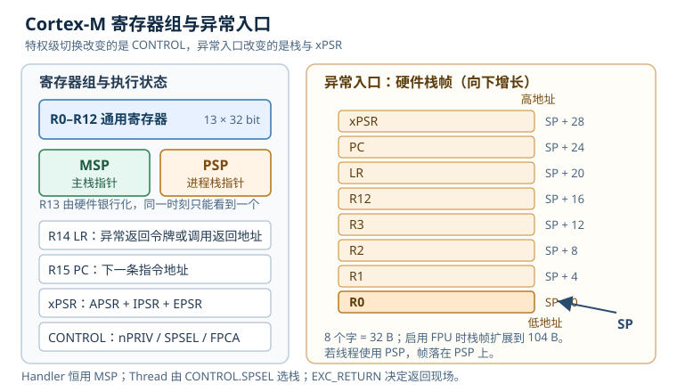

# Cortex-M 内核：寄存器、特权级与异常模型

很多项目把 Cortex-M 当成“能跑 C 代码的单片机”：初始化外设、开中断、进实时操作系统（Real-Time Operating System，RTOS），能点亮灯就算成功。直到某天出现一个随机 HardFault（硬件故障异常），调试器停在 `HardFault_Handler` 的死循环里，调用栈是空的，工程师只能靠猜。另一些项目在 RTOS 下偶发任务踩栈，换大一点的栈就好了，但没人说得清“大多少才够”。这些问题的共同点是：**没有把内核当成一个可以计算的状态机来理解**。

这一篇从软件工程师每天真正会碰到的寄存器、栈和异常入口讲起，把“为什么我的任务栈会被破坏”“为什么中断延迟忽大忽小”“存储器保护单元（Memory Protection Unit，MPU）为什么一开就进 HardFault”变成可以定位、可以复算的问题。文中会把主栈指针（Main Stack Pointer，MSP）和进程栈指针（Process Stack Pointer，PSP）分开讨论；带浮点单元（Floating Point Unit，FPU）的型号还会涉及额外的浮点栈帧。示例以 ARMv7-M 的 Cortex-M3/M4 为主；Cortex-M0+ 没有 PSP 和 BASEPRI 等完整特性，Cortex-M7 的流水线与缓存会在延迟数字上引入额外差异，遇到具体型号仍要以对应手册为准。

## 1. 动机（设计动机）

先看三个现场。

**现场一：HardFault 只留一个死循环。** 产品运行几小时后死机，调试器连上去，PC 停在 `HardFault_Handler`。默认处理函数里只有一个 `while (1)`，没有读取 `SCB->CFSR`，也没有看压栈的 PC。工程师重新烧录、加打印，问题又消失了。实际上，硬件在进异常时已经自动把出错前的 PC、LR、xPSR 和 R0–R3、R12 压到栈上；只要知道当前用的是 MSP 还是 PSP，就能从栈帧里取回出错地址，再对照 map 文件和反汇编定位。**没有读栈帧，等于把硬件已经保存好的证据丢掉了。**

**现场二：任务栈明明够大，还是被踩。** 某任务局部数组 1 KB，任务栈给了 2 KB，看起来余量 1 KB。但异常入口会在这条任务栈上压 32 B，任务里调用的函数还有 200 B 栈帧；如果任务在使用 PSP，异常帧落在 PSP，Handler 自己用的却是 MSP。更隐蔽的是，递归、`printf` 和浮点上下文会把实际占用推高。只按“局部变量大小”估栈，忽略了调用链、异常帧和对齐，余量就是假的。

**现场三：MPU 一开就全线故障。** 为了让任务之间隔离，工程师把 MPU 打开，设置了 Flash 只读、SRAM 可读写，却没有给中断向量表和栈所在区域留下访问权限。结果是第一条取指或第一次压栈就触发 MemManage，系统在启动阶段反复复位。MPU 不是“打开就安全”的开关，它是一组必须和链接脚本、任务布局一起设计的区域规则。

| 你看到的现象 | 先查什么 | 判据（本手册建议值，非标准强制） |
|---|---|---|
| HardFault 地址固定或随机 | CFSR/HFSR、压栈 PC、MSP/PSP | 能还原出错指令与访问地址 |
| RTOS 任务偶发踩栈 | 任务栈高水位、异常帧、FPU 帧 | 最坏占用不超过栈容量的 80% |
| 中断延迟忽大忽小 | 临界区长度、优先级分组、尾链 | 最坏延迟小于控制周期的 10% |
| 权限切换后立即异常 | CONTROL.nPRIV、MPU 区域、SVC（Supervisor Call） | 特权级与区域权限逐项对得上 |
| 函数指针跳飞 | Thumb 位、向量表、链接地址 | 所有代码地址最低位为 1 |

不算清楚会付出什么代价？一个 100 μs 的控制周期，如果临界区关了 10 μs 中断，最坏响应就从几十纳秒变成 10 μs 以上，抖动占周期的 10%；一个 2 KB 的任务栈，如果只留下 300 B 余量，增加一个 104 B 的浮点异常帧就可能踩穿；一次没有使能 UsageFault 的除零，可能被升级成 HardFault，现场只看到“死机”，看不到“除零”。这些都不是靠“再试一次”能解决的。

## 2. 直观（原理图）



### 2.1 十六个可见寄存器与两套栈指针

Cortex-M 的编程模型很紧凑：R0–R12 是通用寄存器，R13 是栈指针（Stack Pointer，SP），R14 是链接寄存器（Link Register，LR），R15 是程序计数器（Program Counter，PC）。此外还有一组特殊寄存器：程序状态寄存器 xPSR、中断屏蔽寄存器 PRIMASK、异常屏蔽寄存器 FAULTMASK、优先级屏蔽寄存器 BASEPRI，以及控制寄存器 CONTROL。

R13 在硬件上有两个物理寄存器：主栈指针（Main Stack Pointer，MSP）和进程栈指针（Process Stack Pointer，PSP）。这不是“两个变量指向同一块内存”，而是两个独立的栈顶指针，由硬件根据当前模式和 CONTROL.SPSEL 选择使用哪一个。复位后默认使用 MSP、处于特权 Thread 模式；进入 Handler 模式后硬件强制使用 MSP。因此 RTOS 的典型分工是：**内核和异常处理用 MSP，用户任务用 PSP**。

R14 在普通函数调用中保存返回地址；在异常入口，硬件会把 R14 改写成一个特殊值——异常返回令牌（EXC_RETURN），异常返回时用它告诉硬件“回到哪个模式、用哪个栈、是否恢复浮点上下文”。这也是为什么在中断服务函数里直接 `return` 能回到被中断的代码：编译器生成的异常返回序列会把 EXC_RETURN 写回 PC，硬件识别这个特殊地址并执行出栈。

### 2.2 模式、特权级与 CONTROL

Cortex-M 有两个执行模式：Thread 模式和 Handler 模式。Thread 模式是普通代码运行的地方，可以是特权级，也可以是非特权级；Handler 模式只用于异常处理，**永远是特权级**。复位后是特权 Thread；通过写 CONTROL.nPRIV 可以降到非特权 Thread；非特权代码不能把自己升回特权，只能通过异常入口（例如系统服务调用（Supervisor Call，SVC））进入 Handler，由 Handler 代为完成需要权限的操作，再在异常返回时回到非特权 Thread。

CONTROL 的三个常见位是：

- `nPRIV`：0 表示 Thread 特权，1 表示 Thread 非特权；
- `SPSEL`：0 表示 Thread 使用 MSP，1 表示 Thread 使用 PSP；
- `FPCA`：浮点上下文活跃标志，只有带浮点单元（Floating Point Unit，FPU）的型号才有。

写 CONTROL 后需要执行指令同步屏障（Instruction Synchronization Barrier，ISB），保证后续指令看到新的特权级和栈选择。典型代码是：

```c
static inline void drop_to_unprivileged(void)
{
    __set_CONTROL(__get_CONTROL() | 1u);  /* CONTROL.nPRIV = 1 */
    __ISB();
}

static inline void use_process_stack(void)
{
    __set_CONTROL(__get_CONTROL() | 2u);  /* CONTROL.SPSEL = 1 */
    __ISB();
}
```

注意：这两段代码只能在特权级执行。非特权任务如果直接写 CONTROL，会触发 UsageFault（若使能）或被忽略，具体行为取决于内核和实现；正确的入口是 SVC。

| 状态 | 使用的栈 | 特权级 | 典型代码 |
|---|---|---|---|
| 复位后的 Thread | MSP | 特权 | 启动文件、内核初始化 |
| Thread + SPSEL=0 | MSP | 可特权可非特权 | 简单裸机主循环 |
| Thread + SPSEL=1 | PSP | 通常非特权 | RTOS 任务 |
| Handler | MSP | 永远特权 | 中断服务程序（ISR）、SVC、PendSV、SysTick |

### 2.3 向量表与异常入口

向量表是一张 32 位地址表。偏移 0 放初始 MSP，偏移 4 放复位处理函数入口，偏移 8 开始依次是 NMI、HardFault、MemManage（存储器管理故障）、BusFault（总线故障）、UsageFault（用法故障）、保留项、SVCall、DebugMonitor、保留项、PendSV、SysTick，之后才是外部中断 IRQ0、IRQ1……。这里的 NMI 是不可屏蔽中断（Non-Maskable Interrupt），其优先级仅次于复位，软件不能用 PRIMASK 把它关掉。用异常号 n 计算向量地址：

$$A_{\text{vector}}(n) = \text{VTOR} + 4n$$

其中 $A_{\text{vector}}$ 是向量地址（字节），$\text{VTOR}$ 是向量表偏移寄存器（Vector Table Offset Register）的值，$n$ 是异常号。VTOR 的低 7 位保留，向量表至少按 128 字节对齐；Bootloader 和应用程序各自有一张表时，就是靠 VTOR 切换。

一次异常入口大致发生这些事：

1. 处理器完成当前指令，或放弃尚未完成的指令；
2. 根据当前使用的是 MSP 还是 PSP，把 R0–R3、R12、LR、PC、xPSR 共 8 个字压栈；
3. 如果栈指针没有 8 字节对齐，硬件插入 4 字节填充，保证异常帧按 8 字节对齐；
4. 把 LR 写成 EXC_RETURN，把 IPSR 设为异常号，切换到 Handler 模式并强制使用 MSP；
5. 从向量表取入口地址，跳到异常处理函数。

如果 Thread 使用 PSP，第 2 步的 8 个字压在 PSP 指向的任务栈上；Handler 随后用 MSP 执行。这一点是理解 RTOS 栈布局的关键：**任务栈里不仅有函数局部变量，还可能有一帧硬件异常上下文；而 Handler 的局部变量和嵌套异常帧在 MSP 上。**

EXC_RETURN 的常见值（不带 FPU 扩展）是：

| EXC_RETURN | 返回目标 | 使用的栈 |
|---|---|---|
| `0xFFFFFFF1` | Handler 模式 | MSP |
| `0xFFFFFFF9` | Thread 模式 | MSP |
| `0xFFFFFFFD` | Thread 模式 | PSP |

当异常嵌套时，内层异常返回到外层 Handler，使用 `0xFFFFFFF1`；返回普通线程时，根据线程使用 MSP 还是 PSP 选择 `0xFFFFFFF9` 或 `0xFFFFFFFD`。如果从异常返回时把 LR 写坏，硬件会触发 INVPC 或 INVSTATE 类故障，最终可能升级为 HardFault。

### 2.4 异常、中断与 NVIC 的分工

在 ARM 术语里，复位、NMI、HardFault、SVCall、PendSV、SysTick 和外部中断都叫异常（Exception）；其中由外设产生的外部异常通常叫中断（Interrupt）。嵌套向量中断控制器（Nested Vectored Interrupt Controller，NVIC）负责使能、挂起、优先级仲裁和向量分发。CPU 只负责在合适的时机接受最高优先级的请求并完成入口/出口。

NVIC 的常用寄存器组包括：使能设置/清除（ISER/ICER）、挂起设置/清除（ISPR/ICPR）、活跃状态（IABR）、优先级（IPR）。在 Cortex 微控制器软件接口标准（Cortex Microcontroller Software Interface Standard，CMSIS）中通常用 `NVIC_EnableIRQ`、`NVIC_SetPendingIRQ`、`NVIC_SetPriority` 访问，不需要自己记地址。要点是：**挂起位是请求的“锁存器”**，即使 CPU 暂时不响应，请求也不会因为外设标志被清掉而消失；优先级数值越小，优先级越高；相同抢占优先级的异常不能互相抢占。

## 3. 定量（静态分析）

### 3.1 寄存器、栈帧与向量表的基本数字

先把最容易算错的几个量列出来。

| 项目 | 数量 | 说明 |
|---|---|---|
| 可见通用寄存器 | 16 个 | R0–R15，其中 R13–R15 有专用含义 |
| 栈指针 | 2 个 | MSP 与 PSP，由硬件银行化 |
| 基本异常栈帧 | 8 个字 = 32 B | R0–R3、R12、LR、PC、xPSR |
| 带浮点上下文的最大栈帧 | 104 B | 8 字基本帧 + 浮点扩展，具体布局按内核手册 |
| Cortex-M3/M4 异常入口 | 典型 12 个周期 | 零等待存储器、无额外等待；含压栈与取向量 |
| 尾链开销 | 典型 6 个周期 | 背靠背异常，不完整出栈再压栈 |
| 典型 MPU 区域数 | 8 个 | 具体型号可能不同 |
| MPU 最小区域 | 32 B | 区域大小必须是 2 的幂，基址按大小对齐 |

向量表大小可以算：如果芯片有 82 个外部中断，加上 16 个系统异常项，一共 98 个表项，每项 4 B，共 392 B；向量表要求 128 B 对齐，所以链接器实际会占用 512 B。这个数会直接影响 Bootloader 预留空间和 MPU 的只读区域划分。

### 3.2 异常延迟

在理想条件下，从 NVIC 接受请求到执行异常处理函数的第一条指令，Cortex-M3/M4 的入口开销典型为 12 个周期。折算成时间：

$$t_{\text{entry}} = \frac{12}{f_{\text{CPU}}}$$

其中 $t_{\text{entry}}$ 是入口时间（s），$f_{\text{CPU}}$ 是内核时钟频率（Hz）。在 168 MHz 下：

$$t_{\text{entry}} = \frac{12}{168 \times 10^{6}} = 71.4 \times 10^{-9}\ \text{s} = 71.4\ \text{ns}$$

但这个 71.4 ns 只是“零等待、无 FPU 上下文、无额外总线阻塞”的硬件下限。实际从引脚变化到 ISR 第一条指令，还要加上：

$$t_{\text{response}} = t_{\text{sync}} + t_{\text{arb}} + t_{\text{entry}} + t_{\text{prologue}}$$

其中 $t_{\text{sync}}$ 是输入同步时间，$t_{\text{arb}}$ 是总线/外设仲裁等待，$t_{\text{prologue}}$ 是编译器为 ISR 保存寄存器、建立栈帧的时间。对一个 168 MHz、Flash 有等待周期的系统，实际“引脚到 ISR”常见在 100–300 ns 量级；如果 ISR 里还有长指令或未命中的缓存，数字会更大。工程上不要拿 71.4 ns 当保证值，要实测。

### 3.3 优先级位数与寄存器编码

ARMv7-M 为每个异常预留 8 位优先级字段，但芯片厂商可以只实现高位的一部分。很多 STM32F4 器件实现 4 位，也就是 16 个优先级等级。CMSIS 用 `__NVIC_PRIO_BITS` 表示实现的位数。若实现 4 位，硬件只比较 IPR 的高 4 位，低 4 位读回为 0；因此把逻辑优先级 $p$ 写入寄存器时，要左移：

$$\text{IPR} = p \ll (8 - \text{PRIO\_BITS})$$

例如 4 位实现，逻辑优先级 5 写入的值是 $5 \ll 4 = 80 = \text{0x50}$，逻辑优先级 10 写入 $\text{0xA0}$。数值越小优先级越高，所以 0x50 可以抢占 0xA0。若直接写 5，硬件看到的是 0x05，高 4 位为 0，实际变成了最高优先级——这是“明明设了低优先级，却抢占了所有中断”的常见原因。

NVIC 还通过应用中断与复位控制寄存器（Application Interrupt and Reset Control Register，AIRCR）中的 PRIGROUP 字段，把已实现的优先级位再分成“抢占优先级”和“子优先级”。只有抢占优先级更高的异常能打断当前 Handler；子优先级只在多个同组异常同时挂起时决定谁先执行，不能抢占。分组一旦确定，所有中断的优先级都要按同一口径编码。

### 3.4 MPU 区域的大小与对齐

Cortex-M 的 MPU 使用基址加大小编码。对大小为 $S$ 字节的区域，要求：

$$S = 2^{N},\qquad \text{base} \bmod S = 0$$

其中 $N$ 是区域大小指数，基址必须按区域大小对齐。RASR 中的 SIZE 字段编码为 $N-1$。例如要保护 64 KB 的 SRAM：

$$N = \log_2(65536) = 16,\qquad \text{SIZE} = 16 - 1 = 15$$

基址必须按 64 KB 对齐，所以 0x20000000 可以，0x20008000 不行。每个区域还可以用 8 个 subregion 位禁用其中的八分之一；一个 64 KB 区域的 subregion 大小是 8 KB。很多“MPU 配好了但一访问就 fault”的问题，根源不是权限位，而是基址没有按大小对齐，或者区域大小写成了“结束地址减基址”。

MPU 的访问权限（AP）和执行禁止（XN）要一起看：Flash 通常设为只读、可执行；SRAM 设为可读写、不可执行；任务私有数据区设为仅该任务可访问；外设区按需要设为特权可访问。启用 MPU 时还要决定是否打开背景区域（PRIVDEFENA）：打开后特权代码可以访问未被区域覆盖的默认地址空间，非特权代码仍然只能访问显式允许的区域。这个位能减少启动阶段的故障，但也可能让内核意外获得过多权限，必须和你的隔离目标一起权衡。

### 3.5 栈预算

一个任务的最坏栈占用可以写成：

$$S_{\text{task}} = S_{\text{call}} + S_{\text{local}} + S_{\text{exc}} + S_{\text{align}} + S_{\text{margin}}$$

其中 $S_{\text{call}}$ 是调用链返回地址和保存寄存器，$S_{\text{local}}$ 是局部变量与临时对象，$S_{\text{exc}}$ 是可能压在该任务栈上的异常帧，$S_{\text{align}}$ 是对齐填充，$S_{\text{margin}}$ 是安全余量。基本异常帧是 32 B；如果任务运行时可能被浮点异常打断，且需要保存浮点上下文，则要按 104 B 预留。注意：只有在线程使用 PSP 时，异常帧才压在该任务的 PSP 栈上；嵌套 Handler 的帧在 MSP 上。

## 4. 算例（动态分析）

### 4.1 从复位向量到第一条指令

假设链接脚本给出：

- 初始 MSP 符号 `_estack = 0x20020000`；
- 复位处理函数 `Reset_Handler` 的链接地址是 `0x08000100`，Thumb 地址为 `0x08000101`；
- 向量表放在 Flash 起始地址 `0x08000000`。

复位时硬件做两件事：

1. 从 `0x08000000` 取第一个字 `0x20020000`，装入 MSP；
2. 从 `0x08000004` 取第二个字 `0x08000101`，装入 PC，同时把 EPSR.T 置 1，表示进入 Thumb 状态。

于是 MSP 初始值为 0x20020000，PC 为 0x08000100（最低位是状态位，不参与取指地址），处理器从 `Reset_Handler` 的第一条指令开始执行。复位后 CONTROL=0，表示特权 Thread、使用 MSP；此时还没有任何任务，也没有 PSP 上下文。

如果链接脚本把 `_estack` 放在 SRAM 中间，或者忘了给栈预留空间，第一次压栈就可能覆盖 `.data`。一个可检查的启动代码骨架是：

```c
extern uint32_t _estack;
extern uint32_t _sidata, _sdata, _edata, _sbss, _ebss;

void Reset_Handler(void);
void Default_Handler(void);

__attribute__((section(".isr_vector"), used))
const uintptr_t g_vectors[] = {
    (uintptr_t)&_estack,          /* 初始 MSP */
    (uintptr_t)Reset_Handler,     /* 复位 */
    (uintptr_t)Default_Handler,   /* NMI */
    (uintptr_t)Default_Handler,   /* HardFault */
    /* 其余系统异常与 IRQ 同理 */
};
```

这段代码本身不初始化 `.data`/`.bss`，也不配置时钟；它只说明向量表前两项的语义。真正的启动文件还要在 `Reset_Handler` 里复制 `.data`、清零 `.bss`、调用 `SystemInit` 和 `main`。如果使用 C 库启动文件，检查 `_estack` 是否等于 SRAM 末端，并确认它按 8 字节对齐，是最低成本的启动自检。

### 4.2 从 PSP 栈帧里取回出错 PC

假设某个任务正在运行，使用 PSP，异常发生前 PSP = 0x2001FFC8。异常入口压入 8 个字（32 B），PSP 变为：

$$0x2001FFC8 - 32 = 0x2001FFA8$$

栈帧从低地址到高地址依次是 R0、R1、R2、R3、R12、LR、PC、xPSR。因此：

- R0 在 0x2001FFA8；
- R1 在 0x2001FFAC；
- R2 在 0x2001FFB0；
- R3 在 0x2001FFB4；
- R12 在 0x2001FFB8；
- LR 在 0x2001FFBC；
- PC 在 0x2001FFC0；
- xPSR 在 0x2001FFC4。

如果从 0x2001FFC0 读到 0x08001ABC，说明异常返回地址是 0x08001ABC；若最低位为 1（例如 0x08001ABD），去掉最低位后代码地址是 0x08001ABC。最低位是 Thumb 状态位，不参与取指地址。把这个地址减去 Flash 起始地址得到偏移，再查 map 文件或反汇编，就能定位到具体函数。若当前是 Handler 模式，或者 EXC_RETURN 的 bit 2 为 0，则异常帧在 MSP 上，不能用 PSP 去读。

这个算例还说明：**栈帧的地址取决于异常发生前的 SP，而不是异常处理函数里的 SP**。在 Handler 里读 `__get_PSP()` 只能拿到任务栈指针的当前值；如果异常入口已经压栈，它指向的是压栈后的位置。先判断 EXC_RETURN，再选 MSP/PSP，再按偏移读，顺序不能反。

### 4.3 RTOS 的 1 ms 节拍与上下文切换

假设内核 168 MHz，SysTick 每 1 ms 产生一次中断。SysTick 是 24 位递减计数器，重装值计算为：

$$\text{LOAD} = \frac{f_{\text{CPU}}}{f_{\text{tick}}} - 1 = \frac{168 \times 10^{6}}{1000} - 1 = 167999$$

写入 167999 后，计数器从 167999 递减到 0 共 168000 个周期，正好 1 ms。24 位最大重装值是 16777215，对应最长周期：

$$T_{\max} = \frac{16777216}{168 \times 10^{6}} = 99.86\ \text{ms}$$

所以 1 ms 节拍远在范围内；如果想用 SysTick 做更长延时，必须软件分频，不能直接写超过 24 位的值。

上下文切换通常分两段：SysTick 只负责把 PendSV 挂起，PendSV 在最低优先级执行真正的保存/恢复。这样做的原因是：SysTick 可能在高优先级中断期间到来，如果直接在 SysTick 里切换任务，会拉长高优先级中断的延迟；PendSV 可以等到所有高优先级工作完成后再切换。切换时，硬件已经保存了 R0–R3、R12、LR、PC、xPSR，软件只需要保存 R4–R11（以及必要时的 FPU 寄存器），再把 PSP 存进任务控制块。Cortex-M 的异常入口不会自动保存 R4–R11，这是软件上下文切换必须补上的部分。

### 4.4 优先级与抢占的计算

设 4 位优先级实现，逻辑优先级 5 和 10 的两个中断同时挂起。写入 IPR 的值分别是 0x50 和 0xA0。NVIC 比较高 4 位，0x5 < 0xA，所以优先级 5 先执行；如果优先级 10 的 ISR 正在运行，优先级 5 的请求可以抢占它；反过来不可以。

如果两个中断都设成优先级 5，它们不能互相抢占。假设一个优先级 5 的通信 ISR 正在执行，耗时 2 ms；另一个同样优先级 5 的 100 μs 控制中断到来，它必须等这 2 ms 的 ISR 结束。控制周期如果是 200 μs，这就已经错过了 10 个周期。**相同优先级不是“平等”，而是“互相阻塞”**；实时系统里要把最坏阻塞时间算进 deadline。

### 4.5 环路与稳定性：中断响应闭环

这里的“环路”不是放大器反馈，而是“事件发生 → 中断响应 → 计算 → 执行 → 下一次事件”的控制闭环。它的稳定性取决于最坏响应时间 $R$ 是否小于截止时间 $D$：

$$R = t_{\text{detect}} + t_{\text{entry}} + t_{\text{ISR}} + t_{\text{output}} \leq D$$

其中 $t_{\text{detect}}$ 是外设检测与同步时间，$t_{\text{entry}}$ 是异常入口，$t_{\text{ISR}}$ 是服务程序执行时间，$t_{\text{output}}$ 是写外设到引脚真正变化的时间。只要 $R$ 超过 $D$，闭环就丢拍；如果 $R$ 随负载波动，抖动会直接进入控制量。

例如控制周期 100 μs，ISR 执行 420 个周期，168 MHz 下是 2.5 μs；异常入口和输出延迟合计约 0.2 μs；那么 $R \approx 2.7\ \mu\text{s}$，占周期 2.7%，看起来余量很大。但若有 10 μs 的临界区关中断，$R$ 变成 12.7 μs，占 12.7%，超过“最坏延迟小于周期 10%”的建议线。解决办法不是把 ISR 写得更快，而是缩短临界区、把长处理搬到 PendSV 或任务上下文，或者提高关键中断的抢占优先级。

优先级的“稳定性”还包括避免优先级反转：低优先级任务持有互斥量，高优先级任务等它，中优先级任务又抢占了低优先级任务，导致高优先级任务被无限期推迟。RTOS 的优先级继承或优先级天花板就是为这个闭环补稳定性。裸机系统没有互斥量，但有关中断临界区，同样要把最长关中断时间当作阻塞时间。

## 5. 工程含义（取值与权衡）

### 5.1 MSP/PSP 的划分

| 方案 | 优点 | 代价 | 适用 |
|---|---|---|---|
| 全部用 MSP | 简单，启动快 | 任务与内核共享栈，隔离差 | 裸机、单任务 |
| 任务用 PSP，Handler 用 MSP | 任务栈可独立计量，配合 MPU 隔离 | 启动时要切 CONTROL，异常入口多一次栈选择 | RTOS、需要隔离 |
| 任务用 PSP + 非特权 | 内核资源受 MPU 保护 | 系统调用要走 SVC，调试更复杂 | 安全关键、任务隔离 |
| 只用 MSP（M0+） | 硬件简单 | 没有 PSP 银行，任务切换要手动搬栈 | Cortex-M0/M0+ |

MSP 要容纳所有 Handler 的嵌套栈帧、ISR 局部变量和可能的中断嵌套。假设最深 4 层 Handler，每层栈帧加局部变量 160 B，加上启动阶段和错误处理的余量，MSP 至少给 2–4 KB。任务 PSP 则按任务的最坏调用链加异常帧计算，再留 20% 余量；不要把所有任务的栈都设成同一个大小，I/O 任务和浮点运算任务的栈需求可能差一个数量级。

### 5.2 MPU 的工程取舍

MPU 能阻止野指针写坏内核数据，但它不是免费的：

- 每个区域要占一个区域描述符，区域数有限；任务多时要在上下文切换时重配区域。
- 区域大小必须是 2 的幂且基址对齐，内存布局要围绕这个约束设计。
- 非特权任务访问外设需要额外的“外设窗口”区域，否则所有寄存器访问都会 fault。
- MPU 故障处理本身需要栈和代码，必须保证故障处理路径可执行。

一个常见的折中是：内核、中断向量、MSP 放在特权可读写、非特权不可访问的区域；任务代码放在只读可执行区域；每个任务的私有数据放在独立区域；外设寄存器只给特权代码访问，非特权任务通过 SVC 使用驱动接口。这样既能隔离任务，又不需要给每个任务开放全部外设。

### 5.3 NVIC 与实时性

优先级分配要围绕 deadline，而不是围绕“哪个中断听起来重要”。建议：

- 最紧急的故障和保护中断给最高抢占优先级；
- 控制环中断次之；
- 通信、显示、日志等可以延后的工作放到低优先级或任务上下文；
- PendSV 设为最低优先级，专门做上下文切换；
- 相同优先级的 ISR 总执行时间要按“互相阻塞”计算。

临界区要短。关中断 10 μs 在 168 MHz 下是 1680 个周期，足够执行很多指令；如果控制周期是 100 μs，这 10 μs 就是 10% 的抖动。能用 BASEPRI 只屏蔽低于某阈值的中断，就不要用 PRIMASK 关掉所有中断；但 BASEPRI 需要芯片支持，M0+ 没有。

### 5.4 指令集与 Thumb-2

Cortex-M 只执行 Thumb 指令，不支持 ARM 状态。Thumb-2 指令集（Thumb-2 instruction set）把 16 位和 32 位编码混合在一起：常用的简单操作保持 16 位以节省代码空间，复杂操作使用 32 位以获得更强的寻址和数据处理能力。函数指针、向量表和 `BX`/`BLX` 目标地址的最低位必须为 1，表示 Thumb 状态；如果链接器或手写汇编把最低位清零，跳转就会触发 INVSTATE，最终可能变成 HardFault。

Thumb-2 的条件执行通过条件执行块（If-Then，IT）实现，最多可以条件执行 4 条指令。编译器通常会自动生成 IT 块，手写汇编时要注意 IT 块内的指令数和条件一致性。Cortex-M4 还提供 DSP 指令和可选的单精度 FPU；使用 FPU 时，异常入口的浮点上下文、惰性压栈和 CONTROL.FPCA 都会影响栈预算和延迟，不能把 M4F 当成“多了一个浮点库”那么简单。

### 5.5 完整设计示例（算例）

需求：128 KB SRAM，两个任务，1 ms 节拍，任务使用 PSP，内核使用 MSP；开启 MemManage/BusFault/UsageFault；用 MPU 保护内核数据。

资源分配：

- MSP：4 KB，放在 SRAM 高端；
- 任务 A：2 KB PSP；
- 任务 B：4 KB PSP（有浮点运算）；
- 堆：8 KB；
- 全局数据：20 KB；
- 其余作为自由内存和栈余量。

配置步骤：

1. 链接脚本把 `_estack` 放在 SRAM 末端，按 8 字节对齐；为 MSP 预留 4 KB，链接器检查 `.data + .bss + heap + 任务栈` 不超过剩余空间。
2. 启动时设置 VTOR、使能 fault 处理、配置 MPU 的内核区域和任务区域。
3. SysTick 配置 1 ms，PendSV 设为最低优先级，SVC 设为较高优先级。
4. 第一个任务启动前，把 PSP 指向任务栈顶，写 CONTROL.SPSEL=1；如果需要隔离，再写 nPRIV=1。
5. 在 SVC 中完成“需要特权”的初始化，然后异常返回到非特权任务。

关键代码骨架：

```c
#define PRIO_BITS 4u

void kernel_init(void)
{
    SCB->VTOR = (uint32_t)g_vectors;             /* 表按 128 B 对齐 */
    SCB->SHCSR |= SCB_SHCSR_MEMFAULTENA_Msk
               |  SCB_SHCSR_BUSFAULTENA_Msk
               |  SCB_SHCSR_USGFAULTENA_Msk;

    NVIC_SetPriority(SVCall_IRQn, 0);
    NVIC_SetPriority(SysTick_IRQn, 14);
    NVIC_SetPriority(PendSV_IRQn, 15);           /* 最低，延后切换 */

    SysTick->LOAD = 168000u - 1u;
    SysTick->VAL  = 0u;
    SysTick->CTRL = 7u;                          /* 内核时钟、开中断、启动 */
}

void start_first_task(uint32_t *psp_top)
{
    __set_PSP((uint32_t)psp_top);
    __set_CONTROL(__get_CONTROL() | 2u);         /* 使用 PSP */
    __ISB();
    /* 之后通过 SVC 或异常返回进入任务 */
}
```

MPU 的 64 KB SRAM 区域可以这样描述（仅示意字段，完整属性按芯片手册）：

```c
MPU->RNR  = 0;
MPU->RBAR = 0x20000000u;                         /* 64 KB 对齐 */
MPU->RASR = (1u << 28)                           /* XN：不可执行 */
          | (3u << 24)                           /* AP：特权/非特权读写 */
          | (15u << 1)                           /* SIZE：2^(15+1)=64 KB */
          | 1u;                                  /* 使能 */
MPU->CTRL = 1u | (1u << 2);                      /* ENABLE | PRIVDEFENA */
__DSB();
__ISB();
```

验证清单：

| 检查项 | 预期 |
|---|---|
| `_estack` 地址 | 等于 SRAM 末端，8 字节对齐 |
| 向量表地址 | 128 字节对齐，VTOR 指向它 |
| 任务 PSP 初值 | 指向任务栈顶，8 字节对齐 |
| 最深 Handler 嵌套 | MSP 高水位低于 80% |
| 任务栈高水位 | 每个任务低于 80%，浮点任务按 104 B 帧预留 |
| 故障注入 | 除零/非法地址能进对应 fault，CFSR 有标志 |

### 5.6 仿真与实验（测量）

**测异常延迟。** 在中断服务程序（Interrupt Service Routine，ISR）的第一条语句翻转一个 GPIO，用逻辑分析仪同时看触发源和 GPIO。测量值包含 GPIO 翻转本身的时间，所以要在同样条件下再测一次“空 ISR 只有翻转”的基线，两者相减得到软件开销。更精确的方法是用数据观察点与跟踪（Data Watchpoint and Trace，DWT）周期计数器：

```c
CoreDebug->DEMCR |= CoreDebug_DEMCR_TRCENA_Msk;
DWT->CYCCNT = 0;
DWT->CTRL |= DWT_CTRL_CYCCNTENA_Msk;
uint32_t t0 = DWT->CYCCNT;
/* 触发中断，进入 ISR 后读取 t1 */
uint32_t cycles = DWT->CYCCNT - t0;
```

DWT 在 Cortex-M3/M4 上通常可用，M0+ 不一定有；使用前查芯片手册。测量时要把中断请求到读取计数器之间的所有路径考虑进去，不能把调试器断点当作实时测量。

**测栈高水位。** 启动时把任务栈填成 0xA5A5A5A5，运行最坏场景后从栈底向栈顶扫描，找到最后一个被改写的字，计算“已用 = 栈顶 - 最后一个未改写地址”。这个方法能发现大部分栈溢出，但不能发现“刚好写到边界外”的破坏；配合 MPU guard 区域或栈哨兵值更可靠。

**注入故障。** 打开 UsageFault 后执行除零，检查 `SCB->CFSR` 的 DIVBYZERO 位；访问非法地址，检查 BusFault 的 PRECISERR 和 BFAR；故意让 MPU 拒绝一次访问，检查 MemManage 的 DACCVIOL。每次注入只改一个变量，记录 CFSR、HFSR、BFAR/MMFAR 和压栈 PC，形成可复现的故障样本。

## 6. 常见坑（现象 → 原因 → 解决）

::: pitfall 坑一：以为写 MSP 就能切换任务栈
- **现象**：RTOS 切换后第一个任务能跑，第二个任务一运行就 HardFault，或者任务之间互相踩数据。
- **原因**：Handler 模式强制使用 MSP，任务在 Thread 模式使用 PSP；只在 Handler 里改 MSP，不会改变任务实际使用的栈，异常帧仍然压在旧 PSP 上。
- **解决**：任务切换时保存/恢复 PSP，Thread 模式通过 CONTROL.SPSEL=1 使用 PSP；Handler 的局部变量留在 MSP。用调试器同时观察 MSP 和 PSP，确认两者指向不同区域。
:::

::: pitfall 坑二：HardFault 处理函数只有死循环
- **现象**：现场死机，调试器停在 HardFault，无法判断是数组越界、空指针还是栈溢出。
- **原因**：没有读 CFSR/HFSR，也没有从 MSP/PSP 栈帧取 PC；默认处理函数把现场覆盖了。
- **解决**：在 HardFault 入口先保存 CFSR、HFSR、BFAR、MMFAR 和栈帧指针，再根据 EXC_RETURN 选择 MSP/PSP，读出压栈 PC 和 LR。把故障信息写入保留 RAM 或通过调试口输出，复位后仍可分析。
:::

::: pitfall 坑三：所有中断同一优先级
- **现象**：控制中断偶尔延迟几百微秒，电机出现抖动；通信量一大，控制环就丢拍。
- **原因**：相同抢占优先级不能互相抢占，低优先级的长 ISR 会把高优先级请求挡到结束；或者优先级字段没有左移，实际都变成了最高优先级。
- **解决**：按 deadline 分配抢占优先级，PendSV 设为最低；检查 `__NVIC_PRIO_BITS`，用 CMSIS 的 `NVIC_SetPriority` 而不是手写未移位的值；把长处理移出 ISR。
:::

::: pitfall 坑四：MPU 区域没有按大小对齐
- **现象**：MPU 使能后第一次访问 SRAM 就 MemManage，或者区域权限看起来生效、实际却保护了错误的地址范围。
- **原因**：RASR 的 SIZE 字段编码的是 $N-1$，基址必须按 $2^N$ 对齐；把“结束地址减基址”直接写进 SIZE，或基址没有对齐，都会得到意料之外的区域。
- **解决**：先用公式算 $N$ 和 SIZE，再检查 `base % size == 0`；用调试器读回 RBAR/RASR，确认硬件实际看到的区域；先只开一个区域验证，再逐步增加。
:::

## 7. 自测题（推导）

<details><summary>题一：为什么复位时 MSP 从向量表第 0 项加载，而不是由复位处理函数自己设置？</summary>

复位是异常入口的一种。硬件在取第一条指令之前就需要一个可用的栈来保存状态，因此向量表第 0 项必须是初始 MSP，第 1 项才是复位处理函数入口。硬件先加载 MSP，再加载 PC 并置 Thumb 位，然后才开始执行 `Reset_Handler`。如果第 0 项是 0 或未对齐，第一次压栈就会出错。软件当然可以在复位处理函数里再改 MSP，但那是“已经有了一个合法初始栈”之后的事。

</details>

<details><summary>题二：任务使用 PSP，异常发生前 PSP=0x2001FFC8，如何计算压栈 PC 的地址？</summary>

异常入口压入 8 个字，共 $8 \times 4 = 32$ B，栈向下增长，所以新的 SP 是 $0x2001FFC8 - 32 = 0x2001FFA8$。栈帧从低到高是 R0、R1、R2、R3、R12、LR、PC、xPSR；PC 是第 7 个字，偏移 $6 \times 4 = 24 = 0x18$。因此 PC 地址是 $0x2001FFA8 + 0x18 = 0x2001FFC0$。前提是异常发生前线程确实使用 PSP；若 EXC_RETURN 的 bit 2 为 0，则帧在 MSP 上。

</details>

<details><summary>题三：168 MHz、零等待、12 周期入口，异常延迟是多少？如果 Flash 每次取指多 5 个等待周期，如何估算？</summary>

零等待时 $t = 12 / (168 \times 10^6) = 71.4 \times 10^{-9}$ s，即 71.4 ns。若每次取指多 5 个等待周期，入口路径中假设有 3 次取指/向量读取受影响，则额外 $3 \times 5 = 15$ 个周期，总周期约 27，时间约 $27 / (168 \times 10^6) = 160.7 \times 10^{-9}$ s，即 160.7 ns。这个估算只用于量级判断；实际还受 Flash 预取、缓存、总线仲裁和 ISR 序言影响，必须实测。不要把“12 周期”当成有等待周期系统的保证值。

</details>

<details><summary>题四：要实现 64 KB 的 MPU 区域，SIZE 字段是多少？基址有什么要求？</summary>

区域大小 $S = 64\ \text{KB} = 65536 = 2^{16}$，所以 $N = 16$，SIZE 字段为 $N - 1 = 15$。基址必须按 64 KB 对齐，即 `base % 65536 == 0`；0x20000000 可以，0x20008000 不可以。若用 8 个 subregion，每个 subregion 是 $65536 / 8 = 8192$ B。

</details>

## 8. 参考资料（文档号）

- ARM, *ARMv7-M Architecture Reference Manual*, ARM DDI 0403E：§B1.4 寄存器模型、§B1.5 异常模型、§B3 Thumb 指令集。
- ARM, *Cortex-M4 Devices Generic User Guide*, ARM DUI 0553A：Chapter 2 The Cortex-M4 Processor 的编程模型与异常模型，Chapter 4 NVIC 的异常入口与优先级。
- Joseph Yiu, *The Definitive Guide to Arm Cortex-M3 and Cortex-M4 Processors*, 3rd Edition, Newnes, 2014：Chapters 2、4、7、11、12，关于寄存器、异常、NVIC、MPU 与故障处理的讨论。
