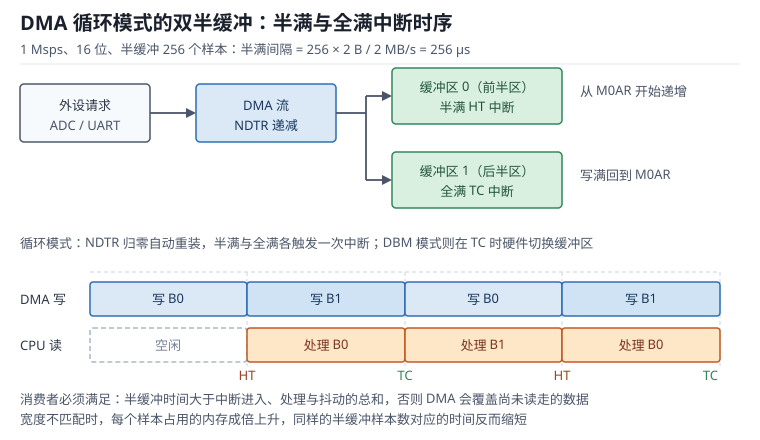

# DMA：通道映射、双缓冲与带宽

**DMA（Direct Memory Access，直接存储器访问）**让数据在外设与存储器之间直接搬运，不经过 CPU 的取指-执行通路。对 1 Msps 的 ADC、48 kHz 的音频、几十兆字节每秒的图像接口，DMA 不是"优化项"而是"能不能跑起来"的前提：1 Msps 采样如果每个样本都进一次中断，光中断开销就能吃掉一半 CPU。

但 DMA 也是最容易"静默失败"的外设：传输宽度配错，数据会错位但不报错；通道映射错，NDTR 一动不动；半缓冲处理慢了，新数据会覆盖还没读走的旧数据；Cortex-M7 上忘了清 Cache，CPU 读到的是旧值而 DMA 已经把新数据写进内存。本章按"通路怎么建（通道与请求映射）→ 一次搬多少（宽度与对齐）→ 怎么持续搬（循环与双缓冲）→ 多快算够（带宽与 Cache）"的顺序展开，并把丢包的每一类原因落到可检查的寄存器与时间数字上。

总线的整体结构与中断响应见[中断与 NVIC](interrupt-nvic.md)；定时器触发 ADC 再经 DMA 搬运，是电流环的标准链路，见[定时器与 PWM](timer-pwm.md)。

## 1. 动机：DMA 省下的不是"几次中断"

::: motivation 四个现场
**现场一：1 Msps ADC 用中断搬。** 每个样本进一次中断，ISR 里读 DR 再写缓冲。按每次中断 24 周期进入/返回加 10 周期处理共 34 周期算，1 MHz 中断率需要 $34\times10^{6}$ 周期/s，在 168 MHz 上是 20%；但 1 µs 一个样本，ISR 只要超过 1 µs 就必然丢样本，实际系统在 60% 占用时就崩了。改成 DMA 后 CPU 占用接近 0。

**现场二：ADC 12 位、缓冲定义成 `uint32_t`。** 每个样本占 4 字节，DMA 按 32 位搬，1 Msps 时内存写入带宽翻倍到 4 MB/s，半缓冲区能放的样本数减半，原本 256 µs 的半满间隔变成 128 µs，中断来不及处理。

**现场三：双缓冲半满中断里做浮点滤波。** 半缓冲 256 个样本、1 Msps，256 µs 必须取走；滤波加开方用了 300 µs，下一次半满时旧数据已被覆盖，波形上出现周期性的"跳变块"。**这不是 DMA 丢包，是消费者追不上生产者。**

**现场四：Cortex-M7 上 DMA 发 SPI，逻辑分析仪看到旧数据。** CPU 先填好发送缓冲区，启动 DMA；缓冲区还在 D-Cache 的脏行里，DMA 直接从内存读到上一帧的内容。加一句 clean 操作就正常了。
:::

| 你想确认 | 先算 | 判据（工程经验值，非标准强制） |
|---|---|---|
| 有效带宽 | $B=W\times R$ | 小于总线峰值的 30% |
| 半缓冲时间 | $t=N_{half}W/B$ | 大于 ISR 最坏处理时间 2 倍 |
| 缓冲区大小 | $2\times t_{half}\times B$ | 至少覆盖两次调度抖动 |
| 对齐 | 地址整除宽度 | 32 位传输必须 4 字节对齐 |
| Cache 维护范围 | $\lceil L/32\rceil$ 行 | 缓冲区按 32 字节对齐且长度为整数倍 |
| 通道映射 | 查请求映射表 | 外设与 stream/channel 一一对应 |

**不算会摔在哪**，四个带数字的代价：

1. **带宽算错。** 640×480、16 位、30 fps 的图像是 18.43 MB/s，加上 ADC 2 MB/s、SPI 1.25 MB/s，总 21.7 MB/s；看起来只占 336 MB/s 的 6.5%，但突发集中时会瞬间打满总线，CPU 取指被饿死。
2. **半缓冲太短。** 1 Msps、半缓冲 128 个样本只有 128 µs，任何一次长中断都会导致覆盖。
3. **宽度不匹配。** 8 位数据搬进 32 位数组，内存占用与写带宽都变成 4 倍，缓冲容量缩水 4 倍。
4. **Cache 未维护。** 1000 字节缓冲区对应 32 个 cache line，漏掉一次 invalidate，CPU 读到的整块都是旧数据，而 DMA 侧完全正常，排查时极易误判为"外设没发"。

## 2. 直观：数据不经过 CPU 的一条通路

### 2.1 原理图：总线矩阵、DMA 与外设请求

DMA 控制器是一个**总线主设备（Bus Master）**，它和 CPU 一样挂在总线矩阵（Bus Matrix）上，能主动发起读写。区别在于它没有指令流，只按配置好的地址、宽度、数量重复搬运。一次完整的链路是：外设产生请求 → DMA 仲裁（Arbitration）→ 读外设数据寄存器 → 写存储器（或反向）→ NDTR 减一 → 减到 0 时产生传输完成事件。

上图画的是最常用的循环模式：DMA 把同一个缓冲区当作两个半区轮流填，半满（HT）与全满（TC）各触发一次中断，CPU 在 DMA 写另一半时处理刚填满的那一半。只要 CPU 的处理时间短于半个缓冲区的填充时间，数据就不会被覆盖。

链路上的四个角色必须都对上，缺一个就是"没有传输"：

- **请求源**：外设的 DMA 请求位（例如 USART_CR3.DMAT、ADC_CR2.DMA）。请求没开，DMA 使能了也不会动。
- **通道/流**：请求必须映射到正确的 stream 与 channel。F1 系列是固定通道映射，F4 系列是"流 + 通道选择"两级映射。
- **地址与宽度**：外设地址、存储器地址、各自的自增模式、传输宽度。
- **数量**：NDTR 初值，每传一个数据减一，减到 0 触发 TC。

### 2.2 通道与请求映射：谁触发谁

DMA 控制器通常有若干**流（Stream）**，每个流有若干可选**通道（Channel）**。以 F4 为例：DMA1 与 DMA2 各 8 个流，每个流可用 CHSEL 选择 8 个通道之一，共 16 个流、128 个可选请求。同一时刻一个流只能服务一个请求，但多个流可以并行。

| 外设请求 | F4 的流/通道 | F1 的通道 |
|---|---|---|
| USART1_RX | DMA2 Stream2 / CH4 | DMA1 Channel5 |
| USART1_TX | DMA2 Stream7 / CH4 | DMA1 Channel4 |
| SPI1_RX | DMA2 Stream0 / CH3 | DMA1 Channel2 |
| SPI1_TX | DMA2 Stream3 / CH3 | DMA1 Channel3 |
| ADC1 | DMA2 Stream0 / CH0 | DMA1 Channel1 |
| I2C1_RX | DMA1 Stream0 / CH1 | DMA1 Channel7 |

映射错的表现非常一致：流使能了、外设请求也开了，但 NDTR 永远是初值。因为请求线接到的是另一个流，当前流在等一个永远不会来的请求。

### 2.3 传输宽度、对齐与地址增量

DMA 的三组宽度必须匹配或刻意错开：外设数据宽度（PSIZE）、存储器数据宽度（MSIZE）、以及外设寄存器的实际位宽。

- **宽度相同**是最省带宽的配置。16 位 ADC → 16 位数组，每个样本 2 字节，内存不浪费。
- **宽度不同**时，DMA 不做"打包"。8 位外设配 32 位存储器，每个字节会被写进一个 32 位字（高位补零），地址按 4 递增。数据能用，但内存占用和写带宽都变成 4 倍。带 FIFO 的器件可以先把 4 个字节攒进 FIFO 再一次性写出，这才恢复效率。
- **对齐是硬约束**。32 位传输要求地址是 4 的倍数，16 位要求 2 的倍数；不对齐会触发传输错误（TEIF），流被硬件自动关闭。

自增模式也有讲究：外设侧访问的是固定数据寄存器，必须 `PINC=0`；存储器侧连续写数组，必须 `MINC=1`。两者配反，前一种会读到一片无关寄存器，后一种会把同一个地址覆盖 65535 次。

### 2.4 循环模式与双缓冲

**循环模式（Circular Mode）**在 NDTR 减到 0 时自动重装初值，DMA 接着从缓冲区头部再写一遍，软件完全不用干预。它适合"永远在采、按半区消费"的流式数据。

**双缓冲（Double Buffer Mode，DBM）**是另一套机制：硬件持有两个存储器地址（M0AR、M1AR），传输完成时自动切换，同时把当前缓冲区编号写进控制寄存器的 CT 位。软件可以在 DMA 使用 B1 时重装 B0，实现"零拷贝切换"。

两者的区别值得记牢：循环模式是"一个缓冲区转圈"，靠 HT/TC 两个事件把缓冲区切成两半；DBM 是"两个缓冲区乒乓"，靠 TC 切换。循环模式简单，但半区大小固定、切换点固定；DBM 灵活，软件必须在切换后的半个周期内重装另一块，否则下一轮会覆盖正在处理的数据。

## 3. 定量：带宽、对齐与 Cache 的代价

这一节按"配置空间（静态）→ 传输时序（动态）→ 回环与追赶（环路）→ 参数边界（权衡）"四层展开。

### 3.1 静态分析：通道映射表与地址约束

静态检查就是"不运行时看配置能不能成立"。六组约束必须同时满足：

| 约束 | 检查内容 | 违反后果 |
|---|---|---|
| 请求映射 | 外设请求 → stream/channel | NDTR 不动，无传输 |
| 地址对齐 | PAR/M0AR 整除传输宽度 | TEIF，流自动关闭 |
| 自增模式 | 外设固定、存储器递增 | 数据错位或覆盖同一地址 |
| 数量范围 | NDTR 不超过 65535 | 单次传输被截断 |
| 方向 | DIR 与外设收发一致 | 读出全 0 或写不进去 |
| 优先级 | 高带宽流给高优先级 | 低优先级流被饿死 |

**单次传输上限**由 16 位 NDTR 决定：

$$S_{max}=65535\times W$$

32 位传输时单次最多 262140 B；超过就必须分段，或者用循环模式连续搬运。这也是大块图像传输必须用"行缓冲 + 多次启动"的原因。

**缓冲区对齐**要同时满足宽度与 Cache 行两重要求。以 32 位传输、32 字节 cache line 为例，缓冲区起始地址应是 32 的倍数，长度应是 4 的倍数；如果要做 cache 维护，长度还要向上对齐到 32 的倍数。

### 3.2 动态分析：一次传输的时序与总线占用

带宽的基本式只有一条：

$$B=W\times R$$

$B$ 是有效带宽（B/s）；$W$ 是每次传输的字节数（1、2、4）；$R$ 是每秒传输次数。ADC 12 位按 16 位存，1 Msps：

$$B=2\ \text{B}\times10^{6}=2\ \text{MB/s}$$

但总线上的流量是有效带宽的两倍，因为每个数据要一读一写：

$$B_{bus}\approx2B=4\ \text{MB/s}$$

总线单向峰值由总线位宽与频率决定：

$$B_{peak}=f_{AHB}\times W_{bus}=168\times10^{6}\times4=672\ \text{MB/s}$$

复制类负载的有效载荷上限是峰值的一半（一读一写）：

$$B_{copy,max}=\frac{B_{peak}}{2}=336\ \text{MB/s}$$

工程上还要打三到五折：仲裁开销、SRAM 分 bank 冲突、CPU 取指与其它主设备争用。可靠的设计值取 30%~50%，即 100~170 MB/s。

单次传输的时序是"请求 → 仲裁 → 读 → 写"。32 位传输至少占 2 个 AHB 周期，突发（Burst）把多次传输压在一起，减少仲裁与地址开销：4 拍突发理论上把每拍的额外开销摊薄到 1/4。FIFO 阈值与突发长度要匹配，比如 FIFO 阈值设为 1/2（2 个字）、突发 4 拍时，DMA 会等 FIFO 攒够再发，减少总线切换次数。

中断延迟也要计入。TC 中断的进入延迟按 12 周期加等待周期算（见[中断与 NVIC](interrupt-nvic.md)），在 168 MHz 上约 100~200 ns；相对半缓冲的几百微秒可以忽略，但如果是 1 µs 级的半缓冲（超高采样率），就必须用双缓冲或把半区做大。

### 3.3 环路稳定性：循环缓冲的回环与指针追赶

循环模式没有流控：DMA 只负责按速率写，写得比读得快就覆盖。这不是"偶发丢包"，而是结构性的追赶问题。设生产者速率 $R_p$、消费者速率 $R_c$，稳态不覆盖的条件是：

$$R_c\ge R_p$$

瞬态不覆盖还要加一条，半缓冲时间必须大于"中断延迟 + 处理时间 + 抖动"：

$$t_{half}=\frac{N_{half}\cdot W}{B}>t_{entry}+t_{proc}+t_{jitter}$$

1 Msps、半缓冲 256 个样本、16 位：

$$t_{half}=\frac{256\times2}{2\times10^{6}}=256\ \mu\text{s}$$

于是 ISR 的执行预算被钉死在 256 µs 以内；考虑 2 倍余量，处理代码不应超过 128 µs。若用 32 位存储（宽度不匹配），半缓冲的样本数掉到 128，$t_{half}$ 变成 128 µs，预算腰斩。

还有一类隐蔽的"回环"问题：DBM 模式下软件重装缓冲区的时机。若在 TC 中断里才去改 M0AR，而 DMA 已经切到 M1 并开始写，重装晚于半个周期就会覆盖。规则是**在切换后立刻重装刚空出的那块**，而不是等下一次中断。

### 3.4 取值与权衡：FIFO 阈值、突发长度与流优先级

**FIFO 阈值**决定"攒多少再发"。阈值高，突发效率好、总线占用集中；阈值低，延迟小、适合小包。串口这类低速流用 1/4 阈值即可；图像、音频用 1/2 或 3/4 配 4~8 拍突发。

**突发长度**受外设与存储器支持能力限制。外部 SDRAM 支持长突发，内部 SRAM 用 4 拍足够；超过器件支持长度的配置会被硬件拆分，不会报错但也没有收益。

**优先级**只有 4 级，且同级的流之间轮转。给图像/音频这类硬带宽流高优先级，给串口低优先级；千万不要把所有流都设成最高，那等于没有优先级。

| 参数 | 典型取值 | 边界与失效条件 |
|---|---|---|
| 传输宽度 | 与外设位宽一致 | 不一致时内存占用成倍上升 |
| 半缓冲区 | 覆盖 2 倍 ISR 时间 | 小于 ISR 时间必然覆盖 |
| FIFO 阈值 | 1/2 或 3/4 | 满载阈值增加延迟 |
| 突发长度 | 4~8 拍 | 超过器件支持无收益 |
| 流优先级 | 按带宽分级 | 全设最高等于无序 |
| Cache 维护 | 整行对齐 | 非对齐失效会丢邻近数据 |

## 4. 算例：七个可复算的带宽账

### 4.1 算例一：1 Msps ADC 的带宽与中断预算

16 位存储、1 Msps：

$$B=2\times10^{6}=2\ \text{MB/s},\qquad B_{bus}\approx4\ \text{MB/s}$$

占总线峰值的比例：

$$\frac{4}{672}=0.60\%$$

若改用中断搬运，每次 34 周期、1 MHz：

$$U_{irq}=\frac{34\times10^{6}}{168\times10^{6}}=20.2\%$$

而且要求每个 ISR 在 1 µs 内完成，几乎不可能。这就是现场一里"60% 占用就崩"的算术来源。

### 4.2 算例二：半缓冲时间

半缓冲 256 个样本、16 位、1 Msps：

$$t_{half}=\frac{256\times2\ \text{B}}{2\times10^{6}\ \text{B/s}}=\frac{512}{2\times10^{6}}=256\ \mu\text{s}$$

中断率要按"每填满半个缓冲区触发一次"算，而不是按样本数算：$10^{6}/256=3906.25$ 次/s，也就是每 256 µs 一次。每次 ISR 处理 256 个样本，处理时间必须小于 256 µs。

若半缓冲改成 128 个样本，$t_{half}=128$ µs，中断率翻倍到 7812.5 次/s，每次处理 128 个样本。**总数据处理量不变，但中断开销翻倍**——这就是缓冲区大小的直接代价。

### 4.3 算例三：宽度不匹配的浪费

8 位数据、32 位缓冲区、无 FIFO：

| 配置 | 每样本内存 | 1 MB/s 数据的内存带宽 | 16 KB 缓冲区可存样本 |
|---|---|---|---|
| 8 位对 8 位 | 1 B | 1 MB/s | 16384 |
| 8 位对 32 位（解包） | 4 B | 4 MB/s | 4096 |

同样的 16 KB 内存，能存的样本数只有 1/4；半缓冲时间也相应缩短到 1/4。若器件带 FIFO，把 4 个字节打包成一个 32 位字写出，则内存占用回到 1 B/样本，带宽不变。

### 4.4 算例四：Cache 行与失效范围

1000 字节缓冲区、32 字节 cache line：

$$N_{line}=\left\lceil\frac{1000}{32}\right\rceil=32,\qquad L_{inv}=32\times32=1024\ \text{B}$$

失效 1024 字节而不是 1000 字节：最后一行里多出的 24 字节也被无效化。如果这 24 字节里恰好有 CPU 尚未写回的变量，它就被丢掉了。所以 DMA 缓冲区必须**按 32 字节对齐、长度取 32 的整数倍**，让失效范围与缓冲区完全重合。

### 4.5 算例五：系统总带宽

| 数据流 | 计算 | 带宽 |
|---|---|---|
| ADC 1 Msps 12 位 | 2 B × 1e6 | 2.00 MB/s |
| 摄像头 640×480 16 位 30 fps | 640×480×2×30 | 18.43 MB/s |
| SPI 10 MHz 16 位帧 | 10e6/16×2 | 1.25 MB/s |
| 音频 48 kHz 立体声 16 位 | 48000×2×2 | 0.19 MB/s |
| 串口 921600 8N1 | 921600/10 | 0.09 MB/s |
| 合计 | | 21.96 MB/s |

占单向峰值的比例：

$$\frac{21.96}{672}=3.27\%$$

占复制上限（336 MB/s）的 6.54%。数字很宽松，但摄像头是突发式写入，一帧 614400 B 若在 5 ms 内集中写完，瞬时带宽是 $614400/0.005=122.9$ MB/s，接近复制上限的 37%，此时 CPU 取指会明显变慢。

### 4.6 算例六：NDTR 上限与分段

32 位传输、NDTR 最大 65535：

$$S_{max}=65535\times4=262140\ \text{B}$$

一帧 640×480×2 = 614400 B 超过上限，必须分成 3 段（262140、262140、90120）或按行搬运。分段后每段结束都要重新配置 NDTR 并重启流，段与段之间的间隙会引入额外的总线空闲，设计时要把它算进帧率预算。

### 4.7 算例七：UART 变长帧

921600 8N1 的字节率是 92160 B/s，半缓冲 256 B：

$$t_{half}=\frac{256}{92160}=2.78\ \text{ms}$$

固定长度帧用循环模式即可；变长帧要靠 IDLE 空闲线检测：收到一帧后总线空闲一个字符时间，触发 IDLE 中断，软件在这时读取 NDTR 得到本帧长度。IDLE 中断的延迟必须小于下一帧到达时间，否则长度会被下一帧污染。

## 5. 工程含义：一致性、丢包与验证

### 5.1 DMA 与 Cache 一致性

Cortex-M4 没有数据 Cache，DMA 与 CPU 看到的是同一份内存；Cortex-M7 有 L1 D-Cache，DMA 绕过了它，于是出现两个方向的不一致：

- **CPU 写、DMA 读**：CPU 的写可能还在脏行里，DMA 读到旧数据。启动 DMA 前必须 clean（写回）。
- **DMA 写、CPU 读**：内存已是新值，CPU 的 Cache 里还是旧行。DMA 完成后必须 invalidate（无效化）。

维护范围必须整行覆盖，且不能让失效范围与其它脏数据共享 cache line，否则会把别的变量一起丢掉。三条实践：

1. **缓冲区独立对齐**：按 32 字节对齐、长度取 32 的倍数，避免与相邻变量共享行。
2. **用 MPU 划非缓存区**：把 DMA 缓冲区所在区域配成 Normal non-cacheable 或 Device 属性，彻底免除维护，代价是 CPU 访问变慢。
3. **紧耦合内存不能给 DMA 用**：Cortex-M7 的 DTCM 直连内核，多数器件的 DMA 无法访问；把 DMA 缓冲区放进去会得到"传输完成但数据没变"的现象。

顺序同样重要：clean 必须在启动 DMA 之前，invalidate 必须在读数据之前，中间要有 `__DSB()` 保证完成。

### 5.2 DMA 与中断配合的常见丢包原因

按出现频率排序，前五类覆盖了绝大多数现场问题，第六类属于配置错误：不常见，但最难查。

1. **消费者追不上生产者。** 半缓冲时间小于 ISR 处理时间，DMA 覆盖未读数据。现象是波形周期性出现整块跳变。
2. **标志清除不完整。** HT 与 TC 是两个独立标志，只清一个会导致中断反复进入或只进一次；清错寄存器（LIFCR 与 HIFCR）同样无效。
3. **流使能状态下改配置。** EN=1 时写 NDTR、PAR、M0AR 会被忽略。必须先清 EN，等 EN 读回 0 再改。
4. **外设溢出未处理。** 串口 ORE 置位后接收停止，DMA 收不到新数据；必须在错误中断里读 SR 再读 DR 清除，并重新使能。
5. **Cache 未维护。** 数据看起来"没更新"或"发出去的是旧帧"，DMA 侧计数完全正常。
6. **传输错误被静默吞掉。** 对齐或突发配置错误触发 TEIF，硬件自动关闭流；如果没开错误中断，表现为"传到一半停了"。

排查套路：先看 NDTR 是否在动（映射与使能），再看 HT/TC 标志是否成对出现（中断配置），再看时间账（半缓冲够不够），最后看数据内容（Cache 与宽度）。

### 5.3 仿真与实验：用计数器和 trace 验证

1. **NDTR 采样。** 在主循环里每毫秒读一次 NDTR，打印或画曲线。循环模式下它应该单调递减后跳回初值；如果一直是初值，说明请求没接上；如果跳变间隔不均匀，说明总线被别的流抢占。
2. **GPIO 标记半满处理。** 在 HT 中断入口置高、出口置低，示波器测高电平宽度就是 ISR 时长，与 $t_{half}$ 对比即可判断余量。
3. **DWT 计时。** 用 `DWT->CYCCNT` 测"启动 DMA → 第一次传输完成"的延迟，验证突发与 FIFO 配置是否生效。
4. **内存填充法。** 把目标缓冲区填 0xAA 再启动 DMA，传输结束后检查哪些字节被改写，可以一次性发现宽度错位、对齐错误与范围不足。
5. **Cache 对照实验。** M7 上分别用"非缓存区"和"缓存区 + 维护"两种配置跑同一段数据，比较 CPU 读到的内容与 DMA 写入的内容；不一致就是维护缺失或范围不对。

## 6. 常见坑

::: pitfall 坑一：宽度不匹配导致数据错位
**现象**：DMA 传输完成，但数组里每个样本的高 16 位是 0，或者数据整体错位一半。

**原因**：外设是 16 位数据寄存器，存储器配成 32 位宽度，DMA 按 32 位解包写入，每个样本占 4 字节；数组按 16 位解释时自然错位。

**解决**：PSIZE 与 MSIZE 保持一致；必须转换时用 FIFO 打包，或在软件里按 32 位数组解释；用内存填充法验证实际写入位置。
:::

::: pitfall 坑二：运行时改 NDTR 无效
**现象**：想动态调整传输长度，写了 NDTR 却没有任何变化。

**原因**：流处于使能状态（EN=1）时，NDTR、PAR、M0AR 都是只读的，写入被硬件忽略。

**解决**：`DMA_Cmd(DISABLE)` → 轮询等待 EN 读回 0 → 改 NDTR/地址 → 重新使能。循环模式下不需要改 NDTR，硬件会自动重装。
:::

::: pitfall 坑三：半满中断处理太慢，数据被覆盖
**现象**：采集波形每 256 个点出现一次整块跳变，跳变位置固定。

**原因**：半缓冲时间 256 µs，ISR 里的滤波与浮点运算超过这个时间，DMA 已经把同一块内存重写了一遍。

**解决**：把处理拆成"中断里拷贝/入队 + 主循环计算"；或增大半缓冲区；或降低采样率。判断依据是 $t_{half}>2(t_{entry}+t_{proc})$。
:::

::: pitfall 坑四：双缓冲切换后仍读到旧数据
**现象**：DBM 模式下两个缓冲区交替使用，但某些周期读到的内容与上一轮相同。

**原因**：软件在 TC 中断里才重装刚被占用的缓冲区，此时 DMA 已经开始写它；或者 CT 位没有及时读取，重装到了错误的一块。

**解决**：在切换发生后立刻重装"刚空出的那一块"，并用 CT 位判断当前 DMA 正在用哪块；重装前确认该块的上一轮数据已经处理完。
:::

::: pitfall 坑五：Cache 未失效，CPU 读到旧数据
**现象**：DMA 计数正常、内存调试器里能看到新数据，但 CPU 读到的数组内容不变。

**原因**：DMA 写的是物理内存，CPU 读的是 D-Cache 里的旧行；没有执行 invalidate。

**解决**：DMA 完成中断里对缓冲区范围执行 `SCB_InvalidateDCache_by_Addr`；缓冲区按 32 字节对齐、长度为 32 的倍数；或直接用 MPU 配成 non-cacheable。
:::

::: pitfall 坑六：通道映射错，NDTR 永远不动
**现象**：流使能、外设请求也开了，传输计数一直是初值。

**原因**：请求映射到了另一个流/通道；F4 上 CHSEL 选错一个值就完全收不到请求。

**解决**：对照参考手册的请求映射表逐项核对 stream、channel、方向；用 NDTR 是否递减作为唯一判据；把映射写成宏并加静态断言。
:::

::: pitfall 坑七：传输错误静默关闭流
**现象**：传输跑了一段时间后停止，没有错误中断，也没有数据。

**原因**：地址不对齐或突发长度超限触发 TEIF，硬件自动把 EN 清零。

**解决**：使能传输错误中断并在里面记录 CFSR 与错误标志；检查 PAR/M0AR 对齐；突发长度不超过器件支持值。
:::

## 7. 自测题

题一：ADC 500 ksps、12 位按 16 位存，DMA 带宽多少？占总线峰值多少？

$$B=W\times R=2\ \text{B}\times500\times10^{3}=1\ \text{MB/s}$$

总线流量约 2 倍（一读一写）即 2 MB/s，占 168 MHz、32 位总线峰值 672 MB/s 的：

$$\frac{2}{672}=0.30\%$$

即使加上 8 路这样的 ADC，也只有 2.4%，远未到瓶颈。真正的瓶颈通常在突发集中时的瞬时占用，而不是平均值。

题二：1 Msps、16 位、半缓冲 192 个样本，半缓冲时间多少？ISR 预算多少？

$$t_{half}=\frac{192\times2}{2\times10^{6}}=\frac{384}{2\times10^{6}}=192\ \mu\text{s}$$

按 2 倍余量，ISR 处理时间应小于 96 µs。若实测 ISR 为 120 µs，虽然仍小于 192 µs，但没有余量，任何一次长中断（比如 Flash 擦写）都会导致覆盖，应改为 256 样本或拆分为两段处理。

题三：1000 字节缓冲区、32 字节 cache line，需要失效多少字节？为什么不能只失效 1000 字节？

$$N_{line}=\lceil1000/32\rceil=32,\qquad L_{inv}=32\times32=1024\ \text{B}$$

缓存维护的最小单位是整行，失效 1000 字节时最后一行只覆盖了 8 字节，剩余 24 字节属于同一行。若该行里还有 CPU 的脏数据，整行失效会把这 24 字节一起丢掉；若不失效整行，DMA 写入的最后 8 字节又可能读不到。正确做法是让缓冲区长度为 32 的整数倍，使维护范围与缓冲区完全重合。

题四：8 位数据配 32 位存储器，16 KB 缓冲区能存多少样本？带宽变成多少？

每个样本占 4 字节：

$$N=\frac{16384}{4}=4096\ \text{样本}$$

相比 8 位对 8 位的 16384 个样本，容量只有 1/4。1 MB/s 的数据率下，写带宽从 1 MB/s 变成 4 MB/s，半缓冲时间也缩短到 1/4。若器件有 FIFO，把 4 个字节打包成一个 32 位字写出，则容量与带宽都恢复到 1 B/样本。

题五：640×480、16 位、30 fps 的摄像头，带宽多少？为什么不能一次 DMA 传完一帧？

$$B=640\times480\times2\times30=18.43\ \text{MB/s}$$

一帧字节数：

$$640\times480\times2=614400\ \text{B}$$

NDTR 是 16 位，32 位传输时单次上限：

$$65535\times4=262140\ \text{B}$$

614400 超过上限，必须分 3 段（262140 + 262140 + 90120）或按行搬运。分段之间要重启流，间隙会损失带宽，因此高帧率场合常配合 DBM 或大 FIFO 平滑。

题六：DMA 计数正常、调试器能看到新数据，CPU 读到的却是旧值，按什么顺序排查？

第一步确认 CPU 是否在读同一块物理内存（链接脚本与 MPU 区域）；第二步确认缓冲区是否落在可缓存区；第三步检查 DMA 完成中断里有没有执行 invalidate，范围是否覆盖整行；第四步检查缓冲区是否与其它变量共享 cache line，导致失效丢数据；第五步做对照实验，把缓冲区改成 non-cacheable 再看结果。

顺序不能反：先怀疑"没维护"，再怀疑"维护范围错"，最后才怀疑"DMA 没写"。因为调试器读内存通常绕过 Cache，所以它看到新数据而 CPU 看不到，本身就是 Cache 不一致的典型特征。

## 8. 参考资料

- STMicroelectronics, RM0008 *STM32F101/102/103/105/107 参考手册*，Chapter 11 DMA controller（通道映射、循环模式、中断标志）。
- STMicroelectronics, RM0090 *STM32F405/407 参考手册*，DMA controller 章节（stream/channel、FIFO、突发、DBM、LISR/HISR）。
- STMicroelectronics, AN4031 *Using the STM32F2, STM32F4 and STM32F7 Series DMA controller*，传输模式、FIFO 与带宽评估。
- STMicroelectronics, AN2548 *Using the STM32F0/F1/F3 series DMA controller*，通道映射与循环模式约束。
- ARM, DDI 0489 *Cortex-M7 Processor Technical Reference Manual*，Level 1 data cache 与 cache maintenance operations 章节。
- Arm, CMSIS 5 *CMSIS-Core (Cortex-M)* 文档，`SCB_CleanDCache_by_Addr` 与 `SCB_InvalidateDCache_by_Addr` 的地址与长度语义。
