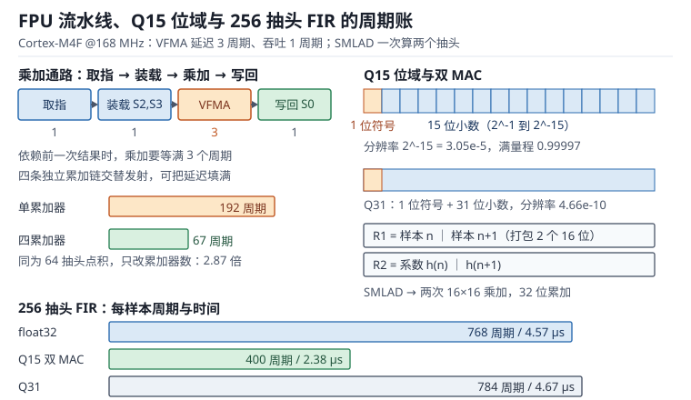

# FPU 与 DSP：单双精度、浮点 ABI 与定点化

**FPU（Floating-Point Unit，浮点运算单元）**把"写 `a*b+c` 就得到一条指令"变成现实，**DSP 扩展**则用一条指令同时算两个 16 位乘法。两者都让数字信号处理从"能不能跑"变成"跑多快、掉多少精度"。

但浮点的成本不在运算本身：单精度乘法只要 1 个周期，代价藏在上下文、ABI 和编译器里——一次中断多压 72 字节栈、一个 `printf("%f")` 拉进几十 KB 的 double 软浮点库、一次错误配置直接进 UsageFault。定点的成本则在精度上：Q15 的量化台阶是 $3.05\times10^{-5}$，看起来不小，但经过十级 FFT 缩放就只剩 32 dB 的动态范围。本章按"谁有硬件（单双精度与寄存器）→ 怎么传参（浮点 ABI）→ 怎么舍入（IEEE 754 与异常）→ 怎么定点化（Q15/Q31 与 CMSIS-DSP）"展开，把每个格式的周期与误差都落到可复算的数字上。

总线与 DMA 对数据搬运见[DMA](dma.md)，Cache 与内存属性对取数的影响见[MPU 与 Cache](mpu-cache.md)；硬件 CRC/AES 这类不经过 CPU 的加速见[硬件加速外设](hw-accel.md)。

## 1. 动机：四个现场

::: motivation 四个现场
**现场一：加了一行 `printf("%f", x)`，Flash 多了 12 KB。** 单精度 `float` 在可变参数函数里被提升为 `double`，而 Cortex-M4F 只有单精度硬件，链接器于是把整套双精度软浮点（加减乘除、格式化）拉进来。中断里的栈使用量也跟着涨。

**现场二：中断服务程序里算了一次浮点，栈突然少了 832 字节。** 带 FPU 的异常栈帧是 104 字节，8 层嵌套就是 832 字节；原本按"每层 32 字节"配的 2 KB 栈直接溢出。

**现场三：Q15 FIR 的系数写成了 1.0。** `q15_t` 常量 `1.0` 被编译器按整数转换处理，得到 1；如果强行写 `32768`，超出 `int16_t` 范围回绕成 -32768，也就是 -1.0，滤波输出整体反相。

**现场四：浮点滤波 4.6 µs，Q15 版本 2.4 µs，但信噪比从 146 dB 掉到 92 dB。** 提速不到 2 倍，精度掉了 54 dB。选哪个取决于系统要的是"快一倍"还是"多 9 个有效位"。
:::

| 你想确认 | 先算 | 判据（工程经验值，非标准强制） |
|---|---|---|
| 每样本预算 | 采样周期乘 CPU 占用上限 | 滤波不超过 25% |
| 每抽头周期 | 指令数（单发射） | 浮点约 3，Q15 双 MAC 约 1.5 |
| 定点累加余量 | $\sum\lvert h\rvert$ 与 2 的比值 | 小于 1.5 才能用 32 位累加 |
| 量化信噪比 | $6.02N+1.76$ | 比系统指标高 10 dB 以上 |
| 中断栈帧 | 32 B 或 104 B | 按最坏嵌套层数乘 |
| 精度验证 | 与双精度参考比对 | 误差小于 1 LSB |

**不算会摔在哪**，四个带数字的代价：

1. **浮点上下文没算进栈。** 每层中断多 72 字节，8 层就是 576 字节的额外占用，占 2 KB 栈的 28%。
2. **定点累加器溢出。** Q15 的 32 位累加器上限是 2.0，系数绝对值之和为 1.2 时余量只有 1.67 倍（0.74 位）；一旦超过 2，输出直接反相，波形上表现为削顶后翻转。
3. **Q15 FFT 不做缩放。** 每级蝶形可能让幅度翻倍，10 级就是 1024 倍；不缩放必然溢出，按级缩放又要付出 60.2 dB 的动态范围。
4. **浮点比较用 `==`。** 0.1 加 0.2 不等于 0.3，累加误差让状态机永远进不了目标分支。

## 2. 直观：从寄存器堆到 Q15 数据通路

### 2.1 原理图：FPU 流水线与定点 MAC

浮点指令和定点指令走的是两套执行单元，但共用同一个取指与寄存器装载通路。M4F 的浮点寄存器是 32 个单精度寄存器 S0 到 S31，M7 上同一组物理寄存器可以配成 16 个双精度寄存器 D0 到 D15。

上图左侧是一次 `VFMA` 的数据通路：两个源操作数从 S 寄存器读出，乘加后写回累加器；依赖前一次结果的链式乘加必须等 3 个周期，而四条独立累加链可以把这 3 个周期填满。右侧是 Q15 的位域：最高位是符号，其余 15 位是小数，两个 Q15 数打包进一个 32 位寄存器后，一条 `SMLAD` 就能完成两次乘加。

三个必须分清的概念：

- **格式**：IEEE 754 单精度（1 符号、8 阶码、23 尾数）与 Q15（1 符号、15 小数位）表示的是不同的数轴，不是"精度高低"的简单排序。
- **执行单元**：FPU 做浮点，DSP 扩展做整数 SIMD；两者可以同时存在，但指令不能互换。
- **ABI**：参数放在哪里、谁负责保存，由调用约定决定，配置错了不会报错，只会算出垃圾。

### 2.2 单精度、双精度与寄存器堆

| 格式 | 位宽 | 有效位数 | 机器 epsilon | 最大值 | M4F | M7 |
|---|---|---|---|---|---|---|
| 单精度 float | 32 | 24 | $2^{-23}=1.19\times10^{-7}$ | $3.40\times10^{38}$ | 硬件 | 硬件 |
| 双精度 double | 64 | 53 | $2^{-52}=2.22\times10^{-16}$ | $1.80\times10^{308}$ | 软件 | 硬件（可选） |
| Q15 | 16 | 15 | $2^{-15}=3.05\times10^{-5}$ | 0.99997 | 硬件 | 硬件 |
| Q31 | 32 | 31 | $2^{-31}=4.66\times10^{-10}$ | 0.9999999995 | 硬件 | 硬件 |

Cortex-M4F 的 FPv4-SP 只有单精度硬件：所有 `double` 运算都编译成对 `__aeabi_dadd`、`__aeabi_dmul` 这类库函数的调用，一次乘法几十到上百周期，还要额外的栈空间。Cortex-M7 的 FPv5-D16 带双精度，但除法与开方仍然是几十周期的多周期指令，能不用就不用。

一个容易被忽略的差别：单精度只有 24 位有效位，`16777217.0f` 等于 `16777216.0f`。做累加时，当累加和超过 $2^{24}$，再加 1 已经不改变结果——这就是"大数吃小数"。对 1 秒、48 kHz 的音频能量累加，样本平方和很容易超过这个量级，正确做法是用 `double` 累加或者分块累加。

### 2.3 浮点 ABI 与调用约定

AAPCS（Procedure Call Standard for the ARM Architecture，ARM 架构过程调用标准）规定了参数放在哪里。带 FPU 的变体（VFP variant）在此基础上追加一条：浮点参数优先走 S 寄存器。

| 资源 | 调用者保存 | 被调用者保存 | 说明 |
|---|---|---|---|
| r0 到 r3 | 是 | 否 | 整数参数与前四个返回值 |
| r4 到 r11 | 否 | 是 | 通用寄存器 |
| s0 到 s15 | 是 | 否 | 浮点参数、返回值、临时值 |
| s16 到 s31 | 否 | 是 | 浮点局部变量，函数返回时必须恢复 |
| 栈 | 是 | 是 | 8 字节对齐 |

由此得到三条工程结论：

1. **8 字节栈对齐是硬约束**。AAPCS 要求 SP 在公共接口处 8 字节对齐，链接脚本和启动文件的初始 SP 必须满足；手工写汇编时只压奇数个寄存器（例如 `PUSH {r4}`）会破坏对齐，需要再补一个寄存器凑成偶数。
2. **s16 到 s31 的保存有成本**。一个用了 8 个浮点局部变量的函数，入口要压 8 个寄存器、出口要恢复，每次调用 16 次访存；小函数应尽量把浮点临时值控制在 s0 到 s15。
3. **可变参数函数按基标准传参**。`printf` 这类函数不知道实参类型，浮点参数走通用寄存器或栈；C 的默认实参提升又把 `float` 提升为 `double`，于是单精度硬件帮不上忙。

编译器层面还要对上三个开关：`-mfloat-abi=hard` 表示浮点参数走 S 寄存器、运算用 FPU 指令；`softfp` 表示用 FPU 指令但参数走通用寄存器；`soft` 表示完全软件模拟。**同一个镜像里混用 hard 与 softfp 编译的库，参数位置对不上，调用会静默算错**，链接器不会报错。`-mfpu=fpv4-sp-d16`、`-mfpu=fpv5-d16` 则要和芯片实际 FPU 一致。

最后是使能：Cortex-M4/M7 复位后 CP10 与 CP11 是禁止访问的，第一次执行浮点指令会触发 UsageFault（NOCP）。启动代码要把 `SCB->CPACR` 的 CP10/CP11 置成全访问，再执行 `__DSB()` 与 `__ISB()`。

### 2.4 IEEE 754 舍入与异常

FPSCR（Floating-Point Status and Control Register）里有舍入模式、异常使能位和累积标志。默认配置下异常不 trap，只置标志并给出默认结果：

| 异常 | 触发条件 | 默认结果 | 标志位 |
|---|---|---|---|
| 无效运算 | 0/0、inf 减 inf、负数开方 | 默认 NaN | IOC |
| 除零 | 有限非零除以 0 | 带符号无穷 | DZC |
| 上溢 | 结果超出最大有限值 | 带符号无穷 | OFC |
| 下溢 | 结果小于最小正规数 | 非正规数或 0 | UFC |
| 不精确 | 结果需要舍入 | 舍入后的值 | IXC |

舍入模式有四种：就近取偶（RN，默认）、向零（RZ）、向正无穷（RP）、向负无穷（RM）。ARM 的浮点指令默认使用 RN，只有显式的转换指令才带方向后缀。**就近取偶**意味着 2.5 舍入到 2、3.5 舍入到 4，这样多次舍入的偏差不会累积。

两个控制位值得单独记：FZ（Flush-to-Zero）把非正规数当零处理，能避免非正规数运算的性能悬崖，代价是损失极小量级的精度；DN（Default NaN）让所有 NaN 运算返回同一个默认 NaN，便于调试但会丢掉 NaN 的负载信息。很多 DSP 库为了速度默认开 FZ，做高动态范围音频时要关掉。

比较运算还有两个坑：NaN 与任何数（包括自己）比较都不相等，`x != x` 是判断 NaN 的标准写法；`+0.0` 与 `-0.0` 相等，但 `1/+0.0` 是正无穷、`1/-0.0` 是负无穷。

### 2.5 CMSIS-DSP 与 Q15/Q31 定点

定点数的本质是"约定小数点位置"。Q15 用 16 位有符号整数表示 $[-1, 1)$ 区间：

$$x_{real}=\frac{x_{int}}{2^{15}},\qquad x_{int}\in[-32768,\ 32767]$$

Q31 同理，分母换成 $2^{31}$。定点乘法的中间结果要右移：

$$z_{Q15}=\text{sat}_{16}\left(\frac{x_{Q15}\times y_{Q15}}{2^{15}}\right)$$

$z$ 是乘积，除以 $2^{15}$ 把 Q30 的结果拉回 Q15，`sat` 表示饱和到 16 位范围而不是回绕。C 语言里对应的写法是 `(q15_t)__SSAT((q31_t)a * b >> 15, 16)`，注意右移是算术右移，负数的舍入方向与"就近取偶"不同，会产生半个 LSB 的直流偏置。

CMSIS-DSP 把常用算法做成了按格式分身的库：

| 函数族 | 浮点版 | 定点版 | 主要差异 |
|---|---|---|---|
| FIR | `arm_fir_f32` | `arm_fir_q15`、`arm_fir_q31` | 定点版内部用 64 位累加 |
| IIR 双二阶 | `arm_biquad_cascade_df1_f32` | `arm_biquad_cascade_df1_q15` | 定点版有状态变量缩放 |
| FFT | `arm_cfft_f32` | `arm_cfft_q15`、`arm_cfft_q31` | Q15 需要逐级缩放或块浮点 |
| 统计 | `arm_mean_f32` | `arm_mean_q15` | 定点版结果精度受输入限制 |

DSP 扩展提供的关键指令都在 16 位这一层做 SIMD：`SMLAD` 一次做两个 16 位乘加（32 位累加），`SMLALD` 做双 16 位乘加到 64 位累加，`SMLABB`、`SMLABT` 做单个 16 位乘加，`QADD16`、`SADD16` 做并行加减，`PKHBT`、`PKHTB` 把两个半字拼成一个字。这些指令**没有 32 位 SIMD**，所以 Q31 拿不到双 MAC 的加速，这是选型时最容易忽略的一点。

## 3. 定量：周期、吞吐与误差

### 3.1 静态分析：类型、ABI 与指令约束

静态检查是"不运行就知道会不会慢或者算错"：

| 检查项 | 内容 | 违反后果 |
|---|---|---|
| FPU 使能 | CPACR 的 CP10/CP11 | 首条浮点指令进 UsageFault |
| 编译选项 | `-mfloat-abi` 与 `-mfpu` 全工程一致 | 参数错位，静默算错 |
| 栈对齐 | SP 8 字节对齐 | 双精度访问触发对齐异常或性能下降 |
| 类型宽度 | `double` 是否出现在热路径 | 单精度芯片上退化到软浮点 |
| 定点范围 | 系数绝对值之和小于 2 | 累加器溢出，输出反相 |
| 饱和处理 | 所有 Q15 输出是否 `__SSAT` | 回绕产生爆音 |

其中"类型宽度"最隐蔽：一个 `double` 局部变量、一个 `1.0` 字面量（默认是 double）、一次 `printf`，都会把双精度软浮点拖进镜像。检查方法是看 map 文件里有没有 `__aeabi_d*` 符号，有就说明热路径或某个角落踩到了双精度。

### 3.2 动态分析：周期、吞吐与依赖链

Cortex-M4F 的关键指令时序：

| 指令 | 周期 | 说明 |
|---|---|---|
| `VADD.F32`、`VSUB.F32`、`VMUL.F32` | 1 | 全流水，可每周期发射 |
| `VFMA.F32`、`VMLA.F32` | 3 | 延迟 3 周期，结果被下一条依赖时阻塞 |
| `VDIV.F32` | 14 | 非流水，阻塞式 |
| `VSQRT.F32` | 14 | 非流水，阻塞式 |
| `VCVT`、`VMOV`、`VCMP` | 1 | 转换与搬移 |
| `VLDM`、`VSTM` | 1 加每寄存器 1 | 批量装载与保存 |

"延迟"和"吞吐"要分开看。一次 64 抽头的点积，如果只用一个累加器，每抽头都要等上一次的 3 周期：

$$t_{serial}=64\times3=192\ \text{周期}$$

改成四个累加器，依赖链被拆成四条，每条 16 次乘加，最后合并：

$$t_{interleave}=64\times1+3=67\ \text{周期}$$

加速比 2.87 倍，而且没有改变任何算法。这就是所有 FIR 库都做多累加器展开的原因。

单发射流水线还给出一个硬下限：每条指令最多 1 个周期。一次抽头至少要"取数据、取系数、乘加"三条指令，所以**浮点 FIR 的下限约 3 周期每抽头**；Q15 用 32 位打包读入两个样本与两个系数，一条 `SMLAD` 算两次乘加，三条指令摊到两个抽头上，下限约 1.5 周期每抽头。

$$c_{f32}\approx\frac{3\ \text{指令}}{\text{抽头}},\qquad c_{q15}\approx\frac{3\ \text{指令}}{2\ \text{抽头}}=1.5\ \frac{\text{周期}}{\text{抽头}}$$

### 3.3 环路与稳定性：定点反馈环的量化噪声与极限环

IIR 滤波器把输出反馈回输入，量化误差也跟着进环路。Q15 的量化台阶是 $q=2^{-15}$，误差方差近似均匀分布：

$$\sigma_q^2=\frac{q^2}{12}$$

$q$ 是量化步长，$\sigma_q^2$ 是量化噪声方差。噪声经过闭环后被极点放大，放大倍数近似为 $1/(1-r)$，$r$ 是极点半径。当输入变成零之后，环路里剩下的量化噪声会维持一个不衰减的小振荡，称为**极限环（Limit Cycle）**，幅度约为：

$$A_{lc}\approx\frac{q/2}{1-r}$$

$A_{lc}$ 是极限环幅度（满量程归一化），$r$ 是极点半径。两个典型值：

$$r=0.99:\ A_{lc}=\frac{1.53\times10^{-5}}{0.01}=1.53\times10^{-3}\ (-56.3\ \text{dBFS})$$

$$r=0.999:\ A_{lc}=\frac{1.53\times10^{-5}}{0.001}=1.53\times10^{-2}\ (-36.3\ \text{dBFS})$$

-36 dBFS 在 16 位音频里是能听见的持续单音。解决办法有三个：在环路里加抖动（dither）、把 IIR 状态改成 Q31 或浮点、或者改用不受极限环影响的 FIR 结构。

极点半径还受系数量化影响：Q15 的系数分辨率是 $3.05\times10^{-5}$，对高 Q 值的二阶节，极点位置对系数的敏感度可能达到几十倍，量化后极点可能被推到单位圆外，滤波器直接自激。判据是：设计时把极点半径留在 0.995 以内，并且用定点系数重新算一遍极点位置。

### 3.4 取值与权衡：float32、Q15 与 Q31

| 维度 | float32 | Q15 | Q31 |
|---|---|---|---|
| 动态范围 | 约 146 dB（24 位有效） | 92 dB | 188 dB（受 32 位数据限制） |
| 每抽头周期 | 约 3 | 约 1.5（双 MAC） | 约 3 |
| 每样本存储 | 4 B | 2 B | 4 B |
| 累加余量 | 无需关心 | 需 $\sum\lvert h\rvert<2$ | 需 $\sum\lvert h\rvert<2$ |
| 上下文成本 | 104 B 栈帧 | 32 B 栈帧 | 32 B 栈帧 |
| 适用 | 算法验证、动态范围大 | 语音、低成本、带宽受限 | 高保真音频、高动态范围 |

三条选择规则：

1. **先浮点验证，再定点交付。** 用 `float` 写算法、用 `double` 做参考，确认算法正确后再逐模块定点化，每一步都对比误差。
2. **按信噪比选位宽。** 16 位音频用 Q15 够（92 dB 与 16 位 PCM 的 98 dB 理论极限相差 6 dB，而实际模拟链路通常只有 90 dB 左右），24 位音频必须 Q31 或 float。
3. **按带宽选格式。** 采样率高、抽头多时，Q15 省一半的取数带宽，往往比省 MAC 更有效。

## 4. 算例：五个可复算的账

### 4.1 256 抽头 FIR 在 48 kHz 下的三种实现

预算：$T=1/48000=20.833$ µs。按单发射指令数模型：

$$t_{f32}=\frac{256\times3}{168\times10^{6}}=4.571\ \mu\text{s},\qquad U=21.94\%$$

$$t_{q15}=\frac{256\times1.5+16}{168\times10^{6}}=2.381\ \mu\text{s},\qquad U=11.43\%$$

$$t_{q31}=\frac{256\times3+16}{168\times10^{6}}=4.667\ \mu\text{s},\qquad U=22.40\%$$

Q15 的双 MAC 把时间压到浮点的一半，代价是 92 dB 的动态范围；Q31 与浮点同速，但精度高出 42 dB。如果系统同时要"高保真"和"低延迟"，常见做法是主链路 Q31、辅助链路（电平检测、静音检测）Q15。

### 4.2 Q15 累加器的余量

Q15 乘 Q15 得到 Q30，累加器是 32 位有符号，能表示到 $\pm2$（以满量程为单位）：

$$y_{max}\le\sum_{n}\lvert h_n\rvert$$

系数绝对值之和为 1.2 时：

$$\text{余量}=\frac{2}{1.2}=1.667\ \text{倍}=0.74\ \text{位}$$

系数之和为 1.9 时：

$$\text{余量}=\frac{2}{1.9}=1.053\ \text{倍}=0.074\ \text{位}$$

0.074 位意味着输入只要略微超出满量程就溢出。**当 $\sum\lvert h\rvert$ 接近或超过 2 时，必须换成 64 位累加（`SMLAL`）**，代价是从 1.5 周期每抽头退到 3 周期每抽头。这也解释了 CMSIS-DSP 的 `arm_fir_q15` 为什么用 64 位累加：它不能假设用户的系数是归一化的。

### 4.3 1024 点 FFT 的预算

复数 FFT 的浮点运算量近似为：

$$F\approx5N\log_2N=5\times1024\times10=51200\ \text{flop}$$

浮点版每条 `VFMA` 完成 2 次浮点运算，加上每两条运算一次装载，按 2.5 周期每条乘加估算：

$$t_{f32}=\frac{51200}{2}\times2.5\times\frac{1}{168\times10^{6}}=381\ \mu\text{s}$$

在 10 ms 一帧的音频处理里占 3.8%，可以接受。Q15 版本虽然乘加快一倍，但**每级蝶形都要缩放**：10 级各右移一位，等效损失 60.2 dB 动态范围，从 92 dB 掉到 31.9 dB，语音以外的场合基本不可用。Q31 版本不缩放时理论 188 dB，缩放 10 位后仍有 128 dB，是"定点加高保真"场景的常见选择。

### 4.4 浮点上下文与中断预算

带 FPU 的异常栈帧是 26 个字：

$$26\times4=104\ \text{B}$$

不带 FPU 是 8 个字、32 B，差值 72 B。嵌套时每一层都有自己的栈帧，8 层全部带浮点上下文时：

$$104\times8=832\ \text{B}$$

8 层全部不带浮点时只有：

$$32\times8=256\ \text{B}$$

多出 576 B，占 2 KB 栈的 28.1%。10 kHz 中断率下，仅栈帧的读写流量就是：

$$104\times2\times10^{4}=2.08\ \text{MB/s}$$

这对 SRAM 带宽不算什么，但对 2 KB 的小栈是致命的。Cortex-M4/M7 的**惰性压栈（Lazy Stacking）**可以缓解：若中断处理函数里不执行任何浮点指令，FPU 上下文不立即写入栈，硬件只把栈指针让出 18 个字的空间；处理函数第一次用浮点时才真正压栈。这条机制让"中断里不用浮点"的代码不必为 FPU 付写入代价，但栈空间的预留仍然存在。

### 4.5 八级双二阶的噪声预算

每个 Q15 双二阶引入一个量化噪声源，方差 $q^2/12$。8 级级联、各级噪声不相关时，总噪声方差相加，幅度按 $\sqrt{8}$ 增长：

$$\Delta SNR=10\log_{10}8=9.03\ \text{dB}$$

从理想的 92.06 dB 掉到 83.03 dB，仍在 16 位音频的可用范围内。如果每级都用截断而不是就近舍入，还会叠加直流偏置：单次截断的偏差是 $q/2=1.53\times10^{-5}$，折合 -96.3 dBFS；8 级按不相关叠加约 -87.3 dBFS，最坏同相叠加约 -78.3 dBFS。通常可忽略，但在直流耦合的测量链路里会被当成传感器零点漂移。

## 5. 工程含义：精度、性能与验证

### 5.1 精度预算怎么定

精度预算的顺序是"从指标反推位宽"，不是"先选格式再看效果"：

1. 系统要求信噪比，比如音频 96 dB、电机电流环 60 dB、计量 110 dB。
2. 减去算法增益带来的噪声放大，比如 FFT 的 $10\log_{10}N$、IIR 的极点放大。
3. 减去级联级数带来的 $10\log_{10}K$。
4. 剩下的余量决定格式：小于 60 dB 用 Q15，60 到 120 dB 用 Q31，再高用 float 或 double。

### 5.2 混合精度：转换点放在哪里

工程上很少全浮点或全定点，常见的是"前端定点、后端浮点"或反过来。转换点的选择原则是**放在增益最小的地方**：定点转浮点的误差被后续增益放大得最少。比如 ADC 采样进来是 Q15，先做直流去除（增益接近 1）再转浮点，比先转浮点再做高增益滤波要好。

每次转换本身有成本：`VCVT.F32.S32` 是单周期，但转换要占寄存器、打断流水；批量转换时用 `VLDM` 加循环比逐个转换快。

### 5.3 仿真与实验：用计数器和参考模型验证

1. **周期计数**：用 `DWT->CYCCNT` 包住 `arm_fir_f32` 调用，与 $3\times N$ 对比；明显偏高说明编译器没有展开或者参数走了栈。
2. **饱和计数**：在 Q15 输出处统计 `__SSAT` 前后的差值，任何一次饱和都要记录；饱和计数为零才能证明量程够。
3. **参考模型对比**：同一段输入分别跑 float 与 Q15，逐样本求差，最大值应小于 1 到 2 个 LSB；超过说明缩放或舍入有问题。
4. **SNR 测量**：输入满量程单音，输出做 FFT，信号功率与噪声加失真功率之比就是 SINAD；与 $6.02N+1.76$ 对比，差距应在 3 dB 以内。
5. **极限环观察**：输入置零后录 1 秒输出，看有没有持续单音；有就是 IIR 定点化的典型症状。

## 6. 常见坑

::: pitfall 坑一：`printf("%f")` 把双精度软浮点拖进镜像
**现象**：只加了一行调试打印，Flash 占用涨了十几 KB，中断延迟变长。

**原因**：可变参数函数按基标准传参，`float` 被提升为 `double`，而 M4F 没有双精度硬件，链接器拉入整套 `__aeabi_d*` 与格式化代码。

**解决**：调试打印改用整数定点格式（把浮点乘 1000 转成整数打印），或使用支持浮点的精简 printf 实现，并在 map 文件里确认没有 `__aeabi_d*` 符号。
:::

::: pitfall 坑二：没开 FPU 就执行浮点指令
**现象**：程序在第一条浮点指令处进 UsageFault，CFSR 的 UFSR 显示 NOCP。

**原因**：复位后 CP10/CP11 默认禁止访问，启动代码没有配置 `SCB->CPACR`。

**解决**：在 `SystemInit` 里置位 CPACR 的 CP10/CP11，随后 `__DSB()` 与 `__ISB()`；用 `__FPU_USED` 宏确认编译器认为 FPU 已启用。
:::

::: pitfall 坑三：hard 与 softfp 混链
**现象**：某个第三方库的滤波函数返回莫名其妙的数，输入正常、输出量级完全不对。

**原因**：库用 `-mfloat-abi=softfp` 编译，参数走 r0 到 r3；应用用 `hard` 编译，参数放在 s0 到 s3。两边对不上，函数读到的是整数寄存器里的垃圾。

**解决**：全工程统一 `-mfloat-abi`，第三方库要么重新编译，要么用显式的整数接口封装；在链接脚本或构建系统里加编译选项检查。
:::

::: pitfall 坑四：Q15 常量写成 1.0 或 32768
**现象**：滤波器输出整体反相，或者系数全变成 0。

**原因**：`q15_t` 是 16 位有符号，1.0 对应的 32768 超出范围回绕成 -32768；写 `1.0` 则被当成整数 1，等于 $3.05\times10^{-5}$。

**解决**：用 `__SSAT((q31_t)(x * 32768.0f), 16)` 做饱和转换，或直接用 CMSIS-DSP 的 `arm_float_to_q15`（打开饱和）；系数表用脚本生成，不手写。
:::

::: pitfall 坑五：定点右移用截断，累积出直流偏置
**现象**：输入为零时输出不是零，而是稳定的小直流；多级级联后偏置变大。

**原因**：算术右移对负数是向负无穷取整，正负不对称，每次乘加都引入半个 LSB 的负偏置。

**解决**：改用带舍入的移位，例如先加 $2^{14}$ 再右移 15 位；或在关键节点用 Q31、浮点；测量时把输入短接到地，观察输出的直流分量。
:::

::: pitfall 坑六：浮点比较用 `==`，状态机卡死
**现象**：滤波器系数更新后，状态机停在等待分支，永远不进入下一步。

**原因**：浮点运算有舍入误差，`0.1f + 0.2f` 不等于 `0.3f`，等值比较失败。

**解决**：用误差带比较 `fabs(a-b) < eps`，`eps` 按量级取 $10^{-6}$ 到 $10^{-5}$；或者状态机用整数标志位驱动，不用浮点值做判据。
:::

## 7. 自测题

题一：256 抽头 FIR、48 kHz、168 MHz，浮点与 Q15 各占多少 CPU？推导过程？

采样周期：

$$T=\frac{1}{48000}=20.833\ \mu\text{s}$$

单发射流水线下，每抽头至少 3 条指令（取数据、取系数、乘加），浮点约 3 周期每抽头：

$$c_{f32}=256\times3=768\ \text{周期},\qquad t=\frac{768}{168\times10^{6}}=4.571\ \mu\text{s}$$

占用：

$$U_{f32}=\frac{4.571}{20.833}=21.94\%$$

Q15 用 32 位打包，一条 `SMLAD` 算两个抽头，三条指令摊到两个抽头，约 1.5 周期每抽头，加上 16 周期循环开销：

$$c_{q15}=256\times1.5+16=400\ \text{周期},\qquad t=2.381\ \mu\text{s},\qquad U=11.43\%$$

结论：Q15 省一半时间、省一半存储，代价是动态范围从 146 dB 降到 92 dB。

题二：系数绝对值之和为 1.8，Q15 的 32 位累加器够用吗？余量多少位？

32 位有符号累加器在 Q30 格式下的表示范围是 $\pm2$（满量程）：

$$\text{余量}=\frac{2}{1.8}=1.111\ \text{倍}$$

换成比特：

$$\log_2 1.111=0.152\ \text{位}$$

只有 0.15 位余量，意味着输入幅度超过满量程的 90% 就可能溢出。工程上要求余量不小于 2 倍（1 位），所以 1.8 的系数和应当改用 64 位累加。若必须用 32 位，可把系数整体缩小 2 倍（右移 1 位），输出再左移回来，代价是损失 1 位精度。

题三：为什么 Q31 拿不到双 MAC 的加速？这对 FIR 的选型有什么影响？

DSP 扩展的 SIMD 只在 16 位粒度上工作：`SMLAD` 把两个 32 位寄存器各拆成两个 16 位分别相乘再加，所以一条指令完成两次 16 位乘加。Q31 是 32 位数据，一条指令只能做一次 32 位乘加（`SMLAL`），拿不到双倍吞吐。

影响是：Q31 与 float32 的每抽头周期数接近（都是约 3），但 Q31 没有浮点的上下文开销和 ABI 复杂度，动态范围还更高。所以"高保真 + 无 FPU"的芯片上，Q31 是合理选择；有 FPU 且动态范围要求极高时，float 更方便。

题四：8 级 Q15 双二阶级联，量化噪声让 SNR 掉多少？从多少掉到多少？

每级噪声功率相同且不相关，8 级相加：

$$P_{total}=8P_1$$

用分贝表示：

$$\Delta SNR=10\log_{10}8=9.03\ \text{dB}$$

Q15 的理想满量程信噪比：

$$SNR=6.02\times15+1.76=92.06\ \text{dB}$$

级联后：

$$92.06-9.03=83.03\ \text{dB}$$

仍在 16 位音频可接受范围内（16 位理论极限约 98 dB，实际系统 85 到 90 dB）。若改成 16 级，损失 12.04 dB，只剩 80 dB，接近临界。

题五：一次 64 抽头点积，单累加器与四累加器分别多少周期？为什么差 2.87 倍？

单累加器：每次 `VFMA` 依赖上一次结果，必须等 3 周期延迟：

$$t_1=64\times3=192\ \text{周期}$$

四累加器：四条独立链，每条 16 次乘加，链内仍然依赖，但四条链交替发射，把延迟藏起来；最后 3 次加法合并：

$$t_4=64\times1+3=67\ \text{周期}$$

加速比：

$$\frac{192}{67}=2.87$$

关键在于"吞吐 1 周期、延迟 3 周期"：只要同时有至少 3 条独立链，流水线就不会空转。这也是编译器自动向量化与手工展开的价值所在。

题六：为什么 Q15 FFT 的 1024 点结果只剩约 32 dB 动态范围？怎么解决？

radix-2 蝶形每级可能让幅度翻倍，1024 点需要 10 级。为了不溢出，每级右移 1 位，等效整体缩小 $2^{10}=1024$ 倍：

$$20\log_{10}1024=60.2\ \text{dB}$$

输入本身的量化信噪比是 92.06 dB，缩放后信号功率下降 60.2 dB，而量化噪声不变，于是有效动态范围只剩：

$$92.06-60.2=31.86\ \text{dB}$$

解决办法有三种：用块浮点（每级只移位必要位数并记录指数）、改用 Q31（理论 188 dB，缩放后仍有 128 dB）、或直接用 float（动态范围 146 dB，不需要缩放）。

## 8. 参考资料

- ARM, DDI 0439 *Cortex-M4 Processor Technical Reference Manual*，Chapter 7 Floating Point Unit（指令时序、FPCCR、惰性压栈）。
- ARM, DDI 0489 *Cortex-M7 Processor Technical Reference Manual*，Floating Point Unit 章（FPv5-D16 双精度）。
- ARM, IHI 0042 *Procedure Call Standard for the ARM Architecture*，参数传递与 VFP 寄存器约定（8 字节对齐、可变参数）。
- ARM, IHI 0055 *ARMv7-M Architecture Reference Manual*，Chapter A2 中的浮点支持（FPSCR、舍入模式、FZ 与 DN）。
- IEEE, *IEEE 754-2019 Standard for Floating-Point Arithmetic*，舍入模式与异常定义。
- Arm, *CMSIS-DSP* 文档，`arm_fir_f32`、`arm_fir_q15`、`arm_cfft_q15` 与 Q 格式说明。
- STMicroelectronics, PM0214 *STM32F3/F4 编程手册*，Floating point unit 章（CPACR、异常返回）。
