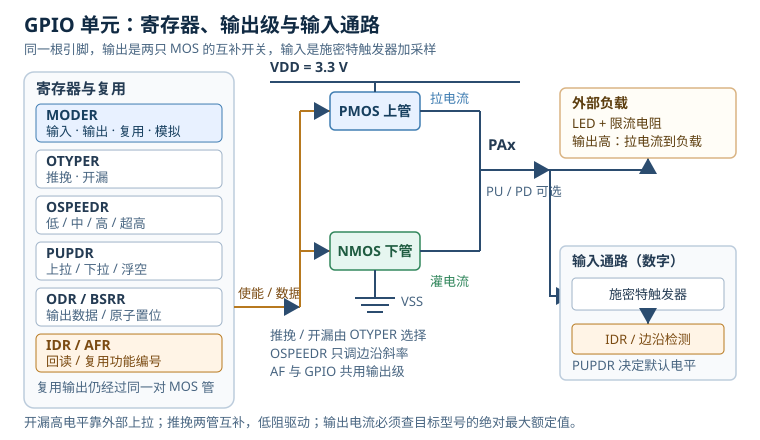

# GPIO 电气与驱动：从推挽输出到按键消抖

通用输入输出（General-Purpose Input/Output，GPIO）看起来只是“把引脚写 1 或写 0”，实际上它同时是数字逻辑、模拟开关、驱动器和保护电路的汇合点。一个引脚能不能直接点 LED、能不能驱动继电器、按键为什么会一次触发多次、为什么开漏上拉到 5 V 会把芯片打坏，答案都不在“HAL_GPIO_WritePin”里，而在输出级的两只 MOS 管和输入级的施密特触发器里。

这一篇把 GPIO 拆成四件事：**推挽与开漏的电气差异、速度档位与输出电流、复用功能怎么落到寄存器、按键消抖的硬件与软件实现**。再用可复算的算例算清 LED 限流电阻、GPIO 压降与功耗、开漏上升时间、GPIO 翻转上限和中断延迟。器件参数一律以目标型号数据手册为准；文中的 $R_{on}$、$V_f$、负载电容都是明确假设，方便读者逐项复核。

## 1. 动机（设计动机）

**现场一：LED 亮度不一致。** 3.3 V 引脚经 100 Ω 电阻驱动一颗红光 LED，按 $V_f=2.0$ V 算，电流约 13 mA。换一批 LED，$V_f$ 从 1.8 V 到 2.2 V，电流从 15 mA 掉到 11 mA，亮度差三成。工程师以为是电阻精度，实际上是 LED 的正向电压分散和 GPIO 的输出压降共同造成的。

**现场二：继电器不吸合。** 5 V 继电器线圈额定 70 mA、电阻约 71 Ω，直接接 3.3 V GPIO。按理想开关算，电流约 46 mA，但 GPIO 的 PMOS（P 沟道 MOSFET，P-channel MOSFET）还有几十欧姆导通电阻，线圈上只剩 2 V 左右，远低于 3.75 V 的吸合电压；同时引脚电流超过额定值。换继电器没用，因为问题在驱动能力。

**现场三：按键按一次加好几个数。** 机械按键在闭合和断开时会有 5–20 ms 的抖动，代码用边沿中断，每个毛刺都进一次中断，计数器连加。有人说“加个 10 ms 延时”，结果在中断里 `delay_ms(10)`，把其他中断全挡住了。消抖不只是“等一会”，还要选择在哪里等、等多久、如何避免阻塞。

**现场四：开漏上拉到 5 V，通信时好时坏。** 3.3 V 微控制器（Microcontroller Unit，MCU）的引脚配成开漏，外部 4.7 kΩ 上拉到 5 V，想和 5 V 器件通信。引脚不是 5 V 容忍时，高电平期间 5 V 会经上拉和静电放电（Electrostatic Discharge，ESD）钳位二极管向 3.3 V 电源灌电流，轻则电平异常，重则损坏。**开漏只决定“高电平由外部上拉”，不决定“引脚能承受多高电压”。**

| 你看到的现象 | 先查什么 | 判据（本手册建议值，非标准强制） |
|---|---|---|
| LED 亮度不对、批次差异大 | $V_f$ 分档、限流电阻、$V_{OH}$ | 最坏 $V_f$ 下电流不超额定 |
| 继电器/蜂鸣器不动作 | 线圈电压、电流、驱动级 | 驱动级压降后仍高于吸合电压 |
| 引脚发烫、复位 | 单脚/总电流、感性负载、5 V 灌入 | 不超过绝对最大额定值 |
| 输入读数乱跳 | 是否悬空、上下拉、阈值 | 输入有确定电平，噪声容限足够 |
| 按键一次触发多次 | 抖动时间、消抖窗口 | 确认窗口大于最大抖动 |
| 开漏上升沿太慢 | 上拉电阻、总线电容 | 上升时间满足协议 |
| GPIO 翻转上不去 | 总线时钟、写操作次数、负载 | 不超过理论翻转率的一半 |

不算会怎样？一个 10 mA 的 LED，如果按理想 3.3 V 算电阻，实际电流可能因为 $V_{OH}$ 跌落少 20%；一个 70 mA 的继电器直接接 GPIO，可能让引脚瞬间过流并触发复位；一个 20 ms 的抖动如果没有消抖，可能产生几十次中断。把这些量算出来，比换芯片、加电容、反复试程序更有效。

## 2. 直观（原理图）



### 2.1 四种模式

STM32 的每个 GPIO 引脚通过 MODER 选择四种模式：

- **输入（Input）**：输出级关闭，引脚经施密特触发器进入输入数据寄存器（Input Data Register，IDR）；上下拉由 PUPDR 选择。
- **输出（Output）**：输出级使能，PMOS 上管和 NMOS（N 沟道 MOSFET，N-channel MOSFET）下管根据输出数据寄存器（Output Data Register，ODR）或位设置/复位寄存器（Bit Set/Reset Register，BSRR）互补或单管工作；OTYPER 选择推挽或开漏。
- **复用功能（Alternate Function，AF）**：引脚交给片上外设（USART、SPI、I2C、TIM 等），但信号仍然经过同一对 MOS 管和输入通路；AFR 选择具体的外设编号。
- **模拟（Analog）**：数字输出级和施密特触发器关闭，引脚直接连到 ADC/DAC 等模拟通路，降低数字输入漏电和干扰。

模式不是“互不相干”的四个开关。比如复用输出仍然受 OTYPER、OSPEEDR 和 PUPDR 影响；模拟模式会关闭数字输入，不能再用 IDR 读电平；输入模式下如果 PUPDR 设为浮空，外部又没有确定电平，引脚就会悬空。

### 2.2 推挽与开漏

**推挽（Push-Pull）** 的输出级是一对互补 MOS：输出高时 PMOS 导通，把引脚拉到 VDD；输出低时 NMOS 导通，把引脚拉到 VSS。两只管子不会同时完全导通（否则就是直通），所以推挽能主动拉高、主动拉低，边沿快、驱动强。缺点是两个推挽输出不能直接并在一起：一个输出高、另一个输出低时，会形成从 VDD 经 PMOS、外部连线、另一个 NMOS 到 VSS 的低阻通路，电流只受导通电阻限制。

**开漏（Open-Drain）** 只使用下拉 NMOS，PMOS 被关闭。输出低时 NMOS 导通，把线拉到 VSS；输出高时 NMOS 关断，引脚呈高阻，靠外部上拉电阻把线拉到高电平。开漏适合内部集成电路总线（Inter-Integrated Circuit，I2C）的线与总线、共享中断线和电平转换，但高电平的上升沿由 $R_{pull} \times C_{bus}$ 决定，速度比推挽慢；而且“能上拉到 5 V”不等于“引脚耐 5 V”，必须查引脚是否标注 5 V 容忍（5V-tolerant）。

### 2.3 输入级与上下拉

输入级通常包含施密特触发器（Schmitt Trigger）：输入从低到高要越过较高的阈值 $V_{IH}$ 才变成高，从高到低要越过较低的阈值 $V_{IL}$ 才变成低，两者之差是迟滞。迟滞能抵抗阈值附近的噪声，但不能解决“输入悬空”或“边沿太慢”的问题。

内部上拉/下拉电阻通常在几十千欧量级。以 40 kΩ 上拉、3.3 V 供电为例，按下按键把引脚拉到地时，电流只有 $3.3/40000 = 82.5$ 微安；这个电流很小，适合低功耗按键，但抗干扰能力也有限。长线、强干扰环境可能需要外部 4.7 kΩ–10 kΩ 上拉，代价是按下时电流增大到 0.33–0.7 mA。

### 2.4 速度档位：改的是边沿，不是逻辑

OSPEEDR 选择输出速度档位（低、中、高、超高）。它控制输出级的 slew rate，也就是电压随时间变化的斜率，不是“逻辑 1 的速度”，也不是一个精确的延时。档位越高，边沿越陡，适合高速 SPI、外部时钟等信号；但快速边沿会带来更大的地弹、过冲、串扰和电磁干扰（Electromagnetic Interference，EMI）。档位越低，边沿越缓，EMI 更小，但上升时间可能满足不了协议，或者在容性负载下增加功耗。

因此选择速度的原则是：**满足协议上升时间的前提下，选最低的档位**；不要因为“高速度听起来更强”就全设成最高。对于按键、LED、继电器控制这类低速信号，低档位通常足够；只有高速串行外设接口（Serial Peripheral Interface，SPI）、外部时钟或脉冲宽度调制（Pulse Width Modulation，PWM）等对边沿有要求的信号，才需要更高档位。

### 2.5 复用功能不是“绕过 GPIO”

复用功能把引脚的输入或输出从 GPIO 寄存器切换到片上外设，具体编号由复用功能寄存器（Alternate Function Register，AFR）选择。配置顺序通常是：

1. 使能 GPIO 和外设的时钟；
2. 把 MODER 设为复用模式；
3. 在 AFR 中写入正确的外设编号；
4. 根据外设要求设置 OTYPER、OSPEEDR、PUPDR；
5. 配置外设本身，最后使能外设。

以 STM32F407 的 USART2 为例，PA2 是 TX、PA3 是 RX，AF 编号是 7。TX 通常设为复用推挽、较高速度；RX 设为复用输入、按需上拉。若 AFR 写成 0，引脚可能连到另一个外设，或者根本没有输出；若 MODER 还是普通输出，外设信号不会出现在引脚上。

## 3. 定量（静态分析）

### 3.1 输出电平、压降与功耗

推挽输出高时，电流从 VDD 经 PMOS 流向负载；输出低时，电流从负载经 NMOS 流向 VSS。忽略引线电阻，输出电平近似为：

$$V_{OH} = V_{DD} - I_{source} R_{on,p}$$

$$V_{OL} = I_{sink} R_{on,n}$$

其中 $V_{OH}$ 是高电平（V），$V_{OL}$ 是低电平（V），$I_{source}$ 是拉电流（A），$I_{sink}$ 是灌电流（A），$R_{on,p}$、$R_{on,n}$ 是 PMOS/NMOS 的导通电阻（$\Omega$）。数据手册给出的 $V_{OH}$、$V_{OL}$ 是在规定测试电流下的保证值，不是常数；电流超过测试条件，压降会继续增大。

MOS 管上的功耗：

$$P_{pin} = I^{2} R_{on}$$

其中 $P_{pin}$ 是单脚功耗（W）。在 10 mA、20 Ω 下，$P=0.01^{2} \times 20 = 2$ mW；单脚功耗通常不是立即烧毁的主因，但绝对最大额定值、总电流、键合线和长期可靠性才是硬约束。不要因为“算出来只有 2 mW”就忽略引脚电流限制。

### 3.2 输入阈值与噪声容限

输入高/低噪声容限：

$$NM_{H} = V_{OH,\min} - V_{IH,\min}$$

$$NM_{L} = V_{IL,\max} - V_{OL,\max}$$

其中 $NM_H$、$NM_L$ 是高/低噪声容限（V），$V_{OH,\min}$、$V_{OL,\max}$ 是驱动器的保证输出，$V_{IH,\min}$、$V_{IL,\max}$ 是接收器的输入门限。按 3.3 V 低压 CMOS（Low-Voltage CMOS，LVCMOS）的常见口径举例：$V_{OH,\min}=2.4$ V、$V_{OL,\max}=0.4$ V、$V_{IH,\min}=2.0$ V、$V_{IL,\max}=0.8$ V，则：

$$NM_H = 2.4 - 2.0 = 0.4\ \text{V}$$

$$NM_L = 0.8 - 0.4 = 0.4\ \text{V}$$

只有 0.4 V 的噪声容限。地弹、串扰、长线反射、电源纹波都可能吃掉它。**如果驱动器的 $V_{OH}$ 只有 2.3 V，而接收器要求 2.31 V，逻辑上就处于不确定区**；这类问题在实验室常温可能看不出来，在温度、批次和负载变化后就会暴露。

### 3.3 上下拉与开漏上升时间

内部上拉电阻 $R_{PU}$ 上的电流：

$$I_{PU} = \frac{V_{DD}}{R_{PU}}$$

开漏输出由外部上拉和总线电容决定上升时间。按 30%–70% 的常用测量区间：

$$t_r \approx 0.85 R_{pull} C_{bus}$$

其中 $t_r$ 是上升时间（s），$R_{pull}$ 是上拉电阻（$\Omega$），$C_{bus}$ 是总线电容（F）。上拉越小，上升越快，但低电平时 NMOS 的灌电流越大：

$$I_{OL} = \frac{V_{DD} - V_{OL}}{R_{pull}}$$

所以上拉电阻是“速度”和“灌电流”的折中，不能只按速度选。

### 3.4 GPIO 翻转速度

GPIO 的翻转速度受三个因素限制：总线写操作、软件循环、输出级与负载。以 BSRR 原子置位/复位为例，每次写 BSRR 只改变一个引脚，不需要读改写。假设 APB2 为 84 MHz，总线每 2 个 APB2 周期接受一次写：

$$f_{\text{toggle}} = \frac{f_{\text{APB2}}}{N_{\text{write}}} = \frac{84\ \text{MHz}}{2} = 42\ \text{MHz}$$

这是“每秒翻转次数”。方波一个周期包含两次翻转，所以：

$$f_{\text{square}} = \frac{f_{\text{toggle}}}{2} = 21\ \text{MHz}$$

对应周期 47.6 ns。这是理想上限；实际受 CPU 取指、总线仲裁、GPIO 速度档位、负载电容和探头影响，通常明显低于这个值。若用 ODR 读改写，还会多出读、与、或、写四步，速度更低；多任务环境下读改写还可能被中断打断，造成丢边沿。

### 3.5 中断延迟

GPIO 边沿中断的延迟可以拆成：

$$t_{\text{irq}} = t_{\text{sync}} + t_{\text{entry}} + t_{\text{prologue}}$$

其中 $t_{\text{sync}}$ 是输入同步和边沿检测时间，$t_{\text{entry}}$ 是嵌套向量中断控制器（Nested Vectored Interrupt Controller，NVIC）的异常入口时间，$t_{\text{prologue}}$ 是中断服务程序（Interrupt Service Routine，ISR）保存寄存器、建立栈帧的时间。以 84 MHz APB2、168 MHz 内核为例：

- 同步约 2 个 APB2 周期：$2/(84 \times 10^6) = 23.8 \times 10^{-9}$ s，即 23.8 ns；
- 异常入口典型 12 个内核周期：$12/(168 \times 10^6) = 71.4 \times 10^{-9}$ s，即 71.4 ns；
- ISR 序言假设 10 个周期：$10/(168 \times 10^6) = 59.5 \times 10^{-9}$ s，即 59.5 ns。

合计约 154.7 ns。这还不包括 EXTI 组合逻辑、Flash 等待、ISR 第一条有效指令之前的流水线影响。实测“引脚到 ISR”常见在 0.1–0.5 微秒量级；如果加了 20 ms 消抖，中断延迟就被消抖窗口完全主导，讨论纳秒级入口没有意义。

### 3.6 输出电流与绝对最大额定值

数据手册通常给出：

- 单脚最大输出电流（source/sink）；
- 所有 IO 的总电流；
- 注入电流（input injection current）；
- 绝对最大引脚电压。

这些值不能互相替代。一个引脚 10 mA 可能没超单脚额定，但 20 个引脚同时 10 mA 就可能超过总电流；一个开漏引脚上拉到 5 V，灌入电流可能不大，但引脚电压超过绝对最大额定值，仍然不允许。设计时先查绝对最大表，再查推荐工作条件，最后用实际负载复算。

## 4. 算例（动态分析）

### 4.1 LED 低边驱动的电流、压降与功耗

假设：

- $V_{DD}=3.3$ V；
- LED 正向电压 $V_f=2.0$ V（设计标称值）；
- 限流电阻 $R=110$ $\Omega$；
- NMOS 导通电阻 $R_{on,n}=20$ $\Omega$；
- 低边驱动，LED 和电阻接在 VDD 与引脚之间。

电流：

$$I = \frac{V_{DD} - V_f}{R + R_{on,n}} = \frac{3.3 - 2.0}{110 + 20} = \frac{1.3}{130} = 0.01\ \text{A} = 10\ \text{mA}$$

引脚低电平：

$$V_{OL} = I R_{on,n} = 0.01 \times 20 = 0.2\ \text{V}$$

NMOS 功耗：

$$P = I^{2} R_{on,n} = 0.01^{2} \times 20 = 2\ \text{mW}$$

如果这批 LED 的 $V_f$ 降到 1.8 V：

$$I = \frac{3.3 - 1.8}{130} = 11.54\ \text{mA}$$

如果 $V_f$ 升到 2.2 V：

$$I = \frac{3.3 - 2.2}{130} = 8.46\ \text{mA}$$

相对 10 mA 约 ±15%。这就是“同一块板、不同批次 LED 亮度不同”的定量来源。若想减小批次差异，可以改用恒流驱动，或者按最坏 $V_f$ 重新选电阻并接受亮度变化。

如果改用高边驱动，PMOS 的 $R_{on,p}$ 假设为 50 Ω，其他不变：

$$I = \frac{1.3}{110 + 50} = 8.125\ \text{mA}$$

$$V_{OH} = 3.3 - 8.125\ \text{mA} \times 50\ \Omega = 3.3 - 0.406 = 2.894\ \text{V}$$

同样的电阻，高边电流比低边小 18.75%，压降更大。这不是“LED 变了”，而是 PMOS 与 NMOS 的导通能力不同。若高边也要 10 mA，电阻要重新算：

$$R = \frac{3.3 - 2.0}{0.01} - 50 = 80\ \Omega$$

### 4.2 5 V 继电器为什么带不动

继电器线圈额定 5 V、70 mA，线圈电阻：

$$R_{coil} = \frac{5}{0.07} = 71.43\ \Omega$$

吸合电压按额定值的 75% 估，约 3.75 V。用 3.3 V GPIO 低边驱动，假设 $R_{on,n}=20$ $\Omega$：

$$I = \frac{3.3}{71.43 + 20} = 36.1\ \text{mA}$$

线圈电压：

$$V_{coil} = I R_{coil} = 0.0361 \times 71.43 = 2.58\ \text{V}$$

2.58 V 远低于 3.75 V，继电器不吸合；同时 36.1 mA 已经超过“假设单脚绝对最大 20 mA”的限制。即使某个批次在实验室吸合，也是靠线圈电感和机械余量碰运气，不能量产。正确做法是用三极管、MOSFET 或专用低边驱动器，并在线圈两端加续流二极管；GPIO 只负责控制驱动器的栅极/基极。

### 4.3 按键硬件 RC 与软件消抖

假设按键接法：引脚通过 10 kΩ 串联电阻接按键，按键另一端接地；引脚内部上拉 40 kΩ，引脚对地接 100 nF。按键断开时，电容主要经 40 kΩ 上拉充电；按键闭合时，电容主要经 10 kΩ 放电。稳态按下时，电流由 40 kΩ 和 10 kΩ 串联决定。

充电时间常数（按键断开时 10 kΩ 支路没有电流，可忽略）：

$$\tau_{\text{open}} = 40\ \text{k}\Omega \times 100\ \text{nF} = 4\ \text{ms}$$

放电时间常数（忽略 40 kΩ 上拉的并联影响，精确值约 0.8 ms）：

$$\tau_{\text{close}} = 10\ \text{k}\Omega \times 100\ \text{nF} = 1\ \text{ms}$$

按施密特阈值 0.3 VDD 和 0.7 VDD 估算，从 0.3 VDD 充到 0.7 VDD 的时间：

$$t = \tau \ln\left(\frac{1 - 0.3}{1 - 0.7}\right) = \tau \ln\left(\frac{0.7}{0.3}\right) \approx 0.847 \tau$$

所以释放方向约 $0.847 \times 4 = 3.39$ ms，按下方向约 $0.847 \times 1 = 0.847$ ms。RC 能把毛刺压到几毫秒，但还不够覆盖 5–20 ms 的机械抖动，且上升/下降不对称；因此硬件 RC 通常作为第一道滤波，软件再做一个 20 ms 的确认窗口。

### 4.4 按键消抖的两种实现

**实现一：周期采样 + 移位寄存器。** 每 5 ms 采样一次，连续 5 次相同才确认，总窗口 20 ms：

```c
#define KEY_MASK 0x1Fu

static uint8_t key_hist;
static uint8_t key_state;   /* 0=松开，1=按下 */

void key_scan_5ms(void)
{
    key_hist = (uint8_t)((key_hist << 1) | (KEY_PIN ? 1u : 0u));

    if ((key_hist & KEY_MASK) == 0x00u && key_state == 0u) {
        key_state = 1u;     /* 连续 5 次低，确认按下 */
    } else if ((key_hist & KEY_MASK) == 0x1Fu && key_state == 1u) {
        key_state = 0u;     /* 连续 5 次高，确认松开 */
    }
}
```

这个实现不需要在中断里延时，CPU 开销小；缺点是确认窗口固定为 20 ms，采样周期必须由可靠的定时器提供。如果抖动持续 25 ms，5 次采样仍可能被欺骗，所以窗口要按最坏抖动时间选，不能只看“按着挺稳”。

**实现二：边沿中断 + 一次性定时器。** 边沿中断到来时，先关闭该外部中断（External Interrupt，EXTI）线，启动 20 ms 单次定时器；定时器到期后再读一次电平，确认稳定才上报按键事件，然后重新使能 EXTI。这样中断服务程序很短，确认窗口由硬件定时器保证，不占用 CPU 等待。

```c
void EXTI0_IRQHandler(void)
{
    EXTI->PR = 1u;                 /* 清挂起 */
    EXTI->IMR &= ~1u;              /* 先关该线，避免抖动重复进中断 */
    debounce_timer_start_20ms();   /* 单次定时器，不在 ISR 里延时 */
}

void debounce_timer_irq(void)
{
    if (KEY_PIN == 0u) {
        key_event_press();
    }
    EXTI->PR = 1u;
    EXTI->IMR |= 1u;               /* 确认后再开 */
}
```

这个实现响应快、CPU 占用低，但需要额外的定时器和状态机；如果按键一直按住，不能反复触发，要在状态机里区分“按下事件”和“按住电平”。两种实现可以叠加：硬件 RC 先滤掉高频毛刺，软件窗口再确认机械抖动。

### 4.5 开漏上拉与上升时间

I2C 总线电容 $C_{bus}=200$ pF，上拉 $R_{pull}=4.7$ kΩ：

$$t_r \approx 0.85 \times 4700 \times 200 \times 10^{-12} = 0.799\ \mu\text{s}$$

快速模式 I2C 的上升时间上限通常在 300 ns 量级，0.799 μs 已经超了。把上拉改成 1 kΩ：

$$t_r \approx 0.85 \times 1000 \times 200 \times 10^{-12} = 0.17\ \mu\text{s}$$

上升时间满足，但低电平时灌电流：

$$I_{OL} = \frac{3.3 - 0.4}{1000} = 2.9\ \text{mA}$$

如果目标引脚允许 3 mA 灌电流，1 kΩ 刚好在边界；如果总线电容更大、节点更多，还要重新算。开漏设计从来不是“随便放一个 4.7 kΩ”。

### 4.6 翻转速度与中断延迟的实测口径

**翻转速度。** 用 BSRR 交替写置位和复位，形成一个方波。若 APB2=84 MHz、每次写占 2 个 APB2 周期，理论翻转率 42 MHz、方波 21 MHz。实际测量时，把 GPIO 设为最高速度档、探头用低电容探头、负载尽量小；如果测到 10 MHz，不要立刻认为芯片“虚标”，先检查循环里是否有函数调用、是否用了 ODR 读改写、是否被中断打断。

**中断延迟。** 用一个 GPIO 在 Enter ISR 的第一条语句翻转，同时用逻辑分析仪看触发源和这个 GPIO。测得的时间包含 GPIO 翻转本身、ISR 序言和仪器延迟；再用“空 ISR 只翻转”做基线，两者相减得到软件开销。不要用调试器断点测延迟，断点会改变时序。

### 4.7 环路与稳定性：驱动回路、边沿与消抖状态机

GPIO 的“环路”有两条：一条是输出电流从 VDD 经 PMOS、走线、负载、地回到 VSS 的驱动回路；另一条是“采样—判断—输出”的软件状态机。两条回路的不稳定表现不同，但都可以用时间常数和阈值来判断。

**驱动回路的边沿与振铃。** 引脚经走线驱动容性负载时，输出级 $R_{on}$、走线电感和负载电容构成一个二阶系统。$R_{on}$ 太小、走线太长或负载电容太大，边沿会过冲和振铃；振铃幅度超过接收器阈值，就可能被多计数一次。工程上可在引脚与负载之间串一个阻尼电阻 $R_s$，按传输线阻抗做一阶估算：

$$R_s \approx Z_0 - R_{on} = 50 - 25 = 25\ \Omega$$

其中 $Z_0$ 是走线特性阻抗（$\Omega$），$R_{on}$ 是输出级导通电阻（$\Omega$）。取 22 $\Omega$ 或 33 $\Omega$ 的串联电阻，可以把源端匹配到接近 50 $\Omega$；以 22 $\Omega$ 为例，总串联电阻是 $25+22=47\ \Omega$。阻尼后的上升时间近似为：

$$t_r \approx 2.2 (R_{on}+R_s) C_L = 2.2 \times 47 \times 100 \times 10^{-12} = 10.3\ \text{ns}$$

对应的一阶带宽：

$$f_{3dB} = \frac{1}{2\pi (R_{on}+R_s) C_L} = 33.9\ \text{MHz}$$

如果负载电容是 1 nF，上升时间会变成 103 ns，带宽降到 3.4 MHz；这时即使把 OSPEEDR 设到最高，边沿也被负载拖慢。**速度档位解决的是输出级斜率，解决不了 $R C$ 负载的时间常数。**

**消抖状态机的稳定条件。** 周期采样状态机要满足两个条件：采样周期小于最短有效电平持续时间，确认窗口大于最大抖动时间。若每 $T_s=5$ ms 采样一次，连续 $N=5$ 次确认：

$$T_{window} = (N-1)T_s = (5-1) \times 5 = 20\ \text{ms}$$

如果按键规格的最大抖动是 15 ms，20 ms 窗口有 5 ms 余量；如果最大抖动就是 20 ms，窗口只是边界，温度、按键老化和采样相位都可能让它漏判，建议把窗口加到 25–30 ms。反过来，窗口不能无限加大：窗口 100 ms 会让快速双击无法识别，用户会觉得“按键不灵”。稳定条件是：

$$T_{bounce,\max} < T_{window} < T_{repeat,\min}$$

其中 $T_{bounce,\max}$ 是最大抖动时间，$T_{repeat,\min}$ 是允许的最小连续按键间隔。这个不等式比“随便延时 10 ms”更能解释为什么消抖窗口既不能太小，也不能太大。

## 5. 工程含义（取值与权衡）

### 5.1 串联电阻、上下拉与速度档位

- **LED 限流电阻**：按最坏 $V_f$、最坏 $V_{OH}$、目标电流算，再验算短路电流。若 $R$ 取 0，3.3 V 经 20 Ω 到地是 165 mA，远超引脚额定。
- **按键上拉**：内部 40 kΩ 省电，但长线抗扰差；外部 4.7–10 kΩ 更强，但按下电流增大。按环境和功耗折中。
- **开漏上拉**：先按协议上升时间选上限，再按灌电流选下限；两者冲突时，降低总线电容、减少节点或改用推挽/缓冲器。
- **速度档位**：满足上升时间即可，不要全开最高；高速档只在 SPI、时钟、高速 PWM 等必要场景使用。
- **串联阻尼**：长线或大电容负载可在引脚与负载之间串 22–100 Ω，减小过冲和振铃；阻值太大会让上升沿变慢，必须和协议一起验算。

### 5.2 输出电流的边界

绝对最大额定值不是“推荐工作值”。推荐工作条件给出保证的逻辑电平，绝对最大额定值只表示“超过可能损坏”。设计时：

1. 用目标电流查 $V_{OL}$/$V_{OH}$，确认后级仍能识别；
2. 查单脚和总电流，留 30% 余量；
3. 感性负载加续流二极管，容性负载算浪涌；
4. 需要更大电流时用三极管/MOSFET/驱动芯片，不把 GPIO 当电源；
5. 5 V 信号先确认引脚是否 5 V 容忍，再谈开漏上拉。

### 5.3 复用功能的引脚规划

复用功能冲突往往不是软件配置能解决的，必须在原理图阶段做 Pin Map：

- 同一引脚不能同时给两个外设；
- 串行线调试（Serial Wire Debug，SWD）引脚默认有特殊功能，复位后不要立即拿去做普通 GPIO；
- BOOT 引脚、晶振引脚、模拟引脚有特殊约束；
- 5 V 容忍只对部分引脚成立，模拟引脚通常不耐 5 V；
- AF 编号因芯片型号而异，不能照抄另一颗芯片的 AFR 值。

### 5.4 完整设计示例（算例）

需求：3.3 V MCU，PA5 低边驱动一颗 10 mA LED；PA0 接按键，要求 20 ms 消抖；PA2/PA3 用作通用同步/异步收发器（Universal Synchronous/Asynchronous Receiver/Transmitter，USART）的 USART2 TX/RX，AF7。设计如下。

**LED 支路**：取 $V_f=2.0$ V、$R_{on,n}=20$ Ω、目标 10 mA：

$$R = \frac{3.3 - 2.0}{0.01} - 20 = 110\ \Omega$$

选 110 Ω，实际电流 10 mA，$V_{OL}=0.2$ V，NMOS 功耗 2 mW；最坏 $V_f=1.8$ V 时 11.54 mA，仍低于 20 mA 的单脚假设上限。若目标型号的单脚额定更低，要重新选。

**按键支路**：内部 40 kΩ 上拉，外部 10 kΩ 串联，100 nF 对地；硬件 RC 的释放时间约 3.39 ms，软件每 5 ms 采样、连续 5 次确认，总窗口 20 ms。按键按下电流约 $3.3/50000=66$ 微安，功耗可接受。

**USART2**：PA2 配 AF7、复用推挽、速度中档；PA3 配 AF7、复用输入、上拉。USART2 的 BRR 按 PCLK1=42 MHz 计算为 365，波特率误差 -0.114%。

初始化代码骨架：

```c
static void gpio_init(void)
{
    RCC->AHB1ENR |= RCC_AHB1ENR_GPIOAEN;
    (void)RCC->AHB1ENR;

    /* PA5：输出，推挽，低速，无上下拉 */
    GPIOA->MODER = (GPIOA->MODER & ~(3u << (2 * 5)))
                 | (1u << (2 * 5));
    GPIOA->OTYPER &= ~(1u << 5);
    GPIOA->OSPEEDR = (GPIOA->OSPEEDR & ~(3u << (2 * 5)))
                   | (0u << (2 * 5));
    GPIOA->PUPDR &= ~(3u << (2 * 5));

    /* PA0：输入，上拉 */
    GPIOA->MODER &= ~(3u << (2 * 0));
    GPIOA->PUPDR = (GPIOA->PUPDR & ~(3u << (2 * 0)))
                 | (1u << (2 * 0));

    /* PA2/PA3：AF7 */
    GPIOA->MODER = (GPIOA->MODER & ~((3u << (2 * 2)) | (3u << (2 * 3))))
                 | (2u << (2 * 2)) | (2u << (2 * 3));
    GPIOA->AFR[0] = (GPIOA->AFR[0] & ~((0xFu << (4 * 2)) | (0xFu << (4 * 3))))
                  | (7u << (4 * 2)) | (7u << (4 * 3));
    GPIOA->OSPEEDR = (GPIOA->OSPEEDR & ~((3u << (2 * 2)) | (3u << (2 * 3))))
                   | (1u << (2 * 2)) | (1u << (2 * 3));
    GPIOA->PUPDR = (GPIOA->PUPDR & ~(3u << (2 * 3)))
                 | (1u << (2 * 3));
}
```

验证：

| 检查项 | 方法 | 预期 |
|---|---|---|
| LED 电流 | 串入毫安表或测电阻压降 | 约 10 mA |
| 按键电平 | 按下/松开读 IDR | 0 / 1，抖动被滤除 |
| 按键事件 | 连续按 100 次计数 | 每次只加 1 |
| USART2 波形 | 逻辑分析仪解码 | 115200，无帧错误 |
| 引脚复用 | 测 PA2 波形 | 有 USART 输出，AF7 生效 |
| 输出压降 | 满载测 $V_{OL}$ | 不超过后级 $V_{IL}$ |

### 5.5 仿真与实验（测量）

**测 $V_{OL}$/$V_{OH}$ 与 $R_{on}$。** 用一个功率电阻或电子负载做负载，改变电流，分别测输出电压。由 $V_{OL}=I R_{on,n}$ 反算 $R_{on,n}$，注意要扣除万用表引线电阻和负载误差。不要用 LED 当负载来测 $R_{on}$，因为 LED 的 $V_f$ 随电流变化，会把压降和电流混在一起。

**测上升时间。** 用方波驱动一个已知电容（例如 100 pF、1 nF），示波器测 10%–90% 上升时间，和 $t_r \approx 2.2 R_{on} C$ 对比。若明显更慢，检查速度档位、探头电容、负载和地线。

**测翻转速度。** 写一个只包含 BSRR 写操作的最小循环，测输出频率；再换成 ODR 读改写、加函数调用、加中断，观察频率下降。这个对比能说明“软件开销”和“总线开销”各占多少。

**测中断延迟。** 用信号发生器给一个 GPIO 边沿，ISR 第一条指令翻转另一个 GPIO，逻辑分析仪测两路的时间差；记录最小值、典型值、最大值，不要只测一次。把消抖窗口、临界区、优先级都考虑进去，才能得到系统级延迟。

## 6. 常见坑（现象 → 原因 → 解决）

::: pitfall 坑一：用 GPIO 直接驱动继电器或电机
- **现象**：继电器不吸合、电机不转，或者引脚发烫、MCU 复位。
- **原因**：线圈/电机需要几十到几百毫安，GPIO 的 $R_{on}$ 和额定电流都不够；感性负载断电时还会产生反电动势。
- **解决**：用三极管、MOSFET 或专用驱动器，加续流二极管；GPIO 只输出控制信号，按驱动器输入电流重新算基极/栅极电阻。
:::

::: pitfall 坑二：输入悬空，读数随机跳
- **现象**：按键没按，IDR 也在 0/1 之间跳；功耗比预期大。
- **原因**：引脚没有确定电平，CMOS 输入停在阈值附近，噪声一来就翻转，输入级还可能同时微导通。
- **解决**：用内部或外部上拉/下拉，或把未用引脚设为模拟模式/固定输出；长线加 RC 滤波和施密特缓冲。
:::

::: pitfall 坑三：消抖在中断里延时
- **现象**：按键响应变慢，其他中断被阻塞，串口丢数据。
- **原因**：在 EXTI ISR 里调用 `delay_ms(20)`，CPU 原地等待，期间高优先级中断无法执行。
- **解决**：ISR 只清标志、关边沿、启动一次性定时器；20 ms 后在定时器上下文确认电平。或用 5 ms 周期采样状态机，完全不在 ISR 里等待。
:::

::: pitfall 坑四：开漏上拉到 5 V 但引脚不耐 5 V
- **现象**：通信偶发错误，引脚发热，长期可靠性下降；严重时芯片损坏。
- **原因**：开漏只让输出级高阻，外部 5 V 仍会加到引脚；非 5 V 容忍引脚的 ESD 钳位二极管会把电流灌进 3.3 V 电源。
- **解决**：查数据手册确认引脚是否 5 V 容忍；不确定时用专用电平转换器、分压或隔离。不要用“开漏”本身当作耐压保证。
:::

## 7. 自测题（推导）

<details><summary>题一：3.3 V、LED $V_f=2.0$ V、限流电阻 110 Ω、低边 $R_{on}=20$ Ω，求电流、$V_{OL}$ 和 NMOS 功耗。</summary>

$I=(3.3-2.0)/(110+20)=1.3/130=0.01$ A，即 10 mA。$V_{OL}=I R_{on}=0.01 \times 20=0.2$ V。$P=I^2 R_{on}=0.01^2 \times 20=2$ mW。若 $V_f$ 降到 1.8 V，$I=(3.3-1.8)/130=11.54$ mA；若升到 2.2 V，$I=8.46$ mA。

</details>

<details><summary>题二：开漏上拉 4.7 kΩ、总线电容 200 pF，上升时间约多少？为什么不能只靠减小上拉解决所有问题？</summary>

$t_r \approx 0.85 R C = 0.85 \times 4700 \times 200 \times 10^{-12} = 0.799$ 微秒。减小上拉能加快上升沿，但低电平时灌电流 $I_{OL}=(V_{DD}-V_{OL})/R_{pull}$ 会增大，可能超过引脚的灌电流能力；同时功耗增加。要在协议上升时间、灌电流、功耗之间折中，必要时减小总线电容或改用推挽/缓冲器。

</details>

<details><summary>题三：按键每 5 ms 采样一次，连续 5 次一致才确认，消抖窗口是多少？如果抖动持续 25 ms，会怎样？</summary>

5 次采样跨度为 $(5-1) \times 5 = 20$ ms，即确认窗口 20 ms。如果抖动持续 25 ms，可能在抖动期间出现连续 5 次相同电平，状态机提前确认，随后又被后续抖动推翻，产生误触发。应把窗口设得大于最大抖动，或先用硬件 RC 把抖动压短。

</details>

<details><summary>题四：APB2=84 MHz、每次 BSRR 写占 2 个 APB2 周期，理论翻转率和方波频率是多少？</summary>

翻转率 $f_{\text{toggle}}=84/2=42$ MHz，即每秒 4200 万次翻转。方波一个周期两次翻转，所以 $f_{\text{square}}=42/2=21$ MHz，周期 $1/(21 \times 10^6)=47.6 \times 10^{-9}$ s，即 47.6 ns。实际受 CPU、总线仲裁、速度档位和负载影响，通常低于这个上限。

</details>

## 8. 参考资料（文档号）

- STMicroelectronics, *RM0090 Reference Manual*, Rev 19：Chapter 8 General-Purpose I/Os (GPIO)，§8.3 GPIO 寄存器与 §8.4 复用功能映射。
- STMicroelectronics, *STM32F407xx Datasheet*, DS8626 Rev 9：Absolute Maximum Ratings 与 I/O Static Characteristics 两节，包含 $V_{OL}$/$V_{OH}$、上下拉和电流限制。
- STMicroelectronics, *AN4899 Application Note*：STM32 GPIO Configuration for Hardware Settings and Low-Power Consumption，§3 输出配置、§4 输入配置、§5 复用功能。
- ARM, *Cortex-M4 Devices Generic User Guide*, ARM DUI 0553A：Chapter 2 The Cortex-M4 Processor 的异常入口与中断延迟。
