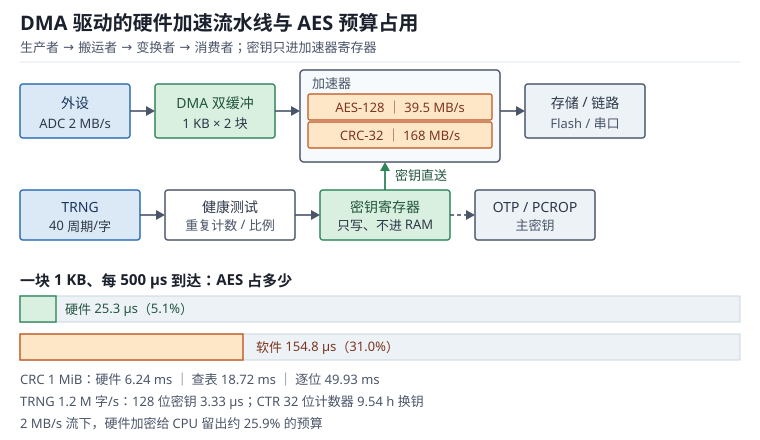

# 硬件加速外设：CRC、AES、TRNG 与加速流水线

**硬件加速器（Hardware Accelerator）**把一段固定的计算搬到专用电路里：CRC 单元每 4 个周期消化一个 32 位字，AES 协处理器每 16 字节块走完 10 轮，TRNG 从模拟噪声里挤出熵。它们不占用 CPU 的指令周期，代价是把"算法正确性"变成"配置正确性"——多项式、位序、初值、模式、密钥字节序，任何一项配错都不会报错，只会算出一串看起来同样随机的错误结果。

本章按"校验怎么算（CRC 的多项式与位序）→ 加密怎么配（AES 与真随机数）→ 数据怎么流（DMA 驱动的流水线）→ 密钥怎么保（侧信道与保护）"展开。性能部分给出软件实现与硬件加速的可复算对比，安全部分给出威胁模型与对应的工程手段。

DMA 通道与双缓冲的细节见[DMA](dma.md)，Cache 对加速器缓冲区的可见性见[MPU 与 Cache](mpu-cache.md)；Cortex-M7 上加速器与 CPU 共享总线时的抢占，可以对照[中断与 NVIC](interrupt-nvic.md) 的延迟数据。

## 1. 动机：四个现场

::: motivation 四个现场
**现场一：STM32 算出的 CRC 和上位机对不上。** 同一份固件，MCU 侧算出 0x1A2B3C4D，PC 侧 zlib 算出 0x4D3C2B1A——字节序全反。原因是 STM32 的 CRC 不反射输入输出，而 zlib 的 CRC-32 反射；多项式、初值、异或值三项里错一项，结果就完全无关。

**现场二：AES 加密的配置文件，两块相同内容密文也相同。** 用的是 ECB 模式，泄露了"哪些块内容相同"这一结构信息；换成 CBC 或 CTR 后密文块才互不相同。

**现场三：上电立刻读 RNG 当密钥。** 模拟熵源需要起振时间，头几个字的相关性偏高；没有健康测试，熵源失效时也发现不了，密钥直接退化。

**现场四：DMA 加 AES 做流加密，最后一包总是少 16 字节。** CRYP 按 16 字节块工作，DMA 传了非整数倍长度，硬件等不到完整块就不产生输出；软件没有补零，也没有按块长切分。
:::

| 你想确认 | 先算 | 判据（工程经验值，非标准强制） |
|---|---|---|
| CRC 参数 | 多项式、初值、反射、异或值 | 四项与对端完全一致 |
| CRC 强度 | $2^{-n}$ 漏检概率 | 32 位用于数据完整性 |
| AES 吞吐 | 每块周期乘块数 | 大于数据率 5 倍 |
| 密钥寿命 | 计数器空间除以数据率 | CTR 计数器不溢出 |
| 熵源 | 每字周期与健康测试 | 最小熵达标再使用 |
| 侧信道 | 曲线数与信噪比 | 关键操作走硬件或常数时间 |

**不算会摔在哪**，四个带数字的代价：

1. **CRC 漏检率按 16 位估。** 10 kHz 报文、每条都含随机错误时，CRC-16 一年漏检约 481 万次，CRC-32 约 73 次；两者都说明"只靠 CRC 不够"，还需要序号与重传。
2. **AES 用软件跑 2 MB/s 的流。** 软件 26 周期每字节在 168 MHz 上是 6.46 MB/s，处理 1 KB 要 154.8 µs；500 µs 的半缓冲预算里占 31%，CPU 基本被加密吃满。
3. **CTR 计数器回绕。** 32 位块计数器在 2 MB/s 下 9.5 小时就用完，回绕后同一密钥流被复用，密文可被直接异或还原。
4. **侧信道按"软件加密加个密钥"就算完。** 无保护的 AES 在几千条功耗曲线内就能恢复密钥，按 200 条每秒的采集速度不到 1 分钟。

## 2. 直观：从校验到加密的流水线

### 2.1 原理图：ADC、DMA、加速器与存储

硬件加速的典型结构是一条"生产者 → 搬运者 → 变换者 → 消费者"的流水线：外设产生数据，DMA 负责搬运，加速器就地变换，CPU 只在块边界处理。整条链路的吞吐由最慢的一级决定，而不是由 CPU 主频决定。

上图把加速链拆成四段：左侧外设以固定速率产生数据；中间的 DMA 用双缓冲把数据切成块；AES 与 CRC 并联工作，前者保证机密性、后者保证完整性；右侧把结果写回存储或送通信接口。下方是密钥路径：TRNG 产生随机数，经条件化后写入密钥寄存器，密钥本身不应长时间停留在普通 RAM 里。

四个角色各自的约束：

- **生产者**：速率固定（如 1 Msps 的 ADC），不能等。
- **搬运者**：DMA 有突发长度与 FIFO 阈值，块大小要与加速器的数据宽度对齐。
- **变换者**：CRC 按字处理、AES 按 16 字节块处理，都要求长度是整数倍。
- **消费者**：CPU 或通信接口，按块处理，不能追不上生产者。

### 2.2 CRC：多项式、位序与种子

CRC 的本质是"把数据当作一个巨大的二进制多项式，除以生成多项式取余数"。硬件实现是一个带异或反馈的移位寄存器：

$$R(x)=\left(M(x)\cdot x^{n}\right)\bmod G(x)$$

$M(x)$ 是数据多项式，$G(x)$ 是 $n$ 次生成多项式，$R(x)$ 是 $n$ 位余数。工程上不关心符号，关心的是四个参数：

| 参数 | 含义 | 常见取值 |
|---|---|---|
| 多项式 | 生成多项式去掉最高位后的表示 | 0x04C11DB7（32 位）、0x1021（16 位） |
| 初值 | 寄存器初值 | 0xFFFFFFFF 或 0x0000 |
| 反射 | 输入/输出是否按位反转 | zlib 都反射，STM32 都不反射 |
| 异或值 | 输出前异或的常数 | 0xFFFFFFFF 或 0 |

STM32 的 CRC 单元配置是"多项式 0x04C11DB7、初值 0xFFFFFFFF、不反射、不异或"，等价于 CRC-32/MPEG-2。它与常见的 zlib CRC-32 不是同一个算法：zlib 用反射多项式 0xEDB88320，输入输出都反射，最后异或 0xFFFFFFFF。两套参数算出的结果没有简单的位反转换算关系，所以"MCU 算出来和 PC 差一个位反转"是典型症状，但正确做法是按对端定义重算，而不是补一条反转指令。

位序问题还有一层：STM32 写 32 位数据寄存器时，字内的四个字节按**大端**顺序进入运算，而 Cortex-M 是小端存储。用 32 位写方式喂一段内存缓冲区，每个 4 字节组的字节顺序会被交换，结果与逐字节喂入不同。要得到与软件逐字节一致的结果，要么按字节写数据寄存器，要么先把缓冲区做字节交换。

CRC 的检错能力来自多项式性质：所有长度不超过 $n$ 的突发错误、所有奇数个比特错误（生成多项式含 $x+1$ 因子时）、以及大部分随机错误都能检出；对随机数据，漏检概率是：

$$P_{undetected}\approx2^{-n}$$

$n$ 是 CRC 位宽。32 位是 $2.33\times10^{-10}$，16 位是 $1.53\times10^{-5}$，差了六个数量级。

### 2.3 AES 与真随机数

AES（Advanced Encryption Standard，高级加密标准）是分组密码，分组固定 16 字节，密钥 128、192 或 256 位，对应 10、12、14 轮。硬件协处理器通常有 128 位数据通路、独立密钥寄存器、输入输出 FIFO，并能发 DMA 请求。

模式选择比算法选择更容易出错：

| 模式 | 是否需要 IV | 并行性 | 典型用途 | 主要风险 |
|---|---|---|---|---|
| ECB | 否 | 块间可并行 | 单块密钥包装 | 相同明文块产生相同密文块 |
| CBC | 是 | 加密串行、解密并行 | 文件与固件加密 | IV 可预测会泄露首块 |
| CTR | 是（计数器） | 完全并行 | 流式数据、通信 | 计数器重用即密钥流重用 |
| GCM | 是（nonce） | 并行 | 带认证的通信 | nonce 重用会同时破坏机密性与完整性 |

CTR 模式的计数器空间决定了密钥寿命：32 位块计数器、16 字节一块，最多加密 $2^{32}\times16=64$ GiB，超过就必须换密钥或换 nonce。GCM 的 nonce 一般 96 位，其中 32 位计数器同样只有 64 GiB 的余量。

随机数分两类。**TRNG（True Random Number Generator，真随机数发生器）**从模拟噪声取熵，STM32 的 RNG 每 40 个 RNG 时钟周期产生一个 32 位字，48 MHz 下约 120 万字每秒；它必须配合健康测试（重复计数、自适应比例）和条件化后才能作为密钥源。**DRBG（Deterministic Random Bit Generator，确定性随机比特发生器）**用 TRNG 做种子，再用 AES 或哈希扩展，速度快但熵不超过种子。

### 2.4 DMA 驱动的加速流水线

加速器很少单独工作，它的价值在"CPU 不参与"的流水线里。一条典型的加密发送链路是：

1. 应用把明文写进缓冲区 A，调用 `HAL_CRYP_Encrypt_DMA`。
2. DMA 把 A 搬进 CRYP 的输入 FIFO，CRYP 逐块加密，输出 FIFO 触发 DMA 请求。
3. DMA 把密文搬到发送缓冲区 B，同时 SPI/UART 的 DMA 把 B 发出去。
4. 传输完成中断里切换缓冲，处理下一块。

这条链上有三个必须对齐的量：**块长**（AES 要求 16 的整数倍）、**FIFO 阈值**（4 个字即 16 字节最自然）、**DMA 突发长度**（与 FIFO 深度匹配）。任何一项不对齐，轻则多一次中断，重则最后一包被截断。

### 2.5 侧信道与密钥保护

侧信道（Side Channel）指通过功耗、电磁辐射、执行时间等物理量推断密钥的攻击。三类常见形式：

- **时序与缓存攻击**：软件 AES 的查表下标依赖密钥，缓存命中与否泄露下标，进而泄露密钥。T 表实现尤其明显。
- **简单功耗分析（SPA）**：从一条功耗曲线上直接看出分支或操作数重量。
- **差分功耗分析（DPA）**：采集大量曲线，按猜测密钥分组求相关性，逐字节恢复密钥。所需曲线数与信噪比的平方成反比。

对应的防护分三层：

1. **算法层**：用常数时间实现（无查表、无数据相关分支），或用硬件 AES（数据通路与密钥无关）。
2. **硬件层**：密钥放 OTP 或受保护的密钥区，读保护（RDP）、专有代码读出保护（PCROP）、调试口锁定。
3. **系统层**：密钥分层（主密钥保护会话密钥）、定期换钥、用完立刻清零、不把密钥写进日志或 core dump。

硬件 AES 不等于"免疫侧信道"，它只是把攻击面从缓存时序换成了功耗相关性；高安全场景还要加随机掩码、双轨逻辑或噪声注入。

## 3. 定量：吞吐、碰撞与熵

### 3.1 静态分析：参数与长度约束

静态检查是"不运行时看配置对不对"：

| 检查项 | 内容 | 违反后果 |
|---|---|---|
| CRC 参数 | 多项式、初值、反射、异或 | 与对端结果不一致 |
| CRC 数据宽度 | 8/16/32 位写与字节序 | 结果随写入方式变化 |
| AES 模式 | ECB 是否被误用 | 结构信息泄露 |
| AES 块长 | 数据长度是否为 16 的整数倍 | 末块不输出或补零错误 |
| 密钥来源 | TRNG 是否等待就绪 | 密钥质量下降 |
| DMA 对齐 | 缓冲区与 FIFO 宽度 | 传输效率减半或截断 |

其中"CRC 数据宽度"最容易被忽略：同一段数据用 32 位写和逐字节写会得到不同结果，而两种写法在代码里看起来都"正确"。

### 3.2 动态分析：吞吐、延迟与流水线平衡

CRC 单元的吞吐由"每个字几个周期"决定。按每 4 个周期处理一个 32 位字估算：

$$B_{CRC}=\frac{4\ \text{B}}{4/f}=f=168\ \text{MB/s}$$

$f$ 是 CRC 单元时钟（168 MHz）。1 MiB 数据需要：

$$t=\frac{1048576}{168\times10^{6}}=6.24\ \text{ms}$$

同样的数据用软件算：查表法约 3 周期每字节，逐位法约 8 周期每字节：

$$t_{table}=\frac{1048576\times3}{168\times10^{6}}=18.72\ \text{ms},\qquad t_{bit}=\frac{1048576\times8}{168\times10^{6}}=49.93\ \text{ms}$$

加速比分别是 3 倍和 8 倍。CRC 的加速比不如 AES 显眼，因为它本身每字节的计算量就小。

AES 的软件实现按 T 表法约 26 周期每字节：

$$B_{sw}=\frac{168\times10^{6}}{26}=6.46\ \text{MB/s}$$

硬件按"每 16 字节块 8 个总线周期加 60 个核心周期"估算：

$$B_{hw}=\frac{16}{68}\times168\times10^{6}=39.5\ \text{MB/s}$$

加速比：

$$\frac{39.5}{6.46}=6.12$$

每块 68 个周期对应每秒 247 万个 128 位块。AES-256 是 14 轮，核心周期按比例增加到 84，每块 92 周期，吞吐降到 29.2 MB/s——密钥每长 64 位，吞吐掉约 26%。软件侧的 AES-256 同样变慢，按 36 周期每字节算只有 4.6 MB/s。

| 功能 | 软件实现 | 硬件加速 | 加速比 |
|---|---|---|---|
| CRC-32（1 MiB） | 18.72 ms（查表） | 6.24 ms | 3.0 |
| AES-128 加密 | 6.46 MB/s | 39.5 MB/s | 6.1 |
| AES-256 加密 | 4.6 MB/s | 29.2 MB/s | 6.3 |
| 随机数 | 约 130 MB/s（非密码学 PRNG） | 4.8 MB/s（TRNG） | 熵质量不同，不可直接比 |

### 3.3 环路与稳定性：握手、背压与密钥寿命

流水线的稳定性是"最慢一级决定一切"。设生产者速率 $R_p$、加速器速率 $R_a$、消费者速率 $R_c$，稳态不丢数据的条件是：

$$\min(R_a,\ R_c)\ge R_p$$

$R_p$ 是数据产生率，$R_a$ 是加速器吞吐，$R_c$ 是下游消费率。以 2 MB/s 的 ADC 流为例，硬件 AES 的 39.5 MB/s 远大于它，余量 19 倍；软件 AES 的 6.46 MB/s 只有 3.2 倍余量，而且每次加密是阻塞式的：

$$U_{sw}=\frac{154.8}{500}=31.0\%$$

$U_{sw}$ 是软件加密在 500 µs 半缓冲周期里的占用。31% 意味着 CPU 还有余量，但任何一次更长的中断都会让流水线错过下一个半缓冲。

反过来，加速器太快也会出问题：如果加速器与 DMA 的握手没有背压（backpressure），输出 FIFO 满了之后要么丢数据，要么覆盖未读走的块。可靠的握手需要三个信号：输入有效、输出就绪、错误（如块长不对）。软件上表现为"HT 中断来了但上一块还没处理完"，这时要暂停 DMA 或者扩大缓冲。

密钥寿命是另一条"环路"：CTR 的计数器每加密一块加一，加满就回绕，回绕后密钥流重复。32 位计数器、2 MB/s：

$$t_{rekey}=\frac{2^{32}\times16}{2\times10^{6}}=34360\ \text{s}=9.54\ \text{h}$$

9.5 小时必须换钥，否则同一密钥流被复用。工程做法是把计数器扩到 64 位（nonce 64 位加计数器 64 位，共 128 位），把寿命拉到设备生命周期之外，或者在协议层每会话换钥。

### 3.4 取值与权衡：CRC 宽度、AES 模式与随机源

| 维度 | 选项 | 适用 | 边界 |
|---|---|---|---|
| CRC 宽度 | 16 位 | 短报文、低成本 | 漏检 $1.5\times10^{-5}$ |
| | 32 位 | 固件、长数据、存储 | 漏检 $2.3\times10^{-10}$ |
| AES 密钥 | 128 位 | 通用 | 10 轮，吞吐最高 |
| | 256 位 | 长期数据、合规要求 | 14 轮，吞吐降 26% |
| AES 模式 | CTR | 流式、随机访问 | 计数器绝不能重用 |
| | GCM | 需要完整性 | nonce 重用即灾难 |
| 随机源 | TRNG 直出 | 密钥、nonce | 速率 4.8 MB/s，需健康测试 |
| | DRBG | 大量随机数 | 熵不超过种子 |

三条选择规则：

1. **CRC 宽度按数据价值选。** 通信报文用 16 位够，固件镜像和存储用 32 位；两者都要配合序号、长度和重传，CRC 只解决"传错"，不解决"重放"。
2. **AES 模式按是否需要认证选。** 只要机密性用 CTR，要机密性加完整性用 GCM；ECB 只用于单块密钥包装这类"数据本身没有结构"的场合。
3. **随机源按熵需求选。** 密钥、IV、nonce 必须来自 TRNG 或 TRNG 播种的 DRBG；会话标识、退避延时这类"只要不重复"的量用 DRBG 即可。

## 4. 算例：五个可复算的账

### 4.1 CRC 的漏检概率与生日界

对随机数据，32 位 CRC 的漏检概率：

$$P=2^{-32}=2.33\times10^{-10}$$

10 kHz 报文、假设每条都发生一次随机错误，一年（$3.1536\times10^{7}$ 秒）的漏检次数：

$$N=10^{4}\times3.1536\times10^{7}\times2.33\times10^{-10}=73.4\ \text{次/年}$$

同样条件下 CRC-16：

$$N=10^{4}\times3.1536\times10^{7}\times1.53\times10^{-5}=4.81\times10^{6}\ \text{次/年}$$

这个数字说明 CRC 不是"够了就行"：73 次每年仍然要求上层有重传与序号。另一个视角是碰撞界：把 CRC 当作 32 位哈希，$k$ 条报文中出现任意两条同余的概率约为 $k^2/2^{33}$，临界点：

$$k_{crit}=\sqrt{2\times2^{32}}=92682$$

$k=10^{5}$ 时碰撞概率：

$$1-e^{-10^{10}/2^{33}}=68.8\%$$

所以"用 CRC 当消息 ID"是不可靠的，CRC 只用于检错。

### 4.2 硬件与软件 CRC 的时间

1 MiB 数据、168 MHz：

$$t_{hw}=6.24\ \text{ms},\qquad t_{table}=18.72\ \text{ms},\qquad t_{bit}=49.93\ \text{ms}$$

如果每 10 ms 要对 64 KB 数据做一次校验，硬件方案耗时：

$$t_{hw}=\frac{65536}{168\times10^{6}}=0.39\ \text{ms},\qquad U_{hw}=\frac{0.39}{10}=3.9\%$$

软件查表方案是 1.17 ms、占 11.7%；逐位方案是 3.12 ms、占 31.2%。**校验频率越高，硬件 CRC 的价值越明显**，因为它把 31% 的 CPU 占用压到 4%。

### 4.3 AES 吞吐与流水线占用

2 MB/s 的采样流、1000 字节半缓冲、每 500 µs 一块。硬件 AES 处理 1000 字节：

$$t_{hw}=\frac{1000}{39.5\times10^{6}}=25.3\ \mu\text{s},\qquad U_{hw}=\frac{25.3}{500}=5.1\%$$

软件 AES：

$$t_{sw}=\frac{1000}{6.46\times10^{6}}=154.8\ \mu\text{s},\qquad U_{sw}=\frac{154.8}{500}=31.0\%$$

硬件把 31.0% 压到 5.1%，省下的 25.9 个百分点可以跑协议栈或控制环。注意 5.1% 是"加速器忙"的时间，不是 CPU 占用；如果 DMA 配置得当，CPU 只在块边界进一次中断。

### 4.4 TRNG 的产率与密钥生成

STM32 的 RNG 每 40 个 RNG 时钟周期产生一个 32 位字，RNG 时钟 48 MHz：

$$R=\frac{48\times10^{6}}{40}=1.2\times10^{6}\ \text{字/s}=4.8\ \text{MB/s}$$

生成一个 128 位密钥需要 4 个字：

$$t_{key}=\frac{4\times40}{48\times10^{6}}=3.33\ \mu\text{s}$$

每秒生成 1000 个会话密钥只占用 TRNG 产率的：

$$\frac{1000\times3.33\times10^{-6}}{1}=0.33\%$$

余量极大。真正的约束不是速率，而是**健康测试的误报率**：若用"连续两个 32 位字相同即判失败"这种简单规则，随机情况下每 $2^{32}$ 对出现一次，1.2 兆字每秒下平均 59.7 分钟误报一次——设备会莫名其妙地报熵源故障。

SP 800-90B 的重复计数测试把阈值和误报率、最小熵绑在一起：

$$C=1+\left\lceil\frac{-\log_2\alpha}{H}\right\rceil$$

$C$ 是连续相同样本数的上限，$\alpha$ 是单次判定的误报率，$H$ 是每个样本的最小熵（比特）。取 $\alpha=2^{-20}$、$H=4$ 位每样本，得到 $C=6$：连续 6 个 32 位字完全相同才判失败，而不是 2 个。阈值必须按熵估计与误报目标算，凭直觉取 1 会让设备每小时误报一次。

### 4.5 侧信道：曲线数与信噪比

DPA 所需曲线数与信噪比的平方成反比：

$$N_{traces}\propto\frac{1}{SNR^{2}}$$

设无防护 AES 在某个采集平台上需要 4000 条曲线，攻击者每秒能采 200 条：

$$t=\frac{4000}{200}=20\ \text{s}$$

如果加掩码把信噪比降到 1/16：

$$N'=4000\times16^{2}=1.024\times10^{6}$$

采集时间变成 5120 秒，约 85 分钟。这个量级说明：**掩码并不能消除泄漏，它只是把攻击成本抬到不划算**；工程上还要叠加密钥轮换、访问控制和物理防护。

## 5. 工程含义：互操作、保护与验证

### 5.1 与上位机对齐 CRC 与 AES

跨平台互通是加速器最常见的翻车点。对齐清单只有四行，但每一行都要实测：

1. 用同一份 256 字节测试向量，分别在 MCU 与 PC 上算 CRC，比较结果；不一致时逐项核对多项式、初值、反射、异或。
2. 检查数据喂入方式：按字节、按半字、按字写，结果可能不同；以"逐字节"为基准，其他方式用已知向量验证。
3. AES 用 NIST 的已知答案测试（KAT）向量验证密钥扩展与字节序，尤其是密钥寄存器的写入顺序。
4. 长度不是 16 整数倍时，明确补零规则，并在协议头里带上原始长度。

### 5.2 密钥保护的分层

密钥保护不是"打开读保护"一个开关，而是分层：

- **存储层**：密钥放 OTP 或受保护的 Flash 区，启用 RDP 与 PCROP；调试口在生产阶段永久关闭。
- **使用层**：密钥只进加速器的密钥寄存器，不在 RAM 里长期驻留；用完清零，避免 core dump 泄露。
- **协议层**：会话密钥由主密钥派生，定期更换；CTR/GCM 的 nonce 单调递增并持久化，防止掉电后重用。
- **物理层**：高安全场景加屏蔽罩、随机延迟、功耗噪声，抵抗侧信道与故障注入。

### 5.3 仿真与实验：已知答案与熵评估

1. **CRC 已知向量**：用 "123456789" 这个标准串，CRC-32/MPEG-2 的结果应为 0x0376E6E7；对不上就说明参数错。
2. **AES KAT**：FIPS 197 附录 C 给出密钥、明文、密文三元组，逐条跑通；再测 CBC/CTR 模式的 NIST 向量。
3. **吞吐实测**：用 `DWT->CYCCNT` 包住 64 KB 的加密或校验，换算成 MB/s，与 3.2 节的模型对比；偏差超过 30% 说明 DMA 或 FIFO 配置有问题。
4. **熵评估**：采集至少 100 万个 32 位样本，做重复计数、比例测试和最小熵估计；不要用"看起来随机"当结论。
5. **侧信道自查**：在关键操作前后加固定延时、比较不同密钥下的执行时间是否相同；时间差异超过一个周期就说明存在时序泄漏。

## 6. 常见坑

::: pitfall 坑一：CRC 与上位机差一个位反转
**现象**：MCU 与 PC 对同一份数据算出的 CRC 完全不同，但两边单独自测都"通过"。

**原因**：STM32 的 CRC 不反射，zlib 的 CRC-32 反射输入输出并异或 0xFFFFFFFF；多项式表示也不同（0x04C11DB7 对 0xEDB88320）。

**解决**：以对端算法为准，逐项对齐四个参数；用 "123456789" 的已知结果验证；软件侧按对端参数重新实现，不要试图用一次位反转把两种 CRC 互转。
:::

::: pitfall 坑二：32 位写入导致字节序错乱
**现象**：逐字节算的 CRC 与用 32 位 DMA 搬运后算的 CRC 不一致。

**原因**：STM32 的 CRC 数据寄存器按大端处理字内字节，而内存是小端；32 位写入时每个 4 字节组被交换。

**解决**：改用字节写入，或在 DMA 前对缓冲区做字节交换；把"喂入方式"写进接口文档，用固定向量回归。
:::

::: pitfall 坑三：CTR 模式的计数器重用
**现象**：两次会话的密文前 16 字节异或结果等于两段明文的异或，攻击者可以直接恢复内容。

**原因**：nonce 或计数器在重启后从头开始，同一密钥下重复使用同一密钥流。

**解决**：nonce 持久化并单调递增；每次上电从 Flash 读取上次值；密钥与 nonce 绑定，换钥必换 nonce。
:::

::: pitfall 坑四：AES 数据长度不是 16 的整数倍
**现象**：最后一包数据没有输出，或者输出比输入少几个字节。

**原因**：CRYP 按 16 字节块工作，不足一块时硬件不产生输出，DMA 却已经搬完了。

**解决**：在软件层补齐到 16 的整数倍并记录原始长度；DMA 传输长度与块长对齐；在完成中断里核对输入输出字节数。
:::

::: pitfall 坑五：RNG 未就绪就读，熵源还没起振
**现象**：上电后第一批密钥在高低温或低压条件下重复率偏高，个别设备甚至读出全零。

**原因**：模拟熵源需要稳定时间，`DRDY` 未置位就读取，或者没有检查种子错误标志。

**解决**：等待 `DRDY` 并检查 `SEIS` 与 `CEIS`；上电后丢弃前若干个字；用健康测试与最小熵评估确认后再用于密钥。
:::

::: pitfall 坑六：把密钥留在普通 RAM 里
**现象**：现场设备被读出固件后，密钥以明文形式出现在某个全局数组里。

**原因**：软件加密时把密钥解密到 RAM 缓冲区长期保存，且未启用读保护。

**解决**：密钥直接写入加速器密钥寄存器，用完清零；启用 RDP 与 PCROP；禁止把密钥区放进 core dump 或日志；对内存做上电清零。
:::

## 7. 自测题

题一：CRC-32 在 10 kHz、每条都含随机错误的链路上，一年漏检多少次？为什么还不能省掉重传？

单条漏检概率：

$$P=2^{-32}=2.33\times10^{-10}$$

一年的报文数：

$$N=10^{4}\times3.1536\times10^{7}=3.1536\times10^{11}$$

漏检数：

$$3.1536\times10^{11}\times2.33\times10^{-10}=73.4\ \text{次/年}$$

73 次每年对功能安全或计量场景仍然不可接受；而且这个模型假设"错误是随机的"，实际链路上的错误往往是突发的、相关的，CRC 对突发错误有界但不对抗恶意构造。所以 CRC 只提供检错，重传、序号、超时和认证要另外做。

题二：硬件 CRC 每 4 周期处理 32 位字，1 MiB 要多久？比软件查表快多少倍？

吞吐：

$$B=\frac{4}{4/168\times10^{6}}=168\ \text{MB/s}$$

1 MiB：

$$t=\frac{1048576}{168\times10^{6}}=6.24\ \text{ms}$$

软件查表 3 周期每字节：

$$t_{sw}=\frac{1048576\times3}{168\times10^{6}}=18.72\ \text{ms}$$

加速比：

$$\frac{18.72}{6.24}=3.0$$

CRC 的加速比只有 3 倍，因为软件 CRC 每字节本来就只有几条指令；硬件加速的价值主要在"不占 CPU"而不是"算得快"。

题三：2 MB/s 的流用 CTR 模式、32 位块计数器，密钥多久必须换？换成 64 位 nonce 呢？

计数器空间：

$$2^{32}\ \text{块}\times16\ \text{B}=64\ \text{GiB}$$

2 MB/s 下：

$$t=\frac{64\times2^{30}}{2\times10^{6}}=34360\ \text{s}=9.54\ \text{h}$$

把计数器扩到 64 位（nonce 64 位加计数器 64 位）后，计数空间变成 $2^{64}$ 块，按 2 MB/s 算需要约 $4.7\times10^{6}$ 年，寿命远超设备生命周期，可以只在会话层换钥。注意 nonce 本身必须唯一且持久化，掉电重启后不能重用。

题四：软件 AES 26 周期每字节、硬件 68 周期每 16 字节，加速比多少？1 KB 数据各占 500 µs 预算多少？

软件吞吐：

$$B_{sw}=\frac{168\times10^{6}}{26}=6.46\ \text{MB/s}$$

硬件吞吐：

$$B_{hw}=\frac{16}{68}\times168\times10^{6}=39.5\ \text{MB/s}$$

加速比：

$$\frac{39.5}{6.46}=6.12$$

1 KB 的耗时与占用：

$$t_{sw}=154.8\ \mu\text{s},\ U_{sw}=31.0\%;\qquad t_{hw}=25.3\ \mu\text{s},\ U_{hw}=5.1\%$$

硬件把 CPU 占用从三成压到 5%，代价是总线占用与配置复杂度。

题五：TRNG 每 40 周期出一个 32 位字、时钟 48 MHz，产率多少？生成 256 位密钥要多久？

产率：

$$R=\frac{48\times10^{6}}{40}=1.2\times10^{6}\ \text{字/s}$$

换算字节：

$$1.2\times10^{6}\times4=4.8\ \text{MB/s}$$

256 位密钥需要 8 个字：

$$t=\frac{8\times40}{48\times10^{6}}=6.67\ \mu\text{s}$$

这个速率对密钥、IV、nonce 绰绰有余；但对"每包都要新随机数"的高频协议，要评估是否会用 DRBG 扩展，因为 TRNG 的熵率通常低于它的输出率。

题六：为什么"用硬件 AES 就没有侧信道问题"是错的？硬件加速改变了什么、没改变什么？

硬件 AES 改变的是**执行路径与数据通路**：加密过程不再有依赖密钥的查表下标，缓存时序攻击面基本消失；密钥只存在专用寄存器里，不进入通用寄存器与栈。

没改变的是**功耗与电磁辐射仍然依赖密钥与数据**：CMOS 电路的翻转功耗与操作数相关，DPA 依然可以按猜测密钥分组做相关性分析。硬件实现只是把每条曲线的信噪比降低、把攻击所需的曲线数抬高，并没有消除相关性。

所以高安全场景要在硬件 AES 之外叠加掩码、随机插桩、噪声注入和密钥轮换；评估标准是"攻击成本是否高于数据价值"，而不是"有没有用硬件"。

## 8. 参考资料

- STMicroelectronics, RM0090 *STM32F405/407 参考手册*，CRC calculation unit 章与 Cryptographic processor (CRYP) 章。
- STMicroelectronics, RM0433 *STM32H743/753 参考手册*，Random number generator (RNG) 章与 CRYP 章。
- STMicroelectronics, AN4187 *Using the CRC peripheral in the STM32 family*，CRC 参数与软件实现的对应关系。
- STMicroelectronics, AN4230 *Getting started with the STM32 crypto library*，AES 模式、密钥管理与性能评估。
- NIST, FIPS 197 *Advanced Encryption Standard (AES)*，轮函数与密钥扩展。
- NIST, SP 800-90B *Recommendation for the Entropy Sources Used for Random Bit Generation*，健康测试与最小熵评估。
- NIST, SP 800-38A *Recommendation for Block Cipher Modes of Operation*，ECB/CBC/CTR 定义。
- Kocher, Jaffe, Jun, *Differential Power Analysis*, CRYPTO 1999，相关性模型与曲线数量估计。
