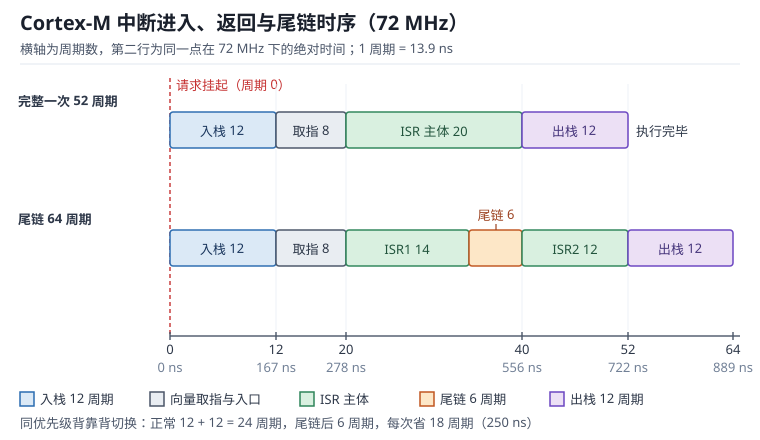

# 中断与 NVIC：向量表、优先级与响应延迟

轮询（Polling）让 CPU 反复去问"串口有没有收到字节、定时器到点没有"；中断（Interrupt）则相反，外设在需要 CPU 时主动把它拽过来。拽过来的动作全部由硬件完成：保存现场、从异常向量表取出入口地址、跳过去执行、返回时恢复现场，整个过程在几十个时钟周期内结束，不依赖任何软件调度。跳过去执行的那段代码叫中断服务程序（Interrupt Service Routine，ISR），它是本章的主角。

但"硬件很快"不等于"你的系统能达标"。中断延迟（Interrupt Latency）是 12 个周期还是 30 个周期、关中断 2 µs 还是 20 µs、同组中断能不能抢占、尾链（Tail-chaining）省下的时间有没有被 ISR 吃掉，这些量直接决定控制环的采样时刻是否稳定、通信会不会丢帧、看门狗会不会被误喂。本章按"入口怎么找（向量表）→ 谁先跑（优先级分组与抢占）→ 花了多少时间（12 周期入栈与延迟方程）→ 怎么把时间省回来（ISR 设计与主循环数据交换）"的顺序，把每个环节落到可复算的周期数上。

读本章前建议先建立外设寄存器的基本图景，见[嵌入式软件全景：从寄存器到 RTOS](../basics/embedded-overview.md)；定时器中断与 PWM 的配合见[定时器与 PWM](timer-pwm.md)，中断驱动的数据搬运见 [DMA](dma.md)。

## 1. 动机：为什么轮询不够

::: motivation 四个现场
**现场一：1 kHz 控制中断，ISR 写了 60 µs。** 单看"60 µs < 1000 µs 周期"觉得没问题，但 CPU 已被吃掉 6%；再加一个 10 kHz 的 3 µs 中断（3%）和一个 100 Hz 的 200 µs 中断（2%），总占用 11%，主循环只剩 89%。当主循环里再加一个 1 ms 的 Flash 擦写，deadline 立刻被击穿。

**现场二：关中断 10 µs 保护一个共享变量。** 控制中断每 50 µs 来一次，最坏情况下它刚好落在关中断窗口里，要等 10 µs 才能响应：中断延迟从 0.36 µs 变成 10.36 µs，抖动放大 29 倍。控制环的采样时刻因此漂移，电机电流出现低频纹波。

**现场三：串口中断里调用 `printf`。** `printf` 内部可能要几百微秒到几毫秒，还不可重入；更高优先级的中断被它挡住，看门狗喂狗被延迟，系统随机复位。工程师以为是"串口丢数据"，实际是 ISR 太长。

**现场四：优先级配了却没生效。** 代码里写了 `NVIC_SetPriority(USART1_IRQn, 1)`，电机中断是 0，结果串口中断仍然被电机中断打断。原因是优先级分组（Priority Grouping）把 4 个有效位切成了 2 位抢占 + 2 位子优先级，1 和 0 落在同一抢占级里，子优先级根本不参与抢占。
:::

| 你想确认 | 先算 | 判据（工程经验值，非标准强制） |
|---|---|---|
| 单次响应延迟 | $(12+w)/f_{CK}$ | 小于被服务事件周期的 10% |
| 最坏响应时间 | 所有更高优先级 ISR 之和 | 小于硬实时 deadline |
| CPU 中断占用 | $\sum f_i \cdot t_{ISR,i}$ | 小于 50%~60%，留余量给主循环 |
| 关中断时长 | 临界区指令周期数 | 单次小于 2 µs，总数每毫秒小于 10 µs |
| 栈深度 | 嵌套层数 × 栈帧大小 | 实测水位小于分配量的 70% |
| 优先级级数 | 抢占位数 | 4 级通常够用，超过 8 级难维护 |

**不算会摔在哪**，四个带数字的代价：

1. **延迟估算差 2~3 倍。** 72 MHz 下 12 个周期是 166.7 ns，但如果向量表放在带 2 个等待周期的外部 Flash，再加上流水线重填，实测常在 300~500 ns，是纸面值的 2~3 倍。
2. **优先级分组配错。** 4 个有效位全给抢占（16 级）时，两个中断只要有 1 个数值差就能互相打断；改成 2+2 分组后只有 4 个抢占级，原本"能抢占"的两个中断变成同组排队，最坏等待时间可能从 5 µs 涨到 25 µs。
3. **关中断时间失控。** 一个 32 位除法和一次 Flash 写就能让临界区超过 10 µs；在 20 kHz 电流环里，这相当于 20% 的采样周期抖动。
4. **栈溢出。** 每层嵌套 32 B 栈帧（Stack Frame，带 FPU 时 100 B），8 层嵌套加 FPU 就是 800 B；一个 2 KB 默认栈的工程在压力测试里必挂，而且挂的位置看起来毫不相关。

## 2. 直观：从外设请求到向量表跳转

### 2.1 原理图：NVIC 与外设、内核的连接

中断通路可以拆成四段：**外设产生请求 → NVIC 记录挂起与优先级 → 内核在指令边界比较优先级 → 从向量表取入口地址并压栈**。NVIC（Nested Vectored Interrupt Controller，嵌套向量中断控制器）是内核的一部分，不在总线外设里；它维护每个中断的使能位、挂起位、活动位和优先级，并在每个指令边界做一次优先级仲裁。



上图画的是同一次中断请求的两种处理路径：上行是"进入 → ISR → 返回"的完整序列，下行是"返回时发现还有挂起中断"的尾链路径。横轴同时标了周期数与 72 MHz 下的纳秒数，可以直接对照示波器读数。

外设与 NVIC 之间的连接有三类信号，理解它们能解释大部分"中断不触发"的问题：

- **请求线**：外设置位自己的标志（例如 USART 的 RXNE），请求线保持有效直到标志被清除。这意味着清除标志的时机决定了中断会不会重复进入。
- **使能位**：NVIC 的 ISER 寄存器按位使能；外设自身通常还有一个中断使能位（例如 USART_CR1.RXNEIE）。两级都开才会进中断，漏掉任何一级都表现为"标志置位但进不去"。
- **优先级**：每个中断一个字节的优先级寄存器（IPR），数值越小优先级越高。

### 2.2 向量表、异常号与 EXC_RETURN

Cortex-M 把中断统一建模为**异常（Exception）**：编号 1~15 是系统异常（复位、NMI、HardFault、SVCall、PendSV、SysTick 等），编号 16 起是外部中断 IRQ0、IRQ1……，最多到 240 个。**向量表（Vector Table）**是一个 4 字节对齐的地址数组，第 0 项不是函数指针，而是复位后要加载的初始主栈指针（MSP），第 1 项才是复位入口。

| 表内偏移 | 异常号 | 内容 | 说明 |
|---|---|---|---|
| 0x00 | - | 初始 MSP | 复位时由硬件加载，不执行代码 |
| 0x04 | 1 | Reset | 复位入口 |
| 0x08 | 2 | NMI | 固定优先级 -2 |
| 0x0C | 3 | HardFault | 固定优先级 -1，所有故障的兜底 |
| 0x2C | 11 | SVCall | RTOS 系统调用常用 |
| 0x38 | 14 | PendSV | RTOS 上下文切换常用 |
| 0x3C | 15 | SysTick | 系统节拍 |
| 0x40 | 16 | IRQ0 | 第一个外部中断 |

向量表的位置由 **VTOR（Vector Table Offset Register，向量表偏移寄存器，地址 0xE000ED08）** 决定。带 bootloader 的工程必须把 VTOR 指向应用区，否则中断会跳进 bootloader 的向量表，表现为"跳转后一开中断就 HardFault"。

进入异常时硬件自动压栈 8 个字，顺序固定（从低地址到高地址）：R0、R1、R2、R3、R12、LR、PC、xPSR。其中 PC 是被打断指令的地址，xPSR 的 IPSR 字段记录当前异常号。硬件同时把 LR 设成一个特殊值 **EXC_RETURN**，返回时只要执行 `BX LR`，内核就能认出这是异常返回并自动出栈。

| EXC_RETURN | 含义 |
|---|---|
| 0xFFFFFFF1 | 返回 Handler 模式，使用 MSP（嵌套返回） |
| 0xFFFFFFF9 | 返回 Thread 模式，使用 MSP（裸机主循环） |
| 0xFFFFFFFD | 返回 Thread 模式，使用 PSP（RTOS 任务） |
| 0xFFFFFFE1 / E9 / ED | 同上，但需要恢复 FPU 上下文（bit4=1） |

这张表解释了一个常见困惑：为什么在中断里读到的 LR 不是返回地址。因为异常返回不靠栈里的 LR，而靠这个魔术值；真正的返回地址在压栈的 PC 里。

### 2.3 优先级分组：抢占与子优先级

Cortex-M 的优先级字段是 8 位，但芯片厂商通常只实现高 4 位（STM32 的 `__NVIC_PRIO_BITS = 4`），所以实际可写 16 个等级。写入 IPR 时，逻辑优先级要左移 4 位：`NVIC_SetPriority(irq, 3)` 实际写进去的是 0x30。

8 位优先级字段被 **PRIGROUP（AIRCR[10:8]）** 分成两段：高位是**抢占优先级（Preemption Priority）**，低位是**子优先级（Subpriority）**。

| PRIGROUP | CMSIS 分组 | 抢占位 | 子优先级位 | 抢占级数 | 每级子级数 |
|---|---|---|---|---|---|
| 0b111 | GROUP_0 | 0 | 4 | 1 | 16 |
| 0b110 | GROUP_1 | 1 | 3 | 2 | 8 |
| 0b101 | GROUP_2 | 2 | 2 | 4 | 4 |
| 0b100 | GROUP_3 | 3 | 1 | 8 | 2 |
| 0b011 | GROUP_4 | 4 | 0 | 16 | 1 |

三条规则必须记牢：

1. **抢占只看抢占位。** 新中断的抢占值严格小于当前正在执行的中断的抢占值，才会立即抢占；相等或更大就排队等待。
2. **子优先级只决定"同时挂起时谁先跑"。** 两个中断同时挂起、抢占位相同时，子优先级小的先执行；但它不能打断已经在执行的同组中断。
3. **数值越小优先级越高。** 0 是最高可配置优先级；NMI 固定 -2、HardFault 固定 -1，永远高于任何可配置中断。

因此"优先级配了却没生效"几乎总是分组问题：在 GROUP_2 下，抢占值只有 0~3 四档，写 1 和 2 能抢占，写 1 和 1 就是同组。

### 2.4 尾链与晚到

**尾链（Tail-chaining）**是 Cortex-M 省时间的关键机制。正常情况下，一次中断结束要先把 8 个寄存器出栈（12 周期），下一个中断再重新入栈（12 周期），合计 24 周期。如果返回时发现还有挂起的中断，且它的优先级高于被抢占的上下文，硬件会跳过出栈直接取新向量，只花约 6 个周期。

**晚到（Late Arrival）**发生在入栈过程中：如果压栈还没结束，一个更高优先级的中断到达，内核不会重复压栈，而是直接把向量取指切换成新中断的入口。软件上完全不感知，代价是额外一次向量取指和流水线重填。

这两个机制对软件是透明的，但它们解释了为什么"中断密集但每个都很短"的系统，实际 CPU 占用会比逐次估算更低；也解释了为什么把大量中断配成同一优先级，反而可能比配成多级更快——同优先级之间没有抢占，全部走尾链。

## 3. 定量：入栈 12 周期与延迟方程

这一节分四层看：先看配置空间（静态分析），再看时序（动态分析），再看它对闭环控制的影响（环路），最后给出取值边界（权衡）。

### 3.1 静态分析：VTOR、IPR 与 PRIGROUP 的配置空间

静态分析就是"不运行时序，只看寄存器和地址布局能不能自洽"。三件事必须对：向量表地址与对齐、优先级写入格式、分组寄存器。

| 寄存器 | 地址 | 作用 | 常见错误 |
|---|---|---|---|
| VTOR | 0xE000ED08 | 向量表基址 | 忘记重定位，或地址不对齐 |
| ISER/ICER | 0xE000E100/180 | 中断使能/禁用 | 只开了外设使能，没开 NVIC |
| ISPR/ICPR | 0xE000E200/280 | 挂起/解挂 | 用软件触发后不清 pending |
| IPR | 0xE000E400 | 每中断 1 字节优先级 | 直接写 0~15 而不是左移 4 位 |
| AIRCR | 0xE000ED0C | PRIGROUP 分组 | 运行中改分组，已有优先级语义改变 |
| STIR | 0xE000EF00 | 软件触发中断 | 用于调试，不用于正常业务 |

**向量表大小与对齐**可以精确算出来。表项数等于 16 个系统异常加外部中断数，每项 4 字节。以 82 个中断请求的器件为例：

$$N_{entry}=16+82=98,\qquad S=98\times 4=392\ \text{B}$$

$$S_{align}=2^{\lceil \log_2 392 \rceil}=512\ \text{B}$$

所以 VTOR 必须按 512 字节对齐。放在 0x08004000 是合法的（0x4000 能被 512 整除），放在 0x08004200 就会被硬件忽略低 9 位，中断跳飞到错误地址。

**优先级编码**也是静态可查的。4 个有效位对应逻辑优先级 0~15，写入 IPR 时占高 4 位：

$$P_{IPR}=P_{logical}\ll 4,\qquad P_{logical}\in[0,15]$$

在 GROUP_2 下，逻辑值又被拆成抢占与子优先级两段：

$$P_{pre}=P_{logical}\gg 2,\qquad P_{sub}=P_{logical}\bmod 4$$

于是逻辑优先级 5 表示抢占级 1、子优先级 1。若两个中断分别配 4 和 5，它们同属抢占级 1，不能互相抢占。

### 3.2 动态分析：入栈、取向量与 12 周期

硬件中断延迟的公认数字是 **12 个周期入栈**（8 个寄存器，零等待存储器；这是 Cortex-M3/M4 的数字，M0/M0+ 的周期数不同，要查对应内核手册）。把它写成方程：

$$t_{entry}=\frac{12+w}{f_{CK}}$$

其中 $t_{entry}$ 是硬件进入延迟（s）；$w$ 是额外等待周期（向量取指时的 Flash 等待、总线仲裁、栈写入等待），典型 0~8；$f_{CK}$ 是内核时钟频率（Hz）。

如果关心"到 ISR 第一条指令"的总响应时间，还要加软件入口的开销：

$$t_{resp}=\frac{12+w+c_{pro}}{f_{CK}}$$

$c_{pro}$ 是编译器生成的入口代码周期数（保存被调用者寄存器、清标志、跳转），典型 4~12 个周期。

完整的一次"进-出"是进入加返回：

$$t_{cycle}=t_{resp}+\frac{12}{f_{CK}}$$

把周期数推广成一般形式：只要知道从请求挂起到响应之间的总周期数 $n$，延迟就是

$$t_{lat}=n\times\frac{1}{f_{CK}}$$

$n$ 取 26 时是"到 ISR 第一条指令"的入栈加取指加软件入口，取 38 时是完整进出；同样 72 MHz，两者相差 46%。报告延迟指标时必须写清 $n$ 的口径，否则两个工程师会对同一个系统给出 361 ns 和 528 ns 两个"都对"的答案。

有更高优先级中断嵌套时，最坏响应时间是所有可能挡在前面的 ISR 之和：

$$t_{worst}=\sum_{i=1}^{k}t_{ISR,i}+k\cdot t_{entry}+t_{resp}$$

$k$ 是可能抢占它的更高优先级中断个数。注意这里每一项都要算"最坏剩余时间"：如果第 $i$ 个 ISR 已经执行了一半，剩余时间按一半算，但工程上通常直接按全额估。

**尾链把 24 周期压到 6 周期**。对 $n$ 次背靠背切换，节省的时间是：

$$t_{save}=n\cdot(24-6)\cdot\frac{1}{f_{CK}}=\frac{18n}{f_{CK}}$$

**FPU 会加长栈帧**。Cortex-M4F 在浮点上下文活跃时，额外压入 S0~S15 与 FPSCR 共 17 个字（68 字节）；由于采用惰性压栈（Lazy Stacking），这部分只在确实需要时才写入，代价是额外约 17 个周期。因此带浮点的 ISR 单次进入可能是 12+17=29 周期，而不是 12。

### 3.3 环路稳定性：中断抖动怎样吃掉相位裕度

中断延迟进入控制系统后有两条路径：**确定性延迟**（每次采样都晚固定的时间）会直接变成相位滞后；**随机抖动**（每次早晚不一样）主要把采样时刻与开关噪声错开，表现为低频噪声而不是明显的相位损失。分清这两者，才知道该优化什么。

确定性延迟 $\tau$ 在环路频率 $f_{bw}$ 处产生的相位滞后是：

$$\Delta\varphi=2\pi f_{bw}\tau,\qquad \Delta\varphi_{deg}=360^{\circ}\cdot f_{bw}\tau$$

按采样周期计更方便。若采样率 $f_s$、总延迟相当于 $n$ 个采样周期，则：

$$\Delta\varphi_{deg}=360^{\circ}\cdot\frac{f_{bw}}{f_s}\cdot n$$

随机抖动 $\sigma_t$ 的相位扰动用标准差表示：

$$\sigma_{\varphi}=2\pi f_{bw}\sigma_t\ \text{rad}$$

代入数字就能看出主次。20 kHz 采样、环路带宽 2 kHz、采样与计算合计 1.5 个周期延迟：

$$\tau=1.5\times\frac{1}{20000}=75\ \mu\text{s},\qquad \Delta\varphi_{deg}=360\times\frac{2000}{20000}\times 1.5=54^{\circ}$$

54° 的滞后足以把 45° 的相位裕度吃成负数。同样的环路，如果只是抖动 2 µs：

$$\sigma_{\varphi}=2\pi\times 2000\times 2\times 10^{-6}=0.0251\ \text{rad}=1.44^{\circ}$$

而抖动放大到 20 µs（例如被一个长临界区挡住）也只有 14.4°。结论很明确：**先压缩确定性延迟（提高采样率、提前采样、减少计算链），再治理抖动**。把中断优先级提到最高、把 ISR 改短，改善的是抖动，不是那 54°。

补偿方向也随之确定：用定时器在 PWM 中心对齐时刻硬件触发 ADC，把采样时刻钉死在开关噪声的对称点上，抖动从微秒级压到纳秒级；计算延迟用前馈或状态观测器补，而不是靠"把中断调快"。这也是为什么电机控制里采样触发必须走定时器硬件，而不是软件循环里随手启动。

### 3.4 取值与权衡：分组粒度、栈深度与 ISR 预算

三个参数互相牵制，不存在"都取最大"的解。

**抢占级数**决定嵌套深度，嵌套深度决定栈。抢占级越多，优先级分配越灵活，但任何一级都可能被更高一级打断，最坏栈深度随级数线性增长，调试时也更难复现时序。工程上 4 个抢占级（GROUP_2）覆盖绝大多数场景：一级给故障与安全，一级给控制环，一级给通信，一级给低速人机接口。

**栈深度**按最坏嵌套算，而不是按典型值：

$$S_{stack}=S_{main}+k\cdot(S_{frame}+S_{fp}+S_{pad})+S_{local}$$

$S_{frame}=32$ B 是 8 字硬件栈帧；$S_{fp}=68$ B 是 FPU 扩展；$S_{pad}=4$ B 是对齐填充（栈指针 8 字节对齐时可能需要一个字）；$S_{local}$ 是 ISR 局部变量与调用深度。5 层嵌套、带 FPU、主栈 1 KB 时：

$$S_{stack}=1024+5\times(32+68+4)=1024+520=1544\ \text{B}$$

占 8 KB SRAM 的 18.8%。这个量必须用运行时水位实测校验，不能只靠静态估算。

**ISR 预算**用两条线卡：单个 ISR 不超过其触发周期的 20%，全部中断的 CPU 占用不超过 60%。超了就把工作拆成"中断里只入队、主循环里处理"的两段式。

| 参数 | 典型取值 | 边界与失效条件 |
|---|---|---|
| 抢占级数 | 4（GROUP_2） | 超过 8 级后优先级分配不可维护 |
| 单 ISR 时长 | 小于周期的 20% | 超过 50% 时抖动不可控 |
| 总中断占用 | 小于 60% | 超过 80% 时主循环饥饿 |
| 单次临界区 | 小于 2 µs | 超过 10 µs 时 20 kHz 环路失效 |
| 栈水位 | 小于分配量 70% | 超过 90% 时随机 HardFault |

## 4. 算例：六个可复算的延迟账

### 4.1 算例一：72 MHz 下单次响应与完整进出

取 $f_{CK}=72$ MHz，$w=6$（向量取指遇到 2 个 Flash 等待周期，加流水线重填），$c_{pro}=8$。

$$t_{resp}=\frac{12+6+8}{72\times 10^{6}}=\frac{26}{72\times10^{6}}=361.1\ \text{ns}$$

完整进出再加 12 个周期：

$$t_{cycle}=\frac{38}{72\times10^{6}}=527.8\ \text{ns}$$

验算：$1/72\ \text{MHz}=13.89$ ns，$26\times13.89=361.1$ ns，$38\times13.89=527.8$ ns，与上式一致。这个量级与示波器实测的 0.3~0.5 µs 吻合。

### 4.2 算例二：尾链省下的时间

10 个同优先级中断在 1 ms 内背靠背到达。不用尾链时每次切换 24 周期，用尾链 6 周期，每次省 18 周期：

$$t_{save}=10\times18\times\frac{1}{72\times10^{6}}=\frac{180}{72\times10^{6}}=2.5\ \mu\text{s}$$

占 1 ms 的 0.25%。单看不大，但如果中断率是 100 kHz（每 10 µs 一次），节省量变成 25%，这时"配成同优先级走尾链"就是实打实的优化手段。

### 4.3 算例三：CPU 占用账

三个中断的负载：

| 中断 | 频率 | ISR 时长 | 每秒时间 | 占用 |
|---|---|---|---|---|
| 控制环 | 1 kHz | 20 µs | 20 ms | 2.0% |
| 通信 | 100 Hz | 200 µs | 20 ms | 2.0% |
| 采样 | 10 kHz | 3 µs | 30 ms | 3.0% |

合计 70 ms/s = 7.0%。再算进入/返回的固定开销：总中断率 1000+100+10000 = 11100 次/s，每次 24 周期：

$$U_{ovh}=\frac{11100\times24}{72\times10^{6}}=\frac{266400}{72\times10^{6}}=0.37\%$$

总占用 7.37%。这说明在 72 MHz 上，固定开销远小于 ISR 本身；真正需要压缩的是 200 µs 的通信 ISR——它 100 Hz 才来一次，却占了 2%。

### 4.4 算例四：同组不抢占带来的抖动

8 个中断分到 4 个抢占级，平均每级 2 个。同一级内最长的 ISR 是 20 µs。20 kHz 控制环的周期是 50 µs，如果控制中断与这个 20 µs 的中断同组，最坏情况下要等它执行完：

$$\text{抖动比例}=\frac{20}{50}=40\%$$

按 1.5 周期延迟折算，这 20 µs 在 2 kHz 带宽处产生：

$$\Delta\varphi_{deg}=360\times\frac{2000}{20000}\times\frac{20}{50}=14.4^{\circ}$$

也就是说，一次分组失误就能吃掉 14.4° 的相位裕度，相当于把 45° 的设计目标降到 30.6°。

### 4.5 算例五：采样延迟与相位裕度

20 kHz 采样、2 kHz 带宽、1.5 个周期延迟，前一节已算得 54°。如果把采样率提到 40 kHz，同样的 1.5 周期延迟变成 37.5 µs：

$$\Delta\varphi_{deg}=360\times\frac{2000}{40000}\times1.5=27^{\circ}$$

相位损失减半，代价是 CPU 中断率翻倍、每次 ISR 的可用时间减半。这就是"提高采样率"与"ISR 预算"之间的直接交换。

### 4.6 算例六：栈深度

5 层嵌套、带 FPU、主栈 1 KB，按 3.4 节公式得 1544 B。若去掉 FPU：

$$S_{stack}=1024+5\times(32+4)=1204\ \text{B}$$

省 340 B。若嵌套降到 3 层且带 FPU：$1024+3\times104=1336$ B。这三个数字说明：**FPU 与嵌套层数对栈的影响是同量级的**，在 SRAM 只有 8~20 KB 的器件上必须一起算。

## 5. 工程含义：ISR 设计与主循环的数据交换

### 5.1 ISR 设计的三条铁律

1. **短。** ISR 里只做"搬运、清标志、置事件"，把解析、计算、打印留给主循环。判断标准是单 ISR 不超过触发周期的 20%。
2. **不可阻塞。** 不调用 `printf`、`malloc`、延时、等待信号量的阻塞版本。这些函数通常不可重入、可能关中断、可能耗时毫秒级。
3. **可重入。** 任何被 ISR 与主循环同时访问的变量都要有明确的并发约定：要么原子访问，要么临界区，要么单生产者单消费者队列。

清标志的顺序同样重要。以 USART 接收为例：先读状态寄存器再读数据寄存器，硬件才会清 RXNE；如果先读数据再读状态，或者在中断里只清了自己关心的位，溢出标志（ORE）可能一直挂着，导致中断反复进入或后续数据全部丢弃。

### 5.2 中断与主循环的数据交换

**`volatile` 不等于原子。** `volatile` 只告诉编译器"每次都从内存读"，不保证读-改-写是原子的，也不保证编译器和 CPU 不重排。Cortex-M3/M4 对对齐的 32 位访问是单次拷贝原子的，但 64 位变量、结构体、以及 Cortex-M0 上的 16 位访问都不是。

**临界区（Critical Section）要短，并且要可嵌套。** 用 BASEPRI 屏蔽"低于某个优先级"的中断，比 PRIMASK 全关更精细：

```c
static inline uint32_t irq_save(void) {
    uint32_t base = __get_BASEPRI();
    __set_BASEPRI(0x20u);   /* 屏蔽逻辑优先级 >= 2 的中断，0/1 仍可抢占 */
    __DMB();
    return base;
}
static inline void irq_restore(uint32_t base) {
    __DMB();
    __set_BASEPRI(base);
}
```

BASEPRI 写 0x20 表示"优先级数值大于等于 2 的中断被屏蔽"，也就是 0 和 1 仍能抢占。这样控制环与故障处理不会被通信临界区挡住。注意 Cortex-M0 没有 BASEPRI，只有 PRIMASK。

**单生产者单消费者环形缓冲（Ring Buffer，SPSC 队列）**是中断与主循环之间最常用的结构。关键约定是：head 只由生产者写、tail 只由消费者写，两边都用无符号减法判断数量，回绕自然正确：

```c
typedef struct {
    volatile uint32_t head;   /* 仅生产者写 */
    volatile uint32_t tail;   /* 仅消费者写 */
    uint8_t buf[256];         /* 大小必须是 2 的幂 */
} spsc_t;

static inline uint32_t spsc_count(const spsc_t *r) {
    return (uint32_t)(r->head - r->tail);   /* 无符号回绕 */
}
bool spsc_put(spsc_t *r, uint8_t v) {
    if (spsc_count(r) >= sizeof r->buf) return false;
    r->buf[r->head & (sizeof r->buf - 1)] = v;
    __DMB();                 /* 先写数据，再发布 head */
    r->head = r->head + 1;
    return true;
}
bool spsc_get(spsc_t *r, uint8_t *v) {
    if (spsc_count(r) == 0) return false;
    *v = r->buf[r->tail & (sizeof r->buf - 1)];
    __DMB();
    r->tail = r->tail + 1;
    return true;
}
```

`__DMB()` 是内存屏障（Memory Barrier）指令，保证数据写入先于 head 更新对另一侧可见。缺了它，编译器或总线重排可能让消费者看到"head 已加、数据还是旧的"。

**需要一致快照时用顺序锁（seqlock）。** 写者进入时把序号加一（变奇数），写完再加一（变偶数）；读者读前读后各取一次序号，两次相同且为偶数才接受数据。适合"参数表、标定值"这类读多写少、且允许重读的数据。

### 5.3 仿真与实验：把延迟量出来

纸面公式只能给量级，真实延迟必须测。四种手段从粗到细：

1. **GPIO 翻转 + 示波器。** 在 ISR 首尾各翻转一次引脚，测高电平宽度即 ISR 时长。注意 GPIO 翻转本身要 2~3 个周期，测量误差约 50 ns。
2. **触发-响应法测延迟。** 用定时器比较输出产生一个干净边沿，同时接示波器通道一；ISR 里翻转 GPIO 接通道二，两者的时间差就是"请求到软件响应"的真实延迟，包含向量取指与入口代码。
3. **DWT 周期计数器。** 使能 `DEMCR.TRCENA` 与 `DWT_CTRL.CYCCNTENA`，直接读 `DWT->CYCCNT` 求差值。72 MHz 下 1 个计数 = 13.89 ns，比示波器更细，但只能测软件内部的段落。
4. **栈水位。** 启动时把栈区填 0xCD，压力测试后扫描最后一个被改写的字节，得到真实峰值。这是验证 3.4 节计算的唯一可靠方法。

预期结果：72 MHz 的 Cortex-M3，空 ISR 从 EXTI 边沿到 GPIO 翻转约 0.3~0.5 µs；带 FPU 的 M4F 在 168 MHz 下约 0.2~0.3 µs。若实测远大于此，优先查向量表是否放在慢速存储器、以及是否有更高优先级中断在挡路。

## 6. 常见坑

::: pitfall 坑一：中断只进一次，之后再也不进
**现象**：串口收到第一个字节后再无中断，标志位看起来一直是 1。

**原因**：ISR 里清了外设标志却没清 NVIC 的挂起位，或者清标志的顺序不对。STM32 的 USART 要求"先读 SR 再读 DR"才能清 RXNE；如果只读 DR，RXNE 仍为 1，退出中断后立刻重新挂起；如果连 ORE 都没处理，接收会直接停摆。

**解决**：按手册规定的顺序清标志；对 EXTI 用写 1 清 pending；在 ISR 末尾读一次 NVIC->ICPR 确认没有残留挂起；用调试器观察 ISPR 与 ICPR 的差异。
:::

::: pitfall 坑二：优先级设了却不抢占
**现象**：串口中断配置了比电机中断更高的优先级，实测仍被电机中断延迟几十微秒。

**原因**：优先级分组把有效位切成了 2 位抢占 + 2 位子优先级，两个中断落在同一抢占级，子优先级不参与抢占；或者代码直接往 IPR 写了 0~15，而没有左移 4 位，硬件只看到 0。

**解决**：全工程固定一个分组（例如 GROUP_2），统一用 `NVIC_SetPriority` 的逻辑优先级接口；把 IPR、AIRCR 的实际值打印出来核对；用两个互相打断的中断做一次抢占实验验证配置。
:::

::: pitfall 坑三：ISR 里调用 `printf` 导致随机死机
**现象**：加了调试打印后，系统偶发 HardFault 或看门狗复位，去掉打印就正常。

**原因**：`printf` 内部有锁、可能动态分配、单次耗时可达毫秒级；在高优先级中断里执行会阻塞所有同级与低级中断，还可能因为不可重入破坏堆。

**解决**：ISR 只把数据写入环形缓冲并置事件，主循环负责格式化输出；必须调试时用 GPIO 翻转或 DWT 计数代替打印。
:::

::: pitfall 坑四：共享变量没加 `volatile`，优化后主循环看不到更新
**现象**：`-O0` 正常，`-O2` 后主循环永远等不到标志变化。

**原因**：编译器把标志缓存进寄存器，循环里不再访存；这是优化器的合法行为，因为程序没有声明该变量会被异步修改。

**解决**：中断与主循环共享的标量加 `volatile`；多字段数据用临界区或 seqlock 保护；不要用 `volatile` 代替内存屏障，跨字段顺序要靠 `__DMB()`。
:::

::: pitfall 坑五：向量表重定位后一开中断就 HardFault
**现象**：bootloader 跳转到应用区后，第一条中断就进 HardFault，单步看 PC 落在 bootloader 区。

**原因**：应用没有设置 VTOR，硬件仍从 0x00000000 取向量；或者 VTOR 写入的地址不满足对齐要求（82 个中断需要 512 字节对齐），低位被硬件忽略。

**解决**：启动文件里在 `main` 之前执行 `SCB->VTOR = (uint32_t)vector_table; __DSB(); __ISB();`；用链接脚本保证向量表段按 512 字节对齐；检查映射文件确认向量表实际地址。
:::

::: pitfall 坑六：边沿中断进了两次
**现象**：一次按键产生两次中断，状态机来回跳。

**原因**：机械抖动在毫秒级内产生多个边沿；或者 EXTI 配成电平触发，ISR 里没有及时撤除电平，退出后立刻再次挂起。

**解决**：边沿触发 + 软件去抖（定时器 10~20 ms 采样确认）；ISR 里先清 pending 再处理；电平触发只用于必须捕获持续状态的场合，并保证 ISR 内能撤除条件。
:::

## 7. 自测题

<details><summary>题一：72 MHz、向量取指 6 个等待周期、入口代码 8 个周期，从请求到 ISR 第一条指令要多久？完整进出呢？</summary>

按 $t_{resp}=(12+w+c_{pro})/f_{CK}$：

$$t_{resp}=\frac{12+6+8}{72\times10^{6}}=\frac{26}{72\times10^{6}}=361.1\ \text{ns}$$

完整进出再加 12 个周期的出栈：

$$t_{cycle}=\frac{26+12}{72\times10^{6}}=\frac{38}{72\times10^{6}}=527.8\ \text{ns}$$

验算：单周期 13.89 ns，$26\times13.89=361.1$，$38\times13.89=527.8$。若实测为 1 µs 以上，先怀疑向量表在慢速存储器或有更高优先级中断挡路。

</details>

<details><summary>题二：4 个有效优先级位、GROUP_2 分组，最多几个抢占级？若需要 8 个抢占级该怎么配？</summary>

GROUP_2 是 2 位抢占 + 2 位子优先级，抢占级数 $2^{2}=4$，每级 4 个子优先级，共 16 个逻辑值。

需要 8 个抢占级时改用 GROUP_3（3 位抢占 + 1 位子优先级）：$2^{3}=8$ 个抢占级，每级 2 个子级。代价是子优先级只剩 1 位，同时挂起的同组中断只能区分先后两级。若还要 16 个抢占级，用 GROUP_4（4+0），此时子优先级完全消失，所有同优先级中断只能排队。

</details>

<details><summary>题三：20 kHz 控制环、2 kHz 带宽、同组最长 ISR 20 µs，最坏抖动折算成多少度相位？如何消除？</summary>

20 kHz 周期 50 µs，20 µs 相当于 0.4 个周期：

$$\Delta\varphi_{deg}=360\times\frac{2000}{20000}\times\frac{20}{50}=14.4^{\circ}$$

若原设计相位裕度 45°，最坏情况降到 30.6°，阶跃响应会出现明显过冲。

消除办法不是提高优先级，而是**不让它同组**：把控制中断放进独立抢占级，保证任何通信 ISR 都不能挡它；同时用定时器硬件触发 ADC，把采样时刻钉死，把剩余抖动压到纳秒级。

</details>

<details><summary>题四：10 个同优先级中断在 1 ms 内背靠背到达，尾链相对"返回+重新进入"节省多少 CPU？</summary>

不用尾链每次切换 12+12=24 周期，用尾链 6 周期，每次省 18 周期：

$$t_{save}=10\times18\times\frac{1}{72\times10^{6}}=\frac{180}{72\times10^{6}}=2.5\ \mu\text{s}$$

占 1 ms 的 $2.5/1000=0.25\%$。若中断率提高到 100 kHz，同样算法得 $100\times18/72\text{M}=25\ \mu\text{s/ms}=2.5\%$，此时尾链就是必须利用的机制。

</details>

<details><summary>题五：5 层嵌套、带 FPU、主栈 1 KB，栈至少留多少？为什么不能只按 32 B 一层算？</summary>

每层栈帧 = 8 字硬件帧 32 B + FPU 扩展 17 字 68 B + 对齐填充 4 B = 104 B：

$$S_{stack}=1024+5\times104=1544\ \text{B}$$

只按 32 B 算是 $1024+160=1184$ B，少算 360 B（23%）。带 FPU 的工程若按旧经验分配栈，压力测试时就会踩穿；而且踩穿的位置通常在毫不相关的局部变量上，表现为随机 HardFault。

</details>

<details><summary>题六：为什么"中断里只置标志、主循环处理"能同时改善延迟和吞吐？</summary>

延迟由"请求到响应"决定，只置标志的 ISR 只需几个周期，抖动最小；吞吐由"单位时间处理量"决定，主循环可以批量处理、合并同类事件、使用更大的缓冲，单位事件的开销反而更低。

代价是端到端延迟变长（要等主循环调度），因此只适用于"响应要及时、处理可稍后"的场景；硬实时控制仍然要在 ISR 或高优先级任务里闭环。

</details>

## 8. 参考资料

- ARM, DUI 0552A *Cortex-M3 Devices Generic User Guide*，Chapter 2（异常进入/返回、12 周期压栈、尾链 6 周期）与 Chapter 4（NVIC 寄存器与优先级分组）。
- ARM, DUI 0553A *Cortex-M4 Devices Generic User Guide*，Chapter 2（FPU 惰性压栈与扩展栈帧）与 Chapter 4（NVIC 抢占与挂起）。
- ARM, DDI 0403 *ARMv7-M Architecture Reference Manual*，Chapter B1（异常模型、EXC_RETURN、STKALIGN）与 Chapter B3（VTOR、AIRCR、ICSR、SHPR）。
- STMicroelectronics, RM0008 *STM32F101/102/103/105/107 参考手册*，Chapter 10 Interrupts and events（EXTI 与 NVIC 向量表）。
- STMicroelectronics, RM0090 *STM32F405/407 参考手册*，Interrupts and events 与 NVIC 章节（4 位优先级、82 个中断请求）。
- Joseph Yiu, *The Definitive Guide to Arm Cortex-M3 and Cortex-M4 Processors*, 3rd Edition, Chapter 8 与 Chapter 9（异常处理时序与优化实践）。
