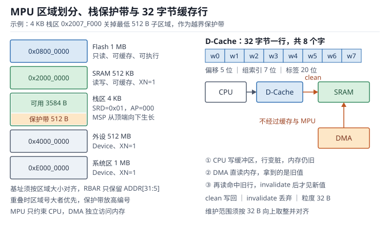

# MPU 与 Cache：区域权限、子区域与一致性

**MPU（Memory Protection Unit，存储器保护单元）**决定"哪段地址、以什么权限、能不能被访问"，**Cache**决定"同一次访问要不要真的走到内存"。前者把"跑飞了"从随机数据损坏变成一次可定位的异常，后者让 Cortex-M7 在几百兆赫兹下还能从 Flash 取指、从外部 SDRAM 取数据而不至于每三个周期停两个。

两者在工程上却经常互相拆台：MPU 的粒度是 32 字节到 4 GB 的二次幂，栈溢出保护通常落在 512 字节的保护带上；Cache 让 CPU 看到的内存和 DMA 看到的内存不是同一份，忘了 clean 就发旧数据，忘了 invalidate 就收旧数据，而这两种错误都不会报任何硬件错误。本章按"区域怎么划（RBAR/RASR）→ 边界怎么对准（对齐与子区域）→ 缓存怎么维护（clean/invalidate）→ 内存怎么分（TCM 与 SRAM）"的顺序展开，把每一类静默失败落到可复算的字节数与周期数上。

内核的异常模型见[Cortex-M 内核](cortex-m-arch.md)，异常进入的时序见[中断与 NVIC](interrupt-nvic.md)；数据搬运本身见[DMA](dma.md)，本章只处理它和 Cache 的交叉部分。

## 1. 动机：四类不会报错的损坏

::: motivation 四个现场
**现场一：递归函数把全局变量覆盖了。** 栈从 0x2007FFFF 向下长，某个深递归越过 4 KB 栈底，继续往下写进了相邻的 DMA 缓冲区。现象是"ADC 数据偶尔整块变成 0x2007Fxxx"——栈上的返回地址被当成采样值。没有 MPU 时，这类越界没有任何硬件信号。

**现场二：任务里一个 `buffer[i]` 越界 5 万次。** 目标地址落在外设寄存器区，写进去的值把某个控制寄存器改掉；系统在几百毫秒后以完全无关的现象死机。事后用调试器看内存，所有变量都正常，因为破坏发生在寄存器空间，不在 RAM。

**现场三：Cortex-M7 上 DMA 发 SPI，逻辑分析仪看到上一帧。** CPU 把 1 KB 发送缓冲写进 D-Cache 的脏行，DMA 从物理内存读到旧内容。DMA 计数正常、内存里也是旧值，软件看不出任何异常。

**现场四：开了 Cache 之后 Flash 校验偶发失败。** 引导程序把新固件写进 Flash，然后跳转执行；D-Cache 里残留的旧行被当成新代码取指，或者写入的数据还在脏行里没落到 Flash。加一条 clean 加一条 invalidate 就恢复，但没人知道为什么"偶发"。
:::

| 你想确认 | 先算 | 判据（工程经验值，非标准强制） |
|---|---|---|
| 区域大小 | $2^{\text{SIZE}+1}$ 字节 | 只能取二次幂，最小 32 B |
| 基址对齐 | 基址能被区域大小整除 | 不整除时硬件截断低位，区域整体偏移 |
| 栈保护粒度 | 保护区域大小，最小 32 B | 用独立 AP=000 区域，4 KB 栈通常划 512 B |
| 栈余量 | 实测高水位加最坏嵌套 | 保留不少于 30% |
| 维护范围 | 向上取整到 32 B 的整数倍 | 缓冲区首尾都对齐到 32 B |
| 维护开销 | 每行 14 周期（clean）加 8 周期（invalidate） | 不超过帧预算的 1% |
| TCM 分配 | 热数据加栈不超过容量 | 给 DMA 访问的数据留出 SRAM |

**不算会摔在哪**，四个带数字的代价：

1. **栈保护粒度算错。** 4 KB 栈区把最低 512 B 划成 AP=000 保护带后，可用栈是 3584 B 而不是 4096 B，少了 12.5%；如果按 4 KB 配栈深，最坏情况下会踩进保护带直接进 MemManage。
2. **Cache 维护范围不对齐。** 1000 字节缓冲区占 32 个 cache line（1000 = 31×32 + 8），维护范围应向上取整到 1024 字节；第 32 行只有前 8 字节属于缓冲区，后 24 字节属于相邻数据。若只按 1000 字节调用维护函数，按行对齐的实现会把邻居这 24 字节一起失效——风险是多失效邻居的脏数据，而不是少维护缓冲区的数据。
3. **1 KB 双缓冲每毫秒维护一次。** 32 行、704 个周期、480 MHz 下 1.47 µs；看着只有 0.15%，但它发生在中断里，与"半缓冲 500 µs 预算"争的是同一段时间。
4. **64 KB 图像缓冲整块 clean。** 2048 行、28672 个周期、59.7 µs，相当于一次 64 KB memcpy 的 44%；如果每帧做两次，带宽直接少掉一个档次。

## 2. 直观：地址空间、区域与缓存行

### 2.1 原理图：区域边界、栈保护带与缓存行

MPU 不是"给每个变量加锁"，而是在地址空间上切出若干块矩形区域，每块带一组属性：起始地址、大小、访问权限、是否可执行、是否可缓存。CPU 每次访问先过 MPU 的检查器，命中区域就按区域属性执行，未命中就按背景区域（Background Region）处理或者直接触发 MemManage 异常。

上图左侧是典型的 M7 地址空间划分：Flash、SRAM、外设、系统区各占一个区域，栈顶单独切一个 4 KB 读写区域，最低 512 B 再由编号更高的 AP=000 区域覆盖成不可访问；右侧是一次 DMA 传输中缓存行的三条路径——CPU 写进脏行、DMA 直连内存、CPU 再读命中旧行。

三个必须对上的角色，缺一个保护就是摆设：

- **区域**：16 个（M7）或 8 个（M3/M4）硬件比较器，每个区域一条 RBAR/RASR 配置。
- **属性**：AP 决定读/写/特权，XN 决定能不能取指，TEX/C/B 决定缓存与缓冲行为。
- **背景**：PRIVDEFENA 置位时，特权模式访问未覆盖区域按默认内存映射放行；不置位时未覆盖区域一律禁止。

### 2.2 区域、属性与权限：三个寄存器说清

每个区域由三个寄存器描述，写入顺序是"选号 → 写基址 → 写属性"：

| 寄存器 | 关键字段 | 作用 |
|---|---|---|
| MPU_RNR | REGION[3:0] | 选择要配置的区域号，0 到 15 |
| MPU_RBAR | ADDR[31:5]、VALID、REGION | 基址（低 5 位隐含为 0）、VALID 置位时顺带切换区域号 |
| MPU_RASR | XN、AP[2:0]、TEX、S、C、B、SRD[7:0]、SIZE[4:0]、ENABLE | 权限、内存属性、子区域禁用、大小、使能 |

AP 的三位编码里，工程上常用的有五种：

| AP | 特权 | 非特权 | 典型用途 |
|---|---|---|---|
| 000 | 禁止 | 禁止 | 栈保护带、未使用区 |
| 001 | 读写 | 禁止 | 内核数据、寄存器 |
| 010 | 读写 | 只读 | 只读配置表 |
| 011 | 读写 | 读写 | 任务共享缓冲区 |
| 110 | 只读 | 只读 | Flash 中的常量与代码 |

内存属性由 TEX、C、B 三个字段组合，M7 上最常用的四种编码：

| TEX | C | B | 含义 | 用在哪 |
|---|---|---|---|---|
| 000 | 0 | 0 | Strongly-ordered | 极少数强序外设 |
| 000 | 0 | 1 | Device | 所有外设寄存器 |
| 001 | 0 | 0 | Normal，不可缓存 | DMA 缓冲区、共享内存 |
| 001 | 1 | 1 | Normal，写回写分配 | 代码、栈、普通数据 |

三个容易记错的点。第一，**外设寄存器必须是 Device 或 Strongly-ordered**，配成 Normal 可缓存会让 CPU 读到缓存里的旧寄存器值，中断标志永远清不掉。第二，**XN 只对取指生效**，数据访问不看 XN；把栈区设成 XN 可以挡住"栈上执行 shellcode"这一类攻击，也能让跑飞的函数指针立刻报错。第三，**MPU 只检查 CPU 的访问**，DMA 作为独立总线主设备完全绕过 MPU，所以"用 MPU 保护 DMA 缓冲区"是做不到的，只能靠地址规划。

### 2.3 对齐与子区域：为什么最小 32 字节

区域的 SIZE 字段不是字节数，而是指数：区域大小等于 $2^{\text{SIZE}+1}$ 字节。SIZE=4 对应 32 B，SIZE=11 对应 4 KB，SIZE=31 对应 4 GB。

$$S=2^{\text{SIZE}+1},\qquad \text{SIZE}=\log_2 S-1$$

$S$ 是区域大小（字节），SIZE 是 RASR 中的 5 位字段。由此得到两条硬约束：

- **大小只能是二次幂**。要保护的栈是 3 KB，就只能取 4 KB 区域，再用 SRD 把多出的 1 KB 排除在本区域之外（交给其他区域或背景区域），或者把栈本身改成 2 KB。
- **基址必须按大小对齐**。4 KB 区域的基址必须是 4 KB 的整数倍。RBAR 只保存 ADDR[31:5]，低 5 位被硬件忽略，所以写一个"看起来对齐"的地址时，硬件会悄悄截断——区域整体下移，边界和你想的不一样，而且不报错。

子区域（Subregion）是这套粒度约束的解药：每个区域被等分成 8 份，SRD 的 8 个位分别控制一份，置 1 表示**该子区域不被本区域覆盖**——落在里面的访问要继续由其他区域或背景区域裁决，只有都不命中才触发 MemManage，它本身不产生"禁止访问"。4 KB 区域的子区域是 512 B，2 KB 区域是 256 B，256 B 区域是 32 B。子区域 0 对应最低地址的那一份。

$$S_{sub}=\frac{S}{8}=\frac{2^{\text{SIZE}+1}}{8}=2^{\text{SIZE}-2}$$

栈保护不能靠"关子区域"：SRD=0x01 只是让 region 4 不再覆盖最低 512 B，这段地址仍会命中覆盖整段 SRAM 的 region 1（AP=011）或背景区域（PRIVDEFENA=1），压栈照样被放行，不会触发 MemManage。正确做法是单独开一个 AP=000 的区域：4 KB 栈区 0x2007F000 到 0x2007FFFF 由 region 4（AP=011）覆盖，MSP 初值 0x20080000；最低 512 B（0x2007F000 到 0x2007F1FF）配成 region 5、AP=000，并保证 region 5 的编号高于 region 4 以及覆盖整段 SRAM 的 region 1。理论上也可以让所有覆盖该段的区域都不覆盖它并关闭背景区域（PRIVDEFENA=0），让访问因无区域命中而 fault；但 SRAM 区域受二次幂对齐限制，很难只挖掉其中的 512 B，工程上不如单独加一个保护区域直接。栈向下生长一旦越过 3584 B，第一次压栈就落进保护带，触发 MemManage 异常，故障地址可以从 MMFAR 里读出来。

代价是保护带要单独占一个区域号，而且这 512 B 不能用来放数据。若要把保护带做到 32 B，直接把保护区域配成 32 B 即可——但区域只有 16 个，用在一个 32 B 的哨兵上通常不划算。

### 2.4 缓存行与一致性：DMA 看到的内存

Cortex-M7 的 L1 缓存以 **32 字节**为一行（cache line），I-Cache 与 D-Cache 各自独立。以 16 KB、32 B、4 路组相联为例：共 512 行、128 组，地址低 5 位是行内偏移，接着 7 位是组索引，剩余 20 位是标签。

$$N_{line}=\frac{C}{L},\qquad N_{set}=\frac{C}{L\times W}$$

$C$ 是缓存容量（16384 B），$L$ 是行大小（32 B），$W$ 是路数（4）。代入得到 512 行、128 组。

D-Cache 是**写回（Write-Back）**的：CPU 写命中时只改缓存行并置脏位，内存里的内容要等到这一行被替换或者被 clean 才更新。DMA 不经过缓存，它读的是内存。这就产生两条不对称的规则：

- **CPU 写、DMA 读**（发送方向）：先把脏行 clean 到内存，再启动 DMA。
- **DMA 写、CPU 读**（接收方向）：DMA 完成后先把对应行 invalidate，再让 CPU 读。

clean 与 invalidate 的语义不同，混用会出事：clean 是"把脏数据写回内存，缓存行仍然有效"，invalidate 是"丢弃缓存行内容，下次访问重新从内存取"。对接收缓冲区，如果 CPU 之前往这块内存写过东西（脏行），直接 invalidate 会把这部分写丢失；正确做法是先 clean 再 invalidate，或者保证接收缓冲区从不让 CPU 写。

维护的最小单位是整行，所以 API 要求地址 32 字节对齐、长度是 32 的整数倍。CMSIS 提供三个函数：`SCB_CleanDCache_by_Addr`、`SCB_InvalidateDCache_by_Addr`、`SCB_CleanInvalidateDCache_by_Addr`。调用前后还要用 `__DSB()` 保证顺序，否则维护操作可能还在流水线里，DMA 已经被使能。

## 3. 定量：区域预算、维护开销与缺失代价

### 3.1 静态分析：区域表与地址约束

静态检查就是"不运行时看配置能不能成立"。区域表要同时满足四组约束：

| 约束 | 检查内容 | 违反后果 |
|---|---|---|
| 大小 | 取 2 的幂，最大 4 GB | 取整后覆盖范围与预期不符 |
| 对齐 | 基址整除大小 | 硬件截断低位，区域整体偏移 |
| 重叠 | 高编号区域优先 | 后配的区域覆盖先配的，属性意外改变 |
| 权限 | 每个区域 AP/XN 与用途一致 | 越权访问静默通过或被误杀 |
| 数量 | 不超过 16 个 | 后面的区域根本没配上 |

区域号的意义常被忽略：**重叠时编号大的优先**。所以栈保护带要放在编号大的区域，外设区放编号小的区域，避免被通用 SRAM 区域盖住。典型分配如下：

| 区域号 | 地址范围 | 大小 | 权限 | 属性 | 用途 |
|---|---|---|---|---|---|
| 0 | 0x08000000 | 1 MB | 只读 | 可缓存写回，XN=0 | Flash 代码与常量 |
| 1 | 0x20000000 | 512 KB | 读写 | 可缓存写回，XN=1 | SRAM 数据 |
| 2 | 0x40000000 | 512 MB | 读写 | Device，XN=1 | 外设寄存器 |
| 3 | 0xE0000000 | 1 MB | 读写 | Device，XN=1 | 系统控制区 |
| 4 | 0x2007F000 | 4 KB | 读写 | 可缓存，XN=1，SRD=0x00 | 栈区（整段可读写） |
| 5 | 0x2007F000 | 512 B | 禁止 | Device，XN=1 | 栈保护带（编号高于 4） |
| 6 | 0x20030000 | 8 KB | 读写 | 不可缓存 | DMA 双缓冲 |

七个区域用掉 16 个预算里的 43.75%。RTOS 的 MPU 端口通常每个任务再占两到三个区域（代码、数据、栈），16 个区域在"内核加三个任务"的场景下刚好够用，再加任务就得合并区域或者放弃按任务隔离。

### 3.2 动态分析：cache 维护的时间账

维护时间按行计费，一行 clean 的开销可以拆成"搬 8 个字"加固定开销：

$$t_{clean}=N_{line}\left(\frac{L}{4}c_{word}+c_{ovh}\right),\qquad N_{line}=\left\lceil\frac{B}{L}\right\rceil$$

$B$ 是需要维护的字节数，$L=32$ B 是行大小，$c_{word}$ 是每个 32 位字写回所需的周期（取 1），$c_{ovh}$ 是每行的循环与地址计算开销（取 6 周期）。于是 clean 14 周期每行、invalidate 8 周期每行（不搬数据，只置无效）。

在 480 MHz 的 M7 上：

| 缓冲区 | 行数 | clean 时间 | invalidate 时间 | clean 加 invalidate |
|---|---|---|---|---|
| 64 B | 2 | 0.058 µs | 0.033 µs | 0.092 µs |
| 256 B | 8 | 0.233 µs | 0.133 µs | 0.367 µs |
| 1 KB | 32 | 0.933 µs | 0.533 µs | 1.467 µs |
| 4 KB | 128 | 3.73 µs | 2.13 µs | 5.87 µs |
| 64 KB | 2048 | 59.7 µs | 34.1 µs | 93.9 µs |

64 KB 的整块维护是 45056 个周期；如果同一块内存按每字节 1 个周期逐字节复制一遍是 65536 个周期，也就是说维护成本相当于一次 memcpy 的 69%。这就是图像、音频这类大缓冲宁愿放不可缓存区的原因：与其每次搬两遍，不如全程慢一点。

反过来，对 1 KB 这种小块，维护成本只有 1.47 µs，而 DMA 传输 1 KB 本身要几微秒到几十微秒，维护占比很小。**结论是分块的：小块维护，大块改属性。**

### 3.3 环路与稳定性：缓存回环与栈的稳态边界

缓存一致性问题本质上是一个"两个观察者"的回路：CPU 写缓存，DMA 读内存，DMA 写内存，CPU 读缓存。只要中间任何一次同步缺失，回路就进入错误稳态——而且这个稳态是自洽的，软件看到的每一个寄存器都正常。

把"脏行未写回"当成一种状态误差，它不会自己衰减：clean 之前，内存永远是旧值，DMA 每发一次就错一次，错误率等于传输频率，而不是偶发。所以一致性问题的现象是"稳定的错"，不是"偶尔错"。

真正会振荡的是缓存替换本身。4 路组相联下同一组能放 4 行，一行 32 B；当同时活跃、且组索引相同的数据流超过 4 条时，每访问一次就替换一次：

$$S_{set}=L\times N_{way}=32\times4=128\ \text{B}$$

$S_{set}$ 是单组的容量，$L$ 是行大小，$N_{way}$ 是路数。地址上相隔 4096 B（128 组乘 32 B）的两个数组会落到同一组；五条这样的流交替访问时，一行在被再次用到之前就被替换掉，冲突缺失率接近 100%。这类冲突缺失在代码里完全看不出来，只能用性能计数器或者对照实验发现。

栈的稳态边界则是另一条曲线：栈使用量由调用深度、局部数组和异常嵌套共同决定，其中异常嵌套在最坏情况下是叠加的。带 FPU 的异常栈帧是 104 字节（8 个核心寄存器加 16 个 S 寄存器加 FPSCR 与填充），8 层嵌套就是 832 B，占 4 KB 栈区的 20%。如果按"平均使用量"配栈，最坏情况必然溢出；正确做法是用填充法测高水位，再乘 1.3 到 1.5 的余量。

### 3.4 取值与权衡：TCM 分割、行对齐与区域粒度

M7 有两块紧耦合内存：ITCM 放代码、DTCM 放数据，都是零等待、不经缓存、不受 MPU 缓存属性影响。它们与 SRAM 的取舍不是"快慢"，而是"确定性"：

| 维度 | DTCM | 可缓存 SRAM | 不可缓存 SRAM |
|---|---|---|---|
| 访问周期 | 1（固定） | 命中 1，缺失数十 | 2 到 3 |
| Cache 维护 | 不需要 | 需要 | 不需要 |
| DMA 可达 | 通常不可 | 可 | 可 |
| 容量 | 128 KB 级 | 数百 KB 到数 MB | 同左 |
| 适用 | 栈、热数据、中断上下文 | 通用数据、代码 | DMA 缓冲区、共享区 |

三条取值建议，都有边界：

1. **栈和中断上下文放 DTCM**。它们对延迟最敏感、体量最小、且 DMA 不需要访问。代价是 DTCM 容量有限，塞满之后要把大数组挪回 SRAM。
2. **DMA 缓冲区放不可缓存 SRAM**。彻底免掉 clean/invalidate，代价是每次访问多一到两个周期；对 1 KB 级的缓冲，这点开销远小于维护成本。注意在部分 M7 器件上常规 DMA 根本访问不到 DTCM，缓冲区必须放在 SRAM 侧。
3. **代码放 ITCM 还是留在 Flash**。中断服务程序、电机控制环这类对抖动敏感的代码值得复制到 ITCM；普通业务代码留在 Flash 靠 I-Cache 和预取就够。判断依据是"最坏执行时间"是否可接受，而不是平均性能。

区域粒度同理：能用 4 KB 区域覆盖的，不要为每个 512 B 边界单独开区域；但栈保护带是例外——它通常要单独配成一个 AP=000 区域，因为子区域禁用只是"不覆盖"，并不会产生禁止访问。反过来，如果保护带必须精确到 32 B，就直接开一个 32 B 的区域并接受区域预算的消耗。

## 4. 算例：五个可复算的账

### 4.1 4 KB 栈区加 512 B 保护带的余量

栈区 4 KB，最低 512 B 另设 AP=000 保护带：

$$S_{usable}=4096-512=3584\ \text{B}$$

可用比例：

$$\frac{3584}{4096}=87.5\%$$

如果栈的最坏使用量实测为 3.1 KB（3174 B），余量是 3584 减 3174 等于 410 B，占可用量的 11.4%，低于 30% 的经验阈值，应该把栈区扩到 8 KB（保护带 1 KB，可用 7168 B）或者削减局部大数组。

### 4.2 1 KB 双缓冲的维护开销

1 KB 接收缓冲，DMA 每 500 µs 写满一次，CPU 在中断里 invalidate：

$$N_{line}=\left\lceil\frac{1024}{32}\right\rceil=32,\qquad t=32\times8=256\ \text{周期}$$

480 MHz 下是 0.533 µs，占 500 µs 预算的 0.107%。如果发送方向还要 clean，则是 448 周期、0.933 µs，两个方向加起来 1.47 µs，占 0.293%。这个量级完全可接受，所以小缓冲配维护是标准做法。

### 4.3 64 KB 图像缓冲的 clean 成本

$$N_{line}=\frac{65536}{32}=2048,\qquad t_{clean}=2048\times14=28672\ \text{周期}$$

480 MHz 下 59.7 µs。若帧率 30 fps、每帧两次维护（发送前 clean、接收后 invalidate）：

$$t_{frame}=59.7+34.1=93.9\ \mu\text{s},\qquad U=\frac{93.9\times30}{10^{6}}=0.28\%$$

平均占用只有 0.28%，但每帧集中占用 93.9 µs，对 33.3 ms 的帧周期是 0.28%，看起来无害；真正的风险在于这 93.9 µs 是阻塞的，如果它落在另一个硬实时的 100 µs 控制环里，就是一次超时。**平均值不能代替最坏值。**

### 4.4 缺失率与 CPI

设理想 CPI 为 1，每次缺失的代价是"填充 8 个字乘 8 周期加 20 周期启动延迟"共 84 周期：

$$CPI=1+m\times84$$

$m$ 是每指令缺失率。代入三档：

$$m=1\%:\ CPI=1.84,\qquad m=5\%:\ CPI=5.2,\qquad m=10\%:\ CPI=9.4$$

对应相对峰值的算力分别是 54.3%、19.2%、10.6%。也就是说缺失率从 1% 涨到 5%，性能掉到原来的三分之一——这就是为什么"把工作集压进缓存"比"提高主频"更有效。

### 4.5 TCM 与 SRAM 的访存差异

一段每个样本做 2 次读、1 次写的处理循环，处理 256 个样本共 768 次访问。DTCM 每次 1 周期，不可缓存 SRAM 每次 2 周期：

$$t_{TCM}=\frac{768}{168\times10^{6}}=4.57\ \mu\text{s},\qquad t_{SRAM}=\frac{1536}{168\times10^{6}}=9.14\ \mu\text{s}$$

48 kHz 下一个 256 样本块的预算是 5.33 ms，两者都只占 0.086% 与 0.171%，差距在平均值上可以忽略。TCM 真正的价值是最坏情况：DTCM 的访问周期是常数，不会因为 DMA 抢总线而变长；在 20 kHz 电流环里，"平均快"没有意义，"最坏不超时"才有意义。

## 5. 工程含义：验证、调试与失效边界

### 5.1 栈溢出检测的三种手段

1. **MPU 保护带**：硬件在越界的第一次访问就触发 MemManage，故障地址可读，是唯一能"当场抓住"的手段。限制是要多占一个区域号，且保护带本身浪费内存；4 KB 栈区通常划 512 B 保护带。
2. **填充法加高水位扫描**：启动时把栈区填成 0xC0C0C0C0，运行一段时间后从栈底往上数未被改写的字节，得到高水位。优点是零硬件成本、能给出精确用量；缺点是只能事后统计，抓不到瞬时越界。
3. **栈哨兵加周期性检查**：在栈底放几个固定魔数，主循环里定期比对。实现最简单，但检查间隔内的越界可能已经把数据写坏。

工程上通常三者叠加：填充法定栈深、哨兵做在线检查、MPU 做最后一道硬保护。

### 5.2 一致性的验证方法

一致性错误的特点是"换个观察者就变"。验证时要有意识地换观察者：

- **调试器读内存**通常绕过 D-Cache（取决于调试配置），它看到的是内存，不是 CPU 看到的。若调试器与 CPU 读数不一致，基本可以确定是缓存问题。
- **DMA 前后各读一次**：DMA 启动前由 CPU 读一遍缓冲区并打印校验和，DMA 完成后再读一遍。如果第二次读到旧值而调试器显示新值，就是 invalidate 缺失。
- **对照实验**：把同一段代码分别跑在可缓存区和不可缓存区，结果不同即说明维护有问题。

### 5.3 仿真与实验：用故障寄存器与计数器验证

1. **故意越界**：把 MSP 临时改到保护带上方 16 字节，执行一次压栈，确认进入 MemManage 且 MMFAR 等于保护带地址。这一步验证区域配置、优先级和异常使能三件事同时成立。
2. **读 CFSR**：在 MemManage 处理函数里打印 `SCB->CFSR` 的 MMFSR 字节。`DACCVIOL` 表示数据访问违规，`MSTKERR` 表示异常入栈失败（栈指针已经非法），`MMARVALID` 表示 MMFAR 有效。
3. **DWT 计时维护**：用 `DWT->CYCCNT` 包住 clean 调用，实测值应与 $N_{line}\times14$ 同一量级；差太多说明函数内部按 4 字节循环而不是按行操作。
4. **填充法测维护范围**：把缓冲区填 0xAA，DMA 写入已知图案，比较首尾各 32 字节。若首部正确、尾部旧值，说明维护长度没有向上取整。
5. **关缓存对照**：同一段 DMA 收发在"开 D-Cache 加维护"和"关 D-Cache"两种配置下各跑一万次，统计校验和错误数。前者必须为 0，后者用于确认错误确实来自缓存而不是外设。

## 6. 常见坑

::: pitfall 坑一：区域基址没对齐，保护带整体偏移
**现象**：栈溢出没有触发异常，反而在别处出现数据损坏；MMFAR 里的地址与预期差了几百字节。

**原因**：4 KB 区域的基址必须是 4 KB 的整数倍，RBAR 只保留 ADDR[31:5]，写入 0x2007F800 这样的地址会被截断成 0x2007F000，区域向下扩了 2 KB。

**解决**：用编译期断言检查 `(base % size) == 0`；把栈区起始地址写成 `__attribute__((aligned(4096)))` 的链接段，并在启动代码里核对 MPU 配置与链接脚本一致。
:::

::: pitfall 坑二：把子区域禁用当成禁止访问，保护带形同虚设
**现象**：栈溢出没有触发 MemManage，反而写坏了栈下面的相邻缓冲区。

**原因**：SRD 的 bit0 只表示 region 4 不再覆盖最低 512 B，这段地址仍会命中覆盖整段 SRAM 的 region 1（AP=011）或背景区域（PRIVDEFENA=1）；把 bit7 置 1 也只是让区域不覆盖最高 512 B，同样不产生任何禁止效果。

**解决**：保护带单独配成一个 AP=000 的区域，编号高于所有覆盖该地址的区域；配置完成后用一次受控越界验证保护带位置，不要靠推理。
:::

::: pitfall 坑三：DMA 发送前忘了 clean
**现象**：DMA 发出去的总是上一帧数据，逻辑分析仪与内存内容一致，CPU 变量检查也正常。

**原因**：CPU 写的是 D-Cache 脏行，内存还是旧值；DMA 绕过缓存直接读内存。

**解决**：发送前对缓冲区执行 `SCB_CleanDCache_by_Addr` 加 `__DSB()`；缓冲区按 32 字节对齐、长度为 32 的整数倍；或者把发送缓冲放到不可缓存区。
:::

::: pitfall 坑四：接收后只 clean 不 invalidate
**现象**：DMA 收到的新数据 CPU 读不到，读到的还是上一轮内容。

**原因**：clean 只把脏数据写回内存，缓存行仍然有效，CPU 继续命中旧行。

**解决**：接收方向用 invalidate；如果这块内存 CPU 之前写过，先 clean 再 invalidate（或用 `SCB_CleanInvalidateDCache_by_Addr`），避免丢掉未写回的写。
:::

::: pitfall 坑五：缓冲区与相邻变量共享 cache line
**现象**：invalidate 之后，紧挨着缓冲区的某个计数器偶尔被清零或跳变。

**原因**：缓冲区末尾没有对齐到 32 字节，最后一行里还放着别的变量；整行 invalidate 把邻居的脏数据一起丢掉。

**解决**：缓冲区用 `__attribute__((aligned(32)))`，长度补齐到 32 的倍数；或者把 DMA 缓冲区独立成段，段内不放假数据。
:::

::: pitfall 坑六：把外设寄存器区配成可缓存
**现象**：轮询 UART 状态寄存器永远读不到新标志，或者中断标志清了又出现。

**原因**：区域属性写成 Normal 可缓存，CPU 读到的是缓存里的旧寄存器值，写操作也可能被合并、重排。

**解决**：所有外设区配 Device（TEX=000、C=0、B=1），共享内存配 Normal 不可缓存；改完属性后执行 `__DSB()` 与 `__ISB()`，并重新初始化相关外设。
:::

## 7. 自测题

题一：4 KB 栈区、MSP 在顶端、最低 512 B 用独立 AP=000 区域保护，可用栈多少字节？若实测峰值 3.4 KB 会怎样？

保护带大小：

$$S_{guard}=\frac{4096}{8}=512\ \text{B}$$

扣除最低 512 B 保护带后可用：

$$S_{usable}=4096-512=3584\ \text{B}=3.5\ \text{KiB}$$

这里的保护带由独立的高编号 AP=000 区域覆盖，不是靠 SRD 关子区域——SRD=0x01 只会让栈区不再覆盖这 512 B，访问仍会落到 SRAM 区域或背景区域。

实测峰值 3.4 KB（3482 B）小于 3584 B，不会触发异常，但余量只有 102 B，占 2.8%。任何一次更深的调用或一层额外中断嵌套（带 FPU 时一帧 104 B）都会越界。结论：这个配置不能用，应扩到 8 KB 栈区（保护带 1 KB，可用 7168 B），并把峰值控制在 4.9 KB（约 5018 B）以内以留出 30% 余量。

题二：1000 字节缓冲区、32 字节行，维护范围为什么是 1024 字节而不是 1000？最后一行多失效 24 字节邻居有什么风险？

行数：

$$N_{line}=\left\lceil\frac{1000}{32}\right\rceil=32,\qquad L_{maint}=32\times32=1024\ \text{B}$$

第 32 行的前 8 字节属于缓冲区，后 24 字节属于相邻数据。缓存维护的最小单位是整行，无法只处理 8 字节。如果只按 1000 字节调用维护函数：按行对齐的实现会把相邻 24 字节一起失效，邻居的脏数据可能被丢掉；向下取整的实现则会漏掉缓冲区最后 8 字节。可靠做法是让缓冲区本身 1024 字节、对齐到 32 字节，使维护范围与缓冲区完全重合。

题三：1 KB 缓冲、每 500 µs 一次 invalidate，维护占用多少？换成 64 KB、每 33.3 ms 一次呢？

1 KB：

$$t_1=32\times8=256\ \text{周期}=0.533\ \mu\text{s},\qquad U_1=\frac{0.533}{500}=0.107\%$$

64 KB：

$$t_{64}=2048\times8=16384\ \text{周期}=34.1\ \mu\text{s},\qquad U_{64}=\frac{34.1}{33300}=0.102\%$$

两者平均占用几乎相同，都是 0.1% 量级。但 1 KB 的维护是 0.5 µs 的短阻塞，64 KB 是 34 µs 的长阻塞；后者在 100 µs 级的控制环里就是一次灾难。判断标准不是平均占用，而是"单次阻塞时间是否小于最紧的实时预算"。

题四：缺失率 5%、缺失代价 84 周期，CPI 多少？相对峰值算力剩多少？

$$CPI=1+0.05\times84=5.2$$

相对峰值：

$$\frac{1}{5.2}=19.2\%$$

也就是说 480 MHz 的核在这段代码上等效于 92 MHz。若把工作集从 20 KB 压到 8 KB，缺失率降到 1%，CPI 变成 1.84，等效频率回到 261 MHz——不换芯片，性能提升 2.8 倍。这就是缓存友好的收益量级。

题五：为什么"用 MPU 保护 DMA 缓冲区"做不到？应该用什么手段？

MPU 挂在 CPU 的访问通路上，只检查处理器发出的访问。DMA 是独立的总线主设备，它的读写不经过 MPU 的检查器，所以即使把某段内存设成"不可访问"，DMA 仍然能写进去。

能做的是三件事：一是**地址规划**，让 DMA 缓冲区独占一段内存，不与关键变量相邻，越界最多损坏缓冲区；二是**MPU 保护关键变量**，把内核数据、函数指针表放进非特权不可访问的区域，DMA 越界即使写坏缓冲区也不会改到它们；三是**传输长度校验**，在启动 DMA 前检查 NDTR 与缓冲区容量的关系，从源头减少越界。

题六：clean 与 invalidate 的语义差别是什么？为什么接收缓冲区不能只 clean？

clean 把缓存行里的脏数据写回内存，缓存行保持有效；invalidate 把缓存行标记为无效，下次访问重新从内存取。两者作用方向相反。

接收缓冲区是 DMA 写、CPU 读。若只 clean，CPU 的缓存行仍有效，读到的还是 DMA 写入之前的旧内容，invalidate 缺失；若只 invalidate，而 CPU 之前往这块内存写过脏数据，这些写会被直接丢弃，造成数据丢失。正确顺序是：DMA 启动前对缓冲区 clean 加 invalidate（清掉可能存在的脏行），DMA 完成后再 invalidate 一次。

## 8. 参考资料

- ARM, DDI 0403 *ARMv7-M Architecture Reference Manual*，Chapter B3.5 Protected Memory System Architecture（RBAR/RASR、AP、XN、SRD、对齐规则）。
- ARM, DDI 0489 *Cortex-M7 Processor Technical Reference Manual*，Memory System 章与 cache maintenance operations 节。
- STMicroelectronics, RM0433 *STM32H743/753 参考手册*，Memory protection unit 章与 Level 1 cache 章。
- STMicroelectronics, AN4838 *Managing memory protection unit (MPU) in STM32 MCUs*，区域对齐、子区域与栈保护配置。
- STMicroelectronics, AN4839 *Level 1 cache on STM32F7 Series*，cache 维护函数与 DMA 一致性实测。
- Arm, *CMSIS 5 CMSIS-Core (Cortex-M)* 文档，`SCB_CleanDCache_by_Addr` 与 `SCB_InvalidateDCache_by_Addr`。
