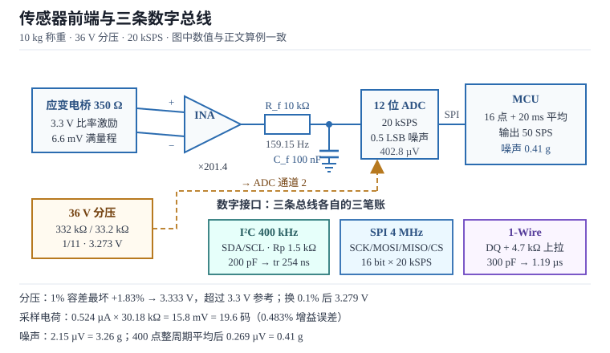

# 传感器接口与信号调理：分压电桥、数字总线与校准

一颗 12 位 ADC 能把 3.3 V 分成 4096 份，每份 805.7 µV。这个数字看上去很细，但把它折回传感器输入端，往往只剩几克、几毫伏或者几个字的有效分辨率：分压电阻的 1% 容差直接变成 74 个码的增益误差，电桥的零点失调吃掉三分之一的量程，采样电容每毫秒从高阻分压器上抽走的电荷又叠上 0.48% 的隐性增益，50 Hz 工频在 20 kSPS 的采样率下原封不动地留在带内。**传感器接口的难点不在"接上"，而在把物理量、模拟电压、数字码这三段之间的每一笔误差都写成算式。**

本章围绕一个工业称重节点展开：10 kg 电阻应变式称重传感器、3.3 V 比率激励、仪表放大器、RC 抗混叠、12 位 ADC、20 kSPS 采样，外加一路 36 V 电池分压监测和 I²C、SPI、单总线三条数字接口。所有数值都可以用纸笔复算，与[采样保持与量化误差](adc-dac.md)和[时钟树与 PLL](clock-tree.md)配合阅读。

## 1 动机：三个让读数失真的现场

::: motivation 三个现场
**现场一：空秤零点每天爬 50 g。** 设备在 15 °C 的仓库标定，装到 40 °C 的车间后零点偏了 50 g。拆开算：称重传感器的零点温度系数按 0.02% FS/°C 计，满量程 6.6 mV，折合 1.32 µV/°C；乘仪表放大器增益 201.4 得 265.8 µV/°C，正好 0.33 LSB/°C；25 °C 温差累计 8.25 LSB，按 6.06 g/LSB 折算就是 50.0 g。**这不是"传感器坏了"，而是校准系数里少了一个温度自变量。**

**现场二：读数每 20 ms 跳一次。** 示波器看 ADC 输入很干净，读数却在 ±20 个码上周期性抖动，周期正好 20 ms。原因是采样率 20 kSPS 只做了 16 点平均，输出率 1250 SPS，50 Hz 工频落在带内且没有被任何环节抑制；16 点平均的零点在 $50\times16/20000=40$ Hz 的整数倍上，50 Hz 不在其中。改成 20 ms 滑动平均后，抖动降到 1 个码以内。

**现场三：36 V 电池监测在满电时饱和。** 分压比按 332 kΩ/33.2 kΩ 算得 1/11，36 V 对应 3.2727 V，看起来离 3.3 V 还有 27 mV。但两只 1% 电阻的最坏组合把分压比抬高 1.83%，输出变成 3.333 V，超过参考电压，ADC 直接输出 4095 并"卡顶"；与此同时，20 kSPS 的采样电容电流在 30.18 kΩ 戴维南电阻上又压出 15.8 mV。**两个误差都不大，叠起来就把 8 个码的余量吃光了。**
:::

| 你想确认 | 先算 | 判据（工程经验值） |
|---|---|---|
| 分压后是否超量程 | $V_{out}=V_{in}R_2/(R_1+R_2)$ | 最坏容差下仍低于 $0.98V_{REF}$ |
| 电桥输出多大 | $V_{bridge}=V_{ex}S$ | 与放大器增益之积不超过满量程的 90% |
| 采样窗口够不够 | $t_{acq}\geq(R_s+R_{sw})C_{sh}\ln 2^{N+1}$ | 计算值留 20% 余量 |
| 高阻源能不能直采 | $\varepsilon=f_sR_sC_{sh}$ | 小于 0.1% 或加缓冲 |
| 抗混叠够不够 | 一阶 $20\lg(f/f_c)$ | 折叠后低于 0.5 LSB |
| 过采样能补几位 | $\Delta N=0.5\log_2 OSR$ | 只补白噪声，不补 INL |
| 零点和增益怎么校 | 两点线性拟合 | 校准点覆盖 10% 与 90% 量程 |
| 温度漂移多大 | $TC\times\Delta T\times2^N/V_{FS}$ | 补偿后小于 2 LSB |

## 2 直观：从被测量到码值的五段链路

一条完整的传感器链路有五个换能环节：**物理量 → 电阻/电容变化 → 差分电压 → 单端电压 → 数字码**。每一段都有自己的零点、增益和带宽，且后一段的误差会按前一段的增益折算回输入端。工程上把这个折算叫"折合到输入端"（Referred to Input，RTI）：放大器后的 1 mV 误差，除以增益 201.4 后只是 4.96 µV，听起来很小；但传感器灵敏度是 0.66 µV/g，它其实是 7.5 g。**判断一项误差要不要管，先把它折回被测量。**

### 2.1 原理图：分压、电桥与抗混叠前端

图中上半部分是电桥通道：350 Ω 应变电桥由 3.3 V 比率激励，差分输出 0 至 6.6 mV，经仪表放大器（Instrumentation Amplifier，INA）放大 201.4 倍、叠加 1.65 V 共模基准后送入 ADC；INA 输出与 ADC 引脚之间是 10 kΩ 与 100 nF 组成的 RC 抗混叠滤波器（Anti-Aliasing Filter，AAF）。下半部分是 36 V 分压通道，332 kΩ 与 33.2 kΩ 把 36 V 压到 3.27 V 后进入同一只 ADC 的第二个通道。右侧三条数字总线分别是 I²C、SPI 与单总线（1-Wire）。

| 图中标号 | 含义 | 取值 | 对结果的影响 |
|---|---|---|---|
| $R_1,R_2$ | 电池分压电阻 | 332 kΩ、33.2 kΩ，0.1% | 决定 1/11 分压比与 30.18 kΩ 源阻抗 |
| $R_{br}$ | 电桥桥臂电阻 | 350 Ω | 决定激励电流 9.43 mA 与输出阻抗 |
| INA | 仪表放大器 | 增益 201.4（$R_g=499\ \Omega$） | 决定折算到输入端的噪声与失调 |
| $R_f,C_f$ | 抗混叠 RC | 10 kΩ、100 nF | 截止 159.15 Hz，抑制带外折叠 |
| $C_{sh}$ | ADC 内部保持电容 | 8 pF | 与源阻抗共同决定采样窗口 |
| MCU | 主控 | 12 位 ADC、20 kSPS | 决定量化台阶与过采样余量 |

### 2.2 静态分析：分压比、电桥失调与增益

**分压通道。** 分压比由电阻决定，输出与源阻抗分别为

$$V_{out}=V_{in}\frac{R_2}{R_1+R_2},\qquad R_s=R_1\parallel R_2$$

对 332 kΩ 与 33.2 kΩ，$V_{out}=V_{in}/11$，36 V 对应 3.2727 V，折算成码是 $3.2727/3.3\times4096=4062$，只剩 34 个码的余量（0.83%）。源阻抗 $R_s=30.18\ \text{k}\Omega$，输入电流 $36/(365.2\ \text{k}\Omega)=98.6\ \mu\text{A}$，电阻上耗散 3.55 mW，对常开设备是可以接受的数量级。

电阻容差的影响比想象的大。分压比是两只电阻之比，两只各偏 1% 且方向相反时误差接近 2%：最坏高侧 $R_2$ 偏 +1%、$R_1$ 偏 -1%，分压比从 0.090909 变成 0.092576，高了 1.83%，36 V 输出 3.333 V，码值 4136，已经超过 4095；换成 0.1% 电阻，最坏 3.279 V、码值 4070，才留出 25 个码。**"1% 电阻够用"这句话必须带上量程余量一起说。** 此外还有 50 nA 输入漏电流在 30.18 kΩ 上产生的 1.51 mV（1.87 LSB），以及最坏 1 µA 时的 30.2 mV（37.5 LSB）——后者足以让 12 位通道彻底失效，因此高阻分压要么加运放缓冲，要么只信典型漏电并做校准。

**电桥通道。** 350 Ω 电桥在 3.3 V 激励下取 9.43 mA、耗散 31.1 mW。按 2 mV/V 灵敏度，满量程差分输出

$$V_{bridge}=V_{ex}S=3.3\times2\times10^{-3}=6.6\ \text{mV}$$

对 10 kg 量程，灵敏度是 0.66 µV/g。仪表放大器增益 $G=1+100\ \text{k}\Omega/R_g$，取 $R_g=499\ \Omega$ 得 $G=201.4$，满量程输出 1.329 V；桥路零点失调按 0.3 mV（4.5% FS，属于偏差较大的批次）计，放大后 60.4 mV。把 INA 的 REF 引脚接 1.65 V 中点，零点输出 1.7104 V、满量程输出 3.0397 V（零点失调与满量程灵敏度叠加），对应码值 2123 与 3773，可用跨度 1650 个码，折合 10 kg/1650 = 6.06 g/LSB。

这里有两个容易被忽略的静态项。其一是**共模电压**：电桥输出共模为 1.65 V，INA 的输入共模范围必须覆盖它，且输出摆幅要留 100 mV 以上；若用 5 V 激励而模拟电源只有 3.3 V，共模变成 2.5 V，很多 INA 会顶到输入级上限。其二是**比率特性**：电桥激励与 ADC 参考取自同一个 3.3 V，激励下降 5% 时电桥输出也下降 5%，参考同步下降，码值不变；这把电源容差从增益误差里消掉了，代价是 REF 引脚的中点也必须比率分压，不能接固定基准。

### 2.3 动态分析：源阻抗、采样窗口与混叠

ADC 采样瞬间把内部保持电容 $C_{sh}$ 接到引脚上，源阻抗与开关电阻给它充电，电压按指数逼近：

$$V_{sh}(t)=V_{in}-(V_{in}-V_{sh,0})e^{-t/\tau},\qquad \tau=(R_s+R_{sw})C_{sh}$$

要求残余误差小于 0.5 LSB，即 $e^{-t/\tau}\leq2^{-(N+1)}$，采样窗口必须满足

$$t_{acq}\geq(R_s+R_{sw})C_{sh}(N+1)\ln2$$

对分压通道，$R_s=30.18\ \text{k}\Omega$、$R_{sw}=200\ \Omega$、$C_{sh}=8\ \text{pF}$，$\tau=243.1\ \text{ns}$，12 位需要 $9.0109\tau=2.19\ \mu\text{s}$；20 kSPS 的周期是 50 µs，单看建立时间绰绰有余。**但建立时间只是第一笔账，第二笔账是采样电容从源上抽走的平均电流。** 每次采样转移的电荷约为 $C_{sh}V_{in}$，在 20 kSPS 下平均电流

$$\bar{I}=f_sC_{sh}V_{in}=20000\times8\times10^{-12}\times3.2727=0.524\ \mu\text{A}$$

这股电流全部流过戴维南电阻，产生 $0.524\ \mu\text{A}\times30.18\ \text{k}\Omega=15.8\ \text{mV}$ 的压降，折合 19.6 个码，等于 0.483% 的增益误差。它正比于输入电压，所以表现为纯增益误差，可以校准；但它也正比于采样率，一旦把采样率翻倍，校准系数就失效。工程上的判据是 $\varepsilon=f_sR_sC_{sh}$：本例 0.00483，远大于 0.1%，高阻分压必须加缓冲。

抗混叠滤波器决定带外干扰折叠进来时剩多少。一阶 RC 的截止频率与衰减为

$$f_c=\frac{1}{2\pi R_fC_f},\qquad A(f)=20\lg\sqrt{1+\left(\frac{f}{f_c}\right)^2}$$

10 kΩ 与 100 nF 给出 $f_c=159.15\ \text{Hz}$。若在 19.9 kHz 处有 1 V 的开关噪声，它折叠到 100 Hz，一阶 RC 只给 41.9 dB 衰减，残余 7.997 mV，是 0.5 LSB 的 19.9 倍；改用二阶巴特沃斯，同样截止频率在 19.9 kHz 处衰减 $40\lg(19900/159.15)=83.9\ \text{dB}$，残余 64 µV，才落到 0.16 LSB。**折叠噪声的幅度不随采样率下降，只有滤波器和更高的采样率能救。**

50 Hz 工频是另一类问题。它低于奈奎斯特频率，根本不在"混叠"范畴，RC 在 159.15 Hz 处对 50 Hz 只有 0.41 dB 衰减，等于没滤。正确做法是数字侧做一个 20 ms 的整周期平均：20 kSPS 下正好 400 点，对 50 Hz 及其整数倍形成零点；若电网频率偏到 50.5 Hz，20 ms 只覆盖 1.01 个周期，残余为 $|\sin(\pi\times1.01)|/[400\sin(\pi\times1.01/400)]=0.0099$，即 -40.1 dB。**整周期平均把"频率准确"变成了新的误差源，工业现场要按 ±0.5 Hz 估算残余。**

### 2.4 环路与稳定性：容性负载、基准缓冲与补偿回路

传感器前端里有两个真正的反馈环路，容易被当成"接线问题"。

第一个是**基准缓冲驱动 ADC 的开关电容负载**。ADC 的参考引脚在每个转换周期被内部电容拉动一次，等效为一个 1.6 mA、5 ns 的电流尖峰。若基准缓冲的输出阻抗是 10 Ω，尖峰在参考上产生 16 mV 压降，折合 19.9 个码；把缓冲输出阻抗压到 1 Ω，压降降到 1.6 mV（2.0 个码），再并 100 nF 本地电容提供瞬时电荷。缓冲器本身带 10 µF 容性负载时，输出极点降到 $1/(2\pi\times50\ \Omega\times10\ \mu\text{F})=318\ \text{Hz}$，而单位增益缓冲的穿越频率是 1 MHz，相位裕度只剩 $90^{\circ}-\arctan(10^6/318)=3.7^{\circ}$，必然振荡；串 100 Ω 隔离电阻后，负载网络变成 $106\ \text{Hz}$ 的极点与 $159\ \text{Hz}$ 的零点，在穿越频率处的净相位滞后只有 $|\arctan(10^6/106)-\arctan(10^6/159)|\approx0.6^{\circ}$，相位裕度回到 89°。**隔离电阻不是"限流"，它把容性负载的相位滞后用零点抵消掉了。**

第二个是**温度补偿的慢速外环**。传感器温度系数在出厂时逐只测量，运行时用板载温度传感器读数做一阶修正：

$$W_{comp}=W_{raw}\left[1+k_s(T-T_0)\right]-k_0(T-T_0)$$

其中 $W_{raw}$ 是未补偿重量（kg），$T$ 是当前温度（°C），$T_0$ 是标定温度（°C），$k_0$ 是零点温度系数（kg/°C），$k_s$ 是量程温度系数（1/°C）。这个环的采样周期必须远小于传感器的热时间常数（通常几百秒），否则补偿量总在追一个已经过时的温度，表现为"温度稳定后重量还在慢慢变"。按热时间常数 300 s、补偿周期 1 s 设计，比值 300 倍，一阶修正不会过冲；若把周期压到 10 s 又加大增益，就会在温度阶跃时看到周期约 1 分钟的衰减振荡。

## 3 定量：四条可复算的公式

### 3.1 分压与电桥的传递比

分压器的传递比与戴维南电阻已经给出。把容差、漏电、采样电荷三项都折到输入端，得到 36 V 通道的总误差预算：

$$\varepsilon_{total}=\frac{\Delta R}{R}+\frac{I_{leak}R_s}{V_{in}}+f_sR_sC_{sh}$$

第一项是电阻比容差（1% 电阻最坏 1.83%，0.1% 电阻 0.18%），第二项是漏电流压降（50 nA 时 0.046%，1 µA 时 0.92%），第三项是采样电荷（0.483%）。三项按最坏情况相加，1% 电阻 + 1 µA 漏电时超过 3%，必须校准或加缓冲。

电桥通道的传递比是

$$V_{out}=V_{ex}S\,G+V_{ref}$$

符号含义：$V_{ex}$ 是桥路激励（V），$S$ 是灵敏度（V/V），$G$ 是仪表放大器增益（无量纲），$V_{ref}$ 是 INA 的参考引脚电压（V）。对 $V_{ex}=3.3\ \text{V}$、$S=2\times10^{-3}$、$G=201.4$、$V_{ref}=1.65\ \text{V}$，零点（失调 0.3 mV）为 1.7104 V，满量程为 3.0397 V。**注意 $V_{ref}$ 只决定零点在码轴上的位置，不决定跨度；跨度由 $G$ 与 $S$ 决定。取中点是为了兼容双极性信号，单极性称重要扩大跨度只能加增益。**

### 3.2 抗混叠与采样定理

采样率 $f_s$ 把频率轴折叠：频率 $f$ 的干扰会出现在 $|f-kf_s|$ 处。要让它折叠后的幅度低于 0.5 LSB，需要

$$A_{req}=20\lg\frac{V_{noise}}{V_{LSB}/2}$$

对 1 V 干扰、805.7 µV 的 LSB，需要 67.9 dB；一阶 RC 要在 19.9 kHz 给出 67.9 dB，截止频率得低到 $19900/10^{67.9/20}=0.80\ \text{Hz}$，会把 10 Hz 的有用信号一起砍掉。这就是为什么抗混叠通常用二阶以上，或者把采样率提高到干扰频率的 10 倍以上，让干扰落在带内再用数字滤波处理。**滤波器的阶数、截止频率、采样率三者必须一起选，单看任何一个都会得出错误结论。**

### 3.3 过采样、噪声整形与有效位数

对白噪声做 $OSR$ 倍过采样再平均，噪声功率降到 $1/OSR$：

$$\Delta SNR=10\lg OSR,\qquad \Delta N=0.5\log_2 OSR$$

每 4 倍过采样换 1 位，这条"4 的 n 次方"规则来自 $2^{2n}=4^n$：要补 4 位就需要 $OSR=4^4=256$，补 5 位需要 1024。本例 16 点平均只补 2 位、12.04 dB，把 ADC 的 0.5 LSB 噪声从 2.00 µV 降到 0.50 µV；再叠 400 点整周期平均，ADC 噪声降到 0.10 µV。

噪声整形（Noise Shaping）把量化噪声从低频推向高频，再让数字滤波器把高频噪声滤掉。一阶 Σ-Δ 调制的信噪比为

$$SNR=6.02N+1.76-5.17+30\lg OSR$$

式中 $N$ 是内部量化器位数，$OSR$ 是过采样率，常数 -5.17 dB 来自一阶整形传递函数 $|1-z^{-1}|$ 的带内积分。斜率从每倍频程 3 dB 变成 30 dB：$OSR=64$ 时比奈奎斯特采样多 $30\lg64-5.17=49.0\ \text{dB}$，相当于 8.14 位；$OSR=256$ 时多 67.1 dB，相当于 11.14 位。**整形只对量化噪声有效，对传感器噪声、参考噪声和 INL 无效——这也是 Σ-Δ 适合慢速高分辨率、却不适合直接测快速瞬态的原因。**

有效位数由实测信纳比反算：

$$ENOB=\frac{SINAD-1.76}{6.02}$$

### 3.4 取值与权衡：电阻、电容、基准与增益

| 参数 | 增大时 | 代价 | 本例取值与理由 |
|---|---|---|---|
| 分压电阻 | 功耗低、输入电流小 | 源阻抗高、漏电与采样误差大 | 332 kΩ/33.2 kΩ，98.6 µA，加缓冲后可再大一倍 |
| 分压电容 | 抗混叠好、电荷缓冲强 | 多通道切换恢复慢 | 单通道 100 nF；多通道 1 至 10 nF |
| 电桥激励 | 输出大、信噪比好 | 自热、共模升高 | 3.3 V 比率激励，31.1 mW |
| INA 增益 | 折算噪声小 | 输出摆幅与带宽受限 | 201.4，满量程用掉 90% 摆幅 |
| 抗混叠截止 | 带内平坦 | 折叠抑制弱 | 159.15 Hz，二阶时 19.9 kHz 衰减 83.9 dB |
| 采样率 | 抗混叠容易、过采样余量大 | 功耗、数据量、电荷电流上升 | 20 kSPS，电荷误差 0.483% |
| 基准 | 量程大 | LSB 大、噪声绝对值大 | 3.3 V 比率，省去独立基准 |

## 4 算例：10 kg 称重节点从 mV 到克

### 4.1 需求与链路预算

量程 10 kg，目标显示分辨率 1 g，工作温度 15 至 40 °C，采样输出率不低于 50 SPS，电源 3.3 V，电池监测 0 至 36 V。按 12 位 ADC、20 kSPS、16 点平均 + 20 ms 整周期平均设计，输出率 50 SPS。链路预算如下：

| 环节 | 数值 | 折算到输入端 |
|---|---|---|
| 电桥满量程 | 6.6 mV | 10 kg |
| 灵敏度 | 0.66 µV/g | 1 g |
| INA 增益 | 201.4 | — |
| ADC LSB | 805.7 µV | 4.00 µV，6.06 g |
| INA 噪声（0.1 至 250 Hz） | 0.790 µV RMS | 1.20 g |
| ADC 噪声（0.5 LSB） | 2.00 µV RMS | 3.03 g |
| 合成噪声（400 点平均后） | 0.269 µV RMS | 0.41 g |

### 4.2 分压通道：36 V 电池监测

按 332 kΩ/33.2 kΩ、0.1% 电阻计算：分压比 1/11，36 V 输出 3.2727 V，码值 4062；最坏容差 3.279 V，码值 4070，未饱和。源阻抗 30.18 kΩ，采样窗口 2.19 µs，20 kSPS 周期 50 µs，建立时间够；但采样电荷电流 0.524 µA 在源阻抗上产生 15.8 mV（19.6 个码）的增益误差，漏电流 50 nA 再叠 1.51 mV（1.87 个码）。总误差约 0.52%，即 17.2 mV，折合 21.5 个码。**这个误差是系统性的，可以在产线两点校准里消掉；但校准后如果把采样率从 20 kSPS 改成 40 kSPS，电荷项翻倍，校准系数必须重算。**

如果坚持不加缓冲，把采样率降到 1 kSPS 可以把电荷误差压到 0.024%，代价是每通道 1 ms 的采样周期；加一颗轨到轨运放做电压跟随器，输入偏置 1 pA、输出阻抗 1 Ω 级，电荷误差降到 0.0005% 以下，是更干净的做法。

### 4.3 电桥通道：增益、零点与码值

零点码值与满量程码值分别为

$$C_0=\frac{V_{ref}+V_{os}G}{V_{ADC}}2^N,\qquad C_{FS}=\frac{V_{ref}+V_{ex}SG}{V_{ADC}}2^N$$

代入 $V_{ref}=1.65\ \text{V}$、$V_{os}=0.3\ \text{mV}$、$G=201.4$、$V_{ex}=3.3\ \text{V}$、$S=2\times10^{-3}$、$V_{ADC}=3.3\ \text{V}$、$N=12$，得 $C_0=2123$、$C_{FS}=3773$，跨度 1650 个码。单码重量

$$\Delta W=\frac{W_{FS}}{C_{FS}-C_0}=\frac{10}{1650}=6.06\ \text{g}$$

两点校准后，任意码值对应的重量为

$$W=\frac{C-C_0}{C_{FS}-C_0}W_{FS}$$

例如码值 3000 对应 $(3000-2123)\times10/1650=5.312\ \text{kg}$。注意 $C_{FS}-C_0$ 只有 1650，满量程只用了 40% 的码值；把增益提到 302.2（$R_g=332\ \Omega$）、参考降到 0.6 V，零点码值 857、满量程 3333，跨度 2476 个码，单码重量改善到 4.04 g。**单改参考只平移零点，只有同时加增益才换得到跨度，代价是输出上限更靠近电源轨。**

### 4.4 噪声、过采样与 50 Hz

INA 的噪声密度取 50 nV/√Hz，RC 的噪声带宽为 $1.57f_c=249.9\ \text{Hz}$，输入噪声 $50\ \text{nV}\times\sqrt{249.9}=0.790\ \mu\text{V}$ RMS。ADC 噪声按 0.5 LSB 计，折合输入端 $0.5\times805.7\ \mu\text{V}/201.4=2.00\ \mu\text{V}$。两者独立，合成 2.15 µV，即 3.26 g。16 点平均后 ADC 项降到 0.50 µV；再做 400 点整周期平均，ADC 项降到 0.10 µV，INA 项因带宽从 250 Hz 压到 25 Hz 降到 $0.790\times\sqrt{25/250}=0.250\ \mu\text{V}$，合成 0.269 µV，即 0.41 g。**最终分辨率由 INA 噪声而不是 12 位量化台阶决定；这也是为什么"换 16 位 ADC"常常不解决问题。**

50 Hz 抑制用 20 ms 整周期平均：20 kSPS 下 400 点，对 50 Hz 及整数倍形成零点；电网偏到 50.5 Hz 时残余 -40.1 dB，1 V 的工频干扰折合 9.9 mV，再除以 INA 的共模抑制（80 dB 时 100 mV 共模变 10 µV）才是真正的输入端误差。若现场工频干扰以差模为主，应在 INA 前加 1 kΩ/100 nF 的共模滤波，并保证两只电阻与电容匹配 1% 以内，否则共模转差模。

### 4.5 校准与温度补偿

产线校准至少三点：空载、50% 量程、满量程。用最小二乘拟合 $C=aW+b$，把 $a$、$b$ 与标定温度 $T_0$ 写入 EEPROM。温度补偿用一阶模型：

$$W_{comp}=W_{raw}\left[1+k_s(T-T_0)\right]-k_0(T-T_0)$$

按零点 0.02% FS/°C、量程 0.02%/°C 计，25 °C 温差的零点漂移是 $0.0002\times10\ \text{kg}\times25=50\ \text{g}$，量程漂移同样是 50 g；逐只测量 $k_0$、$k_s$ 后，残余可压到 20%（约 10 g），再配合开机预热与 20 ms 平均，显示稳定性可以做到 2 g 以内。**校准只能消掉"可重复"的误差，温度系数必须逐只测，不能用同批次的典型值代替。**

### 4.6 仿真与实验：五步验证

1. 用 SPICE 搭采样网络：`V1 in 0 PWL(0 0 1u 3.3)`、`Rs in a 30.18k`、`Rsw a b 200`、`Csh b 0 8p`，`.tran 1n 4u`，读 2.19 µs 时 $V(b)$ 与 3.3 V 的差应小于 0.4 mV。
2. 把分压通道接 36.000 V，连续采 4096 点，均值应为 4062±3；把电阻换成 1% 件，均值升到 4136 附近并出现 4095 卡顶，验证容差分析。
3. 在 INA 输出加 19.9 kHz、1 V 正弦，采样 20 kSPS，对 4096 点做 FFT：一阶 RC 时 100 Hz 处应看到约 8 mV 的折叠峰；把 RC 改成二阶，峰应降到 64 µV 量级。
4. 用砝码做 0、5、10 kg 三点校准，记录 15 °C 与 40 °C 两组码值，反算 $k_0$、$k_s$；两组之间的残差应小于 2 LSB。
5. 用示波器同时看 SDA/SCL 与 ADC 触发：确认 I²C 传输不在采样窗口内，且 SDA 上升沿小于 300 ns（1.5 kΩ 上拉、200 pF 总线时理论 254 ns）。

## 5 工程含义：数字接口、布板与产线

### 5.1 I²C：上拉电阻是一道不等式

I²C（Inter-Integrated Circuit）用两根开漏线，上升时间由总线电容与上拉电阻决定：

$$t_r\approx0.8473R_pC_b$$

快速模式（400 kHz）要求 $t_r\leq300\ \text{ns}$。总线电容 200 pF 时，$R_p\leq300\ \text{ns}/(0.8473\times200\ \text{pF})=1.77\ \text{k}\Omega$；同时灌电流不能超过 3 mA，$R_p\geq(3.3-0.4)/3\ \text{mA}=967\ \Omega$。取 1.5 kΩ，$t_r=254\ \text{ns}$，灌电流 1.93 mA，两头都满足。若总线挂 8 个器件、电容到 400 pF，同样的 1.5 kΩ 给出 508 ns，快速模式就超时了，只能降速到 100 kHz 或换更小的上拉。**上拉不是"随便 4.7 kΩ"，它是电容、速率、灌电流三者解出来的。**

I²C 还有两个软件坑。第一是**总线锁死**：从机在传输中被复位，可能一直拉低 SDA，主机发 START 也没人应答；标准恢复流程是发 9 个 SCL 脉冲让从机把剩余位吐完，再发 STOP，100 kHz 下约 90 µs。第二是**时钟拉伸**：从机拉低 SCL 时主机必须等待，超时时间要按最慢从机的最长转换时间设，不能按自己的节拍硬发。

### 5.2 SPI：速率不是越高越好

SPI（Serial Peripheral Interface）是全双工四线总线，20 kSPS、16 位帧的数据率是 320 kbit/s；4 MHz 时钟下一帧 4 µs，占用采样周期 50 µs 的 8%，余量充足。真正要核的是三件事：从机的最大时钟（很多传感器只有 1 至 10 MHz）、CPOL/CPHA 模式（模式 0 与 3 最常用，错一个沿就整帧错位）、以及 CS 建立/保持时间。若总线上挂多个从机，用独立 CS 而不是菊花链，避免一个器件异常把整条总线拖死。

### 5.3 单总线：长线是上升时间的敌人

单总线（1-Wire）靠一根数据线加 4.7 kΩ 上拉供电与通信。标准速率下 $t_r\leq1\ \mu\text{s}$，100 pF 短线缆时 $0.8473\times4.7\ \text{k}\Omega\times100\ \text{pF}=398\ \text{ns}$ 合格；换成 300 pF 的 2 m 线缆，$t_r=1.19\ \mu\text{s}$，已经超时，读到的序列号会随机错位。把上拉降到 2.2 kΩ 可把 $t_r$ 压到 559 ns，代价是空闲电流从 0.70 mA 升到 1.50 mA。**单总线的"能读"和"能长距离读"是两回事，线缆电容要按 100 pF/m 量级预估并实测。**

### 5.4 布板与产线

模拟地与数字地单点相连，电桥激励与 ADC 参考走同一根星形线，INA 的输入走差分对并包地；RC 滤波器紧贴 ADC 引脚，100 nF 的回路面积越小越好。产线上每台设备做三点校准、记录标定温度与 $k_0$、$k_s$，并把序列号与系数写进 EEPROM；TEDS（Transducer Electronic Data Sheet）把传感器量程、灵敏度、校准日期一起存在传感器里，换传感器时主机自动读回，避免"换了探头还用旧系数"这类批量事故。

## 6 常见坑

::: pitfall 空秤零点随温度缓慢爬升
**现象**：设备在 15 °C 标定，40 °C 车间里空秤显示 50 g，且变化缓慢、可重复，回温后能回到零点附近。
**原因**：桥路零点温度系数 0.02% FS/°C 经 201.4 倍放大后是 0.33 LSB/°C，25 °C 温差累计 8.25 LSB；校准只做了常温两点，没有温度自变量。
**解决**：逐只测量 $k_0$、$k_s$ 写入 EEPROM，运行时用板载温度传感器做一阶补偿；补偿周期取热时间常数的 1/300 以下；开机预热 5 至 10 分钟再采零点。
:::

::: pitfall 读数以 20 ms 为周期跳动
**现象**：空载读数在 ±20 个码上周期性抖动，周期 20 ms，示波器看 ADC 输入却没有明显噪声。
**原因**：50 Hz 工频落在带内，16 点平均的零点在 40 Hz 的整数倍上，50 Hz 恰好不在零点；工频通过电桥激励、电源和地回路耦合进来。
**解决**：改用 20 ms 整周期平均（20 kSPS 下 400 点），对 50 Hz 及整数倍形成零点；电网偏差 ±0.5 Hz 时残余约 -40 dB；若仍不够，在 INA 前加匹配的共模滤波并检查电桥激励的干净程度。
:::

::: pitfall 电池满电时读数卡在 4095
**现象**：36 V 电池 monitoring 通道在满电附近一直显示 4095，降到 34 V 以下才恢复线性。
**原因**：332 kΩ/33.2 kΩ 用 1% 电阻，最坏分压比高 1.83%，36 V 输出 3.333 V 超过 3.3 V 参考；设计时只按标称值算了 27 mV 余量。
**解决**：换 0.1% 电阻把最坏值压到 3.279 V，或把分压比改成 1/11.5 留 4% 余量；软件加超量程标志，不要用卡顶值参与滤波，否则会把饱和值平均进结果。
:::

::: pitfall I²C 总线偶发锁死，重启才恢复
**现象**：运行几天后 I²C 读传感器超时，SDA 被拉低，主机发 START 无效，断电重启恢复。
**原因**：从机在传输中途被复位或热插拔，移位寄存器停在半截，一直拉低 SDA；主机没有总线恢复流程。
**解决**：超时后把 SCL 切成 GPIO，发 9 个时钟脉冲再发 STOP；恢复后重新初始化从机；上拉按 $t_r\leq300\ \text{ns}$ 计算，长总线降速到 100 kHz。
:::

::: pitfall 长线单总线读不到序列号
**现象**：短线上同一颗 DS18B20 读数正常，换成 2 m 线缆后序列号随机错、CRC 校验失败率 30%。
**原因**：线缆电容约 300 pF，4.7 kΩ 上拉给出 1.19 µs 上升时间，超过标准模式 1 µs 上限，采样点落在阈值附近。
**解决**：上拉改 2.2 kΩ（$t_r=559\ \text{ns}$），或缩短线缆、改用带屏蔽的双绞线；强上拉只在转换期间打开，避免空闲电流过大。
:::

## 7 自测题

332 kΩ/33.2 kΩ 分压、1% 电阻、36 V 输入，最坏情况下 ADC 码值是多少？会不会饱和？

标称分压比 $33.2/365.2=1/11$，36 V 输出 3.2727 V，码值 $3.2727/3.3\times4096=4062$。最坏高侧：$R_2$ 偏 +1%、$R_1$ 偏 -1%，分压比变成 $33.532/(328.68+33.532)=0.092576$，比标称高 1.83%，输出 $36\times0.092576=3.3327\ \text{V}$，码值 $3.3327/3.3\times4096=4137>4095$，饱和。换 0.1% 电阻后最坏 3.279 V、码值 4070，才留出 25 个码的余量。

30.18 kΩ 源阻抗、8 pF 保持电容、20 kSPS 采样，采样电荷造成的增益误差是多少？为什么加大滤波电容没用？

每次采样转移电荷 $Q=C_{sh}V_{in}=8\ \text{pF}\times3.2727\ \text{V}=26.2\ \text{pC}$，平均电流 $Qf_s=0.524\ \mu\text{A}$；在 30.18 kΩ 上产生 $15.8\ \text{mV}$ 压降，折合 19.6 个码，即 0.483% 的增益误差。加大 $C_f$ 只改变电荷的"水库"大小，不改变每个周期转移的电荷量，平均电流不变，因此压降不变；要消除它只能加缓冲或降低采样率。

16 倍过采样能补几位？要补 4 位需要多少倍？一阶 Σ-Δ 在 OSR=64 时比奈奎斯特采样多多少 dB？

$\Delta N=0.5\log_2 16=2$ 位，$\Delta SNR=10\lg16=12.04\ \text{dB}$。补 4 位需要 $OSR=4^4=256$（$\Delta N=0.5\log_2 256=4$）。一阶噪声整形的增益是 $30\lg64-5.17=54.11-5.17=48.94\ \text{dB}$，即 8.13 位；注意这 8 位只对量化噪声成立，对 INA 噪声与参考噪声无效。

10 kg 称重、零点码 2123、满量程码 3773，单码多少克？码值 3000 对应多少 kg？若增益提到 302.2、参考降到 0.6 V，跨度变成多少？

单码 $10/(3773-2123)=10/1650=6.06\ \text{g}$。码值 3000 对应 $(3000-2123)\times10/1650=5.312\ \text{kg}$。增益 302.2 时满量程输出 $6.6\ \text{mV}\times302.2=1.9945\ \text{V}$，零点 $0.6+0.3\ \text{mV}\times302.2=0.6907\ \text{V}$，码值 $0.6907/3.3\times4096=857$，满量程 $2.6852/3.3\times4096=3333$，跨度 2476，单码 $10/2476=4.04\ \text{g}$。这里增益与参考同时变了：只降参考只平移零点，跨度仍是 1650。

20 kSPS 下做 20 ms 整周期平均，对 50 Hz 的抑制是多少？电网偏到 50.5 Hz 时呢？

20 ms 正好是 50 Hz 的一个周期，400 点平均对 50 Hz 形成零点，理论上抑制无穷大。电网偏到 50.5 Hz 时，20 ms 覆盖 1.01 个周期，残余为 $|\sin(\pi\times1.01)|/[400\sin(\pi\times1.01/400)]=0.0099$，即 -40.1 dB；频率偏差越大，抑制越差，所以工业现场要按 ±0.5 Hz 预留 40 dB 量级的抑制预算。

## 8 参考资料

- OIML R60:2000，*Metrological regulation for load cells*，§4 计量要求与 §5 温度对零点、量程的影响，是称重传感器误差预算的计量学依据。
- NXP，UM10204 *I2C-bus specification and user manual*, Rev. 6.0，§7.1 给出标准/快速模式下 $t_r$、总线电容与上拉电阻的约束。
- Maxim Integrated，*DS18B20 Programmable Resolution 1-Wire Digital Thermometer* datasheet，1-Wire 时序、恢复时间与强上拉供电的适用条件。
- Texas Instruments，SBOS440 *INA333 Micro-Power Zero-Drift Rail-to-Rail Instrumentation Amplifier* datasheet，增益公式、50 nV/√Hz 噪声密度、输出摆幅与容性负载能力。
- STMicroelectronics，RM0090 *STM32F4 参考手册*，ADC 章的采样时间、源阻抗与多通道轮询，DMA 章的循环缓冲配置。
- IEEE Std 1451.4-2004，*Standard for A Smart Transducer Interface for Sensors and Actuators*，TEDS 模板、自识别传感器与校准数据的存储格式。
