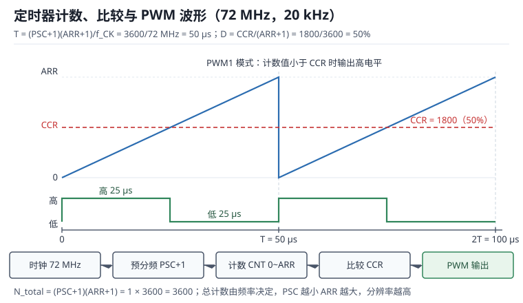

# 定时器与 PWM：预分频、频率与死区

需要"可调能量"的地方几乎都在用 **PWM（Pulse Width Modulation，脉冲宽度调制）**：调 LED 亮度、控电机转速、给加热器恒温、给开关电源做控制。它用一串固定频率的方波，改变高电平的占空比（Duty Cycle），等效出平均电压；比 DAC 便宜、效率高，功率级可以做得很大。

但 PWM 不是"设个占空比就完事"。定时器的预分频（Prescaler，PSC）、自动重装值（Auto-Reload Register，ARR）、比较值（Capture/Compare Register，CCR）三者共同决定频率和分辨率，而这两个指标互相拉扯；驱动电机或加热器时，频率又要在纹波、噪音、开关损耗之间选；半桥还要算死区（Dead Time），否则上下管直通，几百纳秒就能把管子烧掉。本章把这些量全部落到可复算的公式上，最后用 20 kHz 电机 PWM、50 Hz 舵机、占空比整数化、输入捕获测频、编码器计数、死区最小脉宽和 PWM 当 DAC 七个算例收尾。

与中断的配合见[中断与 NVIC](interrupt-nvic.md)：定时器中断是控制环的节拍源；用 DMA 搬运捕获序列或更新占空比见 [DMA](dma.md)。

## 1. 动机：为什么定时器最容易算错"一"

::: motivation 四个现场
**现场一：72 MHz、20 kHz，写 ARR=3600 还是 3599？** 有人按 $f=f_{CK}/ARR$ 算，写 3600，看起来正好 20000 Hz；有人记得"要减一"，写 3599，也是 20000 Hz。正确式子是 $f=f_{CK}/[(PSC+1)(ARR+1)]$，写 3600 时实际是 $72\text{M}/3601=19994.4$ Hz，偏差 0.028%。在电机控制里无所谓，在音频或通信里就不能忽略。

**现场二：想要 12 位分辨率，还要 20 kHz。** 72 MHz 下 12 位、20 kHz 需要 $4096\times20000=81.92$ MHz，时钟不够；于是有人把 PSC 取 224（分频 225）、ARR 取 15，频率对了，分辨率只剩 4 位，电机低速一顿一顿。**频率和分辨率不是独立的**，预分频与 ARR 的分配方式决定了你拿到哪一个。

**现场三：半桥死区只留了 50 ns。** MOSFET 关断有拖尾，驱动有传输延迟差，50 ns 不够；上下管同时导通 100 ns，24 V 母线经两只管子近似短路，电流按 $di/dt=V/L$ 上升，100 nH 回路下 100 ns 就到 24 A，单次能量 28.8 µJ，20 kHz 下平均 0.576 W 全变成热。

**现场四：输入捕获测 100 kHz，误差 10%。** 定时器时钟配成 1 MHz，100 kHz 信号一个周期只有 10 个计数，量化误差 ±1 就是 ±10%。把定时器时钟提到 72 MHz，同样信号有 720 个计数，误差降到 0.14%。**测量精度不是由算法决定，而是由时基决定。**
:::

| 你想确认 | 先算 | 判据（工程经验值，非标准强制） |
|---|---|---|
| PWM 频率 | $f_{CK}/[(PSC+1)(ARR+1)]$ | 电机 16~25 kHz，加热 1~20 kHz |
| 占空比分辨率 | $\log_2(ARR+1)$ | 电机 10~12 位，调光 10 位以上 |
| 电流纹波 | $V_M D(1-D)/(Lf)$ | 小于额定电流的 10%~30% |
| 开关损耗 | $0.5V_MI_L(t_r+t_f)f$ | 小于总损耗的 10%~20% |
| 死区 | $t_{off,max}+t_{skew}+$ 余量 | 200~500 ns，按关断时间算 |
| 捕获分辨率 | $1/(f_T T_{meas})$ | 误差小于目标精度的 1/3 |

**不算会摔在哪**，四个带数字的代价：

1. **ARR 差一。** 72 MHz、ARR=3600 实际是 19994.4 Hz；PSC 不为 0 时误差按 $(PSC+1)$ 放大，在低频率、大分频的配置里可能差出几个百分点。
2. **分辨率不够。** 20 kHz 下若把 ARR 取成 15，只有 4 位，占空比一步 6.25%，电机低速明显抖动。
3. **死区不足。** 100 ns 重叠、24 V/100 nH 回路，峰值 24 A，单次 28.8 µJ；500 ns 重叠时 120 A、720 µJ，足以损坏管子。
4. **时基选错。** 5 kHz 驱动电机，电流纹波是 20 kHz 的 4 倍，还有可闻噪音；50 kHz 虽然安静，但开关损耗和栅极驱动功率按频率线性上升。

## 2. 直观：计数器、比较器与波形

### 2.1 原理图：从总线时钟到互补输出

定时器的核心是一个**计数器（Counter，CNT）**，每个"计数时钟"加 1 或减 1。计数时钟来自总线时钟 $f_{CK}$ 经预分频器分频：

$$f_{cnt}=\frac{f_{CK}}{PSC+1}$$

计数器数到 ARR 后回零（向上计数）或反向（向下/中心对齐）。CCR 与计数器比较，产生输出翻转、中断或 DMA 请求。高级定时器后面还串了死区发生器和互补输出级，再往后是刹车（Break）输入。

寄存器层面只有几个关键项，配置时按这张表对一遍：

| 寄存器 | 关键位 | 作用 |
|---|---|---|
| PSC | PSC[15:0] | 分频系数减一，实际分频 $PSC+1$ |
| ARR | ARR[15:0] | 计数上限，周期为 $ARR+1$ 个计数 |
| CNT | CNT[15:0] | 当前计数值，可读写 |
| CCRx | CCRx[15:0] | 比较值，占空比 $CCR/(ARR+1)$ |
| CCMRx | OCxM | 通道模式（PWM1/PWM2/捕获） |
| CCER | CCxE/CCxNE | 通道使能与互补使能 |
| BDTR | DTG[7:0]、MOE | 死区时间与主输出使能 |

**影子寄存器（Shadow Register）**是理解"改了不生效"的关键：PSC、ARR、CCR 都有预装载（Preload）机制，写入的是预装载寄存器，真正参与比较的影子寄存器要等更新事件（Update Event，UEV）才被刷新。使能 ARPE/OCxPE 后，运行中改占空比不会产生毛刺；不使能则立即生效，可能在本周期中间切出一个窄脉冲。

### 2.2 计数模式与两种对齐

- **向上计数（Edge-Aligned）**：0 到 ARR 再回 0，PWM 边沿对齐，频率 $f_{CK}/[(PSC+1)(ARR+1)]$。
- **向下计数**：ARR 到 0 再回 ARR，频率同上。
- **中心对齐（Center-Aligned）**：0 到 ARR 再回到 0，一个完整周期是 $2\times ARR$ 个计数：

$$f_{PWM}=\frac{f_{CK}}{2(PSC+1)ARR},\qquad D=\frac{CCR}{ARR}$$

中心对齐的脉冲关于周期中心对称，偶次谐波相互抵消，电流纹波和 EMI 通常更小，常用于电机与 D 类功放。代价是同样时钟与频率下分辨率少约 1 位：72 MHz、20 kHz 时边沿对齐有 3600 个计数级，中心对齐只有 1800 级（$11.8$ 位对 $10.8$ 位）。

注意中心对齐的公式里是 $ARR$ 而不是 $ARR+1$，因为上升和下降各走 $ARR$ 步。写代码时按芯片手册核对，别把边沿对齐的 $(ARR+1)$ 直接套过来。

### 2.3 输入捕获：把时间戳变成频率

**输入捕获（Input Capture）**在指定边沿把 CNT 的值复制到捕获寄存器，相当于给事件打时间戳。测周期时连续捕获两个同向边沿：

$$T_{in}=\frac{(PSC+1)(N_2-N_1)}{f_{CK}},\qquad f_{in}=\frac{f_{CK}}{(PSC+1)(N_2-N_1)}$$

测占空比需要三个时间戳（上升、下降、下一个上升），或用两个通道分别捕获上升与下降：

$$D=\frac{N_{fall}-N_{rise}}{N_{rise,2}-N_{rise,1}}$$

捕获通道还有两个容易忽略的配置：**输入滤波（ICF）**按 $f_{DTS}$ 采样若干次才确认边沿，能滤掉开关噪声，但会引入 $(N+1)$ 个采样周期的延迟；**捕获预分频（ICPS）**每 $N$ 个事件才捕获一次，用于降低高频率下的中断率，代价是丢掉中间信息。

低频信号的周期可能超过 16 位计数器的量程，必须用**溢出计数**扩展：

$$T_{in}=\frac{(PSC+1)\left[(N_2-N_1)+k\cdot 65536\right]}{f_{CK}}$$

$k$ 是两次捕获之间发生的溢出次数，由更新中断累加。漏掉一次溢出，测出的周期就少 65536 个计数，误差可能是几十个百分点。

### 2.4 编码器接口、死区与互补输出

**编码器接口（Encoder Interface）**把 A/B 两路正交信号接到定时器的两个通道，硬件根据相位关系自动加/减计数并给出方向位。四倍频（x4）解码下，每转计数为：

$$N_{rev}=4\times PPR$$

$PPR$ 是编码器每转脉冲数（Pulses Per Revolution）。1000 PPR 的编码器一转给出 4000 个计数，分辨率相当于 0.09 度。

**死区**是半桥/全桥上下管之间的强制等待：关断一只管子后，等 $t_{dead}$ 再开另一只，防止**直通（Shoot-Through）**。高级定时器的死区发生器按 $t_{DTS}=1/f_{CK}$ 计数：

$$t_{dead}=DTG\times t_{DTS}$$

$DTG$ 是死区寄存器值（0~127 时按 1 个 $t_{DTS}$ 步进）。72 MHz 下 $t_{DTS}=13.89$ ns，$DTG=36$ 给出 500 ns。互补输出（CHx/CHxN）由硬件保证两路反相，再叠加死区；刹车输入（Break）可以在几个时钟内清掉主输出使能位 MOE，比 10 µs 级的软件轮询快两个数量级。

## 3. 定量：频率、占空比与分辨率

这一节按"配置空间（静态）→ 时序（动态）→ 对闭环的影响（环路）→ 取值边界（权衡）"四层展开。

### 3.1 静态分析：寄存器映射与计数的离散化

先把最基本的关系写清楚。一个 PWM 周期包含的计数个数是预分频与重装值的乘积：

$$N_{total}=(PSC+1)(ARR+1)=\frac{f_{CK}}{f_{PWM}}$$

这个式子是全章的核心：**给定时钟和频率，一个周期的总计数是固定的**；PSC 与 ARR 只是把这个固定总数拆成两段。拆法不影响频率，只影响分辨率。

$$D=\frac{CCR}{ARR+1},\qquad \Delta D=\frac{1}{ARR+1}$$

$$R_{bit}=\log_2(ARR+1)$$

72 MHz 下几个常用频率的拆分：

| $f_{PWM}$ | $N_{total}$ | PSC | ARR | 级数 $ARR+1$ | 分辨率 |
|---|---|---|---|---|---|
| 1 kHz | 72000 | 1 | 35999 | 36000 | 15.1 位 |
| 5 kHz | 14400 | 0 | 14399 | 14400 | 13.8 位 |
| 20 kHz | 3600 | 0 | 3599 | 3600 | 11.8 位 |
| 50 kHz | 1440 | 0 | 1439 | 1440 | 10.5 位 |

第一行值得注意：1 kHz 时 $N_{total}=72000$ 超过 16 位 ARR 的 65535，必须用预分频；取 $PSC=1$（分频 2）后 ARR=35999，刚好放得下，分辨率 15.1 位。如果图省事取 $PSC=71$、ARR=999，频率同样是 1 kHz，分辨率只剩 9.97 位。**在 ARR 放得下的前提下，PSC 越小越好。**

### 3.2 动态分析：波形、捕获时序与死区

占空比与实际高电平时间：

$$t_{high}=D\cdot T_{PWM}=\frac{CCR}{ARR+1}\cdot\frac{(PSC+1)(ARR+1)}{f_{CK}}=\frac{CCR\,(PSC+1)}{f_{CK}}$$

代入 72 MHz、CCR=900、PSC=0 得 $t_{high}=12.5$ µs，占 50 µs 周期的 25%，与 $900/3600=25\%$ 一致。

死区会吃掉有效占空比。以高侧管为例，实际加到负载上的平均电压是：

$$D_{eff}=D-\frac{t_{dead}}{T_{PWM}},\qquad V_{eff}=V_M\left(D-\frac{t_{dead}}{T_{PWM}}\right)$$

20 kHz、500 ns 死区时 $t_{dead}/T=1\%$：指令 10% 占空比实际只有 9%，相对误差 10%；指令 50% 时实际 49%，相对误差 2%。**死区误差在低占空比处最严重**，这就是电机低速、轻载时电流波形畸变的来源。

捕获的量化误差同样可以直接算。周期测量时计数值 $N=(PSC+1)^{-1}f_{CK}T_{in}$，相对误差约：

$$\varepsilon\approx\frac{1}{N}=\frac{f_{in}}{f_{CK}/(PSC+1)}$$

100 kHz 信号配 1 MHz 计数时钟，$N=10$，$\varepsilon=10\%$；配 72 MHz 时钟，$N=720$，$\varepsilon=0.14\%$。

### 3.3 环路稳定性：死区、量化与采样时刻

数字 PWM 进入闭环后有三种非理想因素，影响各不相同。

**量化**决定占空比的最小步进 $\Delta D=1/(ARR+1)$。20 kHz、3600 级时 $\Delta D=0.0278\%$，在 50% 占空比处相对误差 0.056%，可以忽略；但在 1% 占空比处，一步就是 2.8% 的相对变化，控制器会在两个相邻码值之间来回跳，形成**极限环（Limit Cycle）**。低速轻载时的音频噪声往往就是它。

**死区**带来的是增益非线性，不是延迟。它让实际占空比比指令小一个固定量，在过零点附近造成电流畸变；补偿办法是按电流方向查表补偿，而不是调 PID。

**采样时刻**才是相位损失的主要来源。PWM 周期 50 µs、环路带宽 2 kHz、采样加计算 1.5 个周期，相位滞后：

$$\Delta\varphi_{deg}=360^{\circ}\times\frac{2000}{20000}\times1.5=54^{\circ}$$

如果采样时刻落在开关沿上，还会把开关噪声采进电流环，表现为随机的电流尖峰。工程上的标准做法是**中心对齐 PWM + 计数器过零触发 ADC**：采样点固定在脉冲中心，离两个开关沿都最远，噪声最小，抖动也被硬件钉死。

由此可见，"提高 PWM 频率"同时改善三件事：延迟变短、纹波变小、噪音上移；代价是开关损耗线性上升、同样时钟下分辨率下降。环路稳定性的账必须和这三项一起算。

### 3.4 取值与权衡：PSC/ARR 分配、捕获预分频与滤波

**PSC 与 ARR 的分配**遵循一条规则：先由频率确定总计数 $N_{total}$，再让 PSC 取满足 $ARR+1\le 65536$ 的最小值。这样分辨率最高，且 PSC 越小，修改 ARR 时频率的颗粒度越细。

**捕获时基**的取舍是量程与精度的交换：时基越快，量化误差越小，但 16 位计数器的量程越短，低频信号越容易溢出。工程上按"目标信号周期不超过量程的 1/4"选时基，剩下的用溢出计数补。

**输入滤波**用延迟换抗扰。$N$ 个采样点、采样率 $f_{DTS}$ 时，边沿确认延迟约 $(N+1)/f_{DTS}$；72 MHz 下 8 点滤波约 125 ns，对 20 kHz PWM 无影响，对 1 MHz 以上的信号就会吃掉边沿。

**死区**按最坏关断时间加驱动偏斜再加余量：

$$t_{dead}\ge t_{off,max}+t_{skew}+t_{margin}$$

100 ns 关断、50 ns 偏斜、150 ns 余量，取 300 ns；对应 $DTG=300/13.89\approx22$。死区过大同样有害：低速时脉宽被吞掉，转矩脉动变大。

| 参数 | 典型取值 | 边界与失效条件 |
|---|---|---|
| PWM 频率（电机） | 16~25 kHz | 低于 8 kHz 有可闻噪音 |
| 分辨率 | 10~12 位 | 低于 8 位低速抖动明显 |
| 死区 | 200~500 ns | 小于关断时间会直通 |
| 捕获时基 | 频率为信号频率的 100~1000 倍 | 低于 10 倍量化误差不可接受 |
| 输入滤波 | 4~8 点 | 超过 16 点会吃掉窄脉冲 |
| 更新方式 | 预装载 + 更新事件 | 直接改 CCR 会产生毛刺 |

## 4. 算例：七个可复算的时基

### 4.1 算例一：20 kHz、想要 12 位

72 MHz 下 20 kHz 的总计数：

$$N_{total}=\frac{72\times10^{6}}{20000}=3600$$

12 位需要 4096 个计数级，需要的时钟是：

$$f_{req}=4096\times20000=81.92\ \text{MHz}$$

72 MHz 不够。实际分辨率：

$$R_{bit}=\log_2 3600=11.81\ \text{位},\qquad \Delta D=\frac{1}{3600}=0.0278\%$$

若坚持 12 位，最高频率只能到：

$$f_{max}=\frac{72\times10^{6}}{4096}=17578\ \text{Hz}$$

降频到 17.5 kHz 会进入可闻频段，通常不划算。**在 72 MHz 上，20 kHz 与 12 位不可兼得**，这就是现场二里那个"4 位分辨率"方案的由来。

### 4.2 算例二：50 Hz 舵机 PWM

舵机要 50 Hz（20 ms）周期、1.0~2.0 ms 脉宽。总计数：

$$N_{total}=\frac{72\times10^{6}}{50}=1440000$$

超过 16 位 ARR 的 65535，必须分频。取 $PSC+1=24$：

$$ARR+1=\frac{1440000}{24}=60000,\qquad PSC=23,\ ARR=59999$$

验算：$24\times60000=1440000$，$72\text{M}/1440000=50$ Hz。计数时钟变成 $72/24=3$ MHz，一个计数 333 ns；1.5 ms 脉宽对应 $1500/0.333=4500$ 个计数，分辨率 60000 级（15.9 位），远高于舵机本身的机械精度。

### 4.3 算例三：占空比与 CCR 的整数化

20 kHz、3600 级，要 25% 占空比：

$$CCR=0.25\times3600=900,\qquad D=\frac{900}{3600}=25.00\%$$

要 0.1%：

$$CCR=0.001\times3600=3.6\ \rightarrow\ 3\ \text{或}\ 4$$

实取值 3 对应 0.0833%，4 对应 0.1111%，误差约 17%。这说明**低占空比时整数化误差不可忽略**，需要更高分辨率或抖动（dithering）技术。

### 4.4 算例四：输入捕获测频与测占空比

1 kHz、25% 占空比信号，定时器时基 1 MHz（$PSC=71$）：

$$N_{period}=\frac{10^{6}}{1000}=1000,\qquad N_{high}=0.25\times1000=250$$

$$f_{in}=\frac{10^{6}}{1000}=1000\ \text{Hz},\qquad D=\frac{250}{1000}=25.0\%$$

误差：两次捕获各 ±1 个计数，周期误差 ±2/1000 = 0.2%，占空比误差同样约 0.2%。换成 100 kHz 信号、同一时基：

$$N=\frac{10^{6}}{10^{5}}=10,\qquad \varepsilon=\frac{1}{10}=10\%$$

把时基提到 72 MHz（$PSC=0$）：$N=720$，$\varepsilon=0.139\%$。同一个信号，精度差 72 倍，代价只是改一个寄存器。

### 4.5 算例五：编码器计数与回绕

1000 PPR 编码器、四倍频、3000 rpm：

$$N_{rev}=4\times1000=4000,\qquad n=\frac{3000}{60}=50\ \text{r/s}$$

$$R_{count}=4000\times50=200000\ \text{counts/s}$$

16 位计数器每 $65536/200000=0.3277$ s 回绕一次；32 位计数器每 $2^{32}/200000=21474.8$ s，约 5.97 小时。若控制周期 1 ms，两次读取之间最多 200 个计数，远小于半量程 32768，直接用差值法安全；但如果换用 10000 PPR 编码器、6000 rpm，计数率变成 $40000\times100=4\times10^{6}$ counts/s，1 ms 内就是 4000 个计数，仍然安全，而 16 位计数器每 16.4 ms 就回绕一次，必须每周期读取或改用 32 位定时器。

### 4.6 算例六：死区与最小脉宽

20 kHz、500 ns 死区：

$$\frac{t_{dead}}{T_{PWM}}=\frac{500\ \text{ns}}{50\ \mu\text{s}}=1\%$$

指令占空比低于 1% 时，高电平时间不足死区，输出脉冲被完全吞掉。24 V 母线、10% 指令占空比：

$$V_{eff}=24\times(0.10-0.01)=2.16\ \text{V}$$

与期望的 2.4 V 差 0.24 V，相对误差 10%。要减小这个误差，只能减小死区（受器件限制）或提高 PWM 频率（死区占比上升，反而更糟），所以低速性能最终取决于死区补偿算法。

### 4.7 算例七：PWM 当 DAC 的纹波

3.3 V、8 位、20 kHz PWM 经 1 kΩ + 1 µF 滤波，RC = 1 ms 远大于周期 50 µs，纹波近似：

$$\Delta V_{pp}\approx\frac{V_M D(1-D)}{f_{PWM}RC}=\frac{3.3\times0.25}{20000\times1000\times10^{-6}}=\frac{0.825}{20}=41.25\ \text{mV}$$

8 位 LSB 是 $3.3/256=12.89$ mV，纹波约 3.2 个 LSB。建立到 0.5 LSB 的时间约：

$$t_s\approx RC\ln\left(2^{9}\right)=1\ \text{ms}\times6.24=6.24\ \text{ms}$$

所以 PWM+RC 适合"慢变、低精度"的设定值，不适合音频或快速闭环。

## 5. 工程含义：频率选择、更新时机与验证

### 5.1 频率怎么选

电机驱动的 PWM 频率由三件事夹出来：电流纹波（正比于 $1/f$）、开关损耗（正比于 $f$）、噪音（低于 16 kHz 可闻）。工业伺服常取 16~20 kHz，家电风机常取 4~8 kHz 换取更低损耗。加热丝没有电感，纹波不是问题，1~20 kHz 都可以，但要考虑继电器/固态继电器的响应。

LED 调光要避开人眼可感知的闪烁，通常 1 kHz 以上；摄像头拍摄场景要避开相机帧率的整数倍，否则画面出现滚动条纹。

### 5.2 占空比更新与预装载

运行中改占空比有两条路径：直接写 CCR（立即生效）和写预装载寄存器（下个更新事件生效）。前者在周期中间切换，可能产生窄脉冲，经功率级放大成电流尖峰；后者无缝切换，代价是一个周期的延迟。

规则：**只要波形连续性是硬要求（电机、电源），就必须使能 OCxPE 并等更新事件**。调光、加热这类负载对单周期毛刺不敏感，可以直接写。

同理，切换频率要同时改 ARR 与 PSC，并注意先改 ARR 再改 PSC 的顺序，避免中间出现超出量程的组合。

### 5.3 多定时器同步与触发链

单靠一个定时器做三相 PWM 不够：三路互补输出要保持相位关系，ADC 要在固定时刻采样，DMA 要在更新事件搬运。STM32 用主从模式（Master/Slave Mode）把这些串起来：主定时器的 TRGO 输出可以选为更新事件、使能信号或比较脉冲，从定时器把它当作启动、复位或门控源。

三种典型连接：

- **PWM 定时器触发 ADC**：TRGO 选更新事件，ADC 外部触发选该定时器，采样点固定在计数器过零处，避开两个开关沿。
- **主定时器复位从定时器**：多路 PWM 需要严格同相时，让从定时器被主定时器的更新事件复位，相位差为 0。
- **定时器触发 DMA**：更新事件产生 DMA 请求，把新的占空比表搬进 CCR，实现无 CPU 干预的波形序列。

配置顺序有讲究：先配从定时器的触发源与模式，再使能主定时器的 TRGO，最后同时使能两个定时器。顺序反了，第一个周期会出现相位错位，示波器上表现为两路 PWM 的边沿对不齐。

### 5.4 仿真与实验：用逻辑分析仪验证

三步验证，每步都有明确的预期值：

1. **空载测频。** 固定 50% 占空比，逻辑分析仪测输出频率与周期。72 MHz、ARR=3599 的预期是 20.000 kHz、50.00 µs。若测到 19.994 kHz，说明代码用了 3600。
2. **扫占空比。** 让 CCR 从 0 扫到 ARR，观察高电平时间是否线性、有没有窄脉冲或丢脉冲。出现毛刺说明预装载没开；低端丢脉冲说明死区过大。
3. **测捕获精度。** 用信号发生器给 1 kHz/25% 方波，读捕获结果并与源比对。1 MHz 时基下预期周期 1000±2 个计数、占空比 25.0%±0.2%；误差明显偏大时先查时基是不是被 APB 分频影响（定时器时钟在 APB 预分频不为 1 时是 PCLK 的 2 倍）。

## 6. 常见坑

::: pitfall 坑一：ARR 少加一，频率差 0.028%
**现象**：逻辑分析仪测到 19.994 kHz，代码里写的是 20 kHz。

**原因**：周期是 $ARR+1$ 个计数，写 ARR=3600 实际周期是 3601 个计数，$72\text{M}/3601=19994.4$ Hz。

**解决**：所有频率计算统一用 $f=f_{CK}/[(PSC+1)(ARR+1)]$；把期望频率反解成 $ARR+1$ 后减一；在初始化函数里加一行断言或打印实际频率。
:::

::: pitfall 坑二：运行中改 CCR 出现窄脉冲
**现象**：占空比跟随正常，但示波器上偶发几十纳秒的毛刺，功率级电流尖峰。

**原因**：通道没有使能预装载（OCxPE=0），新 CCR 立即生效，在计数器已经越过新值的周期里，输出会先保持再翻转，切出一个窄脉冲。

**解决**：使能 OCxPE，并在更新事件中断里写下一个周期的 CCR；确认 ARPE 也已使能，否则改 ARR 同样会产生异常周期。
:::

::: pitfall 坑三：低频捕获跨溢出，周期算错
**现象**：测 1 Hz 以下信号时，周期读数偶尔只有正确值的几分之一。

**原因**：16 位计数器在两次捕获之间溢出了多次，软件只累加了一次，或者溢出中断被更高优先级中断延迟而丢计数。

**解决**：用更新中断累加溢出次数并保证中断优先级足够高；或者把时基降慢，让一个周期落在量程内；读 CNT 与读溢出计数要做原子保护。
:::

::: pitfall 坑四：死区不足导致上下管直通
**现象**：半桥在加载瞬间炸管，示波器上上下管驱动有几十纳秒重叠。

**原因**：死区按"典型关断时间"设置，没有算驱动传输延迟差、温度升高后的关断拖尾和栅极电阻造成的斜率变化。

**解决**：按最坏关断时间 + 驱动偏斜 + 余量设置死区；用电流探头观察直通电流；在软件里加最小脉宽保护，脉宽小于死区时直接封锁该周期。
:::

::: pitfall 坑五：定时器时钟按 PCLK 算，频率差一倍
**现象**：配置完全按 72 MHz 计算，实测频率却总是 36 kHz 而不是 72 kHz（或反过来）。

**原因**：STM32 的定时器时钟在 APB 预分频不为 1 时等于 PCLK 的 2 倍。APB1 是 36 MHz，但 TIM2 的时钟是 72 MHz；有人按 36 MHz 代入公式。

**解决**：查时钟树确认 TIMxCLK；在代码里用宏统一时钟常量；用逻辑分析仪实测一次反推真实时钟。
:::

::: pitfall 坑六：16 位编码器计数回绕导致速度突跳
**现象**：电机高速时速度环偶尔出现一个巨大的负值尖峰。

**原因**：两次读取之间计数器回绕，直接相减得到负数；或者中断被延迟，跨过了多个回绕点。

**解决**：用无符号 16 位差值并强制转换为有符号数（回绕自动正确）；保证读取周期远小于回绕周期；高速场合改用 32 位定时器或专用编码器计数器。
:::

## 7. 自测题

题一：72 MHz、20 kHz，PSC=0 时 ARR 取多少？分辨率几位？想要 12 位需要多快时钟？

$$ARR+1=\frac{72\times10^{6}}{20000}=3600,\qquad ARR=3599$$

分辨率：

$$R_{bit}=\log_2 3600=11.81\ \text{位}$$

12 位需要 $4096\times20000=81.92$ MHz。72 MHz 下若强行 12 位，最高频率只有 $72\text{M}/4096=17578$ Hz。

验算：$3600\times20000=72\times10^{6}$，闭合。

题二：50 Hz 舵机、72 MHz、16 位 ARR，PSC 和 ARR 怎么取？1.5 ms 脉宽对应多少计数？

$$N_{total}=\frac{72\times10^{6}}{50}=1440000$$

超过 65535，必须分频。取 $PSC+1=24$：

$$ARR+1=\frac{1440000}{24}=60000,\qquad PSC=23,\ ARR=59999$$

计数时钟 $72/24=3$ MHz，一个计数 333.3 ns；1.5 ms 对应 $1500/0.3333=4500$ 个计数。分辨率 60000 级（15.87 位），远高于舵机机械精度。

题三：100 kHz 方波，分别用 1 MHz 和 72 MHz 时基捕获，周期误差各是多少？

1 MHz 时基：$N=10^6/10^5=10$ 个计数，±1 量化误差即 $\pm10\%$。

72 MHz 时基：$N=72\times10^{6}/10^{5}=720$ 个计数，误差 $\pm1/720=0.139\%$。

相差 72 倍，正好等于时基之比。若要测占空比，两个边沿的误差会叠加，误差翻倍到 0.28%。

题四：20 kHz、500 ns 死区，指令 10% 占空比，24 V 母线的实际平均电压是多少？误差多少？

死区占周期比例：

$$\frac{t_{dead}}{T}=\frac{500\ \text{ns}}{50\ \mu\text{s}}=1\%$$

有效占空比 $0.10-0.01=0.09$，平均电压：

$$V_{eff}=24\times0.09=2.16\ \text{V}$$

期望值 2.4 V，绝对误差 0.24 V，相对误差 10%。占空比越低，相对误差越大；50% 时相对误差只有 2%。

题五：1000 PPR 编码器四倍频，3000 rpm，16 位计数器多久回绕一次？1 ms 读取周期安全吗？

$$N_{rev}=4\times1000=4000,\qquad 3000\ \text{rpm}=50\ \text{r/s}$$

$$R=4000\times50=200000\ \text{counts/s}$$

回绕周期：

$$\frac{65536}{200000}=0.3277\ \text{s}$$

1 ms 内最多 200 个计数，远小于半量程 32768，用无符号差值法安全。若编码器换成 10000 PPR、6000 rpm，计数率变成 $4\times10^{6}$ counts/s，16 位计数器 16.4 ms 就回绕，必须每周期读取或改 32 位。

题六：为什么中心对齐 PWM 的公式里没有 +1，而边沿对齐有？

边沿对齐一个周期是 $0,1,\dots,ARR$ 共 $ARR+1$ 个计数；中心对齐是 $0\to ARR\to 0$，上升段 $ARR$ 步、下降段 $ARR$ 步，共 $2\times ARR$ 个计数，所以：

$$f_{edge}=\frac{f_{CK}}{(PSC+1)(ARR+1)},\qquad f_{center}=\frac{f_{CK}}{2(PSC+1)ARR}$$

同样 72 MHz、ARR=1800：边沿对齐 $72\text{M}/1801=39978$ Hz，中心对齐 $72\text{M}/3600=20000$ Hz。写代码时按芯片手册的计数模式和公式核对，不能混用。

## 8. 参考资料

- STMicroelectronics, RM0008 *STM32F101/102/103/105/107 参考手册*，Chapter 13 General-purpose timers（PSC/ARR/CCR、PWM 模式、输入捕获、编码器接口）与 Chapter 14 Advanced-control timers（互补输出、死区、刹车）。
- STMicroelectronics, RM0090 *STM32F405/407 参考手册*，General-purpose timers 与 Advanced-control timers 章节（32 位计数、重复计数器、中心对齐）。
- STMicroelectronics, AN4013 *STM32 cross-series timer overview*，定时器时钟树与通道资源。
- STMicroelectronics, AN4776 *General-purpose timer cookbook for STM32 microcontrollers*，分辨率与频率的取舍、捕获与编码器配置。
- Microchip, AN538 *Using PWM to Generate an Analog Output*，PWM 加 RC 滤波的纹波与建立时间。
- Dynapar, *Encoder Application Handbook*，正交编码器 A/B/Z 信号与四倍频解码。
