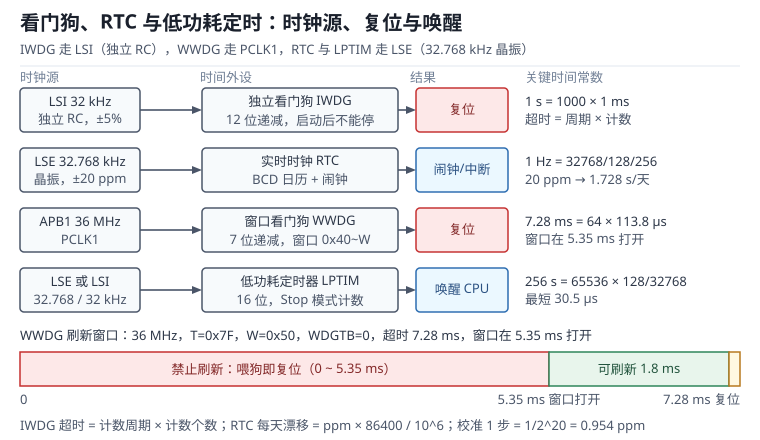

# 看门狗、RTC 与低功耗定时：独立看门狗、窗口看门狗与 ppm 校准 | Watchdog, RTC and Low-Power Timers

看门狗（Watchdog Timer，WDT）是 MCU 里唯一一个“假定软件已经错了”的外设。它不参与正常功能，只在软件按时报到时保持沉默；一旦报到迟到，它就复位整颗芯片。RTC（Real-Time Clock，实时时钟）恰好相反，它假定主电源随时会掉，靠一颗纽扣电池和 32.768 kHz 晶振把日历一路数下去。低功耗定时器（Low-Power Timer，LPTIM）介于两者之间：主时钟全关、CPU 睡在 Stop 模式时，它靠低速时钟继续计数，到点再把 CPU 叫醒。

三者共享同一个设计难点：把“时间”落到一个精度有限的时钟源上。内部 RC 振荡器 LSI（Low-Speed Internal）的偏差是百分之几，外部晶振 LSE（Low-Speed External）的偏差是百万分之几十，两者差了两千多倍。同样一句“1 秒”，在 LSI 上可能变成 0.95 秒，在 LSE 上却是 1.00002 秒；同样一句“一天”，在 20 ppm 的晶振上漂 1.7 秒，在 LSI 上能漂一个多小时。本章把这三类时间外设的公式、时序与失效模式拆开，最后用七个可复算的算例和一个完整的时间子系统设计收尾。

与中断的配合见[中断与 NVIC](interrupt-nvic.md)：喂狗策略本质上是任务监控，依赖中断优先级与临界区；定时器的周期与预分频见[定时器与 PWM](timer-pwm.md)；低速时钟在时钟树里的位置见[时钟树与 PLL](clock-tree.md)。

## 1. 动机：四个没人看着的定时器

::: motivation 四个现场
**现场一：喂狗写在 1 ms 定时器中断里。** 主循环卡在等待 I2C 从机的 `while` 里，从机不响应，功能全失；但定时器中断照常触发，喂狗脉冲一次不少。设备“死”了三天，日志里没有任何复位记录。看门狗监控的是“中断有没有来”，不是“任务有没有做完”。

**现场二：窗口看门狗上电就喂。** 初始化函数最后一行写了 `WWDG->CR = 0x7F | WDGA`，紧接着又写了一次刷新。计数器从 0x7F 开始递减，窗口还没打开（36 MHz 下要等 5.35 ms），这一喂直接触发复位。现象是“上电就重启，串口连一行启动日志都来不及打印”。

**现场三：RTC 用 LSI 当时钟源。** LSI 标称 32 kHz，全温范围偏差按 ±5% 算。日历每天走 86400 秒，5% 就是 4320 秒，一小时十二分钟；一个月下来时间戳能错一天半。工程师在实验室（25 ℃）测了一天觉得“只差 3 分钟，能接受”，装到现场机柜（60 ℃）后误差翻倍。

**现场四：为了省电进了 Stop 模式，RTC 每 60 秒醒一次。** 休眠电流 2 µA，醒来 3 ms、8 mA，算下来平均 52 µA，1000 mAh 电池能撑两年多。但某次唤醒被一个 300 ms 的 Flash 擦除拖住，平均电流立刻翻几倍；再叠加每次唤醒都要重开 HSI、重配外设的 100 µs，账就不是原来那本账了。
:::

| 你想确认 | 先算 | 判据（工程经验值，非标准强制） |
|---|---|---|
| 看门狗超时 | $t=(4\times2^{PR}(RL+1))/f_{LSI}$ | 大于最长正常任务时间的 2~3 倍 |
| 窗口下界 | $(T[5:0]-W[6:0])\times4096\times2^{WDGTB}/f_{PCLK1}$ | 小于最快任务完成时间的 80% |
| RTC 日漂移 | $\epsilon\times86400/10^{6}$ | 小于 1 s/天才能免校准 |
| 校准分辨率 | $1/2^{20}$ 个周期 | 0.954 ppm/步，±488 ppm 量程 |
| 唤醒平均电流 | $I_{run}t_{on}/T+I_{stop}$ | 小于预算的 80% |
| 唤醒延迟 | 时钟启动 + PLL 锁定 + 中断响应 | 小于占空比的 5% |

**不算会摔在哪**，四个带数字的代价：

1. **超时按“标称 LSI”算。** 32 kHz 下配出的 1.000 s，在 30.4 kHz 时是 1.053 s，在 33.6 kHz 时是 0.952 s；F1 系列的 LSI 标称 40 kHz、离散范围 30~60 kHz，同样配置能从 0.53 s 变到 1.07 s。超时设得太紧，低温启动就复位循环。
2. **窗口位置拍脑袋。** 窗口开得太晚（比如 90% 处），一次正常的调度抖动就错过窗口；开得太早，任务稍微提前完成就复位。窗口宽度要覆盖“任务完成时间的分布”，不是覆盖“平均时间”。
3. **RTC 不校准。** 20 ppm 看着很小，一年 631 s，十分钟；工业设备做事件排序、计费、证书有效期校验时，这个量级已经不能忽略。温度从 25 ℃ 升到 60 ℃，音叉晶振的抛物线特性还会再叠加 43 ppm。
4. **唤醒频率没算清。** 每 60 s 醒 3 ms、8 mA，平均只有 0.4 µA；但如果每次唤醒后忘了关 ADC 或没进低功耗，休眠电流从 2 µA 变成 200 µA，电池寿命直接缩水两个数量级。

## 2. 直观：三条独立的时间线

### 2.1 原理图：LSI、LSE 与四个时间外设

三类外设挂在三条不同的时钟上，这条边界决定了“主时钟挂了它们还活不活”。



- **IWDG** 只吃 LSI。LSI 是芯片内部的 RC 振荡器，不依赖任何外部元件，HSE 停振、PLL 失锁都不影响它。代价是精度差、温漂大。
- **WWDG** 吃 APB1 的 PCLK1。它和 CPU 同源，主时钟异常（比如 PLL 被误改）时 WWDG 的节奏也会跟着变，所以它擅长抓“逻辑跑快”，不擅长抓“时钟停摆”。
- **RTC 与 LPTIM** 在备份域，可以吃 LSE、LSI 或 HSE/32。备份域由 VBAT 供电，主电源掉落后 RTC 继续走，备份寄存器（Backup Register）里的内容也还在。

三者的复位与唤醒输出也不同：IWDG 与 WWDG 产生内部复位，走的是系统复位线；RTC 的闹钟和 LPTIM 的到达事件产生中断或唤醒事件，把 CPU 从 Stop/Standby 里拽出来。

### 2.2 独立看门狗：只有一个键的倒计时

IWDG（Independent Watchdog）的结构简单到可以用一句话描述：一个 12 位递减计数器，从重装值 $RL$ 数到 0，数到 0 就复位；软件在它数到 0 之前往键寄存器写一个魔数，它就重新装载。

三个键值分工明确：

| 写入 IWDG_KR | 作用 |
|---|---|
| 0xCCCC | 启动看门狗。启动后除复位外无法关闭 |
| 0xAAAA | 重装计数器（俗称喂狗） |
| 0x5555 | 解除 PR/RL 的写保护，允许修改分频与重装值 |

预分频寄存器 PR 的低 3 位选择 4、8、16、32、64、128、256 分频（实际分频系数是 $4\times2^{PR}$），所以计数时钟是 $f_{LSI}/(4\times2^{PR})$。写 PR 或 RL 之后不能立刻生效，要等状态寄存器 SR 里对应的 PVU（Prescaler Value Update）或 RVU（Reload Value Update）位清零，否则新值会被丢弃。这段“等标志”的代码是最容易被省略、也最容易在低功耗唤醒后出问题的地方。

IWDG 的一个重要性质是**没有窗口**：F1/F4 这一代的 IWDG 只有 KR、PR、RLR、SR 四个寄存器，没有窗口寄存器，喂多早都可以。想检测“喂得太早”，得靠 WWDG；部分较新的系列（如 L4、G0）给 IWDG 补了 WINR 窗口寄存器，可以在独立时钟上做窗口检查。

### 2.3 窗口看门狗：早到也算错

WWDG（Window Watchdog）的计数器只有 7 位，从 0x7F 递减到 0x40；再减一次到 0x3F 时触发复位。它的时钟来自 PCLK1，先固定除以 4096，再由 WDGTB 选择 1、2、4、8 分频。

“窗口”体现在刷新条件上：只有当计数器的值**小于等于**窗口寄存器 W[6:0] 时，写 CR 刷新才合法；计数器还大于 W 时去刷新，同样立即复位。换句话说：

- 刷新太晚（计数器已经到 0x3F）→ 复位，抓“任务卡死”；
- 刷新太早（计数器还大于 W）→ 复位，抓“任务跑飞、提前返回、时钟变快”。

这两个方向合起来，才构成一个完整的“节拍监督”。WWDG 还提供一个 EWI（Early Wakeup Interrupt）中断，在计数器降到 0x40 时触发，给软件留最后 4096 个 PCLK1 周期（36 MHz 下 113.8 µs）做现场保存。

### 2.4 RTC 与 LPTIM：备份域里的时间

RTC 的核心是一条 32.768 kHz 的时钟链和两级预分频：异步预分频 PREDIV_A 与同步预分频 PREDIV_S，通常取 127 和 255，得到 1 Hz。1 Hz 之上是 BCD（Binary-Coded Decimal，二-十进制编码）格式的日历寄存器（秒、分、时、日、月、年、星期），再往上是闹钟 A/B 和 16 位唤醒定时器。

RTC 的校准寄存器 CALIBR 提供两种手段：CALP 在每个校准周期里**增加**一个脉冲（让时钟走快），CALM **删去**一个脉冲（让时钟走慢），脉冲数由 9 位字段给出，校准周期默认 32 秒（$2^{20}$ 个 32.768 kHz 周期），也可以选 8 秒或 16 秒。

备份域的访问有两道门：PWR_CR 的 DBP 位要先置 1 才能写备份寄存器与 RTC，否则写入被静默丢弃；VBAT 引脚要接电池或超级电容，否则主电源一掉，日历和备份寄存器一起归零。

LPTIM 是“低功耗版的定时器”：16 位自动重装，时钟可选 LSE、LSI、APB 或外部输入，预分频 1~128，可以在 Stop 模式下继续计数，到点产生中断或唤醒事件。它没有 PWM 互补输出那样的复杂度，存在的意义只有一个——在主时钟关闭时保持时间感。

| 外设 | 时钟源 | 关键寄存器 | 复位/唤醒行为 |
|---|---|---|---|
| IWDG | LSI | KR、PR、RLR、SR | 计数到 0 产生系统复位 |
| WWDG | PCLK1 | CR、CFR | 计数到 0x3F 或窗口外刷新都复位 |
| RTC | LSE/LSI/HSE 分频 | PRER、TR、DR、ALRMAR、WUTR、CALIBR | 闹钟/唤醒定时器产生中断或唤醒 |
| LPTIM | LSE/LSI/APB | CFGR、ARR、CNT、ICR | 到达事件唤醒 CPU |

## 3. 定量：超时、漂移与校准步长

### 3.1 静态分析：时间常数与寄存器映射

看门狗的超时永远是“计数周期 × 计数个数”。IWDG 的计数周期由 LSI 和预分频决定，计数个数是 $RL+1$：

$$t_{IWDG}=\frac{4\times 2^{PR}\times(RL+1)}{f_{LSI}}=N_{count}\times t_{count},\qquad t_{count}=\frac{4\times 2^{PR}}{f_{LSI}}$$

$PR$ 是 PR 寄存器的 3 位值，$RL$ 是 12 位重装值，$f_{LSI}$ 是 LSI 的实际频率。以 $f_{LSI}=32$ kHz、$PR=3$、$RL=999$ 为例：$t_{count}=32/32000=1$ ms，$N_{count}=1000$，超时正好 1.000 s。

WWDG 的公式形状相同，但计数周期是固定的 4096 个 PCLK1 周期再乘 WDGTB 分频：

$$t_{WWDG}=\frac{(T[5:0]+1)\times 4096\times 2^{WDGTB}}{f_{PCLK1}}$$

注意分子里用的是 $T[5:0]$ 而不是整个 7 位 $T$：计数器最高位（bit 6）在正常计数期间恒为 1，真正参与计数的只有低 6 位，从 0x7F 数到 0x3F 一共 64 个计数周期。窗口打开的时刻则是：

$$t_{open}=\frac{(T[5:0]-W[6:0])\times 4096\times 2^{WDGTB}}{f_{PCLK1}}$$

RTC 的分频链：

$$f_{1\,\text{Hz}}=\frac{f_{LSE}}{(\text{PREDIV\_A}+1)(\text{PREDIV\_S}+1)}=\frac{32768}{128\times 256}=1\ \text{Hz}$$

同步预分频的余数还决定亚秒分辨率：1 Hz 被分成 256 份，每份 3.906 ms。

漂移的定义与换算是本章第二个必须背下来的式子。设实测偏差为 $\Delta t$（在时长 $T$ 内），则

$$\epsilon=\frac{\Delta t}{T}\times 10^{6}\ \text{ppm},\qquad \Delta t_{day}=\frac{\epsilon\times 86400}{10^{6}}$$

校准一步的分辨率由校准周期决定：

$$\Delta f_{step}=\frac{1}{2^{20}}\approx 9.54\times 10^{-7}=0.954\ \text{ppm}$$

所以修正 $\epsilon$ 所需的脉冲数为 $N_{cal}\approx\epsilon/0.954$，9 位字段的上限 511 步对应 487 ppm 的修正范围。

LPTIM 的周期：

$$T_{LPTIM}=\frac{(ARR+1)\times 2^{PRESC}}{f_{LPTIM}}$$

$ARR$ 是 16 位重装值，$PRESC$ 是 0~7 对应的 1~128 分频，$f_{LPTIM}$ 是所选时钟源的频率。

### 3.2 动态分析：喂狗、复位与唤醒的时序

**喂狗时序。** 写 0xAAAA 到 KR 后，计数器在下一个计数时钟沿重装，延迟最多一个计数周期（32 kHz、32 分频下是 1 ms）。这意味着“刚好在超时前 100 µs 喂狗”的代码，实际可能已经越界：软件看到的剩余时间必须按至少一个计数周期来扣。

**复位时序。** IWDG 超时后内部复位立即产生，但“复位产生”到“应用代码重新跑起来”是另一段时间：时钟稳定、从 Flash 取启动代码、C 库初始化、外设重配，通常在 1~10 ms 量级。做故障注入测试时，量的是这段总时间，不是复位信号本身的宽度。

**唤醒时序。** 从 Stop 模式被 RTC 闹钟唤醒，时间由四段组成：唤醒事件同步（几个 LSE 周期）、稳压器与时钟恢复（数据手册给的 Stop 唤醒时间，F4 约 13 µs、L4 约 5 µs 量级）、如果要用 72 MHz 还要加 PLL 锁定（约 100 µs）、最后是中断响应（12 个周期，72 MHz 下 167 ns）。如果每次醒来都要重开 HSI 并锁 PLL，这 100 µs 就是每次唤醒的固定开销；60 s 醒一次，它只占 0.0002%，可以忽略；10 ms 醒一次，它就占 1%，必须计入占空比。

**RTC 日历更新。** 读 TR/DR 时若恰好跨过秒进位，可能读到“59 秒 + 旧分钟”的组合。正确做法是读两次直到一致，或者用影子寄存器（Shadow Register）的 RSF 标志：等 RSF 置位后一次性读走 TR/DR/SSR。

### 3.3 环路稳定性：监控闭环与窗口裕度

把看门狗放进控制论的语言里，它是一条**监督反馈环**：任务集产生心跳，监控器汇总心跳后喂狗，看门狗在超时后复位系统。这条环的“稳定性”不是相位裕度，而是三个时间尺度的包含关系。

设任务的最坏执行时间为 $T_{max}=\mu+3\sigma$，故障可容忍时间为 $T_{fault}$，看门狗超时为 $T_{wdg}$，则：

$$T_{max}\times(1+\delta_{clk}) < T_{wdg} < T_{fault}$$

$\delta_{clk}$ 是看门狗时钟的相对误差（LSI 取 5%，LSE 取 20 ppm）。左边不满足，正常负载波动就会误复位；右边不满足，故障发生了却迟迟不复位。以 1 s 周期、抖动 3σ=50 ms 的任务为例，$T_{max}=1.05$ s，LSI 误差 5%，则 $T_{wdg}>1.10$ s；若要求故障后 2 s 内复位，则 $T_{wdg}<2$ s。可取 1.5 s：距下界 1.10 s 留 36% 裕度，距上界 2.0 s 留 25% 裕度。

窗口看门狗多一个约束：下界必须低于“任务最快完成时间”，否则任务提前完成也会复位。设任务完成时间分布在 $[T_{min},T_{max}]$，窗口打开时刻 $t_{open}$ 应满足

$$t_{open}<T_{min}\times(1-\delta_{clk})$$

这条不等式经常被忽略：优化代码后任务变快了，窗口没改，于是“性能提升”变成了“随机复位”。

**双看门狗的分工**是让两个方向都有人管：IWDG 用独立时钟监控“整个系统还活着”，WWDG 用系统时钟监控“节拍没有跑快”。两者都喂同一个监控任务时，IWDG 覆盖时钟停摆与全局死锁，WWDG 覆盖逻辑跑飞与时钟异常；只用一个，就总有一个方向是盲区。

### 3.4 取值与权衡：超时、窗口与时钟源

| 选择 | 取值方向 | 代价 |
|---|---|---|
| IWDG 超时 | 最长正常任务 × 2~3 | 越长故障发现越慢 |
| IWDG 时钟 | LSI（省电、无外部元件） | 精度 ±5%，超时随温度漂 |
| WWDG 窗口 | 覆盖任务完成时间分布 | 窗口越窄越灵敏，也越易误复位 |
| RTC 时钟 | LSE（±20 ppm） | 需要晶振、负载电容与布线 |
| RTC 时钟 | LSI（无需外部元件） | 每天误差可达小时级，只能做“大致计时” |
| 校准周期 | 32 s（分辨率 0.954 ppm） | 8 s 周期分辨率降到 3.8 ppm，但收敛快 |
| LPTIM 时钟 | LSE | 低功耗且准，但唤醒延迟多几个周期 |
| 唤醒周期 | 按业务需求尽量长 | 越短平均电流越高，唤醒开销占比越大 |

一个容易被忽略的权衡是**看门狗与 Flash 擦写的冲突**：擦除一个 128 KB 扇区需要 1~2 s，擦除期间如果代码在 Flash 里取指会被总线阻塞。IWDG 超时若小于“擦除 + 恢复”的时间，擦除就会变成“必然复位”。解决办法是把超时设到擦除时间之上，或者在擦除期间由 DMA 或 RAM 中的代码维持喂狗，或者干脆把擦除拆成小块。

## 4. 算例：七个可复算的时间账

### 4.1 算例一：1 秒与 8 秒的 IWDG 配置

需求：32 kHz LSI，超时 1.000 s。取 $PR=3$（分频 32）：

$$RL+1=\frac{1.000\times 32000}{32}=1000,\qquad RL=999$$

计数周期 $32/32000=1$ ms，1000 个计数正好 1 s。若需要 8 s，取 $PR=4$（分频 64）：

$$RL+1=\frac{8\times 32000}{64}=4000,\qquad RL=3999$$

仍在 12 位范围（4095）内。该配置的极值：$PR=6$、$RL=4095$ 时 $t=256\times4096/32000=32.768$ s；$PR=0$、$RL=0$ 时 $t=4\times1/32000=0.125$ ms。

### 4.2 算例二：LSI 容差把 1 s 变成 0.95 s

标称配置不变，LSI 偏差 ±5%：

$$t_{min}=\frac{32\times1000}{33600}=0.952\ \text{s},\qquad t_{max}=\frac{32\times1000}{30400}=1.053\ \text{s}$$

也就是 1.000 s 的标称值实际落在 0.952~1.053 s，相对偏差 −4.8%~+5.3%。若系统要求“超时 1 s ±2%”，LSI 直接出局，必须改用 LSE 或外部看门狗芯片。

如果芯片是 F1 系列，LSI 标称 40 kHz、范围 30~60 kHz，同样 32 分频、1000 个计数：

$$t=\frac{32\times1000}{60000}=0.533\ \text{s}\ \text{到}\ \frac{32\times1000}{30000}=1.067\ \text{s}$$

同一条代码，超时能差一倍。超时阈值定在 0.8 s 的系统，在 60 kHz 的芯片上永远复位。

### 4.3 算例三：WWDG 的窗口在 5.35 ms 打开

条件：$f_{PCLK1}=36$ MHz，$WDGTB=0$，$T=0x7F$，$W=0x50$。

超时（从 0x7F 数到 0x3F，共 64 个计数）：

$$t_{WWDG}=\frac{64\times4096}{36\times10^{6}}=7.282\ \text{ms}$$

窗口打开（计数器降到 0x50，走过 $127-80=47$ 个计数）：

$$t_{open}=\frac{47\times4096}{36\times10^{6}}=5.348\ \text{ms}$$

合法刷新区间只有 1.93 ms；EWI 在计数器到 0x40 时触发，即 $63\times4096/36\times10^{6}=7.168$ ms，距复位只剩 113.8 µs。若把 WDGTB 改成 2（分频 4），所有时间乘 4：超时 29.13 ms、窗口 21.39 ms 打开。

### 4.4 算例四：20 ppm 一天漂 1.728 s

$$\Delta t_{day}=\frac{20\times86400}{10^{6}}=1.728\ \text{s}$$

一个月（30 天）51.84 s，一年（365 天）630.7 s，约 10 分 31 秒。反过来，若允许每天漂 1 s，则晶振精度必须优于

$$\epsilon_{max}=\frac{1\times10^{6}}{86400}=11.574\ \text{ppm}$$

再叠加温度：音叉晶振的频率偏差近似服从抛物线

$$\frac{\Delta f}{f}=-0.035\times(T-25)^{2}\ \text{ppm}$$

25 ℃ 校准到 0 ppm 的晶振，到 60 ℃ 时偏差 $0.035\times35^{2}=42.9$ ppm，每天 3.71 s——是常温偏差的两倍多。这就是“实验室校准、现场失准”的算术原因。

### 4.5 算例五：21 步校准把 20 ppm 压到 0.03 ppm

测得日历每天快 1.728 s，对应 20 ppm。每步 0.954 ppm：

$$N_{cal}=\frac{20}{0.954}=20.96\approx21\ \text{步}$$

21 步实际修正 $21\times0.954=20.03$ ppm，残差 0.03 ppm，折算

$$0.03\times0.0864=0.0026\ \text{s/天}$$

一年 0.95 s。方向不能弄反：日历**走快**说明 RTC 时钟偏快，要用 CALM 删脉冲；日历**走慢**才用 CALP 加脉冲。写反了误差翻倍——这一点在第 6 节还有专门的坑。

校准量程也要检查：20 ppm 只用了 21/511 步，量程充足；若晶振偏差 600 ppm（劣质晶振或负载电容严重失配），已经超出 487 ppm 的上限，只能先换元件再校准。

### 4.6 算例六：LPTIM 的最长与最短定时

LSE 32.768 kHz、16 位 ARR、预分频 128：

$$T_{max}=\frac{65536\times128}{32768}=256\ \text{s}$$

最短定时（预分频 1、ARR=0）：

$$T_{min}=\frac{1\times1}{32768}=30.5\ \mu\text{s}$$

256 s 不够覆盖“每小时唤醒一次”的场景，这时要么用 RTC 的 16 位唤醒定时器（1 Hz 时钟下最长 65535 s ≈ 18.2 h），要么让 LPTIM 每次醒来重装并在软件里累计计数。

### 4.7 算例七：平均电流与电池寿命

每秒唤醒一次，醒着 10 ms、电流 5 mA，其余 990 ms 休眠、电流 2 µA：

$$I_{avg}=\frac{5\ \text{mA}\times10\ \text{ms}+0.002\ \text{mA}\times990\ \text{ms}}{1000\ \text{ms}}=51.98\ \mu\text{A}$$

1000 mAh 电池：$1000/0.05198=19238$ h，约 801 天、2.19 年。若系统一直跑在 5 mA，同样电池只有 200 h、8.3 天——低功耗定时的收益是 96 倍。

把唤醒周期从 1 s 放宽到 60 s、每次醒 3 ms、8 mA：

$$I_{avg}=\frac{8\times3}{60000}\ \text{mA}+0.002\ \text{mA}=0.4\ \mu\text{A}+2\ \mu\text{A}=2.4\ \mu\text{A}$$

电池寿命变成 47.6 年（实际会被电池自放电和电容漏电限制在 5~10 年）。同一套硬件，唤醒策略不同，寿命差 21 倍。

### 4.8 设计示例：工业采集节点的时间子系统

需求：4 个任务（20 ms 控制、100 ms 采集、1 s 通信、60 s 记录）；任一任务卡死或跑飞后 2 s 内复位；日历误差小于 1 s/天；平均电流小于 60 µA。

1. **IWDG 2 s。** 取 $PR=4$（64 分频）、$RL=999$：$t=64\times1000/32000=2.000$ s。按 LSI ±5% 校验：最快时钟下 1.905 s、最慢时钟下 2.105 s。需求要写成区间——下界是“最长正常任务 1.2 s 必须跑完”，上界是“故障后 2.2 s 内必须复位”，1.905~2.105 s 正好落在区间内；若任务最坏时间涨到 1.9 s，这个配置就要重算。
2. **WWDG 29.13 ms。** 36 MHz、$WDGTB=2$（分频 4）、$T=0x7F$、$W=0x70$：超时 $64\times4096\times4/36\times10^{6}=29.13$ ms，窗口在 $15\times4096\times4/36\times10^{6}=6.83$ ms 打开。20 ms 控制任务在 10 ms 处喂狗，落在窗口内，早于 6.83 ms 完成或晚于 29.13 ms 未完成都会复位。
3. **RTC 60 s 唤醒。** LSE 32.768 kHz，PREDIV_A=127、PREDIV_S=255，闹钟每 60 s 触发一次；每天与网关对时一次，测得漂移后按 0.954 ppm/步写 CALIBR。
4. **功耗预算。** 60 s 醒一次、每次 3 ms、8 mA，加上休眠 2 µA，平均 2.4 µA；再留 20 µA 给传感器与 LDO 静态电流，总预算 22.4 µA，满足 60 µA。

## 5. 工程含义：喂狗策略、复位取证与校准流程

### 5.1 从“主循环转一圈”到“任务心跳”

最朴素的喂狗是主循环末尾写一次 0xAAAA。它只有一个优点：简单。缺点是一旦某个任务把主循环堵住，喂狗也停了——这其实是正确行为；但如果喂狗写在中断里，这个性质就丢了。真正可用的方案是**心跳汇总**：

```c
#define HB_CTRL   (1u << 0)
#define HB_SENSE  (1u << 1)
#define HB_COMM   (1u << 2)
#define HB_LOG    (1u << 3)
#define HB_ALL    (HB_CTRL | HB_SENSE | HB_COMM | HB_LOG)

static volatile uint32_t hb;

void monitor_task(void)              /* 最低优先级，100 ms 周期 */
{
    if ((hb & HB_ALL) == HB_ALL) {   /* 四个任务都报到过 */
        hb = 0;                      /* 先清，再喂 */
        IWDG->KR = 0xAAAA;
    }
}
```

每个任务在自己的周期末尾执行 `hb |= HB_xxx`。三个细节决定这套机制是否真的有效：

- **置位必须原子。** `hb |= bit` 是读-改-写，两个任务互相抢占时会丢位。用 LDREX/STREX、位带（Bit-Banding）别名，或者给每个任务一个独立的 `volatile uint8_t` 标志。
- **先清后喂。** 顺序反了会漏掉“两个周期只报到一个”的故障：先喂再清，故障周期的心跳会被下一轮吞掉。
- **监控任务自己也要被监控。** 监控任务卡死就没人喂狗，这正好是期望行为；但如果它被高优先级任务长期饿死，就会误复位。监控任务应放在最低优先级，并保证它有确定的执行时间片。

### 5.2 复位取证：谁把系统弄挂了

复位之后第一件事不是重新初始化，而是问“为什么复位”。RCC_CSR 里的标志位给出答案：PORRSTF（上电）、PINRSTF（外部引脚）、SFTRSTF（软件）、IWDGRSTF（独立看门狗）、WWDGRSTF（窗口看门狗）、BORRSTF（欠压）、LPWRRSTF（低功耗模式）。读完要用 RMVF 位统一清除，否则下次无法区分。

第二件事是把“死前现场”留下来。备份寄存器（VBAT 供电）在系统复位后仍然保留，可以在每次喂狗前把当前心跳位图写进去；复位后读出来，就知道是哪个任务没报到。一个实用的约定：

| 备份寄存器 | 内容 |
|---|---|
| DR0 | 魔数，标记“本字段已初始化” |
| DR1 | 复位计数（饱和计数，便于统计现场复位率） |
| DR2 | 上次喂狗前的心跳位图 |
| DR3 | 最后一条日志的序号或时间戳低 32 位 |

这套“黑匣子”只有几十字节，却能把“现场随机复位”从悬案变成一条可复现的记录。

### 5.3 RTC 校准与温度补偿

校准分三步。第一步是**测**：让设备连续运行 24 h 以上，与 GPS 秒脉冲、网关时间或网络对时比对，记录偏差 $\Delta t$，按 $\epsilon=\Delta t\times10^{6}/86400$ 换算成 ppm。第二步是**算**：$N_{cal}=\epsilon/0.954$，四舍五入取整，注意方向（快用 CALM，慢用 CALP）。第三步是**验**：再跑 24 h，确认残差在一个步长以内。

工程上还要处理两件事：

- **温度补偿。** 音叉晶振的抛物线系数约 $-0.035$ ppm/℃²，25 ℃ 校准后，60 ℃ 时额外偏 43 ppm。做法是存一张温度-ppm 表，按片上温度传感器读数查表，把补偿量叠加到 CALIBR。温度传感器本身有 ±2 ℃ 误差，60 ℃ 附近的斜率为 $0.07\times35=2.45$ ppm/℃，折算成 $2.45\times2=4.9$ ppm 的残差，可以接受。
- **老化。** 晶振频率随年份缓慢漂移，典型 ±3 ppm/年。校准值要留出重标定周期，工业产品通常每年一次，计量类产品每季度一次。

### 5.4 仿真与实验：注入故障、量电流、对时间

三类实验，每类都有明确的预期值：

1. **故障注入。** 在某个任务里插入 `while(1){}`（保留中断），预期 2 s 内复位，复位后备份寄存器里的心跳位图缺少对应位。再插入 `__disable_irq(); while(1){}`，此时 20 ms 控制任务也停了，WWDG 会在 29 ms 后先复位，复位源寄存器给出 WWDGRSTF；只有把 WWDG 暂时关掉，才轮到 IWDG 在 2 s 后复位——这一步验证了两个看门狗的分层关系。
2. **电流测量。** 用源表或 µA 级电流表记录 10 个唤醒周期的平均值，与 $I_{avg}=I_{run}t_{on}/T+I_{stop}$ 对比。实测偏大 10% 以上，先查 GPIO 漏电、LDO 静态电流和调试器连接。
3. **时间比对。** 用 GPS 秒脉冲触发 GPIO 中断，记录 RTC 秒计数与 PPS 的相位差，连续测 24 h。相位差对时间的斜率就是 ppm；如果斜率在温度变化时明显弯折，说明需要温度补偿。

## 6. 常见坑

::: pitfall 坑一：在定时器中断里喂狗
**现象**：主循环因等待外设而永久阻塞，设备功能全失，但看门狗一次都没有复位；示波器上喂狗脉冲依然规整。

**原因**：喂狗写在 1 ms 定时器中断里，中断由硬件定时器驱动，与主循环是否推进完全无关。看门狗监控的是“中断有没有来”，而不是“任务有没有完成”。

**解决**：喂狗移出中断，改成心跳汇总：中断只置位，监控任务检查全部任务都报到后才喂狗。喂狗语句全工程只允许出现在监控任务一处。
:::

::: pitfall 坑二：窗口看门狗上电就喂，复位循环
**现象**：上电后串口一行日志都没有，复位引脚周期性出现窄脉冲，设备反复重启。

**原因**：初始化末尾使能 WWDG 后立刻刷新，此时计数器还是 0x7F，窗口尚未打开（36 MHz 下要等 5.35 ms），刷新被判定为“过早”，直接复位。

**解决**：使能后不要立即刷新，等计数器进入窗口再喂；或者把第一次刷新放在定时器中断里，按固定延时（大于 $t_{open}$）执行。调试时可以先不置 WDGA，确认时间基准后再打开。
:::

::: pitfall 坑三：调试暂停时被看门狗复位
**现象**：连着调试器单步执行，几步之后芯片复位，变量全丢；脱离调试器运行却正常。

**原因**：内核被 halt 后外设时钟仍在跑，IWDG 继续递减，超时后复位。默认没有开调试冻结。

**解决**：在调试初始化里置位 DBGMCU 的 IWDG/WWDG/RTC stop 位（F4 在 DBGMCU_APB1_FZ，F1 在 DBGMCU_CR），让内核暂停时冻结这些计数器；量产固件不要保留这段代码。
:::

::: pitfall 坑四：LSI 温漂导致低温启动复位循环
**现象**：冷库设备在 −20 ℃ 开机时反复复位，常温测试一切正常；把看门狗超时放宽后现象消失。

**原因**：LSI 频率随温度与批次变化，低温下偏快，实际超时比标称短（F1 的 LSI 范围 30~60 kHz，若按 32 kHz 配超时，实际可能缩到 53%）。启动阶段 Flash 等待周期、时钟切换又比常温慢，两头一挤就超时。

**解决**：超时按 LSI 最快频率计算并留 2 倍以上裕度；启动阶段先喂一次再进入正常心跳；对时间敏感的产品改用外部看门狗芯片或 LSE 驱动的窗口看门狗。
:::

::: pitfall 坑五：RTC 时钟源选了 LSI，日历每天差一小时
**现象**：设备时间每天慢 40~70 分钟，重启后从备份域恢复的时间也是错的。

**原因**：RTC 时钟源配置成 LSI，而 LSI 的 ±5% 偏差直接变成日历偏差：$0.05\times1440=72$ 分钟/天。实验室 25 ℃ 下偏差小，现场温度一变就放大。

**解决**：日历应用一律用 LSE；没有晶振的板子宁可外挂一颗 RTC 芯片，也不要用 LSI 做日历。已经用 LSI 的，至少每天对时一次并记录偏差。
:::

::: pitfall 坑六：校准方向写反，误差翻倍
**现象**：按测量结果写了校准值，第二天误差从 +2 s 变成 −2 s 甚至 −4 s。

**原因**：CALP 是“增加脉冲”（走快），CALM 是“删去脉冲”（走慢）。日历走快时应删脉冲，写成了加脉冲，等于把误差又加了一遍。

**解决**：把“测量符号 → 校准动作”写成一张表贴在代码注释里；校准后必须再测 24 h 验证；校准值用有符号数存储，避免手工取反。
:::

## 7. 自测题

<details><summary>题一：32 kHz LSI，要 3 s 超时，PR 和 RL 取多少？LSI 偏 5% 时实际范围是多少？</summary>

先选分频，让 $RL+1$ 落在 4096 以内：

$$RL+1=\frac{3\times32000}{4\times2^{PR}}$$

取 $PR=4$（64 分频）：$RL+1=1500$，$RL=1499$，在 12 位范围内。校验：$64\times1500/32000=3.000$ s。

LSI ±5%：

$$t_{min}=\frac{64\times1500}{33600}=2.857\ \text{s},\qquad t_{max}=\frac{64\times1500}{30400}=3.158\ \text{s}$$

若任务最坏 1.5 s、故障容忍 4 s，2.86~3.16 s 落在区间内，可用；若任务最坏 2.9 s，则最快情况下会误复位，必须加大超时或换时钟源。

</details>

<details><summary>题二：PCLK1=30 MHz，T=0x7F，W=0x60，WDGTB=1，超时和窗口打开时刻各是多少？合法刷新窗口多宽？</summary>

超时：

$$t_{WWDG}=\frac{64\times4096\times2}{30\times10^{6}}=17.48\ \text{ms}$$

窗口打开（$127-96=31$ 个计数）：

$$t_{open}=\frac{31\times4096\times2}{30\times10^{6}}=8.465\ \text{ms}$$

合法刷新窗口为 8.465~17.48 ms，宽 9.01 ms。EWI 在 0x40 处，即 $63\times4096\times2/30\times10^{6}=17.20$ ms，距复位 $8192/30\times10^{6}=273$ µs。

</details>

<details><summary>题三：日历每天快 2.592 s，偏差多少 ppm？要校准几步？残差多少？</summary>

$$\epsilon=\frac{2.592\times10^{6}}{86400}=30\ \text{ppm}$$

每步 0.954 ppm：

$$N_{cal}=\frac{30}{0.954}=31.45\approx31\ \text{步}$$

31 步修正 $31\times0.954=29.56$ ppm，残差 $30-29.56=0.44$ ppm，折算每天 $0.44\times0.0864=0.038$ s，一年约 13.9 s。若取 32 步，修正 30.53 ppm，残差 −0.53 ppm（日历偏慢），量级相当；取整方向按“宁慢勿快”或“宁快勿慢”由业务决定。

</details>

<details><summary>题四：为什么“在中断里喂狗”是错的？心跳法如何检测“某个任务卡死但中断正常”？</summary>

看门狗的本质是**任务完成度的监督**，不是“CPU 有没有在跑”。中断由硬件触发，即使主循环死锁、任务被无限阻塞，定时器中断仍然按时到达；在中断里喂狗等于把监督对象换成了“中断控制器还活着”，绝大多数软件故障都会漏检。

心跳法把监督对象换回任务本身：每个任务在完成本轮工作后置自己的位，监控任务只有在**全部位都置起**时才清位并喂狗。若某个任务卡死，它的位永远不置，监控任务不喂狗，看门狗在超时后复位。注意置位要原子、先清后喂、监控任务放最低优先级，否则会出现丢位或误复位。

</details>

<details><summary>题五：每 10 s 唤醒一次，醒着 5 ms、6 mA，休眠 1.8 µA，平均电流多少？1000 mAh 电池理论能用多久？</summary>

$$I_{avg}=\frac{6\ \text{mA}\times5\ \text{ms}+0.0018\ \text{mA}\times9995\ \text{ms}}{10000\ \text{ms}}$$

分子：$0.03+0.017991=0.047991$ mA·s，除以 10 s：

$$I_{avg}=4.80\ \mu\text{A}$$

1000 mAh 电池：$1000/0.0048=208333$ h，约 23.8 年。实际上电池自放电（每年 1%~2%）、LDO 静态电流、电容漏电会把寿命压到 5~10 年，所以低功耗设计的瓶颈通常不在 MCU，而在外围与电池本身。

</details>

## 8. 参考资料

- STMicroelectronics, RM0008 *STM32F101/102/103/105/107 参考手册*，Independent watchdog (IWDG) 章：IWDG timeout period、预分频与键值、PVU/RVU 更新标志；Window watchdog (WWDG) 章：WWDG_CR/WWDG_CFR、7 位计数器、窗口与 EWI。
- STMicroelectronics, RM0090 *STM32F405/407 参考手册*，Real-time clock (RTC) and backup registers 章：PRER 分频、CALIBR 的 CALP/CALM 与 $2^{20}$ 周期校准、WUTR 唤醒定时器、备份域与 VBAT；Power control (PWR) 章：Stop/Standby 与 DBP 写保护。
- STMicroelectronics, AN3371 *Using the hardware real-time clock (RTC) in STM32 F0, F2, F3, F4 and L1 series*，RTC calibration 一节：±488 ppm 量程、8/16/32 秒校准周期与 ppm 换算。
- STMicroelectronics, RM0351 *STM32L4 参考手册*，Low-power timer (LPTIM) 章：16 位 ARR、1~128 预分频、Stop 模式计数与唤醒；Real-time clock (RTC) 章。
- ARM, DDI 0403 *ARMv7-M Architecture Reference Manual*，Chapter B1 Exception Model 与 Chapter B3 System Control Block：异常进入周期、PRIMASK/BASEPRI 对唤醒响应的影响。
- Linux 内核 *Documentation/watchdog/watchdog-api.txt*：nowayout 与 keepalive 的语义，用户态看门狗如何避免“喂狗进程自己挂了”。
