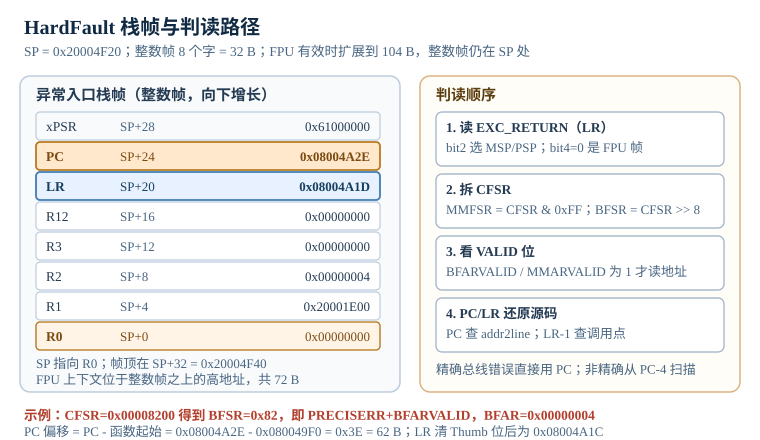

# 现场崩溃分析：HardFault 栈帧、CFSR 判读与 coredump

现场最贵的一类故障，不是"每次都能复现的 bug"，而是"复位之后什么也没留下"的崩溃。设备在客户现场跑了三个月，某天开始随机重启；返修回来上电一切正常，日志停在崩溃前半小时，串口只打印一行启动信息。工程师只能猜：是电源跌落、是某个指针越界、是栈溢出，还是 Flash 里的参数被写坏？猜错一次，就是三个月。

Cortex-M 的异常机制其实留下了很多证据：进入 HardFault 时，硬件会把 R0 到 R3、R12、LR、PC、xPSR 压到栈上；配置故障状态寄存器（Configurable Fault Status Register，CFSR）会记录是总线错误、存储器管理错误还是用法错误；硬件故障状态寄存器（HardFault Status Register，HFSR）记录这次故障是否由配置故障升级而来；总线故障地址寄存器（BusFault Address Register，BFAR）和存储器管理故障地址寄存器（MemManage Address Register，MMFAR）会给出出错地址。问题在于，这些证据默认只存在 RAM 里，复位就没了。本章讲三件事：**怎么读这些证据、怎么在复位前把它们落盘、怎么让下一次故障更容易被抓住。**

> 本章以 Cortex-M3、72 MHz、64 KB Flash、20 KB SRAM 为例；涉及 FPU 的地方单独标注 Cortex-M4F。故障寄存器地址来自 ARMv7-M 架构：CFSR `0xE000ED28`、HFSR `0xE000ED2C`、MMFAR `0xE000ED34`、BFAR `0xE000ED38`、SHCSR `0xE000ED24`。所有地址、时间和概率用 Python 复算。

## 1. 动机：现场只留下一个复位

::: motivation 四个现场
**现场一：HardFault 处理函数里又崩了一次。** 工程师在 `HardFault_Handler` 里调用 `printf` 打印 CFSR，`printf` 需要可观的栈，还可能碰堆锁；故障发生时栈已经溢出，`printf` 一进去就触发第二次异常。HardFault 处理函数不能嵌套自己，内核进入 Lockup（锁定）状态，看门狗复位后什么也没留下。正确做法是先把栈帧和故障寄存器搬到 `.noinit` 的静态缓冲，再用轮询 UART 或直接复位。

**现场二：BFAR 是 0x50000004，工程师却去查空指针。** CFSR 的值是 `0x00008200`，`BFSR=0x82`，其中 `BFARVALID=1`、`PRECISERR=1`，BFAR 是 `0x50000004`。工程师看到地址末位是 4，先入为主地认为是"空指针加 4 字节偏移"，花了两天查 NULL 初始化；实际是野指针指向保留外设区 `0x50000000`，字段偏移 4。真正要改的是"这个指针为什么被写坏"，不是"为什么地址是 4"。

**现场三：PC 指向的指令和崩溃现象对不上。** 压栈 PC 是 `0x08004A2E`，工程师用 `addr2line` 查出来是 `sensor_update` 的第 42 行，但那一行是 `if (p == NULL) return;`，看起来不可能崩。原因是他在 `addr2line` 前减了 4，把地址指到了前一条指令；精确总线错误的压栈 PC 就是出错指令，不需要减。少减或多减 4 字节，能把人带到完全错误的分支。

**现场四：看门狗在 coredump 写到一半时复位。** 工程师把 20 KB RAM 全量写到 Flash，按 1 KB 页擦除 20 ms、半字编程 50 µs 估算，需要 934 ms；看门狗窗口 1 s，加上串口输出和 CRC 校验，刚好超时。复位后日志头部的长度字段是 `0xFFFFFFFF`，CRC 不对，整段作废。正确做法是只 dump 栈窗口和寄存器（约 2 KB，113 ms），或者先喂狗再分段写。
:::

把现象、第一检查点和判据放在一张表里：

| 你看到的现象 | 先查什么 | 判据 |
|---|---|---|
| 复位后无日志、串口只有启动行 | 有没有 `.noinit` 缓冲、看门狗窗口 | 故障后 RAM 里仍有魔数和 CRC 正确的记录 |
| HardFault 处理函数一进就复位 | 处理函数是否用 `printf`/浮点/大局部变量 | 处理函数只用静态缓冲和轮询外设 |
| CFSR 非 0 但读不出地址 | `MMARVALID`/`BFARVALID` 是否置位 | 只有 valid 为 1 时 MMFAR/BFAR 才可信 |
| PC 指向的源码看起来无关 | 是否对 PC 做了错误的减 2/减 4 | 精确总线错误直接用 PC；非精确才考虑 PC-4 |
| BFAR 是 0x50000004 这类保留区地址 | 是否野指针/越界指针 | 反汇编确认 `[rN, #offset]` 与 BFAR 一致 |
| 中断进 Default_Handler | 向量表是否被覆盖、VTOR 是否正确 | 向量表地址与 VTOR 一致，表项在 Flash 范围内 |
| 栈溢出但 CFSR 没有 STKOF | Cortex-M3 没有硬件栈溢出位 | 用 MPU 保护区或栈金丝雀，不依赖 STKOF |

**不算会摔在哪**，四个带数字的代价：

1. **2 KB 栈窗口 dump 只要 185 ms，20 KB 全量要 1.785 s。** 115200 8N1 下每字节 10 位，2,128 B 是 0.185 s；20,560 B 是 1.785 s。看门狗窗口 1 s 时，全量 dump 还没发完就复位了。
2. **写 Flash 的 20 KB 要 934 ms。** 21 页擦除 420 ms，10,280 个半字编程 514 ms。加上串口输出，超过 1 s；只 dump 2 KB 时，3 页擦除加 1,064 个半字是 113.2 ms。
3. **1/10,000 的复现率，50 次/天要等 200 天。** 单台设备每天启动 50 次，期望 200 天碰到一次；10 台设备并联复现，期望 20 天。没有故障注入，这个反馈周期长到项目结束都等不到。
4. **200 条断言占 8 KB，是 64 KB Flash 的 12.2%。** 每条断言约 40 B（比较、分支、字符串地址、失败处理），200 条就是 8,000 B。全删能省 12.2%，但现场故障的定位成本远高于这点 Flash。

## 2. 定义与直观：异常入口、栈帧与故障寄存器

### 2.1 四类故障与升级

Cortex-M 的配置故障分四类：

- **HardFault（硬件故障）**：所有不能被其他处理函数接住的故障，最后都到这里。优先级固定为 -1，高于任何可配置异常。
- **MemManage Fault（存储器管理故障）**：MPU 访问违规、取指违规、入栈/出栈违规。需要使能 `SHCSR.MEMFAULTENA`，否则升级为 HardFault。
- **BusFault（总线故障）**：取指总线错误、数据总线错误、入栈/出栈总线错误。需要使能 `SHCSR.BUSFAULTENA`。
- **UsageFault（用法故障）**：未定义指令、非法状态（Thumb 位为 0）、非法 PC、协处理器不存在、非对齐访问、除零。需要使能 `SHCSR.USGFAULTENA`。

"升级"（escalation）是理解 HardFault 的关键：配置故障默认可能是关闭的，关闭时它不会进自己的处理函数，而是变成 HardFault，并在 HFSR 里置 `FORCED` 位。所以看到 HardFault，第一件事不是"HardFault 是什么"，而是"它原本是哪一类故障，为什么被升级了"。把三个 `*FAULTENA` 都打开，能让故障落到更具体的处理函数，CFSR 的对应位也更完整。

还有两种情况会直接进 Lockup：HardFault 处理函数自己又触发故障，或者 NMI 处理函数触发故障。Lockup 时内核停止取指，只有复位能恢复；这时能救场的只有独立看门狗。

### 2.2 异常入口栈帧

异常入口（exception entry）时，硬件自动把 8 个寄存器压到当前栈上，形成栈帧（stack frame），顺序和地址偏移固定：

| 偏移 | 寄存器 | 说明 |
|---:|---|---|
| SP + 0 | R0 | 参数/返回值 |
| SP + 4 | R1 | 参数 |
| SP + 8 | R2 | 参数 |
| SP + 12 | R3 | 参数 |
| SP + 16 | R12 | 临时寄存器 |
| SP + 20 | LR | 异常发生前的链接寄存器 |
| SP + 24 | PC | 异常发生时的程序计数器 |
| SP + 28 | xPSR | APSR + EPSR，含 Thumb 位 |

8 个字共 32 B。SP 指向最低地址的 R0，所以 `frame[0]` 是 R0、`frame[5]` 是 LR、`frame[6]` 是 PC、`frame[7]` 是 xPSR。这个顺序是 ARMv7-M 规定的，不随编译器变。

如果 FPU 处于活动状态（`CONTROL.FPCA=1`），栈帧扩展到 104 B：整数帧仍在 SP 处，FPU 上下文（S0 到 S15、FPSCR 和一个填充字）位于整数帧之上的高地址，共 72 B。这样设计的好处是，故障处理函数仍然可以用 `frame[6]` 读 PC，不需要先跳过 FPU 数据。Cortex-M4F 的懒压栈（lazy stacking）可能延迟写入 FPU 寄存器，但空间已经预留，帧大小不变。

如果 `CCR.STKALIGN=1` 且异常入口前的 SP 不是 8 字节对齐，硬件可能插入一个填充字来对齐；这时帧内偏移不变，但 SP 与 8 字节边界的关系要重新确认。读帧前先看 SP 的低 3 位，能避免把填充字当成 R0。

下图把 8 个压栈字、SP 偏移和判读顺序放在一起。左侧的 PC 与 LR 是回溯的入口，右侧的四步是处理函数里应当固定执行的顺序。



### 2.3 EXC_RETURN 与 MSP/PSP

异常入口时，硬件把 **EXC_RETURN** 值写进 LR。处理函数返回时执行 `BX LR`，内核根据这个值恢复现场。常见值：

| EXC_RETURN | 含义 | bit4 | bit2 |
|---|---|---|---|
| `0xFFFFFFF1` | 返回到 Handler 模式，使用 MSP | 1 | 0 |
| `0xFFFFFFF9` | 返回到 Thread 模式，使用 MSP | 1 | 0 |
| `0xFFFFFFFD` | 返回到 Thread 模式，使用 PSP | 1 | 1 |
| `0xFFFFFFE1` | Handler 模式，MSP，FPU 帧 | 0 | 0 |
| `0xFFFFFFE9` | Thread 模式，MSP，FPU 帧 | 0 | 0 |
| `0xFFFFFFED` | Thread 模式，PSP，FPU 帧 | 0 | 1 |

读法：

- **bit 2** 选择栈：0 表示 MSP，1 表示 PSP。故障发生在使用 PSP 的线程里时，栈帧在 PSP 上，不在 MSP 上。
- **bit 4** 表示帧类型：1 表示标准帧（32 B），0 表示扩展帧（104 B，含 FPU）。很多代码把这一位写反，结果在 FPU 帧里按 32 B 读，PC 完全错位。
- 低 4 位 `0b0001` 表示返回 Handler 模式，`0b1001` 表示返回 Thread 模式 MSP，`0b1101` 表示返回 Thread 模式 PSP。

故障处理函数通常写成 `__attribute__((naked))`，在 C 代码之前用汇编判断 bit2，把对应的栈指针传给 C 函数：

```c
void HardFault_Handler(void) __attribute__((naked));
void HardFault_Handler(void)
{
    __asm volatile(
        "tst lr, #4        \n"
        "ite eq            \n"
        "mrseq r0, msp     \n"
        "mrsne r0, psp     \n"
        "mov r1, lr        \n"
        "b hardfault_report\n"
    );
}
```

`r0` 是栈帧指针，`r1` 是 EXC_RETURN。`hardfault_report` 用 `frame[6]` 读 PC、`frame[5]` 读 LR、`frame[7]` 读 xPSR，并把 CFSR/HFSR/MMFAR/BFAR 一起存进 `.noinit` 缓冲。注意 `hardfault_report` 不能返回，最后要复位或死循环等看门狗。

### 2.4 CFSR、HFSR、MMFAR 与 BFAR

**CFSR** 是一个 32 位寄存器，按字节分成三块：

- **MMFSR**（bit 7:0）：MemManage Fault Status Register。
- **BFSR**（bit 15:8）：BusFault Status Register。
- **UFSR**（bit 31:16）：UsageFault Status Register。

常用位：

| 区域 | 位 | 名称 | 含义 |
|---|---:|---|---|
| MMFSR | 0 | IACCVIOL | 取指访问违规（MPU） |
| MMFSR | 1 | DACCVIOL | 数据访问违规（MPU） |
| MMFSR | 3 | MUNSTKERR | 异常返回出栈时出错 |
| MMFSR | 4 | MSTKERR | 异常入口压栈时出错 |
| MMFSR | 7 | MMARVALID | MMFAR 中的地址有效 |
| BFSR | 0 | IBUSERR | 取指总线错误 |
| BFSR | 1 | PRECISERR | 精确数据总线错误，PC 指向出错指令 |
| BFSR | 2 | IMPRECISERR | 非精确数据总线错误，PC 可能已前进 |
| BFSR | 3 | UNSTKERR | 异常返回出栈时总线错误 |
| BFSR | 4 | STKERR | 异常入口压栈时总线错误 |
| BFSR | 7 | BFARVALID | BFAR 中的地址有效 |
| UFSR | 0 | UNDEFINSTR | 未定义指令 |
| UFSR | 1 | INVSTATE | 非法状态（Thumb 位为 0） |
| UFSR | 2 | INVPC | 非法 PC（加载到 PC 的值不合法） |
| UFSR | 3 | NOCP | 协处理器不存在（如未开 FPU 却用浮点） |
| UFSR | 4 | STKOF | 栈溢出（ARMv8-M 的栈限寄存器触发） |
| UFSR | 8 | UNALIGNED | 非对齐访问 |
| UFSR | 9 | DIVBYZERO | 除零 |

**HFSR** 记录 HardFault 的原因：

- bit 1 `VECTTBL`：向量表读取错误（VTOR 指向非法地址，或向量表被覆盖）。
- bit 30 `FORCED`：由配置故障升级而来。看到这一位，必须去 CFSR 找原始原因。
- bit 31 `DEBUGEVT`：调试事件触发。

**MMFAR** 和 **BFAR** 分别保存 MemManage 和 BusFault 的出错地址，但只有在 `MMARVALID`/`BFARVALID` 为 1 时才有意义。没有 valid 位时读到的 0 可能是"地址就是 0"，也可能是"没有记录"，不能混为一谈。

这里要澄清一个常见写法：有人把这一组信息简称 **BFHF**，但 Cortex-M 并没有名为 BFHF 的寄存器。实际要读的是 **BFAR**（总线故障地址）和 **HFSR**（硬件故障状态），再加上 **CFSR** 里的 **BFSR** 分区。把这三个混在一起叫，容易在代码里写错寄存器名。

### 2.5 从 PC/LR 到源码

拿到栈帧后，定位源码（回溯，backtrace）的步骤：

1. **确认栈帧在哪个栈上**：看 EXC_RETURN 的 bit2，选 MSP 或 PSP。选错栈，读到的 8 个字全是垃圾。
2. **确认帧大小**：看 bit4，1 是 32 B，0 是 104 B。FPU 帧的整数部分仍在 SP 处，所以 `frame[6]` 仍是 PC，但栈窗口的起始地址要按 104 B 算。
3. **读 PC**：`pc = frame[6]`。精确总线错误、用法错误、取指错误时，PC 就是出错指令；非精确总线错误时，PC 可能已经前进，需要看 `PC-4` 或反汇编附近指令。
4. **读 LR**：`lr = frame[5]`。LR 是当前函数的返回地址，末位可能是 1（Thumb 位）。用 `lr & ~1u` 得到偶地址；要定位调用指令，再减 2 或 4（取决于 `BL`/`BLX` 编码），或者直接用 `lr - 1` 让 `addr2line` 落在调用行。
5. **换算偏移**：`offset = pc - symbol_start`。符号起始地址从 map 文件或 `nm` 拿；`addr2line -e app.elf -f -C 0x08004A2E` 直接给出函数名和行号。
6. **交叉验证**：用 `objdump -d --start-address=... --stop-address=...` 看 PC 附近的指令，确认它访问的地址与 BFAR/MMFAR 一致。只有"指令、地址、故障位"三者对得上，结论才可靠。

对非精确总线错误，压栈 PC 可能指向错误之后几条指令。常用做法是从 `PC-4` 开始反汇编 8 到 16 条指令，找哪条 `LDR/STR` 的地址等于 BFAR；如果 BFAR 无效，就看哪条访问了可疑外设或野指针。写缓冲（write buffer）会把存储操作延迟，非精确错误就是延迟造成的。

### 2.6 coredump（核心转储）与日志落盘

现场崩溃分析的黄金法则是：**先落盘，再复位。** 落盘位置有三种：

- **`.noinit` RAM**：复位后 SRAM 通常保留，读写最快，不磨损 Flash；掉电丢失。适合"看门狗复位/软件复位"的现场。
- **Flash 保留区**：掉电保留，但写入慢、有擦写寿命；适合"必须跨掉电"的现场。要预留 4 KB 到 8 KB，按页擦除、按半字/字编程，最后写魔数和 CRC。
- **备份寄存器（backup register）**：VBAT 供电时掉电保留，容量小（STM32F1 有 20 个 32 位寄存器），适合存 PC、CFSR、BFAR、复位次数这几个关键值。

coredump 的最小内容：

| 字段 | 大小 | 说明 |
|---|---:|---|
| 魔数 | 4 B | 例如 `0x434F5245`（"CORE"） |
| 版本/长度 | 8 B | 兼容不同固件 |
| CFSR/HFSR | 8 B | 故障原因 |
| MMFAR/BFAR | 8 B | 出错地址 |
| EXC_RETURN/SP | 8 B | 选栈与帧位置 |
| 栈帧 8 字 | 32 B | R0-R3、R12、LR、PC、xPSR |
| 栈窗口 | 1-2 KB | 回溯用，通常取 SP 到 SP+1 KB |
| CRC32 | 4 B | 校验整段 |

总大小约 2 KB 出头。若把整个 20 KB RAM 都 dump，信息更全，但时间、Flash 空间和看门狗预算都吃紧。

落盘顺序要保证"要么完整，要么明确无效"：

1. 先在 RAM 缓冲里组装 header、寄存器、栈窗口，算 CRC。
2. 擦除目标 Flash 页。
3. 写入 payload。
4. 最后写魔数和 CRC；魔数最后写，保证中途复位时旧数据不会被误认为新 dump。
5. 复位前回读校验，或至少检查 Flash 状态寄存器。

UART 输出适合研发阶段：2 KB 用 115200 约 185 ms，20 KB 要 1.785 s。量产设备通常没有调试串口，或者串口被业务占用，所以 Flash/备份寄存器更实际。

### 2.7 断言与故障注入

**断言（assertion）** 是把"不可能发生"变成"立刻停住并留下证据"的手段。嵌入式的断言要满足三个条件：失败时能记录 PC/LR/任务 ID/关键变量；不会因为 `printf` 或动态内存再次崩溃；发布版本可以选择保留关键断言或降级为错误码。

```c
#define CHECK(cond, code) do {                         \
    if (!(cond)) {                                     \
        assert_fail(__FILE__, __LINE__, (code),        \
                    __builtin_return_address(0));      \
    }                                                  \
} while (0)
```

`assert_fail` 把信息写进 `.noinit` 缓冲，然后复位或进入安全状态。不要用标准 `assert` 直接调 `printf`：`NDEBUG` 会把它整体删掉，`printf` 又可能重入故障路径。

**故障注入（fault injection）** 是主动制造故障，验证"检测—记录—恢复"链路：

- 野指针：把配置指针改成 `0x50000000`，调用业务函数，期望 CFSR 的 `PRECISERR+BFARVALID`，BFAR 等于 `0x50000004`；如果改用 MPU 保护空指针页，则期望 MemManage 的 `DACCVIOL+MMARVALID`，MMFAR 等于字段偏移。
- 非对齐：把 `uint32_t *` 指向 `buf+1`，在 M0 上期望 HardFault，在 M3/M4 上要看指令类型。
- 除零：整数除以 0，期望 `UFSR.DIVBYZERO`（如果使能了 UsageFault）。
- 栈溢出：递归到超过栈深，期望 MPU 保护区触发 MemManage，或金丝雀被改写。
- MPU 违规：写只读区域，期望 `MMFSR.DACCVIOL+MMARVALID`。
- 看门狗：在长任务里故意不喂狗，期望复位并记录复位原因。

每次注入都要检查：故障是否被捕获、CFSR 是否符合预期、coredump 是否完整、复位后是否能恢复。只测"正常路径"的测试，覆盖不到这些分支。

## 3. 定量关系：栈帧、时间与概率

### 3.1 栈帧地址公式

设异常入口后的栈指针为 $SP$，第 $k$ 个压栈寄存器（$k=0$ 对应 R0）的地址：

$$
A_k=SP+4k,\qquad k=0,1,\ldots,7
$$

因此：

$$
A_{R0}=SP,\quad A_{LR}=SP+20,\quad A_{PC}=SP+24,\quad A_{xPSR}=SP+28
$$

$SP$ 是压栈后的栈指针（字节），$A_k$ 是对应寄存器的地址（字节）。FPU 扩展帧的整数部分仍在 $SP$ 到 $SP+28$，FPU 上下文在 $SP+32$ 到 $SP+100$，总帧 104 B。这个公式假设没有额外的对齐填充字；若 `CCR.STKALIGN` 插入填充，SP 的低 3 位会变，但帧内偏移不变。

### 3.2 回溯偏移

设故障指令地址为 $PC$，所在函数的起始符号地址为 $S$，则函数内偏移：

$$
\Delta=PC-S
$$

调用点偏移用 LR 计算：

$$
\Delta_{\text{call}}=(LR\ \&\ \sim 1)-S_{\text{caller}}
$$

$PC$ 是压栈的程序计数器（字节），$S$ 是函数符号起始地址（字节），$\Delta$ 是偏移（字节）；$LR$ 是压栈的链接寄存器，$S_{\text{caller}}$ 是调用者函数起始地址。`& ~1` 清掉 Thumb 位。$\Delta$ 用于在反汇编里定位，`addr2line` 则直接吃 $PC$。

对非精确总线错误，实际出错指令可能在 $PC-4$ 或更早：

$$
PC_{\text{suspect}}=PC-4
$$

$PC_{\text{suspect}}$ 是可疑指令地址（字节）。这个偏移不是固定的，取决于写缓冲深度和指令流水线；4 字节是常见的起点，不是定律。

### 3.3 故障状态拆解

CFSR 的三段拆解：

$$
\text{MMFSR}=CFSR\ \&\ 0x000000FF
$$

$$
\text{BFSR}=(CFSR\gg 8)\ \&\ 0x000000FF
$$

$$
\text{UFSR}=(CFSR\gg 16)\ \&\ 0x0000FFFF
$$

$CFSR$ 是 32 位寄存器值，$\text{MMFSR}$、$\text{BFSR}$、$\text{UFSR}$ 是对应字节/半字。判断地址是否有效：

$$
\text{addr}_{\text{valid}}=
\begin{cases}
\text{MMFAR}, & \text{MMFSR}[7]=1 \\
\text{BFAR}, & \text{BFSR}[7]=1 \\
\text{unknown}, & \text{otherwise}
\end{cases}
$$

这个式子是判读的核心：**没有 valid 位，地址字段不可信。** 很多"BFAR 是 0"的误判，都是因为没看 `BFARVALID`。

### 3.4 落盘时间

UART 按 8N1 每字节 10 位：

$$
t_{\text{uart}}=\frac{10N}{R_{\text{baud}}}
$$

$N$ 是字节数，$R_{\text{baud}}$ 是波特率（bit/s），$t_{\text{uart}}$ 是秒。Base64 编码后长度：

$$
N_{\text{b64}}=4\left\lceil\frac{N}{3}\right\rceil
$$

Flash 写入：

$$
t_{\text{flash}}=N_{\text{page}}t_{\text{erase}}+\frac{N}{2}t_{\text{prog}}
$$

$N_{\text{page}}$ 是跨页数，$t_{\text{erase}}$ 是页擦除时间，$t_{\text{prog}}$ 是半字编程时间。这三个式子用于判断"dump 能不能在看门狗窗口内完成"。

### 3.5 看门狗预算

设看门狗超时 $T_{\text{wd}}$，dump 时间 $t_{\text{dump}}$，复位和启动余量 $t_{\text{margin}}$，则必须满足：

$$
t_{\text{dump}}+t_{\text{margin}}\leq T_{\text{wd}}
$$

$T_{\text{wd}}$ 是秒，$t_{\text{dump}}$ 是秒，$t_{\text{margin}}$ 是秒。工程上留 30% 余量：

$$
t_{\text{dump}}\leq 0.7T_{\text{wd}}
$$

$T_{\text{wd}}=1$ s 时，dump 应不超过 700 ms。超过就缩短栈窗口、提高波特率、分段写并喂狗，或者用独立看门狗的超时重装载。

### 3.6 复现概率

设单次启动复现概率 $p$，试验 $n$ 次至少复现一次的概率：

$$
P(n)=1-(1-p)^n
$$

期望试验次数：

$$
E[n]=\frac{1}{p}
$$

$p$ 是无量纲概率，$n$ 是次数，$P(n)$ 是至少一次的概率。$p$ 很小时 $P(n)\approx np$。若每天 $m$ 次、$d$ 台设备并联，期望天数：

$$
E[d]=\frac{1}{p\,m\,d}
$$

$m$ 是每天启动次数，$d$ 是设备台数。这个式子解释"为什么现场问题复现不了"：不是玄学，是样本量不够。

### 3.7 断言代码预算

设断言条数 $N_a$，每条代码大小 $s_a$，Flash 总容量 $F$，断言占用率：

$$
\eta_a=\frac{N_a s_a}{F}
$$

$N_a$ 是条数，$s_a$ 是字节/条，$F$ 是字节，$\eta_a$ 是无量纲比值。$s_a$ 取决于字符串、日志调用和失败处理；只做"比较+跳转+复位"的断言约 20 到 40 B，带文件名/行号的约 40 到 80 B。

## 4. 典型计算：一帧 HardFault 的完整判读

### 4.1 现场数据

设备复位后，`.noinit` 缓冲里读到：

| 项目 | 值 |
|---|---|
| SP | `0x20004F20` |
| R0 | `0x00000000` |
| R1 | `0x20001E00` |
| R2 | `0x00000004` |
| R3 | `0x50000000` |
| R12 | `0x00000000` |
| LR | `0x08004A1D` |
| PC | `0x08004A2E` |
| xPSR | `0x61000000` |
| CFSR | `0x00008200` |
| HFSR | `0x40000000` |
| BFAR | `0x50000004` |
| MMFAR | `0x00000000` |

### 4.2 判读

先拆 CFSR：

$$
\text{MMFSR}=0x00008200\ \&\ 0xFF=0x00
$$

$$
\text{BFSR}=(0x00008200\gg 8)\ \&\ 0xFF=0x82
$$

$$
\text{UFSR}=(0x00008200\gg 16)\ \&\ 0xFFFF=0x0000
$$

`BFSR=0x82` 的二进制是 `1000 0010`：bit1 `PRECISERR=1`，bit7 `BFARVALID=1`。这说明是**精确数据总线错误**（precise bus error），BFAR 中的地址有效。BFAR 是 `0x50000004`，所以出错地址是 `0x50000004`。

HFSR 是 `0x40000000`，只有 bit30 `FORCED=1`，说明这个故障是从配置故障升级来的；CFSR 给出了原始原因。MMFSR 和 UFSR 都是 0，排除 MPU 和用法错误。

PC 是 `0x08004A2E`。精确总线错误的压栈 PC 就是出错指令，不需要减 4。反汇编 `sensor_update`（起始 `0x080049F0`）：

```text
08004a28  ldr r3, [r4, #0]     ; r4->ptr = 0x50000000（已损坏）
08004a2a  ldr r2, [r4, #8]     ; r2 = 4
08004a2c  cmp r4, #0
08004a2e  str r2, [r3, #4]     ; 写地址 0x50000004，精确总线错误
```

PC 处的 `str r2, [r3, #4]` 与 BFAR=`0x50000004`、R3=`0x50000000` 三者一致：R3 是野指针，字段偏移 4，写地址就是 `0x50000004`。`0x50000000` 在 STM32F103 的存储器映射里属于保留的外设区，没有实现，访问会返回总线错误。如果反汇编与 BFAR 对不上，先检查是不是读错了栈（MSP/PSP）或帧大小（FPU 的 104 B），再检查是不是非精确错误；不要为了凑结论去改 PC。

补充一个容易踩的边界：如果指针真的是 NULL，STM32F103 会把 `0x00000000` 别名到 Flash，读 `0x4` 会读到复位向量而不报错；写 `0x4` 也可能被 Flash 控制器拦下并置错误标志，而不是总线错误。要让空指针可靠地进 HardFault，需要用 MPU 把 `0x0` 附近设为 no-access，或者用编译器插桩；那时故障类型是 MemManage，CFSR 是 `0x00000082`（`DACCVIOL+MMARVALID`），MMFAR 是 4。这个对照说明：**同样的偏移，落在不同的存储器区域，故障类型和寄存器完全不同。**

函数内偏移：

$$
\Delta=0x08004A2E-0x080049F0=0x3E=62\ \text{B}
$$

`addr2line -e app.elf -f -C 0x08004A2E` 给出 `sensor_update` 的文件和行号；再用 `objdump -d --start-address=0x08004A20 --stop-address=0x08004A38` 核对指令。若 `addr2line` 给出的行是 `p->value++`，而结构体 `value` 的偏移正好是 4，三者一致，结论成立。

再看 LR：

$$
LR\ \&\ \sim 1=0x08004A1C
$$

`LR` 的末位是 1（Thumb 位），清掉后是 `0x08004A1C`。调用者 `control_task` 起始 `0x08004900`：

$$
\Delta_{\text{call}}=0x08004A1C-0x08004900=0x11C=284\ \text{B}
$$

`addr2line 0x08004A1C` 给出 `control_task` 的调用行。注意 `0x08004A1C` 是 `BL` 的返回地址，`BL` 指令本身在 `0x08004A18`；要定位调用指令，可以看 `0x08004A18`，或者用 `LR-1` 让 `addr2line` 落在调用行。不要把 `LR` 当 PC 用：LR 是"函数返回后执行到哪里"，PC 是"现在崩在哪里"。

为什么不是 `PC-4`？因为 `PRECISERR=1`。精确总线错误是同步的，压栈 PC 指向触发访问的指令；减 4 会指到前一条指令，可能得出完全错误的行号。只有 `IMPRECISERR=1` 时才考虑 `PC-4` 或扫描附近指令。

### 4.3 复现与最小化

有了"野指针 + 偏移 4"的结论，复现就变成构造输入：

```c
struct sensor *p = (struct sensor *)0x50000000;
sensor_update(p);   /* 期望同样的 CFSR/BFAR */
```

在单元测试里直接传这个地址，跑一遍，检查 `SCB->CFSR` 是否为 `0x00008200`、`BFAR` 是否为 `0x50000004`。若一致，说明故障路径复现；再往上追"p 为什么变成 `0x50000000`"：是缓冲区溢出把指针写坏、是配置解析把长度字段写坏，还是任务间竞争把指针清了。

最小化的步骤：

1. 关掉无关任务，只保留 `control_task` 和 `sensor_update` 的调用链。
2. 把输入固定成能触发野指针的那一组，去掉随机性。
3. 用 `git bisect` 找引入问题的提交；对比 map 文件，看 `sensor_update` 的地址和结构体偏移有没有变。
4. 在主机上用 UBSan/ASan 跑同一段逻辑，主机能直接报"非法指针解引用"的行号。
5. 在目标板上用故障注入复跑 10,000 次，确认修复后 CFSR 不再出现 `PRECISERR`。

最小化的目标是"一条命令、一个输入、一个断言"就能复现；做不到，说明还有隐藏状态（堆、任务调度、外设时序）没被固定。

### 4.4 落盘时间

最小 coredump：2,048 B 栈窗口 + 72 B 头部（含 8 字栈帧、CFSR/HFSR/MMFAR/BFAR、魔数与 CRC）+ 8 B 对齐 = 2,128 B。

UART 115200：

$$
t_{\text{uart}}=\frac{2{,}128\times10}{115{,}200}=0.1847\ \text{s}
$$

Base64 后：

$$
N_{\text{b64}}=4\left\lceil\frac{2{,}128}{3}\right\rceil=4\times710=2{,}840\ \text{字符}
$$

时间 $2{,}840\times10/115{,}200=0.2465$ s。Base64 比裸二进制多 33%，但能走文本日志通道。

Flash 写入：2,128 B 跨 3 个 1 KB 页（假设起始对齐），1,064 个半字：

$$
t_{\text{flash}}=3\times20\ \text{ms}+1{,}064\times50\ \mu\text{s}=60+53.2=113.2\ \text{ms}
$$

全量 20 KB RAM：20,560 B，21 页，10,280 个半字（从页边界开始）：

$$
t_{\text{flash}}=21\times20+10{,}280\times0.05=420+514=934\ \text{ms}
$$

（若只算 20,480 B RAM，20 页擦除加 10,240 个半字是 912 ms；加上 72 B 头部和 8 B 对齐，就是上面的 934 ms。）

看门狗 1 s 预算：最小 dump 的 UART 185 ms + Flash 113 ms + 复位 10 ms = 308 ms，余量 692 ms；全量 dump 的 UART 1.785 s 已经超时，Flash 934 ms 也只剩 66 ms 余量。结论：**默认只 dump 2 KB 栈窗口，全量 dump 作为研发选项。**

### 4.5 复现概率

假设单次启动复现概率 $p=1/10{,}000=10^{-4}$，每天启动 50 次：

$$
E[n]=\frac{1}{10^{-4}}=10{,}000\ \text{次}
$$

$$
E[d]=\frac{10{,}000}{50}=200\ \text{day}
$$

单台设备期望 200 天。10 台设备并联：

$$
E[d]=\frac{10{,}000}{50\times10}=20\ \text{day}
$$

如果概率降到 $10^{-5}$，单台要 2,000 天，10 台要 200 天。这就是为什么"现场偶发问题"不能靠等：必须用故障注入、压力测试和环境试验把 $p$ 放大，或者用断言/coredump 把"没复现"变成"有证据"。

### 4.6 断言预算

200 条断言，每条 40 B：

$$
\eta_a=\frac{200\times40}{65{,}536}=\frac{8{,}000}{65{,}536}=12.2\%
$$

如果每条 80 B（带文件名、行号、日志），就是 16,000 B，占 24.4%。发布版本可以只保留安全相关和状态机断言，把"参数非空"这类开发期断言编译掉；但不要把全部断言删掉，现场定位的成本远高于 8 KB Flash。

## 5. 工程含义：把故障变成可取证事件

**故障处理函数要"轻"。** 不要 `printf`、不要 `malloc`、不要浮点、不要大局部数组、不要调用可能阻塞的驱动。只做：读栈帧、读故障寄存器、写静态缓冲、复位。需要串口输出时，用轮询发送或 DMA，发送前先确认外设时钟还在。

**先保存，再解释。** 故障现场的第一手数据是栈帧和 CFSR/HFSR/MMFAR/BFAR；任何"先打印再分析"的代码都可能改变现场。把原始 8 个字和 4 个寄存器原样存进 `.noinit`，复位后再用调试器或启动日志解析。解析代码可以复杂，保存代码必须简单。

**区分"故障地址"和"故障指令"。** BFAR/MMFAR 是数据地址，PC 是指令地址；两者可能相差很远。比如 `str r2, [r3, #4]` 的指令在 Flash `0x08004A2E`，数据地址是 `0x50000004`。只看一个，结论会跑偏。

**使能配置故障，不要全交给 HardFault。** 在启动早期设置：

```c
SCB->SHCSR |= SCB_SHCSR_MEMFAULTENA_Msk
            | SCB_SHCSR_BUSFAULTENA_Msk
            | SCB_SHCSR_USGFAULTENA_Msk;
```

这样 MPU 违规进 MemManage、总线错误进 BusFault、除零/未定义指令进 UsageFault，处理函数更具体，CFSR 的位也更完整。代价是多几个异常入口和少量代码；收益是现场能直接区分"越界"和"野指针"。

**CFSR 写 1 清零，不要写 0。** CFSR 的位是"写 1 清除"（write-one-to-clear）。`SCB->CFSR = 0;` 不会清零，反而可能保留旧位；正确写法是 `SCB->CFSR = SCB->CFSR;` 或逐位写 1。清除前先保存到缓冲，否则下一次故障的原因就丢了。

**栈溢出要有独立检测。** Cortex-M3/M4 没有 ARMv8-M 的 `STKOF` 栈限机制，CFSR 不会告诉你"栈溢出"。用 MPU 在栈底下面设 32 B 不可访问区域，溢出时进 MemManage，`MMFAR` 就是越界地址；或者在栈底放金丝雀，定期检查。两者都比"等它踩坏别的变量"早。

**coredump 要做版本和 CRC。** 固件升级后结构体布局会变，旧 dump 不能按新格式解析。header 里放 magic、version、length、CRC32；解析工具先验 magic 和 CRC，再按 version 选布局。没有 CRC 的 dump，遇到半写状态会给出错误的 PC。

**日志分级、环形缓冲。** 平时用环形缓冲记录事件（任务切换、错误码、复位原因），故障时把环形缓冲一起 dump。环形缓冲放 `.noinit` 或固定 RAM，不要用 `malloc`；写入用单生产者/单消费者，避免锁。日志级别在发布版只保留 warning/error，减少开销。

**复位原因要先读后清。** STM32 的 `RCC_CSR` 有 PORRSTF、BORRSTF、PINRSTF、SFTRSTF、IWDGRSTF、WWDGRSTF、LPWRRSTF 等标志，读之前不要写 `RMVF`。启动日志第一行打印复位原因，能直接区分"看门狗复位"和"上电复位"；如果每次都是 IWDGRSTF，说明系统在跑飞，不是电源问题。

**故障注入要进 CI。** 至少覆盖野指针/空指针、非对齐、除零、栈溢出、MPU 违规五类；每类检查 CFSR 的期望位、coredump 的完整性、复位后的恢复。注入用例可以跑在 HIL 台架上，也可以用 QEMU 的 Cortex-M 模型跑逻辑部分。没有注入，故障处理代码永远是"没被执行过的代码"。

**发布构建保留符号。** `.elf` 和 `.map` 要按版本归档；量产可以加密或签名，但不能只留 `.bin`。现场拿到 PC `0x08004A2E`，没有 `.elf` 就只是一个数字；有 `.elf` 才能还原成函数、行号和变量。符号文件是售后分析的基础设施，不是调试期的临时产物。

**安全标准要的是证据链。** IEC 61508-2 的 Annex A 把"程序流监控""栈溢出检测""故障注入测试"列为诊断技术，考核的是诊断覆盖率，不是"有没有写 HardFault 处理函数"。coredump、断言、复位原因、注入报告，合起来才是证据链；单独一个处理函数不算。

## 6. 常见坑（现象、原因与解决）

::: pitfall 七个高频坑
- **HardFault 处理函数里再次崩溃，设备变砖**：现象——复位后没有任何日志，调试器显示内核停在 Lockup，看门狗周期复位。原因——处理函数调用 `printf`/`malloc`/浮点，栈已溢出或外设时钟已关，触发第二次异常；HardFault 不能嵌套自己。解决——处理函数用 `__attribute__((naked))`，只读栈帧和寄存器，写静态 `.noinit` 缓冲，然后复位；串口输出放在复位后的启动流程里。

- **BFAR 有效，但只看低 16 位就下结论**：现象——BFAR 是 `0x50000004`，工程师看到末尾 `0x0004`，以为是空指针加偏移，改了 NULL 判断问题依旧。原因——没有结合 R3、存储器映射和反汇编一起看；`0x50000000` 是保留外设区，不是 NULL。解决——先检查 `BFSR[7]`/`MMFSR[7]` 确认地址有效，再反汇编确认 `[rN, #offset]`，把 BFAR 的高位和 R3 对照；空指针在 STM32 上可能因 `0x0` 别名到 Flash 而不报错，需要 MPU 才能可靠捕获。

- **PC 减了 4，定位到错误的行**：现象——`addr2line` 给出的行看起来完全无关，甚至在一个不可能崩溃的分支。原因——对精确总线错误/用法错误也做了 `PC-4`；这些故障的压栈 PC 就是出错指令。解决——先看 `BFSR.PRECISERR`：为 1 时直接用 PC；为 0（非精确）时才考虑 `PC-4` 或扫描附近指令；用 `objdump` 交叉验证。

- **FPU 帧按 32 B 读，PC 完全错位**：现象——Cortex-M4F 上 HardFault，按 8 个字读栈帧，PC 看起来像随机数。原因——`EXC_RETURN` 的 bit4 为 0，实际是 104 B 扩展帧；或者读帧时选了错误的栈（MSP/PSP）。解决——先看 `EXC_RETURN` 的 bit2 选栈、bit4 判帧；整数帧仍在 SP 处，但栈窗口大小按 104 B 算；用 `frame[6]` 读 PC，不要从 SP+32 开始读。

- **看门狗在 dump 中途复位，日志半截**：现象——coredump 的 length 是 `0xFFFFFFFF`，CRC 不对，解析工具报错。原因——20 KB 全量 dump 的 Flash 时间 934 ms，加上 UART 1.785 s，超过 1 s 窗口；或者擦除/编程时看门狗没喂。解决——只 dump 2 KB 栈窗口（113 ms Flash/185 ms UART）；分段写并在段间喂狗；魔数最后写，保证半写数据不被误认。

- **栈溢出但 CFSR 没有 STKOF**：现象——怀疑栈溢出，读 CFSR 只有 HardFault/FORCED，没有栈溢出位。原因——Cortex-M3/M4 没有 ARMv8-M 的栈限寄存器，`UFSR.STKOF` 不会置位；栈溢出表现为踩坏相邻 RAM 或压栈总线错误。解决——用 MPU 栈底保护区（32 B 不可访问）或金丝雀；检查 `MSTKERR`/`STKERR` 是否置位，结合 SP 与栈底地址判断。

- **断言在发布版被整体删掉，现场没有证据**：现象——调试版能断在 `assert`，发布版直接复位，日志里什么都没有。原因——`NDEBUG` 让标准 `assert` 展开为空；或者自定义断言被 `#ifdef DEBUG` 包住。解决——关键断言用独立宏，不依赖 `NDEBUG`；失败时写 `.noinit` 并复位；发布版保留安全相关断言，开发期断言可降级为错误码。

- **复位原因没读就清，误判为电源问题**：现象——现场每次复位都记录 "POR"，工程师换了电源，问题依旧。原因——启动代码在打印前写了 `RCC_CSR.RMVF`，把 IWDGRSTF 清掉了；或者读的是备份寄存器里的旧值。解决——启动第一行先读 `RCC_CSR` 并保存，再清标志；把复位原因和 coredump 一起落盘。
:::

## 7. 自测题

<details><summary>SP = `0x20004F20`，栈帧 8 个字。PC、LR、xPSR 分别在哪？如果这是 FPU 扩展帧，整数帧的位置变不变？</summary>

按 3.1 的公式：

- R0：`0x20004F20`
- R1：`0x20004F24`
- R2：`0x20004F28`
- R3：`0x20004F2C`
- R12：`0x20004F30`
- LR：`0x20004F34`（SP+20）
- PC：`0x20004F38`（SP+24）
- xPSR：`0x20004F3C`（SP+28）

帧结束于 `0x20004F40`，共 32 B。

FPU 扩展帧时，整数帧仍在 SP 处，偏移不变；FPU 上下文（S0-S15、FPSCR、填充字）在整数帧之上的高地址，从 SP+32 到 SP+100，总帧 104 B。所以 `frame[6]` 仍然是 PC，栈窗口按 104 B 算。若 `EXC_RETURN` 的 bit4 为 0，说明是扩展帧；为 1 是标准帧。

</details>

<details><summary>CFSR = `0x00008200`，BFAR = `0x50000004`，HFSR = `0x40000000`。这是什么故障？地址可信吗？下一步查什么？</summary>

拆解：

$$
\text{MMFSR}=0x00,\quad \text{BFSR}=0x82,\quad \text{UFSR}=0x0000
$$

`BFSR=0x82` 的 bit1 是 `PRECISERR`，bit7 是 `BFARVALID`。所以是**精确数据总线错误**，BFAR 有效，出错地址是 `0x50000004`。HFSR 的 bit30 `FORCED=1`，说明是从 BusFault 升级到 HardFault；CFSR 给出了原始原因。MMFSR/UFSR 为 0，排除 MPU 和用法错误。

下一步：

1. 读压栈 PC，反汇编该指令，确认访问的是 `[rN, #4]` 且 `rN=0x50000000`。
2. 用 `addr2line` 把 PC 映射到源码行，确认是 `p->field` 且字段偏移为 4。
3. 追 `p` 为什么是 `0x50000000`：缓冲区溢出、配置解析把长度写坏、任务竞争。
4. 构造 `p=(struct sensor *)0x50000000` 的单元测试，确认 CFSR 复现；修复后跑故障注入确认不再出现。

补充：如果 `p` 真的是 NULL，STM32F103 会把 `0x00000000` 别名到 Flash，读 `0x4` 可能读到复位向量而不报错；用 MPU 保护空指针页时，同样的访问会变成 MemManage，CFSR 是 `0x00000082`，MMFAR 是 4。不要把"地址小"直接等同于"空指针"。

</details>

<details><summary>压栈 PC = `0x08004A2E`，`sensor_update` 起始 `0x080049F0`；LR = `0x08004A1D`，调用者 `control_task` 起始 `0x08004900`。求函数内偏移和调用点偏移。LR 的末位为什么是 1？</summary>

函数内偏移：

$$
\Delta=0x08004A2E-0x080049F0=0x3E=62\ \text{B}
$$

调用者偏移：

$$
LR\ \&\ \sim 1=0x08004A1C
$$

$$
\Delta_{\text{call}}=0x08004A1C-0x08004900=0x11C=284\ \text{B}
$$

LR 末位是 1，表示 Thumb 状态。Cortex-M 只支持 Thumb 指令，函数指针/返回地址的最低位用来标识"这是 Thumb 地址"，跳转时硬件会忽略或使用这一位。用 `addr2line` 前要 `& ~1`，否则地址可能落在奇地址，符号解析失败或偏移 1 字节。

若这是精确总线错误，PC 直接用，不要减 4；若是非精确错误，可以从 `PC-4` 开始反汇编，找访问 BFAR 的指令。

</details>

<details><summary>2,128 B 的 coredump 走 115200 8N1 要多久？写 1 KB 页、页擦除 20 ms、半字编程 50 µs 的 Flash 要多久？1 s 看门狗够不够？</summary>

UART：

$$
t_{\text{uart}}=\frac{2{,}128\times10}{115{,}200}=0.1847\ \text{s}=184.7\ \text{ms}
$$

Flash：2,128 B 跨 3 页（假设起始对齐），1,064 个半字：

$$
t_{\text{flash}}=3\times20+1{,}064\times0.05=60+53.2=113.2\ \text{ms}
$$

合计约 298 ms，加复位/启动 10 ms 约 308 ms。1 s 看门狗余量 692 ms，够用。

如果改成 20,560 B 全量 dump：UART 1.785 s，Flash 21 页 420 ms + 10,280 个半字 514 ms = 934 ms。UART 已经超时，Flash 也只剩 66 ms 余量，不可靠。所以默认只 dump 栈窗口。

</details>

<details><summary>某故障单次启动复现概率 1/10,000，每天启动 50 次。单台设备期望多少天复现？10 台呢？如果概率降到 1/100,000 呢？</summary>

期望次数：

$$
E[n]=\frac{1}{10^{-4}}=10{,}000
$$

单台：

$$
E[d]=\frac{10{,}000}{50}=200\ \text{day}
$$

10 台：

$$
E[d]=\frac{10{,}000}{50\times10}=20\ \text{day}
$$

概率降到 $10^{-5}$：

$$
E[n]=100{,}000,\qquad E[d]=\frac{100{,}000}{50}=2{,}000\ \text{day}
$$

10 台也要 200 天。这说明低概率故障不能靠"等现场复现"，要用故障注入、压力测试、环境试验把概率放大，或者用 coredump 把每次复位变成样本。

</details>

## 8. 参考资料

- Arm, *ARMv7-M Architecture Reference Manual*（ARM DDI 0403E）：B1.5 节定义异常入口、EXC_RETURN 与栈帧；B3.2.3 节定义 CFSR 的 MMFSR/BFSR/UFSR 分区；B3.2.4 节定义 HFSR；B3.2.5 节定义 MMFAR 与 BFAR。本章 2.2 到 2.4 节的寄存器位定义与 4.2 节的判读流程依据此手册。
- Arm, *Cortex-M3 Technical Reference Manual*（ARM DDI 0337I）：Chapter 7 "Exception Handling" 说明压栈顺序、EXC_RETURN 与异常优先级；Chapter 8 "Fault Handling" 说明 HardFault、Lockup 与配置故障升级。本章 2.1、2.3 与 5 节的工程结论按此整理。
- Arm, *Cortex-M4 Technical Reference Manual*（ARM DDI 0439D）：Chapter 7 "Exception Handling" 给出 FPU 扩展栈帧、`CONTROL.FPCA` 与懒压栈；本章 2.2、3.1 与 6 节关于 104 B 帧的说明依据此章。
- Arm, *Application Note 209, Using Cortex-M3 and Cortex-M4 Fault Exceptions*：给出 `__attribute__((naked))` 处理函数、MSP/PSP 选择、CFSR 判读和栈帧恢复的参考实现；本章 2.3 的汇编骨架与 2.5 的回溯步骤按此改写。
- STMicroelectronics, *RM0008 Reference Manual*：NVIC 与 SCB 章列出 CFSR `0xE000ED28`、HFSR `0xE000ED2C`、MMFAR `0xE000ED34`、BFAR `0xE000ED38`、SHCSR `0xE000ED24`；Flash memory 章给出 1 KB 页擦除 20 ms、半字编程 50 µs；RCC 章给出 `RCC_CSR` 的复位原因位。本章 4.4、4.5 与 5 节的时间、预算按此计算。
- Arm, *CMSIS-Core(M) Documentation*：`SCB_Type` 的 `CFSR`、`HFSR`、`MMFAR`、`BFAR`、`SHCSR` 字段与 `SCB_SHCSR_*` 宏，用于核对寄存器偏移和使能位；本章 5 节的 `SCB->SHCSR` 写法按此整理。
- IEC 61508-2:2010，Annex A 诊断技术表与 §7.4：程序流监控、栈溢出检测、故障注入等诊断技术的覆盖率口径；本章 2.7、5 节把断言、coredump 与注入测试放进同一证据链，依据此标准。
- Joseph Yiu, *The Definitive Guide to Arm Cortex-M3 and Cortex-M4 Processors*（第 3 版）的 "Exception and Interrupts" 与 "Fault Handling" 两章：异常栈帧、CFSR 位域与故障处理实例，可用于交叉核对本章 2.2 到 2.5 的硬件行为。
- GNU Project, *GDB Documentation* 与 *GNU Binary Utilities*：[addr2line](https://sourceware.org/binutils/docs/binutils/addr2line.html) 把地址还原成文件/行号，[objdump](https://sourceware.org/binutils/docs/binutils/objdump.html) 的 `-d` 反汇编，`nm -S` 列符号地址与大小；本章 2.5、4.2 节的定位命令按这些工具整理。
