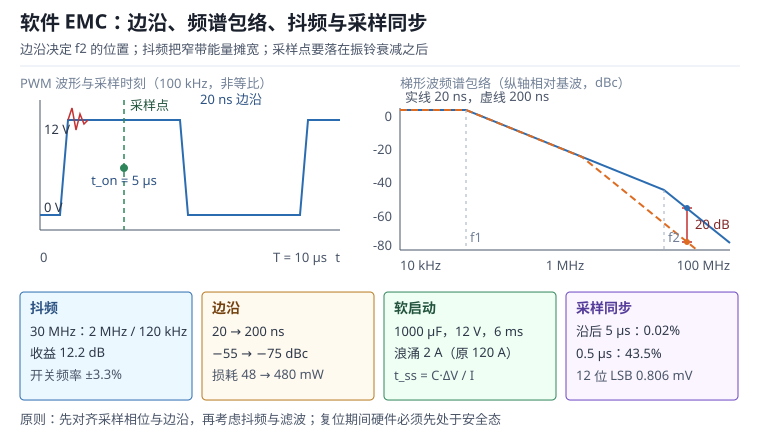

# 软件能做的 EMC：抖频、边沿控制、采样同步与安全状态

EMC（Electromagnetic Compatibility，电磁兼容）通常被当成硬件问题：加磁珠、改地平面、加屏蔽罩、换连接器。但在认证实验室里，最常见的场景是：板子已经定型、模具已经开好、整改预算已经花完，辐射发射在 30~300 MHz 超了 6 dB，传导发射在 150 kHz~30 MHz 超了 3 dB。这时候还能动的，往往只剩软件。

软件对 EMC 的影响不是“玄学”，它可以写成算式：PWM 的边沿斜率决定高次谐波的包络，周期抖动把窄带能量摊到更宽的频带，软启动限制浪涌电流，采样时刻决定开关噪声会不会混进 ADC，通信重试与看门狗决定异常后系统能不能回到安全状态。这些手段不能让一块布局糟糕的板子通过认证，但能把“差 6 dB”变成“刚好通过”，也能把“偶发误动作”变成“可复现的降级”。

本章按“噪声源—耦合路径—敏感受体”三要素组织：先看开关噪声的频谱从哪里来，再讨论软件能拧的五个旋钮，然后用七个算例把抖频收益、边沿代价、软启动电流、采样残留、重试概率与安全状态时间算清楚，最后给出验证方法与常见坑。与 PWM 定时器的关系见[定时器与 PWM](../mcu/timer-pwm.md)；与 ADC 采样保持的关系见[ADC/DAC](../mcu/adc-dac.md)；与通信重试的关系见[UART 与 USART](../comm/uart.md)、[I²C 总线](../comm/i2c.md)、[SPI 总线](../comm/spi.md)；与看门狗和安全状态的关系见[可靠性与看门狗体系](reliability.md)。

## 1. 动机：四个“软件本来能救”的现场

::: motivation 四个现场
**现场一：30 MHz 超 6 dB。** 一台 24 V 供电的电机控制器，PWM 频率 100 kHz，MOSFET 开通时间 20 ns。辐射发射在 30 MHz 附近超限 6 dB，实验室建议加共模电感与屏蔽罩，但结构件已经开模。把开管边沿从 20 ns 放慢到 100 ns，30 MHz 的包络下降约 14 dB，测试通过；代价是开关损耗从 48 mW 涨到 240 mW，需要重新核算散热。

**现场二：ADC 每次都在开关瞬间采样。** 12 位 ADC 采母线电流，采样时刻由软件轮询触发，恰好落在 MOSFET 开通后的振铃里，读到的值比真实值高 80~120 个 LSB。电流环把噪声当成真实电流，输出抖动。把采样改成定时器在 PWM 中心触发，振铃已经衰减到 0.02%，同样的硬件，电流纹波下降一个数量级。

**现场三：EFT 之后继电器自己吸合。** 设备通过 IEC 61000-4-4 群脉冲测试时复位，复位后 GPIO 默认是浮空输入，继电器驱动芯片的输入被拉高，继电器吸合，执行器动作。测试员看到“设备自己动了”，判定不合格。修复不是加电容，而是复位后先把驱动引脚拉到安全电平，再等待 200 ms 确认电源稳定。

**现场四：通信一错就疯狂重试。** RS-485 总线受干扰，一帧 CRC 错，软件立刻重发，重发又错，再重发，发射占空比从 5% 涨到 90%，电源被拉低，干扰更严重，形成“重试风暴”。加上指数退避与随机抖动后，总线恢复时间从秒级降到百毫秒级。
:::

| 你想确认 | 先算 | 判据（工程经验值，非标准强制） |
|---|---|---|
| 谐波包络 | $f_1=1/(\pi\tau)$，$f_2=1/(\pi t_r)$ | 关注频段内包络低于限值 6 dB |
| 抖频收益 | $\Delta L=10\log_{10}(\Delta f/RBW)$ | 调制深度至少 10 倍 RBW |
| 边沿代价 | $P_{sw}=\frac{1}{2}VI t_r f_{sw}\times2$ | 结温与效率仍在预算内 |
| 共模电流 | $I_{cm}=C_{par}\,dV/dt$ | 小于 10 mA 量级，或加共模扼流圈 |
| 软启动时间 | $t_{ss}=C\Delta V/I_{limit}$ | 浪涌小于电源限流点 |
| 采样残留 | $V_{err}=V_{step}e^{-t/\tau}$ | 小于 0.5 LSB |
| 重试成功率 | $P=1-(1-p)^N$ | 大于 99%，且总时间小于超时 |

**不算会摔在哪**，四个带数字的代价：

1. **边沿不是越慢越好。** 20 ns 放慢到 200 ns，30 MHz 包络降 20 dB，但开关损耗从 48 mW 涨到 480 mW，效率掉几个点，结温升 20~30 ℃。边沿要按“刚好满足限值”选，不是按“最慢”选。
2. **抖频深度不够等于没抖。** 调制深度 200 kHz、接收机分辨率带宽 120 kHz，理论收益只有 2.2 dB；做到 2 MHz 才是 12.2 dB。深度小于 RBW 时，能量仍在同一个分辨单元里。
3. **采样同步错相位。** 把采样触发设在 PWM 计数器归零，恰好是开关沿，噪声最大；设在计数器等于周期一半，才是振铃衰减后的时刻。同样是“定时器触发”，差一个相位就差一个数量级。
4. **复位后的默认电平不是安全态。** 大多数 MCU 复位后 GPIO 是浮空输入，外部上拉/下拉决定电平。如果驱动芯片的输入是低有效，浮空就可能被拉高，执行器在复位窗口里动作。

## 2. 直观：噪声的三要素与五个软件旋钮

### 2.1 源、路径与敏感受体

EMC 问题永远是三要素的组合：**噪声源**（开关管、时钟、DC-DC、电机换向）、**耦合路径**（传导、容性耦合、感性耦合、辐射）、**敏感受体**（ADC、通信接收器、传感器、无线模块）。软件不能消灭噪声源，但可以改变源的频谱、改变路径上的电流、改变受体采样时刻。

- **改变频谱**：抖频把窄带谐波摊宽，边沿控制把高次谐波压下去，随机化开关相位避免多路叠加。
- **改变电流**：软启动限制 $dV/dt$ 与浪涌，死区优化减少直通，相位错开让多路电流不同时达到峰值。
- **避开噪声**：ADC 在振铃衰减后采样，通信在开关间隙收发，数字输入在边沿后消隐。
- **异常恢复**：重试与退避避免风暴，看门狗把系统拉回，安全状态保证复位期间执行器不动。

### 2.2 开关噪声的频谱从哪里来

一个周期为 $T$、占空比为 $d$、幅度为 $A$、上升时间为 $t_r$ 的梯形波，其第 $n$ 次谐波的幅度可以写成：

$$A_n=2Ad\,\mathrm{sinc}(nd)\,\mathrm{sinc}\!\left(\frac{n t_r}{T}\right)$$

其中 $\mathrm{sinc}(x)=\sin(\pi x)/(\pi x)$，$A$ 是幅度（单位 V），$d$ 是占空比，$T$ 是周期（单位 s），$t_r$ 是上升/下降时间（单位 s）。这个式子的工程价值在于它的**包络**：低频段是平的，过了第一个转折点按 $-20$ dB/十倍频下降，过了第二个转折点按 $-40$ dB/十倍频下降。两个转折点是：

$$f_1=\frac{1}{\pi\tau},\qquad f_2=\frac{1}{\pi t_r},\qquad \tau=dT$$

$\tau$ 是脉冲宽度（单位 s）。在 $f_2$ 之后，谐波幅度近似与 $t_r$ 成反比：边沿放慢 10 倍，高次谐波降 20 dB。这就是“慢边沿降辐射”的数学依据，也是“慢边沿增损耗”的来源——两者是同一个物理量的两面。

### 2.3 五个软件旋钮

**旋钮一：抖频（Spread Spectrum / Frequency Dithering）。** 让开关频率在中心频率附近周期性或伪随机地偏移，把原本集中在窄带里的能量摊到更宽的频带上。接收机按分辨率带宽（Resolution Bandwidth，RBW）测量，能量被摊到 $\Delta f$ 宽之后，每个 RBW 内的功率下降约 $\Delta f/RBW$ 倍。抖频可以作用在 PWM 周期上，也可以作用在 PLL/时钟源上。

**旋钮二：边沿控制（Slew Rate Control）。** 通过 GPIO 输出速度寄存器、栅极电阻或驱动芯片的压摆率设置，改变开通/关断的 $dV/dt$ 与 $dI/dt$。边沿越慢，高次谐波越低，但开关损耗越大、死区误差越大。软件能做的是选择驱动档位、在轻载时降档、在重载时升档。

**旋钮三：软启动与死区。** 软启动让占空比从 0 缓慢升到目标值，限制输入电容充电的浪涌电流；死区保证上下管不同时导通。两者都直接改变电流波形，从而改变传导发射与电压跌落。

**旋钮四：采样同步（Sampling Synchronization）。** 用定时器在 PWM 的特定相位触发 ADC，避开开关沿与振铃；对多路 ADC，用同时采样或顺序采样加消隐窗口。采样时刻错了，再好的滤波器也救不回来。

**旋钮五：通信重试、看门狗与安全状态。** 重试要有限次、指数退避、加随机抖动；看门狗要在通信阻塞时仍能复位；复位后要先把执行器置于安全态，再等待电源稳定，最后才允许重新使能。

### 2.4 一张图看懂软件旋钮



图的左上角是 PWM 波形与采样时刻，右上角是梯形波的频谱包络：两个转折点把频段分成三段，边沿时间决定第二转折点的位置；底部四个方框把抖频、边沿、软启动、采样同步的收益与代价固定成数字。读图时先找“超标频点落在哪一段”：落在 $f_2$ 之后，优先放慢边沿或抖频；落在 $f_1$ 与 $f_2$ 之间，优先降开关频率或改拓扑；落在 $f_1$ 以下，软件手段有限，要动布局与滤波。

## 3. 定量：包络、抖频、边沿与采样

### 3.1 梯形波包络

把 2.2 的谐波幅度写成包络形式，三段分别是：

$$A(f)=\begin{cases}2Ad, & f\le f_1\\[4pt] \dfrac{2Ad}{\pi f\tau}, & f_1<f\le f_2\\[4pt] \dfrac{2Ad}{\pi^{2}f^{2}\tau t_r}, & f>f_2\end{cases}$$

其中 $f$ 是频率（单位 Hz），其余符号同上。这个包络是**上界**：实际谐波在 sinc 零点附近会低于包络，做 worst-case 估算时用包络是安全的。基波幅度是 $2Ad\,\mathrm{sinc}(d)$，对 $d=0.5$ 就是 $2A/\pi$。

三个适用条件要记住：第一，波形是理想梯形，实际开关波形有振铃与过冲，高频段会比包络高；第二，$t_r$ 指电压与电流中较慢的那个，实际 $dV/dt$ 与 $dI/dt$ 不同；第三，包络只描述差模电压，辐射主要由共模电流决定，还要乘上电缆与结构的天线效应。

### 3.2 抖频的收益

设调制深度为 $\Delta f$（单位 Hz），接收机分辨率为 $RBW$（单位 Hz），且 $\Delta f\gg RBW$，则单个谐波的峰值下降近似为：

$$\Delta L=10\log_{10}\!\left(\frac{\Delta f}{RBW}\right)$$

若 $\Delta f<RBW$，能量仍落在一个分辨单元内，收益接近 0。这个式子是“理论上限”：实际收益还受调制波形、调制频率、接收机检波方式影响。三角波调制比正弦波更均匀，伪随机调制能进一步打散离散谱线，但会增加控制环路的抖动。

抖频的代价有三条：开关周期变化让输出电压纹波频率变化，控制环的带宽要能容忍；调制频率落在音频段会被人耳听到（电机会啸叫）；对通信时钟抖频会改变波特率，必须限制深度或只对 PWM 抖频。

### 3.3 边沿、共模电流与开关损耗

边沿时间同时决定两件事。第一是共模电流：

$$I_{cm}=C_{par}\frac{dV}{dt}=C_{par}\frac{\Delta V}{t_r}$$

$C_{par}$ 是开关节点对地的寄生电容（单位 F），$\Delta V$ 是开关电压摆幅（单位 V），$t_r$ 是边沿时间（单位 s）。$C_{par}$ 包括 MOSFET 输出电容、散热器电容、PCB 焊盘与走线电容，典型 10~100 pF。第二是开关损耗：

$$P_{sw}=\frac{1}{2}VI\,t_r\,f_{sw}\times2$$

$V$ 是开关电压（单位 V），$I$ 是开关电流（单位 A），$f_{sw}$ 是开关频率（单位 Hz），系数 2 表示开通与关断各一次。这个式子是线性近似，实际损耗还与二极管反向恢复、米勒平台有关。

两个式子方向相反：$t_r$ 增大，$I_{cm}$ 下降、辐射下降，但 $P_{sw}$ 上升。工程上先按 EMC 限值确定“最大允许边沿”，再按热预算确定“最小允许边沿”，两者之间的区间就是可选范围。

### 3.4 软启动与浪涌

输入电容 $C$ 在启动时从 0 充到 $\Delta V$，如果没有任何限制，浪涌电流由电源内阻与 ESR 决定，可能达到几十到几百安。软启动用占空比斜坡把输入电流限制在 $I_{limit}$，所需时间：

$$t_{ss}=\frac{C\,\Delta V}{I_{limit}}$$

其中 $C$ 是输入电容（单位 F），$\Delta V$ 是充电电压（单位 V），$I_{limit}$ 是允许的浪涌电流（单位 A）。这个式子假设负载电流可忽略；如果启动时已经有负载，要把负载电流加进去。

### 3.5 采样同步与建立误差

开关沿之后的振铃可以近似为一阶衰减：

$$V_{err}(t)=V_{step}\,e^{-t/\tau}$$

$V_{step}$ 是振铃初始幅度（单位 V），$\tau$ 是衰减时间常数（单位 s），$t$ 是距离开关沿的时间（单位 s）。要让误差小于 0.5 个 LSB，需要：

$$t_{sample}\ge\tau\ln\!\left(\frac{2V_{step}}{V_{LSB}}\right)$$

$V_{LSB}$ 是 ADC 的最小分辨电压（单位 V）。这个式子说明：振铃幅度越大、ADC 位数越高，需要的等待时间越长；等待时间不能超过 PWM 的可用窗口，否则要降低开关频率或改用正弦编码。

### 3.6 重试与退避

单次通信成功率为 $p$，独立重试 $N$ 次的总成功率：

$$P_{success}=1-(1-p)^{N}$$

平均尝试次数是 $1/p$。如果每次重试都立即发起，总线占用率会随失败率上升而上升，形成正反馈；指数退避把第 $k$ 次重试的等待设为 $t_0 2^{k}$，并叠加随机抖动，避免多个节点同时重发。

### 3.7 复位后的安全状态时间

从故障发生到执行器进入安全状态的时间链：

$$t_{safe}=t_{det}+t_{reset}+t_{boot}+t_{off}$$

$t_{det}$ 是检测时间（看门狗超时或故障判定），$t_{reset}$ 是复位序列，$t_{boot}$ 是启动与自检，$t_{off}$ 是输出断使能。这个时间必须小于安全需求规定的响应时间，且要在最坏时钟、最坏温度下验证。

## 4. 算例：七笔 EMC 账

### 4.1 算例一：30 MHz 的包络与边沿代价

条件：$A=12$ V，$d=0.5$，$f_{sw}=100$ kHz，$T=10$ µs，$\tau=5$ µs，$t_r=20$ ns。

$$f_1=\frac{1}{\pi\times5\times10^{-6}}=63.66\ \text{kHz},\qquad f_2=\frac{1}{\pi\times20\times10^{-9}}=15.92\ \text{MHz}$$

基波幅度：

$$A_1=2\times12\times0.5\times\mathrm{sinc}(0.5)=7.64\ \text{V}$$

30 MHz 落在 $f_2$ 之上，用第三段包络：

$$A(30\,\text{MHz})=\frac{12}{\pi^{2}\times(30\times10^{6})^{2}\times5\times10^{-6}\times20\times10^{-9}}=13.5\ \text{mV}$$

相对基波：

$$20\log_{10}\frac{13.5\times10^{-3}}{7.64}=-55.0\ \text{dBc}$$

把 $t_r$ 放慢到 200 ns，$f_2$ 降到 1.59 MHz，30 MHz 仍在 $f_2$ 之上：

$$A(30\,\text{MHz})=\frac{12}{\pi^{2}\times9\times10^{14}\times5\times10^{-6}\times200\times10^{-9}}=1.35\ \text{mV}$$

$$20\log_{10}\frac{1.35\times10^{-3}}{7.64}=-75.0\ \text{dBc}$$

改善 20 dB。代价是开关损耗：

$$P_{sw,20}=\frac{1}{2}\times12\times2\times20\times10^{-9}\times100\times10^{3}\times2=48\ \text{mW}$$

$$P_{sw,200}=\frac{1}{2}\times12\times2\times200\times10^{-9}\times100\times10^{3}\times2=480\ \text{mW}$$

多出 432 mW。如果散热余量只有 300 mW，200 ns 就不可行，应选 100 ns：包络降约 14 dB，损耗 240 mW，多出 192 mW，仍在预算内。

### 4.2 算例二：共模电流的 10 倍差

条件：$C_{par}=20$ pF，$\Delta V=12$ V。

20 ns 边沿：

$$I_{cm}=20\times10^{-12}\times\frac{12}{20\times10^{-9}}=12\ \text{mA}$$

200 ns 边沿：

$$I_{cm}=20\times10^{-12}\times\frac{12}{200\times10^{-9}}=1.2\ \text{mA}$$

共模电流降 10 倍，辐射场强近似降 20 dB（场强与电流成正比）。这就是“慢边沿”对辐射的有效性来源；但共模电流只是源，实际辐射还取决于电缆长度、回流路径与屏蔽，不能只用这个数字预测认证结果。

### 4.3 算例三：抖频 12.2 dB 与 2.2 dB 的区别

条件：中心频率 100 kHz，接收机 RBW 120 kHz。

调制深度 2 MHz：

$$\Delta L=10\log_{10}\frac{2\times10^{6}}{120\times10^{3}}=12.2\ \text{dB}$$

调制深度 200 kHz：

$$\Delta L=10\log_{10}\frac{200\times10^{3}}{120\times10^{3}}=2.2\ \text{dB}$$

2 MHz 的深度把能量摊到 16.7 个分辨单元，峰值降 12.2 dB；200 kHz 只摊到 1.67 个单元，降 2.2 dB。若目标是 6 dB，深度至少要 $120\times10^{3}\times10^{0.6}=478$ kHz。注意这是“峰值下降”的上限，实际还要看调制波形与检波方式。

### 4.4 算例四：软启动把 120 A 降到 2 A

条件：输入电容 1000 µF，母线 12 V，允许浪涌 2 A。

$$t_{ss}=\frac{1000\times10^{-6}\times12}{2}=6\ \text{ms}$$

如果没有软启动，浪涌由 ESR 与电源内阻限制。假设回路总电阻 0.1 Ω：

$$I_{inrush}=\frac{12}{0.1}=120\ \text{A}$$

120 A 的浪涌会触发电源过流保护，也会在输入线上产生极强的磁场，污染附近的采样线。软启动把 6 ms 内的平均电流限制在 2 A，代价是输出电压建立变慢；如果负载要求 1 ms 内建立，就必须减小电容或提高限流点，两者要一起权衡。

### 4.5 算例五：采样点在 5 µs 与 0.5 µs 的差别

条件：振铃初始幅度 200 mV，衰减时间常数 0.6 µs，ADC 12 位、3.3 V 参考。

$$V_{LSB}=\frac{3.3}{4096}=0.806\ \text{mV}$$

在开关沿后 0.5 µs 采样：

$$V_{err}=200\times e^{-0.5/0.6}=200\times0.435=86.9\ \text{mV}$$

折合 $86.9/0.806=108$ 个 LSB。在 5 µs 采样：

$$V_{err}=200\times e^{-5/0.6}=200\times2.4\times10^{-4}=0.048\ \text{mV}$$

只有 0.06 个 LSB，可以忽略。若要求小于 0.5 LSB，所需等待时间：

$$t\ge0.6\ln\frac{2\times200}{0.806}=0.6\times6.21=3.73\ \mu\text{s}$$

5 µs 满足，0.5 µs 差 7 倍。这个算例说明：采样同步不是“用定时器触发”就够了，触发相位必须落在振铃衰减之后，而且要有余量覆盖器件与温度的离散性。

### 4.6 算例六：三次重试的 99.66%

条件：单次成功率 0.85，最多重试 3 次（含首次共 3 次尝试）。

$$P_{success}=1-(1-0.85)^{3}=1-0.15^{3}=0.996625=99.66\%$$

平均尝试次数：

$$\bar{N}=\frac{1}{0.85}=1.176$$

若三次都失败，按 10 ms、20 ms、40 ms 退避后再试一轮，总等待 70 ms；两轮都失败的概率是 $(0.15)^{6}=1.14\times10^{-5}$，约 8.8 万次才出现一次。重试要设上限，不能无限重试；上限由“业务可容忍的恢复时间”决定，而不是由“总想成功”决定。

### 4.7 算例七：复位后 2.466 s 进入安全状态

条件：看门狗上界 2.105 s，复位序列 20 ms，Bootloader 300 ms，POST 40 ms，输出断使能 1 ms。

$$t_{safe}=2.105+0.020+0.300+0.040+0.001=2.466\ \text{s}$$

安全需求要求 3 s 内进入安全状态，余量 17.8%。如果 EMC 测试中复位频繁发生，这个时间会被反复触发；更糟的是，复位后如果立刻重新使能执行器，系统会在“复位—动作—再复位”之间循环。正确做法是：复位后先保持安全态，等电源稳定、自检通过、收到明确使能命令后才恢复输出。

## 5. 工程含义：把旋钮接到代码上

### 5.1 抖频的实现与边界

抖频可以作用在三个地方：

- **PWM 周期**：在中心周期附近按三角波或伪随机序列偏移，占空比按比例补偿，保持伏秒积恒定。伪代码：

```c
/* 周期抖频：中心 10 us，深度 ±5%，步进 100 ns */
static int32_t dither;
static const int32_t dither_step = 100;   /* ns */
static const int32_t dither_max  = 500;   /* ns */

dither += dither_step;
if (dither >  dither_max) dither = -dither_max;
if (dither < -dither_max) dither =  dither_max;

uint32_t period = 10000 + dither;          /* ns */
uint32_t pulse  = (period * duty_permille) / 1000;
TIM1->ARR = period - 1;
TIM1->CCR1 = pulse;
```

关键在最后两行：**周期变了，比较值要按新周期重算**，否则占空比跟着变，输出电压纹波与环路增益都会变。抖频深度要大于 RBW 的 10 倍才有明显收益，但深度太大会让电机转矩脉动、电感啸叫，通常取中心频率的 3%~10%。

- **PLL/时钟源**：部分 MCU 的 PLL 支持扩频时钟（Spread Spectrum Clocking，SSC），深度与调制频率可配。它影响所有由该时钟派生的外设，包括 UART 波特率，使用前要确认通信能容忍频偏。
- **多路开关相位**：多路 Buck 或半桥的开关沿错开 $T/N$，让电流峰值不同时出现。相位错开不改变单路频谱，但降低总电流的峰值与低频包络。

### 5.2 边沿控制：寄存器、电阻与驱动

边沿时间由三个因素决定：驱动器的输出电流能力、栅极电阻、MOSFET 的栅极电荷。软件能改的是前两个：

- **GPIO 输出速度**：STM32 的 OSPEEDR 提供低、中、高、超高四档，对应不同的 $dV/dt$。低速档的边沿可能是高速档的 5~10 倍。
- **驱动芯片档位**：很多栅极驱动芯片有可编程压摆率或分段驱动，软件通过 SPI 配置。
- **栅极电阻**：通常焊在板上，软件改不了；但可以在设计阶段留两个焊盘，认证时换电阻。

边沿放慢的代价要算三笔：开关损耗、死区误差、最小脉宽。死区误差在低速轻载时尤其明显，因为占空比很小，边沿占比大；最小脉宽受驱动器传输延迟限制，边沿太慢会导致窄脉冲丢失。

### 5.3 软启动与死区

软启动的斜坡要按“输入电容 + 负载电流”设计，不能只按电容算。斜坡太快，浪涌超限；斜坡太慢，输出电压建立时间超过负载的欠压复位阈值。工程上把软启动做成状态机：预充电、斜坡、稳压、故障重试，每段都有超时。

死区要按“驱动器传输延迟 + MOSFET 关断时间 + 裕量”算，不能照抄例程。死区太小会直通，太大在轻载时失真。温度变化会让关断时间变化，死区要按最坏温度留裕量。

### 5.4 采样同步：相位、窗口与滤波

采样同步有三个层次：

1. **相位**：定时器在 PWM 计数器等于 $ARR/2$ 时触发 ADC，落在开关沿之后的中心，振铃已衰减。对下管采样，要避开下管开通瞬间；对母线采样，要避开上管开通瞬间。
2. **窗口**：ADC 采样保持需要时间，触发后要等采样完成再读；如果采样窗口与下一个开关沿重叠，读数会被截断。窗口长度由 ADC 采样时间与源阻抗决定。
3. **滤波**：硬件 RC 与软件平均/中值滤波是最后一道，但不能替代相位对齐。先对齐相位，再谈滤波。

多路 ADC 同时采样可以保证电流与电压的相位一致；顺序采样要保证两路之间的时间差远小于 PWM 周期，否则功率计算会有误差。

### 5.5 通信重试与退避

重试策略要写清五个参数：最大次数、退避基数、退避倍数、随机抖动范围、总超时。一个可用的默认值是：最多 5 次，退避 5 ms、10 ms、20 ms、40 ms，抖动 ±20%，总超时 200 ms。重试期间要监视总线占用率，超过 50% 就暂停重试，避免风暴。

CRC 错、超时、帧错误要分开统计：CRC 错说明链路受干扰，重试有用；超时说明对端没响应，重试可能无用；帧错误说明波特率或电气问题，重试只会重复错误。三类错误的处理策略不同，不能一律“重发三次”。

### 5.6 复位与异常后的安全状态

安全状态要在三个时间点定义清楚：

- **复位期间**：GPIO 默认电平、外部上下拉、驱动芯片的使能极性。硬件上要让“复位 = 安全”，不能依赖软件第一时间配置。
- **启动之后**：先配置安全态，再自检，再等电源稳定，最后才允许使能。使能要有明确的命令或条件，不能“上电即运行”。
- **故障之后**：看门狗复位、通信丢失、传感器失效，都要回到安全态；恢复运行要经过确认，不能自动重试到危险状态。

### 5.7 验证：近场探头、频谱仪与预测试

软件改动后要验证，不能只看“感觉安静了”。三个层次的验证：

1. **近场探头 + 频谱仪**：在开关管、电缆、晶振附近扫频，比较改动前后的峰值。近场测量不替代标准测试，但能快速判断方向对不对。
2. **预测试（Pre-compliance）**：在第三方实验室做正式测试前，先做一次辐射与传导预测试，留 6 dB 裕量。软件改动通常在预测试阶段迭代。
3. **功能与可靠性回归**：抖频、慢边沿、重试都会影响控制性能与通信成功率，必须跑 HIL 与长时间老化，确认没有引入新的时序问题。

## 6. 常见坑

::: pitfall 坑一：抖频只改周期，不改占空比
**现象**：加了抖频后辐射确实降了，但输出电压纹波变大、电机有低频啸叫，电流环偶尔振荡。

**原因**：周期变化时比较值没有按比例重算，占空比随周期波动，伏秒积不恒定。控制环看到的是“占空比被调制”，而不是“频率被调制”。

**解决**：按新周期重算比较值，保持 $t_{on}/T$ 恒定；抖频深度限制在中心频率的 3%~10%；把调制频率设在音频之外，或确认电机与电感不会啸叫。
:::

::: pitfall 坑二：边沿放到最慢，EMC 过了但机器过热
**现象**：30 MHz 辐射通过，满载运行 10 分钟后过温保护；效率从 94% 掉到 89%。

**原因**：边沿从 20 ns 放慢到 200 ns，开关损耗从 48 mW 涨到 480 mW，散热设计没有跟着改。边沿时间与损耗是线性关系，10 倍边沿就是 10 倍损耗。

**解决**：先按限值确定“最大允许边沿”，再按热预算确定“最小允许边沿”，取两者交集；轻载时用慢边沿、重载时用快边沿；必要时改拓扑或加吸收电路，而不是一味放慢。
:::

::: pitfall 坑三：采样触发在计数器归零，正好撞上开关沿
**现象**：ADC 读数在开关动作时跳变 100 多个 LSB，电流环输出抖动；把采样率降低后略有改善，但没根治。

**原因**：定时器在计数器归零时触发 ADC，而归零正是开关管开通的时刻；采样保持窗口覆盖了振铃最大的 1~2 µs。软件以为“定时器触发 = 同步”，实际相位错了。

**解决**：把触发点改到计数器等于 $ARR/2$（或开关沿后 3~5 个时间常数），确认振铃衰减到 0.5 LSB 以下；用示波器同时看 PWM 与采样保持信号，验证相位；多路采样要保证窗口不跨过下一个开关沿。
:::

::: pitfall 坑四：通信一错就立即重发，形成重试风暴
**现象**：总线受干扰后，通信彻底瘫痪；示波器上发送占空比接近 100%，电源电压被拉低，干扰更严重。

**原因**：重试没有退避、没有上限、没有抖动。多个节点同时重发，冲突概率上升，失败率上升，重试更频繁，形成正反馈。

**解决**：指数退避 + 随机抖动 + 最大次数 + 总超时；监视总线占用率，超过阈值暂停重试；区分 CRC 错、超时、帧错误，分别处理；关键链路用看门狗兜底，而不是无限重试。
:::

::: pitfall 坑五：复位后执行器自己动作
**现象**：EFT 或电源跌落导致复位，复位后继电器吸合、电机转动一下，操作员吓一跳；软件日志显示“正常启动”。

**原因**：复位期间 GPIO 是浮空输入，外部上下拉或驱动芯片的输入极性让使能端有效；软件启动后先初始化通信、再配置 GPIO，安全态配置得太晚。

**解决**：硬件上让“复位 = 安全”（使能端加下拉、驱动芯片默认关闭）；软件启动第一件事是把执行器引脚置为安全电平，再初始化其他外设；使能要满足“电源稳定 + 自检通过 + 明确命令”三个条件。
:::

::: pitfall 坑六：抖频深度小于 RBW，白忙一场
**现象**：加了抖频，辐射峰值只降了 1~2 dB，实验室说“没什么效果”。

**原因**：调制深度 100~200 kHz，接收机 RBW 120 kHz，能量仍落在一两个分辨单元内；理论上限只有 $10\log_{10}(200/120)=2.2$ dB，实测更低。

**解决**：先确认测试频段的 RBW，调制深度至少取 RBW 的 10 倍（120 kHz 对应 1.2 MHz 以上）；用频谱仪的“最大保持”看峰值是否真的摊开；深度受控制环与音频噪声限制时，改用边沿控制或滤波，不要硬堆抖频。
:::

## 7. 自测题

<details><summary>题一：A=12 V、d=0.5、f=100 kHz、边沿 50 ns，30 MHz 的包络相对基波是多少 dBc？</summary>

$\tau=5$ µs，$f_2=1/(\pi\times50\times10^{-9})=6.37$ MHz，30 MHz 在 $f_2$ 之上：

$$A(30)=\frac{12}{\pi^{2}\times9\times10^{14}\times5\times10^{-6}\times50\times10^{-9}}=5.40\ \text{mV}$$

基波 $7.64$ V：

$$20\log_{10}\frac{5.40\times10^{-3}}{7.64}=-63.0\ \text{dBc}$$

比 20 ns 边沿的 −55.0 dBc 低 8 dB，正好是 $20\log_{10}(50/20)=7.96$ dB。边沿每放慢一倍，高次谐波降 6 dB；放慢 10 倍降 20 dB。

</details>

<details><summary>题二：抖频深度 1 MHz、RBW 120 kHz，理论收益多少？深度 100 kHz 呢？</summary>

$$10\log_{10}\frac{1\times10^{6}}{120\times10^{3}}=9.2\ \text{dB}$$

100 kHz 小于 RBW：

$$10\log_{10}\frac{100\times10^{3}}{120\times10^{3}}=-0.79\ \text{dB}$$

负值说明能量仍集中在一个分辨单元内，实际收益接近 0，甚至因为调制边带略微变差。结论：深度必须显著大于 RBW，工程上取 10 倍以上。

</details>

<details><summary>题三：输入电容 470 µF、母线 24 V、限流 3 A，软启动时间多少？如果要求 2 ms 内建立呢？</summary>

$$t_{ss}=\frac{470\times10^{-6}\times24}{3}=3.76\ \text{ms}$$

要求 2 ms 建立，则限流必须提高到：

$$I_{limit}=\frac{470\times10^{-6}\times24}{2\times10^{-3}}=5.64\ \text{A}$$

限流提高意味着浪涌更大，要确认电源、连接器与 PCB 走线能承受；否则只能减小电容或接受更长的建立时间。

</details>

<details><summary>题四：单次通信成功率 0.7，最多 5 次尝试，总成功率多少？平均尝试几次？</summary>

$$P=1-(1-0.7)^{5}=1-0.3^{5}=1-0.00243=99.76\%$$

平均尝试次数 $1/0.7=1.43$ 次。若每次失败后立即重试，总线占用率会随失败率上升；加上 5 ms、10 ms、20 ms、40 ms 的退避，最坏总等待 75 ms，仍小于 200 ms 的总超时。

</details>

<details><summary>题五：看门狗 1.5 s、复位 20 ms、Bootloader 250 ms、断使能 2 ms，进入安全状态要多久？要求 2 s 够不够？</summary>

$$t_{safe}=1.5+0.020+0.250+0.002=1.772\ \text{s}$$

要求 2 s，余量：

$$\frac{2.000-1.772}{2.000}=11.4\%$$

余量偏薄。时钟误差、Bootloader 重试、POST 时间都会吃掉余量；建议把看门狗降到 1.2 s，或让应用区直接提供安全状态入口、跳过 Bootloader，把总时间压到 1.3 s 左右。

</details>

## 8. 参考资料

- IEC 61000-4-3:2020 *Electromagnetic compatibility (EMC) — Part 4-3: Testing and measurement techniques — Radiated, radio-frequency, electromagnetic field immunity test*，§5 试验等级与 §6 试验布置。
- IEC 61000-4-6:2013 *Electromagnetic compatibility (EMC) — Part 4-6: Testing and measurement techniques — Immunity to conducted disturbances, induced by radio-frequency fields*，§5 试验等级与耦合/去耦网络。
- CISPR 25:2021 *Vehicles, boats and internal combustion engines — Radio disturbance characteristics — Limits and methods of measurement for the protection of on-board receivers*，§6 测量布置与 §7 限值。
- Henry W. Ott, *Electromagnetic Compatibility Engineering*, Wiley, 2009，辐射发射与传导发射章节：梯形波频谱包络、共模电流与地弹。
- STMicroelectronics, AN1709 *EMC design guide for STM8, STM32 and Legacy MCUs*，PCB 布局、时钟与 IO 边沿、软件抖频相关小节。
- K. B. Hardin, J. T. Fessler, D. R. Bush, *Spread Spectrum Clock Generation for the Reduction of Radiated Emissions*, IEEE International Symposium on EMC, 1994：调制深度、调制频率与峰值抑制。
- IEC 61000-4-4:2012 *Electromagnetic compatibility (EMC) — Part 4-4: Testing and measurement techniques — Electrical fast transient/burst immunity test*，§5 试验等级与 §6 试验发生器。
