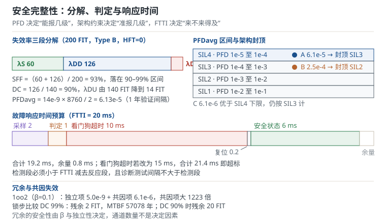

# 功能安全与诊断：SIL/ASIL、诊断覆盖率与安全状态

功能安全（functional safety）要回答的问题不是"代码有没有 bug"，而是"当某个部件失效时，系统还能不能把风险压到可接受的水平，以及我们拿什么证据证明这一点"。它把"安全"变成两个可计算的量：一是失效概率（低需求模式用平均失效概率 PFD，高需求或连续模式用每小时失效概率 PFH），二是诊断覆盖率（Diagnostic Coverage，DC）——即失效发生后被检测出来的比例。这两个量决定了安全完整性等级（Safety Integrity Level，SIL），而架构约束（硬件故障容错 Hardware Fault Tolerance，HFT、安全失效分数 Safe Failure Fraction，SFF）与故障响应时间（Fault Tolerant Time Interval，FTTI）又会把等级压回来。这一章沿着"失效率分解 → SIL 判定 → 架构封顶 → 时间预算 → 证据链"的顺序，把每个数字算到可以写进安全案例。

## 1. 设计动机（三个把安全等级算错的现场）

::: motivation 三个真实的审核现场
**现场一：看门狗被"喂"住了。** 某风机变频器的安全转矩关断（Safe Torque Off，STO）功能依赖看门狗：1 ms 定时任务负责喂狗，电机控制任务负责在过流时关断。一次现场事故里，控制任务因优先级反转卡在互斥量上，而 1 ms 任务属于独立的中断，照样运行、照样喂狗——看门狗计数一切正常，故障录波里没有任何复位记录。800 ms 后绝缘栅双极晶体管（Insulated Gate Bipolar Transistor，IGBT）过流炸机。这里的错误不在看门狗，而在"喂狗者与被监控者不是同一个执行体"这个设计前提：看门狗只能检测"某个任务没跑"，检测不出"该跑的任务没跑"。

**现场二：SIL 等级算高了两级。** 团队算出单通道的 PFD 为 $6.13\times10^{-5}$，对照表格落在 SIL4 区间，于是在安全案例里写了 SIL4。第三方审核退回：该子系统是 B 类（复杂可编程器件）、HFT 为 0、SFF 为 93%，按架构约束最高只能到 SIL2。**PFD 决定"能报几级"，架构约束决定"准报几级"，两者取小。** 这一条如果到审核阶段才发现，整改周期通常是 6 到 12 个月。

**现场三：FTTI 差 1.2 ms。** 整车厂给电助力转向的 FTTI 是 20 ms。软件在电流采样后加了一阶滤波（5 ms 时间常数）和一个 2 次确认，实测从故障注入到助力撤除用了 21.2 ms。表面只差 1.2 ms，但这一项不达标意味着整套安全概念失效——因为 20 ms 对应的是"车辆在 100 km/h 下偏移不超过 0.56 m"这个整车级目标，不是可以商量的余量。
:::

把功能安全阶段的典型现象、第一检查项与判据列成表：

| 现象 | 先查什么 | 判据 |
|---|---|---|
| 安全功能失效但无复位记录 | 喂狗者与被监控者是否同一执行体 | 程序流监控覆盖关键路径；看门狗时基独立 |
| 等级被判高 | SFF、HFT、器件类型 | 三级同时满足；取 PFD 与架构约束的较小值 |
| 诊断覆盖率漂亮但没证据 | 是否有故障注入报告 | 每一条 DC 都有注入用例与统计区间 |
| 响应时间超标 | FTTI 逐段预算 | 检测 + 反应 + 安全状态 + 余量 ≤ FTTI |
| 误停车频繁 | 冗余结构选型 | 1oo2 偏安全、2oo3 偏可用 |
| 量产后安全指标漂移 | 标定数据与软件版本一致性 | 安全相关参数有 CRC 与版本绑定 |

**不算清楚会摔在哪**，三个带数字的代价：

1. **认证返工。** 安全案例被退回一次，典型返工 6 到 12 个月，期间产线停摆；按一条年产 5 万台的线、每台毛利 200 元计，半年的机会成本是 500 万元。
2. **误停车。** 1oo2 结构把危险失效概率压到 $6.1\times10^{-6}$，但只要有 1% 的误报率，按每班 8 小时、每班 3 次误报算，一条产线一年损失 100 多小时产能。安全性与可用性必须一起算。
3. **召回。** 安全功能失效导致的召回，成本通常是普通质量召回的 3 到 5 倍，因为要重新做安全评估。

## 2. 定义与直观

### 2.1 安全功能、安全完整性与等级

**安全功能（safety function）** 是"针对特定危险、把风险降到可接受水平"的功能，例如"检测到过流后 6 ms 内撤除转矩"。**安全完整性（safety integrity）** 是该功能在规定条件下、规定时间内成功执行的概率。等级化之后就是 SIL 1 到 4，汽车行业用 ASIL A 到 D 加 QM（无安全要求）。

| 等级 | PFDavg（低需求） | PFH（高需求/连续，每小时） |
|---|---|---|
| SIL4 | $10^{-5}$ 至 $10^{-4}$ | $10^{-9}$ 至 $10^{-8}$ |
| SIL3 | $10^{-4}$ 至 $10^{-3}$ | $10^{-8}$ 至 $10^{-7}$ |
| SIL2 | $10^{-3}$ 至 $10^{-2}$ | $10^{-7}$ 至 $10^{-6}$ |
| SIL1 | $10^{-2}$ 至 $10^{-1}$ | $10^{-6}$ 至 $10^{-5}$ |

**低需求模式（low demand mode）** 指安全功能被请求的频率不高于每年一次，用 PFD 衡量；**高需求或连续模式（high demand / continuous mode）** 指请求频繁或持续，用 PFH 衡量。同一个子系统放在不同模式里，等级可能差一到两级，这一点在评审时经常被混淆。工程近似换算是 $\mathrm{PFD}\approx\mathrm{PFH}\times T_{\text{mission}}$，例如 PFH 为 $1.4\times10^{-8}\,h^{-1}$ 的子系统在 2 小时任务内等效 PFD 为 $2.8\times10^{-8}$。

### 2.2 失效率分解：λ_S、λ_DD、λ_DU

每一类失效都按"是否危险"和"是否被诊断"两个维度分成三段：

- **λ_S（safe）**：失效后系统进入安全状态，不构成危险，例如输出继电器粘在断开位。
- **λ_DD（dangerous detected）**：危险的，但诊断机制能在安全相关时间内发现。
- **λ_DU（dangerous undetected）**：危险的，且诊断发现不了——**这一项才是安全完整性的敌人**。

由此定义**诊断覆盖率**与**安全失效分数**：

$$
\mathrm{DC}=\frac{\lambda_{DD}}{\lambda_{D}},\qquad
\mathrm{SFF}=\frac{\lambda_{S}+\lambda_{DD}}{\lambda_{S}+\lambda_{DD}+\lambda_{DU}}
$$

$\mathrm{DC}$ 是"危险失效里被抓住的比例"，$\mathrm{SFF}$ 是"所有失效里不构成潜在危险的比例"。两者不同：一台设备的 DC 可以很高，但 SFF 因为 λ_S 太少而偏低，架构约束看的是 SFF。

### 2.3 架构约束：为什么 PFD 达标也可能降级

IEC 61508-2 的架构约束表把器件分成 A 类（简单、失效模式已知）与 B 类（复杂、如 MCU、FPGA、ASIC），再按 HFT 与 SFF 封顶：

| 器件类型 | HFT | SFF 60% 至 90% | SFF 90% 至 99% | SFF 不低于 99% |
|---|---|---|---|---|
| A 类 | 0 | SIL2 | SIL3 | SIL3 |
| A 类 | 1 | SIL3 | SIL4 | SIL4 |
| A 类 | 2 | SIL4 | SIL4 | SIL4 |
| B 类 | 0 | SIL1 | SIL2 | SIL3 |
| B 类 | 1 | SIL2 | SIL3 | SIL4 |
| B 类 | 2 | SIL3 | SIL4 | SIL4 |

（表中只列 SFF 不低于 60% 的三档；SFF 低于 60% 时 B 类 HFT=0 不允许使用。依据 IEC 61508-2:2010 Table 2（A 类）与 Table 3（B 类）。）

表里每一格都是**上限**，最终等级取"PFD 对应等级"与"表内上限"的较小值。B 类器件 HFT 为 0 时，SFF 93% 落在 90% 至 99% 格，上限只有 SIL2，所以前面现场二的结论是 SIL2 而不是 SIL4。注意 A 类 HFT=0 即使 SFF 做到 99% 以上，上限仍是 SIL3——Table 2 的"不低于 99%"行只有 HFT 为 1 或 2 才给 SIL4，单通道拿不到 SIL4。要突破上限，只有两条路：提高 SFF（更好的诊断），或者增加 HFT（冗余通道或锁步核）。

### 2.4 冗余、锁步与共因失效

**1oo1**（1 out of 1）是单通道，危险失效概率就是 $\lambda_{DU}$ 本身。**1oo2** 是两个通道都失效才危险，独立失效项按平方下降，但两个通道可能被同一个原因同时打中——**共因失效（Common Cause Failure，CCF）** 用 β 因子描述，β 表示"总失效率中由共因贡献的比例"。**2oo3** 是三取二，容忍一个通道失效，常用于既要求安全又要求可用（不能随便停车）的场合。

**锁步（lockstep）** 是芯片内的一种冗余：两个核执行同一条指令流，比较器逐周期比对输出，不一致就报错。它把 HFT 从 0 提到 1，代价是面积、功耗与"比较器本身也可能失效"。锁步的诊断覆盖率取决于比较粒度与故障注入验证，典型声称 90% 到 99%。

### 2.5 看门狗的等级

看门狗不是一个器件，而是一族机制，覆盖能力差别很大：

| 机制 | 检测对象 | 典型 DC 声称 | 失效前提 |
|---|---|---|---|
| 窗口看门狗（独立时基） | 程序跑飞、死循环、时序错乱 | 60% | 喂狗动作在被监控的执行体内 |
| 程序流监控（program flow monitoring） | 执行顺序被跳过、函数未按序调用 | 60% 到 90% | 检查点覆盖关键路径 |
| 外部看门狗芯片 | 主控完全无响应 | 60% 到 90% | 独立电源与独立时钟 |
| 锁步比较 | CPU 内部故障 | 90% 到 99% | 比较器与时钟独立 |

关键在"**独立性**"三个字：时基独立、电源独立、执行体独立。三者缺一，DC 声称就要打折。

### 2.6 安全状态与故障响应时间

**安全状态（safe state）** 是失效发生后系统进入的、风险可接受的状态，例如切断输出、抱闸、降级到跛行模式。它必须在**故障容错时间间隔（Fault Tolerant Time Interval，FTTI）** 内到达，而 FTTI 由整车或工艺过程决定，不是软件可以选择的参数。

FTTI 内部还要区分三个时间：**故障检测时间**（fault detection time，从故障发生到被诊断发现）、**故障反应时间**（fault reaction time，从发现到开始执行安全动作）、**安全状态到达时间**（到输出真正安全）。三者之和加余量必须小于 FTTI。

## 3. 定量关系

**单通道平均失效概率。** 设危险未检测失效率 $\lambda_{DU}$（单位 FIT，即 $10^{-9}\,h^{-1}$）、验证测试间隔 $T$（小时），则

$$
\mathrm{PFD}_{1oo1}\approx\lambda_{DU}\cdot\frac{T}{2}
$$

除以 2 是因为失效在间隔内均匀发生，平均暴露时间是 $T/2$。这个近似假设失效后不会被修复，工程上再加修复时间项，通常可以忽略。

**双通道与共因。** 1oo2 的独立失效需要两个通道同时失效，共因失效则一次打中两个：

$$
\mathrm{PFD}_{1oo2}\approx\frac{(\lambda_{DU}T)^{2}}{3}+\frac{\beta\,\lambda_{DU}T}{2}
$$

第一项是"两条独立路径都失效"在 $[0,T]$ 上的平均，第二项是共因项。注意**第二项与 $\lambda_{DU}$ 成正比而不是平方**——这就是为什么 β 一旦不为零，冗余的收益会被迅速吃掉。三取二为

$$
\mathrm{PFD}_{2oo3}\approx(\lambda_{DU}T)^{2}+\frac{\beta\,\lambda_{DU}T}{2}
$$

**高需求模式的每小时失效率。** 对 1oo1，$\mathrm{PFH}=\lambda_{DU}$；对带诊断的通道，$\mathrm{PFH}=\lambda_{DU}+\lambda_{DD}\,(1-\mathrm{DC}_{\text{反应}})$，其中第二项是"检出了但没来得及反应"的残余。

**剩余失效率。** 若某诊断的覆盖率为 DC，则经过该诊断后仍可能漏网的失效率为

$$
\lambda_{res}=\lambda\,(1-\mathrm{DC})
$$

**FTTI 预算。** 各段时间必须满足

$$
T_{\text{FTTI}}\;\geq\;T_{\text{detect}}+T_{\text{react}}+T_{\text{safe}}+T_{\text{margin}}
$$

并且诊断测试间隔（diagnostic test interval，DTI）必须小于等于检测时间，否则"两次检测之间发生的故障"会突破预算。

**程序流的误通过概率。** 若监控器有 $n$ 个检查点、每个检查点的校验值有 $k$ 位，则一次随机跳转恰好通过全部检查的概率为 $2^{-k}$（假设校验值均匀分布）。按每个检查点平均耗时 $t_c$ 计算，期望误通过时间为

$$
T_{fp}=\frac{2^{k}}{1/t_{c}}\quad\text{（即 }2^{k}\text{ 个检查点的时间）}
$$

## 4. 典型计算

### 4.1 失效率分解与 SFF

某伺服驱动器的安全相关失效率合计 200 FIT，其中安全失效 60 FIT、危险失效 140 FIT。取诊断覆盖率 90%：

$$
\lambda_{DD}=140\times0.9=126\ \text{FIT},\qquad \lambda_{DU}=140-126=14\ \text{FIT}
$$
$$
\mathrm{SFF}=\frac{60+126}{200}=93.0\%,\qquad \mathrm{DC}=\frac{126}{140}=90\%
$$

三种配置的对比：

| 配置 | DC | λ_DD | λ_DU | SFF | PFD（1 年） | PFD 对应等级 | 架构上限（B 类，HFT=0） | 最终等级 |
|---|---|---|---|---|---|---|---|---|
| A | 90% | 126 | 14 | 93.0% | $6.13\times10^{-5}$ | SIL4 | SIL2 | SIL2 |
| B | 60% | 84 | 56 | 72.0% | $2.45\times10^{-4}$ | SIL3 | SIL1 | SIL1 |
| C | 99% | 138.6 | 1.4 | 99.3% | $6.13\times10^{-6}$ | 优于 SIL4 | SIL3 | SIL3 |

配置 A 的 PFD 已经落进 SIL4 区间（$10^{-5}$ 至 $10^{-4}$），但架构只允许 SIL2；配置 B 把 DC 从 90% 降到 60%，PFD 变差 4 倍，SFF 掉到 72%，架构上限直接掉到 SIL1——**DC 同时影响 PFD 与 SFF，一次降级会挨两次打**。配置 C 把 DC 提到 99%，PFD 好到超过 SIL4 的下限，但架构上限仍然是 SIL3，收益被表 2.3 吃掉了。

反过来算需求：若目标是 1 年验证间隔下 PFD 小于 $10^{-4}$，则要求

$$
\lambda_{DU}<\frac{2\times10^{-4}}{8760}=2.28\times10^{-8}=22.8\ \text{FIT}
$$

在 140 FIT 的危险失效率下，DC 必须不低于 $1-22.8/140=83.7\%$。若同时要求 SFF 不低于 90%，则 $ (60+140\,\mathrm{DC})/200\geq0.9$，即 DC 不低于 85.7%。**两个约束取严者：DC 至少 85.7%。** 这就是"诊断覆盖率不是越高越好，而是有明确门槛"的来源。注意这 85.7% 只是 PFD/SFF 的算术门槛：若器件是 B 类且 HFT=0，SFF 停在 90% 至 99% 格仍只到 SIL2，要拿到与 PFD 相称的 SIL3，还得把 SFF 推到 99% 以上或把 HFT 加到 1。

### 4.2 验证测试间隔的杠杆

把 $T$ 从 1 年改成 2 年，PFD 翻倍到 $1.226\times10^{-4}$，配置 A 从 SIL4 区间掉到 SIL3 区间；改成半年则降到 $3.07\times10^{-5}$。这说明**验证测试间隔是一个与诊断覆盖率同等重要的设计变量**，而它往往由现场维护能力决定，软件工程师很难改变。工程上的对策是把"连续自检"做进运行期，用诊断覆盖率替代人工验证——自检的等效间隔是毫秒级，比一年一次的验证强六个数量级。

### 4.3 1oo2 的收益与共因失效

取 $\lambda_{DU}=14$ FIT、$T=8760$ h，则 $\lambda_{DU}T=1.226\times10^{-4}$。代入 1oo2 公式：

$$
\frac{(\lambda_{DU}T)^{2}}{3}=\frac{(1.226\times10^{-4})^{2}}{3}=5.01\times10^{-9}
$$
$$
\frac{\beta\,\lambda_{DU}T}{2}=\frac{0.1\times1.226\times10^{-4}}{2}=6.13\times10^{-6}
$$

合计 $6.14\times10^{-6}$。与单通道的 $6.13\times10^{-5}$ 相比只好了 10 倍，而独立项本身好了 12000 倍——**共因项比独立项大 1223 倍**，冗余的安全性完全由 β 决定。若 β 能从 0.1 降到 0.01，合计降到 $6.18\times10^{-7}$，再降一个数量级；这也是为什么安全设计里"物理隔离、独立电源、独立时钟、不同实现"这些看起来与软件无关的措施，实际决定了软件冗余的价值。

2oo3 在同参数下为 $(1.226\times10^{-4})^{2}+6.13\times10^{-6}=6.15\times10^{-6}$，与 1oo2 几乎相同——三取二买到的是可用性（单通道失效不停机），不是安全性。

### 4.4 看门狗与 FTTI 预算

FTTI 为 20 ms 的转向系统，预算表：

| 阶段 | 分配 | 依据 |
|---|---|---|
| 采样与转换 | 2 ms | 电流环 1 kHz，双采样 |
| 合理性判定 | 1 ms | 两帧确认 |
| 看门狗超时 | 10 ms | 窗口 50%，窗口宽度 5 ms |
| 复位与状态切换 | 0.2 ms | 复位向量到安全输出 |
| 安全状态到达 | 6 ms | 抱闸与驱动关断 |
| 余量 | 0.8 ms | 抖动与最坏情况 |

合计 19.2 ms（2 + 1 + 10 + 0.2 + 6），加 0.8 ms 余量正好 20.0 ms。若把看门狗超时改成 15 ms，非余量项合计 24.2 ms，含 0.8 ms 余量为 25.0 ms，超出 FTTI 4.2 ms（含余量 5.0 ms），必须重新分配——此时单靠压缩"采样 + 判定"这 3 ms 已经不够（全砍掉仍有 22.0 ms），安全状态到达时间必须降到 1.0 ms 以下（留 0.8 ms 余量；即使不留余量也只到 1.8 ms），而不是 4.6 ms。看门狗超时不是可以随意取整的参数，它直接吃掉 FTTI 的一半。

若看门狗窗口是 5 ms 到 10 ms，喂狗周期为 10 ms 且抖动允许 5 ms，那么一个"每 1 ms 喂一次"的死循环会在 5 ms 处落入窗口并成功喂狗——窗口看门狗抓不住这种模式，必须叠加程序流监控。

### 4.5 程序流监控与故障注入的置信度

8 个检查点、每个检查点 16 位校验值、控制周期 10 ms，则随机跳转的期望误通过时间为

$$
T_{fp}=2^{16}\times\frac{10\ \text{ms}}{8}=81.9\ \text{s}
$$

换成 32 位校验值则是 $2^{32}\times1.25\ \text{ms}=5.37\times10^{6}$ s，约 62.1 天。前者在一个班次内就可能被随机故障穿过，后者在设备寿命内基本不会——**校验位宽必须与"允许的误通过时间"匹配**，而不是随手用 8 位累加和。

故障注入验证的统计也常被忽略：注入 10000 个故障、观察到 98% 被检出，则检出率的 95% 置信区间为

$$
1.96\sqrt{\frac{0.98\times0.02}{10000}}=\pm0.28\ \text{个百分点}
$$

也就是说真实 DC 可能低到 97.7%。若安全案例声称 99%，10000 个样本根本证明不了——需要至少 40000 个样本才能把区间压到 $\pm0.14$ 个百分点。这一点在写证据链时必须如实标注。

### 4.6 锁步与架构指标

锁步比较的 DC 取 99%，则 200 FIT 的器件残余 $200\times0.01=2$ FIT，MTBF 为 $10^{9}/2=5\times10^{8}$ h，约 57078 年；若 DC 只有 90%，残余 20 FIT，MTBF 降到 5708 年。**DC 从 90% 提到 99%，残余失效率降 10 倍，MTBF 涨 10 倍**，这就是"多花 30% 芯片面积买锁步"的量化理由。

ISO 26262 的架构指标是另一套口径：单点故障度量（Single Point Fault Metric，SPFM）要求 ASIL D 不低于 99%，潜伏故障度量（Latent Fault Metric，LFM）不低于 90%。在 200 FIT 的例子里，若单点故障贡献 5 FIT，SPFM 为 $1-5/200=97.5\%$，只能到 ASIL C；要满足 ASIL D，单点故障必须压到 2 FIT 以内（$1-2/200=99.0\%$），潜伏故障压到 20 FIT 以内。这两个数字比 SIL 表更早暴露设计短板。

## 5. 工程含义

**等级分配先做，再做设计。** 整车或整机的安全目标（safety goal）先分解到子系统，再分解到软硬件。ASIL 分解可以把 D 拆成 C(D) 加 A(D) 或 B(D) 加 B(D)，前提是两个通道足够独立——而独立性正是 β 因子要度量的东西，所以"分解"不是纸面操作，它有硬件代价。

**每条诊断都要有代价表。** 诊断不是免费的：程序流监控约 0.01% 到 0.05% 的 CPU，锁步约 30% 面积与 20% 功耗，外部看门狗约 0.3 元物料加一个 GPIO，双通道传感器让物料翻倍。做安全概念时要把"DC 提升"与"成本、可用性、误报率"放在同一张表里权衡，而不是先堆诊断再算账。

**安全状态要能被验证。** "停机"不总是安全状态：电梯停在两层之间、机械臂在高速运动中突然断电、电机抱闸的机械延迟，都可能让"停"比"继续受控运行"更危险。安全状态的定义必须包含"到达路径"，并且这条路径本身要有诊断——否则安全状态切换失败就成了新的单点故障。

**证据链是安全案例的骨架。** 一条完整的证据链包含：安全计划（谁、何时、用什么方法）、安全需求（从安全目标逐级分解，可追溯到代码）、设计与实现（架构图、接口、诊断清单）、验证（单元测试、集成测试、故障注入）、确认（整车或整机试验）、评审与工具置信度（编译器、静态分析工具的认证等级）。每一环都要有"输入、活动、输出、判据"四要素，缺一环就是审核时的开口项。

**量产一致性。** 安全相关参数（标定值、阈值、看门狗周期）必须与软件版本绑定，并有 CRC 保护；产线刷写后要做一次"安全功能自检"并记录结果。否则实验室里 SIL3 的设计，到现场可能因为一个标定值被改而退化成 SIL1。

## 6. 常见坑（现象、原因、解决）

::: pitfall 看门狗由被监控的任务自己喂
**现象：** 现场设备在控制任务卡死后仍持续运行数秒，输出保持在上一次的值；看门狗复位记录为零，故障录波里只有过流保护动作。

**原因：** 喂狗动作放在一个高优先级定时中断里，而这个中断与控制任务共享同一个"系统还活着"的判断。控制任务卡在互斥量上时，定时中断照常执行，看门狗收到的仍是"一切正常"。

**解决：** 让每个关键任务在完成本轮工作后向监控器"报到"，由监控器检查"所有任务都报到过"才喂狗；或者用程序流监控，把检查点插在控制任务的必经路径上。看门狗的时基、电源、复位路径必须与主控独立，且喂狗动作本身要能被故障注入验证。
:::

::: pitfall 用 PFD 直接对表定级
**现象：** 安全案例里写 SIL4，审核时被退回，要求降为 SIL2 并补充架构论证；项目进度延误两个季度。

**原因：** 只做了"PFD 查表"这一步，漏掉了 IEC 61508-2 的架构约束：B 类器件、HFT 为 0、SFF 93%，落在 90% 至 99% 格，上限就是 SIL2。PFD 只回答"失效概率有多低"，架构约束回答"这个低概率是否可信"。

**解决：** 定级流程固定为三步：算 PFD 或 PFH → 查架构约束表 → 取较小值，并在安全案例里同时给出三个输入（λ 分解、SFF、HFT）。若业务确实需要更高等级，先评估"提高 SFF"与"增加 HFT"两条路的成本，再决定是否改架构。
:::

::: pitfall 诊断覆盖率按设计值填，没有注入证据
**现象：** 安全案例声称 DC 99%，现场却出现"诊断报错但输出未切断"的失效；审核要求提供故障注入报告，团队只有单元测试覆盖率。

**原因：** DC 是"诊断机制在真实故障模式上的检出比例"，不是代码覆盖率，也不是设计文档里的声称值。没有故障注入，就无法证明诊断路径在真实故障（包括诊断自身失效）下有效。

**解决：** 对每一条诊断建立"故障模式 → 注入方法 → 观察点 → 判定"的用例，样本量按目标置信区间反推（例如 99% 的声称至少需要数千次有效注入）；同时验证诊断自身的失效模式（谁监控监控者），并把结果写进安全案例的证据索引。
:::

::: pitfall 安全状态定义成"断电停机"
**现象：** 某输送线在急停后工件滞留在危险区域，操作员手动取件时受伤；安全评估认为"已停机即安全"。

**原因：** 安全状态只考虑"能量撤除"，没有考虑"撤除后物料的惯性、重力与工艺位置"。停机过程本身（例如抱闸延迟 200 ms）也可能造成危险。

**解决：** 安全状态按"危险源"逐个定义，包含到达路径的时间与顺序（先抱闸再断使能，或先降速再断），并对到达路径做诊断与验证；对无法在 FTTI 内到达的状态，必须在风险评估里显式记录残余风险。
:::

## 7. 自测题

题一：某子系统 200 FIT，λ_S 60 FIT，λ_D 140 FIT，DC 90%，验证间隔 1 年。求 SFF、λ_DU、PFD，并判断 SIL；若器件为 B 类且 HFT=0，最终等级是多少？

$\lambda_{DD}=140\times0.9=126$ FIT，$\lambda_{DU}=14$ FIT。

$$
\mathrm{SFF}=\frac{60+126}{200}=0.93,\qquad
\mathrm{PFD}=14\times10^{-9}\times\frac{8760}{2}=6.13\times10^{-5}
$$

PFD 落在 $10^{-5}$ 至 $10^{-4}$，对应 SIL4。但 B 类、HFT=0、SFF 93% 落在"90% 至 99%"格，架构上限为 SIL2。取较小值，最终 SIL2。

若要把等级真正提到 SIL4，SFF 与 HFT 必须同时达标：把 SFF 提到 99% 以上（DC 需达到约 99.3%，见配置 C），并且把 HFT 提到 1——B 类 HFT=1、SFF 90% 至 99% 的格只到 SIL3，要 SIL4 必须 HFT=1 且 SFF 不低于 99%；另一条路是把 HFT 提到 2，此时 SFF 90% 以上就能到 SIL4。

题二：λ_DU=14 FIT、T=1 年、β=0.1，1oo2 的 PFD 是多少？若把 β 降到 0.01，改善多少倍？这个结果说明冗余设计的关键是什么？

先算 $\lambda_{DU}T=14\times10^{-9}\times8760=1.226\times10^{-4}$。

独立项：$(1.226\times10^{-4})^{2}/3=5.01\times10^{-9}$。

共因项（β=0.1）：$0.1\times1.226\times10^{-4}/2=6.13\times10^{-6}$。

合计 $6.14\times10^{-6}$。

β=0.01 时共因项为 $6.13\times10^{-7}$，合计 $6.18\times10^{-7}$，改善约 9.9 倍（几乎全部来自共因项）。

结论：1oo2 的收益由 β 主导，独立项在数值上完全可以忽略（相差 1223 倍）。因此冗余设计的关键不是"多加一个通道"，而是降低共因：独立电源、独立时钟、不同实现、物理隔离、独立复位路径。若两个通道共享同一个 LDO、同一个晶振、同一段代码，β 会接近 0.1 甚至更高，冗余等于白做。

题三：FTTI 为 20 ms，预算为采样 2 ms、判定 1 ms、看门狗 10 ms、复位 0.2 ms、安全状态 6 ms、余量 0.8 ms。若客户要求把 FTTI 收紧到 15 ms，哪些项可以压缩？给出一个可行的重新分配。

当前非余量项合计 19.2 ms，加 0.8 ms 余量正好 20.0 ms。收紧到 15 ms 需要再省 5.0 ms（$19.2+0.8-15$）。可压缩项及其代价：

- 看门狗超时从 10 ms 降到 6 ms：省 4 ms，代价是喂狗窗口变窄（窗口 3 ms 到 6 ms），对任务抖动更敏感，需要重新验证最坏执行时间。
- 采样从 2 ms 降到 1 ms：省 1 ms，代价是电流环带宽下降或采样点减少，可能影响控制性能。
- 安全状态从 6 ms 降到 4 ms：省 2 ms，代价是抱闸电流加大或改用更快关断器件，需要硬件改版。

一个可行组合：看门狗 6 ms + 采样 1.5 ms + 安全状态 5 ms + 判定 1 ms + 复位 0.2 ms + 余量 0.8 ms = 14.5 ms，比 15 ms 的目标还留 0.5 ms。对账时注意口径：该组合的非余量项降到 13.7 ms，加余量 0.8 ms 为 14.5 ms，相对现状 20.0 ms 省 5.5 ms；常被写成的"省 4.7 ms"是拿旧的 19.2 ms（不含余量）去减新的 14.5 ms（含余量），口径不一致。注意：缩短看门狗超时不能以牺牲"诊断测试间隔小于检测时间"为代价，程序流检查点要同步加密，否则检测段变短但误通过概率上升。

题四：程序流监控有 8 个检查点、16 位校验值、控制周期 10 ms。求随机跳转的期望误通过时间；若要求"设备 15 年寿命内误通过概率低于 1%"，校验值至少多少位？

期望误通过时间 $T_{fp}=2^{16}\times(10\ \text{ms}/8)=81.9$ s。

15 年按连续运行计为 $15\times365\times24\times3600=4.73\times10^{8}$ s，检查点总数 $\frac{4.73\times10^{8}}{1.25\times10^{-3}}=3.78\times10^{11}$。要求误通过概率低于 1%，则 $2^{k}\geq100\times3.78\times10^{11}=3.78\times10^{13}$，即 $k\geq\log_{2}(3.78\times10^{13})\approx45.1$，至少 46 位；工程上取 64 位（CRC-64 或两次 CRC-32）留足余量，并注意检查点之间的相关性——若检查值可由程序计数器直接推出，实际熵远低于位宽。

## 8. 参考资料

- IEC 61508-1:2010，Clause 7.4 "Safety requirements allocation" 与 Table 2/Table 3：2.1 节的 SIL 与 PFDavg、PFH 对照表直接取自此处；4.2 节"验证测试间隔"对 PFD 的影响以 Table 2 的区间划分为准。
- IEC 61508-2:2010，Clause 7.4.4 与 Table 2/Table 3 "Architectural constraints"：2.3 节架构约束表与 4.1 节"最终等级取较小值"的判定依据；B 类器件 HFT=0、SFF 90% 至 99% 的 SIL2 上限由此而来。
- IEC 61508-2:2010，Annex A（Table A.1 至 A.14）与 Annex C/D：2.5 节各诊断技术的典型 DC 声称（看门狗 60%、程序流监控 60% 至 90%、锁步 90% 至 99%）与 β 因子的取值方法。
- IEC 61508-6:2010，Annex B：3 节 1oo1、1oo2、2oo3 的 PFDavg 简化公式与共因项结构，4.3 节的数值代入以此为准。
- ISO 26262-5:2018，Clause 8 "Hardware architectural metrics" 与 Clause 9：4.6 节 SPFM 99%、LFM 90% 的 ASIL D 目标值，以及单点/潜伏故障的计算口径。
- ISO 26262-4:2018，Clause 6 "Technical safety concept" 与 6.4.3：2.6 节 FTTI、故障检测时间与故障反应时间的定义，4.4 节预算表的项目划分依此展开。
- ISO 26262-2:2018，Clause 6 "Safety case" 与 ISO 26262-10 的 SEooC 假设：5 节证据链的"输入、活动、输出、判据"四要素结构，以及 4.5 节置信区间写法的来源。
- IEC 61508-7:2010，Annex A/B：把"看门狗 + 程序流监控 + 锁步"组合使用的技术依据，第 6 节第一个坑的整改方案（报到式监控）参考其程序流监控条目。
