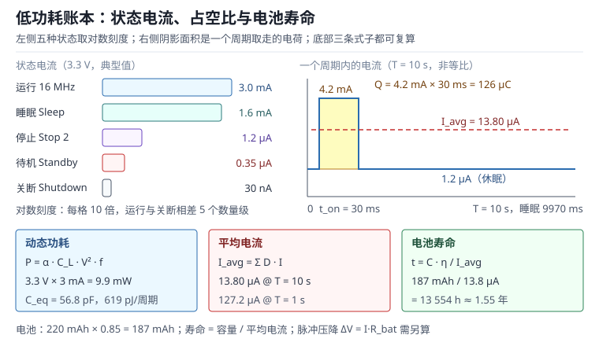

# 低功耗设计：功耗构成、睡眠模式与电池寿命

一颗 CR2032 纽扣电池的标称容量是 220 mAh。这个数字很容易让人产生错觉：如果电路只取 10 µA，似乎能撑两年半。但真正装到板子上，同样的电池可能六个月就报低电量，原因通常不是芯片选错了，而是账没有算全——休眠时某个引脚在漏电、唤醒太频繁、LDO 的静态电流比负载还大、脉冲电流把电池内阻上的压降放大成欠压复位。低功耗设计本质上是一本**电荷账**：每一段时间里，电流从哪来、流多久、按什么效率从电池取走，都要能写成算式。

这本账分三层。第一层是**器件层**：工艺、电压、频率决定动态功耗与漏电的下限。第二层是**模式层**：Sleep、Stop、Standby 各关掉了什么、还留着什么、唤醒要付多少时间与能量。第三层是**系统层**：外设、传感器、LDO、电池内阻与温度一起决定现场寿命。三层里任意一层漏算，最终误差都可能是一个数量级。本章把三层拆开，给出可复算的公式、六个完整算例和一套测量方法，最后用一张图把“电流—时间—电池”三者的关系固定下来。

与时钟配置的关系见[时钟树与 PLL](../mcu/clock-tree.md)：降频、切时钟源、关 PLL 是低功耗的第一组旋钮；与唤醒后外设重新初始化的关系见[启动流程](../basics/startup-boot.md)；与看门狗在低功耗模式下的行为见[看门狗、RTC 与低功耗定时](../mcu/watchdog-rtc.md)。

## 1. 动机：三块电池的死法

::: motivation 三个现场
**现场一：休眠 200 µA。** 一块 220 mAh 的纽扣电池，按 200 µA 计算只能撑 $220/0.2=1100$ 小时，约 46 天。设备标称“待机一年”，实际 45 天就掉电。拆机测量发现，MCU 已经进了 Stop 模式，但三个未使用的 GPIO 配成了浮空输入，引脚电压停在阈值附近，输入缓冲器来回翻转，每个引脚贡献几十微安。

**现场二：每 100 ms 醒一次。** 每次醒来 2 ms、电流 6 mA，占空比 2%，平均电流看起来只有 120 µA；再叠加 1.5 µA 的休眠电流，账面上是 121.5 µA。但唤醒本身还要 108 µs 的时钟恢复与 PLL 锁定，这段也是 3 mA，折进去又是 3.24 µA。更麻烦的是，2 ms 的唤醒窗口里如果漏算了传感器上电稳定时间，实际会变成 8 ms，平均电流直接翻四倍。

**现场三：数据手册 3 mA，板上 17 mA。** 工程师按 MCU 数据手册的 3 mA 选了 220 mAh 电池，一算只能撑 $220/3=73.3$ h（约 3 天）；板上还有一颗 45 µA 静态电流的 LDO（Low-Dropout Regulator，低压差线性稳压器）、一颗常开的霍尔传感器（12 mA）和一颗电源指示灯（2 mA），整板平均电流约 17 mA，续航只剩约 13 小时。低功耗设计从来不是“选一颗低功耗 MCU”，而是“让整块板子的每一毫安都有归属”。
:::

| 你想确认 | 先算 | 判据（工程经验值，非标准强制） |
|---|---|---|
| 运行功耗 | $P_{dyn}=\alpha C_L V_{DD}^{2}f_{clk}$ | 与数据手册同频电流相差不超过 20% |
| 平均电流 | $I_{avg}=\sum_k D_k I_k$ | 实测与预算相差不超过 15% |
| 电池寿命 | $t_{bat}=C_{bat}\eta/I_{avg}$ | 理论值至少是需求值的 1.5 倍 |
| 休眠漏电 | $I_{leak}(T_2)=I_{leak}(T_1)2^{\Delta T/10}$ | 高温端不超过休眠预算的 50% |
| 唤醒开销 | $I_{wake}=I_{run}t_{wake}/T$ | 不超过平均电流预算的 20% |
| 脉冲压降 | $\Delta V=I_{pulse}R_{bat}$ | 低于 BOR 阈值并留 200 mV 裕度 |

**不算会摔在哪**，四个带数字的代价：

1. **休眠电流按芯片手册算。** 手册里的 1.2 µA 是“只有 MCU、所有引脚确定、调试器断开”的条件。板上多一个上拉电阻、一个浮空引脚、一个未断电的传感器，就能把 1.2 µA 变成 200 µA，寿命缩短两个数量级。
2. **只看平均电流，不看峰值。** 4.2 mA 的脉冲在 20 Ω 内阻上产生 84 mV 压降，在内阻升到 200 Ω 的寿命末期是 840 mV。平均电流再小，欠压复位照样发生。
3. **电池容量按标称值算。** 220 mAh 是在 0.2 mA、25 ℃、截止 2.0 V 条件下的值；换成 4.2 mA 脉冲、−20 ℃，有效容量可能只剩一半。
4. **忘了 LDO 的静态电流。** 45 µA 的静态电流对 13.8 µA 的负载来说是三倍多，电池寿命直接除以 3.8。低功耗系统里，LDO 往往比 MCU 更值得先换。

## 2. 直观：功耗从哪里来，睡到哪里去

### 2.1 三个分量：动态、静态与漏电

CMOS 电路的功耗可以拆成三块，它们随频率、温度和电压的变化方向并不相同，这也是低功耗设计容易顾此失彼的原因。

**动态功耗（Dynamic Power）** 来自每个时钟周期里节点电容的充放电。一个节点从 0 充到 $V_{DD}$，电源要提供 $C_LV_{DD}$ 的电荷，能量是 $C_LV_{DD}^{2}$；放电时这部分能量在晶体管里变成热，不再回到电源。所以每个“翻转”周期从电源取走的能量就是 $C_LV_{DD}^{2}$，再乘上每秒的翻转次数。除了充放电，输入翻转的瞬间 PMOS 与 NMOS 会同时导通一小段，形成**短路功耗（Short-Circuit Power）**，通常占动态功耗的 10%~30%，边沿越慢占比越大。

**静态功耗（Static Power）** 指电路不翻转时仍然存在的直流功耗：基准电压源、比较器、振荡器、LDO 的静态电流、分压电阻。它与频率无关，只要供电就在。低功耗设计里最容易被忽略的就是这一块，因为它不出现在“运行电流”里，而是藏在“休眠电流”和“静态电流”里。

**漏电（Leakage）** 是晶体管关断时仍然存在的亚阈值电流、栅氧隧穿电流和结反偏电流。它随温度指数上升，随工艺节点缩小而增大。经验规律是**每升高 10 ℃ 翻一倍**：25 ℃ 时 0.5 µA 的漏电，85 ℃ 时是 32 µA，105 ℃ 时是 128 µA。对一颗在 85 ℃ 机柜里待机的设备，漏电可能比动态功耗更值得优化。

三者的主导关系随工作点移动：16 MHz、3.3 V 下，一颗典型低功耗 MCU 的运行电流在 3 mA 量级，动态功耗约 9.9 mW；进入 Stop 模式后动态功耗归零，剩下的 1.2 µA 几乎全是漏电与少量偏置。频率降到几十 kHz 以下，动态功耗与漏电开始同量级；再往下，模拟静态电流往往成为新的地板。

### 2.2 睡眠模式的四级台阶

各家 MCU 的模式命名不同，但结构大同小异，都是“关掉一部分时钟、保留一部分状态、留下少数唤醒源”。四级台阶分别是睡眠（Sleep）、停止（Stop）、待机（Standby）与关断（Shutdown）模式。以 STM32L4 系列的划分为例，四级台阶的差别可以用一张表说清。

| 模式 | 停掉的 | 保留的 | 典型电流 | 可用的唤醒源 | 唤醒到执行 |
|---|---|---|---|---|---|
| Sleep | CPU 时钟 | 全部外设与 SRAM | 1.6 mA（16 MHz） | 任意中断 | 小于 1 µs |
| Stop 2 | 高速时钟、PLL | SRAM、寄存器、RTC | 1.2 µA | EXTI、RTC、LPTIM、部分串口 | 约 5 µs |
| Standby | 内核、大部分 SRAM | 备份域、RTC、备份寄存器 | 0.35 µA | WKUP 引脚、RTC 闹钟、NRST | 约 50 µs，之后走启动流程 |
| Shutdown | 几乎全部 | 仅复位与唤醒逻辑 | 30 nA | NRST、WKUP | 完整启动，毫秒级 |

这张表的数字是“典型量级”，具体型号必须查数据手册的电流表，因为同一系列不同封装、不同 SRAM 保持范围、不同稳压器配置都会改变结果。比数字更重要的是三条边界：

- **保留什么决定醒来后要做什么。** Stop 模式保留 SRAM，醒来可以从断点继续；Standby 丢失 SRAM，醒来相当于一次复位，必须重新初始化外设并从非易失存储恢复状态。后者省电，但把“状态恢复”的复杂度转移给了软件。
- **谁能唤醒决定哪些外设不能关。** 要用 RTC 闹钟唤醒，RTC 与备份域的时钟必须留着；要用 UART 起始位唤醒，USART 的时钟与唤醒逻辑必须留着。门控之前先列唤醒源清单，否则会出现“睡了就醒不过来”。
- **唤醒时间是能量的一部分。** 从 Stop 醒来的 5 µs 里，内核要重新起振、等时钟稳定；如果还要把 PLL（Phase-Locked Loop，锁相环）锁到 80 MHz，再加 100 µs 量级。每次唤醒都付这笔固定开销，唤醒越频繁，它占的平均电流越大。

### 2.3 时钟门控与电源门控

**时钟门控（Clock Gating）** 是低功耗里最便宜的手段：外设不用时把它的时钟关掉，动态功耗立刻归零，寄存器内容还在，下次用之前重新使能即可。它省不掉漏电，因为供电还在。MCU 上通常按外设提供时钟使能位，例如 AHB1、APB1、APB2 三组寄存器各管一批外设。

**电源门控（Power Gating）** 更彻底：直接切断某个域的供电，漏电也归零，代价是状态丢失、需要隔离与保持策略。MCU 的 Standby 模式本质就是对内核域做电源门控，只留下备份域。对外部电路，用负载开关（Load Switch）给传感器断电也是电源门控，但要考虑上电稳定时间、浪涌电流和通信线上的反灌。

门控的顺序有一条硬规则：**先开时钟，再配置，再用，最后等传输真正完成再关时钟**。关早了的典型现象是“最后一个字节丢失”或“DMA 只搬了一半”：外设的时钟一停，寄存器写入与总线传输都停在半路，标志位也不再更新。正确做法是等传输完成标志（TC）、清标志、再关时钟；如果用了 DMA，还要等 DMA 的完成中断。

另一个容易被忽略的点是：**GPIO 的时钟通常不能关**。只要引脚需要维持输出电平或上拉，端口时钟就得留着；能关的是那些确定不用的端口。对确定不用的引脚，最省电的配置不是浮空输入，而是模拟模式（Analog Mode），它把输入缓冲器和上下拉都断开，避免引脚电压停在阈值附近造成贯通电流。

### 2.4 一张图看懂这本账

把“功耗构成”“占空比”“电池寿命”三件事画在同一张图上，账本的结构就清楚了。



图的左半部分是五种状态的电流，纵轴取对数，因为运行电流与关断电流差了五个数量级；右半部分是一个周期内的电流波形，阴影面积就是这一周期从电池取走的电荷；底部三个方框把三条公式和一组代入结果固定下来。读图时先问三个问题：占空比是多少、唤醒开销占多少、休眠电流里有多少是漏电。这三个问题的答案基本决定了电池寿命的量级。

## 3. 定量：预算、寿命与温度

### 3.1 动态功耗与等效电容

动态功耗的标准形式是：

$$P_{dyn}=\alpha C_L V_{DD}^{2}f_{clk}$$

其中 $\alpha$ 是活动因子（每个时钟周期发生翻转的节点比例，0 到 1），$C_L$ 是等效负载电容（单位 F），$V_{DD}$ 是供电电压（单位 V），$f_{clk}$ 是时钟频率（单位 Hz）。这个式子最重要的含义不是“算出一个精确的毫瓦数”，而是三个 Scaling 关系：功耗与频率线性、与电压平方、与电容线性。

工程上更常用的是反过来用：已知某个频率下的运行电流，反推等效开关电容：

$$C_{eq}=\frac{I_{run}}{V_{DD}f_{clk}}$$

这个 $C_{eq}$ 把内核、总线和外设的翻转活动全部折算成一个电容，便于比较不同频率、不同电压下的功耗。每个时钟周期从电源取走的能量则是：

$$E_{cyc}=C_{eq}V_{DD}^{2}$$

式子的适用条件是“电流主要由开关活动决定”。在很高频率下，等待周期、总线争用和内核电压调节会让电流偏离线性；在很低频率下，静态电流与漏电占主导，$P_{dyn}$ 不再是总功耗。短路功耗没有单独出现在式子里，它被并入了实测的 $I_{run}$；如果只按 $C_{eq}V^{2}f$ 估算，通常会低 10%~30%。

### 3.2 占空比加权平均电流

电池寿命由平均电流决定，而平均电流是各时段电流按时间加权的结果（占空比，Duty Cycle）：

$$I_{avg}=\frac{1}{T}\int_{0}^{T}i(t)\,dt=\sum_{k}D_kI_k,\qquad \sum_{k}D_k=1$$

其中 $T$ 是一个完整周期（单位 s），$D_k=t_k/T$ 是第 $k$ 段占空比，$I_k$ 是该段的平均电流（单位 A）。如果某段里有明显的浪涌，比如电容充电，还要把电荷单独加上：

$$I_{avg}=\sum_k D_kI_k+\frac{Q_{in}}{T}$$

$Q_{in}$ 是一次唤醒注入的电荷（单位 C）。这个修正项在“短脉冲、大电流”的场合不能省：4.2 mA 持续 30 ms 的电荷是 126 µC，如果周期是 10 s，折合 12.6 µA，和运行段本身的贡献同样大。

这个式子的失效边界是**峰值**。平均电流只回答“电池能撑多久”，不回答“电池能不能供得动”。后者由内阻、电容和欠压阈值决定，必须单独算。

### 3.3 电池寿命与降额

电池寿命（Battery Life）的基本式子是容量除以平均电流：

$$t_{bat}=\frac{C_{bat}\,\eta_{T}\,\eta_{age}\,\eta_{pulse}}{I_{avg}}$$

其中 $C_{bat}$ 是标称容量（单位 mAh），$\eta_T$ 是温度降额，$\eta_{age}$ 是老化与自放电降额，$\eta_{pulse}$ 是脉冲放电降额，$I_{avg}$ 的单位是 mA，算出的 $t_{bat}$ 单位是小时。三个降额系数都小于 1，具体取值必须看电池手册的放电曲线，不能凭感觉。

以 CR2032 为例：标称 220 mAh 是在 0.2 mA 连续放电、室温（约 20~25 ℃）、截止 2.0 V 下测的。温度降到 −20 ℃，有效容量常只剩 50%~70%；寿命末期内阻从 20 Ω 升到 200 Ω；脉冲放电还会因为极化效应进一步降低可用容量。工程上常取 $\eta_T\eta_{age}\eta_{pulse}\approx0.85$ 做初步预算，再用实测修正。

用能量法可以交叉验算：

$$E_{day}=3600\,V_{bat}I_{avg}\times24,\qquad t_{bat}=\frac{3600\,C_{bat}V_{bat}\,\eta}{E_{day}}$$

其中 $E_{day}$ 的单位是 J/天，$C_{bat}$ 用 Ah 代入、$I_{avg}$ 用 A 代入；两个 3600 分别把小时换成秒、把 Wh 换成 J，算出的 $t_{bat}$ 单位是天。注意 $V_{bat}$ 要用**电池端电压**，不是 MCU 的 3.3 V。如果中间有 LDO，负载电流近似等于电池电流，但负载能量按 3.3 V 算、电池能量按 3.0 V 算，直接用 3.3 V 会高估约 10%。

### 3.4 漏电与温度

漏电的温度关系可以用“每 10 ℃ 翻倍”的指数模型近似：

$$I_{leak}(T_2)=I_{leak}(T_1)\,2^{(T_2-T_1)/10}$$

其中 $T_1$、$T_2$ 是结温（单位 ℃），$I_{leak}$ 是对应温度下的漏电（单位 A）。这个模型在 −40 ℃ 到 125 ℃ 的范围内大致成立，误差来自工艺角与电压。它解释了两件事：为什么实验室 25 ℃ 测出的休眠电流不能代表现场；为什么高温机柜里的设备寿命比常温短得多。

漏电还随电压变化，大致与 $V_{DD}$ 成正比甚至更强；体偏置（Body Bias）可以进一步压低漏电，但会增加工艺复杂度。对软件工程师来说，能控制的是温度（散热、布局）、电压（DVS）和面积（关掉不用的 SRAM 块、选择保留范围更小的 Stop 模式）。

### 3.5 测量分辨率与分流电阻

用分流电阻加 ADC 测量电流时，三个量决定能不能测准：

$$V_s=IR_s,\qquad I_{LSB}=\frac{V_{REF}}{2^{N}R_s},\qquad V_{burden}=IR_s$$

其中 $R_s$ 是分流电阻（单位 Ω），$V_{REF}$ 是 ADC 参考电压（单位 V），$N$ 是位数，$I_{LSB}$ 是最小可分辨电流（单位 A），$V_{burden}$ 是分流电阻上的压降。12 位、3.3 V 参考、100 Ω 分流，$I_{LSB}=3.3/(4096\times100)=8.06$ µA，测 1.2 µA 时只有 0.149 个 LSB，读数基本是噪声。把分流换成 10 kΩ，分辨率到 80.6 nA，但 4.2 mA 脉冲会在它上面产生 42 V 压降，电路根本无法工作。

这就是低功耗测量的核心矛盾：**动态范围**。4.2 mA 与 1.2 µA 相差 3500 倍，约 70.9 dB；12 位 ADC 的理想动态范围约 74 dB，看似够，但被 burden 电压和噪声一挤就不够了。工程上的解法是量程切换、两级分流、对数放大器，或者直接用源表（Source Measure Unit，SMU）与功耗分析仪。

## 4. 算例：六本账

### 4.1 算例一：从 3 mA 反推 56.8 pF

条件：$V_{DD}=3.3$ V、$f_{clk}=16$ MHz、实测运行电流 3.0 mA。

$$C_{eq}=\frac{3.0\times10^{-3}}{3.3\times16\times10^{6}}=56.8\ \text{pF}$$

每个周期的能量：

$$E_{cyc}=56.8\times10^{-12}\times3.3^{2}=6.19\times10^{-10}\ \text{J}=619\ \text{pJ}$$

运行功耗 $P=3.0\ \text{mA}\times3.3\ \text{V}=9.9$ mW，与 $C_{eq}V^{2}f$ 一致。若降到 8 MHz，功耗近似减半到 4.95 mW；若同时把电压降到 1.8 V：

$$P=56.8\times10^{-12}\times1.8^{2}\times8\times10^{6}=1.47\ \text{mW}$$

比 8 MHz、3.3 V 低 3.36 倍，正好是 $(3.3/1.8)^2$。这就是动态电压频率调节（Dynamic Voltage and Frequency Scaling，DVFS）的收益来源：降频只省线性的一份，降压省的是平方。

### 4.2 算例二：10 s 与 1 s 的占空比

条件：每 10 s 唤醒一次，醒着 30 ms、电流 4.2 mA；其余时间休眠，电流 1.2 µA。

$$I_{avg}=\frac{4.2\ \text{mA}\times30\ \text{ms}+0.0012\ \text{mA}\times9970\ \text{ms}}{10000\ \text{ms}}=13.80\ \mu\text{A}$$

用 220 mAh、降额 0.85 的 CR2032：

$$t_{bat}=\frac{220\times0.85}{0.01380}=13554\ \text{h}=565\ \text{天}\approx1.55\ \text{年}$$

把周期改成 1 s、其余不变：

$$I_{avg}=\frac{4.2\times30+0.0012\times970}{1000}=0.12716\ \text{mA}=127.2\ \mu\text{A}$$

$$t_{bat}=\frac{187}{0.12716}=1471\ \text{h}=61.3\ \text{天}$$

周期缩短 10 倍，寿命只缩短 9.22 倍，而不是 10 倍，因为 1.2 µA 的休眠底噪在长周期里占比更大。这个“不到 10 倍”的偏差提醒我们：当休眠电流不可忽略时，线性外推会高估收益。

### 4.3 算例三：门控一个 300 µA 的外设

某外设时钟常开时取 300 µA，实际每 100 ms 只用 2 ms。

常开时总电流 $300+1.2=301.2$ µA：

$$t_{bat}=\frac{187}{0.3012}=621\ \text{h}=25.9\ \text{天}$$

门控后平均电流：

$$I_{avg}=300\times\frac{2}{100}+1.2=6+1.2=7.2\ \mu\text{A}$$

$$t_{bat}=\frac{187}{0.0072}=25972\ \text{h}=1082\ \text{天}\approx2.96\ \text{年}$$

收益 41.8 倍。注意这里只省了动态部分：如果该外设还有 50 µA 的静态偏置，门控时钟是省不掉的，必须用电源门控或换成低功耗器件。

### 4.4 算例四：温度把 1.2 µA 变成 32 µA

条件：25 ℃ 时休眠电流 1.2 µA，其中漏电 0.5 µA；设备装进 85 ℃ 机柜。

$$I_{leak}(85)=0.5\times2^{(85-25)/10}=0.5\times2^{6}=32\ \mu\text{A}$$

休眠电流从 1.2 µA 涨到约 32.7 µA（其余偏置不变）。仍按 10 s 周期、30 ms、4.2 mA：

$$I_{avg}=\frac{4.2\times30+0.0327\times9970}{10000}=45.2\ \mu\text{A}$$

$$t_{bat}=\frac{187}{0.0452}=4137\ \text{h}=172\ \text{天}$$

对比 25 ℃ 的 565 天，寿命缩短到 30.5%。如果这颗芯片还负责在高温下保持 SRAM，漏电会更高；此时要么缩小 RAM 保持范围，要么改用能耐受高温的待机策略。

### 4.5 算例五：LDO 静态电流的 3.8 倍

条件：负载平均 13.8 µA；LDO 静态电流分别为 45 µA 与 1.5 µA。

$$I_{total,1}=13.8+45=58.8\ \mu\text{A},\qquad I_{total,2}=13.8+1.5=15.3\ \mu\text{A}$$

$$t_1=\frac{187}{0.0588}=3180\ \text{h}=132.5\ \text{天},\qquad t_2=\frac{187}{0.0153}=12222\ \text{h}=509\ \text{天}$$

寿命差 3.84 倍。这个算例说明：当负载电流降到 10 µA 量级时，LDO 的静态电流不再是“小参数”，而是主要负载。选型时要把“静态电流”与“负载电流”放在同一张表里比较，而不是只看压差和最大输出。

### 4.6 算例六：能量法交叉验算与脉冲压降

先按电池端 3.0 V 做能量验算。一次唤醒取走的能量：

$$E_{wake}=3.0\ \text{V}\times4.2\ \text{mA}\times30\ \text{ms}=0.378\ \text{mJ}$$

每天 8640 次唤醒，唤醒段合计 $0.378\ \text{mJ}\times8640=3266\ \text{mJ}=3.266$ J；加上休眠段 $3.0\ \text{V}\times1.2\ \mu\text{A}\times86400\ \text{s}=0.311$ J，合计 3.577 J/天。电池可用能量：

$$E_{bat}=0.220\ \text{Ah}\times3.0\ \text{V}\times3600\times0.85=2019.6\ \text{J}$$

$$t_{bat}=\frac{2019.6}{3.577}=564.6\ \text{天}$$

与电流法的 565 天一致，差 0.07%，说明两种口径可以互相校验。做预算时建议两种都算一遍：电流法快，能量法能暴露“电压不同”的错误。

再算脉冲压降。4.2 mA 脉冲下：

$$\Delta V=I_{pulse}R_{bat}=4.2\ \text{mA}\times20\ \Omega=84\ \text{mV}$$

内阻在 −20 ℃ 升到 100 Ω 时是 420 mV，寿命末期升到 200 Ω 时是 840 mV。若 BOR（Brown-Out Reset，欠压复位）阈值是 2.0 V，电池端 3.0 V 减去 840 mV 只剩 2.16 V，已经贴近阈值；再叠加 LDO 的压差，复位就发生了。平均电流 13.8 µA 的账完全看不出这个问题。

储能电容能帮多少？$C=1000\ \mu\text{F}$ 支撑 30 ms 的 4.2 mA 脉冲：

$$\Delta V=\frac{It}{C}=\frac{4.2\times10^{-3}\times30\times10^{-3}}{1000\times10^{-6}}=126\ \text{mV}$$

换成 10 µF，压降是 12.6 V，远超电源电压，说明小电容根本撑不住，脉冲必须由电池本体或大容量储能提供。这也是为什么纽扣电池设备常在电池旁并一颗 100 µF~1000 µF 的电容，而不是只放 100 nF。

## 5. 工程含义：从万用表到电池选型

### 5.1 四种测量手段

| 手段 | 量程与分辨率 | 能看到什么 | 主要限制 |
|---|---|---|---|
| 数字万用表（Digital Multimeter，DMM） | µA 档分辨率 0.01~0.1 µA | 稳态休眠电流 | 分流电阻的 burden 电压可能让板子欠压；自动量程切换会打断记录 |
| 电流探头 + 示波器 | mV/mA 灵敏度，带宽 MHz | 唤醒波形、脉冲峰值、持续时间 | 直流精度差，噪声底高，需要去偏置 |
| 功耗分析仪 | nA 到 A，内置积分 | 平均电流、能量、长时间记录 | 价格高，接入方式影响被测系统 |
| 源表（SMU） | nA 分辨率，可编程电压 | 精确的 I-V、休眠电流 | 动态响应慢，脉冲测量需要高速档 |

测量低功耗设备时，最实用的组合是“源表测静态 + 电流探头看动态 + 功耗分析仪做长时间积分”。三者互相校验，任何一者的读数偏离另外两者 20% 以上，先怀疑接线与量程，而不是先改代码。

### 5.2 测量误差从哪里来

- **Burden 电压。** 万用表 µA 档的分流电阻可能有 100 Ω~1 kΩ，1 mA 时就是 0.1~1 V 压降。板子在 3.0 V 电池供电时，这个压降足以触发欠压复位，测到的“休眠电流”其实是复位循环的平均值。
- **自动量程。** 从 mA 档切到 µA 档的瞬间，内部继电器与分流切换会产生跳变，长时间记录会出现毛刺。固定量程、手动换挡更可靠。
- **调试器与 USB。** 连着 SWD 调试器时，调试单元、电平转换和 USB 供电都会给板子注入电流；有些调试器还会阻止芯片进入最深睡眠。测休眠电流前必须断开调试器，或者用支持低功耗调试的隔离探头。
- **电容充电。** 板子上电瞬间给电容充电的电荷会被积分进平均电流，测 10 s 窗口时这部分可能占很大比例。先让系统跑几个周期再开始记录。
- **温度。** 用手捏着板子测和放在温箱里测，漏电差一倍并不奇怪。测量记录必须带温度。

### 5.3 门控的代码顺序

下面这段代码把“开时钟、配置、传输、等完成、关时钟”的顺序固定下来，顺序错了就会出现丢字节或半截传输：

```c
/* 1. 开时钟，插入 DSB 保证时钟稳定后再访问寄存器 */
RCC->APB1ENR |= RCC_APB1ENR_USART2EN;
__DSB();

/* 2. 配置外设 */
usart2_init(115200);

/* 3. 启动传输，等待完成标志 */
usart2_send(buf, len);
while (!(USART2->ISR & USART_ISR_TC)) {
    /* 可以在这里进低功耗等待，但不要关时钟 */
}

/* 4. 清标志、关时钟 */
USART2->ICR = USART_ICR_TCCF;
RCC->APB1ENR &= ~RCC_APB1ENR_USART2EN;
```

三个细节：第一，开时钟后要等几个周期再访问寄存器，Cortex-M 的总线桥需要同步；第二，等待完成标志时不能关时钟，否则标志永远不置位；第三，如果外设要在低功耗模式下唤醒 CPU，时钟不能关，只能切换到低功耗时钟源。

### 5.4 GPIO 与外部器件的漏电

未使用引脚的处理顺序是：能设为模拟模式就设为模拟模式；不能设模拟的，设为输出并驱动到确定电平，或者设为输入加上拉/下拉；避免浮空输入。对带有外部上拉的引脚，如果上拉电阻是 10 kΩ、引脚被拉低，就是 330 µA 的常态电流；对带有分压采样的电池检测电路，100 kΩ 分压本身就是 30 µA。

外部器件同样要算：传感器的待机电流、EEPROM 的待机电流、LED 的限流电阻、稳压器的反馈分压。一个常见的错误是“传感器有掉电引脚但没接”，软件以为关了，实际一直供电。

### 5.5 电池选型的三条边界

- **电压窗口。** CR2032 标称 3.0 V，Fresh 时约 3.2 V，寿命末期 2.0 V。若 MCU 需要 3.3 V，LDO 无法升压，必须用升降压或直接把 MCU 降到 1.8 V 工作。选型时先画“电池电压—负载电流—截止电压”三条线，再看 LDO 的压差是否始终满足。
- **脉冲能力。** CR2032 的连续放电建议不超过 1 mA，脉冲可以到几 mA，但内阻会带来压降。Li-SOCl2 容量大（2400 mAh 量级），但有钝化（Passivation）现象，冷启动时电压滞后，需要并联电容或先小电流“唤醒”。
- **自放电与寿命。** 锂锰纽扣电池自放电约每年 1%，锂离子电池约每月 2%~3%。当理论寿命超过 5 年时，自放电和密封寿命会成为新的上限，继续优化 MCU 电流收益有限。

### 5.6 验收清单

| 检查项 | 通过标准 |
|---|---|
| 休眠电流 | 与预算相差不超过 15%，且 85 ℃ 下不超过预算 2 倍 |
| 唤醒波形 | 峰值、持续时间、周期与预算一致，无额外毛刺 |
| 未使用引脚 | 全部为模拟模式或确定电平，无浮空输入 |
| 外设时钟 | 不用的外设时钟全部关闭，唤醒源外设保留 |
| LDO 静态电流 | 小于负载平均电流的 20% |
| 电池压降 | 最低电压下仍高于 BOR 阈值 200 mV |
| 调试器影响 | 断开调试器复测，差值小于 5% |
| 温度覆盖 | −20 ℃、25 ℃、70 ℃ 三点都有记录 |

## 6. 常见坑

::: pitfall 坑一：休眠电流 200 µA，代码查不出问题
**现象**：MCU 已进 Stop 模式，代码里所有外设时钟都关了，实测休眠电流仍有 200 µA；把调试器断开后依旧。

**原因**：三个未使用 GPIO 配成了浮空输入，引脚电压停在阈值附近，输入缓冲器的 PMOS 与 NMOS 同时微导通，每个引脚贡献几十微安。另一种同源问题是外部上拉把某个输入拉低，形成常态电流。

**解决**：未使用引脚统一设为模拟模式；不能设模拟的设为输出并驱动到确定电平；检查所有外部上拉、分压与传感器掉电引脚。改完后逐个引脚测量，确认每个引脚的贡献。
:::

::: pitfall 坑二：连着调试器测功耗，数据永远偏高
**现象**：实验室测得的休眠电流是 1.8 mA，远超数据手册的 1.2 µA；拔掉调试器后降到 1.5 µA，仍偏高。

**原因**：SWD 调试器给调试单元供电，部分芯片在调试连接时不会进入最深睡眠；USB 转串口、电平转换器也在给板子注电。拔掉调试器后仍偏高，是因为调试器断开后引脚状态改变，或者板子上还有未断电的外设。

**解决**：用开关或跳线给板子单独供电，测量时断开调试器与 USB；需要在线调试时用隔离探头或支持低功耗调试的模式。测量记录里注明“调试器已断开”。
:::

::: pitfall 坑三：只算 MCU，不算整板
**现象**：按 MCU 的 3 mA 选了 220 mAh 电池，以为能用两年；一算 $220/3=73.3$ h，只有 3 天。整板再加上 12 mA 的传感器、2 mA 的指示灯和 45 µA 的 LDO，平均电流约 17 mA，续航只剩约 13 小时，样机半天就没电。

**原因**：把“运行电流”当成了“平均电流”。要撑两年（17520 h），220 mAh 对应的平均电流必须压到 $220/17520=12.6$ µA；3 mA 只能出现在 0.42% 的占空比里，其余时间必须进 Stop/Standby。板上还有常开的传感器（12 mA）、电源指示灯（2 mA）、LDO 静态电流（45 µA），整板平均电流约 17 mA，MCU 只占其中一小部分，甚至不是最大的一项。

**解决**：画一张“电流归属表”，把每个器件的工作电流、占空比、休眠电流列出来，按 $I_{avg}=\sum D_kI_k$ 汇总；对常开器件逐一问“能不能门控、能不能换成低功耗型号、能不能降低占空比”。
:::

::: pitfall 坑四：电池按标称容量算，忽略温度与脉冲
**现象**：常温实验室能跑 18 个月，装到 −20 ℃ 的户外机柜后 5 个月就欠压。

**原因**：CR2032 在 −20 ℃ 的有效容量只剩标称的 50%~70%，内阻升到 100 Ω 以上；4.2 mA 脉冲在 100 Ω 上产生 420 mV 压降，叠加老化后的 200 Ω 就是 840 mV，直接触发 BOR。

**解决**：按最低温度的有效容量重算；在电池旁并 100 µF~1000 µF 储能电容；降低脉冲电流或把脉冲拉长；必要时改用宽温电池或超级电容配合。
:::

::: pitfall 坑五：唤醒周期越短越“实时”，寿命骤降
**现象**：为了响应快，把唤醒周期从 10 s 改成 100 ms，但传感器 30 ms 的转换窗口不变。占空比从 0.3% 涨到 30%，平均电流从 13.8 µA 涨到 1.261 mA；按 187 mAh 算，电池寿命从 565 天（约 1.55 年）掉到 148 h（约 6.2 天）。

**原因**：运行段贡献从 $0.003\times4.2=12.6$ µA 涨到 $0.30\times4.2=1.26$ mA，加上休眠段 $0.70\times1.2=0.84$ µA 后总平均 $1.261$ mA，运行段占总平均的 99.9%；休眠段几乎可以忽略。同时每次唤醒的 108 µs 时钟恢复开销按 100 倍频率重复（约 3.24 µA），相对 1.26 mA 也已很小。实时性与平均电流是直接交换关系。

**解决**：用中断唤醒代替轮询唤醒；把多次测量批量处理；用 RTC 做长周期、用比较器或 DMA 做事件触发；把“响应时间”写成需求，而不是默认 100 ms。
:::

::: pitfall 坑六：万用表 µA 档一接，板子就复位
**现象**：用万用表 µA 档串入供电回路，设备不断复位，读数是几百微安到几毫安跳动。

**原因**：µA 档的分流电阻较大，负载脉冲在它上面产生几百毫伏压降，电池端电压被拉到 BOR 阈值以下；自动量程切换又引入跳变。

**解决**：用源表或功耗分析仪供电并测量；必须在回路里串分流电阻时，选足够小的阻值并配合高分辨率 ADC；测量脉冲时用电流探头，直流分量单独用源表测。
:::

## 7. 自测题

<details><summary>题一：3.3 V、16 MHz 下运行电流 3.0 mA，等效电容是多少？降到 8 MHz、1.8 V 后功耗是多少？</summary>

$$C_{eq}=\frac{3.0\times10^{-3}}{3.3\times16\times10^{6}}=56.8\ \text{pF}$$

8 MHz、1.8 V：

$$P=56.8\times10^{-12}\times1.8^{2}\times8\times10^{6}=1.47\ \text{mW}$$

对比 8 MHz、3.3 V 的 4.95 mW，降低 3.36 倍，等于 $(3.3/1.8)^2$。注意这是纯动态部分的估算；实际还要加上静态电流与漏电，低压下漏电也会下降，所以实测收益通常略大于这个比例。

</details>

<details><summary>题二：每 100 ms 唤醒 2 ms、电流 6 mA，休眠 1.5 µA，220 mAh 电池降额 0.85，寿命多少？</summary>

$$I_{avg}=\frac{6\times2+0.0015\times98}{100}=0.12147\ \text{mA}=121.5\ \mu\text{A}$$

$$t_{bat}=\frac{220\times0.85}{0.12147}=1539\ \text{h}=64.1\ \text{天}$$

如果唤醒开销 108 µs、3 mA 没算进去，应再加 $3\times0.108/100=3.24$ µA，总电流 124.7 µA，寿命 62.5 天。差别不大，是因为 2 ms 的占空比已经很高；若唤醒窗口只有 50 µs，这 3.24 µA 就会成为主要项。

</details>

<details><summary>题三：25 ℃ 漏电 0.8 µA，75 ℃ 时多少？对 1 s 周期、30 ms、4.2 mA 的系统，寿命从多少变到多少？</summary>

$$I_{leak}(75)=0.8\times2^{(75-25)/10}=0.8\times2^{5}=25.6\ \mu\text{A}$$

25 ℃ 时假设休眠总电流 1.5 µA：

$$I_{avg}=\frac{4.2\times30+0.0015\times970}{1000}=127.5\ \mu\text{A}$$

75 ℃ 时休眠电流约 25.6 µA（忽略其他偏置）：

$$I_{avg}=\frac{4.2\times30+0.0256\times970}{1000}=150.8\ \mu\text{A}$$

以 187 mAh 计，寿命从 $187/0.1275=1467$ h（61.1 天）降到 $187/0.1508=1240$ h（51.7 天），缩短 15.5%。温度对寿命的影响不是线性的，越靠近高温端越明显。

</details>

<details><summary>题四：负载 13.8 µA，LDO 静态电流 45 µA 换到 1.5 µA，寿命差多少倍？这个结论什么时候不成立？</summary>

$$I_1=58.8\ \mu\text{A},\qquad I_2=15.3\ \mu\text{A},\qquad \frac{I_1}{I_2}=3.84$$

寿命差 3.84 倍。这个结论在“负载电流远大于静态电流”时不成立：如果负载是 5 mA，45 µA 只占 0.9%，换 LDO 几乎没有收益。反过来，当负载降到 1 µA 量级时，LDO 的静态电流就是全部，必须选 nA 级静态电流的器件或直接改用无稳压的方案。

</details>

<details><summary>题五：为什么 12 位 ADC 加 100 Ω 分流测不了 1.2 µA？动态范围问题怎么解？</summary>

$$I_{LSB}=\frac{3.3}{4096\times100}=8.06\ \mu\text{A}$$

1.2 µA 只对应 0.149 个 LSB，读数被量化噪声淹没。系统要同时测 1.2 µA 与 4.2 mA，动态范围：

$$20\log_{10}\frac{4.2\times10^{-3}}{1.2\times10^{-6}}=70.9\ \text{dB}$$

12 位 ADC 的理想信噪比约 $6.02\times12+1.76=74$ dB，看似够，但 burden 电压、参考噪声和增益误差会吃掉余量。解法：量程切换（µA 档用 10 kΩ，mA 档用 10 Ω）、两级分流加开关、24 位 ΔΣ ADC 加可编程增益，或者直接用源表/功耗分析仪。注意 10 kΩ 在 4.2 mA 时会产生 42 V 压降，所以单一分流电阻无法覆盖整个量程。

</details>

## 8. 参考资料

- STMicroelectronics, RM0351 *STM32L4x5/L4x6 参考手册*，Power control (PWR) 章：Sleep/Stop/Standby/Shutdown 的进入条件、唤醒源、SRAM 保持范围与各模式电流消耗表。
- STMicroelectronics, RM0090 *STM32F405/407 参考手册*，Power control (PWR) 章：LPDS/PDDS/CWUF 位与低功耗模式；Reset and clock control (RCC) 章：外设时钟使能寄存器与备份域写保护。
- ARM, DDI 0403 *ARMv7-M Architecture Reference Manual*，Chapter B1 Exception Model 与 Chapter B3 System Control Block：WFI/WFE、SLEEPONEXIT 与唤醒响应。
- Texas Instruments, SLAU445 *MSP430FR58xx/FR59xx/FR68xx/FR69xx Family User's Guide*，Power Management Module 章：LPM0 至 LPM4.5 的电流、唤醒时间与时钟请求。
- Energizer, *CR2032 Lithium Coin Battery Product Datasheet*：标称容量、脉冲放电曲线、内阻随温度与寿命末期的变化。
- IEC 60086-1:2021 *Primary batteries — General*，容量定义、放电性能与温度对有效容量影响的章节。
