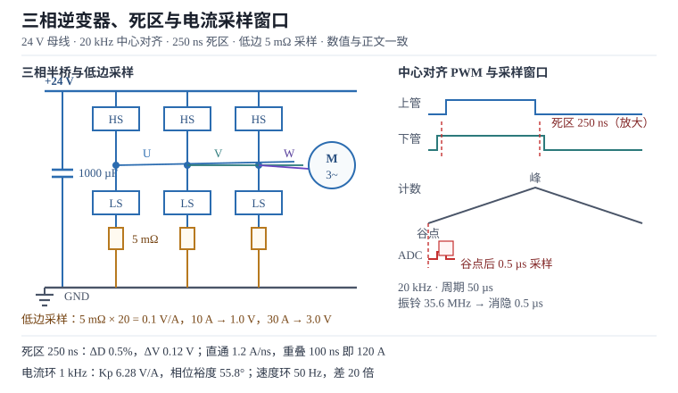

# 电机控制：H 桥、死区、电流环与无感换相

电机控制板上最常见的两种故障，一种是功率管炸，一种是电流环叫。前者往往来自死区不够导致的直通：24 V 母线、20 nH 回路电感，重叠导通 100 ns 就是 120 A 的尖峰，远超器件额定；后者往往来自带宽选错：20 kHz 的 PWM 配 2 kHz 的电流环，数字延迟 95 µs 已经把相位裕度啃到 21.6°，负载一变就振荡。**电机控制不是"调 PID"，而是把功率级时序、采样时刻、环路带宽、热与保护四笔账算在同一张时间轴上。**

本章以 24 V 母线、三相逆变、额定 10 A 峰值、3000 rpm、4 对极的表贴式永磁同步电机（Permanent Magnet Synchronous Motor，PMSM）为例，把 H 桥与三相半桥、PWM 死区、电流采样时机、电流环与速度环、堵转保护、无感换相串成一条可复算的链路。母线电容与器件的选型与[低功耗设计](low-power.md)里的能量账互补，通信层与[CAN 总线](../comm/can.md)的实时性一起看。

## 1 动机：三个烧掉的功率级

::: motivation 三个现场
**现场一：上电第一次 PWM 就炸管。** 24 V 母线、两只并联的 100 µH 电感做负载，半桥上下管同时导通 100 ns，回路电感按 20 nH 计，电流上升率 $24/20\ \text{nH}=1.2\ \text{A/ns}$，100 ns 就是 120 A。器件脉冲电流额定 200 A，看似够，但米勒电容让关断延迟比开通延迟长 80 ns，驱动电阻再一偏差，实际重叠 250 ns 就是 300 A，直接雪崩。**死区不是"留一点"，而是按最坏延迟差算出来的一条不等式。**

**现场二：空载电流环很稳，一加载就啸叫。** 20 kHz PWM、电流环 2 kHz，控制器计算延迟 25 µs、采样保持 50 µs、滤波 20 µs，合计 95 µs；2 kHz 处的相位滞后 $360\times2000\times95\ \mu\text{s}=68.4^{\circ}$，相位裕度只剩 $90-68.4=21.6^{\circ}$，阶跃响应过冲超过 40%。把电流环降到 1 kHz，相位裕度回到 55.8°，啸叫消失。**带宽不是越高越好，它被采样与计算延迟硬性限住。**

**现场三：堵转 8 秒后绕组冒烟。** 堵转电流被限在 30 A 峰值，铜损 $3\times(30/\sqrt{2})^2\times0.5=675\ \text{W}$，绕组热阻 2.4 K/W 时稳态温升 1620 K，早就烧了；真正限制堵转时间的是热容，按 40 J/K 算，2 秒才升 33.8 K。**过流保护必须分两层：毫秒级的电流阈值与秒级的热积分，缺一层都挡不住。**

| 你想确认 | 先算 | 判据（工程经验值） |
|---|---|---|
| 死区够不够 | $t_d\geq t_{off,max}-t_{on,min}+t_m$ | 再留 100 ns 余量 |
| 直通电流多大 | $di/dt=V_{dc}/L_{loop}$ | 重叠时间内不超过器件脉冲额定 |
| 占空比损失 | $\Delta D=t_df_{sw}$ | 小于 1% |
| 电流采样窗 | $t_{on,min}\geq t_{blank}+t_{sample}$ | 最坏占空比下仍成立 |
| 电流环带宽 | $f_{ci}\leq f_{sw}/20$ | 相位裕度大于 45 度 |
| 速度环带宽 | $f_{cs}\leq f_{ci}/10$ | 与机械时间常数匹配 |
| 堵转能量 | $E=I^2Rt$ | 小于绕组热容允许的温升 |
| 低速无感 | $E_{bemf}>V_{diode}+V_{hys}$ | 一般不低于 500 rpm |

:::

## 2 直观：从 H 桥到三相逆变

电机控制的核心动作只有一句话：**用开关把直流母线电压斩成时间平均可调的三相电压，让电流按期望的幅值和相位流入绕组。** 有刷直流电机只需要一个 H 桥，四个开关就能正反转；无刷电机需要三个半桥、六个开关，靠换相让定子磁场始终领先转子一个角度。

### 2.1 电路结构：H 桥与三相半桥

图中左半部分是三相逆变器：母线 $V_{dc}=24\ \text{V}$，三相半桥 U、V、W 各由上下两只 N 沟道 MOSFET 组成，每相下管源极串 5 mΩ 采样电阻，经 20 倍差分放大后送 ADC。右半部分是中心对齐 PWM 的一相时序：上管与下管互补，中间插入 250 ns 死区；计数器在谷点时触发 ADC，此时下管导通、电流流过采样电阻，采样点距离最近的开关沿至少 0.5 µs。

H 桥与三相半桥的关系值得说明白：H 桥是"一个线圈、两种极性"，三相半桥是"三个线圈、六个扇区"。H 桥的每个桥臂同样要死区，同样有直通风险，只是电流路径只有两条；三相逆变器多了第三相，多了"三相对称"这个约束，也多了用三个半桥合成任意方向电压矢量的能力。空间矢量调制（Space Vector Pulse Width Modulation，SVPWM）把六个开关状态组合成六个基本矢量与两个零矢量，线性调制区的相电压峰值上限是 $V_{dc}/\sqrt{3}=13.86\ \text{V}$，比正弦调制的 $V_{dc}/2=12\ \text{V}$ 高 15.5%。

### 2.2 开关状态与电流路径

一个半桥有三种有效状态：上管导通（相电压接母线）、下管导通（相电压接地）、以及死区期间的"两个都关"。死区期间电流走哪条路，取决于电流方向：电流从桥臂流向电机时，走下方续流二极管；电流从电机流回桥臂时，走上方续流二极管。**死区不是"零电压"，而是一段由电流方向决定的、电压不确定的区间**，这就是死区造成波形畸变的根源。

三相同时看，六个开关组合出八个矢量：六个非零矢量把平面分成六个 60° 扇区，两个零矢量让输出停在原点。SVPWM 在每个 PWM 周期内用相邻两个非零矢量与零矢量做时间平均，合成目标电压矢量。对 24 V 母线，线性区最大相电压峰值 13.86 V；电机在 3000 rpm 时反电动势 9.0 V，剩下 4.86 V 用来驱动电流。但 4 对极、3000 rpm 对应 200 Hz 电频率，1 mH 相电感的感抗 $X=2\pi\times200\times0.001=1.257\ \Omega$，阻抗模 $|Z|=\sqrt{0.5^2+1.257^2}=1.352\ \Omega$，把 4.86 V 直接除以阻抗模（同相估算）只有 $4.86/1.352=3.59\ \text{A}$；按 Id=0 的相量关系解 $1.83I^2+9I-111=0$，也只有 5.71 A。9.7 A 是只算 0.5 Ω 电阻、漏掉感抗的乐观值，24 V 在 3000 rpm 撑不到 10 A，必须提高母线电压、降低反电动势常数或降低最高转速。**母线电压决定了高速区的电流能力，减速比与反电动势常数必须在选型时一起算。**

### 2.3 死区与直通

死区时间 $t_d$ 的取值是一条不等式：

$$t_d\geq t_{off,max}-t_{on,min}+t_m$$

式中 $t_{off,max}$ 是关断延迟的最大值（s），$t_{on,min}$ 是开通延迟的最小值（s），$t_m$ 是温度、驱动电阻与器件离散性带来的余量（s）。以关断延迟 120 ns、开通延迟 40 ns、余量 100 ns 为例，$t_d\geq180\ \text{ns}$，工程上取 250 ns 留一倍余量。若把死区压到 100 ns，最坏情况下上下管仍有 20 ns 重叠；按 1.2 A/ns 的电流上升率，20 ns 就是 24 A 的直通尖峰，看起来不大，但尖峰随母线电压和温度上升，冬天合格的板子夏天就可能炸。

死区的代价是占空比损失与电压误差：

$$\Delta D=t_df_{sw},\qquad \Delta V=t_d\frac{V_{dc}}{T_s}=t_df_{sw}V_{dc}$$

20 kHz、250 ns 时 $\Delta D=0.5\%$、$\Delta V=0.12\ \text{V}$。这个误差在高速大电流时只占几个百分点，但在电流过零附近，反电动势与电阻压降都很小，0.12 V 就是主导项，表现为过零畸变、转矩脉动与音频噪声。**死区补偿的方向由电流极性决定，极性判断错一个扇区，补偿反而加倍了畸变。**

### 2.4 电流采样在哪个时刻

电流采样必须避开开关沿。功率管每次开关都会激励回路电感与器件输出电容的谐振：20 nH 与 1 nF 的谐振频率是

$$f_{ring}=\frac{1}{2\pi\sqrt{L_{loop}C_{oss}}}=\frac{1}{2\pi\sqrt{20\ \text{nH}\times1\ \text{nF}}}=35.6\ \text{MHz}$$

周期只有 28 ns，振铃在 0.2 至 0.3 µs 内衰减到可接受水平。因此采样点至少要在开关沿之后 0.5 µs，工程上取 0.5 至 1 µs 的消隐时间（Blanking Time）。中心对齐 PWM 的谷点（计数器为 0）天然满足这个条件：三相下管同时导通，电流全部流过采样电阻，且距离上一个开关沿已经有半个低边导通时间。

三电阻采样的限制在占空比的两端。20 kHz 周期 50 µs，若某相占空比 98%，下管只有 1 µs 导通，扣掉 0.5 µs 消隐只剩 0.5 µs，采样窗口不够；占空比 99% 时完全无法采样。工程上把最大调制比限制在 95% 至 97%，或者在扇区边界改用两电阻采样、甚至单电阻重构。**"采样窗口"是逆变器调制比的隐形上限，它和母线利用率是直接冲突的。**

## 3 定量：PWM、死区、环路与保护

### 3.1 PWM 与死区时间

中心对齐 PWM 的计数器在 0 与 自动重装值 之间上下计数，比较值决定占空比。20 kHz、168 MHz 定时器时钟下，一个周期 8400 个计数；12 位占空比分辨率对应 12.2 ns 的台阶，250 ns 相当于 42 个定时器计数，或 20.5 个 12 位占空比台阶。**死区必须能被定时器以计数为单位精确表示，不能靠软件延时凑。**

死区插入有两条实现路径：硬件死区由高级定时器的死区发生器在互补输出之间自动插入，精度是计数级，抖动小；软件死区在中断里改比较值，受中断延迟影响，20 kHz 下每次抖动几百纳秒，等于死区在 100 至 500 ns 之间随机变化，电流波形会明显变差。能用硬件死区就不要用软件死区。

直通电流的估算用回路电感：

$$I_{shoot}=\frac{V_{dc}}{L_{loop}}t_{overlap}$$

$L_{loop}$ 是母线电容到半桥的换流回路电感（H），$t_{overlap}$ 是上下管同时导通的时间（s）。24 V、20 nH、100 ns 得 120 A；同样的重叠时间，把回路电感做到 10 nH 就翻倍到 240 A。**布局上缩短母线到半桥的回路、把去耦电容紧贴桥臂，比选更大电流的管子更有效。**

### 3.2 电流采样与信噪比

低边采样电阻把相电流换成电压：

$$V_{sh}=I_{phase}R_{sh},\qquad V_{out}=G\,V_{sh}$$

$R_{sh}=5\ \text{m}\Omega$、$G=20$ 时，10 A 对应 1.0 V，30 A 对应 3.0 V，刚好落在 3.3 V ADC 的线性区内。12 位 ADC 的电流分辨率

$$\Delta I=\frac{V_{LSB}}{G R_{sh}}=\frac{805.7\ \mu\text{V}}{20\times5\ \text{m}\Omega}=8.06\ \text{mA}$$

放大器与电阻的热噪声按 50 µV RMS 计，折合 $50\ \mu\text{V}/(20\times5\ \text{m}\Omega)=0.5\ \text{mA}$，远小于量化台阶。真正限制精度的是开关噪声与共模瞬变，不是 ADC 位数。采样电阻的功耗也要核：10 A 峰值、7.07 A RMS 时 $7.07^2\times5\ \text{m}\Omega=0.25\ \text{W}$，要用 1 W 以上的合金电阻，并注意四端开尔文接法。

### 3.3 电流环与速度环带宽

电流环的被控对象是 $RL$ 串联回路：

$$G_i(s)=\frac{1}{L_s s+R_s}$$

用 PI 控制器把零点放在对象极点上，$K_p=L_s\omega_{ci}$、$K_i=R_s\omega_{ci}$，闭环带宽就等于 $\omega_{ci}$。取 $f_{ci}=1\ \text{kHz}$、$L_s=1\ \text{mH}$、$R_s=0.5\ \Omega$，得 $K_p=6.28\ \text{V/A}$、$K_i=3141.6\ \text{V/(A}\cdot\text{s)}$。数字延迟由采样保持 50 µs、计算 25 µs、滤波 20 µs 组成，合计 $T_d=95\ \mu\text{s}$，相位裕度

$$\varphi_{PM}=90^{\circ}-360^{\circ}f_{ci}T_d$$

1 kHz 时是 55.8°，2 kHz 时是 21.6°。判据是 $f_{ci}\leq f_{sw}/20$：20 kHz 开关频率对应 1 kHz 电流环，正好卡在边界上。

速度环在外环，机械时间常数

$$\tau_m=\frac{JR_s}{K_t^2}$$

$J=5\times10^{-5}\ \text{kg}\cdot\text{m}^2$、$R_s=0.5\ \Omega$、$K_t=0.043\ \text{N}\cdot\text{m/A}$ 时 $\tau_m=13.5\ \text{ms}$，对应极点 11.8 Hz。速度环取 50 Hz，是电流环的 1/20、机械极点的 4.2 倍；速度反馈滤波取 1 ms，在 50 Hz 处引入 $360\times50\times1\ \text{ms}=18^{\circ}$ 滞后，相位裕度约 72°。若滤波取 5 ms，50 Hz 处滞后 90°，环路正好在稳定边界上，表现为转速周期性摆动。**速度环的滤波器时间常数不是"越小越干净"，它直接吃掉相位裕度。**

### 3.4 堵转、过流与热

过流保护分两层。第一层是逐周期的硬件比较器：电流超过 30 A 立即关断 PWM，响应时间小于 1 µs，挡住短路与直通。第二层是热积分：

$$E=\int I^2R_s\,dt,\qquad \Delta T=\frac{E}{C_{th}}$$

$C_{th}=40\ \text{J/K}$ 是绕组热容，30 A 峰值、2 s 的堵转能量 $3\times(30/\sqrt{2})^2\times0.5\times2=1350\ \text{J}$，温升 33.8 K；同样电流持续 8 s 就是 135 K，超过绝缘等级。连续运行时用热阻算稳态：10 A 峰值（7.07 A RMS）铜损 $3\times7.07^2\times0.5=75\ \text{W}$，热阻 2.4 K/W 时温升 180 K，40 °C 环境到 220 °C，远超 130 °C 的绕组上限；2.4 K/W 下允许 90 K 温升的连续电流只有 5.0 A RMS（7.07 A 峰值）。**堵转保护看能量，连续保护看热阻，两者不能互相替代。**

### 3.5 无感换相基础

无感控制靠反电动势判断转子位置。星形接法下，任意时刻只有两相导通，第三相悬空，悬空相的端电压等于该相反电动势加上中性点电压；当该相反电动势过零时，端电压与中性点电压相等，比较器输出翻转。反电动势

$$E_{bemf}=K_e\omega_m$$

$K_e=3.0\ \text{V/krpm}$，500 rpm 时 1.5 V，300 rpm 时只有 0.9 V，而续流二极管压降约 0.7 V、比较器迟滞 10 至 20 mV，低转速下信噪比不够，这就是无感电机通常不能从零速闭环的原因。启动要用"三段式"：预定位、开环加速、切闭环。

换相时刻在过零之后延迟 30° 电角度。3000 rpm、4 对极时电频率 200 Hz，60° 对应 833.3 µs，30° 是 416.7 µs；过零检测滤波 2 kHz 带来 79.6 µs 延迟，折合 5.7° 电角度，占 60° 的 9.5%，造成的转矩损失约 $1-\cos5.7^{\circ}=0.5\%$。**滤波延迟在高速时不可忽略，低速时反而无所谓，这就是无感换相要在不同转速下用不同滤波系数的原因。**

## 4 算例：24 V、10 A、3000 rpm 的驱动链路

### 4.1 需求与器件

母线 24 V，额定相电流 10 A 峰值（7.07 A RMS），最高 3000 rpm，4 对极，相电阻 0.5 Ω，相电感 1 mH，反电动势常数 3.0 V/krpm，开关频率 20 kHz，电流环 1 kHz，速度环 50 Hz。功率管选 30 V、5 mΩ、Qg=10 nC 的 MOSFET，栅极驱动 12 V，硬件死区 250 ns。

### 4.2 死区与电压误差

按 120 ns 关断延迟、40 ns 开通延迟、100 ns 余量，死区下限 180 ns，取 250 ns。占空比损失 $250\ \text{ns}\times20\ \text{kHz}=0.5\%$，电压误差 $0.5\%\times24=0.12\ \text{V}$。在 10 A、0.5 Ω 的电阻压降 5 V 面前，0.12 V 只占 2.4%；在电流过零附近，反电动势与电阻压降都接近零，0.12 V 就是全部，会造成明显的过零死区。补偿按电流极性加 0.12 V 的前馈，极性用上一周期的电流符号判断，过零附近加迟滞，避免符号抖动。

### 4.3 电流采样链

5 mΩ 采样电阻在 10 A 时输出 50 mV，20 倍放大后 1.0 V；30 A 时 3.0 V，留 0.3 V 给过流比较器。12 位 ADC 的电流台阶 8.06 mA，噪声 0.5 mA RMS，过流阈值 30 A 对应的码值是 $3.0/3.3\times4096=3724$，软件阈值设在 3600（28.9 A）留 3% 余量。采样点定在计数器谷点后 0.5 µs，消隐要求 0.5 µs；最坏占空比 97% 时下管总导通 1.5 µs，中心对齐下低边窗口以谷点为中心对称，谷点后到下一个开关沿只有 0.75 µs。从 +0.5 µs 起采，到下一个沿只剩 0.25 µs，0.5 µs 的采样保持会跨过开关沿，采到振铃甚至另一相的电流。97% 下这套时序不成立：要么把采样点提前到谷点附近（谷点距上一个沿 0.75 µs，已满足消隐），要么把最大调制比压到 95% 左右（谷点后 1.25 µs，从 +0.5 µs 起还剩 0.75 µs）。

### 4.4 电流环与速度环设计

电流环 $K_p=6.28\ \text{V/A}$、$K_i=3141.6\ \text{V/(A}\cdot\text{s)}$，带宽 1 kHz，相位裕度 55.8°。速度环 $K_p=J\omega_{cs}=5\times10^{-5}\times314=0.0157\ \text{N}\cdot\text{m/(rad/s)}$，$K_i=B\omega_{cs}=1\times10^{-4}\times314=0.0314\ \text{N}\cdot\text{m/rad}$，其中 $B$ 是粘性阻尼系数。速度环带宽 50 Hz，与电流环相差 20 倍，满足"外环比内环慢一个数量级"的经验判据。

阶跃响应可以粗算：电流环闭环等效为一阶惯性 $1/(1+s/\omega_{ci})$，速度环 PI 把机械极点抵消后，环路增益穿越 50 Hz，相位裕度 72°，阶跃过冲约 5%；若把速度环推到 100 Hz，滤波 1 ms 的滞后变成 36°，相位裕度 54°，过冲升到 15% 左右。**调试时先看电流环阶跃（示波器看 Iq 响应），再看速度环阶跃，两级分开整定，不要同时改参数。**

### 4.5 堵转与过流保护

硬件过流 30 A 峰值，比较器直接封 PWM，响应小于 1 µs。软件热积分按 $E=\int I^2R_sdt$ 累加，30 A 时每秒 675 J，$C_{th}=40\ \text{J/K}$，允许 60 K 温升对应 2400 J，即 3.6 s；超过就降额到 5.0 A RMS（7.07 A 峰值），再超时停机。连续 10 A 峰值时铜损 75 W，热阻 2.4 K/W，温升 180 K，环境 40 °C 时绕组 220 °C，远超 F 级绝缘 130 °C 的上限，因此 10 A 峰值不能长期连续运行；2.4 K/W 下允许 90 K 温升的铜损只有 37.5 W。**保护阈值要写进参数表，不能只写在代码里。**

### 4.6 无感启动与换相

启动分三段：先把转子预定位到已知扇区（通电 200 ms，电流限 5 A），再按 5 Hz 到 33.3 Hz 的开环频率加速（每步 60°，步进时间从 33.3 ms 缩到 5 ms），反电动势幅值达到 1.5 V（500 rpm）后切入闭环。500 rpm 时电频率 33.3 Hz，60° 对应 5 ms，滤波 2 kHz 的 79.6 µs 延迟折合 0.96°，换相误差可以接受；3000 rpm 时 60° 为 833.3 µs，同样的滤波延迟折合 9.5%，需要把滤波截止提到 5 kHz 或做相位超前补偿。

## 5 工程含义：从原理图到产线

**母线电容与布局。** 20 kHz、10 A、50% 占空比、1000 µF 母线电容的电压纹波是 $I D/(Cf_{sw})=10\times0.5/(10^{-3}\times2\times10^{4})=0.25\ \text{V}$。纹波不大，但电容的等效串联电阻（Equivalent Series Resistance，ESR）与 ESL 决定高频尖峰，去耦要"大电容加小电容"并联，小电容紧贴桥臂。换流回路面积每缩小一倍，回路电感大约减半，直通电流与电压尖峰同步减半。

**栅极驱动。** 开通电阻与关断电阻分开：开通慢一点抑制振铃与 EMI，关断快一点减少死区需求。栅极电荷 10 nC、12 V 驱动、20 kHz 下驱动功率 $Q_gV_gf_{sw}=10\ \text{nC}\times12\ \text{V}\times20\ \text{kHz}=2.4\ \text{mW}$ 每管，六管 14.4 mW，可以忽略；真正要管的是米勒电容在 dv/dt 下耦合到栅极的尖峰，必要时要加负压关断或有源米勒钳位。

**损耗与散热。** 10 A 峰值、7.07 A RMS 时，导通损耗 $3\times7.07^2\times2\times5\ \text{m}\Omega=1.5\ \text{W}$，开关损耗按 $0.5V_{dc}I(t_r+t_f)f_{sw}$ 估算，每管 0.096 W、六管 0.576 W，总损耗约 2.1 W，输出 135 W 时效率约 98.5%。散热片的热阻要按 2.1 W 与最高环境温度选，不能按"管子额定 30 A"拍脑袋。

**采样与保护的分工。** 电流环用的是滤波后的电流，过流保护用的是比较器的瞬时值，两者不能共用一条慢速通道。比较器阈值要高于电流环的最大指令，低于器件脉冲额定，中间留 20% 余量；软件再做一个"连续 N 个周期超阈值"的确认，避免单次尖峰误触发。

**产线测试。** 每台驱动器做三相电流零漂校准（上电时 PWM 关闭，采 256 点取均值）、死区补偿表写入、堵转保护自检（堵转 200 ms 看电流是否被限住）、反电动势常数抽测。测试数据与序列号绑定，返修时能直接判断是功率级还是控制参数的问题。

## 6 常见坑

::: pitfall 上电第一次 PWM 就炸上下管
**现象**：新板第一次使能 PWM，保险丝熔断，拆下 MOSFET 发现上下管都击穿，栅极电阻烧黑。
**原因**：死区按典型延迟 80 ns 设置，没有覆盖关断延迟最大值 120 ns 与开通延迟最小值 40 ns 的差；驱动电阻偏差与温度进一步放大重叠时间，100 ns 重叠在 20 nH 回路上就是 120 A。
**解决**：按 $t_d\geq t_{off,max}-t_{on,min}+t_m$ 重算并留一倍余量；用硬件死区而不是软件延时；上电先用限流电源与低占空比验证，示波器看上下管栅极的重叠。
:::

::: pitfall 电流环空载稳定、加载啸叫
**现象**：空载时电流波形干净，一加负载就出现 2 至 3 kHz 的振荡，声音刺耳，母线电流跟着抖。
**原因**：电流环带宽设到 2 kHz，而采样、计算、滤波总延迟 95 µs，相位裕度只剩 21.6°；负载把工作点推到非线性区，进一步降低裕度。
**解决**：把电流环降到 1 kHz（$f_{sw}/20$），或提高采样率、减少滤波延迟；整定时看阶跃响应的过冲，不只看稳态误差。
:::

::: pitfall 堵转保护没动作，绕组先冒烟
**现象**：电机堵转 5 s 后驱动器才报过流，拆开发现绕组绝缘变色，热保护形同虚设。
**原因**：只设了 30 A 的瞬时阈值，而 30 A 持续 5 s 的能量是 3375 J，按 40 J/K 热容升温 84 K；40 °C 环境到 124 °C，已经贴着 130 °C 上限，夏季机柜内 60 °C 就直接到 144 °C、超过绝缘等级——软件热模型没有累加，阈值看起来"没超"而已。
**解决**：加 $I^2t$ 热积分，按绕组热容与允许温升算时间；同时用热敏电阻或绕组电阻反推温度做二级保护；堵转测试要记录电流与时间的完整曲线。
:::

::: pitfall 无感电机低速启动失败、来回抖
**现象**：500 rpm 以下启动时电机抖动、偶尔反转，提高到 800 rpm 才能稳定闭环。
**原因**：低速反电动势只有 0.9 至 1.5 V，接近续流二极管压降与比较器迟滞；过零检测滤波又引入相位延迟，换相角错位。
**解决**：采用预定位加开环加速的三段式启动，反电动势达到 1.5 V（约 500 rpm）再切闭环；低速用较小的滤波时间常数，高速再加大；必要时改用高频注入或霍尔传感器。
:::

::: pitfall 电流采样在扇区边界跳变
**现象**：电流波形在每 60° 扇区边界出现毛刺，FOC 的 d/q 电流跟着跳，转矩脉动明显。
**原因**：三电阻采样在最坏占空比下某相下管导通时间不足，采样窗口落在开关沿的振铃上；或者 ADC 触发沿与 PWM 更新沿重合。
**解决**：把最大调制比限制在 95%，采样点放在谷点后 0.5 µs；扇区边界改用两电阻采样或单电阻重构；确认 ADC 触发源与 PWM 计数器同源。
:::

## 7 自测题

母线 24 V、回路电感 20 nH，上下管重叠导通 100 ns，直通电流多大？若死区从 250 ns 减到 100 ns，最坏重叠多少？

电流上升率 $di/dt=24/20\ \text{nH}=1.2\ \text{A/ns}$，重叠 100 ns 时 $I=120\ \text{A}$。判别式是净间隔 $t_{margin}=t_d+t_{on,min}-t_{off,max}$：取 $t_d=250\ \text{ns}$、$t_{on,min}=40\ \text{ns}$、$t_{off,max}=120\ \text{ns}$，得 $250+40-120=170\ \text{ns}$，没有重叠；即使关断延迟因高温升到 160 ns，仍有 130 ns 余量。降到 100 ns 时，常温余量 20 ns，高温下 $100+40-160=-20\ \text{ns}$，即重叠 20 ns，电流尖峰 $1.2\times20=24\ \text{A}$。所以 100 ns 死区在常温下勉强、在高温下危险，250 ns 才覆盖最坏情况。

20 kHz、250 ns 死区，占空比损失和电压误差各是多少？为什么电流过零时影响最大？

$\Delta D=t_df_{sw}=250\ \text{ns}\times20\ \text{kHz}=0.5\%$，$\Delta V=\Delta D\times V_{dc}=0.5\%\times24=0.12\ \text{V}$。高速大电流时相电压由反电动势与电阻压降主导（10 A 时 5 V），0.12 V 只占 2.4%；过零附近反电动势与 $IR$ 都接近零，0.12 V 成为主导项，且误差方向随电流极性翻转，造成波形畸变与转矩脉动。

电流环 1 kHz、总延迟 95 µs，相位裕度多少？为什么 2 kHz 不行？

$\varphi_{PM}=90^{\circ}-360^{\circ}\times1000\times95\times10^{-6}=90-34.2=55.8^{\circ}$。2 kHz 时滞后 $360\times2000\times95\ \mu\text{s}=68.4^{\circ}$，相位裕度只剩 21.6°，阶跃过冲大、对参数敏感，负载扰动下容易振荡。经验判据是 $f_{ci}\leq f_{sw}/20$，20 kHz 对应 1 kHz。

速度环 50 Hz、速度反馈滤波 1 ms，相位裕度约多少？若滤波改成 5 ms 会怎样？

滤波在 50 Hz 处引入 $360\times50\times0.001=18^{\circ}$ 滞后；PI 把机械极点抵消后环路本身接近积分器，相位裕度约 $90-18=72^{\circ}$。改成 5 ms 时滞后 $360\times50\times0.005=90^{\circ}$，相位裕度接近 0，转速会出现周期性摆动甚至失稳。速度环滤波时间常数要按带宽反算，不能凭"滤波越干净越好"选。

30 A 峰值堵转、相电阻 0.5 Ω、热容 40 J/K，2 s 温升多少？连续 10 A 峰值时铜损与温升多少？

30 A 峰值对应 RMS $30/\sqrt{2}=21.2\ \text{A}$，三相铜损 $3\times21.2^2\times0.5=675\ \text{W}$，2 s 能量 1350 J，温升 $1350/40=33.8\ \text{K}$。连续 10 A 峰值（7.07 A RMS）铜损 $3\times7.07^2\times0.5=75\ \text{W}$，热阻 2.4 K/W 时温升 180 K，40 °C 环境到 220 °C，远超 130 °C 上限；允许 90 K 温升的连续电流 $I_{rms}=\sqrt{90/(3\times0.5\times2.4)}=5.0\ \text{A}$（对应 7.07 A 峰值），所以 10 A 峰值不能长期连续运行。

## 8 参考资料

- STMicroelectronics，AN4013 *STM32 定时器概览*，高级定时器的互补输出、死区插入、刹车输入与中心对齐模式。
- STMicroelectronics，AN4144 *电流采样在电机控制中的应用*，单电阻、双电阻、三电阻采样的时机、消隐时间与重构误差。
- Texas Instruments，SPRABQ4 *InstaSPIN-FOC 与 InstaSPIN-MOTION 用户指南*，电流环与速度环整定、无感观测器与低速性能。
- Infineon，AN2015-06 *MOSFET 半桥栅极驱动设计*，死区时间、直通电流、开关损耗与栅极电阻的选择。
- IEEE Std 519-2022，*Recommended Practice and Requirements for Harmonic Control in Electric Power Systems*，逆变器输出谐波与开关频率、调制方式的关系。
- NXP，AN1946 *无刷直流电机无感控制*，反电动势过零检测、30° 延迟、启动三段式与低速限制。
