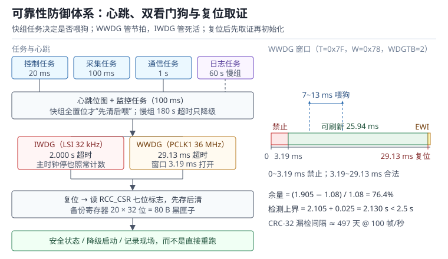

# 可靠性与看门狗体系：故障模型、双看门狗与复位取证

一个在现场“每天随机复位三次”的设备，最让人无力的不是复位本身，而是复位之后什么都没有留下：日志停在半小时前，变量全丢，串口只打印一行启动信息。工程师只能猜——是电源跌落、是某个任务卡死、还是 Flash 里的参数被写坏了？猜错的代价是把一个电源问题当成软件问题改三个月。

可靠性工程的目标不是“让故障不发生”，而是把故障变成**可检测、可恢复、可取证**的事件。检测靠看门狗与自检，恢复靠复位与降级，取证靠复位原因寄存器、备份寄存器与日志。三者缺一，现场故障就会退化成悬案。本章先建立故障模型，再把独立看门狗（Independent Watchdog，IWDG）、窗口看门狗（Window Watchdog，WWDG）、任务心跳、ECC 与 CRC 放进同一个防御体系，最后用复位取证和一套可执行的故障注入测试收尾。

看门狗外设本身的寄存器细节见[看门狗、RTC 与低功耗定时](../mcu/watchdog-rtc.md)；任务调度与优先级见[RTOS 调度](../rtos/rtos-scheduling.md)；Flash 的擦写寿命与掉电安全见[Flash 与 EEPROM](../storage/flash-eeprom.md)；启动流程与复位向量见[启动流程](../basics/startup-boot.md)。

## 1. 动机：四种死法

::: motivation 四个现场
**现场一：跑飞。** 指针越界把返回地址写成了 0xFFFFFFFE，函数返回时内核取指失败，进 HardFault；HardFault 处理函数里又访问了非法地址，异常无法再次进入，内核进入 Lockup（锁定）状态，主循环完全停摆。此时唯一还能动作的，是那个不依赖 CPU 的独立看门狗。

**现场二：死锁。** 两个任务各自持有对方需要的互斥量，谁也不释放。定时器中断照常触发，喂狗语句就写在定时器中断里，于是看门狗一次都没有复位。设备“活着”，但功能全失，现场表现为“屏幕卡住、通信超时”，日志里没有任何复位记录。

**现场三：电源跌落。** 24 V 输入瞬间掉到 18 V，3.3 V 降到 2.6 V 持续 3 ms。BOR 阈值设在 2.7 V，复位信号还没来得及拉低，Flash 正在擦除，擦除中断导致整页变成 0xFF。下次启动读参数，CRC 失败，设备进入默认配置，标定值全丢。

**现场四：位翻转。** 一颗宇宙射线中子打翻了 SRAM 里的一个状态位，状态机跳到一个未定义分支，输出保持上一次的值。没有 ECC、没有 CRC、没有看门狗覆盖这个分支，设备带着错误输出继续运行，直到操作员发现产品尺寸超差。
:::

| 你想确认 | 先算 | 判据（工程经验值，非标准强制） |
|---|---|---|
| 看门狗超时下界 | $T_{wdg,min}=T_{nom}/(1+\delta_f)$ | 大于最长正常任务时间的 1.3 倍 |
| 看门狗超时上界 | $T_{wdg,max}=T_{nom}/(1-\delta_f)$ | 加启动时间后小于故障容忍时间 |
| 窗口打开时刻 | $t_{open}=(127-W)\,t_{tick}$ | 小于任务最快完成时间的 80% |
| 通信漏检 | $P_{ud}=2^{-r}$ | 按帧率折算的漏检间隔大于产品寿命 |
| 板级失效率 | $MTBF=10^{9}/\lambda$ | 现场年故障数在可接受范围 |
| 安全状态时间 | $t_{safe}=T_{wdg,max}+t_{boot}+t_{off}$ | 小于安全需求规定的响应时间 |

**不算会摔在哪**，四个带数字的代价：

1. **超时按标称时钟算。** LSI 偏差 ±5%，标称 2 s 的看门狗实际在 1.905~2.105 s 之间。任务最坏 1.98 s 时，下界已经低于任务时间，正常负载就会触发复位；而上界又让故障检测晚了 100 ms。
2. **窗口位置拍脑袋。** 窗口开得太晚，一次正常的调度抖动就错过；开得太早，任务稍微提前完成就复位。窗口宽度要覆盖“任务完成时间的分布”，不是覆盖平均值。
3. **CRC 位宽不够。** CRC-16 对随机错误的漏检概率是 $2^{-16}$，100 帧/秒的链路上平均 655 s 就会漏掉一次；CRC-32 把这个时间拉到 497 天。链路速率越高，位宽越不能省。
4. **没有复位取证。** 现场复位 100 次，如果只记录“重启了”，等于 100 次都没有信息。加上复位原因、心跳位图、故障寄存器快照，同样的 100 次能定位到具体的任务与故障类型。

## 2. 直观：三层防御

### 2.1 故障模型：瞬时、永久与系统性

可靠性里先把故障分成三类，因为它们的检测手段不同。

**瞬时故障（Transient Fault）** 由电磁干扰、电源毛刺、宇宙射线引起，持续时间短，重新执行往往就恢复。典型例子是 SRAM 位翻转、总线上的错误数据、复位引脚上的窄脉冲。检测手段是 ECC、CRC、重试与看门狗；恢复手段是重读、重发、复位。

**永久故障（Permanent Fault）** 是硬件真的坏了：Flash 某位写不进去、焊点开裂、晶振停振、稳压器失效。检测手段是自检、比较、看门狗；恢复手段是切换到冗余通道、降级运行或进入安全状态。

**系统性故障（Systematic Fault）** 是设计或软件缺陷，同一批产品在同样条件下都会错。它不能靠冗余解决，只能靠评审、静态分析、测试与现场数据回溯。看门狗对系统性故障的作用有限：如果缺陷是“每 100 ms 必卡一次”，看门狗只会把设备变成“每 2 s 复位一次”的复位循环。

三类故障的边界并不绝对：电源跌落可能先造成瞬时位翻转，再造成永久性的 Flash 损伤。防御体系要按“最坏组合”设计，而不是假设一次只发生一种。

### 2.2 看门狗的分层：谁抓什么

单一看门狗（Watchdog Timer，WDT）只能覆盖一个方向。工程上常用三层：

| 层 | 时钟源 | 典型超时 | 抓得住 | 抓不住 |
|---|---|---|---|---|
| 窗口看门狗 WWDG | PCLK1（与 CPU 同源） | 毫秒级 | 任务跑飞、提前返回、时钟变快、控制周期超时 | 时钟停振、PLL 失锁（它自己也停了） |
| 独立看门狗 IWDG | LSI（内部独立 RC） | 秒级 | CPU 死锁、中断关闭、主时钟故障 | 喂狗逻辑本身错误、喂狗在中断里 |
| 外部看门狗芯片 | 自身 RC 或外部电容 | 百毫秒到秒级 | MCU 完全失效、电源异常、内部看门狗被误关 | 成本与板面积，喂狗线被干扰 |

三层的分工可以这样记：**WWDG 管节拍，IWDG 管死活，外部看门狗管“整颗 MCU 已经不响应”**。WWDG 与 CPU 同源，所以它擅长抓“逻辑跑快”，不擅长抓“时钟停摆”；IWDG 吃 LSI，主时钟全停它还在数；外部芯片完全独立，连 MCU 的电源都能监控。

一个常见的误区是“有了 IWDG 就不需要 WWDG”。IWDG 的超时是秒级，一个 20 ms 的控制任务卡死 1.9 s 才复位，这 1.9 s 里电机可能已经飞车。WWDG 的毫秒级窗口能在几十毫秒内把系统拉回来。反过来，只有 WWDG 也不行：PLL 失锁时 PCLK1 停振，WWDG 的计数器不走了，永远等不到复位。

### 2.3 心跳汇总：把“谁没报到”变成位图

最朴素的喂狗是主循环末尾写一次重装键。它只有一个优点：简单。缺点是一旦某个任务把主循环堵住，喂狗也停了——这其实是正确行为；但如果喂狗写在中断里，这个性质就丢了。可用的方案是**心跳汇总（Heartbeat）**：

- 每个任务在完成本轮工作后，把自己的位置 1；
- 一个低优先级的监控任务周期性检查位图，只有全部“必须报到”的位都置起，才清位并喂 IWDG（WWDG 由控制任务在窗口内自行刷新）；
- 慢任务（比如每 60 s 一次的日志）单独用软件截止时间监控，不参与喂狗门控。

最后一条很重要。如果把 60 s 的日志任务也放进 2 s 的看门狗门控里，正常运行时它永远来不及报到，系统会稳定地每 2 s 复位一次。正确的做法是分组：**快组**（控制、采集、通信）决定是否喂 IWDG；**慢组**（日志、自检、上报）用独立的截止时间检查，超时只降级、不复位。

心跳法有三个实现细节，缺一个就会漏检或误复位：

- **置位必须原子。** `hb |= bit` 是读-改-写，两个任务互相抢占时会丢位。用 LDREX/STREX、位带别名，或者给每个任务一个独立的 `volatile uint8_t` 标志。
- **先清后喂。** 顺序反了会漏掉“两个周期只报到一个”的故障：先喂再清，故障周期的心跳会被下一轮吞掉。
- **监控任务自己也要被监控。** 监控任务卡死就没人喂狗，这正是期望行为；但如果它被高优先级任务长期饿死，就会误复位。监控任务应放在最低优先级，并有确定的执行时间片。

### 2.4 降级阶梯：复位不是唯一的恢复手段

不是所有故障都值得复位。传感器偶尔一个野值，重采一次即可；通信断了，切到本地设定值继续运行；只有“继续运行会危险”时才进安全状态。把恢复手段分成五级，写成**降级阶梯（Degradation Ladder）**，现场行为才可预期：

| 等级 | 触发条件 | 动作 | 是否复位 |
|---|---|---|---|
| L0 | 正常 | 无 | 否 |
| L1 | 单次野值、瞬时 CRC 错 | 中值滤波、重读、重发 | 否 |
| L2 | 传感器持续异常 | 用上次有效值并置故障标志，5 s 超时 | 否 |
| L3 | 通信丢失 | 本地闭环、退避重连、告警 | 否 |
| L4 | 关键故障（双位 ECC、执行器反馈丢失） | 输出安全态、断使能、记录、等待复位 | 是 |

这张表的关键是“L4 的门槛要写死”。如果软件在 L2 和 L3 之间反复摇摆，现场看到的就是“时好时坏”；如果所有故障都直接复位，设备会陷入复位循环，反而失去可用性。

### 2.5 ECC 与 CRC：把“数据错了”变成“知道错了”

**ECC（Error Correcting Code，纠错码）** 用在“读的时候必须知道有没有错、最好还能纠一位”的地方：Flash 指令与常量、RAM 的关键数据结构、缓存。SEC（Single Error Correction）能纠一位；SECDED（Single Error Correction, Double Error Detection）能纠一位、检出两位。检出两位后不能纠正，只能进故障处理。

**CRC（Cyclic Redundancy Check，循环冗余校验）** 用在“整块数据一起校验”的地方：配置参数、OTA 镜像、通信帧、日志块。它不纠错，只给出“这块数据是否完整”的判定。CRC 的检错能力由位宽和多项式决定：$r$ 位 CRC 对随机错误的漏检概率约为 $2^{-r}$，对长度不超过 $r$ 位的突发错误全部检出。

两者不能互相替代。ECC 是“每次访问都查”，开销在硬件；CRC 是“整块算一次”，开销在软件与启动时间。一个常见的设计是：Flash 镜像用 CRC-32 做整体校验，关键配置再存两份加 CRC-16，RAM 里的状态机用 ECC 或双副本加魔数。

### 2.6 一张图看懂防御体系



图的左半部分是从任务到复位源的信号链：四个任务各自置心跳位，监控任务汇总后喂两只看门狗；右半部分是窗口看门狗的时间轴与复位后的取证路径。读图时注意两条线：一条是“谁能停掉谁”——WWDG 依赖 PCLK1，IWDG 只依赖 LSI；另一条是“复位后信息去哪”——RCC_CSR 给原因，备份寄存器给现场。

## 3. 定量：超时余量、漏检概率与可靠性数字

### 3.1 看门狗超时余量

看门狗的超时永远是“计数周期 × 计数个数”，但设计时要按时钟容差取上下界。设标称超时为 $T_{nom}$，时钟相对误差为 $\delta_f$，则：

$$T_{wdg,min}=\frac{T_{nom}}{1+\delta_f},\qquad T_{wdg,max}=\frac{T_{nom}}{1-\delta_f}$$

其中 $T_{nom}$ 单位 s，$\delta_f$ 是无量纲的相对误差（LSI 取 0.05，LSE 取 $20\times10^{-6}$）。下界必须大于最坏任务间隔：

$$T_{wdg,min}\ge(1+M)\,T_{wc},\qquad M=\frac{T_{wdg,min}-T_{wc}}{T_{wc}}$$

$T_{wc}$ 是最坏情况下两次成功喂狗之间的时间（单位 s），$M$ 是相对余量。工程上 $M$ 取 0.3~1.0：太小会被正常抖动触发，太大则故障发现太慢。上界则受故障容忍时间约束：

$$T_{wdg,max}+t_{boot}\le T_{fault}$$

$t_{boot}$ 是从复位到应用重新开始执行的时间（单位 s），$T_{fault}$ 是系统能容忍故障存在的总时间。这条不等式经常被忽略：看门狗超时 2 s、启动 300 ms，实际检测延迟是 2.3 s，不是 2 s。

### 3.2 窗口看门狗的三个时刻

WWDG 的计数器只有 7 位，从 0x7F 递减到 0x40；再减一次到 0x3F 时复位。它的计数周期是固定的 4096 个 PCLK1 周期再乘 WDGTB 分频：

$$t_{tick}=\frac{4096\times2^{WDGTB}}{f_{PCLK1}},\qquad t_{to}=64\,t_{tick}$$

$WDGTB$ 取 0~3 对应 1、2、4、8 分频，$f_{PCLK1}$ 单位 Hz，$t_{tick}$ 是每个计数的时间（单位 s）。窗口打开的时刻是计数器降到 $W[6:0]$ 时：

$$t_{open}=(127-W)\,t_{tick}$$

$W$ 是窗口寄存器的低 7 位。合法刷新区间是 $[t_{open},t_{to}]$；早于 $t_{open}$ 刷新或晚于 $t_{to}$ 都复位。提前唤醒中断（Early Wakeup Interrupt，EWI）在计数器降到 0x40 时触发，距复位只剩一个计数：

$$t_{EWI}=63\,t_{tick},\qquad t_{to}-t_{EWI}=t_{tick}$$

三个时刻的关系必须满足 $t_{open}<T_{min}$（任务最快完成时间）和 $T_{max}<t_{to}$（任务最慢完成时间），否则正常任务也会被复位。

### 3.3 漏检概率与 CRC 位宽

对随机错误，$r$ 位 CRC 的漏检概率近似为：

$$P_{ud}=2^{-r},\qquad T_{ud}=\frac{1}{R\,P_{ud}}$$

其中 $R$ 是每秒校验的帧数（单位 1/s），$T_{ud}$ 是平均漏检间隔（单位 s）。这个式子的前提是“错误均匀随机、CRC 多项式合适”；对突发错误，$r$ 位 CRC 能检出所有长度不超过 $r$ 位的突发，更长的突发漏检概率也远低于 $2^{-r}$。

工程上还要注意“CRC 覆盖范围”。只对数据字节算 CRC、不覆盖长度和地址，攻击者或故障可以通过改长度绕过校验；只对 Flash 的应用区算 CRC、不覆盖配置区，配置位翻转就检不出来。覆盖范围要写成清单，而不是“加了 CRC 就行”。

### 3.4 可靠性数字：FIT、MTBF 与可用度

失效率用 FIT（Failures In Time）表示，1 FIT 等于每 $10^{9}$ 小时一次失效：

$$MTBF=\frac{10^{9}}{\lambda},\qquad R(t)=\exp\!\left(-\frac{\lambda t}{10^{9}}\right)$$

其中 $\lambda$ 的单位是 FIT，$MTBF$ 的单位是小时，$t$ 是运行时间（单位小时），$R(t)$ 是存活概率。$MTBF$（Mean Time Between Failures）是平均无故障间隔，不是“寿命”；一只 $MTBF=10^{7}$ h 的器件，不代表能用 1141 年，只代表在 1141 年的总运行时间里平均出一次故障。

可用度把修复时间也算进来：

$$A=\frac{MTBF}{MTBF+MTTR}$$

$MTTR$（Mean Time To Repair）是平均修复时间（单位 h）。对可远程重启的设备，$MTTR$ 可以做到几分钟；对必须派人上门的设备，$MTTR$ 是小时到天，可用度的瓶颈在修复而不在失效率。

### 3.5 ECC 的位数与开销

一个 $n$ 位数据字需要 $r$ 位校验位，SEC 的条件是：

$$2^{r}\ge n+r+1$$

SECDED 在此基础上再加一位总校验（overall parity），所以校验位数是 $r+1$。以 64 位数据为例：$r=7$ 时 $2^{7}=128\ge64+7+1=72$，SEC 够用；SECDED 取 8 位，开销 $8/64=12.5\%$，编码率 88.9%。32 位数据：$r=6$ 时 $2^{6}=64\ge32+6+1=39$，SECDED 取 7 位，开销 $7/32=21.9\%$。数据字越短，ECC 的相对开销越大，这就是为什么 ECC 通常按 32 位或 64 位字组织。

### 3.6 复位原因与黑匣子

复位原因寄存器（RCC_CSR）里的标志位给出“谁把系统弄挂了”：PORRSTF（上电/掉电）、BORRSTF（欠压）、PINRSTF（外部引脚）、SFTRSTF（软件）、IWDGRSTF（独立看门狗）、WWDGRSTF（窗口看门狗）、LPWRRSTF（低功耗模式）。七个标志最多有 $2^{7}=128$ 种组合，读完必须用 RMVF 位统一清除，否则下次无法区分“这次复位”和“上次复位”。

备份寄存器（Backup Register）由 VBAT 供电，系统复位后内容仍在，适合存“死前现场”。一个实用的布局是 20 个 32 位寄存器、共 80 字节：魔数、复位计数、复位原因、心跳位图、故障时的 PC/LR、最后一条日志序号。复位后先读这些，再决定是正常启动、降级启动还是进安全状态。

## 4. 算例：七笔可靠性账

### 4.1 算例一：2 s 看门狗的真实余量

条件：IWDG 标称 2.000 s，LSI 偏差 ±5%；快组任务最坏间隔 1.08 s（1 s 周期 + 80 ms 抖动）；启动时间 25 ms；故障容忍时间 2.5 s。

$$T_{wdg,min}=\frac{2.000}{1.05}=1.905\ \text{s},\qquad T_{wdg,max}=\frac{2.000}{0.95}=2.105\ \text{s}$$

余量：

$$M=\frac{1.905-1.08}{1.08}=76.4\%$$

检测延迟上界：

$$T_{det}=2.105+0.025=2.130\ \text{s}<2.5\ \text{s}$$

两侧都满足。但如果任务最坏时间涨到 1.98 s：

$$M=\frac{1.905-1.98}{1.98}=-3.8\%$$

负余量意味着正常负载就会误复位。这个算例说明：**看门狗超时不是按平均值配的，是按最坏值和时钟下界配的**。

### 4.2 算例二：WWDG 的 29.13 ms 窗口

条件：$f_{PCLK1}=36$ MHz，$WDGTB=2$（4 分频），$T=0x7F$，$W=0x78$。

$$t_{tick}=\frac{4096\times4}{36\times10^{6}}=0.4551\ \text{ms}$$

$$t_{to}=64\times0.4551=29.127\ \text{ms}$$

窗口打开（$127-120=7$ 个计数）：

$$t_{open}=7\times0.4551=3.186\ \text{ms}$$

合法刷新区间 3.186~29.127 ms，宽 25.94 ms。EWI 在 0x40 处：

$$t_{EWI}=63\times0.4551=28.672\ \text{ms}$$

距复位只剩 0.455 ms。若控制任务在 10 ms ± 3 ms 完成，最早 7 ms 已进入窗口，最晚 13 ms 也远早于 29.13 ms，配置可用。若 W 取 0x60（96），窗口在 $(127-96)\times0.4551=14.11$ ms 才打开，7 ms 的合法完成反而会被判“过早”，这就是窗口不能凭感觉设的原因。

### 4.3 算例三：CRC-16 与 CRC-32 的漏检间隔

条件：链路 100 帧/秒，随机错误模型。

CRC-16：

$$P_{ud}=2^{-16}=1.526\times10^{-5},\qquad T_{ud}=\frac{1}{100\times1.526\times10^{-5}}=655.4\ \text{s}$$

约 10.9 分钟漏掉一次。CRC-32：

$$P_{ud}=2^{-32}=2.328\times10^{-10},\qquad T_{ud}=\frac{1}{100\times2.328\times10^{-10}}=4.295\times10^{7}\ \text{s}$$

约 497 天。若帧率升到 1000 帧/秒，CRC-16 的漏检间隔降到 65.5 s，CRC-32 降到 49.7 天。对“一次漏检就可能导致误动作”的控制链路，CRC-16 在高速率下不够用；对 10 帧/秒的慢速传感器，CRC-16 的 1.8 小时漏检间隔可能已经足够。

### 4.4 算例四：300 FIT 的板子一年坏几块

条件：单板失效率 300 FIT（MCU 100 + 电源与外围 200），出货 10000 台。

$$MTBF=\frac{10^{9}}{300}=3.333\times10^{6}\ \text{h}=380.5\ \text{年}$$

年故障数：

$$N=\frac{10000\times300\times8760}{10^{9}}=26.28\ \text{台/年}$$

一年 26 台返修，对 1 万台出货是 0.26% 的年返修率。这个数字要和售后预算对照：如果每台返修成本 200 元，一年就是 5256 元；若把电源部分的 200 FIT 降到 50 FIT，年故障数降到 13.1 台，省下的钱可能超过改设计的成本。

### 4.5 算例五：可用度与年停机时间

条件：$MTBF=50000$ h，$MTTR=5$ min = 0.0833 h。

$$A=\frac{50000}{50000+0.0833}=0.99999833$$

年停机时间：

$$t_{down}=(1-A)\times8760\times3600=52.6\ \text{s/年}$$

如果设备必须派人现场重启，$MTTR$ 变成 8 h：

$$A=\frac{50000}{50008}=0.999840,\qquad t_{down}=1.60\times10^{-4}\times8760=1.401\ \text{h/年}=84.1\ \text{min/年}$$

同一套硬件，远程复位与现场复位差了约 96 倍停机时间。这也是为什么“看门狗复位 + 远程告警”本身就是可靠性设计的一部分。

### 4.6 算例六：安全状态的时间链

条件：IWDG 上界 2.105 s，复位序列 20 ms，Bootloader 300 ms，POST 40 ms，输出断使能 1 ms。

$$t_{safe}=2.105+0.020+0.300+0.040+0.001=2.466\ \text{s}$$

安全需求要求 3 s 内进入安全状态，余量：

$$M_{safe}=\frac{3.000-2.466}{3.000}=17.8\%$$

余量偏薄。可压缩的环节是 Bootloader：如果应用区自带安全状态入口，跳过 300 ms 的 Bootloader，总时间降到 2.166 s，余量升到 27.8%。这也是“安全状态不要只放在应用里”的原因——应用本身可能已经跑飞。

### 4.7 算例七：ECC 的开销与双位错误

64 位数据加 8 位 SECDED：

$$\text{overhead}=\frac{8}{64}=12.5\%,\qquad \text{code rate}=\frac{64}{72}=88.9\%$$

32 位数据加 7 位：

$$\text{overhead}=\frac{7}{32}=21.9\%,\qquad \text{code rate}=\frac{32}{39}=82.1\%$$

双位错误的检出依赖 SECDED 的总校验位；没有总校验的 SEC 会把双位错误误纠成另一位，反而制造错误。因此“用了 ECC”必须说清是 SEC 还是 SECDED，前者不能作为双位错误的防线。

## 5. 工程含义：心跳、取证与降级

### 5.1 心跳与喂狗的实现

下面这段代码把“快组门控、慢组独立、原子置位、一次清位、WWDG 独立刷新”五件事固定下来：

```c
#define HB_CTRL   (1u << 0)
#define HB_SENSE  (1u << 1)
#define HB_COMM   (1u << 2)
#define HB_FAST   (HB_CTRL | HB_SENSE | HB_COMM)

static volatile uint32_t hb_fast;
static volatile uint32_t hb_slow_tick;   /* 慢组最后报到的时间戳 */

void task_ctrl(void)
{
    /* ... 20 ms 控制周期，10 ms 处刷新 WWDG ... */
    WWDG->CR = 0x7F | WWDG_CR_WDGA;      /* 落在 3.19~29.13 ms 窗口内 */
    __atomic_fetch_or(&hb_fast, HB_CTRL, __ATOMIC_RELAXED);
}
void task_sense(void) { /* ... */ __atomic_fetch_or(&hb_fast, HB_SENSE, __ATOMIC_RELAXED); }
void task_comm(void)  { /* ... */ __atomic_fetch_or(&hb_fast, HB_COMM,  __ATOMIC_RELAXED); }
void task_log(void)   { /* ... */ hb_slow_tick = HAL_GetTick(); }

void monitor_task(void)              /* 最低优先级，100 ms 周期 */
{
    uint32_t now = HAL_GetTick();
    uint32_t seen;

    /* 慢组：180 s 没报到只降级，不复位 */
    if ((uint32_t)(now - hb_slow_tick) > 180000u) {
        degrade_set(1);
    }

    /* 一次读走并清零，检查与清零之间不会丢位 */
    seen = __atomic_exchange_n(&hb_fast, 0, __ATOMIC_RELAXED);
    if ((seen & HB_FAST) == HB_FAST) {
        IWDG->KR = 0xAAAA;           /* 清位已在 exchange 中完成，再喂 */
    }
}
```

四个细节值得单独说。第一，`__atomic_fetch_or` 或 LDREX/STREX 保证置位原子；如果用普通 `|=`，两个任务抢占时会丢位，表现为“偶发误复位”。第二，慢组不参与 IWDG 门控，否则 60 s 周期与 2 s 超时天然矛盾。第三，清位用 `__atomic_exchange_n` 一次读走并清零：如果先读后写 0，检查与清零之间新报到的位会被吞掉，下一轮就可能误复位。第四，WWDG 不能由 100 ms 的监控任务喂——29.13 ms 的超时等不到下一轮；它由控制任务在 10 ms 处刷新，窗口 3.19~29.13 ms 正好覆盖，IWDG 才由监控任务在快组全报到后喂。

### 5.2 复位取证：从寄存器到黑匣子

复位之后第一件事不是重新初始化，而是问“为什么复位”。推荐的上电顺序是：

1. 读 RCC_CSR，把七个复位标志解码成位图，存到 RAM 的启动信息结构；
2. 读备份寄存器的魔数，确认黑匣子已初始化；未初始化则写入默认值；
3. 把“本次复位原因 + 上次心跳位图 + 复位计数”写进备份寄存器与日志；
4. 用 RMVF 清除标志；
5. 再初始化外设、跑 POST、进入应用。

备份寄存器的布局可以直接照抄下面这张表：

| 寄存器 | 内容 | 说明 |
|---|---|---|
| DR0 | 魔数 0x5A5A1234 | 判断黑匣子是否已初始化 |
| DR1 | 复位计数（饱和） | 统计现场复位率，饱和到 0xFFFFFFFF |
| DR2 | 复位原因位图 | RCC_CSR 解码后的 7 位 |
| DR3 | 上次喂狗前的心跳位图 | 定位哪个任务没报到 |
| DR4 | 故障时 PC | HardFault 栈帧里的 PC |
| DR5 | 故障时 LR | 调用来源 |
| DR6 | 最后一条日志序号 | 与 Flash 日志环形缓冲对应 |

这套“黑匣子”只有几十字节，却能把“现场随机复位”从悬案变成一条可复现的记录。注意备份寄存器写之前要置位 PWR_CR 的 DBP，否则写入被静默丢弃；VBAT 没接电池时，主电源一掉内容就没了。

### 5.3 降级策略的落地

降级不是“打印一条警告”，而是“改变系统的行为边界”。落地时要写清四件事：触发条件、判定窗口、动作、恢复条件。例如：

- 传感器连续 3 次超量程 → L1，取中值；连续 10 次 → L2，用上次有效值并置故障位；故障位保持到重启或人工清除。
- 通信连续 5 个周期无应答 → L3，切本地设定值；收到 3 个连续有效帧 → 回 L0。
- 执行器反馈与指令偏差超过 10% 持续 200 ms → L4，断使能、抱闸、记录。

“判定窗口”不能省。单次异常就降级会让系统在噪声里反复切换；窗口太长又会错过真实故障。窗口长度按故障动力学定：温度传感器可以 10 s，电机电流必须 10 ms。

### 5.4 ECC 与 CRC 的使用边界

- **Flash 指令区**：优先用带 ECC 的 Flash；没有 ECC 的型号，启动时对应用区做 CRC-32，运行中定期抽查关键函数页。
- **配置参数**：双副本 + CRC-16 + 版本号 + 魔数；写入时先写副本 B、校验、再写副本 A，掉电最多丢一份。
- **OTA 镜像**：镜像头带长度、版本、CRC-32；Bootloader 校验通过才跳转，失败回滚到上一版。细节见[Bootloader 与 OTA](../storage/bootloader-ota.md)。
- **RAM 关键状态**：双副本 + 魔数 + 定期刷新；有 ECC 的型号直接依赖 ECC，但要把双位错误接到 NMI 或 HardFault，而不是只置一个标志。
- **通信帧**：CRC-16 起步，速率高或安全相关用 CRC-32；同时校验长度与序号，防止“旧帧重放”。

ECC 不能纠“整块数据被擦除”，CRC 不能纠“单位翻转”，两者的适用面不同。把两者当成“二选一”是常见的架构错误。

### 5.5 故障注入：验证防御体系真的有效

防御体系不测试就等于没有。建议按下面五类注入，每类都有明确的预期结果：

| 注入 | 方法 | 预期 |
|---|---|---|
| 任务卡死 | 在控制任务里插 `while(1){}`，保留中断 | WWDG 29 ms 内复位，复位原因 WWDG |
| 全局关中断 | `__disable_irq(); while(1){}` | WWDG 仍复位（计数不依赖中断）；关掉 WWDG 后 IWDG 2 s 复位 |
| 时钟故障 | 调试器改 PLL 配置或停 HSE | WWDG 停走，IWDG 2 s 复位；外部看门狗在更短时间内复位 |
| 电源跌落 | 可编程电源 3.3 V→2.6 V 持续 5 ms | BOR 复位，复位原因 BOR；若未触发 BOR，CRC 应发现参数损坏 |
| 位翻转 | 调试器改 RAM 状态字或 Flash 参数 | ECC 报错或 CRC 失败，进 L4 安全状态 |

每类注入至少重复 20 次，统计复位时间分布与复位原因是否符合预期。只做一次“看起来复位了”的测试，无法发现“复位原因寄存器被上一次的标志污染”这类问题。

### 5.6 量产与现场

量产阶段要做的三件事：**POST（Power-On Self-Test）** 覆盖 CPU、RAM、Flash CRC、时钟、看门狗与关键 IO；**序列号与校准数据** 双副本存储并校验；**老化测试** 记录高温下的复位与通信错误率。现场阶段要做的三件事：复位原因统计、降级事件统计、日志回传。三件事合起来，才能把“可靠性”从口号变成可追踪的指标。

POST 的时间要算进启动预算。512 KB Flash 的硬件 CRC 在 100 MHz、1 字节/周期下是 5.24 ms；64 KB RAM 的 March C- 按字节 10N、每次 2 周期是 13.1 ms；再加上时钟与传感器自检，总时间约 23 ms，相对 300 ms 的启动预算可以接受。如果 Flash 没有硬件 CRC，软件查表 CRC 约 10 周期/字节，512 KB 要 52.4 ms，仍然可接受，但要确保看门狗超时覆盖这段时间。

## 6. 常见坑

::: pitfall 坑一：在定时器中断里喂狗
**现象**：主循环因等待外设永久阻塞，功能全失，但看门狗一次都没有复位；示波器上喂狗脉冲依然规整。

**原因**：喂狗写在 1 ms 定时器中断里，中断由硬件定时器驱动，与主循环是否推进无关。看门狗监控的是“中断有没有来”，而不是“任务有没有完成”。

**解决**：喂狗移出中断，改成心跳汇总：中断只置位，监控任务检查全部快组任务都报到后才喂狗。喂狗语句全工程只允许出现在监控任务一处。
:::

::: pitfall 坑二：窗口看门狗上电就喂，复位循环
**现象**：上电后串口一行日志都没有，复位引脚周期性出现窄脉冲，设备反复重启。

**原因**：初始化末尾使能 WWDG 后立刻刷新，此时计数器还是 0x7F，窗口尚未打开（36 MHz、4 分频下要等 3.19 ms），刷新被判定为“过早”，直接复位。

**解决**：使能后不要立即刷新，等计数器进入窗口再喂；或者把第一次刷新放在定时器中断里，按固定延时（大于 $t_{open}$）执行。调试时可以先不置 WDGA，确认时间基准后再打开。
:::

::: pitfall 坑三：调试暂停或 Flash 擦除时被看门狗复位
**现象**：连着调试器单步执行，几步之后芯片复位；或者 OTA 擦除 1 MB 固件时必然复位，正常运行时却正常。

**原因**：内核被 halt 后外设时钟仍在跑，IWDG 继续递减；Flash 擦除期间 CPU 从 Flash 取指被阻塞，喂狗任务停摆，擦除时间超过看门狗超时。

**解决**：调试时置位 DBGMCU 的 IWDG/WWDG 冻结位，量产固件不要保留；擦除期间把喂狗放到 RAM 函数或 DMA 维持，或者把擦除拆成小块并放大超时。关键是把“擦除 + 恢复”的最坏时间写进超时预算。
:::

::: pitfall 坑四：复位标志不清，故障诊断全错
**现象**：每次复位都显示“独立看门狗 + 上电”两个原因，无法判断到底是谁触发的；换了新板子现象一样。

**原因**：RCC_CSR 的标志是“或”累积的，上次复位的标志没有用 RMVF 清除，下次读到的仍是旧值。上电复位与看门狗复位的标志可能同时存在。

**解决**：启动早期读一次 RCC_CSR，保存原始值，立刻写 RMVF 清除；再根据保存的值解码。把“读—存—清”的顺序写进启动代码，不要分散在多个模块里。
:::

::: pitfall 坑五：ECC 双位错误只记录不处理
**现象**：设备偶发输出错误，日志里有一条“ECC double error”，但系统继续运行；下次上电又正常。

**原因**：双位错误不可纠，继续使用这块数据等于使用随机值。软件只置了标志，没有进安全状态，也没有触发复位。

**解决**：把不可纠错误接到 NMI 或 HardFault，记录故障地址与 PC，进入 L4 安全状态并等待复位；对关键数据结构改用双副本加 CRC，避免单点依赖。
:::

::: pitfall 坑六：电源跌落低于 BOR 之前先写了 Flash
**现象**：现场断电后参数丢失，读出来整页 0xFF；用示波器抓电源，掉电过程有 2 ms 处于 2.6~2.8 V，高于 BOR 但低于 Flash 编程所需的最低电压。

**原因**：BOR 阈值设得太低，或者掉电检测只在软件里轮询，轮询间隔错过了跌落窗口；Flash 擦除/写入在低压下变成不确定状态。

**解决**：把 BOR 阈值设到 Flash 编程最低电压之上并留 200 mV 裕度；掉电中断里第一时间停止 Flash 操作；参数写入采用双副本 + CRC，掉电最多丢一份；必要时加一颗电压监控芯片。
:::

## 7. 自测题

<details><summary>题一：任务最坏间隔 1.5 s，LSI ±5%，要求故障后 4 s 内复位，2 s 与 3 s 哪个超时合适？</summary>

2 s：下界 $2/1.05=1.905$ s，余量 $(1.905-1.5)/1.5=27\%$，偏薄；上界 $2/0.95=2.105$ s，加 25 ms 启动是 2.13 s，满足 4 s。

3 s：下界 $3/1.05=2.857$ s，余量 $(2.857-1.5)/1.5=90.5\%$；上界 $3/0.95=3.158$ s，加 25 ms 是 3.183 s，仍小于 4 s。

3 s 的余量更健康，但故障检测慢了约 1 s。若 1 s 的延迟不可接受，应缩短任务周期或提高 LSI 精度（改用 LSE 或外部看门狗），而不是把 2 s 硬撑成“够用”。

</details>

<details><summary>题二：PCLK1=30 MHz，WDGTB=1，T=0x7F，W=0x60，超时、窗口打开、合法窗口宽度、EWI 余量各是多少？</summary>

$$t_{tick}=\frac{4096\times2}{30\times10^{6}}=0.27307\ \text{ms}$$

$$t_{to}=64\times0.27307=17.48\ \text{ms}$$

窗口打开（$127-96=31$ 个计数）：

$$t_{open}=31\times0.27307=8.465\ \text{ms}$$

合法窗口宽度 $17.48-8.465=9.01$ ms。EWI 在 0x40，即 $63\times0.27307=17.20$ ms，距复位 $0.273$ ms。若任务最快 6 ms 完成，6 ms 早于 8.465 ms，会被判“过早”而复位。把 W 调到 0x68（104）仍不够：$t_{open}=(127-104)\times0.27307=6.281$ ms，还是晚于 6 ms。需要 $127-W\le6/0.27307=21.97$，即 $W\ge105.03$，最小取 **W=0x6A（106）**：

$$t_{open}=21\times0.27307=5.734\ \text{ms}$$

此时合法窗口宽度约 11.74 ms，6 ms 的完成时间落在窗口内。EWI 仍在 17.20 ms，距复位 $0.273$ ms；刷新后到 EWI 还有 $17.20-6=11.20$ ms 的余量。这个取值只是“不早于 6 ms”的硬边界，裕度 4.4%；若按本章开头判据表推荐的“小于最快完成时间 80%”，应取 W=0x6E（110），$t_{open}=17\times0.27307=4.642$ ms（77.4%）。

</details>

<details><summary>题三：1000 帧/秒的链路，CRC-16 的平均漏检间隔是多少？换成 CRC-32 呢？</summary>

$$T_{ud,16}=\frac{1}{1000\times2^{-16}}=\frac{65536}{1000}=65.5\ \text{s}$$

$$T_{ud,32}=\frac{2^{32}}{1000}=4.295\times10^{6}\ \text{s}=49.7\ \text{天}$$

1000 帧/秒下 CRC-16 约 1 分钟漏一次，不能作为安全相关链路的唯一校验；CRC-32 约 50 天，仍然建议叠加序号、超时与重试。注意这是随机错误模型；对固定模式的干扰，CRC 的漏检率取决于多项式与干扰模式，不能只用 $2^{-r}$ 估计。

</details>

<details><summary>题四：32 位数据用 SECDED，需要几位校验？开销多少？为什么不能只用 SEC？</summary>

SEC 需要满足 $2^{r}\ge32+r+1$，$r=6$ 时 $64\ge39$，够用；SECDED 再加一位总校验，取 $r=7$。开销 $7/32=21.9\%$，编码率 $32/39=82.1\%$。

不能只用 SEC 的原因：SEC 能纠一位，但两位错误会被“纠”成第三位，等于把可检出的错误变成不可检出的错误。SECDED 的总校验位让两位错误被检出而不是被误纠，代价是多 1 位。对安全相关数据，这 1 位不能省。

</details>

<details><summary>题五：MTBF=20000 h，MTTR=10 min，可用度与年停机时间是多少？若 MTTR 变成 8 h 呢？</summary>

10 min = 0.1667 h：

$$A=\frac{20000}{20000+0.1667}=0.99999167$$

$$t_{down}=(1-A)\times8760\times3600=262.8\ \text{s/年}\approx4.4\ \text{min/年}$$

MTTR = 8 h：

$$A=\frac{20000}{20008}=0.99960016$$

$$t_{down}=3.999\times10^{-4}\times8760=3.50\ \text{h/年}$$

现场修复把年停机从 4.4 分钟拉到 3.5 小时，差 48 倍。这也是远程复位、双分区回滚、看门狗自动恢复的价值所在。

</details>

## 8. 参考资料

- STMicroelectronics, RM0008 *STM32F101/102/103/105/107 参考手册*，Independent watchdog (IWDG) 章与 Window watchdog (WWDG) 章：预分频、重装值、窗口值与 EWI。
- STMicroelectronics, RM0090 *STM32F405/407 参考手册*，Reset and clock control (RCC) 章：RCC_CSR 复位标志与 RMVF；Backup registers 章：20 个 32 位备份寄存器与 VBAT 供电。
- IEC 61508-2:2010 *Functional safety of electrical/electronic/programmable electronic safety-related systems — Part 2*，§7.4 诊断覆盖率、硬件容错与看门狗类诊断手段。
- IEC 60730-1:2013 *Automatic electrical controls — Part 1*，Annex H 软件 Class B 自检项：CPU、RAM、Flash CRC、时钟与看门狗。
- ARM, DDI 0403 *ARMv7-M Architecture Reference Manual*，Chapter B1 Exception Model 与 Chapter B3 System Control Block：HardFault、优先级与故障屏蔽。
- JEDEC JESD89A *Measurement and Reporting of Alpha Particle and Terrestrial Cosmic Ray Induced Soft Errors in Semiconductor Devices*：软错误率与 FIT 的测量口径。
