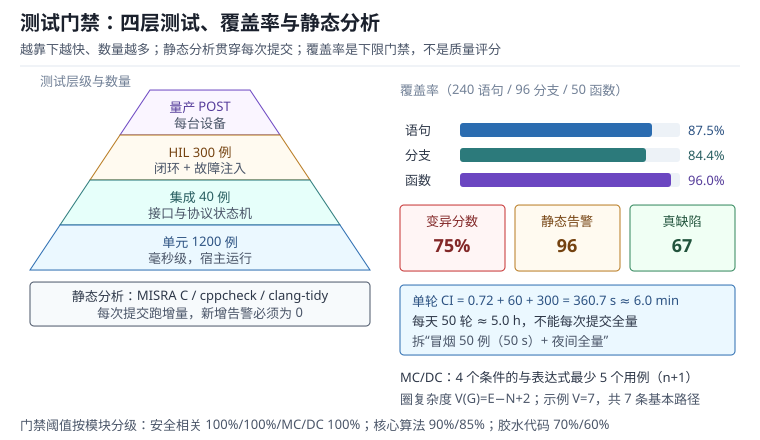

# 测试与静态分析：单元测试、MISRA C、覆盖率与 HIL

“这个模块我测过了”在工程现场至少有三种含义：点过一遍界面、跑过几个单元测试、在真实硬件上带载运行过。三者的置信度差了两个数量级，但它们在周报里长得一模一样。等现场出现一个“每 3000 次调用错一次”的缺陷，团队才发现：单元测试只覆盖了正常路径，静态分析的告警被批量抑制，HIL 从来没做过故障注入。

测试与静态分析不是“证明代码正确”，而是**用可重复的手段提高发现缺陷的概率，并让残余风险可度量**。单元测试回答“这个函数在给定输入下是否返回预期值”，静态分析回答“代码是否违反了语言与规范层面的约束”，覆盖率回答“测试到底碰到了多少代码”，HIL 回答“整个系统在真实时序与真实负载下是否还成立”，量产自检回答“这一台设备出厂时是否健康”。五件事各管一段，缺一段就会留下一种特定的漏网缺陷。

本章把五件事拆开：先建立测试层级与门禁的概念，再给出覆盖率、MC/DC、圈复杂度、缺陷去除效率的可复算定义，然后用七个算例走一遍从单元测试到量产自检的账，最后讨论 Unity/CMock 的工程组织、MISRA 偏差管理与 CI 门禁。与构建工具链的关系见[工具链与调试](../basics/toolchain-debug.md)；与看门狗和复位取证的关系见[可靠性与看门狗体系](reliability.md)；与 Bootloader 镜像校验的关系见[Bootloader 与 OTA](../storage/bootloader-ota.md)。

## 1. 动机：三种“测过了”

::: motivation 三个现场
**现场一：语句覆盖 100%，分支覆盖 50%。** 一个保护函数写成 `if (over_temp) { shut_down(); } log_status();`。测试只跑了 `over_temp=1` 的情况，两行语句都执行了，语句覆盖率 100%；但 `over_temp=0` 的分支从未执行。上线后设备在正常温度下反复关机——`over_temp` 标志在初始化时没有清零，正常路径从未被验证。

**现场二：MISRA 全绿，逻辑仍然错。** 静态分析工具报了 300 条告警，团队用 280 条 `// cppcheck-suppress` 压到 0 条，构建全绿。但一个把 `uint16_t` 毫秒计数直接乘以 1000 的表达式仍然溢出：$65535\times1000$ 超出 32 位有符号范围，工具按规则查“类型不匹配”，查不出“业务上这个值会不会溢出”。

**现场三：台架通过，现场失控。** 电机控制在实验台上空载测试，阶跃响应漂亮；装到设备上带载后，电流环进入饱和，实际控制周期从 100 µs 变成 180 µs，积分项累积过量，开机第一次加速就过流。台架测试没有模拟负载，也没有测“最坏执行时间”，通过的是“功能”，不是“时序”。
:::

| 你想确认 | 先算 | 判据（工程经验值，非标准强制） |
|---|---|---|
| 语句覆盖 | $C_{stmt}=N_{exec}/N_{total}$ | 主干模块不低于 80% |
| 分支覆盖 | $C_{branch}=B_{exec}/B_{total}$ | 不低于 70%，安全相关 100% |
| MC/DC | 每个条件独立影响结果 | 安全等级高时 100% |
| 圈复杂度 | $V(G)=E-N+2$ | 单函数不超过 10~15 |
| 缺陷去除效率 | $DRE=N_{pre}/(N_{pre}+N_{esc})$ | 发布前不低于 90% |
| 变异分数 | $MS=N_{kill}/N_{mut}$ | 关键模块不低于 70% |
| 自检时间 | $T_{POST}=T_{crc}+T_{ram}+T_{io}$ | 小于启动预算的 20% |

**不算会摔在哪**，四个带数字的代价：

1. **把语句覆盖当分支覆盖。** 一个 240 条语句、96 个分支的模块，跑出 87.5% 的语句覆盖，分支只有 84.4%；剩下 15 个未执行分支里如果有 2 个是错误处理，缺陷就正好藏在“不会发生”的那条路上。
2. **测试只在宿主跑。** 宿主上的 `int` 是 32 位，目标机可能是 16 位；宿主上的 `volatile` 行为与编译器优化、中断时序都不同。未定义行为在宿主上“碰巧正确”，在目标机上就是随机崩溃。
3. **静态分析只追求零告警。** 96 条告警全部抑制，等于花 12.8 小时把 96 条线索扔掉；正确做法是分类、留痕、定期复审，而不是把告警数字刷成 0。
4. **没有 HIL 与故障注入。** 时序、负载、掉电、通信中断这些问题只在真实闭环里出现；台架测试通过不代表现场通过，缺的这段只能由现场故障来补课。

## 2. 直观：测试金字塔与门禁

### 2.1 四层测试，各管一段

嵌入式测试通常分四层，越往下越快、越往上越真实：

| 层级 | 运行环境 | 单次耗时 | 能发现 | 不能发现 |
|---|---|---|---|---|
| 单元测试 | 宿主 PC，mock 硬件 | 毫秒 | 算法、边界、错误处理 | 时序、寄存器、中断 |
| 集成测试 | 宿主或目标板 | 秒 | 模块间接口、协议状态机 | 真实负载与电气问题 |
| HIL | 目标板 + 实时仿真 | 分钟 | 时序、闭环、故障注入 | 机械与现场环境 |
| 量产自检 | 每台设备 | 毫秒到秒 | 焊接、存储、时钟、IO | 设计缺陷 |

静态分析不占一层，它是一条贯穿所有层的门禁：每次提交都跑，发现问题越早，修复成本越低。覆盖率也不是一层，而是“单元与集成测试的度量”。

### 2.2 单元测试：在宿主上把硬件变掉

单元测试的核心是**把被测试的 C 模块从硬件里拔出来**，在宿主上编译、链接、运行。做法有三类：

- **链接替换（Link-time Substitution）**：用 `-Wl,--wrap=HAL_ReadReg` 把对硬件的调用转到测试替身，原函数仍可被调用。
- **接口抽象（Interface Seam）**：模块不直接访问寄存器，而是通过 `hal_read()` 这样的函数指针或弱符号，测试时替换实现。
- **宏替换（Macro Seam）**：把寄存器访问封装成宏，测试时用不同的头文件替换。

Unity 提供断言与测试运行器，CMock 根据头文件自动生成 mock。一个典型测试的骨架是“准备—执行—断言”：

```c
#include "unity.h"
#include "control.h"
#include "mock_hal.h"

void setUp(void)    { mock_hal_Init(); }
void tearDown(void) { mock_hal_Verify(); }

void test_output_clamps_at_limit(void)
{
    /* 准备：传感器读到 5000，超过量程 4095 */
    HAL_ReadSensor_ExpectAndReturn(5000);

    /* 执行 */
    int16_t out = control_step();

    /* 断言：输出被限幅，不溢出 */
    TEST_ASSERT_EQUAL_INT16(4095, out);
}
```

这段代码有三个工程要点。第一，`setUp`/`tearDown` 保证每个用例独立，mock 的期望在 `Verify` 里统一检查。第二，测试的是**行为**（限幅），不是实现（调用了哪个函数）。第三，边界值 5000、4095 要来自需求，不是随手写的数字。

### 2.3 静态分析：在编译之前找错

静态分析工具分三类，能力互补：

- **语法与规则类**：Cppcheck、PC-lint Plus、Helix QAC，检查未初始化变量、空指针、数组越界、类型不匹配、不可达代码。
- **编译器前端类**：clang-tidy，基于 AST 做 `bugprone-*`、`cert-*`、`clang-analyzer-*` 检查，能跟踪跨函数的指针生命周期。
- **规范认证类**：MISRA C:2012 检查器，按规则编号报告偏离，通常与 PC-lint、Polyspace、Coverity 集成。

静态分析的输出不是“对错”，而是“可疑点”。工程上要区分三类：

1. **真缺陷**：必须修，例如未初始化指针、数组越界。
2. **误报**：工具不理解上下文，例如中断里修改的 `volatile` 变量被当成“从未赋值”。
3. **规范偏离**：代码正确但违反 MISRA 规则，例如为了访问寄存器而做整数到指针的强制转换。

三类要分别处理：真缺陷修代码，误报加带理由的抑制，规范偏离走偏差审批。把三类混在一起“全部抑制”，等于把静态分析变成形式主义。

### 2.4 覆盖率：三种口径，三种盲区

覆盖率回答“测试执行了代码的多少”，但“执行了”不等于“验证了”。三种常用口径的盲区不同：

- **语句覆盖（Statement Coverage）**：每行可执行语句是否执行过。盲区是分支：`if (x) a();` 只测 `x=1` 就覆盖了 `a()` 这一行，`x=0` 的分支没测。
- **分支覆盖（Branch/Decision Coverage）**：每个判定的真、假两个方向是否都走过。盲区是条件组合：`if (a && b)` 只测 `(1,1)` 和 `(0,0)`，两个分支都覆盖了，但 `b` 单独为假时是否会跳过 `a` 的副作用没有验证。
- **MC/DC（Modified Condition/Decision Coverage，修正条件判定覆盖）**：每个条件都能独立地影响判定结果。它抓的是“条件之间的耦合”，是 DO-178C Level A 与 ISO 26262 ASIL D 要求的口径。

覆盖率的价值在于**暴露没测到的代码**，而不是证明测到的代码正确。100% 覆盖的代码仍然可能逻辑错、边界错、并发错；但没有覆盖的代码一定没被测过。工程上把覆盖率当“下限门禁”，不当“质量评分”。

### 2.5 HIL：把真实时序与真实负载接进来

HIL（Hardware-in-the-Loop，硬件在环）把目标板接进一个实时仿真系统：仿真系统模拟传感器、执行器、负载与故障，目标板运行真实固件，双方的 IO 与总线按真实时序交互。它能发现三类宿主测试发现不了的问题：

- **时序**：中断延迟、任务抖动、最坏执行时间、通信超时。
- **闭环**：控制器与执行器的耦合、饱和、积分 windup、谐振。
- **故障**：掉电、通信中断、传感器断线、执行器卡死。

HIL 的测试用例要按“场景”组织，而不是按“函数”。一个场景包含初始状态、激励序列、预期输出与容差。故障注入是 HIL 的核心能力：用继电器断开传感器、用可编程电源拉低电压、用总线仿真器注入错误帧，观察系统是否按降级策略动作。

### 2.6 量产自检：每台设备出厂前的最后一道

量产自检（Power-On Self-Test，POST）在每台设备上电时运行，覆盖“这台设备本身是否健康”：

- **Flash CRC**：应用区与参数区校验，发现焊接、擦写、位翻转。
- **RAM March C-**：按模式遍历读写，发现 stuck-at、耦合故障。
- **时钟与 PLL**：用独立时钟源比对，发现晶振停振、PLL 失锁。
- **IO 回环**：GPIO 输出到输入、ADC 读基准、DAC 回读，发现焊接与短路。
- **通信回环**：UART/SPI/I2C 自收发，发现收发器与总线故障。
- **看门狗**：短超时自测，确认看门狗真的能复位。

POST 的设计原则是“快、可判定、可记录”：每项都有明确的通过阈值，失败要写进故障日志并进入降级或拒产，而不是只亮一个灯。

### 2.7 一张图看懂测试门禁



图的左侧是四层测试的数量级：单元测试 1200 个、集成 40 个、HIL 300 个场景、量产自检若干项；右侧是门禁指标：语句覆盖 87.5%、分支覆盖 84.4%、变异分数 75%、单轮 CI 68.2 s。读图时注意两件事：测试数量从上到下递增，单次耗时也递增；覆盖率高不等于缺陷少，变异分数才回答“断言是否真的能抓住错误”。

## 3. 定量：覆盖率、复杂度与缺陷效率

### 3.1 覆盖率的基本定义

语句覆盖与分支覆盖的定义很直接：

$$C_{stmt}=\frac{N_{exec}}{N_{total}},\qquad C_{branch}=\frac{B_{exec}}{B_{total}}$$

其中 $N_{exec}$ 是执行过的可执行语句数，$N_{total}$ 是可执行语句总数；$B_{exec}$ 是执行过的分支出口数，$B_{total}$ 是分支出口总数。单位都是“个”，结果是无量纲的比例。函数覆盖同理，用“被调用过的函数数 / 函数总数”。

这三个比例的分母必须来自同一份构建产物。用昨天的 `.gcda` 配今天的源码，会得到看似合理、实际错位的数字；覆盖率报告要带 commit 号与编译器版本。

### 3.2 MC/DC 与最少用例数

MC/DC 要求：对判定中的每个条件，都存在一对测试用例，使得**只改变这个条件的取值**，判定结果随之改变，且其他条件不变。对 $n$ 个条件组成的与/或表达式，最少用例数是：

$$N_{MC/DC,min}=n+1$$

这个 $n+1$ 的前提是“短路求值 + 单条件独立影响”。以 `A && B && C && D` 为例，5 个用例就能让每个条件独立影响结果：

| 用例 | A | B | C | D | 判定 |
|---|---|---|---|---|---|
| 1 | 1 | 1 | 1 | 1 | 真 |
| 2 | 0 | 1 | 1 | 1 | 假 |
| 3 | 1 | 0 | 1 | 1 | 假 |
| 4 | 1 | 1 | 0 | 1 | 假 |
| 5 | 1 | 1 | 1 | 0 | 假 |

用例 1 与用例 2 只改 A，结果从真变假，说明 A 独立影响；用例 1 与 3 只改 B；依此类推。4 个条件如果只测 `1111` 和 `0000`，判定结果变了，但无法证明 B、C、D 各自独立影响，不满足 MC/DC。

### 3.3 圈复杂度与基本路径

圈复杂度（Cyclomatic Complexity）衡量函数的控制流分支数：

$$V(G)=E-N+2P$$

$E$ 是控制流图的边数，$N$ 是节点数，$P$ 是连通分量数（单函数取 1）。对单入口单出口的函数，它等于“判定节点数 + 1”，也等于基本路径数。$V(G)=7$ 意味着至少需要 7 个用例才能覆盖所有基本路径（不含循环的组合爆炸）。

圈复杂度不是越低越好，而是“超过阈值就要拆分”。经验阈值：单函数 10 以下健康，10~15 需要说明理由，15 以上应拆分。中断处理函数与状态机可以放宽，但要有注释说明为什么复杂。

### 3.4 缺陷去除效率与缺陷密度

缺陷去除效率（Defect Removal Efficiency，DRE）衡量“发布前抓到了多少”：

$$DRE=\frac{N_{pre}}{N_{pre}+N_{esc}}$$

$N_{pre}$ 是发布前发现并修复的缺陷数，$N_{esc}$ 是发布后逃逸的缺陷数。DRE 90% 意味着每 10 个缺陷有 1 个流到现场。缺陷密度是每千行代码的缺陷数：

$$\rho_{def}=\frac{N_{def}}{KLOC}$$

$KLOC$ 是千行代码数。缺陷密度用于横向比较模块质量，不用于考核个人：不同模块的复杂度、变更频率、测试强度不同，直接比较没有意义。

### 3.5 测试时间与 CI 预算

一轮 CI 的时间是各层测试时间的和：

$$T_{CI}=N_u t_u+N_i t_i+N_h t_h+T_{setup}$$

$N_u$、$N_i$、$N_h$ 分别是单元、集成、HIL 用例数，$t_u$、$t_i$、$t_h$ 是单例耗时（单位 s），$T_{setup}$ 是环境准备时间。这个式子决定了“多久能合并一次”：如果一轮 30 分钟，团队一天只能合几次；如果 70 秒，每次提交都能跑。

### 3.6 变异测试：断言到底有没有用

变异测试在源码里注入小改动（把 `+` 改 `-`、把 `>` 改 `>=`、删一条语句），然后跑测试。测试失败说明变异被“杀死”，说明断言有效；测试仍通过说明变异“存活”，说明这段代码没有被真正验证：

$$MS=\frac{N_{kill}}{N_{mut}}$$

$N_{kill}$ 是被杀死的变异体数，$N_{mut}$ 是生成的变异体总数。变异分数比覆盖率更接近“测试有效性”，但计算量大，通常只对关键模块跑。

### 3.7 量产自检的时间预算

POST 的时间由各检查项相加：

$$T_{POST}=\frac{N_{flash}}{f_{crc}}+\frac{10N_{ram}c}{f_{cpu}}+T_{clk}+T_{io}$$

$N_{flash}$ 是 Flash 字节数，$f_{crc}$ 是 CRC 吞吐（字节/秒）；$N_{ram}$ 是 RAM 字节数，$c$ 是每次访问的周期数（March C- 取 2），$f_{cpu}$ 是 CPU 频率；$T_{clk}$、$T_{io}$ 是时钟与 IO 自检时间。这个式子用来判断“POST 会不会把启动时间拖过看门狗超时”。

## 4. 算例：七笔测试账

### 4.1 算例一：87.5% 的语句覆盖与 84.4% 的分支覆盖

条件：可执行语句 240 条，执行 210 条；分支出口 96 个，执行 81 个；函数 50 个，调用 48 个。

$$C_{stmt}=\frac{210}{240}=87.5\%,\qquad C_{branch}=\frac{81}{96}=84.375\%\approx84.4\%$$

$$C_{func}=\frac{48}{50}=96.0\%$$

语句覆盖比分支覆盖高 3.1 个百分点，差额来自“执行了语句但没有走完分支”的路径。剩余 15 个未执行分支要逐个确认：如果是错误处理，必须补用例；如果是编译开关，要在报告中排除并注明。

### 4.2 算例二：4 个条件为什么是 5 个用例

对 `A && B && C && D`，按 3.2 的表取 5 个用例。验证独立性：

- A：用例 1（真）与 2（假），只改 A；
- B：用例 1 与 3，只改 B；
- C：用例 1 与 4，只改 C；
- D：用例 1 与 5，只改 D。

每个条件都有一对“只改它、结果翻转”的用例，满足 MC/DC。若只做 4 个用例，必然有一个条件找不到独立对，覆盖率报告会指出“条件未独立影响”。3 个条件的表达式最少 4 个用例，5 个条件最少 6 个，依此类推。

### 4.3 算例三：圈复杂度 7 的函数

考察下面这个函数：

```c
int f(int a, int b)
{
    int r = 0;
    if (a > 0) r += 1;              /* 判定 1 */
    if (b > 0) r += 2;              /* 判定 2 */
    for (int i = 0; i < a; i++) {   /* 判定 3 */
        if (i % 2) r++;             /* 判定 4 */
    }
    while (b--) {                   /* 判定 5 */
        if (r > 10) break;          /* 判定 6 */
    }
    return r;
}
```

判定节点 6 个，$V(G)=6+1=7$，基本路径 7 条。测试至少需要 7 个用例覆盖基本路径；循环边界（`a=0`、`a=1`、`a` 很大）要单独加。若这个函数出现在中断里，循环上界还必须可证明有界，否则最坏执行时间无法估算。

### 4.4 算例四：一轮 CI 68.2 s

条件：单元 1200 例 × 0.6 ms，集成 40 例 × 1.5 s，HIL 300 例 × 25 ms，环境准备 0。

$$T_{CI}=1200\times0.0006+40\times1.5+300\times0.025=0.72+60+7.5=68.22\ \text{s}$$

按每天 50 次提交：

$$T_{day}=50\times68.22=3411\ \text{s}=56.85\ \text{min}$$

一天不到一小时，可以做到“每次提交都跑全量”。如果 HIL 用例涨到 3000 个、每个 50 ms，HIL 段就是 150 s，一轮超过 3.5 分钟；此时应把 HIL 拆成“冒烟 50 例”与“夜间全量”，而不是让每次提交都等 3.5 分钟。

### 4.5 算例五：96 条静态告警的 12.8 小时

条件：120 KLOC，告警密度 0.8 条/KLOC，误报率 30%，每条 triage 8 分钟。

$$N_{find}=120\times0.8=96,\qquad N_{real}=96\times0.7=67.2,\qquad N_{fp}=96\times0.3=28.8$$

triage 总时间：

$$T_{triage}=96\times8=768\ \text{min}=12.8\ \text{h}$$

67 条真缺陷、29 条误报。误报要加“带理由的抑制”，不是直接关规则；真缺陷按严重度排优先级，内存安全类先修。12.8 小时看起来多，但它是**一次性**的首次接入成本；稳定后每次提交只跑增量，通常几分钟。

### 4.6 算例六：75% 的变异分数说明什么

条件：关键模块生成 200 个变异体，测试杀死 150 个。

$$MS=\frac{150}{200}=75\%$$

剩下 50 个存活变异体要分类：如果是“等价变异”（改法不改变语义，比如 `i++` 改成 `i+=1`），可以忽略；如果是“断言缺失”（比如把 `>` 改成 `>=` 测试仍过），说明边界断言不够，要补用例。变异分数 75% 不算高，关键模块通常要求 80% 以上，安全相关模块要求 90% 以上。

### 4.7 算例七：POST 的 16.5 ms

条件：256 KB Flash，硬件 CRC 1 字节/周期，80 MHz；32 KB RAM，March C- 按字节 10N、每次 2 周期；时钟自检 2 ms，IO 自检 3 ms。

$$T_{crc}=\frac{256\times1024}{80\times10^{6}}=3.277\ \text{ms}$$

$$T_{ram}=\frac{10\times32768\times2}{80\times10^{6}}=8.192\ \text{ms}$$

$$T_{POST}=3.277+8.192+2+3=16.47\ \text{ms}$$

相对 300 ms 的启动预算只占 5.5%，可以接受。如果 Flash 没有硬件 CRC，软件查表按 10 周期/字节算，$256\times1024\times10/80\times10^{6}=32.8$ ms，总时间约 46 ms，仍可接受；再大就需要分块校验或后台校验。

## 5. 工程含义：工程结构、偏差管理与 CI 门禁

### 5.1 单元测试的工程结构

一个可维护的测试工程通常长这样：

```text
firmware/
  src/            control.c  sensor.c  protocol.c
  inc/            control.h  sensor.h  protocol.h
  test/
    unity/        unity.c  unity.h
    cmock/        cmock.c  cmock.h
    mocks/        mock_hal.c  mock_hal.h
    test_control.c
    test_sensor.c
    Makefile
```

三条约定让测试可持续：第一，测试与被测代码分目录，测试不进入量产镜像；第二，mock 由头文件自动生成，接口一变 mock 跟着变，避免“手写 mock 与真实接口漂移”；第三，每个模块一个测试文件，文件名与模块名对应，CI 能按变更文件选择测试集。

### 5.2 寄存器访问与链接替换

直接访问寄存器的代码在宿主上会段错误。常见做法是把寄存器访问收到一层薄薄的 HAL：

```c
/* hal.h */
uint32_t hal_read_reg(uint32_t addr);
void     hal_write_reg(uint32_t addr, uint32_t value);

/* control.c */
uint32_t status = hal_read_reg(ADC_BASE + ADC_ISR);
```

测试时用 CMock 生成 `mock_hal.c`，让 `hal_read_reg` 返回预设值。如果不想改代码结构，可以用链接器的 `--wrap`：

```bash
gcc -Wl,--wrap=hal_read_reg test_control.c control.c mock_hal.c -o test_control
```

`--wrap` 把对 `hal_read_reg` 的调用转到 `__wrap_hal_read_reg`，真实实现仍可通过 `__real_hal_read_reg` 调用。代价是构建脚本复杂、符号名不直观，适合“存量代码不好改”的场合，不适合作为长期架构。

### 5.3 静态分析的门禁配置

一个可落地的门禁分三步：

1. **全量基线**：首次接入跑全量，把 96 条告警分类、修复真缺陷、给误报加抑制、给规范偏离建偏差单。
2. **增量门禁**：之后每次提交只检查变更文件，新增告警必须为 0；历史告警数只降不升。
3. **定期复审**：每季度复审一次抑制列表与偏差单，确认理由仍然成立。

Cppcheck 的典型命令：

```bash
cppcheck --enable=all --inconclusive --std=c11 \
         --suppressions-list=suppressions.txt \
         --error-exitcode=1 src/
```

clang-tidy 的典型配置：

```yaml
Checks: 'bugprone-*,cert-*,clang-analyzer-*,-bugprone-easily-swappable-parameters'
WarningsAsErrors: 'bugprone-*,cert-*'
HeaderFilterRegex: 'src/.*'
```

两个工具都要固定版本。工具升级会带来新规则与新的误报，版本漂移会让“昨天全绿、今天 50 条”变成常态，团队很快学会忽略告警。

### 5.4 MISRA 偏差管理

MISRA 允许偏差（Deviation），但要求“有记录、有理由、有审批、有复审”。一条合格的偏差记录至少包含：规则编号、文件与行号、代码片段、为什么必须偏离、偏离的风险、替代控制措施、批准人与复审日期。

例如寄存器访问必须做整数到指针的转换，违反 Rule 11.4（对象指针与整数之间不应互转）。合格的偏差写法是：

```c
/* MISRA deviation: Rule 11.4
 * Reason: memory-mapped register access requires integer-to-pointer cast.
 * Risk: none, address is fixed by the MCU reference manual.
 * Mitigation: address constants are generated from the vendor header.
 * Approved: 2026-03-12, review: 2027-03-12
 */
#define REG32(addr) (*(volatile uint32_t *)(addr))
```

不合格的写法是 `// MISRA deviation` 一行了事，或者在全工程范围抑制整条规则。前者无法审计，后者等于删掉规则。

### 5.5 覆盖率的门禁阈值

阈值要按模块分级，而不是全工程一个数：

| 模块类型 | 语句覆盖 | 分支覆盖 | MC/DC |
|---|---|---|---|
| 安全相关（执行器、保护） | 100% | 100% | 100% |
| 核心算法 | 90% | 85% | 按需 |
| 通信与协议 | 85% | 80% | 按需 |
| 胶水代码、初始化 | 70% | 60% | 不要求 |

“按需”不是“不要求”，而是由安全分析决定。阈值一旦定下，要写进 CI 配置，并用“变更行覆盖率”（diff coverage）防止新代码拉低整体数字。整体覆盖率 87.5% 但新提交的 200 行只有 40% 覆盖，这种“稀释”是常见漏洞。

### 5.6 HIL 的测试设计

HIL 用例按场景写，每个场景包含：初始状态、激励序列、预期输出、容差、终止条件。一个电机控制的场景可能是：

1. 母线 48 V，负载 0%，目标转速 1000 rpm，加速 2 s；
2. 在 1.2 s 时注入“传感器断线”故障；
3. 预期：200 ms 内进入降级，输出转矩限到 30%，故障标志置位；
4. 容差：转速超调不超过 10%，恢复时间不超过 500 ms。

故障注入要覆盖“传感器、执行器、通信、电源”四类，每类至少一个场景。HIL 的价值不在“跑通正常流程”，而在“故障时系统是否按设计动作”。

### 5.7 量产自检的判定与记录

POST 的每一项都要有通过阈值与失败动作：

| 检查项 | 方法 | 通过阈值 | 失败动作 |
|---|---|---|---|
| Flash CRC | 硬件 CRC32 | 与镜像头一致 | 拒产，记录扇区 |
| RAM | March C- | 无 stuck-at | 拒产，记录地址 |
| 时钟 | 内部 RC 比对 | 偏差小于 2% | 降级，禁用高精度功能 |
| ADC | 读内部基准 | 偏差小于 1% | 校准或拒产 |
| IO | 回环 | 全部通 | 记录引脚，拒产 |
| 看门狗 | 短超时自测 | 能复位 | 拒产 |

记录要带序列号、时间、温度与固件版本，便于追溯批次问题。

## 6. 常见坑

::: pitfall 坑一：语句覆盖 100%，分支覆盖只有一半
**现象**：覆盖率报告一片绿，代码评审也通过了，但错误处理分支从未执行；现场第一次触发保护就崩溃。

**原因**：只统计了“语句是否执行”，没有统计“判定的两个方向是否都走”。`if (err) { handle(); }` 只测正常路径时，`handle()` 这一行确实没执行，但如果错误处理写成 `if (err) log(); recover();`，`recover()` 在正常路径也会执行，语句覆盖仍是 100%。

**解决**：门禁同时看语句与分支；对每个 `if/else`、`switch`、循环出口列出用例；错误处理分支用故障注入强制进入。
:::

::: pitfall 坑二：mock 太多，测的是 mock 不是代码
**现象**：单元测试全绿，集成后接口全错；mock 的返回值与真实硬件行为不一致，测试通过但功能不通。

**原因**：把整个 HAL 都 mock 掉，测试只验证了“控制逻辑对 mock 的反应”，没有验证真实寄存器语义、时序与错误码。mock 的期望还是照着实现写的，等于用实现验证实现。

**解决**：mock 只替换“不可在宿主运行”的部分（寄存器、延时、中断），保留纯算法与协议解析；mock 的返回值来自数据手册与真实抓包，不来自被测代码；关键路径补集成测试与 HIL。
:::

::: pitfall 坑三：MISRA 告警批量抑制，构建全绿但风险未降
**现象**：静态分析报告从 300 条降到 0 条，团队庆祝；三个月后同一个模块出现空指针崩溃，回看报告发现那条告警被 `// cppcheck-suppress` 掉了。

**原因**：把“告警数”当 KPI，最省力的做法就是全部抑制。抑制没有理由、没有复审、没有范围限制，等于把静态分析关掉。

**解决**：抑制必须带规则号、理由、批准人与到期日；全工程级抑制禁止，只允许行级或文件级；每季度复审抑制列表；新增告警必须为 0，历史告警只降不升。
:::

::: pitfall 坑四：只在宿主跑测试，目标机的未定义行为漏网
**现象**：宿主上 1200 个单元测试全过；目标机上偶发“除法结果不对”“结构体对齐错”“中断里变量不更新”。

**原因**：宿主的 `int` 是 32 位、目标机可能是 16 位；宿主不优化、目标机 `-O2` 会把 `volatile` 缺失的变量缓存到寄存器；宿主没有中断，目标机的中断会打断读-改-写。

**解决**：单元测试同时用 32 位与 16 位模型编译；关键模块在目标机上跑集成测试；所有跨中断共享的变量加 `volatile` 并用原子操作；用 `-fsanitize=undefined` 在宿主上抓未定义行为。
:::

::: pitfall 坑五：覆盖率报告用了旧数据，数字虚高
**现象**：CI 显示覆盖率 92%，但新增的 300 行代码明显没测；本地重跑只有 78%。

**原因**：`.gcda` 文件没有清理，旧运行的计数与新源码混在一起；或者覆盖率只统计了部分测试二进制，漏掉了失败的测试。

**解决**：每次 CI 从干净目录构建；覆盖率报告绑定 commit 与编译器版本；用 diff coverage 检查变更行；报告里同时给出“总数”和“本次变更”两个数字。
:::

::: pitfall 坑六：HIL 只测正常流程，故障注入缺席
**现象**：HIL 跑了 300 个场景全过，现场第一次通信中断就死机；日志显示任务在等一个永远不会来的应答。

**原因**：HIL 用例集中在“正常激励—正常响应”，没有注入断线、超时、错误帧、掉电。系统的降级路径从未被执行过。

**解决**：每类故障至少一个场景；用继电器断线、总线仿真器注入错误帧、可编程电源拉低电压；断言不仅看输出，还要看故障标志、降级等级与恢复时间。
:::

## 7. 自测题

<details><summary>题一：240 条语句执行 210 条，96 个分支执行 81 个，覆盖率各是多少？差额说明什么？</summary>

$$C_{stmt}=\frac{210}{240}=87.5\%,\qquad C_{branch}=\frac{81}{96}=84.375\%$$

语句覆盖比分支覆盖高 3.1 个百分点。差额说明有 15 个分支出口没走到，但对应的语句可能已经被其他路径执行过。要逐个列出这 15 个出口，确认是错误处理、编译开关还是死代码；错误处理必须补用例，死代码要删除或注明。

</details>

<details><summary>题二：`A && B && C` 的 MC/DC 最少几个用例？给出用例表并说明独立性。</summary>

$n=3$，最少 $n+1=4$ 个用例：

| 用例 | A | B | C | 判定 |
|---|---|---|---|---|
| 1 | 1 | 1 | 1 | 真 |
| 2 | 0 | 1 | 1 | 假 |
| 3 | 1 | 0 | 1 | 假 |
| 4 | 1 | 1 | 0 | 假 |

A 的独立性由 1 与 2 证明，B 由 1 与 3，C 由 1 与 4。每个条件都有一对“只改它、结果翻转”的用例。注意短路求值：用例 2 中 B、C 不会被求值，但 MC/DC 只要求“独立影响”，不要求每个条件在每个用例里都被求值。

</details>

<details><summary>题三：4.3 节的函数圈复杂度是多少？基本路径测试至少几个用例？</summary>

判定节点 6 个：`a > 0`、`b > 0`、`for` 的 `i < a`、`i % 2`、`while` 的 `b--`、`r > 10`。

$$V(G)=6+1=7$$

基本路径 7 条，至少 7 个用例覆盖。实际测试还要加循环边界：`a=0`、`a=1`、`a` 为最大有符号数；`b=0`、`b=1`、`b` 使 `r>10` 提前退出。边界用例不计入基本路径数，但必须补。

</details>

<details><summary>题四：发布前发现 180 个缺陷，发布后逃逸 20 个，DRE 是多少？如果逃逸 30 个呢？</summary>

$$DRE=\frac{180}{180+20}=90\%$$

逃逸 30 个：

$$DRE=\frac{180}{180+30}=85.7\%$$

DRE 从 90% 降到 85.7%，意味着现场缺陷增加 50%。DRE 的统计口径要固定：只统计“确认是缺陷”的问题，不把需求变更、环境问题算进去；否则数字会被稀释。

</details>

<details><summary>题五：256 KB Flash、80 MHz、1 字节/周期 CRC，32 KB RAM、March C- 按字节 10N、每次 2 周期，POST 至少多少毫秒？</summary>

$$T_{crc}=\frac{256\times1024}{80\times10^{6}}=3.277\ \text{ms}$$

$$T_{ram}=\frac{10\times32768\times2}{80\times10^{6}}=8.192\ \text{ms}$$

$$T_{POST}=3.277+8.192=11.47\ \text{ms}$$

再加上时钟与 IO 自检（按 5 ms 估），约 16.5 ms。相对 300 ms 启动预算占 5.5%，可以接受；若 RAM 是 128 KB，March C- 段涨到 32.8 ms，总时间约 41 ms，仍可接受，但要看门狗超时是否覆盖。

</details>

## 8. 参考资料

- MISRA, *MISRA C:2012 Guidelines for the use of the C language in critical systems*，Directive 4.1 与 Rule 8.13、10.4、11.4、13.5、17.7、21.3（含 Amendment 1/2 与 Technical Corrigendum 1）。
- ThrowTheSwitch.org, *Unity Test Framework* 与 *CMock* 文档：TEST_ASSERT 宏、setUp/tearDown、mock 生成与 Expect/Return 接口。
- Cppcheck, *Cppcheck Manual*：--enable=all、--inconclusive、suppressions 与未初始化/空指针/越界检查范围。
- ISO 26262-6:2018 *Road vehicles — Functional safety — Part 6: Product development at the software level*，软件单元测试与软件验证章节中的语句覆盖、分支覆盖与 MC/DC 要求。
- RTCA DO-178C *Software Considerations in Airborne Systems and Equipment Certification*，软件验证过程与 Table A-7 结构覆盖分析。
- GCC, *gcov — a Test Coverage Program* 与 lcov/gcovr 文档：--coverage、分支计数与报告合并。
