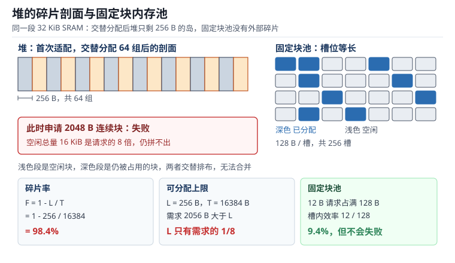

# RTOS 内存管理：静态分配、动态堆与固定块内存池

嵌入式系统里，内存从来不是"够不够"的问题，而是"什么时候、以什么代价、在多大块上"够的问题。同一句 `pvPortMalloc(512)`，在系统启动时几乎不会失败，在一次 8 小时连续运行的设备里却可能每天失败几次；代码没改，负载也没变，变的是堆的**形状**——空闲总量还很多，但都被切成了小岛。

这一章把内存管理拆成三个可以分别预算的对象：**静态分配**（编译期定尺寸，运行期零开销）、**动态堆**（首次适配或 TLSF，运行期可变但碎片不可控）、**固定块内存池**（尺寸固定，废一点空间换确定性）。三者不是新旧替代关系，而是同一份 SRAM 上的三种契约。理解契约的边界，才能在"内存够但分配失败"这种最反直觉的故障面前有据可依。

本章的堆与[Flash 与 EEPROM](../storage/flash-eeprom.md)里的持久化存储共享"按块管理"的思路，但介质特性完全不同：RAM 可以按字节写，Flash 不行。栈与任务的关系见[RTOS 调度](rtos-scheduling.md)，任务栈的溢出保护在[可靠性与看门狗体系](../practice/reliability.md)里与复位取证一起讨论。

## 1. 动机：内存问题总在量产阶段才爆

::: motivation 四个现场
**现场一：跑了五个多小时的设备死机。** 一台数据采集终端每隔 10 秒上报一次，每次 `pvPortMalloc(16)` 申请一个消息块，处理完忘了 `vPortFree`。堆总共 32 KiB，泄漏速率 1.6 B/s，也就是每小时 5760 B。32 KiB 撑 5.7 小时，于是"每天早上重启一次就好了，下午才死"——看起来像温度问题，实际是内存问题。现场排查时 `xPortGetFreeHeapSize()` 只剩 300 多字节，而 `xPortGetMinimumEverFreeHeapSize()` 记录的最低点早在几小时前就贴近 0。

**现场二：内存明明够，分配却失败。** 堆 32 KiB，已经申请了 4 个 8000 B 的缓冲区，释放了第 1 个和第 3 个。此刻空闲总量 16752 B，申请 12000 B 却返回空指针——因为最大的一块连续空闲只有 8008 B。空闲总量是请求量的 1.4 倍，仍然失败。日志里"free 16 KiB"这行数字骗了所有人。

**现场三：栈溢出踩坏的是堆。** 某个任务在中断里多嵌套了一层调用，栈向低地址方向溢出了 40 字节，正好落在堆区的第一个块头（Block Header）上。块头里的长度字段被改成一个巨大的数，下一次 `vPortFree` 时合并逻辑按这个长度遍历，把整条空闲链表写坏。现象是"随机在某次分配时 HardFault"，而堆的空闲统计数字看起来一切正常。

**现场四：中断里调用了不能睡眠的分配函数。** ISR 里为了拼一个应答帧调了 `pvPortMalloc`，在 heap_3 实现下它背后是 `malloc`，而 `malloc` 可能加锁；锁被任务持有时，中断永远等不到，看门狗复位。换成 heap_4 也不安全：分配器内部用挂起调度器的方式做互斥，在 ISR 上下文里这个前提不成立。
:::

| 你想确认 | 先算 | 判据（工程经验值，非标准强制） |
|---|---|---|
| 堆够不够 | $H_{peak}=H_{total}-H_{min}$ | 峰值占用低于总量的 70% |
| 最大块够不够 | $L \geq \lceil (s+h)/a \rceil a$ | 最大块大于最大单次请求的 1.5 倍 |
| 碎片严重不严重 | $F=1-L/T$ | 稳态低于 30%，突增说明有长寿命大块 |
| 会不会泄漏 | $t=H/(r f)$ | 连续 24 h 斜率小于 1 B/min |
| 栈余量够不够 | $M=W_{free}/W_{total}$ | 余量大于 30%，且含 FPU 栈帧 |
| 池要多大 | $n$ 个并发对象 × 块长 | 并发峰值 × 1.2 |

**不算会摔在哪**，四个带数字的代价：

1. **按"平均用量"估堆。** 平均占用 12 KiB 的系统，峰值可能到 28 KiB，因为峰值出现在"上报 + 存储 + 通信"三条路径同时持有缓冲区的那个瞬间。用 `xPortGetFreeHeapSize()` 采到的永远是采样时刻的值，必须用最低水位才能看见峰值。32 KiB 堆在峰值 31.7 KiB 时只剩 1024 B 余量，任何一次多申请 1 KiB 都会失败。
2. **忽略每次分配的固定开销。** 每个块要带 8 字节块头，长度还要向上对齐到 8 字节。申请 12 字节实际占 24 字节，效率 50%；申请 100 字节占 112 字节，效率 89.3%。一个"平均 40 字节"的队列项，按 48 字节算账，1 万个就是 480 KB 而不是 400 KB。
3. **把碎片当成"概率事件"。** 交替分配 64 组 256 字节对象再释放一半，空闲总量 16 KiB，最大块只有 256 B，碎片率 98.4%。此时任何大于 256 B 的请求都会失败，而系统中的"大块请求"往往就是最关键的通信缓冲。
4. **在中断里分配。** 分配器的最坏执行时间从几十周期变成"等锁 + 遍历"，而且在 ISR 里根本不该有阻塞路径。正确做法是在启动时把 ISR 需要的缓存一次性池化（Pooling），ISR 只做"取一个空槽"。

## 2. 直观：三种内存来源与它们的分界线

上图把同一段 32 KiB SRAM 画成了两种形态。左边是堆：64 组对象与它们的空隙交替排布，浅色是空闲块，深色是仍被占用的块。每个空闲块单独看都有 256 B，加起来 16 KiB，但因为中间夹着存活对象，它们永远无法合并。右边是固定块池：所有槽位等长，分配就是"从空闲链表取一个"，没有合并、没有遍历、没有碎片——代价是块大小写死，申请 12 B 也占满 128 B。

### 2.1 静态分配：链接期就写死的三段内存

静态分配（Static Allocation）指内存的位置和大小在编译链接阶段就确定：`.data` 放已初始化的全局变量，`.bss` 放未初始化的，栈由链接脚本里的 `_estack` 指定起点。RTOS 里的对应物是 `configSUPPORT_STATIC_ALLOCATION`：任务控制块、任务栈、队列、信号量都可以由调用者提供缓冲区，内核不再碰堆。

它的三个性质决定了适用面：

- **零运行期开销**。没有分配动作，没有块头，地址就是符号地址，取用是一条 `LDR`。
- **最坏执行时间可证**。因为根本没有"分配"这个动作需要证明。
- **失败在链接期暴露**。RAM 不够时链接器直接报错，而不是在现场等到某个凌晨。

代价是灵活性：静态分配的尺寸必须在编译时知道，且一旦分配就永久占用。对"最多 8 路、每路 1 KiB"的场景，静态分配就是 8 KiB 永远占着，哪怕实际只跑 2 路。

### 2.2 动态堆：从 sbrk 到 pvPortMalloc

动态堆（Dynamic Heap）把一段连续 SRAM 交给分配器管理。FreeRTOS 提供五种实现，差异只在"怎么找块"和"能不能合并"：

| 实现 | 查找策略 | 释放 | 合并相邻空闲块 | 典型用途 |
|---|---|---|---|---|
| heap_1 | 只递增指针 | 不支持 | 不适用 | 启动期一次性分配，之后不变 |
| heap_2 | 首次适配 | 支持 | 否 | 固定尺寸反复申请释放 |
| heap_3 | 包装 `malloc`/`free` | 支持 | 取决于 C 库 | 已有 C 库、非实时路径 |
| heap_4 | 首次适配 | 支持 | 是 | 通用首选 |
| heap_5 | 首次适配 | 支持 | 是 | 多段不连续 RAM |

`heap_4` 的每个块前有 8 字节块头（`pxNextFreeBlock` 与 `xBlockSize`），块大小按 8 字节对齐，释放时把相邻空闲块向前合并。**首次适配（First Fit）**从空闲链表头开始找第一个足够大的块——这意味着低地址的大块会被优先切碎，而高地址的大块得以保留。这个偏向性既是优点（大块存活率高）也是缺点（地址空间低端越来越碎）。

**TLSF（Two-Level Segregated Fit）**用两级位图解决了"查找时间随块数增长"的问题：第一级按 2 的幂分档（32 位下 5 位，即 32 档），第二级在每个档内按 1/16 细分（4 位，16 档），共 512 个尺寸类。分配时用 `CLZ` 指令算出请求所属的档，两级位图各取一次"最低非零位"，得到的就是最小可用块所在链表——**最坏执行时间是常数**，不随堆内块数增长。

TLSF 的代价藏在"向上取整"里：请求尺寸会被抬到尺寸类的边界，块内产生内部碎片，最多浪费该档宽度的 1/16。这也是后面算例里 TLSF 的碎片率反而略高的原因。

### 2.3 固定块内存池：用浪费换确定性

固定块池（Fixed-Block Pool，也叫内存分区，Memory Partition）把一段内存切成 $n$ 个等长槽位，用一条空闲链表串起来。分配就是从链表头摘一个节点，释放就是挂回去——两次指针操作，通常 10~20 个周期，且**与池的大小无关**。

它的性质几乎是堆的镜像：

- 没有外部碎片，因为所有块等长，任何一个空槽都能满足请求。
- 分配时间恒定，可以写进最坏执行时间分析。
- 内部浪费由块长决定：12 B 的请求放进 128 B 的槽，效率只有 9.4%。
- 池的容量上限在编译期确定，池满时返回空指针——这是一个**确定的**失败点，而不是"跑着跑着突然不行"。

工程上的常见用法是"按对象类型各建一个池"：通信帧池（64 B）、日志记录池（128 B）、传感器样本池（32 B）。每类对象的并发峰值是有限的、可测量的，池大小按峰值乘 1.2 定，失败就是真正的设计缺陷，而不是运气不好。

### 2.4 堆与栈的两个方向：边界在哪里

栈（Stack）和堆（Heap）通常放在同一片 SRAM 的两端，一个从高地址向低地址长（Cortex-M 的满递减栈），一个从低地址向高地址长。它们之间没有墙，只有一条"当前还没碰上"的虚线。

Cortex-M 的栈有两根指针：**MSP（Main Stack Pointer）**用于异常处理和启动代码，**PSP（Process Stack Pointer）**用于任务。RTOS 在任务切换时切换 PSP，异常进入时硬件自动切到 MSP。这意味着**每个任务有独立的栈**，而中断嵌套使用的是 MSP——中断的栈开销不属于任何任务，必须单独留出。

边界检查分三层：

1. **哨兵（Sentinel）**：任务创建时把整段栈填成 `0xA5A5A5A5`，运行一段时间后从栈底向上扫描连续未被改写的字数，剩余字数就是该任务的水位。这是事后测量，不是在线保护。
2. **运行时检测**：`configCHECK_FOR_STACK_OVERFLOW` 设为 2 时，内核在任务切换时检查栈指针附近的若干字节是否仍为 `0xA5`；被改写就调用 `vApplicationStackOverflowHook`。
3. **硬件保护**：用 MPU 在栈底划一条不可访问的区域，栈一旦越过就立刻触发 MemManage 异常。它把"随机数据损坏"变成"精确的故障地址"，是量产固件值得付的代价。

## 3. 定量：碎片率、水位与开销公式

### 3.1 碎片率：用最大块衡量，而不是用总空闲

最容易被误读的指标是"剩余多少 KB"。真正决定能不能分配的是**最大连续空闲块**，于是定义外部碎片率（External Fragmentation Ratio）：

$$
F = 1 - \frac{L}{T}
$$

- $F$：外部碎片率，无量纲，取值 $[0,1)$；$F=0$ 表示所有空闲内存连成一块。
- $L$：当前最大可用空闲块的字节数（Largest free block）。
- $T$：当前全部空闲字节数之和（Total free bytes）。

$F$ 越接近 1，说明空闲内存越"散"。它不区分是分配器切碎的还是对象生命周期造成的——两者在现象上一样，在治理手段上完全不同（前者换算法，后者改设计）。

反过来，一次大小为 $s$ 的分配能否成功，只看一条不等式：

$$
L \geq \left\lceil \frac{s + h}{a} \right\rceil a
$$

- $s$：请求字节数；$h$：每块固定开销（heap_4 为 8 B 块头）；$a$：对齐粒度（Cortex-M 上通常 8 B）。
- 不等式右边就是实际要从堆里切走的字节数，记作 $B(s)$。

把 $B(s)$ 代回，得到分配效率：

$$
\eta(s) = \frac{s}{B(s)}
$$

$s=12$ 时 $B=24$，$\eta=50\%$；$s=100$ 时 $B=112$，$\eta=89.3\%$。小对象多的时候，光块头和对齐就能吃掉一半内存。

### 3.2 堆水位：峰值只能从最低点反推

堆的瞬时空闲量是采样量，会骗人。真正有信息量的是历史最低空闲量，由 `xPortGetMinimumEverFreeHeapSize()` 记录：

$$
H_{peak} = H_{total} - H_{min}
$$

- $H_{total}$：堆总字节数（`configTOTAL_HEAP_SIZE`）。
- $H_{min}$：历史上出现过的最小空闲字节数。
- $H_{peak}$：峰值占用，也就是选型时真正要保证的量。

这与本章开头现场一的 32 KiB 堆对上：$H_{min}=1024$ B 时，$H_{peak}=32768-1024=31744$ B，占总量 96.9%。此时"还剩 1 KB"这句话的真实含义是"再要 1 KB 就崩"。

### 3.3 泄漏：用斜率反推耗尽时间

持续泄漏的系统，空闲量随时间是近似线性的。设单次泄漏 $r$ 字节、频率 $f$ 赫兹，则耗尽时间：

$$
t_{exh} = \frac{H_{total}}{r \cdot f}
$$

$r=16$ B、$f=0.1$ Hz（每 10 秒一次）时，$r f = 1.6$ B/s，$t_{exh}=32768/1.6=20480$ s，即 **5.69 小时**。这个数字和"下午必死"的现象精确吻合，反过来也说明：凡是运行时间与死机时间成正比的故障，先怀疑泄漏。

### 3.4 栈余量与池容量

任务栈余量用水位法测量：

$$
M = \frac{W_{free}}{W_{total}}
$$

- $W_{free}$：运行后仍为哨兵值的字数（每字 4 B）。
- $W_{total}$：栈总字数，$W_{total} = S/4$，$S$ 为栈字节数。
- $M$：余量比例，经验下限 30%；含浮点运算的任务要按 26 字异常栈帧重新算。

固定块池的容量则是一次乘法加一次向上取整：

$$
S_{pool} = n \cdot b, \qquad n = \lceil N_{max} \cdot k \rceil
$$

- $N_{max}$：该对象类型的并发峰值为 $N_{max}$；$k$ 为余量系数，取 1.2。
- $b$：单块字节数（含池自身链表指针），$S_{pool}$ 为池占用的总字节数。

## 4. 算例：从 32 KiB 堆到一次真实的分配失败

### 4.1 算例一：98.4% 的碎片率是怎么来的

场景：32 KiB 堆，交替申请与释放 256 B 的对象 64 轮，每次释放后让相邻的对象仍然存活。最终堆里有 64 个存活块、64 个空闲块，交替排布。

总空闲 $T = 64 \times 256 = 16384$ B。由于每个空闲块两侧都是存活块，无法合并，最大空闲块 $L = 256$ B。代入：

$$
F = 1 - \frac{256}{16384} = 1 - 0.015625 = 0.984375
$$

即 **98.4%**。此时申请 2048 B 需要 $B = \lceil (2048+8)/8 \rceil \times 8 = 2056$ B 的连续空间，而 $L=256$ B，$L$ 只有需求的 1/8，必然失败——尽管空闲总量是请求量的 **8 倍**。

这就是"内存够但分配失败"的最小可复现样本：把 64 组降到 32 组，碎片率仍是 98.4%；把对象从 256 B 放大到 1 KiB，碎片率不变但最大块变成 1 KiB，2000 B 的请求又能成功。**碎片率与请求尺寸的关系，比碎片率本身更重要。**

### 4.2 算例二：52.2% 的碎片率与 1.4 倍的总空闲

更接近真实的场景：32 KiB 堆，申请 4 个 8000 B 缓冲区。

- 每次实际切走 $B = \lceil (8000+8)/8 \rceil \times 8 = 8008$ B。
- 4 次共 $4 \times 8008 = 32032$ B，剩 $32768-32032=736$ B，成为第 5 个空闲块（大于最小块阈值 24 B）。
- 释放第 1 个和第 3 个后：空闲总量 $T = 8008 + 8008 + 736 = 16752$ B，最大块 $L = 8008$ B。
- 碎片率 $F = 1 - 8008/16752 = 0.5220$，即 **52.2%**。
- 现在申请 12000 B：需要 $B = 12008$ B，而 $L = 8008$ B，失败。空闲总量是请求量的 $16752/12008 = 1.40$ 倍。

注意 736 B 这个尾巴的来历：它不是"浪费"，而是对齐与块头的必然产物。任何按块管理的分配器都会在末尾留下小于最小块阈值的碎片（内部称为 Remblock），一部分实现会把它并入前一个块，heap_4 则保留为独立空闲块。

### 4.3 算例三：三种分配器在同一负载下的对比

用同一段随机负载（4000 次申请，尺寸服从对数分布，60% 在 16~72 B、32% 在 72~256 B、8% 在 256~1024 B，稳态并存 140 个对象）分别喂给三种策略，各跑 20 个随机种子取平均，堆总 32 KiB。结果：

| 策略 | 稳态块数 | 总空闲 $T$ | 最大块 $L$ | 碎片率 $F$ | 平均检索块数 |
|---|---|---|---|---|---|
| 首次适配（heap_4） | 171 | 14576 B | 10744 B | 31.0% | 80.1 |
| 最佳适配 | 161 | 14592 B | 10304 B | 33.6% | 158.8 |
| TLSF（1/16 尺寸类） | 161 | 14488 B | 9627 B | 37.1% | 常数（位图） |

三个结论都能从机制上解释：

1. **首次适配的碎片率最低（31.0%）。** 它总是从低地址切，高地址的大块被反复"留到最后"，所以最大块 $L$ 最大。这是一种"牺牲地址空间、保住大块"的偏好。
2. **最佳适配的检索代价翻倍（158.8 对 80.1）而碎片率反而略高。** 它每次挑最小的可用块，把块切得越来越碎，留下的残块小于最小分配阈值后就成了不可用碎片。教科书上"最佳适配碎片少"的说法在带合并的实现里并不成立。
3. **TLSF 的碎片率最高（37.1%），块数最少（161）。** 块数少说明合并积极；碎片率高来自"请求向上取整到尺寸类"的内部碎片——请求 1000 B 可能被抬到 1024 B 那一档，多出来的部分算在已分配里，于是总空闲变少、最大块变小。

**TLFS 的卖点从来不是省内存，而是可证的常数时间。** 在 140 个并存对象时首次适配平均要扫 80 个块、最坏扫满全表；TLSF 无论多少块都是"两次位图查找 + 一次摘链"。当分配发生在控制环路径上时，这个差别比 6 个百分点碎片率重要得多。

### 4.4 算例四：泄漏速率与水位交叉验证

现场一的数据：$r=16$ B、$f=0.1$ Hz，$t_{exh}=5.69$ h。反过来验算斜率：每 10 秒下降 16 B，即每分钟 96 B。如果日志里 24 小时的堆空闲曲线从 28800 B 线性降到 500 B，总降幅 28300 B，除以 24 h 得 1179 B/h，换算 $\Delta H/\Delta t = 0.33$ B/s——比 1.6 B/s 小，说明泄漏不是每次上报都发生，而是走了某条分支（例如只在"上报失败重试"路径上泄漏）。

水位法的价值就在这里：单次快照只能说"现在还够"，而**斜率 + 最低水位**能同时给出"什么时候不够"和"是不是一直在掉"。

### 4.5 算例五：栈水位 75.8%，该不该加栈

某任务栈配置 1 KiB（256 字），运行 10 分钟后停止，扫描哨兵发现从栈底起有 62 个字仍是 `0xA5A5A5A5`。

- 已用 $W_{used} = 256 - 62 = 194$ 字 $= 776$ B，占用 $776/1024 = 75.8\%$。
- 余量 $M = 248/1024 = 24.2\%$。

按 30% 的余量门槛，这个任务**不合格**。但直接加栈之前要先问：这个余量是在什么工况下测的？如果测试时没跑最坏分支（例如没触发过浮点路径、没遇到中断嵌套最深的那一次），24.2% 只是"当前路径"的余量。正确的做法是把三个最坏场景各跑一遍再取最小值：带 FPU 的异常栈帧是 26 字 = 104 B，比普通栈帧的 8 字 = 32 B 多出 72 B，正好能把 24.2% 吃成负数。

## 5. 工程含义：把分配变成可预算的设计

### 5.1 选型：三条判据决定用哪一层

| 判据 | 静态分配 | 固定块池 | 动态堆 |
|---|---|---|---|
| 尺寸在编译期已知 | 是 | 是（块长） | 否 |
| 需要运行期增删对象 | 否 | 是（数量可变） | 是 |
| 需要可证的最坏执行时间 | 是 | 是（常数） | 否（首次适配） |
| 对象尺寸分布集中 | 无所谓 | 是 | 否 |
| 失败必须可定位 | 链接期 | 池空（可断言） | 运行期任意点 |
| 内存利用率 | 最低 | 中 | 最高 |

落地时的默认组合是：**内核对象、通信缓冲、DMA 描述符全部静态或池化；只有初始化阶段的一次性大块配置用堆；运行期禁用堆分配**。这条规则不新鲜，但它是唯一能同时满足"最坏执行时间可证"和"故障可复现"的组合。

### 5.2 堆大小怎么定：从水位反推，而不是从用量平均

1. 打开 `configUSE_MALLOC_FAILED_HOOK` 与 `xPortGetMinimumEverFreeHeapSize`，先给一个偏大的堆（例如 48 KiB），跑完整业务循环 8 小时以上，覆盖上电、升级、告警、满负载四种工况。
2. 读 $H_{min}$。如果 $H_{min} < 0.15 H_{total}$，说明堆给得不够或分配模式有问题。
3. 按 $H_{peak} \times 1.3$ 定最终堆大小。32 KiB 堆下 $H_{peak}=31744$ B，乘 1.3 已经超过 32 KiB，这时候的结论不是"堆再放大"，而是"峰值占用 96.9% 说明有长寿命大块，应该把它搬进静态分配或专用池"。
4. 定完后把 `configTOTAL_HEAP_SIZE` 降回目标值，重跑，确认 $H_{min}$ 仍留有 30% 余量，且 $L$ 始终大于最大单次请求的 1.5 倍。

### 5.3 池的块长与数量怎么定

块长按"该类型对象的 95 分位尺寸"取整到 8 字节，不按平均值。128 B 的块装 100 B 的对象，效率 78%；如果对象尺寸分布是 20~110 B，用 128 B 块的总体效率仍在 70% 以上，而用 64 B 块会导致 40% 的对象放不下，必须再建一个池——两个池的复杂度往往比那点浪费更贵。

数量按并发峰值乘 1.2。并发峰值可以静态数出来：有 3 个任务可能同时持有帧缓冲，加上 2 个 DMA 在途，峰值就是 5，池开 6 个。**这个数必须能写进设计文档，否则就是没算过。**

### 5.4 内存够但分配失败：五条判据

遇到"空闲量显示够，分配却返回空"，按顺序查这五条，基本不会漏：

1. **最大块不够（最常见）。** 打印 $L$ 而不只是 $T$。若 $F > 60\%$，问题在碎片；若 $F$ 很低但 $L$ 仍不够，问题在"堆本来就小"。算例一的 98.4% 和算例二的 52.2% 都属于这一类。
2. **请求被块头和对齐放大。** 请求 12000 B 实际要 12008 B。差 8 B 就失败时，这 8 B 就是原因。把 $B(s)$ 打出来。
3. **堆的边界和你想的不是同一块 RAM。** 链接脚本里的 `_end`、`__HeapLimit`、`configTOTAL_HEAP_SIZE` 三者可能指向不同区域；使用 heap_3 时 `pvPortMalloc` 走的是 C 库的 `malloc`，`configTOTAL_HEAP_SIZE` 完全不生效，堆大小由链接脚本的 `heap` 段决定。用 `&ucHeap` 与 `sbrk(0)` 打印实际地址和长度即可确认。
4. **堆已被写坏。** 栈溢出、野指针、DMA 越界都可能改写块头。表现是 `vPortFree` 里的断言失败或链表遍历跑飞，而空闲统计看起来正常。检查方法：在块的头部与尾部各写一个哨兵字（例如 `0xDEADBEEF`），每次释放前校验；或在 MPU 里把堆区设为只读之外的权限，越界立刻触发异常。
5. **在错误上下文里分配。** ISR 或调度器挂起期间调用分配器，可能返回空（可重入保护）或直接破坏状态。规则是：ISR 只从池里取，`pvPortMalloc` 只在任务上下文、且不在临界区内使用。

### 5.5 观测手段：五个必须常驻的计数器

| 计数器 | 取法 | 用途 |
|---|---|---|
| $H_{free}$ | `xPortGetFreeHeapSize()` | 当前剩余，画曲线看斜率 |
| $H_{min}$ | `xPortGetMinimumEverFreeHeapSize()` | 峰值占用，定容量 |
| 分配失败次数 | `vApplicationMallocFailedHook` 里自增 | 失败是否已经发生 |
| 栈余量 | `uxTaskGetStackHighWaterMark()` | 每任务最小剩余字数 |
| 池空次数 | 池实现里自增 | 池容量是否够 |

这五个数在 1 Hz 打一行 CSV，比任何事后调试都快。现场一如果早有这条日志，"下午死机"会在第一天就被定位。

## 6. 常见坑

::: pitfall 坑一：栈溢出把堆写坏，报错却报在分配器
**现象**：设备运行数小时后随机 HardFault，故障地址落在 `prvInsertBlockIntoFreeList` 之类与业务无关的函数里；堆的空闲统计正常，但偶发 `pvPortMalloc` 返回空。
**原因**：某个任务栈溢出 40 字节，越界写入紧邻的堆块头，长度字段被改大；下一次合并按错误长度遍历，写穿整条空闲链表。
**解决**：把栈哨兵与块头哨兵同时打开，任务切换时检查；用 MPU 在栈底设不可访问区，让越界立刻变成 MemManage 异常而不是延迟损坏；任务栈按最坏路径的水位乘 1.5 配置，不要按"看起来够"配。
:::

::: pitfall 坑二：中断里调用 pvPortMalloc，偶发死锁
**现象**：通信压力大时系统整体卡死，看门狗复位；复现概率与 ISR 频率正相关。
**原因**：heap_3 背后是 `malloc`，可能持有 C 库锁；锁被任务持有时，ISR 永远等不到。heap_4 虽然不用锁，但内部依赖调度器挂起，在 ISR 上下文里前提不成立。
**解决**：ISR 一律不分配。启动时建立每类对象的固定块池，ISR 只做"取空槽/还空槽"；确实需要动态长度的，用预分配的环形缓冲加长度字段，把"分配"变成"占位"。
:::

::: pitfall 坑三：只盯空闲量，不盯最大块
**现象**：日志里一直显示"free 16 KiB"，但图像上传功能每天失败几次，重启后恢复。
**原因**：空闲总量够，最大连续块不够。图像缓冲需要 12 KiB 连续空间，而稳态碎片率 52%~98%，最大块只有 8 KiB 甚至 256 B。
**解决**：把最大块 $L$ 与碎片率 $F$ 一起打印；大块需求（图像、音频、OTA 缓冲）改用专用池或静态缓冲，不要和短寿命小对象共享同一个堆。
:::

## 7. 自测题

题一：32 KiB 堆，交替分配 64 组 256 B 对象后释放一半，碎片率是多少？此时申请 2 KiB 会怎样？

总空闲 $T = 64 \times 256 = 16384$ B。每个空闲块两侧都是存活块，无法合并，最大块 $L = 256$ B。

$$
F = 1 - \frac{L}{T} = 1 - \frac{256}{16384} = 0.9844
$$

即 98.4%。申请 2048 B 需要 $B = \lceil (2048+8)/8 \rceil \times 8 = 2056$ B，而 $L = 256$ B，$L$ 只有需求的 1/8，**必然失败**，尽管空闲总量是请求量的 8 倍。

结论：只看总量会得出"还很多"的错误判断；决定成败的是最大块。

题二：为什么最佳适配的碎片率可能比首次适配更高？推导它在什么条件下更差。

最佳适配每次选"最小的可用块"，会不断把块切成刚好装下的尺寸，剩余部分如果小于最小分配阈值就成了不可用碎片（Remblock）。首次适配固定从低地址切，高地址的大块长期不被触碰，最大块 $L$ 反而更大。

由于 $F = 1 - L/T$，在 $T$ 接近的情况下，$L$ 更大的一方 $F$ 更小。实测（20 个种子、140 个并存对象）首次适配 $F=31.0\%$、$L=10744$ B，最佳适配 $F=33.6\%$、$L=10304$ B，与推导一致。

反例条件：当对象尺寸高度集中、且远小于块尺寸时，最佳适配的残块仍然可用，两者会趋同；当大量小对象与少量大对象混跑时，最佳适配的劣势最明显。

题三：某设备每 10 秒泄漏 16 B，堆 32 KiB，多久耗尽？如果日志显示 24 小时空闲量从 28.8 KB 降到 0.5 KB，两者矛盾吗？

$r=16$ B、$f=0.1$ Hz，$rf = 1.6$ B/s：

$$
t_{exh} = \frac{32768}{1.6} = 20480\ \text{s} = 5.69\ \text{h}
$$

不矛盾。日志的斜率是 $(28800-500)/86400 = 0.328$ B/s，只有 1.6 B/s 的 20.5%，说明泄漏只在约 1/5 的上报中发生（例如只在重试分支上泄漏）。

工程含义：斜率给出"平均速率"，单次速率给出"哪条路径在漏"；两者结合才能定位到分支，只看其中一个会误判为"偶发"。

题四：任务栈 1 KiB，运行后剩 62 个哨兵字，余量多少？加了 FPU 之后为什么可能不够？

$W_{used} = 256 - 62 = 194$ 字 $= 776$ B，占用 75.8%，余量 $M = 248/1024 = 24.2\%$，低于 30% 门槛。

FPU 的影响在异常栈帧：Cortex-M4F 的异常自动压栈在启用浮点时会从 8 字变成 26 字，多出 18 字 = 72 B。如果测试工况没触发浮点异常路径，24.2% 的余量（248 B）在加入 72 B 后降到 17.2%，再叠加一层中断嵌套就会溢出。

做法：把 FPU 路径纳入最坏场景重测，按 26 字栈帧重算，并给中断嵌套单独留出 MSP 的空间（中断栈不在任务栈里）。

## 8. 参考资料

1. Richard Barry，《Mastering the FreeRTOS Real Time Kernel》Chapter 2 *Heap Memory Management*：heap_1~heap_5 的实现差异、块头结构、合并策略，以及 `xPortGetFreeHeapSize` 与 `xPortGetMinimumEverFreeHeapSize` 的语义。本章的 8 B 块头与 8 字节对齐取值来自该章源码说明。
2. M. Masmano, I. Ripoll, A. Crespo, J. Real, *TLSF: A New Dynamic Memory Allocator for Real-Time Systems*, ECRTS 2004：两级位图、512 个尺寸类、常数时间分配与碎片度量。本章 TLSF 的 1/16 二级细分为该文默认配置。
3. Jean J. Labrosse，《MicroC/OS-III The Real-Time Kernel》Chapter 17 *Memory Management*：固定大小内存分区的 `OSMemCreate`/`OSMemGet` 语义，分区内块等长、分配时间恒定。
4. ARM, *DDI 0403 ARMv7-M Architecture Reference Manual*, Chapter B1 异常模型与 Chapter B3 MPU：异常自动压栈 8 字、浮点扩展 26 字，以及栈底不可访问区域的配置方式。
5. Joseph Yiu，《The Definitive Guide to ARM Cortex-M3 and Cortex-M4 Processors》(3rd Edition) Chapter 4：AAPCS 栈对齐、MSP/PSP 分工与栈帧布局。
6. John Regehr, *Embedded in Academia* 关于堆分配最坏执行时间的系列笔记：首次适配的检索开销随块数线性增长，以及为什么实时系统偏好固定块分配器。
