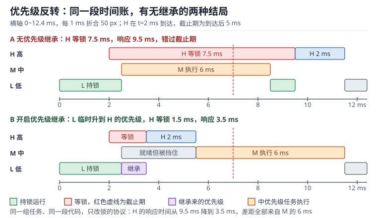

# 优先级反转与实时性：继承、天花板与微秒级抖动

优先级调度的全部意义是"高优先级任务想跑就能跑"。这条承诺有一个隐藏前提：**高优先级任务不会被低优先级任务挡住**。一旦两者共享资源，这个前提就失效了——高优先级任务必须等低优先级任务释放锁，而低优先级任务又可能被中优先级任务抢占，于是高优先级任务的等待时间不再由它自己决定。

这种现象叫优先级反转（Priority Inversion）。它最著名的后果是 1997 年火星探路者号（Mars Pathfinder）在着陆前反复复位：一个低优先级任务持锁时被中优先级任务抢占，高优先级任务等锁超时，看门狗触发复位。工程上修复它只需要一个配置项，但**能不能在事故前发现问题**，取决于你是否能量化阻塞时间与关中断带来的抖动（Jitter）。

本章把三件事算清楚：反转能把响应时间拉长多少、关中断在采样时刻上引入多少微秒级抖动、以及怎样用一根 GPIO 加一台逻辑分析仪把这些数字测出来。

前置阅读：[RTOS 调度](rtos-scheduling.md)（响应时间分析与优先级分配）、[同步原语](sync-primitives.md)（互斥量与临界区）、[中断与 NVIC](../mcu/interrupt-nvic.md)（中断延迟的硬件部分）。

## 1. 动机：反转为什么能搞垮系统

::: motivation 四个现场
**现场一：等锁时间随着系统负载增长。** 高优先级任务 H 每 10 ms 运行一次、每次 2 ms，截止期 5 ms。压测时它的响应时间从 2.1 ms 涨到 9.5 ms，而 H 自己的代码一行没改。根因是它等的那把锁被日志任务持有 1 ms，而日志任务在等锁期间被通信任务（6 ms）抢占——H 的实际等待时间等于"持锁剩余时间 + 所有中优先级任务的总执行时间"。

**现场二：控制环的采样时刻在抖，抖动 2 µs 却让相位裕度掉了 7°。** 20 kHz 电流环，采样周期 50 µs。示波器上一切正常，因为 2 µs 的抖动在时域上肉眼难辨；但把抖动代入环路相位，穿越频率 10 kHz 处损失 6.77° 相位裕度，原本 45° 的裕度掉到 38.2°，负载阶跃时开始出现振荡。

**现场三：中断延迟统计"平均 0.3 µs"，但最坏 4 µs。** 用 GPIO 翻转测出的平均值掩盖了尾部：平均值由 99% 的快速路径决定，而实时性由最坏 1% 决定。某次 ADC 转换完成中断恰好落在 1.07 µs 的关中断窗口内，叠加更高优先级 ISR 的 0.71 µs，采样值对应的时刻偏了 1.8 µs。

**现场四：修好了反转，却引入了新问题。** 打开优先级继承后，低优先级任务继承了高优先级，于是它持锁期间不能被中优先级任务抢占——中优先级任务的最坏响应时间反而变长（被"优先级继承阻塞"）。这不是 bug，是协议的固有代价：继承把延迟从高优先级转移到了中优先级。
:::

| 你想确认 | 先算 | 判据（工程经验值，非标准强制） |
|---|---|---|
| 会不会发生反转 | 是否有"低优先级持锁 + 中优先级可抢占" | 有共享锁就必须考虑 |
| 反转有多严重 | $B_i$ 与中优先级任务总执行时间 | 无协议时可达成百上千倍 |
| 最坏阻塞多少 | 继承：$\sum$ 持锁区间；天花板：$\max$ | 小于截止期的 20% |
| 关中断引入多少抖动 | $J=T_{off}+\sum C_{hp}+C_{save}$ | 小于采样周期的 1% |
| 抖动对环路的影响 | $\Delta PM=\omega_c J$ | 相位裕度损失 < 5° |
| 测出来的数可信吗 | 采样率、探头、翻转开销 | 测量误差 < 抖动的 5% |

**不算会摔在哪**，四个带数字的代价：

1. **把"平均延迟"当实时性指标。** 平均 0.3 µs、最坏 4 µs 的系统，平均值看起来优秀，但每次最坏情况都可能丢一个采样点，按 20 kHz 折算每秒 200 次。
2. **忽略中优先级任务的总量。** 反转的等待时间等于中优先级任务执行时间之和，而不是某一个任务。三个 2 ms 的中优先级任务就能让 H 多等 6 ms。
3. **以为"开了继承就万事大吉"。** 继承只保证"不因中优先级任务而无限延长"，不保证阻塞时间小于截止期；链式阻塞（多个低优先级任务依次持锁）仍可累加。
4. **测量方法本身引入误差。** 逻辑分析仪 100 MS/s 的 10 ns 采样间隔、GPIO 翻转的 2 周期开销、探头地线振铃，三者叠加可以让 2 µs 的抖动测出 ±0.1 µs 的偏差，足以把"超标"误判为"达标"。

## 2. 直观：反转、继承与天花板

### 2.1 反转发生的三个条件

优先级反转不是"任务设计得不好"，它有明确的触发条件，三个同时成立才会发生：

1. 高优先级任务 H 与低优先级任务 L 共享一个**互斥资源**（锁保护的临界区）。
2. L 先获得该资源，H 随后到达并阻塞等待。
3. 存在一个中优先级任务 M，它**不需要该资源**，但优先级高于 L，因此能抢占 L。

结果是 H 被 M 间接阻塞——H 的等待时长由 M 决定，而 M 与 H 毫无关系。第三个条件是关键：没有 M，L 会很快跑完临界区，H 只等一个临界区的时间；有了 M，H 的等待时间被"注入"了 M 的全部执行时间，且 M 可能有多个、可以被反复唤醒。

### 2.2 一段时序看清代价

同一组任务、同一段代码，只改锁的协议：

图中三个任务：

| 任务 | 周期 | 执行时间 | 说明 |
|---|---|---|---|
| H | 10 ms | 2 ms | t=2 ms 到达，相对截止期 5 ms |
| M | 20 ms | 6 ms | 不访问共享资源 |
| L | 50 ms | 4.4 ms（临界区 2.5 ms） | t=1 ms 加锁，t=3.5 ms 才可能跑完 |

**无继承（上半图）**：L 在 t=1 ms 加锁，t=2 ms 时 H 到达并阻塞，L 继续跑到 t=2.5 ms 被 M 抢占。M 跑 6 ms 到 t=8.5 ms，L 才恢复，用 1 ms 跑完临界区并在 t=9.5 ms 释放锁。H 从 t=9.5 ms 开始执行，t=11.5 ms 完成：

$$R_H=11.5-2=9.5\ \text{ms}>5\ \text{ms}$$

**有继承（下半图）**：t=2 ms 时 H 阻塞，内核发现锁的持有者 L 的优先级低于 H，于是把 L 的优先级临时提升到 H。t=2.5 ms M 就绪，但 L 现在是"H 的优先级"，M 抢不动它。L 用 1 ms 跑完临界区，t=3.5 ms 释放锁并恢复原优先级。H 立刻运行，t=5.5 ms 完成：

$$R_H=5.5-2=3.5\ \text{ms}\le5\ \text{ms}$$

两者的差距 6 ms 恰好等于 M 的执行时间。**继承协议做的事情，就是把"中优先级任务的执行时间"从 H 的等待时间里剔除出去。**

### 2.3 优先级继承协议

优先级继承协议（Priority Inheritance Protocol，PIP）的规则只有三条：

1. 任务持锁期间，若更高优先级任务请求同一把锁，持有者的优先级**提升到请求者的优先级**。
2. 持有者释放锁时，优先级**回落到它的原始优先级**（或回落到仍被阻塞的最高请求者优先级）。
3. 提升只在持锁期间有效，不影响任务的其他行为。

它的优点是实现简单（只在 `take`/`give` 的慢路径上加一次优先级比较与链表重排），不需要预先知道谁会用哪把锁；缺点是**只能压缩、不能消除阻塞**：

- **链式阻塞（Chained Blocking）**：H 等 L1 的锁，L1 又在等 L2 的锁，而 L2 被 L3 持有——H 要等整条链。
- **多重阻塞（Multiple Blocking）**：H 在一个响应周期内可能被多个不同的低优先级任务各阻塞一次，阻塞时间累加。

于是 PIP 下的阻塞界是"所有低优先级任务持锁时间之和"，而不是某一次的最大值。

### 2.4 优先级天花板协议

优先级天花板协议（Priority Ceiling Protocol，PCP）给每把锁预先指定一个**天花板优先级**，等于所有可能使用该锁的任务中的最高优先级。主流实现是**立即天花板（Immediate Priority Ceiling，ICPP）**：

1. 任务一旦获得锁，就立刻把自己的优先级提升到该锁的天花板——不等别人来请求。
2. 因此任何可能与之冲突的任务在**尝试加锁前**就会被挡住，不会出现"持锁者被中优先级任务抢占"的窗口。
3. 释放锁时恢复原优先级。

ICPP 的三条性质值得记住：

- **单次阻塞**：H 最多被一个低优先级任务的**一段**临界区阻塞，阻塞界是 $\max C_{k,crit}$ 而不是求和。
- **无死锁**：因为加锁顺序被天花板优先级强制成了全序，循环等待无法形成。
- **实现代价**：需要静态分析"谁会用哪把锁"来定天花板，动态创建锁或任务时容易算错；且它改变了任务的实际运行优先级，调试时容易看花眼。

| 协议 | 阻塞界 | 死锁 | 实现复杂度 | 适用 |
|---|---|---|---|---|
| 无协议 | 不受控 | 可能 | 无 | 不应使用 |
| 优先级继承 PIP | $\sum C_{k,crit}$（可多次、可链式） | 可能 | 低 | 通用，动态场景 |
| 立即天花板 ICPP | $\max C_{k,crit}$（单次） | 不可能 | 中，需静态分析 | 硬实时、锁集合固定 |
| 关中断（最粗暴的天花板） | 临界区长度，且影响所有任务 | 不可能 | 最低 | 极短临界区、与 ISR 共享 |

**关中断本质上是一种"最高天花板"**：它把所有任务的并发都排除掉，因此绝不会有反转，代价是把阻塞施加给了包括中断在内的所有执行流。这也解释了为什么"关中断保护"在短临界区上是对的，在长临界区上是灾难。

### 2.5 ISR 与任务的通信：三条路径的语义差异

中断服务程序（Interrupt Service Routine，ISR）不能阻塞、不能等锁，它把事件交给任务只有三条正路：

1. **队列（Queue）**：把数据复制进队列，任务在另一端取走。适合"必须一条不丢"的数据流。代价是复制开销与深度带来的时延。
2. **信号量（Semaphore）**：只告诉任务"有事发生了"，数据放在共享变量里由任务自己去取。适合"状态型"事件（新的一帧到了、DMA 完成了），不保证事件次数，多次触发会被合并。
3. **直接任务通知（Direct Task Notification）**：内核在每个任务的控制块里预留一个 32 位值和一个状态字，ISR 直接写目标任务的通知值并把它置为就绪。它是最快的路径——不经过队列、不经过链表，但**只能有一个接收者**，且多次通知会覆盖而非排队。

三者的选择不是风格问题，而是语义问题：数据要排队就必须用队列；只要"到没到"就用信号量或通知；点对点且只需要最新值就用通知。

## 3. 定量：阻塞时间、抖动与相位

### 3.1 阻塞时间界

PIP 下，任务 $i$ 的最坏阻塞时间为

$$B_i^{PIP}=\sum_{k\in lp(i)}\left\lceil\frac{R_i}{T_k}\right\rceil C_{k,crit}$$

ICPP 下为

$$B_i^{PCP}=\max_{k\in lp(i)}C_{k,crit}$$

符号说明：$lp(i)$ 为优先级低于 $i$ 的任务集合；$C_{k,crit}$ 为任务 $k$ 单次持锁区间的最长执行时间（s）；$T_k$ 为其周期（s）；$R_i$ 为任务 $i$ 的响应时间（s）。两式相差一个求和号——这就是"单次阻塞"与"多重阻塞"的量化差别。

代入一组具体值：低优先级任务 L1 持锁 0.5 ms、L2 持锁 0.7 ms、L3 持锁 0.3 ms，且 $R_i$ 小于所有周期（每个任务在一个响应窗口内最多持锁一次）：

$$B^{PIP}=0.5+0.7+0.3=1.5\ \text{ms},\qquad B^{PCP}=\max(0.5,0.7,0.3)=0.7\ \text{ms}$$

天花板把阻塞压到 46.7%（$0.7/1.5$）。这就是硬实时系统偏爱天花板协议的原因。

### 3.2 中断延迟与抖动的分解

中断延迟（Interrupt Latency）指"事件发生"到"ISR 第一条指令执行"的时间。它由四段组成：

$$L=L_{hw}+T_{off}+\sum_{j\in hp(i)}C_j+C_{save}$$

- $L_{hw}$：硬件响应，Cortex-M 固定 12 周期（含压栈），单位 s。
- $T_{off}$：当时正在执行的临界区的**剩余**关中断时间，0 到最长临界区之间。
- $\sum C_j$：更高优先级 ISR 的执行时间之和（它们会先跑完）。
- $C_{save}$：ISR 自身的软件保存（压寄存器、清中断标志），通常 8~16 周期。

抖动是延迟的最大值与最小值之差：

$$J=L_{max}-L_{min}=\left(L_{hw}+T_{off}^{max}+\sum C_j+C_{save}\right)-L_{hw}=T_{off}^{max}+\sum C_j+C_{save}$$

**抖动与延迟的区别**：延迟的固定部分（$L_{hw}$）不影响抖动，因为它对每次中断都一样；只有"变化的"部分才造成采样时刻漂移。这也解释了为什么优化硬件响应时间（12 周期→10 周期）对抖动毫无帮助，而缩短临界区立竿见影。

### 3.3 抖动对环路与采样的影响

对采样系统，抖动等价于**采样时刻的相位误差**。对频率为 $f_{sig}$ 的信号，相位误差为

$$\Delta\varphi=360^{\circ}f_{sig}J$$

对控制系统，抖动等价于**附加的相位滞后**。在穿越频率 $\omega_c$（rad/s）处：

$$\Delta PM=\omega_c J$$

符号说明：$\Delta PM$ 为相位裕度损失（rad，乘 $180/\pi$ 得度），$\omega_c=2\pi f_c$ 为开环穿越角频率（rad/s），$J$ 为抖动（s）。

这两条式子给出同一个工程直觉：**抖动本身没有绝对好坏，要看它相对于信号周期或环路带宽的比例**。1.88 µs 的抖动对 50 Hz 工频信号只造成 $360\times50\times1.88\times10^{-6}=0.034^{\circ}$ 的相位误差，可以忽略；对 10 kHz 的环路穿越频率却造成 6.77° 的相位损失，必须处理。

### 3.4 通信路径的时延

从"ISR 决定通知任务"到"任务执行第一条指令"，时延由两部分组成：ISR 内的提交开销 + 一次上下文切换（96 周期）。在 168 MHz、32 字节数据的条件下：

| 路径 | ISR 内开销（周期） | 加切换（96） | 总时延 |
|---|---|---|---|
| 直接任务通知 | 28 | 124 | 738 ns |
| 二值信号量 | 32 | 128 | 762 ns |
| 事件组置位 | 35 | 131 | 780 ns |
| 队列（32 B 复制） | 60 | 156 | 929 ns |

注意这是"最坏情况"的估算：若任务优先级高于被中断的任务，切换会在中断返回时立即发生；若低于，则要等当前任务让出，时延还要加上当前任务的剩余时间片。

### 3.5 测量：GPIO 翻转 + 逻辑分析仪

原理很简单：在待测区间的入口与出口各翻转一个空闲 GPIO，用逻辑分析仪记录边沿时刻，脉宽即区间长度。

**误差来源与量级**（168 MHz，1 周期 = 5.952 ns）：

| 误差源 | 量级 | 处理方式 |
|---|---|---|
| GPIO 翻转本身 | 2 周期 = 11.9 ns | 两侧各一次，脉宽测量中相互抵消 |
| 逻辑分析仪采样间隔 | 100 MS/s → 10 ns | 取 1 GS/s 降到 1 ns，或按 ±1 采样估计 |
| 探头与地线振铃 | 5~20 ns | 用弹簧地针，地线 < 1 cm |
| 编译器重排 | 不确定 | 翻转前后加内存屏障 |
| DWT 计数器读取 | 2~4 周期 | 直读 `CYCCNT`，误差 24 ns |

对 1.88 µs 的抖动，100 MS/s 的量化误差（两次边沿各 1 个采样）为 ±20 ns：

$$\varepsilon=\frac{2\times10\ \text{ns}}{1881\ \text{ns}}=1.06\%$$

可以接受。若抖动只有 200 ns，同样的设备误差变成 10%，必须换更高采样率或改用 DWT 的周期计数。

## 4. 算例

### 4.1 算例一：一次反转的完整时间账

**条件**：同 2.2 节的 H/M/L，另设 H 的截止期为到达后 5 ms。

**第一步，无协议。**

$$R_H=\underbrace{1.5\ \text{ms}}_{\text{L 剩余临界区}}+\underbrace{6\ \text{ms}}_{M}+\underbrace{2\ \text{ms}}_{C_H}=9.5\ \text{ms}$$

超时 4.5 ms，相当于截止期的 90%。

**第二步，开继承。**

$$R_H=\underbrace{1.5\ \text{ms}}_{\text{L 剩余临界区}}+\underbrace{2\ \text{ms}}_{C_H}=3.5\ \text{ms}$$

余量 1.5 ms，占截止期 30%。

**第三步，用阻塞界复核最坏情况。** 若 H 恰好在 L 刚加锁时到达，要等整个临界区 2.5 ms：

$$R_H^{worst}=2.5+2=4.5\ \text{ms}\le5\ \text{ms}$$

仍满足，但余量只剩 0.5 ms（10%）。这说明**设计时不能按"平均到达时刻"估，要按最坏相位估**。

**第四步，若再加一个低优先级任务持锁 0.6 ms**（PIP 会累加）：

$$R_H^{worst}=2.5+0.6+2=5.1\ \text{ms}>5\ \text{ms}$$

失败。改用天花板协议：$B=\max(2.5,0.6)=2.5$ ms，$R_H=4.5$ ms 恢复达标。这是"锁一多就必须换协议"的定量理由。

### 4.2 算例二：微秒级抖动预算

**条件**：20 kHz 采样（$T=50$ µs），168 MHz，最长关中断 180 周期，更高优先级 ISR 执行 120 周期，ISR 软件保存 16 周期。

**第一步，逐项换算。**

$$L_{hw}=12\times5.952=71.4\ \text{ns}$$
$$T_{off}^{max}=180\times5.952=1071.4\ \text{ns}$$
$$\sum C_j=120\times5.952=714.3\ \text{ns}$$
$$C_{save}=16\times5.952=95.2\ \text{ns}$$

**第二步，最坏与最好延迟。**

$$L_{max}=71.4+1071.4+714.3+95.2=1952.4\ \text{ns}$$
$$L_{min}=71.4\ \text{ns}$$

**第三步，抖动。**

$$J=1952.4-71.4=1881\ \text{ns}\approx1.88\ \mu\text{s}$$

占采样周期的比例：

$$\frac{1.881}{50}=3.76\%$$

**第四步，判断。** 3.76% 超过 1% 的工程判据，需要改善。若目标是把抖动压到 1% 以内（500 ns），需要压缩的总量为 $1881-500=1381$ ns，折合 232 周期。

**第五步，方案取舍。**

- 把最长临界区从 180 周期压到 60 周期：省 120 周期 = 714 ns，抖动降到 1167 ns（2.33%），仍不达标。
- 再把更高优先级 ISR 的 120 周期移出关键路径（改为置标志 + 延后处理）：再省 714 ns，抖动 452 ns（0.90%），达标。

**第六步，验证改造后的数。** $T_{off}=60\times5.952=357.1$ ns，$L_{max}=71.4+357.1+95.2=523.7$ ns（更高优先级 ISR 已移走），$J=452.3$ ns，占周期 0.90%。

### 4.3 算例三：抖动对相位裕度的影响

**条件**：10 kHz 穿越频率的电流环，抖动 1.881 µs，原相位裕度 45°。

**第一步，角频率。**

$$\omega_c=2\pi\times10^{4}=6.2832\times10^{4}\ \text{rad/s}$$

**第二步，相位损失。**

$$\Delta PM=6.2832\times10^{4}\times1.881\times10^{-6}=0.1182\ \text{rad}$$

换算成度：

$$0.1182\times\frac{180}{\pi}=6.77^{\circ}$$

**第三步，剩余裕度。**

$$45^{\circ}-6.77^{\circ}=38.2^{\circ}$$

低于 45° 的经验下限，阶跃响应会出现约 25% 的超调与 2~3 个周期的振荡。

**第四步，反推允许的抖动。** 若要求损失不超过 5°：

$$J_{max}=\frac{5\times\pi/180}{6.2832\times10^{4}}=\frac{0.08727}{6.2832\times10^{4}}=1.389\ \mu\text{s}$$

即抖动要压到 1.39 µs 以内。用 4.2 节的方案（1.167 µs）刚好满足，对应 4.20° 的损失。

**第五步，换算成"每 100 周期"的经验值。**

$$100\times5.952\ \text{ns}\times6.2832\times10^{4}\ \text{rad/s}=0.0374\ \text{rad}=2.14^{\circ}$$

在 10 kHz 穿越频率下，**每 100 个周期的关中断就吃掉 2.14° 相位裕度**——这个数字可以直接用于评审：如果你的临界区预算表里写着"最长 300 周期"，那就等于承诺了 6.4° 的相位损失。

### 4.4 算例四：通信路径选型

**条件**：编码器每 250 µs 产生一次位置更新（4 kHz），ISR 需要把 32 位计数值交给控制任务，控制任务优先级最高。

**方案 A：队列（32 B 结构体）。** 时延 929 ns，队列深度 8 占用 8×32=256 B 加控制块 80 B。

**方案 B：任务通知。** 时延 738 ns，零额外 RAM，但只保留最新值。

**第一步，算时延占比。** 方案 A：$929/250000=0.37\%$；方案 B：$738/250000=0.30\%$。两者都远小于周期。

**第二步，算最坏排队时延。** 若控制任务被更高优先级的故障处理短暂阻塞 50 µs，队列中最多积压 1 条（250 µs 一条），最坏时延 $50+0.929\approx51$ µs，仍在预算内。

**第三步，判断语义需求。** 编码器是**状态量**——控制任务只关心最新位置，中间值丢了不影响。因此通知更合适：省 336 B RAM、时延低 191 ns，且不会因为"队列满"而丢数据（它本来就只留最新值）。

**第四步，反例。** 若换成 UART 收到的命令帧（每条都要处理、不能丢），则必须用队列，且深度按"最长处理阻塞 / 帧间隔"取。此时 0.19 µs 的时延差异完全不重要，语义正确才是第一位的。

### 4.5 算例五：测量方案的不确定度

**条件**：逻辑分析仪 100 MS/s（10 ns 采样），测 1.881 µs 的抖动，GPIO 翻转 2 周期。

**第一步，量化误差。** 脉宽由两个边沿确定，每个边沿有 ±1 个采样（±10 ns）的不确定度，最坏 ±20 ns。

**第二步，翻转开销。** 两侧各 2 周期 = 11.9 ns，在差值中抵消；若只测单边（如 ISR 入口到某条指令），则必须扣除 11.9 ns。

**第三步，相对误差。** 脉宽测量时两侧翻转开销相互抵消，只剩量化误差：

$$\varepsilon=\frac{20}{1881}=1.06\%$$

若只测单边（例如从 ISR 入口到某条指令），翻转开销不抵消，需按方和根合成：

$$\varepsilon=\sqrt{\left(\frac{20}{1881}\right)^{2}+\left(\frac{11.9}{1881}\right)^{2}}=1.24\%$$

**第四步，结论。** 1% 的测量误差对"1.88 µs 是否超过 1 µs"这类判断足够；若要分辨 100 ns 级的改善，必须换 1 GS/s 采样（误差降到 0.11%）或改用 DWT 周期计数（分辨率 5.95 ns）。

## 5. 工程含义

| 设计决策 | 推荐做法 | 定量依据 | 代价 |
|---|---|---|---|
| 锁协议 | 通用任务用 PIP；硬实时且锁固定用 ICPP | 阻塞界 1.5 ms → 0.7 ms | ICPP 需静态分析 |
| 临界区长度 | ≤ 84 周期（20 kHz、1% 预算） | 每 100 周期 = 2.14° 相位 | 需拆分与双缓冲 |
| 采样抖动 | < 周期的 1% | 10 kHz 穿越下 1.39 µs 对应 5° | 重构 ISR |
| ISR 结构 | 只做"取数 + 通知"，处理放任务 | 直接通知 738 ns | 多一次切换 |
| 共享资源 | 能用消息传递就不用锁 | 消除阻塞与死锁 | 复制开销 |
| 测量 | GPIO + 逻辑分析仪，1 GS/s 或 DWT | 误差 < 1% | 需空闲引脚 |

**实施顺序**（按投入产出比排序）：

1. **先用 GPIO 量出三类时间**：最长关中断、ISR 执行时间、任务切换时间。没有这三个数，后面所有讨论都是猜。
2. **再建阻塞表**：列出每把锁的持有者、最长持锁时间、可能的请求者。把 $B_i$ 填进响应时间方程，看余量。
3. **然后决定协议**：若 $B^{PIP}$ 已使某个任务超时，先拆长临界区；拆不动再上天花板。
4. **最后做抖动预算**：把 $T_{off}$、$\sum C_j$、$C_{save}$ 列成表，与 1% 判据对比，逐项削减。

**关于"该不该开继承"的常见误解**：继承不是"更安全"，而是"把不受控的延迟变成有界但更大的延迟"。它对中优先级任务不利（会被低优先级持锁者挡住），对高优先级任务有利。若系统中没有任何任务会因为继承而超时，就该开；否则应改用天花板或重构。

## 6. 常见坑

::: pitfall 坑一：以为用了互斥量就没有反转
**现象**：压测时高优先级任务响应时间随负载线性增长，但代码里所有共享资源都用互斥量保护了。
**原因**：互斥量本身不消除反转，它只提供"可挂接继承协议"的载体。若创建时没有开启继承（FreeRTOS 的 `xSemaphoreCreateMutex` 默认开启，但 `xSemaphoreCreateBinary` 不是互斥量），或用了不支持继承的 RTOS 配置，反转照旧发生。
**解决**：确认锁对象的类型是"互斥量"而非"二值信号量"；确认内核配置里优先级继承已启用；用 GPIO 测量低优先级任务持锁期间被抢占的次数，非零即说明继承未生效。
:::

::: pitfall 坑二：只优化平均延迟，忽略尾部
**现象**：中断延迟统计平均 0.3 µs，测试报告显示"满足 1 µs 指标"，但现场偶发丢采样。
**原因**：平均值由 99% 的快速路径决定，实时性由最坏 1% 决定。最坏情况是"中断恰好落在最长临界区内 + 更高优先级 ISR 正在执行"，两者叠加可达 1.95 µs。
**解决**：统计最大值与 P99.9，而不是平均值；用逻辑分析仪连续抓 10^6 次中断，导出脉宽直方图；把最长关中断区间定位到具体函数。
:::

::: pitfall 坑三：测量本身把被测对象改变了
**现象**：加了 GPIO 翻转后，原本 1.2 µs 的区间测出 1.5 µs，且不同编译选项下差异很大。
**原因**：翻转语句被编译器重排到区间外；或翻转本身引入了总线等待（GPIO 在 APB 总线上，跨总线写有额外周期）；或调试器在半主机模式下拖慢了执行。
**解决**：翻转前后加 `__DSB()` 或内存屏障；用 BSRR 单次写而不是读-改-写；关闭调试器与半主机；用 DWT 交叉验证。
:::

::: pitfall 坑四：把继承当成万能药，中优先级任务被饿死
**现象**：开启继承后，高优先级任务达标了，但中优先级的通信任务开始丢帧，且丢帧时刻与日志落盘相关。
**原因**：继承让低优先级持锁者临时获得高优先级，它在持锁期间（含被继承放大的时间窗）挡住了所有中优先级任务。若持锁区间本身很长，中优先级任务被延迟的量等于该区间长度。
**解决**：拆短持锁区间是第一优先；其次评估中优先级任务的截止期是否还能满足；必要时改用天花板协议把阻塞集中到"加锁前的单次等待"，而不是"运行中被抢走"。
:::

## 7. 自测题

题一：H（T=10 ms，C=2 ms，截止期 5 ms）、M（C=6 ms）、L（临界区 2.5 ms）。H 在 L 加锁后 1 ms 到达。分别求无继承与有继承时的响应时间，并给出继承下的最坏阻塞界。

**无继承**：L 剩余临界区 1.5 ms，随后被 M 抢占 6 ms，H 共等待 $1.5+6=7.5$ ms，加上自身 2 ms：

$$R_H=7.5+2=9.5\ \text{ms}>5\ \text{ms}$$

**有继承**：L 升到 H 的优先级，M 无法抢占，H 只等剩余临界区 1.5 ms：

$$R_H=1.5+2=3.5\ \text{ms}\le5\ \text{ms}$$

**最坏阻塞界**：若 H 恰在 L 刚加锁时到达，$B=2.5$ ms，$R_H^{worst}=4.5$ ms，余量 10%。

题二：20 kHz 采样、168 MHz，最长关中断 300 周期，更高优先级 ISR 合计 60 周期，软件保存 16 周期。求抖动与占周期比例；若要求 <1%，需压缩多少周期？

$L_{hw}=12$ 周期忽略固定部分，抖动只含变化部分：

$$J=(300+60+16)\times5.952=376\times5.952=2238\ \text{ns}=2.24\ \mu\text{s}$$

占比 $2.238/50=4.48\%$。

要 <1%（500 ns），需把变化部分压到 $500/5.952=84$ 周期，即压缩 $376-84=292$ 周期。主要来源是 300 周期的关中断，必须拆分临界区或改用无锁结构。

题三：三把锁的持锁时间分别为 0.4、0.8、0.6 ms。PIP 与 ICPP 下的阻塞界各是多少？若某任务截止期 1.2 ms、自身执行 0.3 ms，哪种协议能过？

$$B^{PIP}=0.4+0.8+0.6=1.8\ \text{ms},\qquad B^{PCP}=\max(0.4,0.8,0.6)=0.8\ \text{ms}$$

PIP：$R=0.3+1.8=2.1$ ms > 1.2 ms，失败。
PCP：$R=0.3+0.8=1.1$ ms < 1.2 ms，通过（余量 8.3%，偏紧）。

结论：锁一多，协议选择直接决定能否达标；若必须用 PIP，则要把三把锁的持锁区间都拆到 0.2 ms 以下（$B=0.6$，$R=0.9$ ms）。

题四：4 kHz 编码器更新，ISR 要把 32 位计数值交给最高优先级任务。队列与直接通知的时延分别为 929 ns 与 738 ns，选哪个？若换成 UART 命令帧（每条必处理），又该怎么选？

编码器是**状态量**，控制任务只需要最新值，中间值丢弃无影响，因此选直接通知：时延低 191 ns、省 256 B 队列 RAM 与控制块，且不存在"队列满"分支。

UART 命令帧是**事件流**，每条都必须处理且顺序不能乱，必须用队列；深度按"最长处理阻塞 / 帧间隔"取，例如最长阻塞 20 ms、帧间隔 5.56 ms，则深度 $\lceil20/5.56\rceil=4$。

此时 191 ns 的时延差异可以忽略，语义正确（不丢帧、保序）比省 0.2 µs 重要得多。

## 8. 参考资料

- Lui Sha, Ragunathan Rajkumar, John P. Lehoczky, "Priority Inheritance Protocols: An Approach to Real-Time Synchronization," *IEEE Transactions on Computers*, 39(9), 1990, pp. 1175-1185（PIP 与 PCP 的阻塞界、单次阻塞性质与无死锁性证明）。
- Glenn E. Reeves, "What Really Happened on Mars," *Risks Digest*, 19(49), 1997（探路者号优先级反转的第一手复盘：低优先级任务持锁、中优先级任务抢占、看门狗复位、远程开启继承）。
- Giorgio C. Buttazzo, *Hard Real-Time Computing Systems* (3rd Edition)，Chapter 7 Handling of Shared Resources（阻塞时间界、天花板协议、死锁预防）与 Chapter 4（抖动对周期任务响应时间的影响）。
- Jean J. Labrosse, *MicroC/OS-III The Real-Time Kernel*，Chapter 13 Resource Management（继承与天花板两种实现、优先级恢复时机）。
- Joseph Yiu, *The Definitive Guide to Arm Cortex-M3 and Cortex-M4 Processors* (3rd Edition)，Chapter 8 Exception and Interrupt Handling（中断延迟组成、12 周期入栈、测量方法）。
- ARM, DDI 0403 *ARMv7-M Architecture Reference Manual*，Chapter B1 The Exception Model（异常优先级仲裁、尾链、晚到中断）。
- ARM, DUI 0553A *Cortex-M4 Devices Generic User Guide*，Chapter 2 The Cortex-M4 Processor 与 Chapter 4 NVIC（抢占、挂起、异常进入/返回周期）。
- Richard Barry, *Mastering the FreeRTOS Real Time Kernel*，Chapter 6 Mutexes（`configUSE_MUTEXES` 与继承行为）与 Chapter 9 Task Notifications（直接通知的实现与 32 位值语义）。
