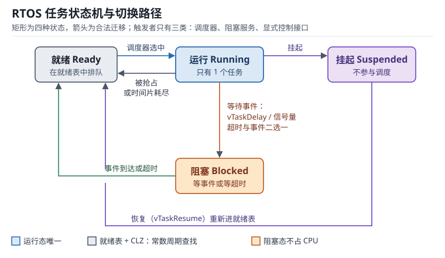

# RTOS 调度：任务状态机、优先级抢占与可调度性

裸机程序的主循环只有一个执行流，谁先跑由代码顺序决定。一旦系统里出现"每 1 ms 采一次 ADC""收到串口命令要在 5 ms 内应答""Flash 擦写不能挡住控制环"这三件事同时存在，顺序执行的假设就崩了：控制环被擦写阻塞 20 ms，串口应答被 ADC 缓冲打断，任何一处改动都可能把另一处的时序挤爆。

实时操作系统（Real-Time Operating System，RTOS）把"什么时候跑谁"从代码顺序里抽出来，交给一个内核（Kernel）按优先级决定。但调度器不是免费的：它要保存和恢复寄存器、要维护每个任务的栈、要在毫秒与微秒两个尺度上按你的假设分配 CPU。本章把这三笔账算清：一次切换花多少周期、每个任务要分多少栈、一组任务在给定周期下到底能不能全部按时完成。

读本章前建议先建立异常与中断的图景，见[中断与 NVIC](../mcu/interrupt-nvic.md)；任务切换最终落在 PendSV 异常与栈指针上，寄存器与特权级的背景见 [Cortex-M 内核](../mcu/cortex-m-arch.md)。

## 1. 动机：调度器决定了系统的上限

::: motivation 四个现场
**现场一：切换太频繁，CPU 被"搬运行李"吃掉。** 一个 168 MHz 的 Cortex-M4 系统，每 25 µs 切换一次任务（40 kHz 切换率），单次切换实测 96 周期。只看单次觉得"才 0.57 µs"，乘上频率后是 2.29 ms/s，也就是 2.29% 的 CPU 花在保存和恢复寄存器上；若任务里用了浮点，单次涨到 196 周期，这个数字变成 4.67%。它不报错、不崩溃，只是让所有任务的响应都变慢一档。

**现场二：栈开小了，崩溃点看起来毫不相关。** 某任务声明了 512 B 栈，实测峰值 480 B，看起来还有 32 B 余量。但中断嵌套最深处会在这条任务栈上再压 2 层 ISR 栈帧（每层 40 B），加上 8 字节对齐填充，峰值变成 568 B，溢出 56 B。溢出写坏的是相邻 TCB 的字段，现象是"另一个任务莫名不再被调度"，与栈毫无表面关系。

**现场三：优先级配了却没起作用。** 代码里给通信任务设了优先级 5、控制任务 6，期望控制任务随时抢占。但在 FreeRTOS 里数值越大优先级越高，6 本应高于 5；真正的原因通常是 `configMAX_PRIORITIES` 只配到 6（有效值为 0~5），6 被截断成 5，两个任务落进同一个内核优先级，调度器只能按时间片轮流跑。控制环的抖动从 0.4 µs 涨到 1 ms 量级。（“优先级分组”是 NVIC 中断优先级的概念，不能用来解释任务优先级。）

**现场四：算过利用率，但算错了口径。** 工程师把 5 个任务的 $C_i/T_i$ 加起来得到 0.90，对照"利用率不能超过 1"的判断认为没问题。但固定优先级抢占式调度的充分条件是 $n(2^{1/n}-1)$，5 个任务时只有 0.743；0.90 超出这个界，不代表一定失败，却代表"必须做响应时间分析才能下结论"。
:::

| 你想确认 | 先算 | 判据（工程经验值，非标准强制） |
|---|---|---|
| 切换开销 | $f_{sw}\cdot t_{sw}$ | 小于 2%；超过 5% 先怀疑任务切得太碎 |
| 任务栈够不够 | 上下文 + 局部 + 深度 × 帧 + ISR 嵌套 | 实测水位占用分配量 < 70% |
| 能否全部按时完成 | $U=\sum C_i/T_i$ 与 RMS 界 | 低于界可放行；高于界必须做 RTA |
| 最坏响应时间 | $R_i=C_i+\sum\lceil R_i/T_j\rceil C_j$ | 小于截止期，且余量 > 20% |
| 时间片粒度 | 一个 tick 的长度 | 小于任务单次工作量的 3 倍 |
| CPU 余量 | $1-U$ | 硬实时系统留 30% 以上 |

**不算会摔在哪**，四个带数字的代价：

1. **切换率估低一个量级。** 只按 SysTick 1 kHz 估，得出 0.057% 的开销；实际每个信号量唤醒、每次队列阻塞都触发切换，实测 8~12 kHz，开销是估值的 10 倍。
2. **栈深按"局部变量总和"估。** 局部变量只占实测栈水的 20%~40%，剩下的是调用帧、寄存器溢出（Register Spilling）、中断嵌套和库函数内部缓冲。按前者估会漏掉一半以上。
3. **把 RMS 界当必要条件。** 界是充分条件：低于界一定可调度，高于界只是"结论未知"。反过来，把 0.90 当成"必然失败"而砍功能，也是误用。
4. **忽略时间片的隐性成本。** 1 ms 时间片下，一个只需 200 µs 的任务仍会占满 1 ms 才让出，CPU 有效利用率掉到 20%，其余 800 µs 是空转。

## 2. 直观：任务状态机、就绪表与切换点

### 2.1 四种状态与合法迁移

每个任务在任一时刻只能处于一种状态，迁移由内核在明确的时刻完成，不存在"半运行"的中间态：

- **运行（Running）**：全系统唯一，正在使用 CPU 的那个任务。
- **就绪（Ready）**：条件都满足了，只差 CPU。就绪任务按优先级排队，同优先级按到达顺序排队。
- **阻塞（Blocked）**：在等一个事件——延时到期、信号量可用、队列有数据、事件位置位。阻塞态不占 CPU，也不参与优先级比较，这是 RTOS 相对"死等循环"最大的价值。
- **挂起（Suspended）**：被显式调用 `vTaskSuspend()` 冻结，既不参与调度也不因事件而就绪，只能被 `vTaskResume()` 解冻。调试、低功耗、故障隔离时用。

关键点在于：**阻塞是主动的，抢占是被动的**。任务调用 `vTaskDelay()` 或等信号量时主动交出 CPU，这是协作；而更高优先级任务就绪时把当前任务踢下去，这是抢占，当前任务无从拒绝。两者都经过同一条切换代码路径，因此开销相同。

### 2.2 就绪表：为什么调度是常数时间

调度器每次要回答"当前最高优先级的就绪任务是哪个"。线性扫描 32 个优先级要几十个周期，且随任务数增长；RTOS 的通行做法是**位图（Bitmap）+ 前导零计数（Count Leading Zeros，CLZ）**：

- 一个 32 位字 `uxTopReadyPriority`，第 $k$ 位为 1 表示优先级 $k$ 有就绪任务。
- 查找时一条 `CLZ` 指令得到最高位位置，再查 `pxReadyTasksLists[k]` 取链表头。
- 该操作固定 3~5 个周期，与任务数无关，这就是"调度开销与任务数无关"的来历。

FreeRTOS 的任务优先级**数值越大越高**，0 是最低优先级，`configMAX_PRIORITIES-1` 是最高；这与 Cortex-M 的 NVIC 中断优先级恰好相反——NVIC 的数值越小越高，两者容易混淆，见[中断与 NVIC](../mcu/interrupt-nvic.md)。若优先级数超过 32，位图扩展为多字数组，查找变成"先找非零字，再 CLZ"，仍是常数级但常数变大。

### 2.3 切换发生在哪里：SysTick、PendSV 与中断返回

Cortex-M 上的任务切换不是一个函数调用，而是两段异常的组合：

1. **触发**：SysTick 中断、`vTaskDelay()` 到期、信号量唤醒等场合调用 `taskYIELD()`，内核把 PendSV（可挂起的系统调用异常）置为挂起。
2. **延后**：PendSV 的优先级被设为**最低**，因此它不会打断任何正在执行的 ISR，而是等所有中断都退出后才执行。这一步保证了"切换不会发生在中断嵌套中间"。
3. **执行**：PendSV 处理程序保存当前任务的 R4~R11 到它的栈、把栈指针写回 TCB（Task Control Block，任务控制块）、调用调度器选出下一个任务、从新 TCB 取出栈指针并恢复 R4~R11。
4. **返回**：异常返回指令自动弹出硬件压入的 8 个字（R0~R3、R12、LR、PC、xPSR），CPU 从新任务的断点继续。

R0~R3、R12、LR、PC、xPSR 这 8 个寄存器由硬件压栈，R4~R11 由软件压栈——这个分工决定了后文 96 周期的账目。中断进入与返回的周期数推导见[中断与 NVIC](../mcu/interrupt-nvic.md)。

### 2.4 时间片：同优先级之间的公平

同一优先级有多个任务时，调度器按**时间片（Time Slice，也称时间配额）**轮转，粒度等于一个 tick（通常 1 ms）。规则是：

- 只有同优先级任务之间才轮转，不同优先级永远严格按优先级。
- 时间片用完时，当前任务被放到同优先级就绪链表的**尾部**，而不是头部——否则它会立刻又被选中，轮转失效。
- 任务主动阻塞或让出时，剩余时间片被清零，下次就绪重新计满。

时间片解决的是"同级任务饿死"，代价是切换次数增加。1 ms 时间片、3 个同级任务意味着最坏情况下每 1 ms 切换一次，与 40 kHz 的切换率相比可以忽略；真正的问题是**粒度太粗**——需要 200 µs 内响应的事件，在 1 ms 时间片下最坏要等 1 ms。

## 3. 定量：切换开销、栈深与可调度性

### 3.1 一次切换的周期账

以 STM32F407（Cortex-M4F，168 MHz，Flash 5 等待周期）为例，从"决定切换"到"新任务执行第一条指令"逐段计数：

| 阶段 | 周期数 | 说明 |
|---|---|---|
| 触发与分支到 PendSV | 6 | 写 ICSR、数据同步屏障、函数返回 |
| 硬件异常进入（8 字压栈） | 12 | ARMv7-M 固定开销，与对齐修正有关 |
| 保存 R4~R11 与 PSP | 10 | 10 条 STR，单周期存储 |
| 选择下一个任务 | 12 | 位图 + CLZ + 链表头 + TCB 解引用 |
| 更新 TCB 与栈指针 | 8 | 两次指针写 + 内存屏障 |
| 恢复新任务 R4~R11 | 10 | 10 条 LDR |
| 异常返回（8 字出栈） | 12 | 硬件固定开销 |
| 流水线重填与取指等待 | 26 | 实测补齐项，受 Flash 等待与分支预测影响 |
| **合计** | **96** | 单次切换 |

$$t_{sw}=\frac{96}{f_{CPU}}=\frac{96}{168\times10^{6}}=571.4\ \text{ns}$$

符号说明：$t_{sw}$ 为单次切换耗时，单位 s；$f_{CPU}$ 为内核主频，单位 Hz；分子 96 为周期数，无量纲。**这个数必须实测**：表里最后一项"流水线重填"随代码放置位置（Flash/ITCM/SRAM）、是否开 ART 加速器、是否命中分支预测而变，同一份代码在不同链接脚本下能差 30%。

若任务使用浮点，Cortex-M4F 的惰性压栈（Lazy Stacking）在真正保存 FPU 上下文时，会在 8 字基本帧之外再压入 17 个寄存器字（S0~S15 与 FPSCR）加 1 个对齐字，共 18 字 = 72 B；完整扩展帧是 26 字 = 104 B。实测单次切换从 96 周期涨到约 196 周期：

$$t_{sw}^{FPU}=\frac{196}{168\times10^{6}}=1.167\ \mu\text{s}$$

### 3.2 切换开销占比

切换开销占 CPU 的比例等于"每秒花在切换上的时间"：

$$\eta_{sw}=f_{sw}\cdot t_{sw}$$

其中 $f_{sw}$ 为每秒切换次数（Hz），$t_{sw}$ 为单次切换时间（s），$\eta_{sw}$ 为无量纲占比。

代入 168 MHz 下的 571.4 ns：

| 切换率 $f_{sw}$ | 每秒耗时 | $\eta_{sw}$（整数） | $\eta_{sw}$（带浮点，1.167 µs） |
|---|---|---|---|
| 1 kHz | 0.571 ms | 0.057% | 0.117% |
| 10 kHz | 5.714 ms | 0.571% | 1.167% |
| 40 kHz | 22.86 ms | 2.286% | 4.667% |
| 100 kHz | 57.14 ms | 5.714% | 11.67% |

判据：$\eta_{sw}<2\%$ 属于健康区间；2%~5% 要检查切换是否由过细的周期任务驱动；超过 5% 说明任务被切得过碎，每次运行时间已接近切换时间本身，应合并任务或改用事件驱动。

一个有用的等价换算：切换开销相当于"每个任务每次被调度都要交 96 周期的过路费"。若某任务每 1 ms 被唤醒一次、每次只干 20 µs 的活（3360 周期），过路费占它工作量的 2.9%；若它每次只干 2 µs（336 周期），过路费就占到 28.6%——后者是典型的"任务设计错误"，应改为在一个任务里顺序处理。

### 3.3 栈深估算

每个任务有独立的栈，深度必须覆盖"最坏情况下同时存在的所有栈内容"。估算式：

$$S_{req}=S_{ctx}+S_{loc}+d\cdot F_{call}+N_{isr}\cdot F_{isr}+S_{pad}$$

符号说明：

- $S_{ctx}$：上下文保存区。Cortex-M 硬件压栈 8 字 = 32 B，软件保存 R4~R11 = 32 B，合计 64 B；若用浮点，硬件压入的完整扩展帧是 26 字 = 104 B，其中已含 8 字基本帧，所以比基本帧多 18 字 = 72 B，$S_{ctx}(\text{FPU})=64+72=136$ B，而不是 $64+104=168$ B。
- $S_{loc}$：任务函数内所有局部变量、结构体副本、`printf` 类库函数的内部缓冲之和，单位 B。
- $d$：最长调用深度（函数嵌套层数，含中断里调用的函数），无量纲。
- $F_{call}$：单层调用帧的字节数，等于被调函数的局部变量 + 保存的寄存器 + 返回地址，典型 32~64 B。
- $N_{isr}$：中断帧落在**本任务栈上**的层数，**至少为 1**。异常进入总是把 8 字硬件帧压到异常前的 SP：任务用 PSP 时，即使 ISR 之后切到 MSP，第一层中断的硬件帧仍落在任务栈上（32 B；浮点扩展帧 104 B），不能因为“中断用 MSP”就记 0；只有更深的嵌套层切到 MSP 才不占任务栈，若全部使用 PSP 则每层都要计入。所以用 MSP 时取 $N_{isr}=1$，不要直接拿 ISR 嵌套总层数去乘 $F_{isr}$；只有全部 ISR 都用 PSP 时，$N_{isr}$ 才等于嵌套总层数。
- $F_{isr}$：单层 ISR 栈帧，含硬件压栈 32 B 与 ISR 自身局部变量。
- $S_{pad}$：对齐与余量。AAPCS 要求 8 字节对齐，另外按经验再留 25%~50%。

**这条式子只能给下界**，因为它假设你能穷举调用深度和所有库函数的内部缓冲——现实中往往不能。所以工程做法是"估算定初值，水位定终值"。

### 3.4 栈溢出的检测手段

栈溢出不会当场报错，它悄悄写坏相邻内存。四种检测手段按成本从低到高：

1. **填充图案（Pattern Fill）**：创建任务时把整个栈区填成 `0xA5A5A5A5`，运行一段时间后从栈底向上扫描连续未被改写的字数，得到**高水位（High Water Mark）**。FreeRTOS 的 `uxTaskGetStackHighWaterMark()` 返回的就是剩余字数。优点是零运行开销，缺点只能事后查，且无法捕获瞬时尖峰。
2. **栈底金丝雀（Canary）**：在栈底放一个魔数，切换时检查是否被改写。能捕获溢出但已经写坏了数据，属于"事后报警"。
3. **MPU 保护带（Guard Region）**：用内存保护单元把栈底下方 32 B 设为不可访问，溢出瞬间触发 MemManage 异常，能定位到出错的任务与 PC。Cortex-M3/M4 通常只有 8 个 MPU 区域，任务多时要复用。
4. **硬件栈限（PSPLIM）**：ARMv8-M（Cortex-M23/M33）提供 `PSPLIM` 寄存器，栈指针低于限值立即硬件异常，无需 MPU 区域，是成本最低的方案。

工程判据：**实测高水位占用不超过分配量的 70%**。低于 70% 说明有余量；高于 70% 时任何一次新增的 `printf` 或中断嵌套都可能击穿。分配量按实测峰值的 1.4~1.5 倍取整到 2 的幂。

### 3.5 RMS 利用率界与响应时间分析

速率单调调度（Rate Monotonic Scheduling，RMS）是最常用的静态优先级策略：**周期越短，优先级越高**。它的经典结论（Liu & Layland，1973）是：$n$ 个周期任务在单核、抢占、截止期等于周期、任务间无阻塞的假设下，若

$$U=\sum_{i=1}^{n}\frac{C_i}{T_i}\leq n\left(2^{1/n}-1\right)$$

则一定可调度。符号说明：$C_i$ 为第 $i$ 个任务的最坏执行时间（s），$T_i$ 为周期（s），$U$ 为 CPU 利用率（无量纲），$n$ 为任务数。$n\to\infty$ 时界趋于 $\ln 2\approx0.693$。

| $n$ | 1 | 2 | 3 | 4 | 5 | 8 | 16 | $\infty$ |
|---|---|---|---|---|---|---|---|---|
| 界 $n(2^{1/n}-1)$ | 1.000 | 0.828 | 0.780 | 0.757 | 0.743 | 0.724 | 0.708 | 0.693 |

这个界是**充分不必要**的。低于界，闭眼放行；高于界，什么都说明不了——可能仍然可调度（任务周期成整数倍关系时尤其常见），也可能已经失败。要下结论必须做**响应时间分析（Response Time Analysis，RTA）**，迭代求最小不动点：

$$R_i=C_i+\sum_{j\in hp(i)}\left\lceil\frac{R_i}{T_j}\right\rceil C_j$$

其中 $hp(i)$ 为优先级高于 $i$ 的任务集合，$\lceil\cdot\rceil$ 为向上取整——它统计在 $R_i$ 窗口内任务 $j$ 最多能执行几次。从 $R_i^{(0)}=C_i$ 开始迭代，若某一步 $R_i^{(k)}>T_i$ 则不可调度；若收敛到 $R_i^{(k)}=R_i^{(k-1)}$ 且不超过 $T_i$，则任务 $i$ 可调度。

::: advanced 进阶：利用率界的来历
界来自"最坏同步释放"情形：$n$ 个任务的第一个周期同时到达，此后各自按周期释放。此时若每个任务的执行时间按 $C_i=T_i(2^{1/n}-1)$ 取，总利用率恰好等于界，任何再多一点就会在某个临界时刻超时。把 $n$ 个任务的释放时刻构造成"每次都在前一个任务刚完成时到达"，能逼出界的最紧情形，所以它是充分条件的极限。周期成整数倍（调和）时，RMS 可达到 100% 利用率仍可调度，这正是"界保守"的直观解释。
:::

## 4. 算例：三笔账

### 4.1 算例一：切换开销占比

**条件**：168 MHz，8 个任务，SysTick 1 kHz，每个 tick 有 4 个任务因延时期满变为就绪（平均每次 tick 触发 4 次切换），另有 2 kHz 的通信任务因队列收发阻塞/唤醒（每次 1 次切换）。

**第一步，估切换率。**

$$f_{sw}=1000\times4+2000\times1=6000\ \text{Hz}$$

**第二步，单次切换时间**（无浮点）：$t_{sw}=571.4$ ns。

**第三步，占比。**

$$\eta_{sw}=6000\times571.4\times10^{-9}=3.428\times10^{-3}=0.343\%$$

**第四步，换算成绝对时间**：每秒钟 3.428 ms 花在切换上，占 1 s 的 0.343%。看起来很小，但它等价于"每个 tick 的 1 ms 里被扣掉 3.4 µs"，且这 3.4 µs 是**分散在最坏位置**的——若某个控制中断恰好落在这 96 周期里，它的响应被推迟 571 ns。

**第五步，浮点情形复核**：假设 8 个任务里有 3 个使用浮点，切换时约一半需要保存 FPU 上下文。用加权平均 $t_{sw}'=0.5\times571.4+0.5\times1167=869.2$ ns：

$$\eta_{sw}'=6000\times869.2\times10^{-9}=0.521\%$$

仍然健康。但若把 SysTick 提到 10 kHz（为了 100 µs 的调度粒度），tick 驱动的切换变成 $10000\times4=40000$ Hz，加上队列唤醒的 2000 Hz，切换率是 **42000 Hz**（不是 60000 Hz）：

$$\eta_{sw}''=42000\times869.2\times10^{-9}=3.65\%$$

无浮点口径为 $42000\times571.4\times10^{-9}=2.40\%$。3.65% 已落入 2%~5% 的检查区间。**这就是"tick 频率不能随便调高"的定量理由**：tick 从 1 kHz 提到 10 kHz，切换开销从 0.521% 涨到 3.65%，是 **7.0 倍**（不是 10 倍），而调度粒度只改善 10 倍——开销的绝对值仍然翻了 7 倍，收益却可以用事件驱动替代。

### 4.2 算例二：栈深与水位

**条件**：采集任务，无浮点，$S_{loc}=96$ B，最长调用深度 $d=5$，平均帧 $F_{call}=48$ B，中断嵌套 $N_{isr}=2$ 层、每层 $F_{isr}=40$ B。

**第一步，代公式（$S_{pad}$ 先取 0，算下界）。**

$$S_{req}=64+96+5\times48+2\times40+0=64+96+240+80=480\ \text{B}$$

**第二步，加余量。** 取 25%：$480\times1.25=600$ B。先向上取到 32 B 边界得 608 B，再取 2 的幂，分配 **1024 B**（256 字）——768 B 不是 2 的幂，不满足这条取整规则。

**第三步，水位验证。** 运行 24 h 压力测试后扫描填充图案，实测峰值 512 B：

$$\text{占用率}=\frac{512}{1024}=50.0\%<70\%$$

通过。同时注意：实测 512 B 比估算下界 480 B 高 6.7%，差值来自库函数内部缓冲与编译器寄存器溢出——**估算偏低是常态，方向是对的，量级需实测校准**。

**第四步，反例。** 若当初按"局部变量 + 估算"直接分配 512 B，则占用率 100%，任何一次多一层的调试打印就会溢出。溢出的 0 字节边界恰好落在相邻 TCB 的 `pxTopOfStack` 字段上，现象是"任务莫名不再被调度"。

### 4.3 算例三：五任务集的可调度性

**条件**（单位 µs，同一 168 MHz 平台，周期单调优先级，数字越小优先级越高）：

| 任务 | 周期 $T_i$ | 执行时间 $C_i$ | 利用率 $C_i/T_i$ | 优先级 |
|---|---|---|---|---|
| E（编码器采样） | 500 | 120 | 0.240 | 1（最高） |
| A（电流环） | 1000 | 200 | 0.200 | 2 |
| B（速度环） | 2000 | 300 | 0.150 | 3 |
| C（通信组帧） | 5000 | 800 | 0.160 | 4 |
| D（日志落盘） | 10000 | 1500 | 0.150 | 5（最低） |

**第一步，总利用率。**

$$U=0.240+0.200+0.150+0.160+0.150=0.900$$

**第二步，RMS 界。** $n=5$：$5(2^{1/5}-1)=5\times(1.148698-1)=0.7435$。$U=0.900>0.7435$，**界不通过，结论未知**，必须做 RTA。

**第三步，逐任务 RTA。**

E：$R_E=120\le500$，通过。

A：从 $R^{(0)}=200$ 起：

$$R_A=200+\left\lceil\frac{200}{500}\right\rceil\times120=200+120=320\le1000$$

再代一次 $R_A=200+\lceil320/500\rceil\times120=320$，不动点 320 µs，通过。

B：$R^{(0)}=300$：

$$R_B=300+\left\lceil\frac{300}{500}\right\rceil120+\left\lceil\frac{300}{1000}\right\rceil200=300+120+200=620$$
$$R_B=300+\left\lceil\frac{620}{500}\right\rceil120+\left\lceil\frac{620}{1000}\right\rceil200=300+240+200=740$$
$$R_B=300+\left\lceil\frac{740}{500}\right\rceil120+\left\lceil\frac{740}{1000}\right\rceil200=300+240+200=740$$

不动点 740 µs $\le$ 2000 µs，通过。

C：$R^{(0)}=800$：

$$R_C=800+2\times120+1\times200+1\times300=1540$$
$$R_C=800+\left\lceil\frac{1540}{500}\right\rceil120+\left\lceil\frac{1540}{1000}\right\rceil200+\left\lceil\frac{1540}{2000}\right\rceil300=800+480+400+300=1980$$
$$R_C=800+4\times120+2\times200+1\times300=1980$$

不动点 1980 µs $\le$ 5000 µs，通过。

D：$R^{(0)}=1500$：

$$R_D=1500+3\times120+2\times200+1\times300+1\times800=3360$$
$$R_D=1500+7\times120+4\times200+2\times300+1\times800=4540$$
$$R_D=1500+10\times120+5\times200+3\times300+1\times800=5400$$
$$R_D=1500+11\times120+6\times200+3\times300+2\times800=6520$$
$$R_D=1500+14\times120+7\times200+4\times300+2\times800=7380$$
$$R_D=1500+15\times120+8\times200+4\times300+2\times800=7700$$
$$R_D=1500+16\times120+8\times200+4\times300+2\times800=7820$$
$$R_D=1500+16\times120+8\times200+4\times300+2\times800=7820$$

不动点 7820 µs $\le$ 10000 µs，通过。余量 $10000-7820=2180$ µs，占周期 21.8%。

**结论**：$U=0.900$ 超过 RMS 界 0.7435，但整个任务集**可调度**，最紧的 D 还有 21.8% 余量。这就是"界保守"的具体数值证据。

**第四步，找真正的临界点。** 把 D 的执行时间从 1500 µs 加到 3500 µs，总利用率：

$$U=0.240+0.200+0.150+0.160+\frac{3500}{10000}=1.100>1$$

$U>1$ 是**必要**条件的破坏——CPU 的时间根本不够，无论怎么排优先级都必然超时，不需要再算 RTA。

### 4.4 算例四：时间片粒度

**条件**：1 ms tick，3 个同优先级任务，每个任务每轮需要 200 µs 的 CPU。

**第一步，理论上限。** 3 个任务轮转，每个每 3 ms 获得 1 ms：

$$\text{每任务 CPU 占比}=\frac{1}{3}=33.3\%$$

**第二步，有效工作量。** 但每个任务只需 200 µs，剩下 800 µs 它在空转（或主动让出）。若任务不主动让出，有效利用率：

$$\eta_{eff}=\frac{200}{1000}=20\%$$

**第三步，改成 tick 100 µs。** 每个任务每 300 µs 获得 100 µs，仍只需 200 µs 工作，于是它每次跑 100 µs 后被切走、下次再跑 100 µs——工作量不变，但切换次数涨了 10 倍。按 4.1 的口径（每个 tick 4 次唤醒 + 2 kHz 队列唤醒），切换率从 6 kHz 涨到 42 kHz，无浮点开销从 0.34% 涨到 2.40%。

**正确做法**：把三个任务合并为一个，或用事件驱动——数据到了才跑，跑完就阻塞。时间片的正确用途是"同优先级任务都不主动让出时的兜底公平"，不是"让短任务变快"。

## 5. 工程含义

| 参数 | 推荐取值 | 依据 | 代价 |
|---|---|---|---|
| tick 频率 | 1 kHz；需要 100 µs 级粒度的场合用 2~4 kHz | 切换开销 $f_{sw}t_{sw}$ 与粒度线性权衡 | 10 kHz 时开销 3.65% |
| 时间片 | 1 个 tick | 与 tick 同源，无需额外硬件 | 短任务空转 |
| 任务栈 | 实测峰值 ×1.5，取 2 的幂 | 水位 < 70% | RAM 占用 |
| 优先级级数 | 5~8 级 | 超过 8 级难以人工检查优先级反转 | 表达能力 |
| CPU 利用率 | ≤ 70% | 留 30% 应对突发与测量误差 | 硬件成本 |
| 任务数 | ≤ 12 | 每个任务至少 200~500 B RAM + 切换开销 | 可维护性 |

**tick 频率的选择**是一次纯定量权衡。tick 决定三件事：延时的分辨率、时间片的粒度、切换率的下界。1 kHz 下 `vTaskDelay(1)` 的实际延时在 0~1 ms 之间随机，平均 0.5 ms；若控制环要求 100 µs 的延时精度，tick 必须 ≥ 10 kHz，此时必须同时接受 3.65% 的切换开销，或者改用**无节拍（Tickless）**模式——空闲时关掉 SysTick，由下一个到期任务的绝对时刻编程一个单次定时器，唤醒时一次性补偿节拍计数。Tickless 把空闲期的切换率降到 0，代价是代码复杂度与低功耗模式唤醒延迟。

**优先级分配**的经验顺序是：硬实时周期任务按速率单调（周期越短越高）→ 软实时事件任务居中→ 后台任务最低。切勿按"重要性"拍脑袋，因为 RMS 的最优性只在速率单调下成立。若任务间有共享资源，还要叠加[同步原语](sync-primitives.md)带来的阻塞时间，见后文优先级反转的讨论。

**与中断优先级的关系**需要单独强调：任务优先级与中断优先级是两套编号，且 Cortex-M 的中断优先级数值越小越高，与多数 RTOS 的任务优先级方向相反。PendSV 必须设为最低中断优先级，SysTick 设为次低，外设中断高于两者——这样"中断永远能打断任务切换"，而"任务切换永远等中断做完"。配错这一条的现象是：偶发的、无法复现的任务延迟，且延迟时长恰好等于某个中断的执行时间。

**测量而不是相信纸面值**。三个必测项：

1. 切换时间：在 PendSV 入口和出口各翻转一个 GPIO，用逻辑分析仪读脉宽；或读 DWT（Data Watchpoint and Trace）的 `CYCCNT` 计数器相减。
2. 栈水位：跑满所有工况（含故障注入）后调 `uxTaskGetStackHighWaterMark()`。
3. CPU 利用率：空闲任务计数器 / 总 tick 数，或用 RTOS 自带的运行统计（需要额外一个高精度定时器）。

## 6. 常见坑

::: pitfall 坑一：任务栈"看着够"，跑一天后必挂
**现象**：设备连续运行 8~24 h 后随机死机或某个任务停止调度，复位后一切正常，复现困难。
**原因**：栈溢出写坏了相邻 TCB 或堆块头。溢出往往只在最坏路径上发生——某个错误分支调用了一次 `sprintf`，或中断嵌套比平时多一层。声明 512 B、平时用水位 400 B，最坏路径到 560 B。
**解决**：把栈填 `0xA5` 后跑满 24 h 再读水位；按实测峰值 ×1.5 分配；开启 `configCHECK_FOR_STACK_OVERFLOW=2` 或 MPU 保护带；把 `printf` 类调用移出任务上下文。
:::

::: pitfall 坑二：把 tick 提到 10 kHz 想"提高实时性"，结果整体变慢
**现象**：控制环抖动没改善，反而所有任务的响应时间都增加了 2.4%~3.7%，CPU 空闲率下降。
**原因**：tick 提高只改善**延时分辨率**，不改善**响应延迟**（后者由优先级与中断延迟决定）。切换率随 tick 线性上升，96 周期/次的过路费从 0.34% 涨到 2.40%，再叠加浮点保存到 3.65%。
**解决**：先用"事件驱动 + 阻塞等待"替代轮询与短延时；确实需要 100 µs 粒度时，用单次定时器或 Tickless 模式，不要无脑提高 tick。
:::

::: pitfall 坑三：优先级设了，抢占却没发生
**现象**：高优先级任务的就绪到运行延迟达到 1 ms 量级，且延迟值离散（0.2/0.5/1.0 ms）。
**原因**：三种可能——两者被分到同一抢占优先级（RTOS 的任务优先级相同）；调度器被 `taskENTER_CRITICAL()` 长时间关中断；或者该任务的阻塞调用带有超时，实际在等一个永远不来的事件，超时后才继续。
**解决**：打印每个任务的优先级与状态，确认数值确实不同；统计最长关中断时间（GPIO 翻转测量）；用 `vTaskDelayUntil` 替代 `vTaskDelay` 消除累积漂移。
:::

::: pitfall 坑四：RMS 界没过就砍功能，或界过了就以为万事大吉
**现象**：一边是"利用率 0.9 超界，把日志任务删了"；另一边是"利用率 0.6 在界内，上线后仍偶发超时"。
**原因**：界是充分条件，超界不等于失败（算例三已证明 0.900 可调度）；反之，界成立的前提是"无阻塞、无中断干扰、$C_i$ 为真实最坏值"。实际系统里有互斥量阻塞、有 ISR 抢占、有 Cache 未命中，$C_i$ 常被低估 20%~50%。
**解决**：超界时做 RTA 得到真实余量；在界内也要把 ISR 时间与阻塞时间按"虚拟任务"计入利用率；对 $C_i$ 做最坏路径测量（关闭 Cache 或用 `CYCCNT` 取最大值），不要用平均值。
:::

## 7. 自测题

题一：168 MHz、浮点任务、切换率 20 kHz，求切换开销占比；若要求该占比不超过 2%，切换率上限是多少？

单次切换 196 周期：

$$t_{sw}=\frac{196}{168\times10^{6}}=1.167\ \mu\text{s}$$

占比：

$$\eta_{sw}=20000\times1.167\times10^{-6}=0.02333=2.33\%$$

超 2%。上限：

$$f_{sw,max}=\frac{0.02}{1.167\times10^{-6}}=17138\ \text{Hz}\approx17.1\ \text{kHz}$$

即切换率必须降到 17 kHz 以下。工程上同时应减少浮点任务数量，或改用定点运算把 196 周期拉回 96 周期（此时上限升到 34.9 kHz）。

题二：某任务 $S_{loc}=128$ B，调用深度 6 层、帧 40 B，ISR 嵌套 2 层 × 32 B，无浮点。按 1.5 倍余量分配栈，取 2 的幂，应分多少？若实测水位 600 B，占用率是否达标？

下界：

$$S_{req}=64+128+6\times40+2\times32=64+128+240+64=496\ \text{B}$$

乘 1.5：$496\times1.5=744$ B，向上取 2 的幂得 **1024 B**（FreeRTOS 允许任意字数的栈，取 1024 是为了便于 MPU 区域对齐——MPU 要求基址与大小为 2 的幂且 ≥32 B）。

验算水位：$600/1024=58.6\%<70\%$，达标。若当时只分 768 B（744 向上取 32 B 的倍数），占用率 $600/768=78.1\%$，超判据——这说明"刚好装下"的分配在加上调试打印后必然不够，2 的幂的浪费其实换来了安全余量。

题三：三任务 $T=(4,8,16)$ ms，$C=(1,2,3)$ ms，速率单调。判断 RMS 界是否成立，再用 RTA 给出真实结论。

利用率：$U=1/4+2/8+3/16=0.25+0.25+0.1875=0.6875$。界：$3(2^{1/3}-1)=0.7798$。$0.6875<0.7798$，界成立，可调度。RTA 复核（优先级 1 周期 4 ms 最高）：

$R_1=1$ ms；$R_2=2+\lceil2/4\rceil\times1=3$ ms $\le8$；$R_3=3+\lceil3/4\rceil1+\lceil3/8\rceil2=3+1+2=6$，再代 $R_3=3+\lceil6/4\rceil1+\lceil6/8\rceil2=3+2+2=7$，再代 $R_3=3+\lceil7/4\rceil1+\lceil7/8\rceil2=3+2+2=7$，不动点 7 ms $\le16$ ms。

两者一致。注意此例周期成整数倍（调和），RMS 实际可到 100% 利用率仍可调度，界 0.78 显得保守。

题四：1 ms tick、5 个同优先级任务、每个每轮需 300 µs。求每任务获得的 CPU 占比与有效利用率；要让它"不浪费"，最小的 tick 应是多少？

轮转周期 $5\times1=5$ ms，每任务每 5 ms 得 1 ms：

$$\text{占比}=\frac{1}{5}=20\%$$

有效利用率 $=300/1000=30\%$。要"刚好够用"，时间片应 ≥ 300 µs，且为避免边界效应取 400~500 µs，对应 tick 2~2.5 kHz。此时每任务每 2 ms 得 0.4 ms，占 20%，工作量 0.3 ms，空转 0.1 ms（10%）。

更好的做法不是调 tick，而是让任务在 300 µs 工作完成后主动阻塞，把剩余时间片让出——此时 tick 保持 1 kHz，利用率不受影响。

## 8. 参考资料

- Joseph Yiu, *The Definitive Guide to Arm Cortex-M3 and Cortex-M4 Processors* (3rd Edition, ISBN 978-0-12-408082-9)，Chapter 10 OS Support Features（PSP/MSP 双栈、PendSV、SVC、上下文切换的寄存器分工）与 Chapter 12（异常返回与栈对齐）。
- Jean J. Labrosse, *MicroC/OS-III The Real-Time Kernel*，Chapter 5 Task Management（TCB 结构、任务状态、栈初始化）与 Chapter 6 Scheduling（就绪位图、`OS_PrioGetHighest()` 的 CLZ 实现、时间片轮转）。
- C. L. Liu and James W. Layland, "Scheduling Algorithms for Multiprogramming in a Hard-Real-Time Environment," *Journal of the ACM*, 20(1), 1973, pp. 46-61（利用率界 $n(2^{1/n}-1)$ 的原始推导与 RMS 最优性证明）。
- N. Audsley, A. Burns, M. Richardson, K. Tindell, A. Wellings, "Applying New Scheduling Theory to Static Priority Pre-emptive Scheduling," *Software Engineering Journal*, 8(5), 1993（响应时间分析的迭代不动点算法）。
- Richard Barry, *Mastering the FreeRTOS Real Time Kernel*，Chapter 3 Task Management（任务状态、优先级、时间片、`uxTaskGetStackHighWaterMark`）与 Chapter 4 Queue Management（阻塞与唤醒路径）。
- ARM, DDI 0403 *ARMv7-M Architecture Reference Manual*，Chapter B1 The Exception Model（异常进入 12 周期压栈、EXC_RETURN、栈对齐）与 Chapter B3 System Control Block。
- STMicroelectronics, RM0090 *STM32F405/407 参考手册*，Section 3.4 Embedded Flash memory（168 MHz 需 5 个等待周期，ART 加速器行为）。
