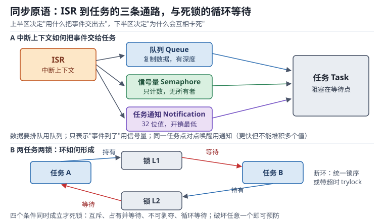

# 同步原语：临界区、互斥量、事件组与死锁预防

只要有两个执行流访问同一块内存，就有同步问题。主循环与中断抢一个缓冲区、两个任务抢一条 I2C 总线、三个任务往一个日志队列里写，这些都不是"小心一点"能解决的——它需要明确的协议：谁有资格进、进去之后别人怎么办、出来时通知谁。

RTOS 提供的同步原语（Synchronization Primitive）就是这些协议的实现。它们分成两族：**保护共享数据的**（临界区、互斥量、递归锁）和**传递事件与数据的**（二值信号量、计数信号量、事件组、队列/邮箱）。选错族的后果不是效率问题，而是保护失效或死锁。本章按"机制→开销→选型→失效"的顺序，把每一族原语落到可测的周期数与可算的阻塞时间上。

本章的阻塞与反转现象与[RTOS 调度](rtos-scheduling.md)中的可调度性分析直接相关；互斥量背后的优先级继承机制在[优先级反转与实时性](priority-inversion.md)中展开。

## 1. 动机：共享资源是并发的原罪

::: motivation 四个现场
**现场一：一个没保护的 32 位计数器。** 任务在 `ulCount++` 里读、加、写三步，中断恰好插在"读"之后，中断自己也改了这个变量，回到任务继续写回旧值——一次更新凭空丢失。这个 bug 在 1 kHz 中断下平均几秒钟出现一次，示波器看不出来，逻辑分析仪也抓不到，因为它是软件时序。

**现场二：用二值信号量保护共享结构，结果保护失效。** 二值信号量没有所有者概念：任何任务都能 `give`，包括从未 `take` 过的任务。于是"释放"可能提前发生，临界区被第二个任务闯进来。更麻烦的是它不参与优先级继承，高优先级任务被低优先级持锁者卡住的时间不受控。

**现场三：两个任务各持一把锁，互相等对方。** 任务 A 先锁 L1 再锁 L2，任务 B 先锁 L2 再锁 L1。正常运行几个月都没事，直到某次两个任务同时进入这段代码，系统整体卡死，看门狗复位。加打印、加断点都会改变时序，问题"消失"。

**现场四：临界区里做了一次 Flash 写。** 为了保护一小段配置结构，代码在 `taskENTER_CRITICAL()` 里调用了写 Flash 的函数，单次 3 ms。这 3 ms 内所有中断被屏蔽，控制环连续错过 60 个周期，电机直接失步。工程师以为是"驱动有问题"。
:::

| 你想确认 | 先算 | 判据（工程经验值，非标准强制） |
|---|---|---|
| 临界区能有多长 | $\rho T_{per} f_{CPU}$ 条指令 | 单次 ≤ 84 周期（20 kHz、1% 预算） |
| 关中断总占比 | $\sum N_i t_i / T_{obs}$ | 每毫秒累计 < 10 µs |
| 锁操作开销 | take/give 的周期数 | 无竞争 < 250 ns |
| 高优先级被阻塞多久 | $B_i$ 阻塞界 | 小于其截止期的 20% |
| 队列要多深 | 生产速率 × 最长消费者阻塞 | 时延 < 端到端预算的 1/3 |
| 死锁风险 | 加锁顺序是否唯一 | 全局锁序固定，或每任务只持一把 |

**不算会摔在哪**，四个带数字的代价：

1. **临界区按"就几行代码"估。** 一行 `memcpy` 是库函数，64 字节在 168 MHz 上约 180 周期（1.07 µs），足以让 20 kHz 控制环的采样点偏移 2%。
2. **锁开销被忽略。** 每次 `take` 无竞争 40 周期（238 ns），有竞争 136 周期（809 ns）。一个每 100 µs 就要抢一次锁的任务，光锁开销就占 0.24%~0.81%，这还没算持锁者被抢占带来的等待。
3. **阻塞时间不受控。** 用二值信号量保护共享资源时，高优先级任务的等待时间等于"低优先级任务持锁期间被所有中等优先级任务抢占的总时长"，可以是几毫秒，而设计假设是几十微秒。
4. **死锁概率被低估。** 两个任务各自按随机顺序获取 $k$ 把锁时，死锁概率约为 $1-1/k!$；$k=2$ 就有 50%，$k=4$ 高达 95.8%。"我们从来没死锁过"通常只说明两段代码还没同时执行过。

## 2. 直观：两族原语与它们的边界

### 2.1 临界区与关中断：硬件提供的原子性

所有软件同步最终都依赖一条硬件保证：**关中断期间不会发生上下文切换**。Cortex-M 提供三个寄存器来做这件事：

- **PRIMASK**：置 1 后屏蔽所有可配置优先级的中断，只留 NMI 与 HardFault。`__disable_irq()` / `__enable_irq()` 操作它。这是"最粗暴但最有效"的屏蔽。
- **BASEPRI**：写入一个优先级阈值，**只有优先级数值大于等于该阈值的中断被屏蔽**，数值更小（更高优先级）的中断照常响应。这是 Cortex-M 相对早期内核的关键改进——你可以屏蔽"普通中断"而保留电机保护、故障保护这类最高优先级中断。
- **FAULTMASK**：屏蔽包括 HardFault 在内的所有异常（NMI 除外），只在极端场合用。

临界区（Critical Section）的代价就是这段屏蔽时间：屏蔽期内到达的中断不会丢，但会**挂起等待**，等开中断后按优先级补上。因此单个临界区的长度直接加到所有中断的响应延迟上。这与[中断与 NVIC](../mcu/interrupt-nvic.md)中"关中断时长决定抖动"的结论是同一件事的两面。

判断该用哪种保护，只需要问一个问题：**被保护的数据会被中断访问吗？**

- 会 → 必须用关中断（或 BASEPRI）。互斥量在中断里根本不能 `take`，任务持锁时中断照样能闯进来。
- 不会，只在任务之间 → 用互斥量，让调度器帮忙，别长时间关中断。

### 2.2 互斥量 vs 二值信号量：所有权是分水岭

两者在 API 上长得几乎一样（`take` / `give`，或 `pend` / `post`），语义却完全不同：

| 维度 | 二值信号量（Binary Semaphore） | 互斥量（Mutex） |
|---|---|---|
| 所有者 | 无，任何上下文都能 give | 有，只有 take 成功的任务能 give |
| 初始状态 | 常为 0（等事件）或 1（放行） | 常为 1（锁可用） |
| 用途 | ISR→任务的事件通知、任务间握手 | 保护共享资源 |
| 优先级继承 | 不支持 | 支持（可配置） |
| 递归获取 | 不支持 | 支持（递归互斥量） |
| 能否在 ISR 中使用 | give 可以（FromISR 版本） | 不能 |
| 释放顺序 | 无关 | 必须由所有者释放，否则报错 |

一句话区分：**信号量传递的是"事件发生了"，互斥量传递的是"资源归我了"**。把二值信号量当锁用，等于放弃所有权检查与优先级继承；把互斥量当事件通知用，会在 ISR 里调用非法 API 而触发断言。

### 2.3 递归锁：允许同一任务重复进入

当一个任务在持锁期间调用了另一个也要拿同一把锁的函数（典型是日志函数被业务函数调用，而业务函数自己也加锁），普通互斥量会**自己把自己锁死**——它不知道请求者就是持有者。递归互斥量（Recursive Mutex）用两个字段解决：所有者任务句柄与**递归计数**。

规则很简单：第 $n$ 次 `take` 让计数变成 $n$，必须 `give` $n$ 次才真正释放。计数不为 0 时，其他任务仍然被阻塞。代价是每次 take/give 多几个周期的计数维护，以及一个隐蔽的错误源：**少给一次，锁永远不释放**。

### 2.4 事件组与邮箱：一次等多个条件

**事件组（Event Group）** 用一个位图（FreeRTOS 默认 24 位可用）表示多个事件，任务可以"等第 3 位和第 5 位同时置位"或"任一位置位"。它解决的是"用多个二值信号量凑条件"带来的问题：多个信号量需要多次 take，中间状态可能被别的任务看到；事件组是一次原子判断。

**邮箱（Mailbox）与队列（Queue）** 传递的是数据本身，不是"事件"。语义差别在于复制与所有权：

- 队列按值复制，发送方在 `send` 返回后就可以复用缓冲区，接收方拿到的是副本。代价是每次收发都要 `memcpy`，32 B 的数据约 30~60 周期。
- 队列有深度，深度决定了能缓冲多少个"未处理"的消息，也就决定了最坏排队时延。
- 邮箱通常指深度为 1 的队列，用于"最新值覆盖"场景（如传感器最新读数）。

### 2.5 死锁的四个必要条件

死锁（Deadlock）不是"程序写错了"这么模糊，它有精确的四个必要条件，**同时成立**才会发生：

1. **互斥（Mutual Exclusion）**：资源一次只能被一个执行流占用。
2. **占有并等待（Hold and Wait）**：持有至少一个资源，同时等待另一个。
3. **不可剥夺（No Preemption）**：已分配的资源不能被强行收回。
4. **循环等待（Circular Wait）**：存在一个等待环 $T_1\to T_2\to\cdots\to T_n\to T_1$。

破坏任意一个即可预防：

- 破坏"占有并等待"：一次性申请全部锁，或申请第二把锁前先释放第一把。
- 破坏"不可剥夺"：用带超时的 `take`，超时后释放已持有的锁并重试（需要保证状态可回滚）。
- 破坏"循环等待"：**全局锁序**——所有任务按同一顺序获取多把锁，把环变成有向无环图。这是工程上最有效、成本最低的一条。
- 破坏"互斥"：改用无锁数据结构或消息传递，让资源不被共享。

## 3. 定量：临界区长度、锁开销与阻塞界

### 3.1 临界区预算

控制环周期为 $T_{per}$，允许关中断占用的比例为 $\rho$（工程上取 1%），则单次临界区的允许时长与指令数上界为：

$$T_{crit}\leq\rho\,T_{per},\qquad N_{crit}\leq\rho\,T_{per}\,f_{CPU}$$

符号说明：$T_{crit}$ 为单次临界区时长（s），$T_{per}$ 为最紧任务的周期（s），$\rho$ 为无量纲比例，$N_{crit}$ 为允许的指令条数（把"周期数"近似为"指令条数"，对单周期指令为主的内核偏保守），$f_{CPU}$ 为主频（Hz）。

代入 $T_{per}=50$ µs（20 kHz）、$\rho=1\%$、$f_{CPU}=168$ MHz：

$$T_{crit}\leq0.01\times50=0.5\ \mu\text{s},\qquad N_{crit}\leq0.01\times50\times10^{-6}\times168\times10^{6}=84$$

即**一个临界区最多 84 条指令**。这个数字很苛刻：一次 64 字节的 `memcpy` 就吃掉两倍预算。

除单次长度外还要看累计占比：若每毫秒进入临界区 $m$ 次、每次 $t_c$，则关中断总时间占比为

$$\eta_{off}=m\,t_c$$

工程判据是每毫秒累计关中断时间小于 10 µs（即 $\eta_{off}<1\%$），且单次不超过最紧周期的 1%。

### 3.2 锁操作本身的开销

互斥量的 `take` / `give` 不是免费的，它们内部也要进临界区（保护就绪链表），在 168 MHz 上实测：

| 操作 | 周期数 | 时间 | 说明 |
|---|---|---|---|
| `take` 无竞争 | 40 | 238 ns | 查计数、记所有者、退出临界区 |
| `take` 有竞争 | 136 | 809 ns | 额外 96 周期上下文切换 |
| `give` 无等待者 | 35 | 208 ns | 清所有者、退出临界区 |
| `give` 有等待者 | 131 | 780 ns | 唤醒 + 可能触发切换 |
| ISR 中 `give`（FromISR） | 30 | 179 ns | 不做切换，只置就绪位 |
| 递归互斥量额外开销 | 6 | 36 ns | 计数加一/减一 |

关键结论：**有竞争时开销是无竞争的 3.4 倍**，多出来的部分才是真正的切换成本。这也解释了为什么"锁竞争率"比"锁数量"更值得优化。

### 3.3 优先级继承带来的阻塞界

用优先级继承（Priority Inheritance，PI）的互斥量时，高优先级任务 $i$ 的最坏阻塞时间有一个可计算的上界：

$$B_i=\sum_{k\in lp(i)}\left\lceil\frac{R_i}{T_k}\right\rceil C_{k,crit}$$

符号说明：$lp(i)$ 为优先级低于 $i$ 的任务集合，$T_k$ 为任务 $k$ 的周期（s），$C_{k,crit}$ 为任务 $k$ 持锁区间的最长执行时间（s），$R_i$ 为任务 $i$ 的响应时间（s），$\lceil\cdot\rceil$ 表示在 $R_i$ 窗口内任务 $k$ 最多能持锁几次。

加上阻塞后，响应时间方程变成：

$$R_i=C_i+B_i+I_i+\sum_{j\in hp(i)}\left\lceil\frac{R_i}{T_j}\right\rceil C_j$$

其中 $I_i$ 为中断与内核开销（通常取所有 ISR 的 $C$ 之和的 5%~10%）。用迭代法求不动点：从 $R_i^{(0)}=C_i+B_i$ 开始，每轮重新计算右侧，直到收敛。

与[RTOS 调度](rtos-scheduling.md)中的 RTA 相比，这里多了 $B_i$ 一项——它正是"共享资源"给实时性带来的额外成本，也是优先级反转章节要展开的核心量。

### 3.4 死锁的概率模型

设两个任务各需获取 $k$ 把锁，且获取顺序在 $k!$ 种排列中随机。两者顺序完全一致的概率是 $1/k!$，顺序不一致就构成环：

$$P_{dl}=1-\frac{1}{k!}$$

| $k$ | 2 | 3 | 4 | 5 |
|---|---|---|---|---|
| $P_{dl}$ | 50.0% | 83.3% | 95.8% | 99.2% |

这个模型当然是简化的（真实系统里两个任务不一定同时进入），但它给出了正确的方向：**锁一多，"碰巧没死锁"就是小概率事件**。$k=4$ 时 95.8% 的随机配对会死锁，说明"我们线上跑了半年没死锁"不能作为没有死锁风险的证据——它只说明最坏时序还没被触发。

### 3.5 队列深度与缓冲时延

队列深度 $N$ 决定了积压消息数，最坏排队时延等于

$$D_{max}=N\cdot L_{frame}$$

其中 $L_{frame}$ 为单帧在生产端的间隔（s）。以 115200 波特、8N1 为例，每字节 10 位：

$$L_{byte}=\frac{10}{115200}=86.8\ \mu\text{s}$$

64 字节一帧：$L_{frame}=64\times86.8=5.56$ ms。深度取 8 时 $D_{max}=8\times5.56=44.4$ ms——若端到端预算只有 20 ms，这个深度已经超标。正确做法是按预算反推深度：

$$N\leq\frac{D_{budget}}{L_{frame}}=\frac{20}{5.56}=3.6\Rightarrow N=3$$

## 4. 算例

### 4.1 算例一：临界区预算与改造

**条件**：20 kHz 电流环，$T_{per}=50$ µs，168 MHz，要求单次关中断 ≤ 500 ns（84 周期）。

**现状测量**：代码里有三处临界区。

| 位置 | 内容 | 实测周期 | 换算 | 是否达标 |
|---|---|---|---|---|
| A | 置标志位 + 改队列索引 | 24 | 143 ns | 达标 |
| B | 更新 PID 结构的 8 个字段 | 60 | 357 ns | 达标 |
| C | 临界区内 64 字节 `memcpy` | 180 | 1071 ns | 超标 2.1 倍 |

**第一步，算 C 的超标倍数。**

$$\frac{180}{84}=2.14$$

**第二步，算它对中断延迟的影响。** 控制中断的响应延迟最坏情况要加上这 180 周期：

$$L_{worst}=L_{hw}+T_{off}=(12+180)\times5.952=192\times5.952=1142.9\ \text{ns}$$

原本 71.4 ns 的硬件延迟被放大到 1.14 µs，是 16 倍。

**第三步，改造方案。** 把 `memcpy` 移出临界区，改用"双缓冲 + 指针原子切换"：在临界区内只做一次指针赋值（4 周期），把 176 周期挪到临界区外。

$$24+4=28\ \text{周期}=167\ \text{ns}$$

改造后最坏中断延迟回到 $71.4+167=238$ ns，回到预算内。

**第四步，累计占比复核。** 该函数每 100 µs 被调用一次，三处临界区合计：

$$\eta_{off}=\frac{(24+60+28)\times5.952\ \text{ns}}{100\ \mu\text{s}}=\frac{666.6\ \text{ns}}{100\ \mu\text{s}}=0.67\%<1\%$$

达标。

### 4.2 算例二：阻塞界与响应时间

**条件**：三个任务共享一把互斥量保护的配置表。

| 任务 | 周期 $T$ | 执行时间 $C$ | 持锁区间 $C_{crit}$ | 优先级 |
|---|---|---|---|---|
| H（安全监控） | 2 ms | 0.3 ms | 0.05 ms | 高 |
| M（通信） | 5 ms | 1.2 ms | 0.30 ms | 中 |
| L（日志落盘） | 20 ms | 3.0 ms | 0.90 ms | 低 |

**第一步，算 H 的阻塞界。** 先取初值 $R_H^{(0)}=C_H=0.3$ ms：

$$B_H=\left\lceil\frac{0.3}{5}\right\rceil\times0.30+\left\lceil\frac{0.3}{20}\right\rceil\times0.90=1\times0.30+1\times0.90=1.20\ \text{ms}$$

**第二步，迭代响应时间。**

$$R_H^{(1)}=0.3+1.20=1.50\ \text{ms}$$

用 $R_H=1.50$ 重算阻塞：$\lceil1.5/5\rceil=1$、$\lceil1.5/20\rceil=1$，$B_H$ 仍为 1.20 ms：

$$R_H^{(2)}=0.3+1.20=1.50\ \text{ms}$$

不动点 1.50 ms < 2 ms，通过，余量 25%。注意 H 自身只跑 0.3 ms，**80% 的响应时间花在等锁上**——这就是"共享资源成本"的具体形态。

**第三步，反例：执行时间涨到 0.9 ms。**

$$R_H=0.9+1.20=2.10\ \text{ms}>2\ \text{ms}$$

超时。此时要么缩短 L 的持锁区间，要么把配置表改成"每任务一份副本，定时刷新"来取消锁。假设把 L 的 $C_{crit}$ 从 0.90 ms 拆成两段各 0.30 ms：

$$B_H=0.30+0.30=0.60\ \text{ms},\qquad R_H=0.9+0.6=1.50\ \text{ms}$$

恢复达标。**把长临界区拆成短临界区，比换更快的 CPU 有效得多**。

### 4.3 算例三：递归锁的计数推演

**条件**：日志模块用递归互斥量保护，业务函数 `process()` 持锁，内部调用 `log_write()` 也拿同一把锁。

**推演**：

1. `process()` 调 `take` → 计数 0→1，所有者 = 任务 T。
2. `log_write()` 调 `take` → 检测到所有者就是自己，计数 1→2，立即返回（不阻塞）。
3. `log_write()` 结束调 `give` → 计数 2→1，**不释放**（计数非 0）。
4. `process()` 结束调 `give` → 计数 1→0，真正释放并唤醒等待者。

**错法一**：第 3 步忘了 `give`，计数停在 2，锁永不释放，其他任务全部饿死。
**错法二**：第 2 步用了普通互斥量，任务自己阻塞自己，且因为没有其他任务能释放锁，形成**自死锁（Self-Deadlock）**。
**错法三**：第 4 步之后又调了一次 `give`，计数 0→负（或触发断言），释放了本来不属于自己的锁。

**工程判据**：每次 `take` 与 `give` 必须在同一函数内成对出现，用代码审查或静态检查强制；若嵌套层数超过 3，说明锁的粒度设计有问题，应改为"上层持锁、下层不加锁"的约定。

### 4.4 算例四：队列深度与时延

**条件**：串口 115200、8N1，每帧 64 字节，任务每 6 ms 处理一帧（处理时间 5.2 ms），端到端预算 20 ms。

**第一步，帧间隔**（上节已算）：$L_{frame}=5.56$ ms。

**第二步，生产速率与消费速率。** 生产每 5.56 ms 一帧，消费每 6 ms 一帧——**消费比生产慢**，队列必然持续增长，最终溢出，与深度无关：

$$5.56\ \text{ms}<6\ \text{ms}\Rightarrow\frac{6}{5.56}-1=0.079\ \text{帧}/6\ \text{ms}\Rightarrow1\ \text{帧}/75.9\ \text{ms}$$

**第三步，结论**：这不是调深度能解决的问题。要么把消费时间压到 5 ms 以下（$5<5.56$），要么提高波特率到 230400（$L_{frame}=2.78$ ms）。假设处理后消费时间 4.0 ms，则队列平均排空，此时按预算定深度：

$$N\leq\frac{20}{5.56}=3.6\Rightarrow N=3$$

**第四步，RAM 核算**：3 帧 × 64 B = 192 B，加上队列控制块约 80 B，共 272 B。若按"经验取 16"分配，是 1104 B，且最坏时延 88.9 ms，既浪费 RAM 又超预算。

## 5. 工程含义

| 场景 | 选择 | 理由 | 代价 |
|---|---|---|---|
| ISR 通知任务有数据 | 任务通知 > 队列 > 二值信号量 | 通知最快（30 周期），不经过链表 | 只有一个接收者 |
| 传递数据块 | 队列（按值复制） | 所有权清晰，发送后可复用缓冲 | 每次拷贝 30~60 周期 |
| 保护共享结构（任务间） | 互斥量（开优先级继承） | 有所有权，阻塞有界 | 有竞争时 809 ns |
| 保护与 ISR 共享的变量 | 关中断 / BASEPRI | 互斥量挡不住中断 | 直接加中断延迟 |
| 等多个条件同时满足 | 事件组 | 一次原子判断，无中间态 | 位宽有限（24 位） |
| 同任务可重入的锁 | 递归互斥量 | 避免自死锁 | 计数维护 + 易漏 give |
| 资源池（4 个缓冲） | 计数信号量 | 计数即余量 | 无所有权，需自行保证配对 |

**几个必须记住的边界条件**：

- 互斥量**不能**在 ISR 中使用，也不该在中断上下文里"顺便解锁"。Cortex-M 的异常优先级与任务优先级是两套体系，继承语义在中断里没有意义。
- 关中断保护的范围必须覆盖**读-改-写的全部**，包括编译器优化可能重排的部分；必要时加 `volatile` 与内存屏障。
- 临界区里不能调用任何可能阻塞的 API（`vTaskDelay`、`xQueueReceive` 带长超时），否则会在关中断状态下试图切换，触发断言。
- 用 BASEPRI 而不是 PRIMASK 屏蔽时，注意优先级分组（Priority Grouping）会改变可用位数，见[中断与 NVIC](../mcu/interrupt-nvic.md)。
- 所有锁的获取顺序写进设计文档，并在代码里用编号注释（`/* LOCK 1 */`），让评审能一眼看出顺序。

**测量方法**：在临界区入口与出口各翻转一个空闲 GPIO，用逻辑分析仪测脉宽，分辨率 10 ns 级；累计占比用"每毫秒脉宽总和 / 1 ms"统计。若没有空闲引脚，用 DWT 的 `CYCCNT` 在入口读一次、出口读一次，差值即周期数。

## 6. 常见坑

::: pitfall 坑一：用二值信号量当锁，保护时灵时不灵
**现象**：共享结构偶发损坏，概率约每天一次；加打印后不复现；换成互斥量后消失。
**原因**：二值信号量没有所有者，任何任务都能 `give`。当某个任务在异常路径上多给了一次，信号量计数错位，临界区被两个任务同时进入；且它不参与优先级继承，高优先级任务的等待时间不可控。
**解决**：保护资源一律用互斥量；二值信号量只用于事件通知；在 `give` 前检查调用者是否持有（部分 RTOS 会断言，部分不会）。
:::

::: pitfall 坑二：持锁期间调用阻塞 API，锁被持有几毫秒
**现象**：高优先级任务偶发超时，超时时长恰好等于某个低优先级任务的 I/O 等待时间；系统负载越高越频繁。
**原因**：低优先级任务持锁后调用了阻塞式 I/O（如等待 I2C 完成、等待串口发送），在阻塞期间锁仍被它持有；中优先级任务趁机抢占，高优先级任务的等待时间被拉长——这是典型的优先级反转前奏。
**解决**：持锁期间只做内存操作；把 I/O 移到锁外，用"取数据-放锁-发送"的顺序；给锁加超时并在超时时记录日志。
:::

::: pitfall 坑三：加锁顺序不一致导致死锁，复现不了
**现象**：系统整体卡死，所有任务停止，看门狗复位；加调试打印后不再复现；现场偶发，实验室无法重现。
**原因**：两个任务以相反顺序获取两把锁，恰好同时进入时形成循环等待。加打印改变了时序，掩盖了窗口。
**解决**：定义全局锁序并写进注释；用 `take` 的超时版本，超时后释放已持有的锁并按固定间隔重试；在调试版本里用"锁依赖图"静态检查（拿锁时记录已持有的锁编号，违反顺序即断言）。
:::

::: pitfall 坑四：临界区里做重活，中断延迟暴涨
**现象**：电机控制环偶发失步；示波器上看到 PWM 占空比有周期性缺口；关中断时间统计显示某函数单次 3 ms。
**原因**：为了保护配置结构，在 `taskENTER_CRITICAL()` 内调用了写 Flash 或大块 `memcpy`。关中断期间所有中断挂起，控制中断连续错过多个周期。
**解决**：临界区只保护"指针或索引的原子更新"，数据复制放到临界区外；用双缓冲或影子副本；把单次临界区控制在 84 周期（20 kHz、1% 预算）以内。
:::

## 7. 自测题

题一：50 kHz 控制环（$T_{per}=20$ µs），168 MHz，要求单次关中断不超过周期的 0.5%。允许多少条指令？一次 32 字节 memcpy 约 90 周期，能用吗？

预算：

$$N_{crit}=0.005\times20\times10^{-6}\times168\times10^{6}=0.005\times3360=16.8\ \text{条}$$

即约 16 条指令。32 字节 `memcpy` 约 90 周期，是预算的 5.6 倍（$90/16.8=5.36$），不能用。

改造方向：把复制移到临界区外，或降低控制环频率——0.5% 的预算在 50 kHz 下只有 100 ns，本身已接近硬件中断响应时间（12 周期 = 71.4 ns），说明这个指标定得过于激进，实际应放宽到 2%~5%，同时用"双缓冲 + 原子指针"把临界区压到 4 周期。

题二：两任务各需 3 把锁，随机顺序获取。死锁概率多少？若强制统一锁序，概率变成多少？这对"跑了一年没死锁"意味着什么？

随机顺序：$P_{dl}=1-1/3!=1-1/6=83.3\%$。

统一锁序后，两个任务的获取顺序必然一致，循环等待无法形成，$P_{dl}=0$（在只有这两个任务、且锁不嵌套于其他资源的假设下）。

"跑了一年没死锁"只说明两个任务从未在最坏时序上同时进入临界区。若两段代码的执行窗口各占 1% 时间，同时进入的概率约万分之一，按每天 1000 次触发计算，平均 10 天才碰上一次——一年不出现完全可能，但这不代表安全。

题三：任务 H（T=2 ms，C=0.4 ms）与两个低优先级任务共享互斥量，L1 持锁 0.5 ms、L2 持锁 0.7 ms。求 $B_H$ 与 $R_H$，判断是否可调度（截止期 = 周期）。

初值 $R^{(0)}=0.4$ ms：

$$B_H=\left\lceil\frac{0.4}{10}\right\rceil\times0.5+\left\lceil\frac{0.4}{25}\right\rceil\times0.7=0.5+0.7=1.2\ \text{ms}$$

$$R_H^{(1)}=0.4+1.2=1.6\ \text{ms}$$

用 1.6 ms 复算：$\lceil1.6/10\rceil=1$、$\lceil1.6/25\rceil=1$，$B_H=1.2$ 不变，$R_H=1.6$ ms。

$1.6<2$，可调度，余量 $0.4/2=20\%$，刚好卡在判据线上。若再增加一个持锁 0.2 ms 的低优先级任务，$B_H=1.4$、$R_H=1.8$ ms，余量降到 10%，应视为不可接受。

题四：事件组等"第 2 位与第 5 位同时置位"，两位置位间隔 3 ms。用两个二值信号量实现会有什么问题？事件组的开销在哪？

用两个信号量时，任务必须先 take A 再 take B（或反之）。若第 2 位在 $t=0$ 置位、第 5 位在 $t=3$ ms 置位，任务在拿到 A 之后阻塞在 B 上 3 ms，此时它已经"消费"了 A——若这期间又来一次 A 事件，信号量计数饱和为 1，事件被吞掉。此外两个信号量的置位不是原子的，中间态对其他任务可见。

事件组用一次按位与判断（`xEventGroupWaitBits` 带 `xWaitForAllBits`），语义是"两个条件同时成立的时刻才返回"，不存在中间态。

开销：置位约 20~30 周期（一次临界区 + 位或），等待方唤醒额外一次上下文切换（96 周期）。相比两个信号量的两次 take（各 40 周期 + 可能的两次切换），事件组在"多条件"场景下反而更省，且不会丢事件。

## 8. 参考资料

- Jean J. Labrosse, *MicroC/OS-III The Real-Time Kernel*，Chapter 13 Resource Management（互斥量的所有者字段、优先级继承与天花板实现、嵌套计数）与 Chapter 15 Event Flags（多位等待的"与/或"语义）。
- Lui Sha, Ragunathan Rajkumar, John P. Lehoczky, "Priority Inheritance Protocols: An Approach to Real-Time Synchronization," *IEEE Transactions on Computers*, 39(9), 1990, pp. 1175-1185（阻塞界 $B_i$ 的推导与天花板协议的最优性）。
- Richard Barry, *Mastering the FreeRTOS Real Time Kernel*，Chapter 6 Mutexes（`xSemaphoreCreateMutex` 与 `xSemaphoreCreateBinary` 的语义差异、递归互斥量的计数规则）与 Chapter 8 Event Groups（24 位可用性、清位规则）。
- Giorgio C. Buttazzo, *Hard Real-Time Computing Systems* (3rd Edition)，Chapter 7 Handling of Shared Resources（临界区、优先级继承、天花板协议、死锁四条件与预防）。
- ARM, DDI 0403 *ARMv7-M Architecture Reference Manual*，Chapter B5 The System Control Block（PRIMASK、BASEPRI、FAULTMASK 的精确屏蔽范围）与 Chapter B1（异常优先级与抢占）。
- ARM, DUI 0553A *Cortex-M4 Devices Generic User Guide*，Chapter 2 The Cortex-M4 Processor（`CPSID i` / `CPSIE i` / `MSR BASEPRI` 指令与周期数）。
- STMicroelectronics, RM0090 *STM32F405/407 参考手册*，Section 10 Nested vectored interrupt controller（优先级分组对 BASEPRI 阈值的影响）。
