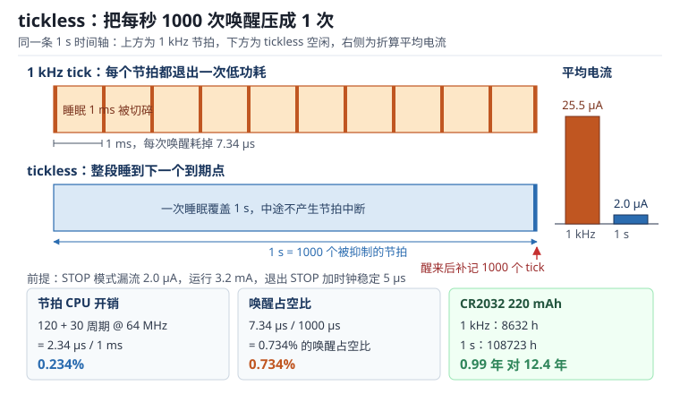

# tickless 与低功耗调度：节拍开销、补偿与实时性权衡

系统节拍（System Tick）是 RTOS 的心脏：它让 `vTaskDelay` 知道过了多久，让超时等待能返回，让同优先级任务能轮转。代价是这颗心脏必须一直跳——哪怕所有任务都在等一件 5 秒后才发生的事，1 kHz 的节拍也会把处理器从低功耗状态唤醒 5000 次。

每次唤醒都要付出"退出低功耗模式 + 恢复时钟 + 进中断 + 出中断"的固定开销。在毫安级的运行电流旁边，这笔开销小得看不见；但在微安级的休眠电流旁边，它决定了设备的电池是撑三个月还是三周。**tickless（无节拍空闲）** 就是把这笔开销压下去的技术：既然没人需要这一毫秒，就别让它发生。

这一章的每个结论都可以用一个乘法算出来。真正难的不是公式，而是知道哪些开销藏在了"唤醒"这个动作里，以及省下的功耗要从哪里还回去。

## 1. 动机：功耗账本上最容易被忽略的一行

::: motivation 四个现场
**现场一：理论三个月的电池撑了三周。** 设计文档算的是"休眠 2 µA，220 mAh 电池可用十年"。实测平均电流 25 µA，寿命掉到 359 天，再加上脉冲负载和自放电，实际三周就没电。差额几乎全部来自 1 kHz 节拍：每次唤醒 7.3 µs，乘以 1000 次每秒，等效 23.5 µA，是漏流的十倍以上。

**现场二：打开 tickless 后，一分钟定时器每天慢一分钟。** 补偿逻辑用 RTC 计数差来回填节拍，而 RTC 时钟源选了内部 LSI（±5%）。一天下来累积误差 4320 秒——不是"慢一分钟"，是慢一小时十二分钟。

**现场三：SPI 收包偶发丢数据。** 为了让功耗好看，代码在 `SPI DMA` 传输开始后立刻调 `__WFI()` 进 STOP 模式。STOP 模式下外设时钟全停，DMA 停止搬运，SPI 移位寄存器里的数据被后续时钟冲掉。现象是"偶发 CRC 错"，且只在低负载（空闲比例高、更容易进 STOP）时出现。

**现场四：要睡 120 秒的任务每 65.5 秒醒一次。** 用 16 位唤醒定时器做补偿，最大抑制节拍数被限制在 65535 个，1 kHz 下就是 65.5 秒。任务睡不够，被切成两段，代码里"睡够 120 秒后检查一次传感器"的假设失效，读到的还是旧值。
:::

| 你想确认 | 先算 | 判据（工程经验值，非标准强制） |
|---|---|---|
| 节拍吃掉多少 CPU | $\eta=f_t (t_{isr}+t_{ret})$ | 1 kHz 下低于 0.5%，10 kHz 下要重新评估 |
| 唤醒吃掉多少电 | $D=t_{wake}/T$ | 占空比低于 0.1% |
| 平均电流 | $I=D I_{run}+(1-D) I_{lp}$ | 休眠电流应占主导，否则先治唤醒 |
| 电池寿命 | $t=Q/I$ | 预留 40% 给脉冲负载与自放电 |
| 最长可睡多久 | $T_{max}=(2^{b}-1)/f_{tick}$ | 覆盖最长的任务超时，否则分段 |
| 时钟误差 | $\delta=\varepsilon T_{sleep}$ | 日历用 LSE，短睡可用 LSI |

**不算会摔在哪**，四个带数字的代价：

1. **把节拍开销当成"几个周期的中断"。** 120 周期 ISR 加 30 周期返回，在 64 MHz 上是 2.34 µs，1 kHz 下占 CPU 的 0.234%——CPU 层面确实可以忽略。但在 STOP 模式下，每次唤醒还要加 5 µs 的退出时间，总代价变成 7.34 µs，占空比 0.734%，平均电流从 2.0 µA 抬到 25.5 µA。
2. **以为 tickless 只是"关掉节拍"。** 关掉之后必须补回来，补回来必须知道睡了多久，知道睡了多久必须有一个比节拍更省电的计时器。三个环节任一环节的精度不够，系统时间就会漂。
3. **忽略唤醒延迟的抖动。** RTC 的 32768 Hz 时钟意味着唤醒时刻的分辨率是 30.5 µs；叠加 STOP 退出 5 µs、ISR 1.9 µs，最坏 37.9 µs。对 1 ms 周期的控制环，这是 3.8% 的抖动；对 100 µs 的截止期，tickless 根本不该出现在这条路径上。
4. **在 DMA 传输期间睡眠。** 1 KiB 数据在 8 MHz SPI 上要 1.024 ms，如果这 1 ms 里进了 STOP，传输就断了。若改用 Sleep 模式让 DMA 跑完，电流从 2 µA 变成 120 µA——单次传输多耗的电量换算成每秒一次的负载，等效 3.15 µA，比休眠电流还大。

## 2. 直观：节拍、睡眠与补偿的三件事

上图画的是同一条 1 秒时间轴。上方是 1 kHz 节拍：睡眠被切成 1000 段，每段结束都要退出一次低功耗、跑一次 ISR、再回去。下方是 tickless：一整段睡到下一个真正有意义的时刻，只在末尾醒一次，醒来后把漏掉的 1000 个节拍一次补齐。右侧两根柱子的高度差就是平均电流的差：25.5 µA 对 2.0 µA。

### 2.1 系统节拍到底在做什么

节拍中断（Tick Interrupt）由 SysTick 或某个通用定时器产生，每次进入做三件事：

1. **递减所有阻塞任务的超时计数**。`vTaskDelay(100)` 的实现是"把任务挂到延时链表，到期时间 = 当前 tick + 100"。
2. **检查软件定时器**。`configUSE_TIMERS` 打开时，定时器服务任务按 tick 判断哪个定时器到期。
3. **触发同优先级任务的时间片轮转**（`configUSE_TIME_SLICING`）。

三件事都依赖"tick 是一个均匀流逝的计数器"这个假设。tickless 打破的正是这个假设：tick 不再均匀产生，而是**跳变**。所以补偿要做的事，是让所有依赖 tick 的代码仍然看到一个均匀的计数器。

### 2.2 tickless 的三个动作：预测、抑制、补偿

**预测**：空闲任务（Idle Task）在无事可做时进入钩子 `vPortSuppressTicksAndSleep(xExpectedIdleTime)`，参数是"距下一个任务到期还有多少个 tick"。这个值由调度器算好，已经是保守估计。

**抑制**：关掉节拍中断，按 `xExpectedIdleTime` 设置一个单次唤醒定时器（RTC 唤醒、LPTIM 单次触发或低功耗 SysTick），然后执行 `WFI` 或 `WFE`。如果期间有中断到来，唤醒提前发生——这是允许的，但要记下实际睡了多久。

**补偿**：醒来后读低功耗定时器的经过时间，换算成 tick 数，用 `vTaskStepTick(n)` 一次性推进 $n$ 个 tick，或重新设置节拍计数器。如果在这段时间里有软件定时器到期，需要逐个处理。

抑制的安全阀是 `xMaximumPossibleSuppressedTicks`：低功耗定时器是 16 位时，最多只能计数 65535 个 tick 单位，1 kHz 下就是 65.5 秒。超过这个值必须分段睡，或者提高定时器分辨率/换 32 位计数器。

还有一条容易漏的规则：`configEXPECTED_IDLE_TIME_BEFORE_SLEEP`（默认 2 个 tick）规定"预计空闲时间短于这个值就不要折腾了"。因为进一次 STOP 再出来要 7.3 µs，如果本来就只空闲 2 µs，省下的电还不够付进入/退出开销。

### 2.3 低功耗模式的层级：哪些资源还活着

以 STM32L4 系列为例，低功耗模式从浅到深大致是：

| 模式 | 电流量级 | 唤醒时间量级 | 还活着的东西 | DMA 能跑吗 |
|---|---|---|---|---|
| Run | 3.2 mA @ 64 MHz | — | 全部 | 能 |
| Sleep | 120 µA | 几个周期 | 内核停、外设时钟继续 | 能 |
| Stop 2 | 2 µA | 5 µs | SRAM 保持、RTC/LPTIM、EXTI | 不能 |
| Standby | 0.3 µA | 复位级 | 备份域 | 不能 |

三个模式的电流比是 **1600 : 60 : 1**。这个比例决定了设计策略：能用 Stop 就不要用 Sleep（差 60 倍），能在 Stop 里完成的事就不要退到 Run（差 1600 倍）。

Stop 模式下"外设全停"这句要打折扣：LPUART、LPTIM、I2C（地址匹配唤醒）、部分 ADC 和比较器仍然可用，因为它们有独立的低速时钟域。**SRAM 内容保持**是 Stop 与 Standby 的分水岭——Standby 醒来等于复位，所有状态丢失，只能靠备份寄存器或 Flash 恢复。

### 2.4 唤醒路径的时间构成

一次唤醒的总延迟是四段之和：

1. **定时器分辨率**：RTC 的 32768 Hz 时钟，1 LSB = 30.5 µs。设成 2 分频就是 61.0 µs，4 分频 122.1 µs。
2. **退出低功耗模式**：Stop 2 约 5 µs（稳压器启动、时钟恢复）。
3. **时钟重新稳定**：如果唤醒后要跑 64 MHz，HSI 起振约 2 µs，PLL 重新锁定在百微秒量级——这一段最容易被漏算，也是"为什么唤醒后第一件事总是慢半拍"的原因。
4. **中断响应与返回**：中断延迟加 ISR 加恢复上下文，约 2.3 µs。

四段中前三段都花在"还没开始干活"上。工程上的对策是：**唤醒后先用低速时钟跑完必要动作**（读一次 ADC、写一条日志），需要高速计算时再切 PLL。这样把最贵的那一段（PLL 锁定）留给真正需要它的路径。

### 2.5 tickless 之后 tick 的语义变化

打开了 tickless，`xTaskGetTickCount()` 不再是"每毫秒加一"的均匀计数器，而是"睡一段、跳一次"。这个变化会渗透到三个地方，设计时必须逐条确认：

- **时间戳**。用 tick 差值算出的时间间隔会被量化到一次睡眠的粒度。要给记录打时间戳，应该用 RTC 的日历值或单独的 32 位秒计数器，不要用 tick。
- **超时判断**。`xTaskCheckForTimeOut` 与 `vTaskSetTimeOutState` 依赖 tick 的单调性，跳变本身没问题（单调仍成立），但"超时精度"等于一次睡眠的时长。对 100 ms 的超时，若空闲时每 1 s 醒一次，实际可能 1 s 后才判定。
- **时间片轮转**。补偿时一次推进 $n$ 个 tick，`configUSE_TIME_SLICING` 打开的轮转会被"压缩"到醒来那一刻集中处理，同优先级任务可能连续占用比预期更长的时间。

这条边界的判据很朴素：**凡是"用 tick 当地钟"的地方，在 tickless 下都要重新设计**；凡是"用 tick 当相对延时"的地方，tickless 是透明的。前者改成硬件计时或绝对时间，后者不需要动。

## 3. 定量：节拍开销、占空比与补偿上限

### 3.1 节拍开销占比

CPU 层面的节拍开销，就是每秒花在节拍中断上的时间比例：

$$
\eta = f_{tick} \cdot (t_{isr} + t_{ret})
$$

- $\eta$：节拍占用的 CPU 时间比例，无量纲。
- $f_{tick}$：系统节拍频率，Hz。
- $t_{isr}$：节拍 ISR 的执行时间，秒；$t_{ret}$：中断返回与上下文恢复时间，秒。

$\eta$ 只回答"CPU 忙不忙"，不回答"费不费电"。费电要看占空比：

$$
D = \frac{t_{wake}}{T}, \qquad t_{wake} = t_{exit} + t_{isr} + t_{ret}
$$

- $D$：处理器处于"清醒且高频运行"状态的时间占比。
- $t_{wake}$：单次唤醒的固定代价，秒；$t_{exit}$：退出低功耗模式的时间，秒。
- $T$：两次唤醒之间的间隔，秒。普通节拍下 $T=1/f_{tick}$，tickless 下 $T$ 是实际睡眠时长。

平均电流则是两个电流的加权：

$$
I_{avg} = D \cdot I_{run} + (1-D) \cdot I_{lp}
$$

$I_{run}$ 为唤醒后的运行电流，$I_{lp}$ 为休眠电流。最后电池寿命：

$$
t_{life} = \frac{Q}{I_{avg}}
$$

- $Q$：电池可用容量（安时），$t_{life}$ 用同一时间单位。

这里要强调：**$D$ 由 $t_{wake}/T$ 决定，而 $I_{avg}$ 对 $D$ 是线性的**。所以把 $T$ 从 1 ms 抬到 1 s，平均电流就按比例掉——直到 $I_{lp}$ 成为主导项，再抬 $T$ 就没有收益了。

### 3.2 补偿上限与时钟误差

16 位计数器能表示的最大 tick 数：

$$
N_{max} = 2^{16} - 1 = 65535, \qquad T_{max} = \frac{N_{max}}{f_{tick}}
$$

1 kHz 下 $T_{max} = 65.535$ s。如果任务的超时是 120 s，必须分段睡，或者把定时器换成 32 位。

时钟误差对睡眠时长的影响是**线性累积**的：

$$
\delta = \varepsilon \cdot T_{sleep}
$$

- $\varepsilon$：时钟源的相对误差，ppm 或百分比。
- $T_{sleep}$：累计睡眠时长。
- $\delta$：时间偏差。LSE 取 $\varepsilon = 20$ ppm，LSI 取 $5\times10^{-2}$（±5%）。

20 ppm 意味着一天 1.728 s 的漂移；5% 意味着一天 4320 s。两者相差 2500 倍，这就是"日历必须用 LSE"的全部理由。

### 3.3 一次唤醒的电量代价

单次唤醒耗掉的电荷：

$$
Q_{wake} = I_{run} \cdot t_{wake}
$$

3.2 mA × 7.344 µs = 23.5 nC（纳库仑），折算成 1 Hz 的等效平均电流就是 $23.5 \times 10^{-9} \times 1 = 23.5$ nA——看着微不足道，但乘以 1000 次每秒就是 23.5 µA。**频率把电荷变成了电流，这是本节唯一需要记住的换算。**

## 4. 算例：把 25.5 µA 算回 2 µA

以下全部按一组明确的假设计算，换器件时只要替换常数即可：

- 主频 64 MHz，运行电流 $I_{run}=3.2$ mA，Stop 2 电流 $I_{lp}=2.0$ µA。
- 节拍 ISR 120 周期 $=1.875$ µs，中断返回 30 周期 $=0.469$ µs。
- 退出 STOP 并稳定时钟 $t_{exit}=5.0$ µs，故 $t_{wake}=7.344$ µs。
- 电池 CR2032，标称 220 mAh，按理想容量计。

### 4.1 算例一：节拍占多少 CPU

$$
\eta = 1000 \times (1.875 + 0.469)\times 10^{-6} = 2.344\times 10^{-3} = 0.234\%
$$

在 64 MHz 上相当于 150 kHz 的"虚拟占用"。把节拍换成 100 Hz，$\eta = 0.023\%$；换成 10 kHz，$\eta = 2.344\%$——**每十倍频，多 0.2 个百分点的 CPU**。这就是为什么 1 kHz 是默认值：再高，CPU 开销开始显形；再低，`vTaskDelay(1)` 的粒度就粗到影响控制环。

注意 0.234% 这个数字**不含**退出低功耗的时间。它只说明"如果处理器一直在跑，节拍占多少"。

### 4.2 算例二：唤醒占空比与平均电流

普通 1 kHz 节拍下，每毫秒醒一次：

$$
D = \frac{7.344\ \mu s}{1000\ \mu s} = 7.344\times10^{-3} = 0.734\%
$$

$$
I_{avg} = 0.007344 \times 3.2\ \text{mA} + (1-0.007344) \times 2.0\ \mu A
= 23.50\ \mu A + 1.985\ \mu A = 25.49\ \mu A
$$

其中 23.50 µA 来自唤醒，1.985 µA 来自漏流——**唤醒占总电流的 92.2%**。这个比例说明：在 1 kHz 节拍下讨论"选哪颗低功耗芯片"意义不大，先把唤醒次数降下来。

换成 tickless，每 1 秒醒一次：

$$
D = \frac{7.344\ \mu s}{10^6\ \mu s} = 7.344\times10^{-6}
$$

$$
I_{avg} = 7.344\times10^{-6}\times3.2\ \text{mA} + 2.0\ \mu A = 0.0235\ \mu A + 2.0\ \mu A = 2.02\ \mu A
$$

此时唤醒只占 1.2%，漏流成为主导。继续把周期抬到 10 s（2.00 µA）几乎不再有收益——**这是 tickless 的收益边界：当 $I_{run}\cdot t_{wake}/T \ll I_{lp}$ 时就到头了。**

完整的周期对比：

| 唤醒周期 | 占空比 $D$ | 平均电流 | CR2032 寿命 |
|---|---|---|---|
| 1 ms（普通节拍） | 0.734% | 25.49 µA | 8632 h ≈ 0.99 年 |
| 10 ms（100 Hz 节拍） | 0.0734% | 4.35 µA | 50592 h ≈ 5.78 年 |
| 100 ms | 0.00734% | 2.23 µA | 98440 h ≈ 11.24 年 |
| 1 s | 0.000734% | 2.02 µA | 108723 h ≈ 12.41 年 |
| 10 s | 0.0000734% | 2.00 µA | 109871 h ≈ 12.54 年 |

从 1 ms 到 1 s，寿命差 12.6 倍。这个倍数不是芯片给的，是**调度策略**给的。

顺带算一下每 tick 的电量：$3.2\ \text{mA} \times 7.344\ \mu s = 23.5$ nC。一天 86400 次唤醒共 $2.03\times10^{-3}$ A·s，折 0.564 mAh/天；漏流 2 µA 一天 48 µAh。两者相加正好是 25.49 µA 对应的 612 µAh/天，账目自洽。

### 4.3 算例三：补偿上限与补 tick 的 CPU 成本

用 16 位唤醒定时器、1 kHz 节拍：

$$
T_{max} = \frac{65535}{1000} = 65.535\ \text{s}
$$

一个要睡 120 s 的任务只能分两段，第二段从 65.5 s 处开始。如果补偿是"逐 tick 调用一次处理函数"，成本是 $N \times 20$ 周期：

- 睡 3.5 s（3500 tick）：$3500 \times 20 = 70000$ 周期 $= 1.09$ ms。
- 睡满 65.5 s（65535 tick）：$65535 \times 20 = 1310700$ 周期 $= 20.48$ ms。

20.48 ms 是一次"醒来就卡住"的停顿，足以让一个 1 ms 的控制环错过 20 个周期。FreeRTOS 的 `vTaskStepTick()` 在 `configUSE_TICK_HOOK = 0` 时是 O(1) 的（直接加总），只有需要逐 tick 处理软件定时器时才退化成线性。**所以补偿成本取决于有没有打开 tick hook 和软件定时器**，这句话要在设计评审时明确写出来。

### 4.4 算例四：LSI 与 LSE 的漂移差 2500 倍

设睡眠累计 1 小时：

- LSE 20 ppm：$\delta = 20\times10^{-6} \times 3600 = 0.072$ s。
- LSI ±0.5%：$\delta = 5\times10^{-3} \times 3600 = 18$ s。
- LSI ±5%：$\delta = 5\times10^{-2} \times 3600 = 180$ s。

一天下来分别是 1.73 s、432 s、4320 s。若系统用 tick 计时来触发"每小时采一次样"，5% 的 LSI 会让采样点每小时漂 180 秒，几小时后采样点就跨到了别的时段——数据看起来"正常但时间错"，比崩溃更难查。

结论：**日历与长期计时用 LSE（外接 32.768 kHz 晶振）；短睡眠（秒级以内）可以用 LSI，但要在每次唤醒后重新对齐**。

### 4.5 算例五：一次 DMA 传输要不要醒着

1 KiB 数据在 8 MHz SPI 上：$t = 1024 \times 8 / 8\times10^6 = 1.024$ ms。

- 若用 Sleep 模式（外设时钟继续，DMA 可用）：$120\ \mu A \times 1.024\ \text{ms} = 122.9$ nC。
- 若用 Run 模式：$3.2\ \text{mA} \times 1.024\ \text{ms} = 3.277\ \mu C$。

Run 是 Sleep 的 26.7 倍。若每秒传一次，差异折算成平均电流：

$$
(3.2\ \text{mA} - 0.12\ \text{mA}) \times 1.024\ \text{ms} \times 1\ \text{Hz} = 3.15\ \mu A
$$

3.15 µA 比整个休眠电流 2.0 µA 还大。这意味着"每秒传一次 1 KiB"这个负载本身就该被优化：降频、减数据量，或者让 DMA 在 Sleep 模式里跑完再一起睡。

## 5. 工程含义：省电要省在对的地方

### 5.1 什么时候值得上 tickless

三条判据同时满足才划算：

1. **空闲时间远大于唤醒开销**。平均空闲时长大于 $10 \times t_{wake}$（约 73 µs），否则进 STOP 的入场费就吃掉收益。
2. **系统对 tick 的均匀性要求不高**。如果控制环依赖"每 1 ms 精确触发一次"，tickless 引入的 30.5 µs 粒度会直接伤害它——这类系统应该用硬件定时器触发 ADC/DAC，让节拍只管调度。
3. **有可靠的低功耗定时器**。RTC 或 LPTIM 必须能在 STOP 下工作，且精度满足要求。

反过来，以下场景不该开 tickless：1 ms 级的软实时控制、依赖 tick 累加做时间戳的协议栈、休眠时间短于 100 µs 的高频轮询。

### 5.2 低功耗定时器怎么选

| 选项 | 优点 | 缺点 | 适用 |
|---|---|---|---|
| RTC 唤醒定时器 | 通常是最低功耗域，STOP/Standby 都活 | 分辨率由 32.768 kHz 决定（30.5 µs）；常为 16 位或 24 位 | 秒级到分钟级睡眠 |
| LPTIM | 可接 LSE/LSI/内部时钟，16 位，可单次触发 | 精度依赖时钟源，配置略繁 | 毫秒到秒级，需要精确单次 |
| 低功耗 SysTick | 兼容现有节拍代码 | 大多数型号在 STOP 下停摆 | 只适合 Sleep 模式 |
| 通用定时器 + 低功耗时钟 | 分辨率高 | 多数在 STOP 下不工作 | 只适合 Sleep 模式 |

实用组合：**秒级以上用 RTC，毫秒级用 LPTIM**。两者都不适合 100 µs 级，因为晶振本身的分辨率不够。

### 5.3 外设与 DMA 的配合清单

进入 STOP 之前必须逐项确认，这份清单可以直接当 checklist 用：

1. **DMA 是否在途**。在途就不能进 STOP。要么等传输完成再睡（用传输完成中断替代 WFI），要么改用 Sleep 模式。
2. **串口是否在接收**。普通 USART 在 STOP 下不工作；要收数据必须用 LPUART（起始位唤醒）或在进入前关闭接收并丢弃。
3. **I2C 从机是否需要响应**。I2C 可以在地址匹配时唤醒，但唤醒后要重新初始化时序。
4. **ADC 是否在转换**。转换中途进 STOP 会得到无效值；用 LPTIM 触发 ADC，转换完成后立即唤醒。
5. **SPI 片选是否拉低**。SPI 主机在 STOP 期间不产生时钟，从机可能把片选期间的杂波当成数据。进入前必须拉高片选。
6. **GPIO 是否浮空**。未使用的引脚若浮空，输入缓冲器的翻转电流会吃掉几微安——比休眠电流还大。未用引脚配成模拟输入或推挽输出低电平。
7. **调试器是否连着**。DBGMCU 的调试保持位会让内核在 WFI 后仍然保持时钟，实测电流会高一个数量级。测功耗必须拔掉调试器或用独立供电。

### 5.4 实时性预算

tickless 把"最坏唤醒延迟"从一个固定值变成一个分布。做预算时按最坏情况叠加：

| 来源 | 典型值 | 说明 |
|---|---|---|
| RTC 分辨率 | 30.5 µs | 32768 Hz，1 分频 |
| 退出 STOP | 5 µs | 数据手册给出上限 |
| 时钟稳定 | 2 µs（HSI） | PLL 锁定另计 |
| ISR + 返回 | 2.3 µs | 120 + 30 周期 @ 64 MHz |
| **合计** | **约 37.9 µs** | 未含 PLL 锁定 |

对 1 ms 周期：37.9 µs 是 3.8% 的抖动，可接受。对 100 µs 截止期：37.9 µs 已经逼近一半，不可接受。**判据是"最坏唤醒延迟小于截止期的 10%"**，超过就不要在这条路径上省电。

### 5.5 怎么测：三个必做的实验

1. **空载电流曲线**。固件停在只有空闲任务的状态，用电流探头录 10 秒，看波形是"平坦的 2 µA"还是"每毫秒一个尖峰"。尖峰就是节拍。
2. **唤醒次数计数**。在 `configPOST_SLEEP_PROCESSING` 里自增一个计数器，1 分钟后读一次，验证实际唤醒次数是否等于设计值。很多"tickless 没生效"的案例是因为 `configEXPECTED_IDLE_TIME_BEFORE_SLEEP` 太大或某个任务在空转。
3. **时间漂移测试**。让设备跑 24 小时，与 NTP 对时比较。漂移超过 1 秒/天说明时钟源选错或补偿没生效。

## 6. 常见坑

::: pitfall 坑一：tickless 打开后系统时间变慢
**现象**：设备运行一天后，日志时间戳比真实时间慢 1~2 分钟；`xTaskGetTickCount()` 增长速率低于真实时间。
**原因**：补偿时用的是"设置值"而不是"实际经过值"。低功耗定时器被提前唤醒（有中断到来）时，代码仍然按设定的完整时长补 tick，或者反过来只补了整数部分、丢掉了余数。
**解决**：醒来后读定时器的实际计数值换算经过时间，余数要保留到下一次；用 `vTaskStepTick()` 一次推进，避免逐 tick 调用；把 RTC 时钟源换成 LSE，并对补偿逻辑做"睡 10 分钟、对时一次"的回归测试。
:::

::: pitfall 坑二：进了 STOP，SPI 从机收到半帧数据
**现象**：低负载时偶发 CRC 错误，高负载时反而正常；逻辑分析仪上看从机在片选有效期间收到过时钟毛刺。
**原因**：DMA 传输开始后立刻 `__WFI()` 进 STOP，SPI 时钟停止，移位寄存器停在半途；退出 STOP 后重新配置 SPI，从机把这段中断当成新的一帧。
**解决**：DMA 在途时禁止进入 STOP（用 `eTaskConfirmSleepModeStatus` 返回 `eAbortSleep`，或在进入前检查 DMA 忙标志）；必须省电时改用 Sleep 模式让 DMA 跑完；进入前拉高片选并在退出后重新初始化 SPI。
:::

::: pitfall 坑三：补偿上限把长睡眠切碎，业务逻辑看到旧数据
**现象**：一个"睡 120 秒后读传感器"的任务，实际每 65.5 秒就醒一次，第二次醒来读到的是 65.5 秒前的缓存值。
**原因**：16 位唤醒定时器在 1 kHz 下最多表示 65.5 秒，超出部分被截断，任务被提前唤醒；业务代码里的"睡够 120 秒"假设不成立。
**解决**：把长睡眠拆成显式的循环（`for` 若干段 + 累计时间判断），或改用 32 位 RTC 计数器；在任务层用"绝对到期时刻"而不是"相对延时"来判定，避免被截断后语义改变。
:::

## 7. 自测题

题一：主频 64 MHz，节拍 ISR 120 周期、返回 30 周期，1 kHz 节拍占多少 CPU？若改成 10 kHz 呢？

$$
\eta = f_{tick}(t_{isr}+t_{ret}) = 1000 \times \frac{120+30}{64\times10^{6}} = 1000 \times 2.344\times10^{-6} = 0.234\%
$$

10 kHz 时 $\eta = 10000 \times 2.344\times10^{-6} = 2.344\%$，即 1.5 MHz 的等效占用。

注意这只算 CPU，不含退出低功耗的 5 µs。若每次节拍都从 STOP 醒来，占空比要按 $t_{wake}=7.344$ µs 算：1 kHz 下 0.734%，10 kHz 下 7.34%——十倍频让功耗代价也放大十倍。

题二：运行 3.2 mA、休眠 2 µA、每次唤醒 7.344 µs，1 kHz 节拍与 1 s tickless 的平均电流各是多少？为什么到 10 s 就没收益了？

1 kHz：$D = 7.344/1000 = 0.734\%$，

$$
I = 0.00734\times3.2\ \text{mA} + 0.99266\times2\ \mu A = 23.50 + 1.99 = 25.49\ \mu A
$$

1 s：$D = 7.344\times10^{-6}$，

$$
I = 7.344\times10^{-6}\times3.2\ \text{mA} + 2\ \mu A = 0.0235 + 2.0 = 2.02\ \mu A
$$

10 s 时唤醒项只有 0.0024 µA，$I = 2.00$ µA。收益消失的原因是**主导项换了**：从"唤醒开销主导"变成"漏流主导"。判据是 $I_{run}t_{wake}/T \ll I_{lp}$，本例中当 $T > 12$ ms 时唤醒项已经小于漏流的 1%。

题三：16 位唤醒定时器、1 kHz 节拍，最长能睡多久？若补偿按每 tick 20 周期逐个处理，睡满这段时间要多少 CPU？

$$
T_{max} = \frac{2^{16}-1}{f_{tick}} = \frac{65535}{1000} = 65.535\ \text{s}
$$

补 tick 成本：$65535 \times 20 = 1310700$ 周期，在 64 MHz 上是 20.48 ms。这段时间里调度器不能响应任何任务，等价于一次 20 ms 的关中断。

工程结论：要么让补偿保持 O(1)（`vTaskStepTick` 直接加总），要么把单次睡眠限制在秒级，把 20 ms 的停顿换成每段 1 ms 以内的补偿。

题四：为什么用 LSI 做 RTC 时钟源时，"睡 1 秒"可能变成 1.05 秒？如何量化并消除？

LSI 的相对误差 $\varepsilon$ 典型为 ±5%（部分型号 ±0.5%）。睡眠 $T_{sleep}$ 的实际偏差：

$$
\delta = \varepsilon T_{sleep} = 0.05 \times 1\ \text{s} = 50\ \text{ms}
$$

即每天 $0.05 \times 86400 = 4320$ s 的累积误差。

消除办法有三条：改用 LSE（20 ppm，一天 1.7 s）；对 LSI 做出厂校准并在运行时用外部时间源（GPS、上位机对时、温度补偿表）修正；把"睡多久"的判断从 RTC 计数改成"醒来后读一个绝对时间源"。三条可以叠加，但第一条最有效——误差差 2500 倍。

## 8. 参考资料

1. Richard Barry，《Mastering the FreeRTOS Real Time Kernel》Chapter 10 *Low Power Support*：`configUSE_TICKLESS_IDLE`、`portSUPPRESS_TICKS_AND_SLEEP`、`eTaskConfirmSleepModeStatus` 与 `vTaskStepTick` 的调用契约。本章的预测—抑制—补偿三段式来自该章实现说明。
2. FreeRTOS 官方文档 *Low Power Tickless Idle*：`configPRE_SLEEP_PROCESSING`/`configPOST_SLEEP_PROCESSING` 钩子，以及 `xMaximumPossibleSuppressedTicks` 由定时器位宽推导的规则。
3. STMicroelectronics, *RM0394* STM32L41x/42x/43x/44x 参考手册 Section 5 低功耗模式与 Section 26 RTC：Stop 0/1/2 的时钟与外设可用性、RTC 唤醒定时器预分频。本章模式表与 30.5 µs 分辨率由此而来。
4. STMicroelectronics, *AN4621* STM32L4 超低功耗特性概览：Stop 2 的唤醒时间与电流量级，用于校验本章"5 µs / 2 µA"取值。
5. Joseph Yiu，《The Definitive Guide to ARM Cortex-M3 and Cortex-M4 Processors》(3rd Edition) Chapter 9：WFI/WFE 语义、SLEEPDEEP 与唤醒延迟的时间构成。
6. ARM, *DDI 0403 ARMv7-M Architecture Reference Manual* Chapter B1：异常进入/返回的时间构成，用于估算 ISR 与上下文恢复开销。
7. Giorgio C. Buttazzo，《Hard Real-Time Computing Systems》(3rd Edition) Chapter 4：定时器分辨率对调度抖动与截止期的影响，是"最坏唤醒延迟小于截止期 10%"这条判据的来源。
