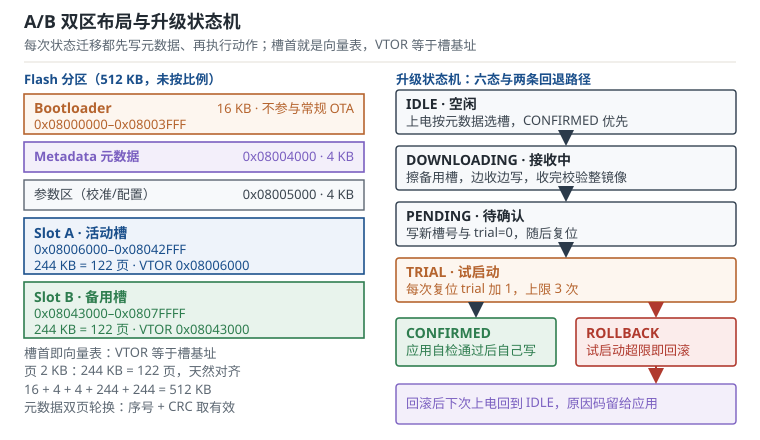

# Bootloader 与 OTA：A/B 双区、镜像校验与回滚 Bootloader and OTA

设备装到配电柜里之后，升级就变成了一次不可撤回的远程手术：没有人能到现场按复位键，也没有人能拆开外壳接 SWD。引导加载程序（Bootloader，下文简称引导程序）与空中升级（Over-The-Air update，OTA）要解决的就是这件事——把新镜像写进去、确认它真的能跑、跑不了就退回旧镜像，并且在整个过程中随时可能掉电。这一章按"分区布局—跳转收尾—镜像校验—A/B 状态机—失败恢复—差分升级"的顺序，把每一步的地址、时间与擦写次数都算成数字。

## 1. 设计动机（为什么升级比刷机难一个数量级）

::: motivation 三个升级现场
**现场一：升到 60% 掉电，设备再也不亮。** 某电表模块用的是"单区 + 下载缓存"方案：先把新镜像收进外部 SPI Flash，再擦除主程序区往里写。现场断电时主程序区刚好擦掉一半，上电后引导程序找不到可启动的镜像，串口也没人接，只能返厂。返修成本约等于三台新设备，而这一批装了 4000 台。

**现场二：升级成功，但设备只在第一次上电正常。** 新镜像写进了 B 槽，元数据里 `active = B`。第二天现场反映设备反复重启：应用启动 5 秒后自检失败、看门狗复位，引导程序又从 B 槽启动，如此循环。问题在于升级流程里根本没有"确认"这一步，只要写进去就当成功——旧镜像还完好地躺在 A 槽，却永远轮不到它。

**现场三：换了个 2 KB 页的型号，擦除把隔壁槽的头擦没了。** 应用从 1 KB 页的型号移植过来，镜像 131 KB，也就是 65.5 个 2 KB 页。1 KB 页的器件上擦 131 页刚好；换到 2 KB 页的器件，擦除必须补齐到 66 页、也就是 132 KB，多出来的 1 KB 正好压在 B 槽的向量表上——B 槽复位向量被擦成 `0xFFFFFFFF`。现象是"升级成功、重启后 HardFault"。
:::

把升级阶段的典型现象、第一检查项与判据列成表：

| 现象 | 先查什么 | 判据 |
|---|---|---|
| 升级后彻底不启动 | 引导程序是否还在、有无可启动槽 | 引导程序区未被擦；至少一个槽通过校验 |
| 反复重启 | 应用是否写过确认标志 | 元数据里有 CONFIRMED，trial 未超限 |
| 跳转后立刻 HardFault | 向量表地址、栈顶、外设状态 | VTOR 等于槽基址；MSP 落在 RAM；DMA 已停 |
| 升级成功但功能异常 | 镜像长度、页对齐、CRC 覆盖范围 | 擦除范围不越界；CRC 覆盖整镜像含填充 |
| 用一段时间后升级失败 | 元数据页擦写次数 | 累计擦除 < 器件擦写寿命 |

**不算会摔在哪**，三个带数字的代价：

1. **返修成本。** 现场一台设备的返修成本通常是一台新机的 2–3 倍（拆装、物流、停运），而一次全量 OTA 只花 24 s 的传输时间。把"可回滚"做进去的成本是几 KB 代码加两页 Flash，收益是避免整批返修。
2. **掉电窗口。** 一次 24 s 的升级里，元数据写入占约 20 ms，只算这一次写入，正好在写元数据时掉电的概率约 $20/24000=0.083\%$。这个数字看起来很小，但 4000 台设备、每年 6 次升级就是 2.4 万次，期望命中约 20 次；若每次试启动都去递增计数，写入次数还要乘 4。所以元数据必须双份。
3. **擦写寿命。** STM32F1 的 Flash 擦写寿命典型 10 000 次。若每次上电都往同一页写一个"启动计数"，每天上电 10 次，寿命只有 $10000/(10\times365)=2.74$ 年——比设备的设计寿命还短。

## 2. 定义与直观（分区、跳转与状态机）

### 2.1 分区布局：五块存储，各有各的命运

**分区布局（partition layout）** 是把一块连续 Flash 切成若干段，每段有固定基址、固定长度、固定用途。一个能 OTA 的布局至少有五块：

| 区域 | 地址范围（512 KB 方案） | 大小 | 参与 OTA | 作用 |
|---|---|---|---|---|
| 引导程序 | `0x08000000`–`0x08003FFF` | 16 KB | 否（特殊流程除外） | 选槽、校验、跳转、收镜像 |
| 元数据 | `0x08004000`–`0x08004FFF` | 4 KB（2 页） | 是（每次状态跳变） | 槽状态、trial 计数、版本号 |
| 参数区 | `0x08005000`–`0x08005FFF` | 4 KB（2 页） | 是（应用自己写） | 校准系数、配置、运行计数 |
| 槽 A | `0x08006000`–`0x08042FFF` | 244 KB | 是 | 应用镜像 A |
| 槽 B | `0x08043000`–`0x0807FFFF` | 244 KB | 是 | 应用镜像 B |

槽（slot）是能独立启动的一份完整镜像所占的地址区间。A/B 双区（A/B slots）意味着任何时刻设备上都有两份镜像，正在跑的那份叫活动槽（active slot），另一份叫备用槽（standby slot）。升级就是把新镜像写进备用槽，然后切换活动槽。

一个必须提前说清的细节：**镜像描述不能插在向量表前面**。如果把"魔数 + 长度 + CRC"的头部放在槽首 32 字节，向量表就从槽基址 +32 开始，而 VTOR 要求 128 字节对齐，`+32` 直接违约。正确做法有三种：把描述放进元数据区（本章方案）、把头部补齐到 128 或 2048 字节、把向量表在启动时拷到 RAM。选第一种，槽首第一个字节就是初始栈顶，VTOR 等于槽基址，天然对齐。

### 2.2 页、扇区与写入粒度：对齐不是美德，是硬约束

Flash 有三个不同的粒度，混用就是事故：

- **编程粒度（program granularity）**：一次能写多少字节。STM32F1 是 16 位半字；带 ECC 的 L4/H7 要求整双字（64 位）或整行（32 字节）写入，写半个双字会被 ECC 判为不可纠正错误。
- **擦除粒度（erase granularity）**：一次擦除的最小单位。F1 中容量是 1 KB 页，大容量是 2 KB 页，F4 是 16/64/128 KB 扇区，H7 是 128 KB 扇区。
- **保护粒度（protection granularity）**：写保护（WRP）与读保护（RDP）按页或按扇区生效，一旦按扇区保护，扇区内的引导程序和应用不能分开保护。

| 器件 | 擦除粒度 | 编程粒度 | 做 A/B 的代价 |
|---|---|---|---|
| STM32F103 中容量 | 1 KB 页 | 16 位半字 | 槽可按页精确切分，浪费小 |
| STM32F103 大容量 | 2 KB 页 | 16 位半字 | 同上，槽长须是 2 KB 整数倍 |
| STM32F4 | 16/64/128 KB 扇区 | 8/16/32 位 | 每槽至少一个扇区，小镜像浪费大 |
| STM32L4 | 2 KB 页 | 64 位双字（ECC） | 镜像尾部必须补齐到 8 字节 |
| STM32H7 | 128 KB 扇区 | 32 字节整行（ECC） | 槽边界必须落在扇区边界 |

"典型值，具体以对应型号数据手册为准。"表里最容易被忽略的是最后一行：擦除粒度大于一个槽时，你无法"只擦半个槽"。

### 2.3 跳转前的收尾：把引导程序的痕迹擦干净

从引导程序跳到应用，不是一条 `goto`。内核状态、外设状态、向量表三者都要交给应用，顺序错了就是偶发 HardFault。收尾清单按顺序如下：

1. **合法性检查**：槽首 4 字节是初始 MSP，必须落在 RAM 内且 8 字节对齐；+4 是复位向量，必须是奇数（Thumb 位）且落在该槽范围内。
2. **关总中断**：`__disable_irq()` 置位 PRIMASK。必须在换栈之前完成。
3. **清 NVIC 使能与挂起**：写 `ICER` 关使能，写 `ICPR` 清挂起。只关使能不清挂起，跳转后应用一开中断，旧的中断会立刻补触发。
4. **停外设**：停 DMA 并等 `EN` 位真正清零、关 SysTick、关自己开过的外设时钟、必要时复位外设寄存器。
5. **重定位向量表**：`SCB->VTOR = 槽基址`，随后 `__DSB()` 与 `__ISB()`，保证写到达系统控制块且流水线已清。
6. **换栈并跳转**：`__set_MSP(sp)`，然后 `((void (*)(void))pc)()`。跳转前把 PRIMASK 清零，让应用看到的是"复位后的状态"。
7. **喂狗与留证**：跳转前喂一次看门狗；把跳转原因（复位源、目标槽、重试次数）写进 RAM 的保留区或元数据，供应用上报。

| 漏做的一步 | 现场表现 | 机理 |
|---|---|---|
| 没清 `ICPR` | 应用刚开中断就进老中断 | 挂起位在关中断期间已置位 |
| 没停 DMA | RAM 数据莫名被覆盖 | DMA 目标地址是应用刚初始化的缓冲区 |
| 没改 VTOR | 中断进引导程序的表 | 默认 VTOR 仍指向复位时的表 |
| 先换栈后关中断 | 极小概率 HardFault | 中断在换栈窗口里压栈，栈帧错位 |
| 没关外设时钟 | 功耗偏高、唤醒异常 | 外设仍在跑，时钟门控未关 |

### 2.4 镜像校验：从"能读"到"可信"

校验分三层，成本和强度递增：

1. **结构校验（几十微秒）**：栈顶在 RAM 内、复位向量奇数且在槽内、版本号递增、长度不超过槽容量。挡住空白 Flash（全 `0xFF`）和写坏的向量表。
2. **完整性校验（CRC32，几十毫秒）**：对整个镜像算 CRC32，与元数据里记的值比对。挡住传输误码、擦除残留、写了一半个页。
3. **真实性校验（签名，秒级）**：对镜像摘要做 ECDSA P-256 或 Ed25519 验签，公钥烧在引导程序里。挡住伪造镜像和降级攻击。

关键是**覆盖范围**：CRC 必须覆盖"实际会被执行的每一个字节"，包括尾部补齐的填充。只算 `length` 个字节、却不检查补齐字节是常见漏洞——攻击者可以把代码藏在填充里，靠越界执行触发。工程口径是：镜像长度先补齐到编程粒度，CRC 对补齐后的长度计算。

还有一层常被忽略：**校验时机**。每次上电全量 CRC 会拖慢启动（244 KB 约 21 ms，可接受；1 MB 就是 87 ms，接近某些产品的启动预算）。折中做法是"上电只做结构校验 + 首屏 CRC，后台任务做全量校验"。但切槽后的第一次启动必须全量校验，否则等于没校验。

### 2.5 A/B 双区与升级状态机

A/B 的核心不是"两份镜像"，而是**一个能表达"这份镜像还没被确认"的状态字**。没有这个字，B 槽写得再对也无法回滚。把状态字的所有取值列出来：

| 状态 | 值 | 谁写 | 进入条件 | 退出条件 |
|---|---|---|---|---|
| `IDLE` | 0x01 | 引导程序 | 上电、回滚完成 | 收到升级命令，或直接跳活动槽 |
| `DOWNLOADING` | 0x02 | 引导程序 | 收到升级命令 | 镜像收完且校验通过 |
| `PENDING` | 0x03 | 引导程序 | 校验通过、目标槽已擦净写完 | 复位 |
| `TRIAL` | 0x04 | 引导程序 | 复位后选中 PENDING 槽 | 应用写 `CONFIRMED`，或 trial 超限 |
| `CONFIRMED` | 0x05 | 应用 | 自检通过 | 下一次升级 |
| `ROLLBACK` | 0x06 | 引导程序 | trial 超限或结构校验失败 | 复位后回到 `IDLE` |

状态机的每次迁移都遵循同一条规则：**先写元数据，再执行动作**。写 `PENDING` 要在"镜像已经完整落盘并校验通过"之后，不能在开始写之前；写 `CONFIRMED` 要在应用自检通过之后，不能在 `main` 的第一行。反过来做，掉电时就会留下"元数据说成功、镜像其实残缺"的组合。

表里只有 `IDLE` 不写进元数据：它只活在引导程序的 RAM 里，表示"本次上电没有升级事务"。元数据里长期保存的是 `CONFIRMED`、`PENDING` 或 `ROLLBACK`，引导程序每次上电读出来再翻译成动作。



::: analogy 两把钥匙与一张便签
把 A/B 双区想成两把钥匙，元数据区是门口的一张便签。便签上只写两件事：现在用哪把钥匙、这把钥匙试过几次。换钥匙时先改便签再进门；如果试了三次门都打不开，就按便签上的记录换回旧钥匙。便签本身会被反复涂改，所以准备了两张，一张写坏了还有一张；读的时候挑序号大且没写坏的那张。
:::

::: advanced 为什么"两阶段提交"在小 Flash 上仍然不够
元数据页的"擦—写"不是原子操作：擦除要 20 ms，这期间掉电，整页变成 `0xFF`。写 16 个字节（8 个半字）要 0.4 ms，这期间掉电，可能只写进去一半。所以单页元数据的失效窗口是 20.4 ms，不是 0。双页轮换把失效条件从"一次写坏"提升到"两次连续写坏"：第一次写坏时，另一页的序号更小但 CRC 有效，仍可用；只有当另一页也恰好写坏，才会退到"无有效元数据"。此时引导程序的兜底策略必须是"回到出厂镜像或停在升级模式"，而不是"猜一个槽跳过去"。

更强的做法是加一个单调计数器（monotonic counter）与镜像版本号绑定，防止把设备刷回有漏洞的旧版本。计数器本身也有擦写寿命问题，通常与元数据页同页存放、一起轮换。
:::

### 2.6 "变砖"的边界在哪里

**变砖（bricking）** 的严格定义是：上电后既没有任何一个槽能启动，引导程序本身也无法进入可通信的升级模式，只能靠 SWD/JTAG 或返厂。按这个定义，能不能变砖取决于**哪些存储会被 OTA 流程擦到**：

| 对象 | 被 OTA 擦到的可能 | 后果 | 兜底手段 |
|---|---|---|---|
| 应用槽 A/B | 必然 | 可回滚 | 另一槽 + 元数据 |
| 元数据页 | 每次迁移 | 可恢复 | 双页 + 序号 + CRC |
| 参数区 | 应用自己写 | 配置丢失 | 双备份 + 默认值 |
| 引导程序自身 | 仅在"引导程序 OTA"时 | 不可回滚 | 双 Bank 或硬件 Boot 引脚 |
| 选项字节 | 仅在专门流程 | 读保护锁死 | 不轻易动 RDP 级别 |
| 时钟/看门狗配置 | 寄存器，掉电复位 | 可恢复 | 独立看门狗 + 复位源寄存器 |

结论很清楚：**只要引导程序不被擦、且元数据有双份，应用层的 OTA 就不该造成变砖**。真正会变砖的是三件事——引导程序自升级、选项字节误操作、以及把唯一一份校准数据放在会被擦的页里。

硬件侧还有两条保险。独立看门狗（Independent Watchdog，IWDG）一旦启动就停不下来，能在引导程序卡死时强制复位；复位源寄存器（RCC 的 `CSR`）记录本次是上电复位、看门狗复位还是软件复位，是排查"为什么又回到引导程序"的第一手证据。

### 2.7 差分升级的收益与代价

**差分升级（delta update / patch update，也称增量升级）** 只传输新旧镜像的差异。生成端用 bsdiff 一类算法把旧镜像变成新镜像的补丁，设备端用补丁引擎在本地重建新镜像。

收益是带宽与时间：镜像 1 MiB、补丁占比 8%，传输时间从 101 s 降到 8.1 s，现场用 2G 模块按流量计费时成本也按同比例下降。

代价有四项，且都是硬代价：

1. **设备上必须留着旧镜像**，否则补丁没有基准。这意味着 A/B 布局里"擦掉旧槽再写新槽"的顺序要改，或者额外留一份备份区——多占一个槽的空间。
2. **补丁引擎要占 Flash 与 RAM**。典型实现占 8–16 KB 代码、4–8 KB RAM；RAM 紧张的 20 KB 器件上这是不可接受的。
3. **版本矩阵爆炸**。$M$ 个在网版本需要 $M(M-1)/2$ 组补丁，每组都要构建、签名、存储、测试。8 个版本就是 28 组。
4. **失败模式更隐蔽**。全量镜像写坏了，CRC 一定不过；补丁打错了，可能得到一个"CRC 正确但语义错误"的镜像——所以补丁之后必须再对结果算一次 CRC，并把基准镜像的摘要也放进补丁头里比对。

## 3. 定量关系（对齐、时间、窗口与寿命）

### 3.1 槽位大小与页对齐

槽的字节数必须同时满足两个条件：装得下镜像，且是擦除粒度的整数倍。

$$
S_{\text{slot}}=\left\lceil\frac{S_{\text{img}}+S_{\text{tail}}}{P}\right\rceil P
$$

其中 $S_{\text{img}}$ 是镜像字节数，$S_{\text{tail}}$ 是尾部签名或填充的字节数，$P$ 是擦除粒度（页或扇区），$\lceil\cdot\rceil$ 是向上取整。取整后必须验证 $S_{\text{slot}}\bmod P=0$。

对齐的第二条约束来自向量表。Cortex-M3/M4 的 VTOR 只实现 bit[31:7]，低 7 位恒为 0：

$$
\text{VTOR}\bmod 128=0,\qquad \text{VTOR}=\text{base}_{\text{slot}}
$$

因为槽基址按页对齐，而页大小（1 KB 或 2 KB）是 128 的整数倍，所以"槽首即向量表"的方案自动满足这条约束；而"头部 32 字节 + 向量表"的方案必然违约。

第三条约束与编程粒度有关。带 ECC 的器件要求整双字写入，镜像长度要先补齐：

$$
S_{\text{img}}'=\left\lceil\frac{S_{\text{img}}}{B_{\text{prog}}}\right\rceil B_{\text{prog}}
$$

$B_{\text{prog}}$ 是编程粒度（F1 为 2 字节，L4 为 8 字节，H7 为 32 字节）。补齐的填充字节也要计入 CRC 覆盖范围。

### 3.2 升级时间的分解

一次 OTA 的总时间由四段组成，可以重叠的只有前两段：

$$
T_{\text{ota}}=\max\left(T_{\text{link}},T_{\text{flash}}\right)+T_{\text{verify}}+T_{\text{switch}}
$$

链路时间取决于波特率、每字节位数与协议效率：

$$
T_{\text{link}}=\frac{n_{\text{bit}}S_{\text{img}}'}{\eta_{\text{proto}}f_{\text{baud}}}
$$

其中 $n_{\text{bit}}=10$ 是 8N1 帧的位数（1 起始 + 8 数据 + 1 停止），$\eta_{\text{proto}}$ 是协议效率（带 ACK 的块传输典型 0.85–0.92），$f_{\text{baud}}$ 是波特率。

Flash 时间取决于页数与每页的擦写开销：

$$
T_{\text{flash}}=N_{\text{page}}\,t_{\text{er}}+\frac{S_{\text{img}}'}{B_{\text{prog}}}\,t_{\text{prog}}
$$

$N_{\text{page}}$ 是要擦的页数，$t_{\text{er}}$ 是页擦除时间（F1 典型 20 ms），$t_{\text{prog}}$ 是单次编程时间（F1 半字典型 50 µs）。两项都是典型量级，实际以数据手册的擦除/编程特性表为准。

校验时间与字节数成正比：

$$
T_{\text{verify}}=\frac{S_{\text{img}}'C_{\text{byte}}}{f_{\text{cpu}}}
$$

$C_{\text{byte}}$ 是每字节等效周期数，查表法 CRC32 在 Cortex-M3 上约 6 个周期/字节。

### 3.3 回滚窗口与"未确认"状态

**回滚窗口（rollback window）** 是从新镜像第一次启动到它被确认的时间预算：

$$
T_{\text{try}}=N_{\text{trial}}\left(t_{\text{boot}}^{\text{app}}+t_{\text{self}}\right)
$$

$N_{\text{trial}}$ 是允许的试启动次数，$t_{\text{boot}}^{\text{app}}$ 是应用从复位到主循环的时间，$t_{\text{self}}$ 是应用自检耗时。$T_{\text{try}}$ 必须大于"应用最坏情况下的启动 + 自检"时间，否则健康的新镜像也会被误判回滚。

窗口内的掉电概率可以直接算。元数据一次写入耗时 $t_{\text{meta}}$（擦一页加编程）：

$$
p_{\text{hit}}=\frac{n_{\text{meta}}\,t_{\text{meta}}}{T_{\text{ota}}}
$$

$n_{\text{meta}}$ 是一次 OTA 期间元数据的写入次数。这个概率衡量的是"掉电正好落在元数据写入的那几个 20 ms 窗口里"，它决定了双页轮换到底值不值。

### 3.4 元数据写入次数与擦写寿命

元数据页是整块 Flash 上最热的一页。每次 OTA 的擦写次数：

$$
n_{\text{meta}}=1+N_{\text{trial}}
$$

1 次用于写 `PENDING`，$N_{\text{trial}}$ 次用于试启动时递增计数。年寿命为：

$$
Y=\frac{N_{\text{erase}}\,\rho}{365\,k_{\text{up}}\,n_{\text{meta}}}
$$

$N_{\text{erase}}$ 是器件擦写寿命（F1 典型 10 000 次），$\rho$ 是轮换份数（单页 1，双页 2，等于每页承担的擦写减半），$k_{\text{up}}$ 是日均升级次数。

同一条公式也能算槽位的寿命：A/B 轮换下，每个槽每两次升级才被擦一次，$\rho=2$、$n_{\text{meta}}$ 换成每槽的擦除次数。

### 3.5 差分补丁的带宽账

补丁占比定义为：

$$
\eta_{\text{delta}}=\frac{S_{\text{patch}}}{S_{\text{img}}}
$$

传输时间按同比例缩短（忽略补丁引擎的重建时间）：

$$
\frac{T_{\text{delta}}}{T_{\text{full}}}=\eta_{\text{delta}}
$$

版本矩阵的规模是组合数：

$$
N_{\text{patch}}=\frac{M(M-1)}{2}
$$

$M$ 是在网版本数。这个二次增长是差分升级在运维上最大的隐形成本：版本越多，要构建、签名、回归的补丁越多。

## 4. 典型计算（64 KB 与 512 KB 两套方案）

设定两套硬件：一套 64 KB Flash、1 KB 页（59 项向量表，43 个外设中断）；一套 512 KB Flash、2 KB 页（76 项向量表，60 个外设中断）。链路都是 115200 8N1，协议效率 0.90。

**参数一：115200 8N1 的有效吞吐。**

$$
R_{\text{eff}}=\frac{\eta_{\text{proto}}f_{\text{baud}}}{n_{\text{bit}}}=\frac{0.9\times115200}{10}=10368\ \text{B/s}
$$

即 10.4 kB/s。记住这个数：所有串口 OTA 的估算都从它出发。

**参数二：Flash 的等效写入吞吐。**

1 KB 页、512 半字、50 µs/半字：

$$
t_{1\text{KB}}=20+512\times0.05=45.6\ \text{ms}\ \Rightarrow\ R_{\text{flash}}\approx\frac{1024}{0.0456}=22.5\ \text{KB/s}
$$

2 KB 页、1024 半字：

$$
t_{2\text{KB}}=20+1024\times0.05=71.2\ \text{ms}\ \Rightarrow\ R_{\text{flash}}\approx\frac{2048}{0.0712}=28.8\ \text{KB/s}
$$

两个都高于 10.4 kB/s，所以在 115200 下**瓶颈永远是链路**；换成 USB 全速（有效 0.5–1 MB/s）后瓶颈立刻变成 Flash。

**问题一：64 KB 的器件能不能做 A/B？**

8 KB 引导程序 + 2 KB 元数据（兼参数区），剩下 54 KB。按页切成两半：

$$
S_{\text{slot}}=\frac{64-8-2}{2}=27\ \text{KB}=27\ \text{页}
$$

27 页为整数，正好按页对齐。布局是：引导程序 `0x08000000`–`0x08001FFF`，元数据 `0x08002000`–`0x080027FF`，槽 A `0x08002800`–`0x080093FF`，槽 B `0x08009400`–`0x0800FFFF`。验算：$\text{0x2800}+\text{0x6C00}=\text{0x9400}$，$\text{0x9400}+\text{0x6C00}=\text{0x10000}$，正好 64 KB，无剩余。

VTOR 校验：$\text{0x2800}=10240$，$10240/128=80$；$\text{0x9400}=37888$，$37888/128=296$，都整除。向量表 59 项 236 B，落在 1 KB 页内。

结论是**能，但应用只有 27 KB**。如果应用已经 40 KB，A/B 放不下，只能退回"单槽 + 引导程序代收"的方案：新镜像先收进外部 SPI Flash 或压缩进 RAM，再在引导程序里原地覆盖。这条路的代价是覆盖过程中掉电即失去应用——此时设备不变砖（引导程序还在），但会长期停在升级模式。

**问题二：512 KB 的器件怎么分正好装满？**

16 KB 引导程序 + 4 KB 元数据 + 4 KB 参数区，剩下 488 KB，两槽各 244 KB：

$$
16+4+4+244+244=512\ \text{KB}
$$

244 KB 即 122 页，是 2 KB 的整数倍。地址：引导程序 `0x08000000`，元数据 `0x08004000`，参数区 `0x08005000`，槽 A `0x08006000`–`0x08042FFF`，槽 B `0x08043000`–`0x0807FFFF`。

VTOR 校验：$\text{0x6000}=24576$，$24576/128=192$；$\text{0x43000}=274432$，$274432/128=2144$，都整除。向量表 76 项 304 B，落在槽首 2 KB 页内。

这套布局的好处是**零剩余**，坏处是**没有出厂备份区**：两个槽都可能被升级覆盖。要留一份"永远不动的出厂镜像"，就得再切一个槽，代价是每个槽少 1/3。

**问题三：一次 242 KB 的 OTA 要多久？**

镜像按 242 KB 计（244 KB 槽留 2 KB 页给尾部签名），$S_{\text{img}}=242\times1024=247808$ B。

链路：

$$
T_{\text{link}}=\frac{10\times247808}{0.9\times115200}=23.9\ \text{s}
$$

Flash：122 页擦除加编程，

$$
T_{\text{flash}}=122\times0.0712=8.69\ \text{s}
$$

两者重叠时取大值，再加校验与切换：

$$
T_{\text{ota}}=23.9+\frac{247808\times6}{72\times10^{6}}+0.1\approx23.9+0.021+0.1=24.0\ \text{s}
$$

如果实现是"先收完再擦再写"（不重叠），总时间变成 $23.9+8.69+0.12=32.7$ s，多了 36%。这就是流式写入（收一块写一块）的价值。

**问题四：回滚窗口设多长？掉电正好撞上元数据的概率是多少？**

应用从复位到自检完成按 8 s 预算（外设初始化 1 s、传感器预热 5 s、自检 2 s），试启动 3 次：

$$
T_{\text{try}}=3\times8=24\ \text{s}
$$

元数据一次写入 = 擦 2 KB 页 20 ms + 写 16 B 约 0.4 ms：

$$
t_{\text{meta}}=20.4\ \text{ms}
$$

一次 OTA 里元数据写 4 次（1 次 `PENDING` + 最多 3 次 trial）：

$$
p_{\text{hit}}=\frac{4\times0.0204}{24.0}=0.34\%
$$

单看一次升级，0.34% 不算高；但 4000 台 × 每年 6 次 = 2.4 万次升级，期望命中约 82 次。双页轮换把"命中即失效"变成"命中后仍可用"，这 82 次里的大部分就从事故降级成日志里的一条记录。

**问题五：元数据页能用几年？**

单页、每次升级 4 次擦写、每天 4 次升级：

$$
Y=\frac{10000\times1}{365\times4\times4}=1.71\ \text{年}
$$

双页轮换：

$$
Y=\frac{10000\times2}{365\times4\times4}=3.42\ \text{年}
$$

把 trial 上限降到 1（只试一次就确认或回滚），$n_{\text{meta}}=2$，双页轮换变成 6.85 年。若升级频率降到每周一次（$k_{\text{up}}=1/7\approx0.143$），寿命是 $10000\times2/(365\times(1/7)\times2)=191.8$ 年——**元数据的寿命问题只在"高频升级 + 每次试启动都写"时才出现**。

槽位这边反而宽裕：每个槽每两次升级擦一次，$k_{\text{up}}=4$ 时每槽每天 2 次：

$$
Y_{\text{slot}}=\frac{10000}{365\times2}=13.7\ \text{年}
$$

**问题六：1 MiB 镜像、补丁占比 8%，差分能省多少？**

全量：

$$
T_{\text{full}}=\frac{10\times1048576}{0.9\times115200}=101.1\ \text{s}
$$

差分（8% = 83886 B）：

$$
T_{\text{delta}}=\frac{10\times83886}{0.9\times115200}=8.09\ \text{s}
$$

省 93 s。但要付三项：补丁引擎 8–16 KB Flash、基准镜像必须留在设备上（多占一个槽）、版本矩阵 $M(M-1)/2$ 组补丁。若在网版本 8 个，就是 28 组补丁要构建与回归。

## 5. 工程含义（分区表、跳转与量产）

**分区表的单一事实源。** 引导程序的链接脚本、应用的链接脚本、元数据结构体、产线烧写脚本，四处都写着槽基址和槽长。把它们抽到一个 `partition.h`，两边都包含，再用编译期断言守住：

```c
_Static_assert(SLOT_A_BASE + SLOT_SIZE <= SLOT_B_BASE, "A/B 重叠");
_Static_assert(SLOT_B_BASE + SLOT_SIZE <= FLASH_END,   "B 槽越界");
_Static_assert(SLOT_SIZE % FLASH_PAGE == 0,           "槽长未按页对齐");
_Static_assert(SLOT_A_BASE % 128 == 0,                "VTOR 未对齐");
```

这四条断言能在编译期拦下大部分分区错误，成本是四行代码。

**跳转收尾的代码骨架。** 下面这段是引导程序跳转的最小实现，关键点都在注释里：

```c
#include "stm32f1xx.h"          /* 寄存器名按 CMSIS 书写 */

#define FLASH_BASE   0x08000000u
#define FLASH_END    0x08080000u
#define SRAM_BASE    0x20000000u
#define SRAM_END     0x20010000u     /* 64 KB SRAM */
#define SLOT_A_BASE  0x08006000u
#define SLOT_B_BASE  0x08043000u

typedef void (*app_entry_t)(void);

static int slot_image_ok(uint32_t slot)
{
    const uint32_t sp = *(const volatile uint32_t *)slot;
    const uint32_t pc = *(const volatile uint32_t *)(slot + 4u);

    if (sp < SRAM_BASE || sp > SRAM_END) return 0;   /* 空白 Flash 的 0xFFFFFFFF 落空 */
    if ((sp & 0x7u) != 0u)               return 0;   /* AAPCS：栈顶 8 字节对齐 */
    if (pc < slot || pc >= FLASH_END)    return 0;   /* 复位向量必须在槽内 */
    if ((pc & 1u) == 0u)                 return 0;   /* Thumb 位必须为 1 */
    return 1;
}

static void quiesce_peripherals(void)
{
    DMA1_Channel4->CCR = 0u;                         /* 先停 DMA */
    while ((DMA1_Channel4->CCR & DMA_CCR_EN) != 0u) { }  /* 等 EN 真正清零 */
    SysTick->CTRL = 0u;
    SysTick->LOAD = 0u;
    RCC->APB2ENR  = 0u;                              /* 最后关时钟 */
    RCC->APB1ENR  = 0u;
}

void boot_jump(uint32_t slot)
{
    const uint32_t sp = *(const volatile uint32_t *)slot;
    const uint32_t pc = *(const volatile uint32_t *)(slot + 4u);

    if (!slot_image_ok(slot)) {
        return;                                      /* 失败就留在引导程序，可重试 */
    }

    __disable_irq();                                 /* 1. 先关总中断，再动栈 */
    for (uint32_t i = 0u; i < 8u; i++) {
        NVIC->ICER[i] = 0xFFFFFFFFu;                 /* 2. 关使能 */
        NVIC->ICPR[i] = 0xFFFFFFFFu;                 /*    清挂起，否则跳过去就补触发 */
    }
    quiesce_peripherals();                           /* 3. 停 DMA / SysTick / 外设时钟 */

    SCB->VTOR = slot;                                /* 4. 向量表重定位到槽基址 */
    __DSB();
    __ISB();

    __set_MSP(sp);                                   /* 5. 最后才换栈 */
    __enable_irq();                                  /*    让应用看到"复位后"的中断状态 */
    ((app_entry_t)pc)();                             /* 6. 跳转 */
    for (;;) { }                                     /* 不该返回 */
}
```

四个容易被省略的细节：`volatile` 保证编译器不会把向量读取优化掉；`ICPR` 清挂起比 `ICER` 关使能更关键；DMA 要等 `EN` 位清零而不是只写 0；`__DSB`/`__ISB` 要在 VTOR 写完之后、跳转之前。

**状态机落地的三条写序规则。** 第一，写 `PENDING` 必须在镜像完整落盘并校验通过之后；第二，写 `CONFIRMED` 必须由应用在自检通过后完成，不能在 `main` 开头写；第三，写 `ROLLBACK` 必须在切换到旧槽之前，否则掉电后就会重复试启动新槽。三条规则的共同点是"先记录意图，再执行动作"。

**量产与运维口径。** 产线一次烧写引导程序 + 出厂镜像 + 一份 `CONFIRMED` 元数据，出厂镜像永不参与 OTA。运维侧要能拿到四个数字：升级成功率、回滚率、平均确认时延、元数据页累计擦写次数。前三个来自应用上报，第四个来自引导程序的计数器——它决定这批设备还能升几次，是最容易被忽略的寿命指标。

## 6. 常见坑（现象、原因与解决）

::: pitfall 六个高频坑
- **跳转后立刻 HardFault，或第一次中断就崩**：现象——应用在 `main` 里跑得好好的，一开中断就 HardFault，或者串口收不到数。原因——VTOR 没改，或改了但 VTOR 指向的槽基址 +32（头部插在向量表前），128 字节对齐违约；也可能 DMA 没停，搬运还在往应用刚初始化的缓冲区写。解决——VTOR 写槽基址并 `DSB`/`ISB`；镜像描述移到元数据区；跳转前等 DMA 的 `EN` 位清零。

- **升级"成功"但重启后仍在旧版本**：现象——升级流程返回成功，版本号没变。原因——元数据写 `PENDING` 时把 `active` 也改成了新槽，但新槽的 CRC 其实没过校验（校验只算了头部）；或者引导程序在写 `PENDING` 之前就跳了。解决——校验通过之后再写状态；写状态之后必须复位，由引导程序重新读元数据决定跳哪个槽；把"校验结果"和"状态字"放进同一次元数据写入。

- **擦除越界，把隔壁槽的头擦没**：现象——升级后另一个槽也无法启动，两个槽都挂。原因——镜像长度不是擦除粒度的整数倍，按长度算擦除页数时最后一页跨过槽边界；或槽长本身没有按页对齐。解决——擦除页数用 $\lceil S_{\text{img}}/P\rceil$ 并对槽长做编译期断言；擦除前先检查 `slot_base + n*P <= slot_base + slot_size`。

- **元数据被写坏，设备在两槽之间反复横跳**：现象——每次上电启动的版本不一样，日志里 trial 计数忽大忽小。原因——元数据只有一份，擦除中掉电后整页变成 `0xFF`，引导程序读到全 1 的序号，按"最新"处理。解决——双页轮换加序号与 CRC，读的时候取"序号最大且 CRC 有效"的一份；两份都无效时停在升级模式并点亮故障灯，不要猜。

- **回滚之后配置读不出来**：现象——回滚到旧版本后，应用启动即报参数错误。原因——新版本升级时把参数区的结构体布局改了（加了字段、改了类型），旧版本按老布局解析，长度或校验对不上。解决——参数区加版本号与长度字段，读的时候先校验再解析；破坏性变更走"新建一份参数块 + 指针切换"，不要原地改布局。

- **给引导程序做 OTA，断电后彻底不启动**：现象——引导程序升级过程中掉电，之后 SWD 也连不上（读保护）。原因——单 Bank 器件上引导程序自己擦自己，擦到一半就再没有可执行的代码。解决——引导程序不参与常规 OTA；必须升级时用双 Bank 器件的 Bank 交换，或"两段式引导"（第一段只做跳转，永不升级）；量产时保留 SWD 接口与 BOOT 引脚。
:::

## 7. 自测题

<details><summary>512 KB Flash、2 KB 页，16 KB 引导程序 + 4 KB 元数据 + 4 KB 参数区，A/B 各多大？槽基址是多少？VTOR 合法吗？</summary>

先算可用空间：

$$
512-16-4-4=488\ \text{KB}
$$

两槽平分：

$$
S_{\text{slot}}=\frac{488}{2}=244\ \text{KB}=122\ \text{页}
$$

122 页为整数，满足 $S_{\text{slot}}\bmod 2048=0$。

基址：引导程序 `0x08000000`，元数据 `0x08004000`，参数区 `0x08005000`，槽 A `0x08006000`，槽 B `0x08006000 + 0x3D000 = 0x08043000`，槽 B 结束于 `0x08043000 + 0x3D000 = 0x08080000`，正好 512 KB。

VTOR 校验：$\text{0x6000}=24576$，$24576/128=192$；$\text{0x43000}=274432$，$274432/128=2144$。都整除，合法。槽首 2 KB 页内放下 76 项 304 B 的向量表，余量充足。

补充：槽 A 与槽 B 的基址相差 244 KB，不是 2 的整数次幂，但 VTOR 只要求 128 字节对齐，不要求 2 的幂，所以仍然合法——这是很多人误以为"槽基址必须是 64 KB 的倍数"的地方。

</details>

<details><summary>242 KB 镜像、115200 8N1、协议效率 0.90，传输要多久？如果换成 1 MB/s 的 USB，瓶颈变成什么？</summary>

有效吞吐：

$$
R_{\text{eff}}=\frac{0.9\times115200}{10}=10368\ \text{B/s}
$$

镜像字节数 $242\times1024=247808$：

$$
T_{\text{link}}=\frac{247808}{10368}=23.9\ \text{s}
$$

Flash 侧（2 KB 页、20 ms 擦除、50 µs/半字）：

$$
t_{2\text{KB}}=20+1024\times0.05=71.2\ \text{ms},\qquad T_{\text{flash}}=122\times0.0712=8.69\ \text{s}
$$

串口下 $T_{\text{link}}>T_{\text{flash}}$，瓶颈在链路，总时间约 24.0 s（加 21 ms CRC 与切换开销）。

换成 1 MB/s 的 USB（有效按 0.5 MB/s 估）：

$$
T_{\text{link}}=\frac{247808}{0.5\times1048576}=0.47\ \text{s}
$$

此时 $T_{\text{flash}}=8.69$ s 成为瓶颈，总时间反而由 Flash 决定。结论：**优化链路只在链路是瓶颈时有意义**；USB/CAN-FD 方案必须同时优化擦写（流式写入、页对齐的连续写、必要时用双 Bank 并行）。

</details>

<details><summary>试启动 3 次、应用启动与自检 8 s，回滚窗口多长？一次 OTA 里元数据写几次、耗时多少、撞上掉电的概率多大？</summary>

回滚窗口：

$$
T_{\text{try}}=N_{\text{trial}}\left(t_{\text{boot}}^{\text{app}}+t_{\text{self}}\right)=3\times8=24\ \text{s}
$$

这个 24 s 是"新镜像必须在这段时间内证明自己能跑"的预算，不是无限期。应用侧必须保证最坏情况下 8 s 内完成自检并写确认，否则健康镜像会被误回滚。

元数据写入次数：1 次写 `PENDING`，最多 3 次递增 trial，共 4 次。

单次写入耗时：擦 2 KB 页 20 ms + 写 16 B（8 个半字 × 50 µs = 0.4 ms）：

$$
t_{\text{meta}}=20.4\ \text{ms}
$$

掉电撞上元数据写入的概率（以 24.0 s 的 OTA 计）：

$$
p_{\text{hit}}=\frac{4\times0.0204}{24.0}=0.34\%
$$

换算到 2.4 万次升级，期望命中约 82 次。这解释了为什么"元数据双页 + 序号 + CRC"不是可选项：单页方案在这 82 次里会有一部分直接丢掉槽状态。

</details>

<details><summary>擦写寿命 10 000 次、每天 4 次升级、每次 OTA 写 4 次元数据，单页和双页轮换各能用几年？如果每次上电都写一次状态呢？</summary>

单页：

$$
Y=\frac{10000\times1}{365\times4\times4}=1.71\ \text{年}
$$

双页轮换（$\rho=2$）：

$$
Y=\frac{10000\times2}{365\times4\times4}=3.42\ \text{年}
$$

把 trial 上限从 3 降到 1，$n_{\text{meta}}=2$：

$$
Y=\frac{10000\times2}{365\times4\times2}=6.85\ \text{年}
$$

如果每次上电（每天 10 次）都写一次状态，且只有单页：

$$
Y=\frac{10000}{365\times10}=2.74\ \text{年}
$$

三条结论：轮换把寿命翻倍；减少不必要的写入（trial 上限）比轮换更有效；**"每次上电写一次"是最坏的习惯**——它把一次升级的 4 次写入变成了每次开机 1 次，乘上开机频率后寿命掉得比想象快。

</details>

<details><summary>1 MiB 镜像、补丁占比 8%、115200 链路，差分能省多少时间？列出三项必须付的代价，并说明补丁后为什么还要再算一次 CRC。</summary>

全量传输：

$$
T_{\text{full}}=\frac{10\times1048576}{0.9\times115200}=101.1\ \text{s}
$$

补丁大小 $0.08\times1048576=83886$ B：

$$
T_{\text{delta}}=\frac{10\times83886}{0.9\times115200}=8.09\ \text{s}
$$

省 $101.1-8.09=93.0$ s，传输量降到 8%。

三项代价：

1. 设备上必须保留基准镜像（旧槽不能被提前擦除），或者额外留一个备份区，多占一个槽的空间。
2. 补丁引擎占 8–16 KB Flash 与 4–8 KB RAM，小容量器件上放不下。
3. 版本矩阵 $M(M-1)/2$ 组补丁，$M=8$ 时为 28 组，每组都要构建、签名、回归。

补丁后必须再算 CRC 的原因：补丁引擎的失败模式不是"写不进去"，而是"按错误的基准重建出一个结构合法、语义错误"的镜像。此时长度对、向量表对、甚至逐字节的 patch 校验也对，只有整体摘要能发现。做法是在补丁头里放基准镜像的 SHA-256，重建后先比对基准，再比对结果摘要，两步都过才允许切换槽。

</details>

## 8. 参考资料

- Arm, *ARMv7-M Architecture Reference Manual*（ARM DDI 0403E），Chapter B1 "System Level Architecture" 的 "Exception vectors" 与 "Reset behavior"：向量表结构、初始 MSP/PC 装载规则、Thumb 位要求，第 2.3 节的合法性检查依据此节。
- Arm, *Cortex-M3 Devices Generic User Guide*（DUI 0552A），Chapter 4.3 "System control block"：VTOR 的可实现位与 128 字节对齐、AIRCR 的 `SYSRESETREQ`；Chapter 4.4 "SysTick"：跳转前停 SysTick 的寄存器写法。
- STMicroelectronics, *RM0008 Reference Manual*（Rev 21），Chapter 3 "Memory and bus architecture" 中 "Flash memory" 一节：页大小、擦除与编程时序、`FLASH_ACR` 等待周期；第 3.2 节的时间模型与第 4 节的 71.2 ms/页按此整理。
- STMicroelectronics, *STM32F103x8/xB Datasheet*（DS5319 Rev 10）与 *STM32F103xC/D/E Datasheet*（DS5792），各自的 Table 5 "Memory map" 与 "Flash memory endurance/data retention" 小节：64 KB 与 512 KB 两个容量的地址映射、10 000 次擦写寿命，第 3.4 节的寿命计算以此为准（大容量型号的页大小见 DS5792 的 Flash 特性表）。
- MCUboot 项目文档，*MCUboot Design* 的 "Image Slots"、"Swap Modes"、"Image Validation" 三节（[docs.mcuboot.com](https://docs.mcuboot.com/design.html)）：槽位、交换模式与镜像校验的实现口径，第 2.5 节的状态机与第 3.3 节的回滚窗口参照其术语。
- Android Open Source Project，*A/B (Seamless) System Updates*，[source.android.com](https://source.android.com/docs/core/ota/ab)：槽元数据（slot metadata）、bootloader 支持与回滚计数器的工业实践，第 2.5 节的状态表与其 `slot_suffix`/`successful` 标记同构。
- Colin Percival, *Naive Differences of Executable Code*（2003）：bsdiff 的差分编码与内存需求分析，第 2.7 节与第 3.5 节的补丁占比与版本矩阵讨论以此为基础。
