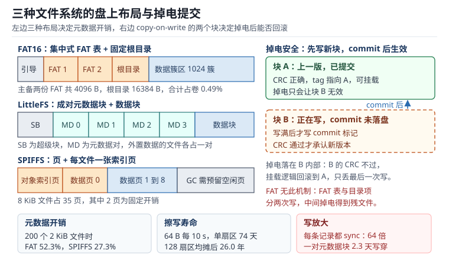

# 嵌入式文件系统：FAT、LittleFS 与 SPIFFS 的取舍

单片机上的"文件系统"和服务器上的不是一回事。服务器假设磁盘很大、掉电罕见、有日志和电池；单片机假设 Flash 只有几兆、掉电随时发生、RAM 只有几十 KB，而且产品要在无人值守的现场跑十年。

这三个假设把选型逼到了一条窄路上：要么用最通用但最脆弱的 FAT，要么用为掉电设计的日志结构（LittleFS、SPIFFS），代价是元数据开销和写放大。**没有一种方案同时赢下容量效率、掉电安全和寿命**，能做的只是把三者的账算清楚，选一个输得起的地方。

这一章不讨论"哪个文件系统更好"，只讨论"在什么负载下哪个的账更划算"。

## 1. 动机：四个真实的现场

::: motivation 四个现场
**现场一：断电后再也挂不上。** 设备在写配置文件的瞬间被拔电，重新上电时 `f_mount` 返回 `FR_NO_FILESYSTEM`。原因是 FAT 表写了、目录项写了、数据还没写完，或者反过来——三种顺序都可能是"最后一笔"，而 FAT 没有任何机制知道哪一笔没完成。恢复只能格式化，用户三年的数据全丢。

**现场二：两年写坏了 Flash。** 每 10 秒记一条 64 字节的传感器数据，直接往同一个 4 KiB 扇区里追加，满了擦除重写。按 1 万次擦写寿命算，这个扇区 74 天就到寿命。设备在保修期内返修，拆下来的芯片里只有前 4 KiB 区域有擦写痕迹。

**现场三：空间还有 20%，写入却返回 ENOSPC。** 用了 SPIFFS，卷使用率到 80% 以后，写入随机失败。原因是垃圾回收（Garbage Collection, GC）需要预留空闲页才能搬运，使用率越高，每次写入要搬运的页越多，最后连"搬一页的空间"都没有。

**现场四：200 个小文件吃掉 82% 的容量。** 4 MiB Flash、4 KiB 块、LittleFS，放了 200 个 2 KiB 的配置片段。算下来数据只有 400 KiB，实际占用 2400 KiB——元数据对占了 1600 KiB。文件数量而不是文件大小决定了容量。
:::

| 你想确认 | 先算 | 判据（工程经验值，非标准强制） |
|---|---|---|
| 元数据吃多少 | $(S_{total}-S_{data})/S_{total}$ | 小文件场景低于 30% |
| 擦写寿命 | $N_{erase}/N_{daily}$ | 大于 10 年 |
| 写放大 | $W_{flash}/W_{user}$ | 低于 4 倍 |
| 掉电后能否恢复 | 提交是否原子 | 单一 CRC 块切换 |
| 需要留多少空闲 | GC 余量 | 高于 15% |
| 格式化要多久 | 页数 × 单页擦除时间 | 小于看门狗超时 |

**不算会摔在哪**，四个带数字的代价：

1. **按数据量估容量。** 200 个 2 KiB 文件在 4 KiB 块的 LittleFS 上开销 83.3%，在 FAT16 上 52.3%，在 SPIFFS 上 27.3%。同一份数据，最差和最好的方案差一倍多。
2. **按"每天写多少字节"估寿命。** 真正决定寿命的是**擦除次数**，而擦除次数由"每次写触发多少个扇区擦除"决定。每条记录都 `f_sync` 的日志，写放大 64 倍，2.3 天就能写穿一对元数据块。
3. **忽略 GC 余量。** SPIFFS 在 80% 使用率下的写放大可能是 5~10 倍，寿命按标称值算会差一个数量级。设计目标是稳态使用率不超过 70%。
4. **把格式化当成瞬间操作。** 4 MiB 内部 Flash 按 2 KiB 页、每页 20 ms 擦除算，全片格式化 40.96 s。这期间如果看门狗在跑而没喂，格式化会被复位打断，留下一个"一半是旧数据、一半是空白"的卷。

## 2. 直观：三种盘上布局与三种掉电策略

上图左边是三种布局。FAT 把"文件内容在哪"集中记在 FAT 表里，所以表本身要占空间，且必须有两份备份；LittleFS 把每个目录/文件的元数据成对存放，靠"两个块交替、最后写提交标记"实现原子性；SPIFFS 把每个文件的数据摊成页，用一张索引页记录页的归属。右边是 LittleFS 的提交过程：新数据写进块 B，写完才写 commit 标记，掉电时块 A 始终是完整的旧版本。

### 2.1 FAT：集中式索引，最通用也最脆弱

FAT 的布局是四段：引导扇区（BPB）、FAT 表（通常两份）、根目录区（FAT16 固定位置）、数据区（簇）。每个文件的目录项 32 字节，记录文件名、长度、起始簇号；簇与簇之间靠 FAT 表串成链，链尾是 `0xFFFF`。

它的优点是**主机可直接读**：拔下 SD 卡插到电脑上就能看到文件，这在数据记录类产品里是硬需求。缺点是三处结构性弱点：

- **一次写入要改多个位置**：数据簇、FAT 表、目录项。三者不在一个扇区里，掉电必然出现"改了一半"的状态。
- **FAT 表是单点**：FAT 的第一份写坏了还能用第二份，两份都坏就只能格式化。
- **没有磨损均衡**：分配器从低地址找空簇，热点永远集中在前面几 MB。

FAT 的元数据开销是**与簇数成正比**的：FAT16 每个簇 2 字节，两份拷贝，所以表大小 = 簇数 × 4 字节。4 MiB 卷、4 KiB 簇时是 1024 个簇，表共 4096 字节；若把簇改成 512 字节，簇数变 8192，表变 32 KiB——**簇越小，表越大，但簇内浪费越小**，这是个必须算的权衡。

### 2.2 LittleFS：成对元数据 + 写时复制

LittleFS 把每个目录和每个文件的数据索引组织成"元数据对（Metadata Pair）"——两个块，交替写入。每次修改不是原地改，而是把新版本追加到"当前有效的那一块"里，最后写一个带 CRC 的提交标记（Commit Tag）。挂载时从两块中选 CRC 正确、序号更大的那个，另一块自动成为垃圾。

这套机制叫**写时复制（Copy-on-Write, COW）**：数据永远不原地改写，改的是"指向数据的指针"，而指针的切换是一次单块写入。原子性就来自于"单块写是原子的"这个硬件前提——对 NOR/NAND 的一页编程，要么完整落下，要么整页无效。

代价有两层：

- **每个外置数据的文件至少占一对块**。4 KiB 块时就是 8 KiB，一个 2 KiB 文件实际吃掉 12 KiB。只有小到 inline 阈值（默认块大小的 1/8，4 KiB 块下 512 字节）以内的文件才能把数据内联进元数据块，不额外占块。
- **每次提交重写整个元数据块**。写 64 字节的记录，如果每次都提交，实际写的是 4 KiB——写放大 64 倍。

LittleFS 的磨损均衡是内置的：`block_cycles` 参数（默认 500）规定一个元数据块被擦除多少次后强制迁移到别的块，避免热点集中。把它设成 `-1` 就等于关掉元数据迁移，寿命会掉一个数量级。

### 2.3 SPIFFS：扁平的日志结构

SPIFFS 把整片 Flash 切成 256 字节左右的页，每个文件有一张对象索引页，记录它的数据页分布。文件更新时新数据写到新页，索引页更新——本质上也是 COW，但**索引页的更新不是原子的**：一张索引页写了一半掉电，剩下的半张需要靠 `spiffs_check` 扫描回收。

它有三个鲜明的取舍：

- **没有目录**。名字里的 `/` 只是字符串的一部分，"目录"是逻辑概念。这省掉了目录元数据，也让 `opendir` 这类操作要靠全表扫描。
- **代码极小**。核心约 5 KB，RAM 占用低，适合 Flash 和 RAM 都紧张的 MCU。
- **GC 依赖空闲页**。空间不足时必须先把存活页搬到新位置、再擦除旧块。使用率超过约 70%~80% 后，写放大急剧上升，表现为"越满越慢"。

### 2.4 掉电安全的三代做法

| 代际 | 做法 | 代表 | 掉电后的状态 |
|---|---|---|---|
| 第一代 | 无保护，直接写 | 裸 Flash 写、简单 FAT | 数据与索引可能不一致，需人为修复 |
| 第二代 | 日志（Journaling）：先写日志区，再改原位 | ext4、JFFS2 | 重放日志可恢复到一致状态 |
| 第三代 | 写时复制：永不原地改，指针原子切换 | LittleFS、Btrfs | 自动回滚到上一个完整版本 |

三代的分界不是"有没有校验"，而是**"是否存在一个瞬间，之后的状态一定完整"**。日志靠"日志写完"这个瞬间，COW 靠"提交标记写完"这个瞬间。没有这个瞬间的设计，掉电后只能靠扫描去猜。

### 2.5 磨损均衡与坏块：两个不同的问题

**磨损均衡（Wear Leveling）** 解决"擦除次数不均匀"：动态均衡只搬热数据，静态均衡会定期把冷数据也搬一遍，让所有块轮流磨损。FAT 需要外部均衡层，LittleFS 靠块分配策略天然均衡，SPIFFS 靠 GC 顺带均衡。

**坏块管理（Bad Block Management）** 解决"某些块本身就是坏的"：NAND 出厂就有 2% 左右的坏块标记，使用中还会新增。文件系统必须在格式化时扫描并跳过，且**不能对坏块执行擦除**（会扩散）。NOR Flash 很少有出厂坏块，但擦写次数用尽后会出现"擦不干净"的块，同样要能跳过。

这两个问题常被混为一谈：均衡是"别把某一处用坏"，坏块是"坏了之后别用它"。前者靠策略，后者靠表。

### 2.6 目录与 inode 的开销从哪来

"inode"在嵌入式文件系统里通常叫"目录项"或"元数据块"，开销来自四处：

1. **文件固定开销**。FAT：32 字节目录项；LittleFS：一对块（有外置数据时）；SPIFFS：一张索引页。
2. **长文件名**。FAT 的长文件名（Long File Name, LFN）每 13 个字符占一个 32 字节槽位，还要额外一个短文件名槽。24 字符的名字要 2 个 LFN 槽 + 1 个 SFN 槽 = 96 字节。
3. **对齐与簇内碎屑**。4 KiB 簇装 2 KiB 文件，浪费 2 KiB；这部分不算元数据，但同样是容量损失。
4. **提交开销**。LittleFS 每次提交的 tag 与 CRC 约 4~8 字节，频繁提交时累积可观。

## 3. 定量：开销、寿命与写放大

### 3.1 元数据开销率

$$
O = \frac{S_{total} - S_{data}}{S_{total}} = 1 - \frac{S_{data}}{S_{total}}
$$

- $O$：元数据与对齐开销占实际占用容量的比例。
- $S_{data}$：用户数据的净字节数。
- $S_{total}$：卷上实际被占用的字节数（含元数据、索引、簇内碎屑）。

注意这里的 $O$ 是"占用效率"的反面，不是"占全卷的比例"。200 个 2 KiB 文件占 2400 KiB 时，$O = 1-400/2400 = 83.3\%$；而它占 4 MiB 卷的比例只有 58.6%。**前者决定"还能不能放下更多文件"，后者决定"卷够不够大"**，两个数都要看。

对 FAT，簇内碎屑的期望值是半个簇：

$$
W_{slack} \approx \frac{C}{2} \cdot N_{file}
$$

$C$ 为簇大小，$N_{file}$ 为文件数。4 KiB 簇、200 个文件时，期望浪费 $2048 \times 200 = 400$ KiB——比很多元数据项都大。

### 3.2 擦写寿命

Flash 的寿命由**擦除次数**决定，而不是写入字节数。设每 $R$ 字节擦除一次，则：

$$
N_{daily} = \frac{86400}{t_{rec}} \cdot \frac{1}{N_{rec/sector}}, \qquad t_{life} = \frac{N_{endur}}{N_{daily}} \cdot N_{sector}
$$

- $t_{rec}$：记录间隔，秒；$N_{rec/sector} = \lfloor S_{sector}/R \rfloor$：每个扇区能装多少条记录。
- $N_{endur}$：单块擦写寿命（NOR/内部 Flash 典型 10000 次，部分工业级 100000 次）。
- $N_{sector}$：参与轮转的扇区数。$N_{sector}=1$ 就是"没有磨损均衡"。
- $t_{life}$：寿命，单位为天。

公式的关键在最后乘的 $N_{sector}$：**磨损均衡的收益就是扇区数的倍数**。从 1 个扇区扩到 128 个，寿命直接乘 128。

### 3.3 写放大

$$
WA = \frac{W_{flash}}{W_{user}}
$$

- $W_{flash}$：实际写入 Flash 的字节数（含元数据重写、GC 搬运）。
- $W_{user}$：用户请求写入的字节数。

LittleFS 每次提交重写一个元数据块，所以写入 $R$ 字节记录时的 $WA \approx B_{block}/R$（$B_{block}$ 为块大小），与记录大小成反比。SPIFFS 的 $WA$ 随使用率上升，因为 GC 搬运量增加：

$$
WA_{spiffs} \approx \frac{1}{1-u}
$$

$u$ 为使用率。$u=0.5$ 时约 2 倍，$u=0.8$ 时 5 倍，$u=0.9$ 时 10 倍。这是"不要用到 90%"的定量依据。

### 3.4 格式化与挂载

格式化时间就是"擦完整片"：

$$
t_{format} = \frac{S_{vol}}{S_{page}} \cdot t_{erase}
$$

4 MiB / 2 KiB = 2048 页，每页 20 ms，得 40.96 s。挂载时间则取决于"要读多少个块"：

$$
t_{mount} = N_{block} \cdot \frac{B_{block}}{BW_{read}}
$$

20 MHz 四线 QSPI 的有效带宽约 2.5 MB/s 时，读一个 4 KiB 块要 1.64 ms。挂载只读超级块对（2 块）时 3.3 ms；做全盘遍历时块数上去，时间线性增长。

## 4. 算例：三个工作负载的账

统一假设：4 MiB 卷，FAT16 用 4 KiB 簇、两份 FAT、512 项目录；LittleFS 分别取 4 KiB 块和 512 B 块；SPIFFS 取 256 字节页、每页 4 字节头、每文件 2 页固定开销。所有开销率按 $O=1-S_{data}/S_{total}$ 计算。

### 4.1 算例一：三种布局对三个工作负载

| 工作负载 | 数据量 | FAT16 | LittleFS 4 KiB 块 | LittleFS 512 B 块 | SPIFFS 256 B 页 |
|---|---|---|---|---|---|
| A：200 个 2 KiB 文件 | 400 KiB | 52.3% | 83.3% | 33.3% | 27.3% |
| B：32 个 100 KiB 文件 | 3200 KiB | 0.7% | 7.4% | 1.0% | 2.2% |
| C：50 个 8 KiB 文件 | 400 KiB | 5.8% | 50.0% | 11.1% | 8.6% |

逐个拆开看：

**工作负载 A（200 个 2 KiB 文件）。** FAT 每个文件占 1 个 4 KiB 簇，实占 800 KiB；加上 FAT 表 4 KiB、根目录 16 KiB、目录项 200 × 96 B = 18.75 KiB，总 838.75 KiB，开销 $1-400/838.75 = 52.3\%$。LittleFS 4 KiB 块时，每个文件 1 个数据块 + 1 对元数据块 = 12 KiB，200 个文件 2400 KiB，开销 83.3%——**这就是现场四**。把块改成 512 B，每文件 4 个数据块 + 1 对元数据块 = 6 块 = 3 KiB，总 600 KiB，开销降到 33.3%。SPIFFS 每文件 8 个数据页 + 2 个固定页 + 索引，共 11 页 = 2816 B，总 550 KiB，开销 27.3%。

**工作负载 B（32 个 100 KiB 文件）。** 100 KiB 正好是 25 个 4 KiB 簇，没有簇内碎屑；FAT 开销只有表 4 KiB + 根目录 16 KiB + 目录项 3 KiB，$1-3200/3223 = 0.7\%$。LittleFS 4 KiB 块时每文件 25 个数据块 + 2 个元数据块 = 27 块，开销 7.4%；换成 512 B 块后元数据占比骤降（2 块只占 1 KiB），开销 1.0%。SPIFFS 2.2%。

**工作负载 C（50 个 8 KiB 文件）。** 8 KiB 刚好 2 个簇，FAT 开销 5.8%；LittleFS 4 KiB 块下 2 + 2 = 4 块，开销 50%；512 B 块下降 16 块 + 2 块，开销 11.1%；SPIFFS 8.6%。

三条结论：

1. **LittleFS 的开销由"文件数 × 2 块"决定，与文件大小无关。** 块越大，这个固定成本越高。文件多而小时，必须把块调小。
2. **FAT 的开销由"簇内碎屑 + 目录项"决定。** 文件大小恰好是簇的整数倍时开销极低；否则每个文件平均浪费半个簇。
3. **SPIFFS 的页级开销最平缓**，因为它没有"每个文件一对块"这种固定成本，代价是索引页和 GC。

### 4.2 算例二：64 字节记录能写多久

内部 Flash 扇区 4 KiB、擦写寿命 10000 次、记录 64 字节、每 10 秒一条。

- 每扇区装 $4096/64 = 64$ 条，装满需 $64 \times 10 = 640$ s。
- 每天擦除 $86400/640 = 135$ 次。
- 不均衡时寿命 $10000/135 = 74.1$ 天，约 2.4 个月。
- 若在 128 个扇区（512 KiB）间轮转：$74.1 \times 128 = 9481$ 天 = **26.0 年**。

同一份数据，均衡与否差 128 倍。作为对照：记录改成 256 字节时每扇区只装 16 条，每天擦 $86400/160 = 540$ 次，寿命 18.5 天；记录间隔改成 1 秒、仍是 64 字节时每天 1350 次，寿命 7.4 天。**记录频率和长度都在线性地吃寿命。**

### 4.3 算例三：每条记录 f_sync 的写放大

日志型文件系统里，每条记录都调用 `f_sync`（或 littlefs 的 `lfs_file_sync`）会强制提交元数据：

- 一天 8640 条记录（10 秒一条），每条提交重写 4 KiB 元数据块 → $8640 \times 4096 = 33.75$ MiB/天。
- 写放大 $WA = 4096/64 = 64$ 倍。
- 元数据对只有两个块交替，每块每天承受 $4320$ 次擦除 → 寿命 $10000/4320 = 2.31$ 天。
- 若磨损均衡把擦除摊到 1024 个块：每块每天 $4320/1024 = 4.22$ 次 → $10000/4.22 = 2370$ 天 = **6.5 年**。

差 1024 倍，而这个倍数就是卷的块数。工程结论很直接：**别在每条记录上做 sync**。按 4 KiB 缓冲攒满再提交，写放大从 64 降到 1 量级，寿命从 2.3 天回到数年。

### 4.4 算例四：格式化与挂载要多久

格式化 4 MiB：$4096/2 \times 20\ \text{ms} = 2048 \times 20 = 40960$ ms = **40.96 s**。这期间必须喂狗，或者把格式化拆成"按需擦除"——只擦元数据区，数据区在首次分配时再擦。

挂载：LittleFS 只读超级块对 2 个块，$2 \times 1.64 = 3.28$ ms；做全盘遍历（50 个目录，每个一对块）时 100 个块，$100 \times 1.64 = 164$ ms。FAT 挂载读 BPB 与根目录，通常在 5 ms 内；但打开一个 200 项的目录要扫 6400 字节目录项 = 2 个簇 ≈ 3.3 ms。

### 4.5 算例五：SPIFFS 的 GC 余量

512 KiB 卷，使用率 80% 时空闲 102.4 KiB。按 $WA \approx 1/(1-u) = 5$ 算，用户写 1 KiB 实际要写 5 KiB，其中 4 KiB 是搬运。若一次写入需要搬运的最大存活页数超过 102.4 KiB，GC 就无法推进，返回 `SPIFFS_ERR_FULL`——尽管"空闲还有 20%"。

按 8% 的余量（40 KiB）设计时，单次写入必须小于 $40\ \text{KiB}/WA_{max}$ 的数量级。经验做法：**把稳态使用率控制在 70% 以下，并保证单次写入不超过空闲量的 1/10。**

## 5. 工程含义：选型、配置与恢复

### 5.1 选型决策树

按顺序问四个问题：

1. **需要被 PC/相机/读卡器直接读取吗？** 需要 → FAT（这是它唯一不可替代的优势）。
2. **掉电是常态吗（电池设备、现场插拔）？** 是 → LittleFS 或 SPIFFS，不要用裸 FAT。
3. **文件多而小（配置、日志分片）吗？** 是 → 块大小必须调小，或改用 SPIFFS；LittleFS 用 4 KiB 块会付出 80% 的代价。
4. **RAM 和代码空间极度紧张吗（小于 16 KB RAM）？** 是 → SPIFFS；否则 LittleFS 的掉电语义更干净。

一句话总结：**要兼容选 FAT，要掉电安全选 LittleFS，要省 RAM 选 SPIFFS，文件多而小则先算元数据再选。**

### 5.2 块大小与页大小怎么定

- LittleFS 的块大小决定"每文件元数据成本"：块大小 × 2 就是每个有外置数据的文件的固定开销。文件平均大小 $F$、块大小 $B$ 时，开销率约 $2B/(F+B)$——$B$ 应当取 $F$ 的 1/4 到 1/2，而不是取 Flash 的擦除粒度上限。
- 块大小不能小于 Flash 的擦除粒度（否则一次擦除会破坏多个块），也不能大到让 RAM 里的缓存装不下两个块（挂载时至少要缓存一个块）。
- SPIFFS 的页大小应与 Flash 的写粒度对齐（通常是 256 字节），块大小取页的若干倍。页太小则每页头的开销占比上升，页太大则写放大上升。

### 5.3 掉电安全的配置清单

1. **提交要原子**。确认所用文件系统的提交是"单块写"语义；FAT 上必须自己加"影子配置 + 双份 + CRC"。
2. **每个文件写完再关闭**。`f_close` 会写目录项，不能省；`f_sync` 只在需要持久化的时刻调用。
3. **掉电测试要做在真实的写时刻**。用继电器在随机时刻切断电源，反复 1000 次，每次都验证"能挂载、能读出上一个完整版本"。
4. **留 15% 以上空闲**。GC 需要搬运空间，满盘写入是损坏的高发场景。
5. **格式化后做一次写-读-校验**，再写"已初始化"标记，避免把半格式化卷当成有效卷。
6. **保留一个只读的出厂分区**，里面放默认配置和文件系统镜像，主卷损坏时可重建。

### 5.4 文件系统损坏后的恢复流程

先分清"挂载失败"和"数据错乱"，两者的处置完全不同：

| 现象 | 可能原因 | 处置顺序 |
|---|---|---|
| `f_mount` 返回 `FR_NO_FILESYSTEM` | BPB/超级块被破坏 | 先 dump 原始镜像到 PC；尝试从备份 BPB 恢复；失败则格式化 |
| 挂载成功但读文件返回 `FR_INT_ERR` | FAT 链断裂或循环 | 用 `f_chkdsk` 类工具修复链；不能修就删掉该文件 |
| 文件长度为 0 但实际有数据 | 目录项未写完整 | 扫描 FAT 链找孤儿簇，重建目录项 |
| `ENOSPC` 且空间充足 | GC 无法推进 | 降低使用率、增大卷、或换文件系统 |
| LittleFS 挂载回滚到旧版本 | 新提交未完成 | 正常行为，不需要修；检查是否频繁掉电 |
| SPIFFS 挂载失败 | 页/块配置不匹配，或索引页损坏 | 先核对配置；再用 `spiffs_check` 回收 lost pages |

三条纪律：

1. **先取证再修复**。出问题的第一件事是把整片 Flash 读出来存成文件，在 PC 上离线分析。设备上反复尝试写只会破坏现场。
2. **恢复要有兜底**。双卷（A/B）设计：主卷损坏时切到备份卷并用出厂镜像重建，同时上报故障码。
3. **修复逻辑本身要能被测试**。把"人为破坏镜像"的用例放进 CI：改坏 BPB、截断 FAT 链、把一个块填成 0xFF，验证恢复流程不会二次损坏。

## 6. 常见坑

::: pitfall 坑一：每条记录都 f_sync，两个月写穿 Flash
**现象**：设备使用两个月后开始出现写入失败或数据丢失，拆机发现 Flash 前几个扇区的擦除计数远超其他区域。
**原因**：日志文件每写一条记录就 `f_sync`，每次提交重写整个元数据块，写放大 64 倍。按 4 KiB 块算，一对元数据块在 2.3 天内被擦 4320 次。
**解决**：改为缓冲写入，攒满一个块或每 N 条提交一次；把 `f_sync` 留给"关键状态变更"（如配置修改、断电前的最后一次刷新）；用 `block_cycles` 或外部磨损均衡层把擦除摊开。
:::

::: pitfall 坑二：断电后挂载失败，代码直接格式化
**现象**：用户反馈"每次拔电后数据全丢"，售后能复现但开发环境复现不了。
**原因**：挂载失败的处理逻辑写成"失败就 `f_mkfs` 重建"，把一次可恢复的元数据损坏升级成数据全丢。FAT 的双份 FAT 表、LittleFS 的元数据对本来都还有回滚余地。
**解决**：挂载失败先尝试只读挂载与修复（换另一份 FAT、切到另一个元数据块），再决定是否格式化；格式化前把镜像 dump 到备份区；用双卷设计让"重建"只影响一个卷。
:::

::: pitfall 坑三：SPIFFS 用了 85%，写入开始随机失败
**现象**：删除文件后空间"看起来够了"，但写入间歇性返回 `SPIFFS_ERR_FULL`；设备越用越慢。
**原因**：GC 需要空闲页搬运存活页，使用率越高单次写入要搬的页越多，写放大按 $1/(1-u)$ 上升。到某个点，搬一页的空间都不够，写入直接失败。
**解决**：把稳态使用率压到 70% 以下；单次写入大小限制在空闲量的 1/10 以内；监控 GC 次数（`spiffs_gc_quick` 返回值），超过阈值就主动清理或上报。
:::

## 7. 自测题

题一：200 个 2 KiB 文件放在 4 MiB 卷上，FAT16（4 KiB 簇）与 LittleFS（4 KiB 块）各占多少？差异从哪来？

FAT16：每个文件占 1 个簇 4 KiB，共 800 KiB；FAT 表 $1024 \times 2 \times 2 = 4096$ B；根目录 16384 B；目录项 200 × 96 B = 19200 B。总占用 838.75 KiB，开销 $1-400/838.75 = 52.3\%$。

LittleFS：每文件 1 个数据块 + 1 对元数据块 = 3 块 = 12 KiB，200 个文件 2400 KiB，开销 $1-400/2400 = 83.3\%$。

差异来自"固定成本"的性质：FAT 的固定成本是 32~96 字节目录项，随文件数线性增长但系数很小；LittleFS 的固定成本是**每文件 2 个整块**，系数是块大小的两倍。块从 4 KiB 改成 512 B 后，LittleFS 开销降到 33.3%，说明这个成本是块大小的函数，不是数据量的函数。

题二：64 字节记录、每 10 秒一条、4 KiB 扇区、1 万次寿命。不均衡能写多久？128 扇区轮转呢？

每扇区 $4096/64 = 64$ 条，装满 $64 \times 10 = 640$ s。每天擦 $86400/640 = 135$ 次。

不均衡：$10000/135 = 74.1$ 天。

128 扇区轮转：$74.1 \times 128 = 9481$ 天 = 26.0 年。

关键在"寿命与扇区数成正比"——磨损均衡的收益就是可轮转的块数。这也解释了为什么把日志写在单一扇区上的设备总在保修期内坏。

题三：为什么 LittleFS 的写放大等于块大小除以记录大小？给出 64 字节记录、4 KiB 块时的数值，并说明如何降低。

LittleFS 每次提交都要把新的元数据版本写进一个块（不是就地改几个字节），所以用户写 $R$ 字节，Flash 上写的是一个完整块 $B$：

$$
WA = \frac{B}{R} = \frac{4096}{64} = 64
$$

一天 8640 条记录对应 $8640 \times 4096 = 33.75$ MiB 的写入。

降低办法：攒批提交。把 $n$ 条记录合并成一次提交，$WA = B/(nR)$。攒到 64 条再提交，$WA$ 从 64 降到 1。副作用是崩溃时最多丢 64 条记录，这个"最多丢多少"必须写进需求，而不是由实现偶然决定。

题四：挂载失败时，为什么"先 dump 镜像再修复"比"直接格式化"更可取？给出两条可恢复路径。

因为损坏往往是局部的，而格式化是不可逆的全局操作。先 dump 至少保留了两条恢复路径：

1. **FAT 双表**：第一份 FAT 坏了可以用第二份；BPB 的主备份也在引导扇区与备份扇区里各有一份。dump 出来后可以在 PC 上对比两份表，重建正确的链。
2. **LittleFS 元数据对**：两个块里只要有一个 CRC 正确就能回滚到上一个完整版本，这是设计好的行为，不需要修复就能挂载。

而直接格式化的后果是：所有可恢复的数据一次清零，且现场证据消失，无法判断是掉电、写穿还是软件 bug。正确顺序是"取证 → 只读挂载 → 修复 → 最后才格式化"，并且格式化前把镜像备份到另一个分区或上报到云端。

## 8. 参考资料

1. ChaN, *FatFs - Generic FAT Filesystem Module* 应用笔记：`f_mount`/`f_mkfs`/`f_sync` 的语义、簇大小选择与 `_MAX_SS`/`_FS_TINY` 配置对 RAM 的影响。本章 FAT 的目录项与簇链描述依据该文档。
2. Microsoft, *FAT: General Overview of On-Disk Format* v1.03：BPB 字段、FAT 表项取值（含坏簇标记）、32 字节目录项与 LFN 每 13 字符一槽的规则。本章 LFN 96 字节的算例来自该规范。
3. Christopher Haster, *LittleFS - A high-integrity embedded file system*：metadata pair 的提交协议、CRC tag、inline 阈值（块大小的 1/8）、`block_cycles` 磨损均衡参数。本章 2.2 与 5.3 的配置建议据此。
4. Peter Andersson, *SPIFFS Technical Design*：页与对象索引页布局、日志结构分配、GC 触发条件与 `spiffs_check` 的一致性修复流程。
5. Micrium, *µC/FS User Manual* Chapter 4：嵌入式 FAT 实现的缓存与同步策略，用于解释"为什么 `f_close` 必须调用"。
6. STMicroelectronics, *AN3969* EEPROM emulation 与 *AN4894* 内部 Flash 擦写寿命说明：擦写次数、扇区粒度与写放大的工程取值。
7. SD Association, *SD Specifications Part 2 File System Specification*：FAT 卷在可移动介质上的兼容性要求，是"数据记录产品必须用 FAT"的规范依据。
