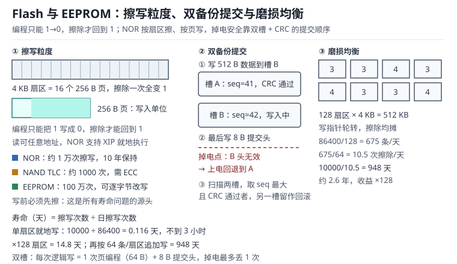

# Flash 与 EEPROM：擦写粒度、寿命与掉电安全写入 | Flash and EEPROM: Granularity, Endurance and Fail-Safe Writes

Flash 有三条与 RAM 完全不同的规矩：读可以按字节，写必须按页，擦必须按扇区；编程只能把位从 1 写成 0，想把 0 变回 1 只能擦除；每擦一次就消耗一次寿命。EEPROM（Electrically Erasable Programmable Read-Only Memory，电可擦可编程只读存储器）是例外，它允许逐字节改写，代价是容量小、单价高、写入慢。

这三条规矩直接决定产品可靠性。一个每秒保存一次参数的设备，用 1 万次寿命的片内 Flash，0.116 天（约 2.78 小时）就能写坏一页；一次掉电恰好落在页编程中间，半新半旧的配置足以让设备变砖；一块 SPI NOR 如果按“覆盖写”的思路使用，读回来的数据会是新旧值按位与的结果，看起来像随机乱码。本章从浮栅讲起，把页、扇区、块的粒度，寿命公式，写放大，双备份提交顺序与模拟 EEPROM 的容量账全部落到可复算的算式上。

启动流程与 Flash 的配合见[启动与引导](../basics/startup-boot.md)；掉电时如何保住最后几条日志，还牵涉[中断与 NVIC](../mcu/interrupt-nvic.md)里的临界区设计。

## 1. 动机：四个写坏的现场

::: motivation 四个现场
**现场一：结构体直接写进 Flash。** 配置区每次修改都 `memcpy` 到同一地址，没有擦除。上电读回来校验失败，设备用默认值启动，用户设置的量程、地址、校准系数全丢。更隐蔽的是“有时能读出来”：读回值其实是新值与旧值的按位与，只有旧值的 1 位恰好被新值的 0 位覆盖时，结果才恰好等于新值，换一组参数就错。

**现场二：每秒存一次累计流量。** 计数写在 1 KB 的页里，每次改动都擦一次。1 万次寿命，每秒一次，$10000/86400=0.116$ 天（约 2.78 小时）。设备装上去不到三小时就开始丢配置，返修拆下来读，整页都是 0xFF。

**现场三：掉电恰逢页编程。** 512 B 的配置写到一半断电，头部写完了、数据区只写了一半。上电时 CRC 校验失败，两份配置都判无效，设备进入安全模式，现场无法恢复。事后统计，随机断电 500 次里撞上写窗口 0.8 ms 的概率并不为零。

**现场四：EEPROM 页写跨页。** 24C02 的页大小是 8 B，从地址 0x06 连续写 10 B，写完发现 0x00~0x07 全被覆盖。原因是页写缓冲区的地址在页内回卷，多出来的 2 B 绕回了页首，把相邻参数冲掉。
:::

| 你想确认 | 先算 | 判据（工程经验值，非标准强制） |
|---|---|---|
| 寿命 | 擦写次数 ÷ 日擦写次数 | 大于产品设计寿命的 2 倍 |
| 日擦写次数 | 日写入次数 ÷ 参与均衡的页数 | 每页每天小于耐久度的 1/3650 |
| 写放大 | (编程字节 + 擦除字节) ÷ 主机字节 | 日志型 2~3，就地改写可达上千 |
| 掉电窗口 | 页编程时间 × 页数 | 小于写入周期的 0.1% |
| 校验强度 | CRC-32 漏检率 | 小于 $10^{-9}$ |
| 备份份数 | 双槽 + 提交头 | 任意单点掉电至少剩一份有效 |

**不算会摔在哪**，四个带数字的代价：

1. **寿命按“写入次数”而不是“擦除次数”估。** NOR 的寿命单位是擦除次数，一次擦除对应一整页的改写。1 KB 页上改 4 B，寿命消耗和改 1 KB 一样。
2. **忽略擦除时间。** 128 KB 扇区擦除要 1~2 s，4 KB 扇区 45 ms（典型值，最大 400 ms）。擦除期间总线被占，中断延迟变大，看门狗可能先复位。
3. **掉电窗口没算。** 512 B 分两页编程，每页 0.4 ms，窗口 0.8 ms；写周期 60 s 时撞上的概率是 $0.8/60000=1.3\times10^{-5}$，1000 次断电测试期望撞上 0.013 次——不做双备份，这个概率迟早兑现。
4. **磨损集中在一个扇区。** 配置区每秒写一次、日志区从不写，寿命由配置区决定；把配置改成“变化才写 + 双槽轮换”，寿命立刻放大两个数量级。

## 2. 直观：从浮栅到页、扇区、块

### 2.1 原理图：擦写粒度与双槽提交

Flash 的存储单元是一个带浮栅（Floating Gate）的 MOS 管。向浮栅注入电子，阈值电压升高，读出来是 0；把电子抽走，阈值电压降低，读出来是 1。注入靠热电子注入或 Fowler-Nordheim 隧穿，抽取靠隧穿——每一次注入和抽取都会在隧穿氧化层里留下陷阱，积累到一定程度，单元就再也分不清 0 和 1。这就是“擦写寿命”的物理来源。

因为擦除要在一整块区域上加高压，写又需要精确控制每一位，器件的操作粒度被硬性分成三层：**读**可以按字节甚至按位，**写（编程）**按页，**擦除**按扇区或块。

### 2.2 单元、页、扇区与块

以一颗 128 Mbit 的 SPI NOR（W25Q128JV）为例：容量 16 MB，擦除最小单位是 4 KB 扇区（Sector），也可以一次擦 64 KB 块（Block）或整片；写入单位是 256 B 页（Page）；读取可以任意地址。页编程命令一次最多写一页，超过 256 B 会在页内回卷，而不是自动进位到下一页。

MCU 片内 Flash 的划分不同：STM32F103 中容量器件是 1 KB 一页，高容量是 2 KB 一页；STM32F405 则是 16 KB×4、64 KB×1、128 KB×7 的不等大扇区。写单位是半字或字（16/32 位），擦除单位是页或扇区。**片内 Flash 没有“页写回卷”这回事，但有“必须整扇区擦”的硬约束**：想改一个字节，得把整扇区读到 RAM、改完、擦除、再写回。

NAND 的层次更多：页（2 KB 或 4 KB）是读写单位，块（128 KB 或 256 KB）是擦除单位，每页附带 64 B 或 128 B 的备用区（Spare Area，也叫 OOB，Out-of-Band），用来放 ECC 校验码、坏块标记和文件系统元数据。NAND 出厂就允许存在坏块，使用中还会新增坏块，必须配合 ECC 与坏块管理。

EEPROM 是另一种结构：每个字节有独立的擦写通路，可以逐字节改写，不需要“先擦后写”。代价是单元面积大、容量小（常见 2 Kbit~512 Kbit）、写入慢（24C02 一次写周期 5 ms），而且页写缓冲区只有 8~32 B。

| 器件 | 读粒度 | 写粒度 | 擦除粒度 | 典型耐久度 | 典型保持时间 |
|---|---|---|---|---|---|
| MCU 片内 Flash | 字 | 半字/字 | 1~128 KB 扇区 | 1 万次 | 20 年（85 ℃） |
| SPI NOR | 字节 | 256 B 页 | 4 KB 扇区 | 10 万次 | 20 年 |
| NAND SLC | 页 | 2 KB 页 | 128 KB 块 | 10 万次 | 10 年 |
| NAND TLC | 页 | 4 KB 页 | 256 KB 块 | 1 千次 | 1~3 年 |
| EEPROM | 字节 | 字节/页 | 字节 | 100 万次 | 100 年 |

### 2.3 三种器件的分工

- **片内 Flash**：放代码和少量参数。容量小、擦除慢、寿命最低，但不需要外部器件，读取可以 XIP（Execute In Place）。
- **SPI NOR**：放日志、字库、固件备份。容量大、可按扇区擦、支持随机读，是“小文件系统”的常见载体。
- **EEPROM**：放校准系数、序列号、用户设置。容量最小、单价最高，但可以逐字节改，写入次数多一个数量级。
- **NAND**：放大量数据（录音、图像、大批日志）。单位容量最便宜，但必须配 ECC、坏块管理和磨损均衡，裸片直接用基本都会丢数据。

## 3. 定量：擦写粒度、寿命与写放大

### 3.1 擦写粒度的账：写放大

写放大（Write Amplification，WAF）定义为“真正写进介质的数据量”除以“主机要求写入的数据量”。就地改写一个字节的代价：

$$WAF_{inplace}=\frac{B_{erase}+B_{prog}}{B_{host}}$$

以 4 KB 扇区、256 B 页、改 4 B 为例：擦除 4096 B、写回 256 B，$WAF=(4096+256)/4=1088$。这就是为什么“每次改动都擦整页”的代码会把寿命吃光。日志型写入把多条记录攒在一页里，擦除被摊薄：

$$WAF_{log}=\frac{B_{prog}+B_{erase}/R_{erase}}{B_{host}}$$

$R_{erase}$ 是每个擦除单元能容纳的记录数（不是每页记录数）。64 B 记录、4 KB 扇区，一个扇区放 $4096/64=64$ 条，$WAF=(64+4096/64)/64=2$；若只统计编程字节而把擦除成本记在账外，$WAF=(64+0)/64=1$，两个数字差 2 倍，说明即便布局最优，擦除也要占一半的介质写入量。

NAND 的写放大还要加备用区：2 KB 页配 64 B OOB，$WAF=(2048+64)/2048=1.031$。

### 3.2 掉电窗口与提交顺序

掉电安全的核心不是“写得快”，而是“任何时刻断电，都能读出一个自洽的旧版本或新版本”。双备份（Dual-Slot）的做法是准备两个同样大小的槽 A、B，每次只写其中一个，写完并校验通过后才把另一个标记为旧。

一次写入的提交顺序必须是：

1. 擦除目标槽（若它还不是空白的）；
2. 写数据区；
3. 最后写头部，头部含魔数、序号 seq、长度、数据 CRC-32；
4. 读回校验；
5. 把旧槽标记为失效（可选）。

**头部是提交点（Commit Point）**：头部没写成功，这个槽就永远不算数。上电时扫描两个槽，只接受“魔数正确、头 CRC 正确、数据 CRC 正确”的槽，取 seq 最大的那个；两个都有效就选新的，一个有效就用另一个，两个都无效才回退到默认值。

CRC-32 对随机错误的漏检率约 $2^{-32}\approx2.3\times10^{-10}$，比任何“魔数 + 长度”的组合都可靠。代价是每次读要算一遍 512 B 的 CRC，72 MHz 下软件 CRC 大约几十微秒，可以接受；有硬件 CRC 外设时几乎免费。

### 3.3 寿命模型与磨损均衡

寿命的第一性公式只有一句：

$$t_{life}=\frac{E}{W_{day}/P}$$

$E$ 是擦写耐久次数，$W_{day}$ 是每天的逻辑写入次数，$P$ 是参与磨损均衡的页数。分母 $W_{day}/P$ 就是“每页每天被擦几次”。等价地：

$$t_{life}=\frac{E\times P}{W_{day}}$$

磨损均衡（Wear Leveling）的全部作用就是把 $P$ 做大：写入在 $P$ 个页之间轮转，每页分摊 $1/P$ 的擦除。收益是线性的：

$$G=P\quad(\text{就地写}),\qquad G=P\times R_{erase}\quad(\text{追加写})$$

追加写（Append-Only）按记录顺序填满整个擦除单元（例如 16 个 256 B 页、共 64 条 64 B 记录）才擦下一个单元，因此一次擦除的寿命覆盖 $R_{erase}$ 条记录。两种收益可以叠加：先按扇区轮转，再在扇区内追加。

### 3.4 取值与权衡：页大小、份数与校验

| 选择 | 取值方向 | 代价 |
|---|---|---|
| 页大小 | 记录大小 × 整数倍，留头部空间 | 页越大，单次编程越久、内部碎片越多 |
| 扇区/块大小 | 与擦除时间、容量平衡 | 4 KB 擦除 45 ms，128 KB 擦除 1~2 s |
| 备份份数 | 2 份（双槽） | 容量翻倍，擦除次数翻倍 |
| 校验 | CRC-32（数据 + 头） | 计算时间、代码体积 |
| 日志布局 | 环形追加，写满迁移 | 需要一个写指针与迁移逻辑 |
| 配置写入 | 变化才写，RAM 缓存 | 掉电会丢最后一次未提交的修改 |
| 文件系统 | littlefs/自研日志，不用 FAT | FAT 掉电不安全，需要额外修复 |

“双槽 + 每次擦除”会把擦除次数翻倍：两个槽各擦一半的写入，单槽寿命 $E$，总逻辑写入 $2E$。如果配置一天只改几次，这个代价可以忽略；如果一天改几千次，就该换成“日志追加 + 定期整理”，而不是双槽就地擦。

## 4. 算例：七个可复算的寿命账

### 4.1 算例一：每秒写一次能撑几天

1 KB 页是 MCU 片内 Flash，耐久 1 万次；每秒写一次：

$$t_{life}=\frac{10000}{86400}=0.116\ \text{天}\approx2.78\ \text{小时}$$

0.116 天还不到 3 小时。每天写一次呢？$10000/1=10000$ 天，约 27.4 年——寿命完全不是问题。**写入频率才是寿命的分母**，这一点比任何“选大容量”都重要。

### 4.2 算例二：磨损均衡的收益

把每秒 1 次、每天 86400 次的写入摊到 128 个 4 KB 扇区（512 KB 的 SPI NOR，耐久 10 万次）上：

$$W_{page}=\frac{86400}{128}=675\ \text{次/页/天},\qquad t_{life}=\frac{100000}{675}=148.1\ \text{天}$$

收益正好 128 倍。若每个扇区再按 64 条记录追加写：

$$W_{page}=\frac{675}{64}=10.547\ \text{次/页/天},\qquad t_{life}=\frac{100000}{10.547}=9481\ \text{天}\approx26.0\ \text{年}$$

两项收益相乘：$128\times64=8192$ 倍；单扇区基准 $100000/86400=1.157$ 天，乘 8192 得 $100000\times8192/86400=9481$ 天（约 26.0 年）。

### 4.3 算例三：追加写与就地写差多少

条件：4 KB 扇区、64 B 记录、每扇区 64 条、128 个扇区（512 KB）、1 Hz。

- 就地写：每条记录擦一次扇区，$W_{page}=86400/128=675$ 次/天，寿命 $100000/675=148.1$ 天；
- 追加写：写满 64 条才擦一次，$W_{page}=675/64=10.547$ 次/天，寿命 $100000/10.547=9481$ 天（约 26.0 年）。

同一条记录、同一块 Flash，只因布局不同，寿命差 64 倍。追加写的代价是需要一个“写指针”和迁移逻辑：写满当前扇区，擦除下一个扇区，把指针移过去；迁移过程中掉电，需要能从头部序号恢复。

### 4.4 算例四：模拟 EEPROM 的容量账

用 1 KB 页模拟 EEPROM，每条记录 4 B（2 B 虚拟地址 + 2 B 数据，AN2594 的做法），两页轮换：

$$N_{rec}=\frac{1024}{4}=256\ \text{条/页}$$

每 256 次写入迁移一次、擦除一次，所以每次写入消耗的擦除次数是 $1/256$：

$$N_{writes}=2\times10000\times256=5.12\times10^{6}\ \text{次}$$

每秒写一次：$5.12\times10^{6}/86400=59.3$ 天；每分钟一次：$5.12\times10^{6}/1440=3556$ 天，约 9.7 年。把记录改成 8 B（加 CRC 与长度），容量减半，寿命也减半——**校验字节是从寿命里扣的**。

### 4.5 算例五：双备份把掉电窗口变成可控量

配置 512 B，分两页编程，每页 0.4 ms；掉电窗口 0.8 ms。写入周期 60 s 时：

$$P_{hit}=\frac{0.8\ \text{ms}}{60\ \text{s}}=1.33\times10^{-5}$$

1000 次随机断电，期望撞上 $1000\times1.33\times10^{-5}=0.013$ 次。概率很低，但产品卖 10 万台、每台每年断电 100 次，一年就是 $10^{5}\times100\times1.33\times10^{-5}=133$ 次——没有双备份，就是 133 台设备配置损坏。

有双备份时，撞上写窗口只意味着“新版本没提交”，上电仍能读回旧版本，功能不受影响；只有“旧槽已被标记失效、新槽又没提交”才会丢配置，而正确的提交顺序保证这不会发生。

### 4.6 算例六：EEPROM 页写回卷

24C02 页大小 8 B，从地址 0x06 连续写 10 B。地址序列是 0x06、0x07，然后回卷到 0x00 继续，最后 0x00~0x07 全部被覆盖。原本想写的 0x08、0x09 根本没被写到，而 0x00、0x01 上的旧参数被冲掉。

正确做法是按页边界拆分：0x06 写 2 B，然后重新发起一次从 0x08 开始的写；或者把缓冲区按 8 B 对齐，一次只写一页。SPI NOR 的页编程同样会在 256 B 边界回卷，跨越页边界时必须拆成两次命令。

### 4.7 算例七：NAND 的 ECC 与写放大

2 KB 页、64 B OOB，要求每 1 KB 纠正 40 bit。每页需要 $40\times2=80$ bit，即 10 B；OOB 还剩 54 B 放坏块标记、逻辑地址与版本号。写放大 $(2048+64)/2048=1.031$，也就是写 1 MB 主机数据，介质上实际写 1.031 MB。

ECC 的强度决定了能用多久：SLC 的原始误码率约 $10^{-5}$，40 bit/1 KB 的 BCH 可以把不可纠正错误率压到 $10^{-15}$ 以下；TLC 的原始误码率高两个数量级，同样的 ECC 只能撑更短的时间，所以 TLC 必须配 LDPC（Low-Density Parity-Check，低密度奇偶校验）与更强的读重试。

### 4.8 设计示例：8 MB NOR 记录仪的完整账

需求：1 条/分钟、每记录 64 B、保留 30 天、掉电安全、设计寿命 10 年。

1. **容量。** 30 天需要 $30\times1440=43200$ 条，$43200\times64=2.76$ MB。取 4 MB 日志区，相对需求留出 45% 余量。
2. **寿命。** 4 MB 日志区 = 1024 个 4 KB 扇区，每扇区 64 条，SPI NOR 耐久 10 万次，总记录数 $1024\times64\times100000=6.5536\times10^{9}$ 条；按每天 1440 条算，可用 $6.5536\times10^{9}/1440=4.5511\times10^{6}$ 天，约 12469 年。寿命远不是瓶颈。
3. **保留时间。** 环里能放 $4\ \text{MB}/64\ \text{B}=65536$ 条，每天 1440 条，覆盖 45.5 天，满足 30 天。
4. **配置区。** 两个 4 KB 槽，双槽轮换，每天改 10 次：每槽每天 5 次擦除，$100000/5=20000$ 天，约 54.8 年，已超过 10 年设计寿命。若写入频率再高一个量级，才需要把“变化才写”落实，或者改成追加日志。
5. **掉电安全。** 配置与日志都遵循“数据先写、头最后写、旧槽最后失效”；上电扫描头部，取 seq 最大且 CRC 通过的版本。

这里藏着一个恒等式：**环形日志的寿命天数 = 耐久度 × 保留窗口天数**。保留 45.511 天（$65536/1440$）、耐久 10 万次，寿命就是 $45.511\times100000=4.5511\times10^{6}$ 天，约 12469 年，与记录速率无关——速率提高会把写入总量和保留时间按同一比例压缩。所以环形日志的设计约束永远是保留时间，也就是容量；耐久度只决定“寿命是保留窗口的多少倍”。真正会被耐久度卡住的，是不覆盖旧数据的就地更新：同一页反复擦写，增大容量帮不上忙。按本例的 4 MB 环，要在 30 天保留下提高记录速率，只能压缩每条记录或加大容量，而不是换一颗更耐久的 Flash。

## 5. 工程含义：掉电检测、文件系统与量产

### 5.1 掉电检测与写入时机

掉电不是瞬间发生的：电源从 3.3 V 掉到 1.8 V 通常有几毫秒到几十毫秒，取决于负载与电容。这段时间足够做三件事：停止发起新的写操作、把关键状态写进备份寄存器、等待正在进行的编程结束。

可用的手段有三层：

- **BOR（Brown-Out Reset，欠压复位）**：电压低于阈值直接复位，防止 CPU 在低压下乱跑。阈值要高于 Flash 编程所需的最低电压。
- **PVD（Programmable Voltage Detector，可编程电压检测器）**：在 BOR 之前产生中断，软件有机会收尾。PVD 中断里不能做长操作，一页 256 B 的编程就要 0.4 ms，必须确认储能电容撑得住。
- **储能电容/超级电容**：在电源入口放足够大的电容，保证掉电后还能完成一次页编程。容量按 $C=I\times t/\Delta V$ 估算：0.4 ms、20 mA、允许压降 0.3 V，需要 $26.7\ \mu\text{F}$，实际取 100 µF 留裕量。

### 5.2 文件系统与裸块

裸块管理的优点是可控、代码小；缺点是要自己实现坏块、磨损、掉电恢复。用文件系统时，选择标准只有一个：**掉电是否安全**。

- FAT/FatFS：目录项与 FAT 表分多处更新，掉电可能留下交叉链接或半写文件，需要 `chkdsk` 类修复，不适合无人值守设备。
- littlefs：copy-on-write + CRC + 元数据对，掉电后能回滚到上一个一致状态，自带磨损均衡，适合 SPI NOR。
- SPIFFS：较老，掉电恢复能力弱于 littlefs，新项目不建议。

无论用哪种，都要保证“写文件 + 落盘”的顺序与业务语义一致：先写临时文件、校验、再重命名，比直接覆盖原文件安全。

### 5.3 量产、坏块与唯一 ID

量产阶段要处理三件事：

1. **唯一 ID。** 用芯片的 96 位唯一标识（Unique ID，UID）或外部 EEPROM 的序列号生成设备 ID，写进配置区并参与 CRC；不要用“随机数 + 时间”拼，重复率不可控。
2. **坏块表。** NAND 出厂坏块标记在 OOB 的固定位置（通常是块首页 spare 的第 1 个字节），首次扫描后建立坏块表，之后每次启动比对；新增坏块要迁移数据并更新表。
3. **产线烧录与校验。** 烧录后整片读回做 CRC 比对，记录烧录次数；对 EEPROM 类器件，注意产线反复烧录也会消耗寿命。

### 5.4 仿真与实验：随机断电与寿命加速

- **随机断电测试。** 用继电器或 MOS 管在写入过程中随机切断电源，重复 1000 次，每次上电校验配置与日志。合格标准：不丢已提交的数据，不产生无法解析的状态。
- **写入窗口测量。** 用示波器同时抓 CS/WE 与电源，测量“最后一个字节写进介质”到“电源跌到阈值”的时间，与储能电容的放电曲线比对。
- **寿命加速。** 按 $t_{life}=E/W_{day}$ 反推需要的擦写次数，写一个只做“擦-写-校验”的循环，跑到 1 万次后检查保持特性；高温烘烤（85 ℃/1000 h）可以加速数据保持的衰减。
- **CRC 注入。** 人为翻转一个字节，确认上电检测能识别并回退，而不是带着错误数据继续运行。

## 6. 常见坑

::: pitfall 坑一：不擦除直接覆盖写
**现象**：写完立刻读回，数据时对时错；对比发现读出的值等于新旧值按位与。

**原因**：Flash 编程只能把 1 写成 0。旧值是 0 的位，新值写 1 也变不回来，读出的结果就是两者的按位与。EEPROM 没有这个问题，所以从 EEPROM 迁移到 Flash 的代码最容易踩。

**解决**：写之前先擦除目标扇区；擦除粒度大于写入粒度时，把整页读到 RAM、修改、擦除、整页写回；在驱动层加“写前检查”断言，防止误用。
:::

::: pitfall 坑二：擦除期间中断延迟暴涨，看门狗复位
**现象**：日志写入时偶发复位，复位原因寄存器显示独立看门狗；用示波器看擦除期间的中断响应，延迟从微秒级涨到毫秒级。

**原因**：单 Bank Flash 擦除时，从 Flash 取指会被总线阻塞，中断向量与 ISR 代码都在 Flash 里，CPU 只能等。128 KB 扇区擦除 1~2 s，足以让任何 1 s 超时的看门狗复位。

**解决**：把擦除/编程函数与中断服务程序放到 RAM 执行；擦除前关中断并加大看门狗超时；改用双 Bank 器件，擦 A 区时从 B 区取指。
:::

::: pitfall 坑三：双备份的提交顺序写反
**现象**：随机断电测试里偶发“两份配置都无效”，设备回默认值；正常断电却复现不了。

**原因**：先写头、后写数据，或者先失效旧槽、再写新槽。掉电落在中间时，新槽头部有效但数据不完整，旧槽又已被标记失效。

**解决**：严格按“擦目标槽 → 写数据 → 写头（提交点）→ 读回校验 → 最后失效旧槽”的顺序；上电只认“头 + 数据”双 CRC 通过的槽；把这段顺序写进代码注释与测试用例。
:::

::: pitfall 坑四：EEPROM 页写跨页回卷
**现象**：一次写 10 B，结果页首的两个参数被改掉，后面的地址没写进去。

**原因**：24C02 的页写缓冲区只有 8 B，地址在页内回卷；SPI NOR 的页编程在 256 B 边界同样回卷。

**解决**：按页边界拆分写入；缓冲区按页对齐并补齐；驱动层做“起始地址 + 长度 ≤ 页边界”的断言。
:::

::: pitfall 坑五：配置区每秒写一次，三天后读回全 FF
**现象**：设备用了三个月，配置丢失；读出该页全是 0xFF，写也写不进去。

**原因**：每次参数变化都擦写同一页，1 万次寿命在每秒一次的写入下 0.116 天（约 2.78 小时）耗尽；耗尽后单元无法保持电荷，表现为全 1 或随机。

**解决**：RAM 缓存 + 变化才写 + 延时合并（例如 5 s 内的多次修改只落盘一次）；双槽或环形日志分摊擦除；监控擦除计数，接近寿命时告警并迁移。
:::

::: pitfall 坑六：NAND 不做 ECC 与坏块管理
**现象**：新板读回正常，运行几个月后偶发 1 bit 错误，后来越来越频繁，最终整页不可读。

**原因**：NAND 的原始误码率随擦写次数与保持时间上升，出厂坏块与使用中新增坏块都会导致整块数据不可靠；没有 ECC 就无法纠正，没有坏块表就会反复写坏块。

**解决**：按页做 ECC（SLC 至少 40 bit/1 KB），OOB 存 ECC 与坏块标记；首次上电扫描坏块建表；读失败时做读重试与电压偏移重读；关键数据加副本。
:::

## 7. 自测题

题一：1 KB 页、1 万次耐久，每分钟写一次，能撑多久？加 128 页磨损均衡呢？

每天写入 $24\times60=1440$ 次。不均衡时每次都擦同一页：

$$t_{life}=\frac{10000}{1440}=6.94\ \text{天}$$

加 128 页均衡后，每页每天 $1440/128=11.25$ 次：

$$t_{life}=\frac{10000}{11.25}=889\ \text{天}\approx2.44\ \text{年}$$

收益 128 倍。若再把每页按 16 条记录追加写，每页每天擦 $11.25/16=0.703$ 次，寿命 $10000/0.703=14222$ 天，约 39.0 年——此时瓶颈已经从寿命转移到容量与数据保持。

题二：双槽配置写入，掉电可能发生在哪几个点？每个点之后上电读到什么？

按“擦 B → 写 B 数据 → 写 B 头 → 校验 → 失效 A”的顺序，掉电点有五个：

1. 擦 B 中途：B 头部无效，A 有效，读 A；
2. 写 B 数据中途：B 头仍未写，A 有效，读 A；
3. 写 B 头中途：头 CRC 失败，B 无效，读 A；
4. 校验后、失效 A 前：A、B 都有效，取 seq 大的 B；
5. 失效 A 中途：A 的失效标记可能只写了一半，但 B 已完整有效，取 B。

五个点都至少有一份完整数据，且不会把“半写的新版本”当成有效版本。关键在两点：头部最后写（提交点），旧槽最后失效。

题三：2 KB 页、8 B 记录（含 CRC）、1 万次耐久，两页轮换的模拟 EEPROM 能写多少次？每分钟写一次能用多久？

每个擦除周期能写 256 条，两页轮换、每页 1 万次擦除：

$$N_{writes}=2\times10000\times256=5.12\times10^{6}\ \text{次}$$

每分钟一次：$5.12\times10^{6}/(60\times24)=3556$ 天，约 9.7 年。若记录缩到 4 B，寿命翻倍到 19.4 年；若加 4 B 的 CRC 与时间戳，寿命减半——校验与元数据都要从寿命预算里扣。

题四：24C02 页大小 8 B，从 0x03 写 12 B，实际写到哪些地址？如何修正？

地址序列：0x03~0x07 五个字节，然后回卷到 0x00~0x06 七个字节，共 12 B。最终 0x00~0x07 全被覆盖，其中 0x03~0x06 被写两次，0x07 只写一次，0x08 之后没有写入。

修正：拆成两次写，第一次 0x03 起 5 B（到 0x07 为止），第二次从 0x08 起 7 B；或者把数据按 8 B 页对齐后整页写。驱动层应断言“长度不超过页边界剩余空间”。

题五：NAND 2 KB 页、64 B OOB、要求 40 bit/1 KB ECC，OOB 够用吗？写放大多少？

每页 ECC 位数 $40\times2=80$ bit，即 10 B；OOB 64 B 减去 10 B 还剩 54 B，足够放坏块标记（2 B）、逻辑地址（4 B）、版本号与时间戳（8 B）。

写放大 $(2048+64)/2048=1.031$。但要注意：ECC 只保护数据区，OOB 里的元数据也要有自己的校验；另外 40 bit/1 KB 是按 SLC 的误码率设计的，TLC 需要更强的 LDPC 与读重试，不能直接套用。

## 8. 参考资料

- STMicroelectronics, RM0090 *STM32F405/407 参考手册*，Embedded Flash memory interface 章：扇区划分（16 KB×4、64 KB×1、128 KB×7）、10 kcycle 寿命、半字/字编程与扇区擦除时序。
- STMicroelectronics, RM0008 *STM32F101/102/103/105/107 参考手册*，Embedded Flash memory 章：1 KB/2 KB 页擦除、FPEC 键序列与页擦除流程。
- STMicroelectronics, AN2594 *EEPROM emulation in STM32F10x microcontrollers*：两页轮换、4 B 元素布局、页满迁移与掉电恢复。
- Winbond, *W25Q128JV 数据手册*，7.1 Program/Erase cycles 与 8.2.6~8.2.8 的 Page Program、Sector Erase、Block Erase 命令及页内回卷说明。
- Micron, TN-29-19 *NAND Flash 101*：编程/擦除操作、坏块、ECC 与 OOB 布局。
- JEDEC, JESD218B *Solid-State Drive (SSD) Requirements and Endurance Test Method*：TBW 与耐久度等级。
- STMicroelectronics, AN3969 *EEPROM emulation for STM32F40x and STM32F41x microcontrollers*：双页模拟与 CRC 校验流程。
