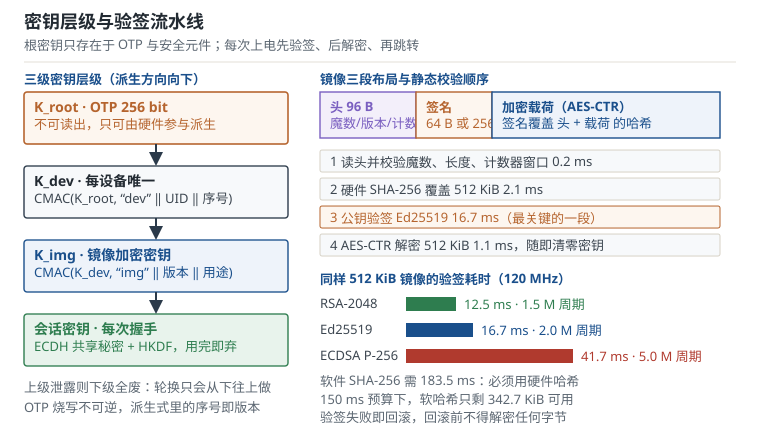

# 安全固件更新与密钥管理：签名、密钥层级与防回滚

固件更新的安全性不取决于算法有多强，而取决于**密钥在哪里、谁能用它、用完之后能不能撤销**。一条完整的信任链从晶圆厂或产线烧进一次性可编程存储（One-Time Programmable memory，OTP）的根密钥开始，经密钥派生（key derivation）落到每台设备独有的设备密钥，再派生出镜像加密密钥（image key）；上电时引导程序用公钥验签（signature verification），通过之后才解密、才跳转；同时用单调计数器（monotonic counter，MC）挡住降级，用轮换（rotation）与吊销（revocation）处理密钥泄露。这一章把这条链上的每一段时间、每一个字节、每一次擦写都换算成数字，重点回答三个工程问题：验签要花多少启动预算、密钥强度够不够、计数器能撑多久。

## 1. 设计动机（签名机制在什么情况下等于零）

::: motivation 三个真实失效的现场
**现场一：私钥进了代码仓库。** 某团队把 RSA-2048 私钥（PEM，约 1.7 KB）和固件源码放在同一个仓库里，流水线直接调用 `openssl dgst -sign` 出签名。半年后一名外包人员把仓库镜像同步到个人网盘，私钥随之下线。攻击者不需要破解任何算法，把固件改成"永久解锁"，用同一把私钥签一次名，设备照单全收。验签只能证明"这串字节来自持有私钥的人"，不能证明"持有私钥的人是善意的"。密钥管理失败时，签名机制提供的是零安全性，而且比不签名更危险——因为它给了团队一种"已经安全了"的错觉。

**现场二：验签吃掉整个启动预算。** 某车载后视项目要求上电 200 ms 内出图。镜像 1 MiB，处理器 120 MHz，软件 SHA-256 的实现是每字节 42 个周期：光是算哈希就要 $\frac{42\times1048576}{120\times10^{6}}=367$ ms，加上 Ed25519 验签 16.7 ms 和初始化开销，实测 394 ms。产品最后只能砍掉"每次上电全量校验"，改成"校验一次后置标志位"——而这恰好给现场三埋了雷。哈希与验签的开销不是"可以优化"的细节，它是启动预算里最大的一块可变成本，必须在选型阶段就算清楚。

**现场三：回滚计数器写丢了。** 旧版本有一个已公开的空中升级（Over-The-Air update，OTA）鉴权绕过漏洞，新版本修掉了。设备本来用单调计数器挡降级：计数器只增不减，镜像里的版本号小于计数器就拒收。但计数器记录和镜像写在同一个 Flash 页里，升级中途掉电，页擦到一半，读出来的计数器是 `0xFFFFFFFF`；恢复逻辑为了"不让设备变砖"，把读不出来的计数器宽容地当成 0 处理。于是降级窗口打开了：攻击者把带漏洞的旧镜像塞回去，设备认为"版本 0 比 0 大"，照收。一个 fail-open 的容错分支，抵消了整套密码学。
:::

把安全更新阶段的典型现象、第一检查项与判据列成表：

| 现象 | 先查什么 | 判据 |
|---|---|---|
| 攻击者能刷入自制固件 | 验签是否真的在跳转前执行 | 验签失败分支不可达跳转；公钥在只读区 |
| 能刷回旧版本 | 计数器与版本号是否同一事务 | 计数器先写、镜像后写；读失败必须 fail-close |
| 同一固件在两台设备上可互换 | 是否做了密钥分散 | 镜像密钥含设备唯一标识 |
| 一台设备被拆解后全线沦陷 | 是否存在全局镜像密钥 | 每设备独立密钥；泄露影响面为 1 |
| 启动时间超标 | 哈希与验签的周期数 | 全量校验落在预算内；硬件哈希已启用 |
| 密钥泄露后无法止损 | 是否有轮换与吊销通道 | 证书有有效期；有镜像黑名单 |

**不算清楚会摔在哪**，三个带数字的代价：

1. **召回成本。** 私钥泄露导致的不是"打补丁"，而是整批设备失去可信身份。一次 3 万台的车载模块召回，物流加现场工时按每台 120 元计就是 360 万元，而一把硬件安全模块（Hardware Security Module，HSM）的采购价通常在五位数。
2. **启动预算挤占。** 每多 10 ms 的启动延迟，倒车影像的可用时间就少 10 ms；按法规要求"挂倒挡后 2 s 内出图"计算，394 ms 的校验已经吃掉 20% 的预算余量。
3. **认证不通过。** IEC 62443-4-2 与 ISO/SAE 21434 都要求"更新包的真实性与完整性可验证、旧版本不可回退"，缺一项就是不符合项，整改意味着重新送样与重新排产。

## 2. 定义与直观（从一根烧不掉的密钥到一次可验证的跳转）

### 2.1 信任根与信任链

**信任根（root of trust，RoT）** 是一段"无法被修改、因此可以被无条件相信"的起点。它通常由三部分组成：一段固化在只读存储里的引导代码、一把烧在 OTP 里的公钥或根密钥哈希、以及一个能产生真随机数的硬件模块。**信任链（chain of trust）** 是把这份信任逐级传递下去的过程：第一级引导程序校验第二级，第二级校验应用，每一级在把控制权交出去之前必须完成校验，且校验失败的路径上不能存在任何可以绕过它的分支。

这里有一个容易被忽略的工程细节：**校验者必须先于被校验者运行，且自身的完整性不能依赖于被校验者**。如果引导程序从应用区读取"是否需要校验"的标志位，攻击者只要把标志位擦成空白值就能跳过校验。所以这类标志位要么放在引导程序自己的只读区，要么其默认值（擦除后的全 1）必须对应"必须校验"。

### 2.2 三级密钥层级

密钥不是一把，而是一棵树。工程上稳定的做法是三级：

| 层级 | 存放位置 | 生命周期 | 泄露影响面 | 用途 |
|---|---|---|---|---|
| 根密钥 $K_{\text{root}}$ | OTP 或安全元件（secure element，SE） | 设备全生命周期 | 全部同批设备 | 派生设备密钥 |
| 设备密钥 $K_{\text{dev}}$ | 由 $K_{\text{root}}$ 派生，不落盘 | 设备全生命周期 | 单台设备 | 加密镜像密钥、身份认证 |
| 镜像密钥 $K_{\text{img}}$ | 运行时派生，用完清零 | 单次启动或单次升级 | 单个版本 | AES-CTR 解密载荷 |
| 会话密钥 | 每次握手派生 | 分钟级 | 单次会话 | 传输层加密 |

这样做的好处是"上层不落地"：$K_{\text{dev}}$ 只存在于寄存器里，攻击者即使把 Flash 完整读出来也拿不到它；而 $K_{\text{root}}$ 从不参与任何对外运算，只在派生时被硬件调用一次。**密钥分散（key diversification）** 指的就是给每台设备一份不同的密钥——通常不存储，而是用设备唯一标识（Unique ID，UID）现场算出来：

$$
K_{\text{dev}}=\mathrm{CMAC}\!\left(K_{\text{root}},\;\text{"dev"}\,\|\,\mathrm{UID}\,\|\,b\right)
$$

其中 $\mathrm{CMAC}$ 是分组密码的消息认证码，$b$ 是 16 位的派生序号（用于在不换根密钥的前提下换一代设备密钥），$\|$ 表示字节串拼接。域分离字符串 `"dev"` 不能省：没有它，同一个 $K_{\text{root}}$ 派生出的一把密钥可能被用在两个语义不同的场合，形成跨协议攻击面。

### 2.3 三种签名算法怎么选

| 维度 | RSA-2048 | ECDSA P-256 | Ed25519 |
|---|---|---|---|
| 公钥长度 | 256 B（模数）+ 指数 | 64 B（未压缩 65 B） | 32 B |
| 签名长度 | 256 B | 64 B（r‖s） | 64 B（R‖S） |
| 验签周期（120 MHz） | 1.5 M（12.5 ms） | 5.0 M（41.7 ms） | 2.0 M（16.7 ms） |
| 签名周期 | 60 M（500 ms） | 2.4 M（20 ms） | 0.42 M（3.5 ms） |
| 安全强度 | 约 112 bit | 128 bit | 128 bit |
| 对随机数的要求 | 填充需随机 | 每次签名必须唯一且不可预测 | 确定性，不需要随机数 |
| 适合的场景 | 已有 PKI、验签端算力极弱 | 需要与现有证书体系互通 | MCU 端自签、批量产线 |

RSA 的验签非常便宜，因为它只做一次小指数模幂（$e=65537$，17 位）；代价是签名长、公钥大，且**私钥运算慢到 500 ms**——这在设备端签不了名，只能放在服务器或 HSM 里。ECDSA P-256 的问题不在数学而在实现：签名时需要一个一次性随机数 $k$，如果 $k$ 重复或可预测，私钥会被直接解出（索尼 PS3 的 ECDSA 事故就是同一个 $k$ 被复用）。Ed25519 用确定性方式从私钥和消息哈希出 $k$，从源头上消掉了这个失效模式，而且在 32 位 Cortex-M 上验签比 ECDSA 快一倍多、签名只有 64 B——这就是近十年 MCU 安全启动普遍改用 Ed25519 的原因。

### 2.4 防回滚：两种单调计数器

**防回滚（anti-rollback）** 要解决的是"签名完全合法，但版本是旧的"这一类攻击。签名没法区分新旧，必须引入一个"只增不减"的状态，也就是**单调计数器**。工程上有两条路线：

- **OTP 计数器**：在 OTP 里逐位烧断，每烧一位计数加一。它不可逆、掉电安全，但位数有限（典型 2 KiB 的 OTP 按 4 B 一条记录只有 512 次），适合做"防回滚的下限"而不是"每次升级都加一"。
- **Flash 记录式计数器**：在一页里顺序追加记录，每条带序号和 CRC，写满换页、擦旧页。它可写次数多，但必须处理"写记录时掉电"的窗口，且需要双页轮换来保证任何时刻都有一份完整记录。

两种路线经常组合使用：Flash 计数器负责日常递增，OTP 里的值作为不可篡改的"地板"，设备每次启动取两者较大值。**窗口（window）** 的概念由此而来：设备接受的版本区间是 $[\,V_{\text{mc}},\;V_{\text{mc}}+2^{k}\,)$，$k$ 是参与比较的位数。如果只存版本号的低 16 位，那么"回滚整整 65536 个版本"就能绕过比较——这就是截断计数器窗口，后文会算它需要多少次升级才能被利用。

### 2.5 加密固件与密钥分散

**加密固件** 的目的通常不是保密，而是提高逆向与篡改的成本：让攻击者拿不到可以直接改的明文二进制，也让"改一个字节再重算 CRC"这种低级攻击失效。工程上常见组合是"先加密、再对密文签名"，或者用带关联数据的认证加密（Authenticated Encryption with Associated Data，AEAD）。**顺序很重要**：一定是先验签、后解密。先解密再验签，等于把解密器暴露在未经认证的输入面前，历史上大量漏洞都出在这个顺序上。

密钥分散让每台设备的密文不同：同样的明文，因为 $K_{\text{dev}}$ 不同，密文完全不同。这样攻击者无法把 A 设备的镜像搬到 B 设备上，也无法用一台设备的功耗曲线去攻击整批设备。

## 3. 定量关系

**启动时间预算。** 设镜像长度 $N_{\text{img}}$ 字节、CPU 主频 $f$（Hz）、哈希实现每字节 $c_{\text{hash}}$ 个周期、验签耗时 $T_{\text{verify}}$、解密耗时 $T_{\text{dec}}$、引导程序初始化 $T_{\text{init}}$、应用自身初始化 $T_{\text{app}}$，则从上电到应用第一条指令的时间为

$$
T_{\text{boot}}=T_{\text{init}}+\frac{N_{\text{img}}\,c_{\text{hash}}}{f}+T_{\text{verify}}+T_{\text{dec}}+T_{\text{app}}
$$

符号含义：$c_{\text{hash}}$ 是"每字节周期数"，软件 SHA-256 在 Cortex-M4 上典型为 40 到 60，带 DMA 的硬件哈希引擎等效为 0.5 到 2；$T_{\text{dec}}$ 对 AES-CTR 是 $\frac{N_{\text{img}}}{16}\cdot c_{\text{block}}/f$，$c_{\text{block}}$ 是每 16 字节分组所需周期。硬件哈希把第一项从"百毫秒级"压到"毫秒级"，是能在不改变安全性的前提下压缩预算的主要手段。

**密钥强度与穷举时间。** 若密钥空间为 $2^{b}$、攻击者每秒可试 $R$ 个候选，则期望穷举时间

$$
T_{\text{search}}=\frac{2^{b}}{R}
$$

注意这里 $b$ 是**有效安全强度**而不是密钥长度：RSA-2048 的模数是 2048 位，但已知的最快攻击是数域筛法，等效强度约 112 位；椭圆曲线上的离散对数用 Pollard rho，攻击复杂度约 $2^{n/2}$，所以 P-256 与 Ed25519 都是 128 位。

**计数器寿命。** 设页大小 $P$ 字节、每条记录 $r$ 字节、双页轮换、Flash 擦写寿命 $E_{\text{cyc}}$ 次，则计数器在不擦坏 Flash 的前提下能递增的次数为

$$
N_{\text{inc}}=E_{\text{cyc}}\times\frac{2P}{r}
$$

**截断窗口。** 若只保留低 $k$ 位做比较，回滚 $2^{k}$ 个版本才会被漏检；按每天升级 $n_{\text{upd}}$ 次计算，自然回绕需要

$$
T_{\text{wrap}}=\frac{2^{k}}{n_{\text{upd}}}
$$

**密钥碰撞。** $N$ 台设备各自独立派生 $n$ 位密钥，出现任意一对相同密钥的概率近似为

$$
p\approx\frac{N^{2}}{2^{\,n+1}}
$$

**签名开销占比。** 签名长度 $L_{\text{sig}}$ 相对镜像长度的开销为 $\eta=L_{\text{sig}}/N_{\text{img}}$。对 512 KiB 镜像，256 B 的 RSA 签名只占 0.049%，可以忽略；但对 8 KiB 的差分补丁，同样的签名占 3.125%，会显著改变传输时间——这是差分升级与 RSA 组合时容易踩的坑。

## 4. 典型计算

### 4.1 同一镜像、三种算法的启动预算

条件：镜像 512 KiB（524288 B），主频 120 MHz，硬件 SHA-256 吞吐 250 MB/s，硬件 AES-CTR 每 16 B 分组 4 个周期，引导初始化 8 ms，应用初始化 2 ms，头部解析 0.5 ms。

硬件哈希：$\frac{524288}{250\times10^{6}}=2.10$ ms；AES-CTR 解密：$\frac{32768\times4}{120\times10^{6}}=1.09$ ms。三项公共开销合计 $8+2.10+1.09+0.5+2=13.69$ ms。

$$
T_{\text{boot}}^{\text{RSA}}=13.69+12.50=26.19\ \text{ms}
$$
$$
T_{\text{boot}}^{\text{Ed25519}}=13.69+16.67=30.36\ \text{ms}
$$
$$
T_{\text{boot}}^{\text{ECDSA}}=13.69+41.67=55.36\ \text{ms}
$$

如果图省事用软件 SHA-256（42 周期/字节），单哈希就是 $\frac{42\times524288}{120\times10^{6}}=183.5$ ms，Ed25519 方案的启动时间涨到 199 ms；换成 1 MiB 镜像则到 394 ms——已经超过 200 ms 的产品要求。反过来算：在 150 ms 预算里，扣掉 8 ms 初始化、16.7 ms 验签、2.5 ms 应用侧开销，留给软哈希的是 122.83 ms，按 42 周期/字节只能覆盖 $\frac{122.83\times10^{-3}\times120\times10^{6}}{42}\approx350952$ B，也就是 342.7 KiB。**结论：镜像超过 340 KiB 就必须上硬件哈希，或者把校验拆成"启动校验头部 + 后台校验载荷"。**

### 4.2 密钥强度与穷举时间

| 强度 | 每秒尝试 | 期望时间 | 换算 |
|---|---|---|---|
| 80 bit（RSA-1024 级别） | $10^{9}$ | $1.21\times10^{15}$ s | $3.83\times10^{7}$ 年 |
| 112 bit（RSA-2048） | $10^{12}$ | $5.19\times10^{21}$ s | $1.65\times10^{14}$ 年 |
| 128 bit（P-256 / Ed25519） | $10^{12}$ | $3.40\times10^{26}$ s | $1.08\times10^{19}$ 年 |
| 128 bit，专用集群 | $10^{18}$ | $3.40\times10^{20}$ s | $1.08\times10^{13}$ 年 |

按年换算用了 $3.156\times10^{7}$ s/年。80 位在今天已经不能用于新设计：$3.83\times10^{7}$ 年看起来仍很久，但这是"单机单任务"的算法；分布式集群把 $R$ 提高六个数量级后就只剩几十年，而固件的生命周期是 15 到 20 年。128 位在可预见的算力下是安全的，真正的风险不在算法而在实现——密钥泄露、随机数失效、侧信道，三者的概率都比穷举高得多。

### 4.3 回滚计数器的寿命与窗口

取页大小 $P=2048$ B、记录 $r=16$ B，则每页 128 条记录，双页轮换共 256 条；Flash 擦写寿命 $10^{5}$ 次：

$$
N_{\text{inc}}=10^{5}\times\frac{2\times2048}{16}=2.56\times10^{7}\ \text{次}
$$

按每天升级一次算，可用 $2.56\times10^{7}/365=70137$ 年——远超设备寿命，说明 Flash 计数器本身不是瓶颈。若换成 OTP 逐位烧写：2 KiB / 4 B = 512 次，四页轮换共 2048 次，按每天一次只够 5.6 年，这就是 OTP 只能做"地板"、不能做"日常递增"的原因。

再看截断窗口：若版本号只保留低 16 位，$2^{16}=65536$，按每天一次需要 179.6 年才会自然回绕；但攻击者不需要等自然回绕——他只需要构造一个"低 16 位相同、高 16 位更旧"的镜像，而这个镜像必须由厂商签名，所以真正的防线是"签名 + 完整 32 位比较"，截断只是把攻击成本从"一次签名"提高到"需要厂商签过一个低 16 位相同的旧版本"。工程上的做法是把计数器做到 32 位并与版本号分离存储，让"窗口"只用于容忍产线补签，不用于运行时比较。

### 4.4 设备密钥碰撞与产线节拍

10 万台设备、每台派生 128 位密钥，出现任意一对相同密钥的概率为

$$
p\approx\frac{(10^{5})^{2}}{2^{129}}=1.47\times10^{-29}
$$

可以忽略。真正的碰撞风险来自随机数质量：如果产线用固定种子或时间戳生成 UID，碰撞概率就不再服从这个公式。产线节拍方面：每台设备做 3 次 256 位真随机数读取（每次 10 ms）合计 0.8 h/10 万台；密钥注入与校验按 2 s/台、8 个工位并行，需要 6.9 h/10 万台。这两个数字决定了产线是否需要独立的注入工站。

### 4.5 验签的能耗

按 3.3 V、30 mA 计算，Ed25519 验签 16.67 ms 耗能 $3.3\times0.03\times0.01667=1.65$ mJ，ECDSA 为 4.12 mJ，RSA-2048 为 1.24 mJ。10 万台设备每天启动两次，Ed25519 方案一年约 0.3 kWh——单台看微不足道，但对电池供电的无线传感器，每次唤醒多 1.65 mJ 直接换算成寿命，这也是低功耗节点常把"全量验签"改成"抽样验签 + 计数器"的原因。

## 5. 工程含义

**选型按约束排序，不按算法名气排序。** 如果设备端算力极弱（Cortex-M0、无硬件加速）、已有 PKI 体系、镜像很小，RSA-2048 的 12.5 ms 验签仍然是最省的选择；如果需要 128 位强度、签名短、且不想在设备端管理随机数，Ed25519 是默认答案；如果必须与现有 X.509 证书链、HSM 的 ECDSA 密钥互通，才选 P-256，并接受 41.7 ms 的验签代价。这张取舍表的本质是"把成本放在签名端还是验签端"：RSA 把成本放在签名端（500 ms），Ed25519 把成本均摊，ECDSA 把风险放在随机数上。

**密钥存储的三档。** OTP 最便宜、不可读出，但位宽有限且不可逆，适合放根密钥或根密钥的哈希；安全元件抗物理攻击、支持内部运算，适合放设备私钥，代价是每台多 0.3 到 1 美元；纯派生方案不存任何密钥，只存 UID，成本最低，前提是根密钥自始至终不出芯片——一旦 $K_{\text{root}}$ 泄露，整批设备同时沦陷。三档可以组合：$K_{\text{root}}$ 在 OTP，$K_{\text{dev}}$ 派生不落地，私钥签名操作放在安全元件里完成。

**轮换与吊销必须提前设计。** 轮换（rotation）是"换一把新的、旧的还能用一段时间"；吊销（revocation）是"立刻让某把密钥失效"。两者都需要设备端有对应的能力：轮换要求固件里预置**多把**公钥或一条可更新的证书链，否则新密钥签的固件在旧设备上验不过；吊销要求设备能接收"黑名单"并持久化，黑名单本身又需要签名保护。工程上常见的过渡方案是双签名：一个镜像同时带新旧两把密钥的签名，任何一代设备都能验过，等所有设备都升到支持新密钥的版本后再停掉旧签名。轮换周期参考 SP 800-57 的建议，签名密钥的密码周期通常为 1 到 3 年，根密钥可以长得多，但必须有"根密钥泄露"的应急预案。

**供应链与产线注入。** 私钥永远不应该出现在构建服务器上：签名动作在 HSM 内完成，工程师只能提交"待签哈希"，拿回签名，私钥不出模块。产线注入的关键是"密钥与设备的绑定关系可审计"：每台设备注入时记录 UID、派生序号、注入工位、时间戳，形成可追溯的台账；注入完成后立刻做一次"用该密钥验签一段挑战数据"的自检，失败即判废。OTA 服务器只持有镜像与签名，不持有任何设备密钥；设备身份认证用设备证书，证书由产线的中间 CA 签发，中间 CA 可以按批次吊销。

**失败必须 fail-close。** 所有校验路径的默认值都要指向"拒绝"：空白 Flash（全 1）必须被判为无效签名，读不出的计数器必须被判为"已达上限"，而不是 0。前面现场三的根因就是这个默认值反了。这条规则要写进代码评审清单，因为它在正常测试中永远不会被触发。

## 6. 常见坑（现象、原因、解决）

::: pitfall 先解密后验签
**现象：** 某些批次的设备在升级后偶发 HardFault，且故障率与镜像内容相关；把镜像重新打包（内容不变、只改填充）后故障消失。

**原因：** 引导程序为了"省一次遍历"，先把载荷解密到 RAM，再对明文算哈希验签。攻击者（或一个损坏的包）可以让解密器的输入是任意字节，分组密码在错误输入上的行为、以及后续解析器对畸形明文的处理，都变成了攻击面；更糟的是，验签失败时明文已经写进了 RAM，某些实现会"继续用已经解出来的数据"。

**解决：** 严格按"读头 → 硬件哈希（覆盖头与密文）→ 验签 → 解密 → 再校验解密结果的结构"的顺序执行；验签失败分支直接复位，不进入解密。若用 AEAD，认证标签必须在解密前校验，且解密输出只在认证通过后才交给解析器。
:::

::: pitfall 计数器与镜像不在同一事务
**现象：** 升级过程中掉电，重启后设备接受了一个旧版本镜像；或者相反，计数器被写成全 1，设备从此拒绝一切更新（变砖）。

**原因：** 计数器记录与镜像写入是两次独立的 Flash 操作，中间存在掉电窗口；恢复逻辑为了让设备"至少能启动"，把 CRC 失败的计数器记录当作 0 或最大值处理，形成 fail-open。

**解决：** 先写"预留"记录（把新版本号写进计数器并落盘、校验通过），再写镜像，最后写"确认"记录；任何一步失败都回滚到上一个完整状态。读取时若发现记录 CRC 错误，取"所有有效记录中的最大值"而不是 0；若一条有效记录都没有，按 OTP 里的地板值处理，且地板值默认等于出厂的最高版本。双页轮换保证任何时刻至少一页完整，这一点必须在掉电测试里逐点验证。
:::

::: pitfall 用 memcmp 比较签名
**现象：** 实验室里一切正常，但第三方渗透测试报告指出"签名比较存在时序侧信道，可在数小时内逐字节恢复有效签名"。

**原因：** `memcmp` 在第一个不同字节处提前返回，比较时间与"匹配了多少字节"相关。攻击者可以构造大量候选签名，通过测量启动时间（或通过调试口读到的计数器）逐步逼近，最终伪造一个能通过比较的签名——注意这绕过的是"比较"而不是"验签"，但在实现里两者常常被混为一谈。

**解决：** 用常数时间比较（异或累加后一次性判断），或者干脆只做真正的公钥验签、不做任何"哈希比对"式的短路判断。同理，所有与密钥相关的分支都不能依赖秘密数据。
:::

## 7. 自测题

题一：1 MiB 镜像、120 MHz、软件 SHA-256 每字节 42 周期，验签用 Ed25519（2.0 M 周期），其余开销 10.5 ms。求启动时间；若要求 200 ms 出图，还能剩多少余量？

哈希时间：

$$
T_{\text{hash}}=\frac{1048576\times42}{120\times10^{6}}=367.0\ \text{ms}
$$

验签时间：

$$
T_{\text{verify}}=\frac{2.0\times10^{6}}{120\times10^{6}}=16.67\ \text{ms}
$$

总时间 $T_{\text{boot}}=10.5+367.0+16.67=394.2$ ms。

200 ms 的预算已经超了 194.2 ms，余量为负。可行的三条路：把哈希换成硬件引擎（250 MB/s 时只需 4.2 ms，总时间降到 31.4 ms）；把镜像压到 340 KiB 以内；或者把校验拆成"启动只校验前 64 KiB 的关键段 + 后台校验剩余部分"，但这会引入"未校验代码先运行"的窗口，必须配合内存保护单元（Memory Protection Unit，MPU）把未校验区域设为不可执行。

题二：RSA-2048 验签 12.5 ms 比 Ed25519 的 16.7 ms 更快，为什么很多 MCU 安全启动反而选 Ed25519？请从三个维度给出量化理由。

第一，签名长度与传输：RSA 签名 256 B，Ed25519 64 B，对 8 KiB 的差分补丁，开销分别是 3.125% 与 0.781%，按 2 Mbaud 的升级链路算是 1.02 ms 与 0.26 ms 的差别；对每天升级一次的 10 万台设备，一年差 2.8 GB 流量。

第二，公钥存储与验签端内存：RSA 公钥 256 B 且需要 2048 位模幂运算的工作缓冲区（典型 1 到 2 KB RAM），Ed25519 公钥 32 B、验签栈峰值约 1.5 KB，对小 RAM 器件更友好。

第三，签名端与随机数：RSA 私钥运算 500 ms、ECDSA 依赖唯一随机数，Ed25519 是确定性签名，3.5 ms 出签且不需要真随机数——产线批量签名时，这一条直接把"随机数失效导致私钥泄露"的整类风险删掉。

12.5 ms 对 16.7 ms 的差距只有 4.2 ms，而上面三项收益是结构性的；只有当镜像很小、设备端极度受限、且已有 RSA 体系时，RSA 的验签优势才值得保留。

题三：版本号只存低 16 位，计数器每天加一。攻击者要利用"回绕"降级，需要满足什么条件？给出一个在 32 位计数器下彻底消除该窗口的方案。

低 16 位可表示 $2^{16}=65536$ 个版本。设备比较"新版本低 16 位是否大于当前低 16 位"，则当版本差恰好是 65536 的整数倍时比较结果错误。自然回绕需要 $65536/365=179.6$ 年，攻击者等不起，所以真实攻击路径是"让厂商签一个低 16 位相同的旧版本"——这要求攻击者能影响发布流程，或在旧版本里预留后门。

消除方案：把计数器做成 32 位、与版本号**独立**存储（版本号只用于展示与兼容性判断），比较时用完整 32 位；同时把 OTP 里的 24 位地板值作为上限保护，使计数器一旦被擦成空白（全 1）也不会被误判为"最大版本"，而是触发一次"从地板值恢复"的受控流程。若器件只提供 16 位硬件计数器，则用"高 16 位存在 Flash 记录、低 16 位用硬件计数器"的组合，并在每次高 16 位进位时写一条新记录，把窗口从 $2^{16}$ 缩小到"一次进位事务"。

题四：写出设备密钥的派生式，说明每个输入的作用；并解释为什么不能直接用 $K_{\text{root}}$ 加密镜像。

$$
K_{\text{dev}}=\mathrm{CMAC}\!\left(K_{\text{root}},\,\text{"dev"}\,\|\,\mathrm{UID}\,\|\,b\right),\qquad
K_{\text{img}}=\mathrm{CMAC}\!\left(K_{\text{dev}},\,\text{"img"}\,\|\,\text{ver}\,\|\,\text{slot\_id}\right)
$$

$K_{\text{root}}$ 是唯一长期秘密；`"dev"` 与 `"img"` 是域分离标签，保证同一根密钥在不同用途下派生出不相关的密钥；$\mathrm{UID}$ 保证每台设备密钥不同（密钥分散）；$b$ 是派生序号，用于在不更换根密钥的情况下升级一代设备密钥；$\text{ver}$ 与 $\text{slot\_id}$ 把密文绑定到具体版本与分区，防止"把 B 槽的密文搬到 A 槽"这类重放。

不能直接用 $K_{\text{root}}$ 的原因有三：其一，一旦某个镜像的密钥流被复用或泄露，根密钥就暴露，整批设备沦陷；其二，所有设备共用一把密钥，无法做"一台设备被拆解只影响一台"的隔离；其三，根密钥只应参与派生、不参与任何对外可见的运算，否则其使用次数与功耗特征会成为侧信道。

## 8. 参考资料

- NIST, *FIPS 186-5 Digital Signature Standard (DSS)*，Section 6 "ECDSA" 与 Section 7 "EdDSA"：本文三种算法的签名与验签等式、P-256 曲线参数由此小节给出；2.3 节的强度对比以 112 位与 128 位的等效强度为准。
- IETF, *RFC 8032 EdDSA*，Section 5.1 "Ed25519" 与 Appendix A：确定性签名的构造（$k$ 由私钥与消息哈希得出）与测试向量，2.3 节"不需要随机数"的结论依据此节。
- NIST, *SP 800-57 Part 1 Rev. 5*，Section 5 "Key management life cycle" 与 Section 7 "Cryptoperiod"：2.2 节的三级密钥层级与 5 节的轮换周期（签名密钥 1 到 3 年）以此为准。
- NIST, *SP 800-193 Platform Firmware Resiliency Guidelines*，Section 3 "Protection" 与 Section 4 "Detection and recovery"：信任根的三要素、防回滚与恢复流程，第 1 节现场三与第 6 节计数器事务的整改依据。
- Arm, *Trusted Firmware-M* 文档，"Immutable root of trust" 与 "Secure boot" 两节：2.1 节"校验者先于被校验者运行"的实现口径，以及 5 节密钥存储三档中"派生不落地"的工业实践。
- MCUboot 项目文档，*MCUboot Design* 的 "Image Validation" 与 "Downgrade prevention" 两节（docs.mcuboot.com）：镜像头部的版本与安全计数器字段、验签顺序，4.3 节计数器寿命的镜像格式与此同构。
- NIST, *SP 800-108 Rev. 1*，Section 4 "KDF in counter mode"：2.2 节派生式的输入编码与域分离写法，第 7 节题四的推导据此展开。
- STMicroelectronics, *STM32L5 系列参考手册*（RM0438），"System security" 一章的 RDP、HDP 与 OTFDEC 小节：读出保护等级、隐藏保护区与片上加密，5 节密钥存储与 6 节 fail-close 的寄存器级依据。
