# 附录 F · 常用电路速查图集

16 个工程中最常复用的小电路，每个一张示意图 + 一句话用途 + 关键公式/取值。公式后面标了每个符号的单位；典型值给的是“能直接上手”的量级，实际取值按需求重算。设计时直接套用，再按需求细化。

## F.1 电阻分压

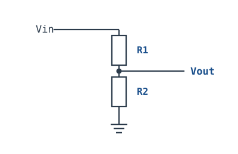

- **用途**：把高电压按比例降到 ADC 量程内。
- **公式**：$V_{out}=V_{in}\cdot\dfrac{R_2}{R_1+R_2}$，$R_1,R_2$ 单位 Ω，$V$ 单位 V。
- **输出阻抗**：$R_{th}=R_1\parallel R_2=\dfrac{R_1R_2}{R_1+R_2}$。
- **取值**：R1=R2 得 1/2。接负载 $R_L$ 后实际输出为 $V_{out}\cdot\dfrac{R_L}{R_L+R_{th}}$；要让误差 <1%，需 $R_L>100R_{th}$。
- **源阻抗方向别搞反**：分压器对**源**的负载效应要求 $R_1+R_2\gg R_s$（源阻抗），对**负载**的要求是 $R_{th}\ll R_L$。高阻抗源直接接低阻分压会把源拉塌；正确做法是先用缓冲/仪表放大器隔离，或把分压电阻取大。
- **典型值**：12 V 电池检测用 30 kΩ/10 kΩ 得 3 V，$R_{th}=7.5$ kΩ；多数 SAR ADC 要求源阻抗 <10 kΩ，超了要加运放缓冲或减小电阻（代价是耗电）。

## F.2 上拉电阻

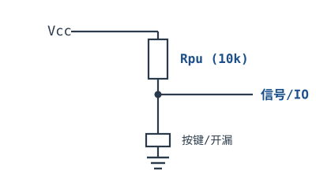

- **用途**：开漏/开集输出、按键常态保持高电平。
- **取值**：I²C 标准模式（100 kHz）常用 4.7 kΩ；快速模式（400 kHz）常用 2.2–3.3 kΩ；按键/通用 GPIO 用 10 kΩ。
- **电流**：按下时 $I=V_{cc}/R$，3.3 V/4.7 kΩ = 0.70 mA；5 V/10 kΩ = 0.5 mA。
- **I²C 的上限由上升时间定**：$R_{p(max)}\approx\dfrac{t_r}{0.8473C_b}$，$t_r$ 为规范允许的最大上升时间（100 kHz 时 1000 ns，400 kHz 时 300 ns），$C_b$ 为总线电容（单位 F，100 pF 要写成 $100\times10^{-12}$ F）。$C_b=100$ pF、400 kHz 时 $R_p\le3.5$ kΩ，所以 4.7 kΩ 在 400 kHz 下偏大。
- **下限由灌电流定**：$R_{p(min)}=\dfrac{V_{cc}-V_{OL}}{I_{OL}}$，3.3 V、$V_{OL}=0.4$ V、$I_{OL}=3$ mA 时约 970 Ω。太小费电且可能超出器件灌电流。

## F.3 RC 低通滤波

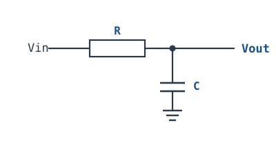

- **用途**：滤除高频噪声、PWM 转模拟电压。
- **公式**：截止频率 $f_c=\dfrac{1}{2\pi RC}$，$R$ 单位 Ω，$C$ 单位 F，$f_c$ 单位 Hz。
- **例**：R=1 kΩ、C=1 µF → $f_c=159$ Hz；1 kHz 方波基波被衰减到约 0.157（−16 dB），输出是带明显纹波的直流。要更平滑，把 C 加到 10 µF（$f_c=15.9$ Hz），1 kHz 处衰减到 1.6%。
- **阶数**：一阶 RC 只有 −20 dB/dec；要 −40 dB/dec 用两阶（注意级间负载效应）或有源滤波。
- **取值**：PWM→模拟一般取 $f_c\le f_{PWM}/10$，且 $R$ 不要太大（后级输入偏置电流会在 R 上产生误差）。

## F.4 BJT 三极管开关

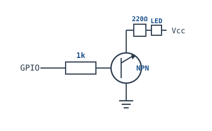

- **用途**：用 GPIO 小电流控制 LED/继电器等负载。
- **饱和条件**：$I_B\ge(3\sim5)\cdot\dfrac{I_C}{\beta_{min}}$。注意不是 $I_B>I_C/\beta$——那只是放大区边界，要做开关必须**过驱动**，让 $V_{CE}$ 落到饱和压降（0.1–0.3 V）。
- **算例**：5 V 电源、红色 LED（$V_F\approx2.0$ V）、220 Ω 限流，$I_C=(5-2-0.2)/220=12.7$ mA；$\beta_{min}=100$ 时需 $I_B\ge0.38$ mA（取 3 倍），基极串 1 kΩ、GPIO 3.3 V 时 $I_B=(3.3-0.7)/1k=2.6$ mA，深度饱和。
- **取值**：基极 1–10 kΩ；LED 限流 220 Ω–1 kΩ；继电器线圈必须并续流二极管（1N4148/1N4007）。
- **注意**：发射极接地（低边开关）；高边开关要用 PNP/PMOS 或栅极驱动。

## F.5 LDO 典型应用

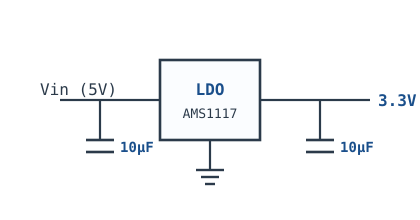

- **用途**：把 5 V 稳成干净的 3.3 V 给 MCU/模拟电路。
- **要点**：输入输出各并 10 µF（按 datasheet 的 ESR 要求）；压差越小效率越高；功耗 $P=(V_{in}-V_{out})I_{out}+V_{in}I_q$。
- **算例**：AMS1117-3.3，5 V→3.3 V、0.5 A，$P=1.7\times0.5+5\times0.005=0.875$ W；SOT-223 的 $R_{\theta JA}$ 约 60–100 °C/W，温升 52–88 °C，夏天很容易触过热保护。
- **选型**：压差（dropout）要小于 $V_{in(min)}-V_{out}$ 并留 0.2–0.3 V 余量；固定输出比可调少两颗电阻，噪声也更低。

## F.6 Buck 降压典型

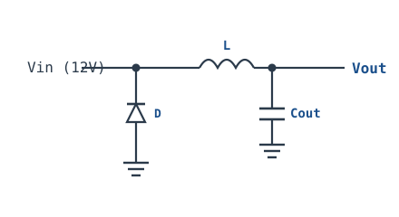

- **用途**：高效把高压降到低压（如 12 V→5 V/3 A）。
- **公式**：$V_{out}\approx D\cdot V_{in}$（CCM、理想开关）；实际 $D\approx\dfrac{V_{out}}{V_{in}\eta}$，$\eta$ 为效率（0.80–0.95）。
- **电感纹波**：$\Delta I_L=\dfrac{V_{out}(1-D)}{L f_{sw}}$，$L$ 单位 H，$f_{sw}$ 单位 Hz；一般取 $\Delta I_L=0.2\sim0.4I_{out}$。
- **输出纹波**：$\Delta V\approx\dfrac{\Delta I_L}{8f_{sw}C}+\Delta I_L\cdot ESR$，第二项常占主导。
- **算例**：12 V→5 V、$f_{sw}=500$ kHz、L=10 µH、$D=0.46$，$\Delta I_L=5\times0.54/(10^{-5}\times5\times10^5)=0.54$ A；2 A 负载时约 27%，合理。C=22 µF、ESR=10 mΩ 时容性纹波 6.1 mV、ESR 纹波 5.4 mV。
- **注意**：非同步 Buck 的续流二极管有正向压降，轻载会进 DCM，$V_{out}$ 不再严格等于 $D V_{in}$。

## F.7 反相比例放大器

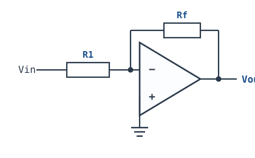

- **用途**：反相放大传感器信号，增益可控。
- **公式**：$G=-\dfrac{R_f}{R_1}$；输入阻抗等于 $R_1$；噪声增益 $1+\dfrac{R_f}{R_1}$（稳定性看它，不看信号增益）。
- **取值**：$R_1$ 取 1–10 kΩ 平衡噪声与输入阻抗；$R_f$ 决定增益，尽量不超过 1 MΩ（否则偏置电流与寄生电容惹事）。
- **电源**：双电源最省事；单电源时同相端要偏置到 $V_{cc}/2$，输出才能双向摆。LM358 在 ±5 V 下输出只能到约 ±3.5 V，增益 10 时输入不要超过 0.35 V，否则削顶。

## F.8 同相比例放大器

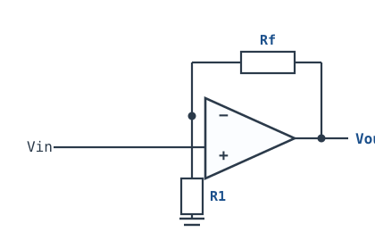

- **用途**：高输入阻抗缓冲/放大，单电源友好。
- **公式**：$G=1+\dfrac{R_f}{R_1}$；输入阻抗由运放输入级决定（CMOS 可达 GΩ，BJT 约 MΩ）。
- **跟随器**：$R_f=0$ 且 $R_1$ 开路（不接），此时 $G=1$。只把 $R_f$ 短接而保留 $R_1$，$R_1$ 会变成输出到地的负载，白白耗电。
- **注意**：同相端不要悬空；高阻输入要防静电与漏电，PCB 上做保护环/清洁助焊剂。

## F.9 比较器迟滞（施密特）

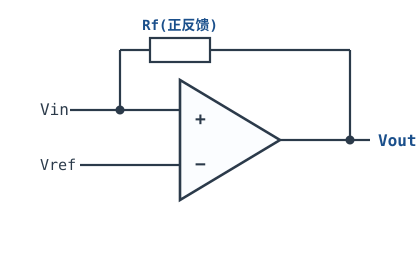

- **用途**：阈值检测时抗噪声，避免输出在阈值附近抖动。
- **接法**：输出经 $R_f$ 正反馈回同相端，同相端另经 $R_1$ 接参考 $V_{ref}$；输入接反相端。
- **门限**：$V_{TH+}=V_{ref}+(V_{OH}-V_{ref})\dfrac{R_1}{R_1+R_f}$，$V_{TH-}=V_{ref}+(V_{OL}-V_{ref})\dfrac{R_1}{R_1+R_f}$；迟滞宽度 $\Delta V=\dfrac{(V_{OH}-V_{OL})R_1}{R_1+R_f}$。
- **方向**：**$R_f$ 越小（正反馈越强）或 $R_1$ 越大，迟滞越宽**，不是“Rf 越大越宽”。
- **算例**：5 V 单电源、$V_{OH}\approx5$ V、$V_{OL}\approx0$ V、$V_{ref}=2.5$ V、$R_1=10$ kΩ、$R_f=100$ kΩ，$\Delta V=5\times10/110=0.45$ V，门限约 2.27 V / 2.73 V（$V_{ref}$ 正好在输出摆幅中点时才是 $V_{ref}\pm\Delta V/2$）。
- **注意**：比较器是开漏输出时 $V_{OH}$ 由上拉电阻决定；上拉太小会增加功耗，太大则边沿变慢。

## F.10 MOSFET 双向电平转换

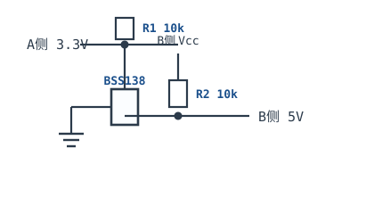

- **用途**：3.3 V MCU 与 5 V 传感器/I²C 双向通信。
- **接法**：低压侧 SDA 接 BSS138 源极，高压侧 SDA 接漏极，**栅极接低压侧电源（如 3.3 V），不是地**；两侧 SDA 各上拉到自己的 $V_{cc}$（3.3 V 侧 4.7 kΩ、5 V 侧 4.7 kΩ）。
- **原理**：低压侧拉低时 $V_{GS}=3.3$ V 导通，把高压侧也拉低；高压侧拉低时体二极管先导通，源极被拉低后 MOS 才完全导通。栅极接地会常通或常断，是最常见的接错。
- **限制**：只适合低速总线（I²C 100/400 kHz）；高压侧电压不能超过 BSS138 的 $V_{DS}$ 额定（60 V）且栅极电压要低于 $V_{GS(max)}$（±20 V）。

## F.11 按键去抖

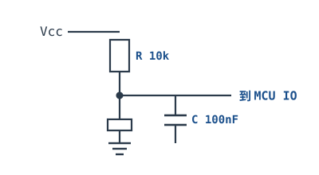

- **用途**：滤除机械按键按下/松开时十几 ms 的抖动。
- **取值**：R=10 kΩ、C=100 nF → $\tau=1$ ms；机械按键抖动通常 1–20 ms，1 ms 偏短，建议 10 kΩ+1 µF（$\tau=10$ ms）。
- **稳定时间**：RC 不是“到 τ 就稳”，要 3–5τ 才进入误差带；10 ms 时间常数对应 30–50 ms 响应，按键会觉得“稍肉”。
- **更好做法**：RC + 施密特触发器（74HC14）整形，或软件消抖（采样 10–20 ms 一致才确认）。电容直接并在按键两端时，注意按下瞬间的放电电流不要超过按键额定。

## F.12 H 桥电机驱动

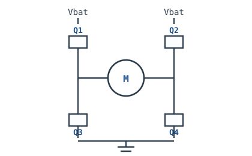

- **用途**：控制直流电机正反转 + PWM 调速。
- **要点**：Q1+Q4 导通正转，Q2+Q3 导通反转；**绝不能同侧直通（shoot-through）**。
- **死区**：换向前先关断再开通，死区时间 0.5–2 µs；电机是感性负载，关断瞬间要续流回路（MOSFET 体二极管或外部肖特基）。
- **电源**：电机电源并 100 µF 电解 + 0.1 µF 陶瓷，抑制换向尖峰；逻辑地与功率地单点连接。

## F.13 共射放大电路

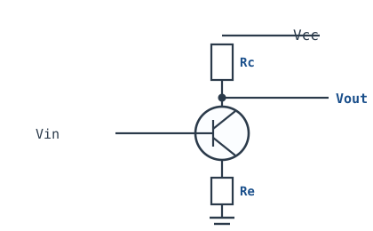

- **用途**：单管小信号电压放大（反相）。
- **公式**：$A_v\approx-\dfrac{R_C}{r_e'+R_e}$（$R_e$ 未旁路）；$R_e$ 旁路时 $A_v\approx-\dfrac{R_C}{r_e'}$。
- **符号**：$r_e'=\dfrac{V_T}{I_E}\approx\dfrac{26\,\text{mV}}{I_E}$，$I_E$ 单位 mA 时 $r_e'$ 单位 Ω；$R_C$、$R_e$ 单位 Ω。
- **算例**：$I_E=1$ mA → $r_e'=26$ Ω；$R_C=2.2$ kΩ、$R_e$ 旁路，$A_v\approx-84.6$。
- **权衡**：$R_e$ 稳定工作点、降低失真，但牺牲增益；旁路电容只对交流短路，直流偏置仍靠 $R_e$。

## F.14 整流与电容滤波

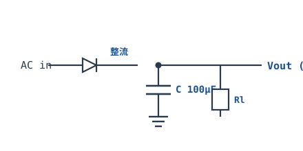

- **用途**：交流变平滑直流。
- **要点**：桥式整流→馒头波→大电容滤波；全波整流后纹波频率是输入频率的 2 倍（50 Hz→100 Hz）。
- **纹波估算**：$\Delta V\approx\dfrac{I_{load}}{2f_{ripple}C}$，$I_{load}$ 单位 A，$C$ 单位 F，$\Delta V$ 单位 V。
- **算例**：1 A 负载、100 Hz 纹波、1000 µF，$\Delta V=1/(2\times100\times10^{-3})=5$ V——所以大电流电源不能只靠电容，要上稳压。
- **二极管**：桥式整流每个半周有两个二极管导通，压降约 $2\times0.7=1.4$ V（硅管）或 $2\times0.3=0.6$ V（肖特基）。输入幅度必须大于这个压降，否则整流失效。

## F.15 仪表放大器（三运放）

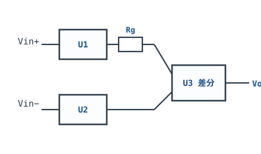

- **用途**：放大微小差分信号（电桥/生物电），高 CMRR。
- **公式**：$G=1+\dfrac{2R}{R_g}$，$R$ 为 A1/A2 的反馈电阻，$R_g$ 为两反相端之间的增益电阻，单位 Ω。
- **算例**：$R=25$ kΩ、$R_g=1$ kΩ → $G=51$；$R_g$ 越小增益越大，但带宽与稳定性会下降。
- **CMRR**：由外围电阻匹配决定，分立三运放要做到 80 dB 以上，电阻需 0.01% 或更高匹配；集成仪放（如 AD620/INA333）内部已修调，省事得多。
- **注意**：输入共模范围、输入偏置电流回流路径、RFI 滤波（输入串 1 kΩ + 差模/共模电容）都要查 datasheet。

## F.16 晶振振荡电路

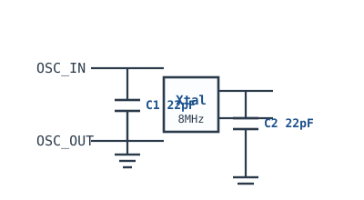

- **用途**：为 MCU 提供稳定时钟。
- **负载电容**：晶振的 $C_L$ 由两颗匹配电容决定，$C_L=\dfrac{C_1C_2}{C_1+C_2}+C_{stray}$；对称取 $C_1=C_2$ 时 $C_1=C_2\approx2(C_L-C_{stray})$，$C_{stray}$ 为 PCB/引脚寄生电容（典型 3–5 pF）。
- **算例**：$C_L=18$ pF、$C_{stray}=5$ pF → $C_1=C_2\approx26$ pF，取 27 pF 标称值；若随手用 22 pF，实际 $C_L\approx11+5=16$ pF，频率会偏。
- **布局**：晶振紧贴 MCU，走线短且包地，下方不走其他信号；负载电容地就近回到 MCU 地。
- **起振**：按 ST AN2867 核算负阻（$|R_{neg}|>5\times ESR_{max}$），否则低温/低压可能不起振。

---

> 以上为最常用的 16 个基础电路；更复杂的拓扑（有源滤波、D 类功放、隔离反激等）见正文对应章节。

## F.17 速查自检

为什么“高阻抗源要配小分压电阻”是错的？

分压器对源是负载：源阻抗 $R_s$ 与 $R_1+R_2$ 串联分压，若 $R_1+R_2$ 比 $R_s$ 小，源电压会被拉低。正确条件是 $R_1+R_2\gg R_s$，同时又要 $R_{th}\ll R_L$，两者冲突时加缓冲。

BJT 开关的基极电阻按 $I_B=I_C/\beta$ 算，为什么可能不饱和？

$I_C/\beta$ 只是放大区边界，此时 $V_{CE}$ 仍可能较高、功耗大。开关设计要过驱动 3–5 倍，按 $I_B\ge(3\sim5)I_C/\beta_{min}$ 取，并核对 datasheet 的 $V_{CE(sat)}$ 测试条件。

BSS138 电平转换的栅极应该接哪里？

接低压侧电源（如 3.3 V），不是地。栅极接 3.3 V 才能让低压侧拉低时 $V_{GS}=3.3$ V 导通；接地的 MOS 常通或常断，总线直接失效。

8 MHz 晶振配 22 pF 负载电容，一定对吗？

不一定。要按晶振的 $C_L$ 算：$C_1=C_2\approx2(C_L-C_{stray})$。$C_L=18$ pF、$C_{stray}=5$ pF 时应取 26–27 pF；22 pF 只适合 $C_L\approx16$ pF 的晶振。

