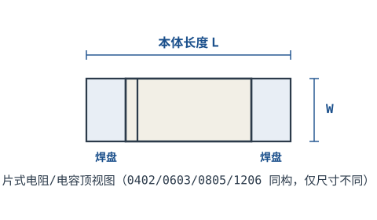
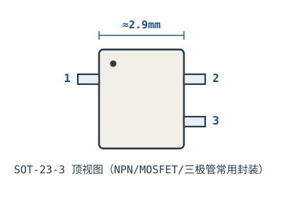
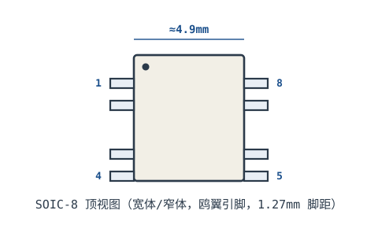
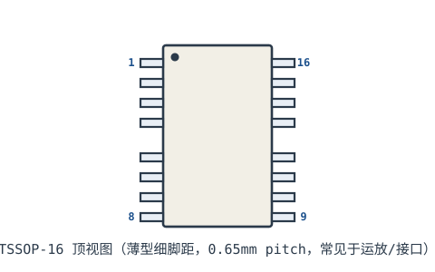
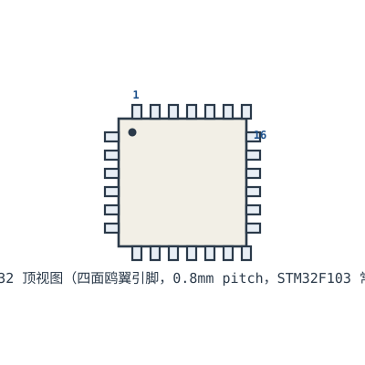
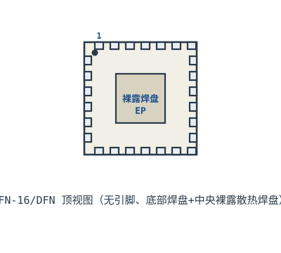

# 附录 C · SMD 封装尺寸图

常见贴片封装的外形与典型尺寸。尺寸为典型值（nominal），**实际焊盘设计务必以器件 datasheet 与 IPC-7351 为准**——不同厂商同型号封装可能有细微差异。

## C.1 片式无源元件（电阻/电容）

0402/0603/0805/1206 都是两端片式结构，仅尺寸不同。

| 英制代码 | 公制代码 | 本体长 L (mm) | 本体宽 W (mm) | 典型功率/电压 | 常用场景 |
|---|---|---|---|---|---|
| 0402 | 1005 | 1.00 | 0.50 | 1/16W, 50V | 高密度手机/板卡 |
| 0603 | 1608 | 1.60 | 0.80 | 1/10W, 50V | 最通用、好焊接 |
| 0805 | 2012 | 2.00 | 1.25 | 1/8W, 100V | 电源/功率余量 |
| 1206 | 3216 | 3.20 | 1.60 | 1/4W, 200V | 高功率/高压 |

> 英制代码 = 长×宽（千分之一英寸），如 0805 ≈ 0.08×0.05 inch。公制 = 毫米，0805 = 2012（2.0×1.2mm）。

## C.2 SOT-23（三极管/MOSFET/基准）

| 参数 | 典型值 |
|---|---|
| 本体尺寸 | 2.9 × 1.3 mm |
| 脚距（左右脚中心） | ≈1.9 mm |
| 引脚数 | 3（常见 SOT-23-3）；另有 5/6 脚变体 |
| 典型器件 | S8050、AO3400、TL431、LM4040 |

## C.3 SOIC（小外形集成电路）

| 参数 | SOIC-8 典型值 |
|---|---|
| 本体宽 | 3.9mm（窄体）/ 7.5mm（宽体） |
| 本体长 | ≈4.9mm |
| 引脚间距（pitch） | 1.27 mm |
| 引脚数 | 8（也有 14/16/20/24） |
| 典型器件 | LM358、NE5532、W25Q64、MAX485 |

## C.4 TSSOP（薄型细脚距）

| 参数 | TSSOP-16 典型值 |
|---|---|
| 本体宽 | ≈4.4 mm |
| 本体长 | ≈5.0 mm |
| 引脚间距 | 0.65 mm（或 0.5mm） |
| 引脚数 | 16（8×2；常见 20/24/28/48） |
| 特点 | 比 SOIC 更薄更密，手持焊难度高 |

## C.5 QFP（方形扁平封装）

| 参数 | LQFP-32 典型值 |
|---|---|
| 本体尺寸 | 7×7 mm（或 9×9） |
| 引脚间距 | 0.8 mm（LQFP） |
| 引脚数 | 32（四面各 8） |
| 典型器件 | STM32G030K8T6（LQFP-32） |

## C.6 QFN / DFN（无引脚方形扁平）

| 参数 | QFN-16 典型值 |
|---|---|
| 本体尺寸 | 3×3 mm（或 4×4、5×5） |
| 引脚间距 | 0.5 mm（或 0.65/0.4） |
| 中央裸露焊盘 | 有，接 GND 增强散热 |
| 焊接要点 | 需钢网 + 回流焊，手焊难度大 |
| 典型器件 | ESP32-C3、电源 IC、射频前端 |

## C.7 选型与焊接建议

::: pitfall 封装与焊接工艺匹配
- **0402 及以下**：手焊极难，建议回流焊/钢网；面包板上无法直接插。
- **QFN/DFN**：中央裸露焊盘必须在 PCB 上对应开窗并接地，否则散热不良；手焊需热风枪。
- **TSSOP/QFP 细脚距**：0.65mm 以下脚距建议用钢网印刷，飞线修复困难。
- **焊盘设计**：优先用 IPC-7351 计算 land pattern，KiCad 封装库已按标准提供，勿手动画尺寸。
- **Pin 1 方向**：所有封装均有 Pin 1 标记（圆点/缺口/斜角），贴装与焊接前务必核对方向，反贴会烧片。
:::

> 本节图形为示意结构，非精确工程图；生产用 gerber 请从 EDA 库或 datasheet 提取精确尺寸。
