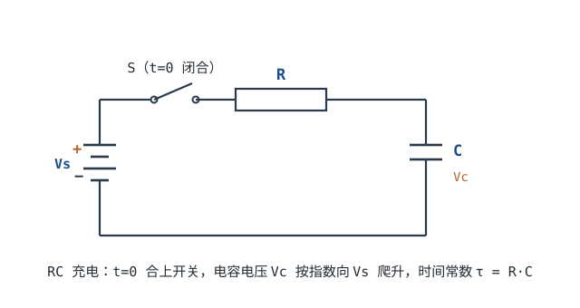

# 电容原理与 RC 时间常数 Capacitor & RC Time Constant

在[电压、电流、电阻与功率](voltage-current-power.md)和[欧姆定律](ohms-law.md)里，电压与电流是同一时刻的代数关系：电压一变，电流立刻跟着变，电路里没有"时间"。真实电路不是这样。电源合上的瞬间，电容两端电压还是 0；按键松开以后，节点要过一会儿才爬过门限；芯片旁边那只 0.1µF 电容，要在几纳秒里顶住负载的电流跳变。**电容把"时间"带进了电路**，而这个时间的尺度，就是 RC 时间常数 $\tau=RC$。

这一章的主线：先把电容的三个基本关系（$C=Q/V$、$I=C\,dV_C/dt$、$E=CV^2/2$）讲透，再解出 RC 充放电的指数曲线，然后把 $\tau$ 换算成"到阈值要多久""截止频率是多少""去耦能顶几纳秒"，最后用一个 3.3V 系统的上电复位（Power-On Reset，POR）设计收尾。读完应该能独立回答三类问题：给定 R、C 和阈值，什么时候翻转；给定延时和阈值，R、C 怎么取；容差和温度会把结果推偏多少。

## 1. 设计动机

::: motivation 三个每天都在发生的场景
**上电复位。** MCU 的复位脚不能一上电就释放：电源还没稳、晶振还没起振，程序跑起来会跑飞。常见做法是用一只电阻从 VCC 给电容充电，复位脚接在电容节点上，等电压越过门限再放行。这个"等多久"不是拍脑袋，而是 $t=\tau\ln\frac{1}{1-k}$；阈值取 $0.9V_{CC}$ 时是 $2.30\tau$，不是 $3\tau$。

**去耦。** 一颗芯片在时钟沿瞬间拉走 1A 电流，电源来不及响应，只能由旁边的电容先顶住。顶多久、掉多少伏，由 $\Delta V=I\Delta t/C$ 决定：100nF 顶 1A、10ns 会掉 0.1V；想只掉 50mV，至少要 200nF。容值选错，芯片会在"电压看起来正常"的板上随机复位。

**滤波与延时。** 按键消抖、ADC 抗混叠、传感器信号平滑，本质都是 RC 低通：$f_c=1/(2\pi RC)$。截止频率和延时是同一个 $\tau$ 的两种说法，改了 R 或 C，两边一起变。
:::

把常见问题、要算的量和判据放在一张表里：

| 你遇到的问题 | 先算 | 判据 |
|---|---|---|
| 复位释放太早/太晚 | $t=\tau\ln\frac{1}{1-k}$ | 最坏情况下仍落在要求窗口内 |
| 负载瞬变时电源跌落 | $\Delta V=I\Delta t/C$ | 跌落小于芯片允许的纹波 |
| 滤波截止频率不对 | $f_c=1/(2\pi RC)$ | 目标频段被衰减到要求值 |
| 上电浪涌、电源打嗝 | $I=C\,dV/dt$ | 浪涌在电源限流以内 |
| 断电后电容仍有高压 | $V(t)=V_0e^{-t/\tau}$，$\tau=R_{\text{bleed}}C$ | 降到安全电压以下的时间可接受 |

**不算会摔在哪**，三个有具体数字的代价：

1. **把 3τ 当成 90%。** 3τ 时电容已经到 $1-e^{-3}=95.02\%$，不是 90%。反过来，如果按"3τ=100ms"去反推电容，得到 $\tau=33.3$ms，实际在 $0.9V_{CC}$ 处只用了 $2.3026\times33.3=76.8$ms，比要求早 23%。用错一个系数，延时短了近四分之一。
2. **去耦只看容值。** 100nF 在 100MHz 的理想容抗是 15.9mΩ，1µF 是 1.59mΩ；但只要封装电感是 0.5nH，它在 100MHz 的感抗就是 $2\pi\times10^8\times0.5\times10^{-9}=0.314\Omega$，比容抗大 20 倍以上。这个频段上，换大电容没用，要换低 ESL 的封装、多只并联、或者把电容放近。
3. **断电就以为没电。** 470µF 充到 400V 储存 $0.5\times470\times10^{-6}\times400^2=37.6$J。即使拔掉电源，没有泄放通路时电荷只能靠漏电流慢慢掉；维修时摸上去的可能是几百伏。并联 47kΩ 泄放电阻后，$\tau=47\times10^3\times470\times10^{-6}=22.09$s，降到 60V 还要 $22.09\times\ln(400/60)=41.9$s。

## 2. 定义与直观

### 2.1 电容是什么：$C=Q/V$

电容是两块被绝缘介质隔开的导体。在两端加电压 $V$，两块板上就会出现等量异号电荷 $+Q$ 与 $-Q$，定义

$$
C=\frac{Q}{V}
$$

其中 $Q$ 是一块极板上的电荷量，单位库仑（C）；$V$ 是两极板间的电压，单位伏特（V）；$C$ 是电容量（Capacitance），单位法拉（F）。$1\text{F}=1\text{C/V}$，也就是"加 1V 能存 1C 电荷"。

平行板电容器的电容由几何和介质决定：

$$
C=\varepsilon_0\varepsilon_r\frac{A}{d}
$$

其中 $\varepsilon_0=8.854\times10^{-12}\ \text{F/m}$ 是真空介电常数，$\varepsilon_r$ 是介质的相对介电常数，$A$ 是极板正对面积（$\text{m}^2$），$d$ 是极板间距（m）。这个式子解释了两件事：想做大容量，要么增大面积、要么减薄介质、要么换高介电常数的材料。MLCC 用薄层叠印把面积做进小封装，电解电容用蚀刻铝箔增大表面积，超级电容则靠多孔电极把面积做到极大。

1F 是很大的单位。1F 电容在 1A 电流下放电 1s，电压才掉 1V；而常见的 100nF 在同样 1A 下 0.1µs 就掉 1V（1µs 掉 10V）。工程上常见的量级是：pF 级用于射频匹配和晶振负载，nF 级用于去耦和滤波，µF 级用于电源储能，mF 级以上是电解电容和超级电容的领域。



::: analogy 电容像一个截面积固定的水桶
- 电容量 $C$ = 水桶的**截面积**；
- 电容电压 $V_C$ = 桶里的**水位**；
- 电荷量 $Q$ = 桶里的**水量**；
- 电流 $I$ = 进水龙头的**流量**。

水位不能瞬间跳变：龙头开得再大，桶里的水也要时间涨上去。电容电压同理，$V_C$ 不能突变，突变意味着无穷大电流，物理上做不到。

这个类比有边界：水桶有重力、有开口、会溢出，电容没有"溢出"这回事，超过耐压会击穿；水桶的"容量"不随水位变，而实际电容的容值会随直流偏压和温度变化（见 5.3 节）。
:::

### 2.2 电流是电荷的变化率：$I=C\,dV_C/dt$

对 $Q=CV_C$ 两边对时间求导。$C$ 在正常工作范围内是常数，于是

$$
I_C=\frac{dQ}{dt}=C\frac{dV_C}{dt}
$$

其中 $I_C$ 是**流入**电容正极的电流（A），$dV_C/dt$ 是电容电压的变化率（V/s）。这个式子是电容的动态定义：**流过电容的电流不取决于当前电压，而取决于电压变化得多快**。

两个直接推论：

- **直流稳态下电容相当于开路。** $V_C$ 不变时 $dV_C/dt=0$，所以 $I_C=0$；无论两端加多大直流电压，都没有持续电流（只有漏电流）。
- **电压变化越快，电流越大。** 100nF 的电容上电压以 1V/µs 上升，电流就是 $100\times10^{-9}\times10^{6}=0.1$A=100mA。以 1V/ns 上升就是 100A——当然实际电路里电源、走线电感会限制这个变化率，但这个数量级解释了为什么去耦电容能在瞬间提供大电流。

### 2.3 储能：$E=\frac{1}{2}CV^2$

电容储存的能量等于把它从 0V 充到 $V$ 的过程中电源做的功：

$$
E=\int_0^t V_C I_C\,dt=\int_0^{V}C V_C\,dV_C=\frac{1}{2}CV^2
$$

其中 $E$ 是储能（J），$C$ 是容量（F），$V$ 是电容两端电压（V）。注意能量与电压是**平方关系**：电压翻倍，储能变四倍。

几个能记住的数：

| 电容 | 电压 | 储能 |
|---|---|---|
| 100nF | 3.3V | $0.5\times100\times10^{-9}\times3.3^2=0.545\ \mu\text{J}$ |
| 680nF | 3.3V | $0.5\times680\times10^{-9}\times3.3^2=3.70\ \mu\text{J}$ |
| 10µF | 5V | $0.5\times10\times10^{-6}\times5^2=125\ \mu\text{J}$ |
| 1000µF | 5V | $0.5\times1000\times10^{-6}\times5^2=12.5\ \text{mJ}$ |
| 470µF | 400V | $0.5\times470\times10^{-6}\times400^2=37.6\ \text{J}$ |

同样 470µF，3.3V 时只有 $0.5\times470\times10^{-6}\times3.3^2=2.56$mJ，400V 时是 37.6J，相差 $(400/3.3)^2=14692$ 倍。**高压大电容的危险来自 $V^2$，不是来自容量数字。** 37.6J 在瞬间释放足以产生强烈火花、灼伤皮肤，甚至让手腕肌肉不受控制地抽开，维修前必须按 5.3 节的方法泄放并测量。

### 2.4 电压不能突变，电流可以突变

由 $I_C=C\,dV_C/dt$，如果电压在 $\Delta t\to0$ 内跳变 $\Delta V$，需要的电流趋于无穷大。真实电源有内阻、走线有电感，给不出无穷大电流，所以**电容电压只能连续变化**；反过来，电流可以在一瞬间从 0 跳到 $V_S/R$（开关闭合的瞬间），电容电压仍从 0 开始爬。

这就是"电容对直流开路、对交流短路"这句话的严格版本：

- 对**直流**（频率为 0），$dV/dt=0$，$I=0$，开路；
- 对**高频**，同样的电压摆幅对应更大的 $dV/dt$，电流更大，阻抗更低，$Z_C=1/(j\omega C)$；
- 对**阶跃**，电压不能跳，电流可以跳，所以合闸瞬间电容像短路，之后按指数充电。

把这一点和[电感](inductor-rl.md)一章对照着记：电容的**电压**连续、电流可以跳；电感的**电流**连续、电压可以跳。两条对偶规则，构成了所有开关电路、滤波器和保护电路的直觉基础。

## 3. 定量关系

### 3.1 充电：KVL 与指数解

把 $V_S$、$R$、$C$ 串联，$t=0$ 合上开关，电容初始电压为 0。对回路列 KVL：

$$
V_S=V_R+V_C=RI_C+V_C=RC\frac{dV_C}{dt}+V_C
$$

这是一个一阶线性微分方程。代入初始条件 $V_C(0)=0$，解为

$$
V_C(t)=V_S\left(1-e^{-t/\tau}\right),\qquad \tau=RC
$$

其中 $V_S$ 是电源电压（V），$t$ 是合闸后的时间（s），$\tau$ 是时间常数（s），$R$ 是电阻（$\Omega$），$C$ 是电容（F）。

验证三件事：$t=0$ 时 $V_C=0$；$t\to\infty$ 时 $V_C\to V_S$；$t=0$ 时 $dV_C/dt=V_S/\tau$，对应的初始电流 $I(0)=C\,V_S/\tau=V_S/R$，正是欧姆定律给出的值。量纲也对：$\Omega\cdot\text{F}=\Omega\cdot\text{C/V}=(\text{V/A})\cdot(\text{A}\cdot\text{s/V})=\text{s}$。

表里给出充电进度，最后一列按 $V_S=3.3$V 计算，方便直接对照示波器读数：

| $t/\tau$ | $1-e^{-t/\tau}$ | $V_C$（3.3V 系统） |
|---|---|---|
| 0.25 | 22.12% | 0.730V |
| 0.5 | 39.35% | 1.298V |
| 1 | 63.21% | 2.086V |
| 2 | 86.47% | 2.853V |
| 2.3026 | 90.00% | 2.970V |
| 3 | 95.02% | 3.136V |
| 4 | 98.17% | 3.240V |
| 5 | 99.33% | 3.278V |
| 7 | 99.91% | 3.297V |

把充电和放电画在同一张归一化曲线上（横轴 $t/\tau$，纵轴 $V_C/V_S$，数值与上表及 3.2 节一致）：

```echarts
{
  "animation": false,
  "tooltip": {"trigger": "axis"},
  "legend": {"data": ["充电 Vc/Vs", "放电 Vc/Vs"], "bottom": 0, "textStyle": {"fontSize": 12}},
  "grid": {"left": 64, "right": 28, "top": 30, "bottom": 62},
  "xAxis": {"type": "value", "name": "t / τ", "nameLocation": "middle", "nameGap": 30, "min": 0, "max": 5, "axisLabel": {"fontSize": 11}},
  "yAxis": {"type": "value", "name": "Vc / Vs (%)", "min": 0, "max": 100, "axisLabel": {"fontSize": 11}},
  "series": [
    {"name": "充电 Vc/Vs", "type": "line", "smooth": true, "showSymbol": false,
     "lineStyle": {"width": 2.6, "color": "#1a4f8b"},
     "data": [[0, 0], [0.25, 22.12], [0.5, 39.35], [0.75, 52.76], [1, 63.21], [1.25, 71.35], [1.5, 77.69], [1.75, 82.62], [2, 86.47], [2.5, 91.79], [3, 95.02], [4, 98.17], [5, 99.33]]},
    {"name": "放电 Vc/Vs", "type": "line", "smooth": true, "showSymbol": false,
     "lineStyle": {"width": 2.2, "color": "#b5642e", "type": "dashed"},
     "data": [[0, 100], [0.25, 77.88], [0.5, 60.65], [0.75, 47.24], [1, 36.79], [1.25, 28.65], [1.5, 22.31], [1.75, 17.38], [2, 13.53], [2.5, 8.21], [3, 4.98], [4, 1.83], [5, 0.67]]}
  ]
}
```

充电电流是

$$
I_C(t)=\frac{V_S}{R}e^{-t/\tau}
$$

它从 $V_S/R$ 开始指数衰减。电阻上的功耗 $P_R=I_C^2R$ 也按 $e^{-2t/\tau}$ 衰减，这一点在 3.2 节的能量账里会用到。

### 3.2 放电与能量守恒

已经充到 $V_0$ 的电容，通过电阻 $R$ 放电（电源移开），回路 KVL 变成 $V_R+V_C=0$，即 $RC\,dV_C/dt+V_C=0$，解为

$$
V_C(t)=V_0e^{-t/\tau},\qquad I_C(t)=-\frac{V_0}{R}e^{-t/\tau}
$$

负号表示电流方向与充电时相反。放电到 1% 需要 $\ln100=4.605\tau$，到 0.1% 需要 $6.908\tau$。工程上常说的"5τ 放完"对应剩余 0.67%，并不是真的到 0。

放电时电容储存的能量全部消耗在电阻（和电容自身 ESR）上：

$$
E_R=\int_0^\infty I^2R\,dt=\frac{V_0^2}{R}\int_0^\infty e^{-2t/\tau}dt=\frac{V_0^2}{R}\cdot\frac{\tau}{2}=\frac{1}{2}CV_0^2
$$

**这个结果与 R 无关。** R 大，放电慢、电流小；R 小，放电快、电流大；两种情况下电阻上的总热量一样，都等于电容的储能。

::: advanced 进阶：充电时一半能量去哪了
把电容从 0 充到 $V_S$，电源输出的电荷是 $Q=CV_S$，做功 $W_S=QV_S=CV_S^2$；电容只存下 $\frac12CV_S^2$，剩下的一半在充电过程中被电阻烧掉：

$$
E_R=\int_0^\infty I^2R\,dt=\frac{V_S^2}{R}\int_0^\infty e^{-2t/\tau}dt=\frac{V_S^2}{R}\cdot\frac{RC}{2}=\frac{1}{2}CV_S^2
$$

这个结论同样与 R 无关：无论串联多大的电阻、充得多慢，效率都只有 50%。想减少充电损耗，只能改变充电方式——恒流充电、电荷泵、或者用开关变换器让电源只输出略高于电容电压的电压。这也是"大电容直接挂到电源上会浪费一半能量、同时产生浪涌"的定量原因。对 680nF、3.3V 的复位电容，电源输出 $CV_S^2=7.41\mu$J，电容存 3.70µJ，电阻上消耗 3.70µJ——绝对量很小，但对 1000µF 的电源入口电容，$CV_S^2$ 就是 25mJ，浪涌电流和发热都要认真对待。
:::

### 3.3 到阈值的时间：不要背 3τ

工程上最常问的不是"充到 63.2% 要多久"，而是"充到某个门限要多久"。设门限为 $V_T=kV_S$，其中 $k$ 是归一化阈值（0 到 1），令 $V_C(t)=kV_S$：

$$
1-e^{-t/\tau}=k\quad\Longrightarrow\quad e^{-t/\tau}=1-k\quad\Longrightarrow\quad t=\tau\ln\frac{1}{1-k}
$$

这个式子比"3τ=95%"有用得多，因为它对任何阈值都成立。常用的点：

| 归一化阈值 $k$ | $t/\tau=\ln\frac{1}{1-k}$ | 典型场景 |
|---|---|---|
| 0.5 | 0.693 | 50% 判决电平 |
| 0.632 | 1.000 | 一个时间常数 |
| 0.7 | 1.204 | 很多 CMOS 输入的 $V_{IH}$ 下限 |
| 0.8 | 1.609 | 较保守的高电平判决 |
| 0.9 | 2.303 | 本章 POR 判据 |
| 0.95 | 2.996 | 接近"3τ" |
| 0.99 | 4.605 | 接近"5τ" |

由此得到几个必须记准的对应关系：

- **1τ = 63.2%**，不是 50%；
- **3τ = 95.0%**，不是 90%；
- **5τ = 99.33%**，不是 100%；
- **90% 在 2.303τ**，比 3τ 早 23.2%（反过来，3τ 比 2.303τ 晚 30.3%）；
- 要 99.9%，需要 $6.908\tau$。

阈值是**比率型**还是**固定电压型**，结果完全不同。若 $V_T=kV_S$，$k$ 不随电源变，则 $t$ 与 $V_S$ 无关；若 $V_T$ 是一个固定电压（例如 2.0V 的复位门限），则

$$
t=\tau\ln\frac{V_S}{V_S-V_T}
$$

对电源电压很敏感。取 $\tau=100$ms、$V_T=2.0$V：$V_S=3.3$V 时 $t=100\times\ln(3.3/1.3)=93.2$ms；$V_S=3.0$V 时 $t=109.9$ms；$V_S=3.6$V 时 $t=81.1$ms。电源只变了 ±10%，延时变了约 ±15%。**所以看复位芯片或 MCU 数据手册时，要确认门限是"VDD 的百分比"还是"固定电压"**，两者对电源波动的敏感度不在一个量级。

用这个通式还能校验现成公式。555 单稳态的内部阈值是 $2V_{CC}/3$，$k=2/3$，所以

$$
t=\tau\ln\frac{1}{1-2/3}=\tau\ln3=1.0986RC\approx1.1RC
$$

这正是数据手册里 $t_w=1.1RC$ 的来源（见[555 定时器](../opamp/555-timer.md)）。记住"指数 + 阈值"这一条主线，就不需要分别背 555、复位、延时电路的公式。

### 3.4 从时间常数到截止频率

把 RC 看成低通滤波器，输入 $V_{in}$、输出取电容电压，传递函数是

$$
H(s)=\frac{1}{1+sRC},\qquad s=j\omega
$$

幅频特性 $|H|=1/\sqrt{1+(f/f_c)^2}$，其中截止频率

$$
f_c=\frac{1}{2\pi RC}=\frac{1}{2\pi\tau},\qquad \tau=\frac{1}{2\pi f_c}
$$

在 $f=f_c$ 处，$|H|=1/\sqrt2$，即比通带低 $20\log_{10}(1/\sqrt2)=-3.01$dB，相位滞后 45°。这就是"−3dB 截止频率"的来源。

时域和频域是同一个 $\tau$ 的两种写法。阶跃响应的 10%~90% 上升时间：

$$
t_r=t_{90}-t_{10}=\tau\ln10-\tau\ln\frac{1}{0.9}=2.3026\tau-0.1054\tau=2.197\tau
$$

代入 $f_c=1/(2\pi\tau)$，得到工程上常用的近似：

$$
t_r=2.197\times\frac{1}{2\pi f_c}=\frac{0.3497}{f_c}\approx\frac{0.35}{f_c}
$$

一张表把 R、C、$\tau$、$f_c$、上升时间串起来（全部按上式计算）：

| R | C | $\tau=RC$ | $f_c=1/(2\pi RC)$ | $t_r=2.197\tau$ |
|---|---|---|---|---|
| 1kΩ | 100nF | 100µs | 1.592kHz | 220µs |
| 10kΩ | 100nF | 1ms | 159.2Hz | 2.20ms |
| 100kΩ | 100nF | 10ms | 15.92Hz | 22.0ms |
| 1kΩ | 1µF | 1ms | 159.2Hz | 2.20ms |
| 10kΩ | 1µF | 10ms | 15.92Hz | 22.0ms |
| 100kΩ | 1µF | 100ms | 1.592Hz | 220ms |
| 100kΩ | 10µF | 1s | 0.159Hz | 2.20s |

注意这张表是**空载** RC。输出端一旦接上负载，负载与 C 并联（或与 R 分压），$f_c$ 和 $\tau$ 都会变；有源滤波和缓冲的问题见[一阶滤波器](../opamp/first-order-filters.md)。

### 3.5 容抗、ESR 与自谐振

理想电容的阻抗是

$$
Z_C=\frac{1}{j\omega C},\qquad |Z_C|=\frac{1}{2\pi fC}
$$

按这个式子算，容量越大、频率越高，阻抗越低：

| 电容 | 50Hz | 1kHz | 100kHz | 1MHz | 10MHz | 100MHz |
|---|---|---|---|---|---|---|
| 10nF | 318.3kΩ | 15.92kΩ | 159.2Ω | 15.92Ω | 1.592Ω | 0.159Ω |
| 100nF | 31.83kΩ | 1.592kΩ | 15.92Ω | 1.592Ω | 0.159Ω | 0.0159Ω |
| 1µF | 3.183kΩ | 159.2Ω | 1.592Ω | 0.159Ω | 0.0159Ω | 0.00159Ω |

但真实电容不是纯电容，而是 $C$、ESR、ESL 的串联模型。频率高到一定程度，ESL 的感抗超过容抗，电容反而"变成电感"。串联谐振频率是

$$
f_0=\frac{1}{2\pi\sqrt{L_{ESL}C}}
$$

以 0.5nH 的封装电感（典型量级，具体看封装和数据手册）估算：100nF 的 $f_0=1/(2\pi\sqrt{0.5\times10^{-9}\times100\times10^{-9}})=22.5$MHz；1µF 的 $f_0=7.12$MHz；10nF 的 $f_0=71.2$MHz。在 100MHz，100nF 的容抗只有 15.9mΩ，但 0.5nH 的感抗是 $2\pi\times10^8\times0.5\times10^{-9}=0.314\Omega$，后者完全盖过前者。

这解释了一个常见困惑：**为什么 1µF 不能替代 100nF 做高频去耦。** 大容量把低频阻抗做低了，但封装越大、ESL 越大，自谐振频率越低；到了几十 MHz 以上，它已经是个电感。正确做法是按频段配电容、用低 ESL 封装、多只并联并把回路面积做小，细节见[电容参数](../components/capacitor-parameters.md)和[电源完整性与去耦体系](../power/power-integrity-decoupling.md)。

## 4. 典型计算

### 4.1 算例一：100kΩ + 1µF 的阈值时刻

**需求**：3.3V 电源，$R=100$kΩ，$C=1\mu$F，求时间常数和到达不同阈值的时间。

**时间常数**：

$$
\tau=RC=100\times10^3\times1\times10^{-6}=0.1\ \text{s}=100\ \text{ms}
$$

**到各阈值的时间**（用 $t=\tau\ln\frac{1}{1-k}$）：

| 阈值 | 计算 | 结果 |
|---|---|---|
| $0.7V_{CC}=2.31$V | $100\times\ln\frac{1}{1-0.7}=100\times1.204$ | 120.4ms |
| $0.9V_{CC}=2.97$V | $100\times\ln\frac{1}{1-0.9}=100\times2.303$ | 230.3ms |
| $0.95V_{CC}=3.135$V | $100\times\ln20=100\times2.996$ | 299.6ms |
| 固定 2.0V | $100\times\ln\frac{3.3}{3.3-2.0}=100\times0.9316$ | 93.2ms |

**验算 3τ 的说法**：$t=300$ms 时 $V_C=3.3\times(1-e^{-3})=3.3\times0.9502=3.136$V，确实越过了 $0.9V_{CC}=2.97$V；但越过 2.97V 的实际时刻是 230.3ms，不是 300ms。若按"3τ"设计 300ms 的复位延时，实际 230ms 就释放了，早了 23%。反过来，若要求"$0.9V_{CC}$ 处至少 230ms"，正确的 $\tau$ 是 $230/2.3026=99.9$ms；按 3τ 反推会得到 $\tau=230/3=76.7$ms，实际只有 $2.3026\times76.7=176.6$ms，短了 23%。

**初始电流**：$I(0)=3.3/100\text{k}=33\mu$A，电阻上的初始功耗 $P=3.3^2/100\text{k}=109\mu$W。这个电流很小，不会影响电源，但也意味着复位节点阻抗高达 100kΩ，容易拾取噪声，实际电路常在复位脚附近再并一只小电容或加施密特输入。

**2τ 时**：$V_C=3.3\times0.8647=2.853$V，仍低于 2.97V，所以"2τ 就够了"是错的；对 0.9 阈值，必须等到 2.303τ。

### 4.2 算例二：按键消抖的 RC

**电路**：3.3V 经 10kΩ 上拉到 MCU 输入，输入节点经 100nF 到地，按键把节点短接到地。按键松开时，节点经 10kΩ 充电；按下时，节点经按键触点放电。

**充电时间常数**：

$$
\tau=R C=10\times10^3\times100\times10^{-9}=1\times10^{-3}\ \text{s}=1\ \text{ms}
$$

**放电时间常数**：按键触点电阻按 0.1Ω 估算（典型量级，具体看按键数据手册），

$$
\tau_{\text{dis}}=0.1\times100\times10^{-9}=10\ \text{ns}
$$

所以按下是"瞬间"拉低，松开是"缓慢"爬升——这种不对称正是消抖需要的。

**抖动过程**：机械按键在按下和松开时会有几毫秒的抖动（典型 1~10ms，具体看器件）。设抖动持续 5ms，期间触点反复开合。每次闭合都把电容瞬间放电到 0；每次断开，电容从 0 开始按 1ms 的时间常数上升。如果两次闭合的间隔小于到达 $V_{IH}$ 的时间，节点就到不了高电平。

设 MCU 的 $V_{IH}=0.7V_{CC}=2.31$V，则从最后一次断开到越过 $V_{IH}$：

$$
t=\tau\ln\frac{1}{1-0.7}=1\times1.204=1.204\ \text{ms}
$$

到 $0.9V_{CC}$ 是 2.303ms。也就是说，**RC 并没有"消除"抖动，它只是把节点的上升沿变慢，让 MCU 在最后一次抖动结束后再等约 1.2ms 才看到高电平。** 如果抖动间隔大于 1.2ms，MCU 仍会看到多个脉冲，所以实际设计还要靠施密特输入或软件计数确认。

**按下时的电流**：$3.3/10\text{k}=0.33$mA，功耗 $3.3^2/10\text{k}=1.09$mW，可以接受。

**边界**：如果 R 取 1MΩ 省电，$\tau=100$ms，上升沿变成 120ms，按键响应会明显迟滞，而且高阻节点容易被噪声干扰；如果 C 取 10nF，$\tau=100\mu$s，抖动间隔大于 0.12ms 就会漏过去。10kΩ + 100nF 是"响应速度、功耗、抗扰"三者的常用折中，具体取值按按键抖动特性和 MCU 的 $V_{IH}$ 调整。

### 4.3 算例三：RC 低通与 12 位 ADC 的建立时间

**需求**：传感器输出经 1kΩ + 100nF 的 RC 低通送 12 位 ADC，$V_{ref}=3.3$V，求截止频率、建立到 0.5LSB 的时间和最高采样率。

**截止频率**：

$$
f_c=\frac{1}{2\pi RC}=\frac{1}{2\pi\times10^3\times100\times10^{-9}}=1591.5\ \text{Hz}\approx1.59\ \text{kHz}
$$

**时间常数**：

$$
\tau=10^3\times100\times10^{-9}=100\ \mu\text{s}
$$

**0.5LSB 对应的电压**：

$$
V_{0.5LSB}=\frac{3.3}{2^{12}}\times0.5=\frac{3.3}{8192}=0.4028\ \text{mV}
$$

**从 0 阶跃到 3.3V，误差收敛到 0.5LSB 以内的时间**：

$$
t=\tau\ln\frac{3.3}{0.0004028}=100\times10^{-6}\times9.011=901\ \mu\text{s}
$$

**最高采样率**：$1/901\mu\text{s}=1.11$kSPS。采样间隔短于 901µs，读数就会偏低；如果要多通道轮询，每个通道都要留够这个建立时间，或者在前级加缓冲器降低源阻抗。

**对比**：如果把 R 换成 100kΩ（为了省电或提高输入阻抗），$\tau=10$ms，建立时间变成 90.1ms，采样率掉到 11SPS，完全不适合音频或振动信号。**RC 滤波器的 R 不能只按截止频率选，还要按后级采样/建立时间核算。**

### 4.4 完整设计：3.3V 系统的 100ms 上电复位

这是一个从需求到验算走完整遍的设计例子。目标是：电源上电后至少等 100ms 再释放复位，最长不超过 300ms；用一只 R 和一只 C 实现，不用专用复位芯片。

**需求与假设**：

| 项目 | 要求/假设 |
|---|---|
| 电源 | 3.3V ±5% |
| 复位门限 | $0.9V_{CC}$ 的比率型门限，门限比容差 ±0.05 |
| 释放时间 | 100ms ≤ $t$ ≤ 300ms（0~70°C） |
| R | 100kΩ，±1%，100ppm/°C |
| C | 680nF；先按 X7R（初始 ±10%、全温 ±15%、偏压 −5%）评估，再按薄膜/C0G ±5% 复核 |
| 复位输入漏电 | ≤1µA |
| 电容绝缘电阻 | ≥10GΩ（典型量级，以数据手册为准） |


**第 1 步：写出释放时刻的公式。** 电容从 0 充电到 $0.9V_{CC}$：

$$
t=\tau\ln\frac{1}{1-0.9}=\tau\ln10=2.3026\tau
$$

**第 2 步：选电容，反算电阻。** 取标准值 $C=680$nF（E6 系列），由 $t=2.3026RC$ 得

$$
R=\frac{t}{2.3026C}=\frac{0.1}{2.3026\times680\times10^{-9}}=6.39\times10^4\ \Omega
$$

这个 63.9kΩ 是"刚好 100ms、没有任何余量"的临界值；R、C 和门限的容差最坏会把时间往下拉（X7R 约 40.7%，见第 3 步；薄膜/C0G 约 22.5%），所以不能取它。这里**刻意取 E24 的 100kΩ**，把标称延时推到 156.6ms，让最坏情况仍落在 100ms 以上。于是

$$
\tau=100\times10^3\times680\times10^{-9}=0.068\ \text{s}=68\ \text{ms}
$$

$$
t_{\text{nom}}=2.3026\times68=156.6\ \text{ms}
$$

**第 3 步：先按 X7R 做最坏情况。** X7R 的容值有三项误差：初始 ±10%、全温 ±15%、3.3V 偏压约 −5%。按最不利的乘性叠加：

- 下限：$C_{\min}=680\times0.90\times0.85\times0.95=494.2$nF（−27.3%）；
- 上限：$C_{\max}=680\times1.10\times1.15=860.2$nF（+26.5%）。

再叠加 R 的 ±1% 和门限比 $k=0.85\sim0.95$：

$$
\tau_{\min}=0.99\times100\times10^3\times494.2\times10^{-9}=48.93\ \text{ms}
$$

$$
t_{\min}=48.93\times\ln\frac{1}{1-0.85}=48.93\times1.897=92.8\ \text{ms}
$$

$$
\tau_{\max}=1.01\times100\times10^3\times860.2\times10^{-9}=86.88\ \text{ms}
$$

$$
t_{\max}=86.88\times\ln\frac{1}{1-0.95}=86.88\times2.996=260.3\ \text{ms}
$$

下限 92.8ms 已经跌破 100ms，**X7R 方案不满足要求**；上限 260.3ms 仍在 300ms 内。差的不是"典型值"，而是容差叠加——这也是为什么第 4 步要换介质。

**第 4 步：换薄膜/C0G，重算最坏范围。** 把 C 换成 ±5% 的薄膜或 C0G（温度、偏压、老化影响都远小于 X7R），$C_{\min}=680\times0.95=646$nF，$C_{\max}=680\times1.05=714$nF：

$$
\tau_{\min}=0.99\times100\times10^3\times646\times10^{-9}=63.95\ \text{ms}
$$

$$
t_{\min}=63.95\times1.897=121.3\ \text{ms}
$$

$$
\tau_{\max}=1.01\times100\times10^3\times714\times10^{-9}=72.11\ \text{ms}
$$

$$
t_{\max}=72.11\times2.996=216.0\ \text{ms}
$$

最坏 121.3~216.0ms，下限余量 21.3%、上限余量 28.0%，满足 100~300ms。如果成本不允许薄膜/C0G，可以保留 X7R 但把 C 加到 820nF，并把上限放宽到 350ms：$C_{\min}=820\times0.72675=595.9$nF、$C_{\max}=820\times1.265=1037$nF，对应最坏约 111.9~313.9ms。**"换介质"和"放宽窗口"是两条不同的路，不能只在典型值上打转。**

**门限比单独变化时的影响。** 如果只把门限比从 0.9 改成 0.85 或 0.95（其他条件取标称）：

$$
t(0.85)=68\times1.897=129.0\ \text{ms},\qquad t(0.95)=68\times2.996=203.7\ \text{ms}
$$

**第 5 步：核算复位脚漏电。** 复位脚的漏电流会改变充电的"终点电压"。设漏电 $I_L$ 流入节点，充电方程变成 $C\,dV_C/dt=(V_{CC}-V_C)/R+I_L$，稳态电压不再是 $V_{CC}$，而是

$$
V_\infty=V_{CC}+I_LR
$$

时间常数仍是 $\tau=RC$，解为 $V_C(t)=V_\infty(1-e^{-t/\tau})$，到达门限 $V_T=0.9V_{CC}=2.97$V 的时间是

$$
t=\tau\ln\frac{V_\infty}{V_\infty-V_T}
$$

**1µA 灌入节点**：$V_\infty=3.3+1\times10^{-6}\times100\times10^3=3.4$V，

$$
t=68\times\ln\frac{3.4}{3.4-2.97}=68\times\ln7.907=68\times2.068=140.6\ \text{ms}
$$

比标称 156.6ms 早 10.2%。

**1µA 从节点流出**：$V_\infty=3.3-0.1=3.2$V，

$$
t=68\times\ln\frac{3.2}{3.2-2.97}=68\times\ln13.913=68\times2.633=179.0\ \text{ms}
$$

比标称晚 14.3%。两个方向都还在 100~300ms 内。

**5µA 从节点流出**：$V_\infty=3.3-5\times10^{-6}\times100\times10^3=2.8$V，已经低于 2.97V 的门限——**电容永远到不了门限，复位永远不释放**。所以复位脚的漏电必须按最坏方向核算，不能只看 1µA 的典型值；数据手册给不出保证值时，宁可选小一点的 R（例如 47kΩ 配 1.5µF，$\tau=70.5$ms，与 68ms 同一量级），或者加一级缓冲。

**第 6 步：核算温度。** R 的 TCR 为 100ppm/°C，从 25°C 到 70°C 变化 45°C：

$$
\frac{\Delta R}{R}=100\times10^{-6}\times45=0.45\%
$$

相对薄膜/C0G 的 ±5% 可以忽略。真正的主导项是电容介质：X7R 的 ±15% 温度项已经在第 3 步的 92.8ms 里体现；换成薄膜/C0G 后，初始容差和温度漂移都进入 ±5% 的包络（第 4 步）。结论：**温度的主要影响不是 R，而是 C 的介质**；选薄膜/C0G 就是把这一项从 ±15% 压到 ±5%。

**第 7 步：核算电容漏电。** 绝缘电阻 10GΩ 与 100kΩ 并联，等效电阻仍约 100kΩ；电容自身的放电时间常数 $10\times10^9\times680\times10^{-9}=6800$s，比 68ms 大 10 万倍，可以忽略。

**第 8 步：核算电源爬升时间。** 上面的公式假设 VCC 是阶跃。如果 VCC 上升时间接近或超过 $\tau$，电容会"跟着"电源爬，实际释放时刻被电源爬升时间拉长。工程上要求电源上升时间小于 $\tau/10=6.8$ms；慢上电（如大容量输入电容、软启动电源）必须按实际 VCC 波形仿真或测量，不能直接套指数公式。

**第 9 步：选耐压和封装。** 3.3V 工作电压下选 16V 薄膜（或容值/封装可接受的 C0G），$16/3.3=4.85$ 倍余量；680nF 的具体封装和尺寸按所选物料的 datasheet 确认。电容储能 $0.5\times680\times10^{-9}\times3.3^2=3.70\mu$J，浪涌能量很小。

**第 10 步：验算汇总。**

| 项目 | 数值 | 是否满足 |
|---|---|---|
| 标称释放时间 | 156.6ms | 在 100~300ms 内 |
| X7R 最坏（C−27.3%/+26.5%、R±1%、k=0.85/0.95） | 92.8~260.3ms | **下限不满足** |
| 薄膜/C0G 最坏（C±5%、R±1%、k=0.85/0.95） | 121.3~216.0ms | 满足，余量 21.3%/28.0% |
| 漏电 1µA（灌入/流出） | 140.6/179.0ms | 满足 |
| 漏电 5µA 流出 | $V_\infty=2.8$V，永不释放 | 不允许 |
| 门限比 0.85/0.95 时 | 129.0/203.7ms | 满足 |
| 电容漏电影响 | 6800s 时间常数 | 可忽略 |
| 功耗 | $3.3^2/100\text{k}=109\mu$W | 可接受 |

**结论**：选 $R=100$kΩ ±1%、$C=680$nF 薄膜/C0G 16V，在复位脚漏电 ≤1µA 的前提下，标称 156.6ms 释放，最坏 121.3~216.0ms。X7R 版本在容差叠加后最低 92.8ms，不满足 100ms 下限；如果必须用 X7R，把 C 加到 820nF 可得到 111.9~313.9ms，但上限超出了 300ms 的要求，需要放宽窗口，或改用带迟滞和固定门限的复位芯片（见[时钟与复位设计](../digital/clock-reset-design.md)）。不要用 3τ 直接反推，也不要把 X7R 当成精密定时元件。

## 5. 工程含义

### 5.1 数量级速查：同样的 τ，不同的代价

同样是 RC，不同场景的 R、C 量级差好几个数量级，代价也不同：

| 场景 | R | C | $\tau$ | $f_c$ | 代价/注意 |
|---|---|---|---|---|---|
| 按键消抖 | 10kΩ | 100nF | 1ms | 159Hz | 按下时 0.33mA，响应约 1.2ms |
| ADC 抗混叠 | 1kΩ | 100nF | 100µs | 1.59kHz | 12 位建立 901µs，限制采样率 |
| 音频耦合（高通） | 10kΩ | 1µF | 10ms | 15.9Hz | 转折频率以下衰减，见 3.4 节的对偶用法 |
| 电源滤波 | 10Ω | 100µF | 1ms | 159Hz | 100mA 时压降 1V、功耗 0.1W |
| 上电复位 | 100kΩ | 680nF | 68ms | 2.34Hz | 漏电和容差敏感，见 4.4 节 |

这张表说明：**RC 的取值不是"越大越好"或"越小越好"，而是由时间尺度、阻抗和功耗三者共同决定。** 时间常数相同的两组 R、C，阻抗可能差 100 倍：1kΩ+1µF 和 100kΩ+10nF 都是 1ms，但前者输出阻抗低、功耗大，后者省电但容易被负载和噪声影响。

### 5.2 去耦：电容到底能顶多久

去耦电容的作用，是在电源来不及响应的那段时间里，替负载提供电流。设负载电流阶跃 $I$，持续时间 $\Delta t$，电容电压跌落

$$
\Delta V=\frac{I\Delta t}{C}
$$

反过来看更直观：按 1A 阶跃，电容"能顶多久"（电压跌到指定值之前）是 $t=C\Delta V/I$：

| 电容 | 跌 10mV | 跌 50mV | 跌 100mV | 跌 500mV |
|---|---|---|---|---|
| 100nF | 1ns | 5ns | 10ns | 50ns |
| 1µF | 10ns | 50ns | 100ns | 500ns |
| 10µF | 100ns | 500ns | 1µs | 5µs |

（表内按 $t=C\Delta V/I$ 计算。超过这个时间，跌落继续按线性增大，直到跌落接近初始电压、电容基本放空后公式失效。）

要求跌落不超过 50mV 时，需要的容量是

$$
C=\frac{I\Delta t}{\Delta V}=\frac{1\times\Delta t}{0.05}=20\,\Delta t
$$

其中 $C$ 的单位是 F，$\Delta t$ 的单位是 s。

$\Delta t=10$ns 要 200nF，100ns 要 2µF，1µs 要 20µF。这就是为什么电源入口要有 10~100µF 的 bulk 电容，而每个芯片旁边还要 100nF：**bulk 负责 µs 级、大容量的需求，小电容负责 ns 级、低 ESL 的需求，两者不能互相替代。**


布局比容值更关键。电容到芯片的回路每毫米约 1nH（典型量级），5nH 的回路上如果电流以 1A/ns 变化，感应压降就是 $5\times10^{-9}\times10^9=5$V——比电容本身的容抗大得多。所以去耦电容要"靠近引脚、短而宽的走线、地过孔就近"，细节见[电源完整性与去耦体系](../power/power-integrity-decoupling.md)。

### 5.3 选型、降额与安全

选电容不只看容值，至少要看五项：耐压、介质、容差、ESR/纹波电流、温度特性。

- **耐压**：常见做法是陶瓷电容长期工作电压不超过额定值的 50%~80%，电解电容不超过 80%，钽电容按 50% 降额（不同厂商和标准要求不同，以数据手册为准）。高压场合还要注意浪涌和重复峰值。
- **介质**：C0G/NP0 的容值随温度、电压、时间都很稳定（典型 ±30ppm/°C），适合定时和滤波；X7R 的容值在全温范围变化 ±15%，还有明显的直流偏压降容；Y5V 的容值变化可达 +22%/−82%，只能用于对容值不敏感的旁路。**RC 定时想要准，优先 C0G 或薄膜，不要用高 K 陶瓷。**
- **容差**：普通电容 ±10%~±20%，C0G 可到 ±5% 或 ±1%，薄膜可到 ±2%。定时精度要求高时，电阻和电容的容差要一起算，必要时标定。
- **ESR 与纹波电流**：电解电容的 ESR 随温度下降而上升，纹波电流过大会发热、缩短寿命。开关电源输出电容要按纹波电流选，不能只看容值。
- **温度与寿命**：电解电容的寿命对温度敏感，工程上常用"每升 10°C 寿命减半"的经验法则估算（具体以厂商寿命公式为准）；陶瓷电容没有这种寿命机制，但会有机械裂纹和直流偏压问题。

**高压电容的安全处理**：以大容量、高压的 470µF/400V 为例，储能 37.6J。维修前必须断电、等待、泄放、测量：

1. 并联泄放电阻：取 47kΩ、5W（400V 时功耗 $400^2/47\text{k}=3.40$W），$\tau=47\times10^3\times470\times10^{-6}=22.09$s；
2. 等待时间：降到 60V 需要 $22.09\times\ln(400/60)=41.9$s，工程上至少等 2~3 分钟；
3. 用万用表直流档实测电容两端电压，确认降到安全值再动手；
4. 注意泄放电阻本身的耐压：400V 可能超过小功率电阻的额定电压，必要时用两只串联分压。

即使有泄放电阻，也不要假设"断电就安全"；介质吸收（Dielectric Absorption）会让电容在放电后缓慢"回弹"出一点电压，见 5.4 节。

### 5.4 RC 模型什么时候不够用

本章的指数公式建立在四个假设上：$C$ 是常数、$R$ 是常数、电源是理想阶跃、没有寄生参数。真实电路里这些假设会逐个失效：

- **介质吸收（DA）**：电容放电到 0 后断开，介质里"慢极化"的电荷会慢慢释放，两端电压回弹。电解电容的 DA 较明显，薄膜和 C0G 较小；回弹比例以数据手册或实测为准。采样保持、积分器、高压维修都要考虑这一点。
- **ESR/ESL**：高频下电容不是纯电容，阻抗在自谐振点后上升；大电流瞬变时 ESR 上的压降不可忽略。
- **漏电流**：电解电容的漏电随温度和电压上升；高阻 RC 定时电路中，漏电会改变等效时间常数。
- **非线性容值**：X7R/Y5V 的容值随直流偏压下降，3.3V 下可能比标称低 5%~30%（具体看封装和介质），高压偏置下更明显。
- **温度**：容值和 ESR 都随温度变；R 的 TCR 也会贡献误差。
- **自热与纹波**：大纹波电流会让电容发热，ESR 越大发热越多，形成正反馈。
- **高频分布效应**：当电路尺寸接近波长（例如 1GHz 对应 30cm 波长），集总 RC 模型不再成立，要用传输线或电磁场方法。

工程判断的关键是：**知道自己正在用哪个近似，以及这个近似在什么条件下会失效。** 对复位、消抖这类"毫秒级、精度要求不高"的场合，RC 模型足够；对精密定时、高 Q 滤波、高速去耦，必须把上述非理想因素纳入。

## 6. 常见坑

::: pitfall 常见坑
- **把 3τ 当成 90%**：现象——按"3τ"设计的复位延时比预期短 23%，或者示波器上 90% 的时刻对不上计算。原因——$1-e^{-3}=95.02\%$，90% 对应的是 $2.303\tau$；指数曲线不是线性斜坡，不能用"三分之一""三分之二"去插值。解决——用 $t=\tau\ln\frac{1}{1-k}$ 算，先确认门限是比率型还是固定电压，再代入。
- **去耦电容只看容值、不看封装和位置**：现象——换了 10µF 电容，芯片还是复位；或者同一块板换一个封装就好了。原因——大容量封装的 ESL 大，自谐振频率低，高频段已经是电感；回路电感上的 $L\,di/dt$ 压降比容抗大得多。解决——按频段配 100nF/1µF/10µF，选低 ESL 封装，电容靠近引脚、地过孔就近，必要时多只并联。
- **直流分析时把电容当短路**：现象——算静态工作点时电流偏大、偏置电压对不上。原因——直流稳态 $dV_C/dt=0$，电容电流为 0，应该按**开路**处理；只有交流小信号或瞬态才考虑它的阻抗。解决——直流分析先把电容拿掉（开路），再单独做交流/瞬态分析；电感的规则相反（直流短路）。
- **忽略 X7R 的直流偏压和温度**：现象——RC 定时比计算值短 20%~30%，批量一致性差。原因——高 K 陶瓷的容值随直流偏压和温度显著下降，标称 680nF 在 3.3V、70°C 下可能只剩 80%。解决——定时场合改用 C0G/薄膜，或按数据手册的偏压/温度曲线取最坏值，必要时产线标定。
- **断电就以为电容没电**：现象——维修时被电击，或者换元件时打火。原因——大电容储存的能量与 $V^2$ 成正比，没有泄放通路时电荷只能靠漏电慢慢消失。解决——并联泄放电阻，按 $\tau=R_{\text{bleed}}C$ 算等待时间，断电后用万用表实测确认；高压电容还要注意电阻耐压和介质吸收回弹。
- **上电浪涌被忽略**：现象——插拔电源时适配器打嗝、保险丝熔断、USB 端口保护。原因——空电容上电瞬间相当于短路，浪涌电流受电源内阻和 ESR 限制；1000µF 在 5V、1ms 内充满，平均电流就是 5A。解决——加软启动/限流电路、NTC 热敏电阻或热插拔控制器，按 $I=C\,dV/dt$ 估算最坏浪涌。
:::

## 7. 自测题

<details><summary>100nF 电容充到 3.3V 储存多少能量？470µF 充到 400V 呢？两者相差多少倍？</summary>

100nF、3.3V：

$$
E=\frac12CV^2=\frac12\times100\times10^{-9}\times3.3^2=0.5\times100\times10^{-9}\times10.89=5.445\times10^{-7}\ \text{J}=0.545\ \mu\text{J}
$$

470µF、400V：

$$
E=\frac12\times470\times10^{-6}\times400^2=0.5\times470\times10^{-6}\times160000=37.6\ \text{J}
$$

倍数：$37.6/(5.445\times10^{-7})=6.9\times10^7$，约 6900 万倍。容量只大了 4700 倍，电压高了 121 倍，能量按 $CV^2$ 放大，所以高压大电容的危险远大于同等容值的低压电容。

</details>

<details><summary>3.3V 经 100kΩ 给 1µF 充电，时间常数是多少？充到 0.9×3.3V 要多久？3τ 时电压是多少？</summary>

时间常数：

$$
\tau=RC=100\times10^3\times1\times10^{-6}=0.1\ \text{s}=100\ \text{ms}
$$

到 $0.9V_{CC}=2.97$V：

$$
t=\tau\ln\frac{1}{1-0.9}=100\times\ln10=100\times2.3026=230.3\ \text{ms}
$$

3τ 时：

$$
V_C=3.3\times(1-e^{-3})=3.3\times0.9502=3.136\ \text{V}
$$

3.136V 已经超过 2.97V，但越过 2.97V 的时刻是 230.3ms，不是 300ms。**"3τ=90%"是错的，90% 在 2.303τ。**

</details>

<details><summary>R=10kΩ、C=100nF 的 RC 低通，截止频率和 10%~90% 上升时间各是多少？如果把 R 改成 100kΩ，两者怎么变？</summary>

$f_c$：

$$
f_c=\frac{1}{2\pi RC}=\frac{1}{2\pi\times10^4\times100\times10^{-9}}=\frac{1}{6.283\times10^{-3}}=159.2\ \text{Hz}
$$

上升时间：

$$
t_r=2.197\tau=2.197\times10^4\times100\times10^{-9}=2.197\times10^{-3}\ \text{s}=2.20\ \text{ms}
$$

R 改成 100kΩ 后，$\tau$ 变为 10ms，$f_c$ 降为 15.92Hz，$t_r$ 变为 22.0ms。**截止频率和上升时间都由同一个 $\tau$ 决定，改 R 会同时改变两者，不能独立调。**

</details>

<details><summary>上电复位用 100kΩ + 680nF，门限为 0.9VCC，求 τ 和标称释放时间。若实际门限只有 0.85VCC，释放时间变成多少？</summary>

$$
\tau=100\times10^3\times680\times10^{-9}=68\ \text{ms}
$$

门限 0.9：

$$
t=68\times\ln\frac{1}{0.1}=68\times2.3026=156.6\ \text{ms}
$$

门限 0.85：

$$
t=68\times\ln\frac{1}{0.15}=68\times1.897=129.0\ \text{ms}
$$

门限比从 0.90 降到 0.85，释放时间提前 17.6%。这就是为什么设计时要确认门限的容差，而不能只按典型值算。

</details>

<details><summary>负载电流 1A 阶跃持续 10ns，100nF 去耦电容上电压跌落多少？要求跌落不超过 50mV，需要多大电容？</summary>

跌落：

$$
\Delta V=\frac{I\Delta t}{C}=\frac{1\times10\times10^{-9}}{100\times10^{-9}}=\frac{10^{-8}}{10^{-7}}=0.1\ \text{V}
$$

要求 50mV：

$$
C=\frac{I\Delta t}{\Delta V}=\frac{1\times10\times10^{-9}}{0.05}=2\times10^{-7}\ \text{F}=200\ \text{nF}
$$

注意这是"电容独自供电"的估算；实际还有电源、VRM 和 PCB 电感参与，且电容的 ESR/ESL 会额外贡献压降。所以工程上不会只留 200nF，而是按频段配 100nF + 1µF + bulk。

</details>

<details><summary>400V、470µF 的电容，用 47kΩ 泄放电阻放电。时间常数多少？降到 60V 要多久？电阻初始功耗多少？</summary>

时间常数：

$$
\tau=RC=47\times10^3\times470\times10^{-6}=22.09\ \text{s}
$$

降到 60V：

$$
t=\tau\ln\frac{V_0}{V_t}=22.09\times\ln\frac{400}{60}=22.09\times1.897=41.9\ \text{s}
$$

初始功耗（400V 时）：

$$
P=\frac{V^2}{R}=\frac{400^2}{47\times10^3}=\frac{160000}{47000}=3.40\ \text{W}
$$

所以要选 5W 以上的电阻，并注意电阻的额定电压；工程上等待时间按 2~3 倍 $t$ 留余量，断电后还要用万用表实测确认。

</details>

## 8. 参考资料

- [Lessons In Electric Circuits, Volume I – DC（Kuphaldt）](https://www.ibiblio.org/kuphaldt/electricCircuits/)：*Chapter 13 Capacitors* 讲电容的物理结构、$C=Q/V$、储能与介质；*Chapter 16 RC and L/R Time Constants* 讲 RC 充放电的指数解与时间常数。本章的指数曲线、能量账和"电压不能突变"按该两章的结构重写。
- The Art of Electronics, 3rd ed.（Horowitz and Hill），*Chapter 1 Foundations*：电容、RC 时间常数、容抗与去耦的工程讲法；本章的"去耦按频段分工"和"RC 低通"口径参考该书。
- Practical Electronics for Inventors, 4th ed.（Scherz and Monk），*Chapter 2 Theory*：电容、RC 充放电、按键消抖与电源滤波的入门推导；本章的 Water Bucket 类比与消抖算例参考该书。
- IEC 60384-1:2016, *Fixed capacitors for use in electronic equipment – Part 1: Generic specification*：固定电容的通用规范，包括耐压、温度特性、试验分类；本章 5.3 节的降额与选型口径按该标准及厂商数据手册。
- IEC 60063:2015, *Preferred number series for resistors and capacitors*：E6/E12/E24 标称值系列；本章 680nF、100kΩ 等取值按此标准选取。
- Texas Instruments, *NE555 定时器数据手册*，Monostable Operation 一节：$t_w=1.1RC$，内部阈值为 $2V_{CC}/3$；本章 3.3 节用它校验"指数 + 阈值"的通式。
- [Falstad Circuit Simulator](https://www.falstad.com/circuit/)：可交互观察 RC 充放电波形；建议用 3.3V、100kΩ、1µF 复现本章 3.1 节充电表的数值。
