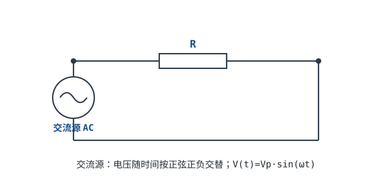

# 直流与交流、频率、相位与有效值 DC / AC, Frequency, Phase, RMS

前面讲的都是直流（DC）——电压一直朝一个方向不变。从市电、信号、无线到 MCU 时钟，另一大类是**交流（AC）**——电压随时间正负变化。这一章建立交流语言：频率、周期、相位、有效值（RMS），后面阻抗、滤波全靠它。

## 1. 设计动机

::: motivation 为什么要学交流
市电插座是 220V/50Hz 交流；声卡输出是交流音频；射频信号是高频交流；甚至数字方波也能分解成交流。万用表测的"220V"不是峰值，是有效值；示波器上两个正弦波谁超前谁，就是相位。这些概念不懂，后面阻抗、谐振、滤波全没法谈。
:::

## 2. 原理图与波形



```echarts
{
  "tooltip": {"trigger": "axis"},
  "legend": {"data": ["v(t) 瞬时电压", "Vrms 有效值"], "bottom": 0, "textStyle": {"fontSize": 13}},
  "grid": {"left": 56, "right": 24, "top": 26, "bottom": 56},
  "xAxis": {"type": "category", "name": "角度", "data": [0,30,60,90,120,150,180,210,240,270,300,330,360], "axisLabel": {"fontSize": 11}},
  "yAxis": {"type": "value", "name": "电压 V", "min": -1.2, "max": 1.2, "axisLabel": {"fontSize": 11}},
  "series": [
    {"name": "v(t) 瞬时电压", "type": "line", "smooth": true, "showSymbol": false, "lineStyle": {"width": 2.6, "color": "#1a4f8b"},
     "data": [0,0.5,0.866,1,0.866,0.5,0,-0.5,-0.866,-1,-0.866,-0.5,0]},
    {"name": "Vrms 有效值", "type": "line", "smooth": false, "showSymbol": false, "lineStyle": {"width": 2, "color": "#b5642e", "type": "dashed"},
     "data": [0.707,0.707,0.707,0.707,0.707,0.707,0.707,0.707,0.707,0.707,0.707,0.707,0.707]}
  ]
}
```

## 3. 核心概念（只给结论）

::: analogy 把正弦波想象成旋转的轮子
一个点在圆周上匀速转，它在竖直方向的投影就是正弦波。**转一圈 = 一个周期**，**每秒转几圈 = 频率 f**，**轮子的半径 = 峰值 Vp**，**两个轮子谁先到顶点 = 相位差**。
:::

- **直流 DC**：电压方向/大小基本不变（电池、电源 5V）。
- **交流 AC**：电压随时间正负交替，最常见是正弦波 $v(t)=V_p\sin(2\pi f t)$。
- **周期 T**：一个完整波形的时间（秒）；**频率 f = 1/T**（赫兹 Hz）。我国市电 f=50Hz，T=20ms。
- **峰值 Vp**：波峰到 0 的幅度；**峰峰值 Vpp = 2Vp**。
- **角频率** $\omega = 2\pi f$（弧度/秒）。
- **相位**：两个同频正弦波在时间上的错位，用角度表示（360° = 一个完整周期）。

## 4. 有效值 RMS（最重要的实用结论）

交流一会儿正一会儿负，平均电压是 0，但它确实能做功发热。**有效值 RMS**（Root Mean Square）回答"这个交流相当于多大的直流电压"：

$$V_{rms} = \frac{V_p}{\sqrt{2}} \approx 0.707\,V_p \qquad (\text{正弦波})$$

符号含义：$V_p$ 是峰值，$V_{rms}$ 是等效直流值。市电 220V 指的就是**有效值**，它的峰值 $V_p=220\times\sqrt2\approx311$ V。

::: advanced 进阶：为什么是 √2
有效值定义为"在一个电阻上产生相同热量的直流电压值"，即 $V_{rms}=\sqrt{\frac{1}{T}\int_0^T v(t)^2 dt}$。代入正弦 $V_p\sin\omega t$ 积分，结果正好是 $V_p/\sqrt2$。这就是为什么万用表电压档默认按正弦 RMS 标定。
:::

## 5. 带数字的算例

::: example 市电到底多高
1. **插座标称**：220V 是**有效值**。
2. **峰值**：$V_p=220\times\sqrt2\approx$ **311 V**。
3. **峰峰值**：$V_{pp}=2\times311\approx$ **622 V**。
4. **接 100Ω 电阻**：功率 $P=V_{rms}^2/R=220^2/100=484$ W——和用 220V 直流接同一电阻发热一样。
:::

::: example 示波器上看到 1V 峰峰值的正弦，有效值多少
$V_{pp}=1V \Rightarrow V_p=0.5V \Rightarrow V_{rms}=0.5/\sqrt2\approx$ **0.354 V**。万用表测出来就是这个数。
:::

## 6. 常见坑

::: pitfall 常见坑
- **把市电 220V 当成峰值**：现象——选元件耐压时只留 250V 余量，结果被击穿。原因——220V 是有效值，峰值 311V。解决——交流回路元件耐压按峰值（×√2）再留余量，如 220V 整流后电容选 400V。
- **拿真有效值表去测非正弦波，读数不准**：现象——测方波/变频器输出，表读数对不上。原因——普通万用表按正弦标定，非正弦需真有效值（True-RMS）表。解决——测非正弦波形选 True-RMS 仪表。
- **混淆频率和周期**：现象——50Hz 算成 50ms 周期。原因——T=1/f，50Hz 的 T=1/50=0.02s=20ms。解决——记住 50Hz=20ms、1kHz=1ms、1MHz=1µs 这组常用换算。
:::

## 7. 自测题

<details><summary>市电 220V/50Hz：周期多少？峰值多少？</summary>

$T=1/50=$ **0.02s = 20ms**。峰值 $V_p=220\sqrt2\approx$ **311V**（峰峰值约 622V）。
</details>

<details><summary>一个正弦波峰值 10V，有效值多少？接 10Ω 电阻发热几瓦？</summary>

$V_{rms}=10/\sqrt2\approx$ **7.07V**。发热 $P=V_{rms}^2/R=7.07^2/10\approx$ **5W**。
</details>

<details><summary>两个同频正弦波，一个比另一个早到波峰 1/4 周期，相位差多少度？</summary>

一个完整周期 = 360°，1/4 周期 = **90°**。称二者相位差 90°（正交）。
</details>

## 8. 参考资料

- [Lessons In Electric Circuits — Chapter 12: AC Electricity](https://www.ibiblio.org/kuphaldt/electricCircuits/)
- NEETS — Introduction to Alternating Current
- Practical Electronics for Inventors (Scherz & Monk) — AC / RMS chapter
