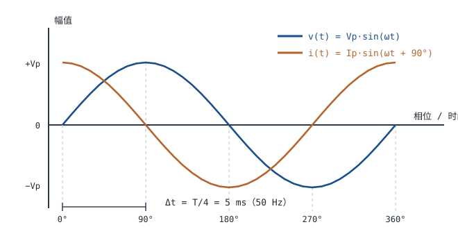

# 直流与交流、频率、相位与有效值 DC / AC, Frequency, Phase, RMS

在[电压、电流、电阻与功率](voltage-current-power.md)和[欧姆定律与焦耳定律](ohms-law.md)里，电压与电流都被当成不随时间变的量：接上 5V，就一直读 5V。可插座里的电压每秒正负交替 50 次，麦克风输出是声压的电压副本，MCU 时钟是几十 MHz 的方波。只要信号在动，"一个数"就不够用了，需要一套描述"怎么动"的语言：幅值、频率、相位，以及把交流折算成等效直流的有效值。

这套语言要先回答三个反复出现的工程问题：插座上标的 220V 指的是峰值还是有效值？同一路信号，万用表读 220V 而示波器看到 311V，谁错了？两个波形"谁先谁后"，对电路到底意味着什么？后面[阻抗与导纳](impedance.md)里的 $j\omega$、[RLC 电路与谐振](rlc-resonance.md)里的 $f_0$、[变压器原理](transformer.md)里的 $V/f$，全部建立在这一章的三要素与有效值定义上。

## 1. 设计动机

::: motivation 三个真实的摔跤现场
**场景一：给整流后的滤波电容选耐压。** 看到"220V 市电"，直觉是 400V 电容足够。但 220V 是有效值，峰值 $220\times\sqrt2=311.1$ V；市电允许 +7% 时峰值到 332.9V。400V 电容在 332.9V 下已经占到 $332.9/400=83.2\%$，长寿命、高温场合就偏紧。峰值与有效值差 1.414 倍，直接决定 BOM 里写 400V 还是 450V。

**场景二：用万用表量变频器输出。** 表显示 380V，电机却明显没劲；或者表读 220V，绕组已经过热。变频器输出是 PWM 脉冲而非正弦，普通"平均值响应"万用表按正弦的波形因数标定，读数会系统性偏离真有效值。不知道这一点的直接后果，是拿一个错数字去判断设备好坏。

**场景三：电压、电流两路采样算功率。** 两路通道的延时不同，等效于引入相位误差。50Hz 下 5° 只有 $5\times55.56=278$ µs，示波器上几乎看不出来，但对功率因数 0.9 的负载，$\cos25.84^{\circ}=0.900$ 与 $\cos30.84^{\circ}=0.859$ 差了 4 个百分点，功率读数跟着错。
:::

这一章的输出不是几个公式，而是四张可查的表：正弦量三要素表、波形因数与波峰因数表、频率与时间的换算表、器件选型该看峰值还是有效值的对照表。工程上绝大多数交流问题，都能先在这四张表上定位，再决定要不要精算。

| 你想解决 | 先算 | 判据 |
|---|---|---|
| 选电容/二极管耐压 | $V_p=\sqrt2\,V_{rms}$ | 峰值再乘市电上限，留 20% 余量 |
| 判断万用表读数可不可信 | 波形因数 $FF$、波峰因数 $CF$ | 非正弦且表不是 True-RMS，就按 $FF$ 修正 |
| 变压器能不能换国家用 | $V/f$ | 50Hz 设备接 60Hz 通常安全；反向可能饱和 |
| 功率与功率因数 | $P=V_{rms}I_{rms}\cos\varphi$ | 相位必须取自同一时刻、同一参考 |
| 采样窗口对齐 | $\Delta t=\varphi T/360^{\circ}$ | 50Hz 下 1° = 55.56µs |

**不懂会在哪摔跤**，具体是这四条：

1. 把 220V 当峰值，按 250V 选薄膜电容，市电浪涌一到就击穿——**耐压必须按峰值算**。
2. 用平均值响应表测方波或半波整流，读数偏高 11% 或偏低 29%，据此判断"电源超标"，白改一版。
3. 把超前/滞后记反，RC 补偿网络方向做错，环路相位裕度反而变小。
4. 把 60Hz 设计的变压器直接接 50Hz 市电，磁通升 20%、铁芯饱和、空载电流暴涨。

## 2. 定义与直观：正弦量的三要素

### 2.1 直流与交流的边界

**直流（DC, Direct Current）**：电流的**方向**不随时间改变。这个定义只管方向：带 50mV 纹波的 5V 电源仍然是直流，纹波只是叠加在上面的交流分量。

**交流（AC, Alternating Current）**：电流方向周期性改变，一个周期内的平均值为零。

判据是"有没有过零反向"：过零并反向 → 交流；始终不反向 → 直流（可能含交流分量）。第三种情况最容易出错——0~10V 的单极性脉冲方向不变，却含大量交流分量，做频谱或滤波分析时要按"直流 + 各次谐波"拆开处理。


::: analogy 传送带与活塞
直流像传送带：一直朝一个方向走，速度可以变，方向不变。交流像活塞：来回运动，平均位置不动，但每一刻都在动。活塞的行程 = 峰峰值，每秒往复次数 = 频率，与曲轴的夹角 = 相位。

类比的边界：活塞有惯性，电流没有；活塞的"平均位置"是一个物理位置，而交流的整周期平均值是 0，能量却一直在传递——所以不能因为"平均电压为 0"就认为"不耗电"。
:::

### 2.2 三要素与瞬时表达式

正弦量的一般形式：

$$v(t)=V_p\sin(\omega t+\varphi_v)$$

符号与单位：

- $v(t)$：瞬时电压，V；
- $V_p$：峰值（也叫幅值），V；
- $\omega$：角频率，rad/s；
- $\varphi_v$：初相，rad（工程上更常用度）；
- $t$：时间，s。

三个参数——**幅值、频率、初相**——叫正弦量的三要素。知道这三个，任意时刻的值都能算出来。它们之间的换算关系是：

$$V_{pp}=2V_p,\qquad \omega=2\pi f=\frac{2\pi}{T},\qquad T=\frac{1}{f}$$

其中 $V_{pp}$ 是峰峰值，V；$f$ 是频率，Hz；$T$ 是周期，s；$\omega$ 是角频率，rad/s。注意 $\omega$ 不是"每秒转几圈"，而是"每秒转过多少弧度"，一圈是 $2\pi$ 弧度，所以 $\omega=2\pi f$。

以 220V/50Hz 市电为例，把这一章会用到的量一次列清：

| 量 | 符号 | 定义 | 单位 | 220V/50Hz 的值 |
|---|---|---|---|---|
| 峰值 | $V_p$ | 一个周期内的最大绝对值 | V | 311.1 |
| 峰峰值 | $V_{pp}$ | $2V_p$ | V | 622.3 |
| 有效值 | $V_{rms}$ | 均方根，见 §3.2 | V | 220 |
| 整周期平均值 | $\bar v$ | $\frac{1}{T}\int_0^T v\,dt$ | V | 0 |
| 整流平均值 | $V_{avg}$ | $\frac{1}{T}\int_0^T \lvert v\rvert\,dt$ | V | 198.1 |
| 周期 | $T$ | 一个完整波形的时间 | s | 0.02 |
| 频率 | $f$ | $1/T$ | Hz | 50 |
| 角频率 | $\omega$ | $2\pi f$ | rad/s | 314.16 |
| 初相 | $\varphi_v$ | $t=0$ 时的相位 | rad | 由参考点决定 |

把 220V/50Hz 的瞬时波形画出来，可以看到它每 10ms 过零一次、每 5ms 到一次峰值：

```echarts
{
  "tooltip": {"trigger": "axis"},
  "legend": {"data": ["v(t) 瞬时值", "有效值 220 V"], "bottom": 0, "textStyle": {"fontSize": 12}},
  "grid": {"left": 64, "right": 26, "top": 34, "bottom": 58},
  "xAxis": {"type": "value", "name": "时间 t / ms", "nameLocation": "middle", "nameGap": 30,
            "min": 0, "max": 20, "interval": 2.5, "axisLabel": {"fontSize": 11}},
  "yAxis": {"type": "value", "name": "电压 v(t) / V", "nameLocation": "middle", "nameGap": 48,
            "min": -360, "max": 360, "axisLabel": {"fontSize": 11}},
  "series": [
    {"name": "v(t) 瞬时值", "type": "line", "showSymbol": false, "smooth": false,
     "lineStyle": {"width": 2.6, "color": "#1a4f8b"},
     "data": [[0,0],[1.25,119.06],[2.5,220.0],[3.75,287.44],[5,311.13],[6.25,287.44],[7.5,220.0],[8.75,119.06],[10,0],[11.25,-119.06],[12.5,-220.0],[13.75,-287.44],[15,-311.13],[16.25,-287.44],[17.5,-220.0],[18.75,-119.06],[20,0]]},
    {"name": "有效值 220 V", "type": "line", "showSymbol": false,
     "lineStyle": {"width": 2, "color": "#b5642e", "type": "dashed"},
     "data": [[0,220],[20,220]]}
  ]
}
```

图中数据点按 $v(t)=311.13\sin(314.16\,t)$ 计算，例如 $t=2.5$ ms 时 $v=311.13\sin(0.7854)=220.0$ V。**有效值那条虚线并不是波形的某种平均高度**，它与波形的交点也不特殊——它只表示"这个交流发热等效于 220V 直流"，见 §3.2。

### 2.3 相位差、超前与滞后

两个**同频**正弦量才谈得上相位差：

$$v(t)=V_p\sin(\omega t+\varphi_v),\qquad i(t)=I_p\sin(\omega t+\varphi_i)$$

$$\varphi=\varphi_v-\varphi_i$$

$\varphi$ 是电压相位减电流相位，rad 或度。四种典型情况：

- $\varphi>0$：电压超前电流，负载呈**感性**；
- $\varphi<0$：电流超前电压，负载呈**容性**；
- $\varphi=0$：同相，负载等效为纯电阻；
- $\lvert\varphi\rvert=90^{\circ}$：纯电抗（理想电感或理想电容）。

相位差换算成时间差：

$$\Delta t=\frac{\varphi}{360^{\circ}}\,T$$

50Hz 时 $T=20$ ms，所以 $1^{\circ}$ 对应 $20/360=55.56$ µs，$90^{\circ}$ 对应 5ms，$120^{\circ}$ 对应 6.667ms。60Hz 时 $T=16.67$ ms，$1^{\circ}$ 对应 46.3µs。



"超前"指的是**时间上先发生**。电容的电流在电压过零时就已经到峰值，所以电流超前电压 90°；说"电压滞后电流 90°"是同一件事，只是参考量换了。工程上写规格书时要写明比较方向，否则"相位差 90°"没有意义。

相位差在工程上有三处直接用途：

1. **功率因数**：$P=V_{rms}I_{rms}\cos\varphi$。相位差 25.84° 对应功率因数 0.9；同样 220V、5A，有功 880W，视在功率 1100VA，无功 660var。
2. **采样对齐**：电压、电流分别采样时，通道延时差会变成相位误差。50Hz 下 100µs 的延时就是 1.8°。
3. **三相系统**：三相电压互差 120°，对应 6.667ms，这是[市电与三相电基础](mains-three-phase.md)的起点。

## 3. 定量关系：有效值、平均值与波形因数

### 3.1 公式、符号与单位

| 关系 | 公式 | 符号与单位 | 适用条件 |
|---|---|---|---|
| 瞬时值 | $v=V_p\sin(\omega t+\varphi_v)$ | V、V、rad/s、rad | 正弦量 |
| 角频率 | $\omega=2\pi f=2\pi/T$ | rad/s | 正弦量 |
| 有效值定义 | $V_{rms}=\sqrt{\frac{1}{T}\int_0^T v^2\,dt}$ | V | 任意周期波形 |
| 正弦有效值 | $V_{rms}=V_p/\sqrt2$ | V | 纯正弦、无直流偏置 |
| 含直流分量 | $V_{rms}=\sqrt{V_{dc}^2+V_{ac,rms}^2}$ | V | 直流与交流不相关 |
| 全波整流平均值 | $V_{avg}=2V_p/\pi$ | V | 纯正弦全波整流 |
| 半波整流平均值 | $V_{avg}=V_p/\pi$ | V | 纯正弦半波整流 |
| 波形因数 | $FF=V_{rms}/V_{avg}$ | 无量纲 | 正弦为 1.1107 |
| 波峰因数 | $CF=V_p/V_{rms}$ | 无量纲 | 正弦为 1.4142 |
| 平均值响应表读数 | $V_{read}=1.1107\,V_{avg}$ | V | 表按正弦标定 |
| 瞬时功率 | $p(t)=v(t)i(t)$ | W | 任意波形 |
| 平均功率 | $P=V_{rms}I_{rms}\cos\varphi$ | W | 正弦稳态 |
| 相位差换算时间 | $\Delta t=\varphi T/360^{\circ}$ | s | 同频正弦 |

三个容易混的量要分清楚：

- **峰值** $V_p$：波形最高的那一点，用于**耐压、饱和、击穿**类判断；
- **有效值** $V_{rms}$：发热等效的直流值，用于**功率、温升、额定值**类判断；
- **整流平均值** $V_{avg}$：整流后波形的高度平均，只在**平均值响应仪表**的语境里出现，本身没有发热意义。

### 3.2 有效值为什么是 √2 倍

有效值（RMS, Root Mean Square）的定义是：让这个交流在电阻上产生的**平均功率**，与某个直流电压产生的功率相同，那个直流电压就是它的有效值。数学上是"平方 → 平均 → 开方"三步：

$$V_{rms}=\sqrt{\frac{1}{T}\int_0^T v^2(t)\,dt}$$

代入 $v=V_p\sin\omega t$：

1. **平方**：$v^2=V_p^2\sin^2\omega t$。平方把负半周翻正，所以正负交替不会被相互抵消——这正是不能用"整周期平均"代替有效值的原因。
2. **平均**：用半角公式 $\sin^2\theta=(1-\cos2\theta)/2$，一个周期内 $\cos2\omega t$ 的平均值为 0，所以 $\sin^2$ 的平均值是 $1/2$。
3. **开方**：$V_{rms}=\sqrt{V_p^2/2}=V_p/\sqrt2\approx0.7071\,V_p$。

这就是 $\sqrt2$ 的全部来历：**它来自正弦平方的平均值恰好是峰值平方的一半**，与"220"或"50Hz"都无关。反过来，$V_p=\sqrt2\,V_{rms}=1.4142\,V_{rms}$，所以 220V 的峰值是 311.1V。

适用条件必须写清：

- **纯正弦**：方波、三角波、半波整流的系数都不是 0.707，见 §3.4；
- **无直流偏置**：含直流时用 $\sqrt{V_{dc}^2+V_{ac,rms}^2}$。例如 5V 直流叠 1V 有效值纹波，$V_{rms}=\sqrt{25+1}=5.099$ V；
- **稳态**：上电瞬间、负载突变时的峰值可能远高于稳态峰值，不能拿稳态公式套瞬态。

::: advanced 有效值的积分过程，以及"为什么必须先平方"
把积分完整写出来：

$$\frac{1}{T}\int_0^T V_p^2\sin^2\omega t\,dt=\frac{V_p^2}{T}\int_0^T\frac{1-\cos2\omega t}{2}\,dt=\frac{V_p^2}{2T}\left[T-\frac{\sin2\omega T-\sin0}{2\omega}\right]$$

当 $T=2\pi/\omega$ 时 $\sin2\omega T=\sin4\pi=0$，方括号内只剩 $T$，于是均方值 $=V_p^2/2$，开方得 $V_p/\sqrt2$。

如果省掉"平方"这一步，先平均再开方，得到的整周期平均值是 0——把一个 220V 的交流接到电阻上，按"平均电压为 0"算出的功率也是 0，与"灯泡很亮"的事实矛盾。功率正比于 $v^2/R$，所以必须先平方。这个顺序不是数学技巧，而是物理：**发热只与电流大小有关，与方向无关**。
:::

### 3.3 平均值与有效值：万用表到底在测什么

"平均值"在交流里有三个不同含义，混用就会算错：

1. **整周期平均值**（直流分量）：$\frac{1}{T}\int_0^T v\,dt$，纯正弦为 0；
2. **整流平均值**：$\frac{1}{T}\int_0^T\lvert v\rvert\,dt$，纯正弦全波整流为 $2V_p/\pi=0.6366V_p$；
3. **有效值**：均方根，纯正弦为 $0.7071V_p$。

两种交流电压表的实现方式不同：

- **真有效值表（True-RMS）**：直接计算均方根，用模拟乘法器、热转换元件或数字采样实现，理论上对任何波形都成立（受带宽和波峰因数限制）。
- **平均值响应表（Average-responding）**：先整流、再取平均，然后乘一个固定系数 **1.1107**（正弦的波形因数 $1/0.9003$），把读数"标定"成正弦有效值。它对正弦完全正确，对非正弦必然有误差。

误差可以写成闭式：

$$\varepsilon=\frac{V_{read}-V_{rms}}{V_{rms}}=\frac{1.1107}{FF_{wave}}-1$$

因为 $V_{read}=1.1107\,V_{avg}=1.1107\,(V_{rms}/FF_{wave})$。由此得到一条判据：**波形的波形因数小于 1.1107，表读数偏高；大于 1.1107，表读数偏低**。正弦的 $FF$ 恰好是 1.1107，所以误差为 0。

波峰因数 $CF=V_p/V_{rms}$ 决定真有效值表还准不准。典型手持表在 $CF\le3$ 内保证精度，超出后读数开始偏低；具体上限以仪表手册为准。半波整流正弦的 $CF=2$，还在范围内；可控硅调光的窄脉冲 $CF$ 可达 5~10，这时连真有效值表也不能直接信。

### 3.4 非正弦波形的误差估算

把五种常见波形列成表，峰值统一取 $V_p=100$ V，每一列都能用定义复算：

| 波形（峰值 100V） | 真有效值 $V_{rms}$ | 整流平均值 $V_{avg}$ | 波形因数 $FF$ | 平均值响应表读数 | 相对误差 |
|---|---|---|---|---|---|
| 正弦 | 70.71 V | 63.66 V | 1.111 | 70.71 V | 0 |
| 方波（±100V） | 100.0 V | 100.0 V | 1.000 | 111.1 V | +11.1% |
| 三角波（±100V） | 57.74 V | 50.00 V | 1.155 | 55.53 V | −3.8% |
| 半波整流正弦 | 50.00 V | 31.83 V | 1.571 | 35.36 V | −29.3% |
| 50% 占空比脉冲（0~100V） | 70.71 V | 50.00 V | 1.414 | 55.53 V | −21.5% |

每行的算法：

- **方波**：$v^2$ 恒为 $100^2$，均方根就是 100V；整流平均也是 100V，$FF=1$；表读数 $1.1107\times100=111.1$ V。
- **三角波**：$V_{rms}=V_p/\sqrt3=57.74$ V，$V_{avg}=V_p/2=50$ V，$FF=1.1547$；读数 $1.1107\times50=55.53$ V。
- **半波整流正弦**：只有半个周期有值，均方值再乘以 $1/2$，得 $V_{rms}=V_p/2=50$ V；$V_{avg}=V_p/\pi=31.83$ V，$FF=1.5708$；读数 $1.1107\times31.83=35.36$ V。
- **50% 占空比脉冲**：均方值 $=0.5V_p^2$，$V_{rms}=70.71$ V；$V_{avg}=0.5V_p=50$ V，$FF=1.4142$；读数 $55.53$ V。

反过来修正也简单：$V_{true}=V_{read}\times FF/1.1107$。半波整流的例子，$35.36\times1.5708/1.1107=35.36\times1.4142=50.0$ V，与真值一致。**但修正的前提是你知道波形是什么形状**——现场往往不知道，所以这类场合要用真有效值表或示波器。

### 3.5 频率、周期、角频率与相位的时间换算

$$T=\frac{1}{f},\qquad \omega=2\pi f,\qquad \lambda=\frac{c}{f},\qquad \Delta t=\frac{\varphi}{360^{\circ}}T$$

其中 $\lambda$ 是电磁波在真空中的波长，m；$c=3\times10^8$ m/s。四个锚点记熟就够用：**50Hz = 20ms，1kHz = 1ms，1MHz = 1µs，1GHz = 1ns**。

工程上还要换算"相位精度 ↔ 时间精度"。50Hz 一个周期 20ms，采样率 10kS/s（每点 100µs）时，一个周期只有 200 个点，每点对应 $360^{\circ}/200=1.8^{\circ}$；想分辨 1° 的相位差，采样间隔要小于 55.6µs。这也是为什么功率分析仪在 50Hz 下动辄用几百 kS/s 采样，而不是"够用就行"。

### 3.6 适用条件与失效边界

- **$0.707V_p$ 只对纯正弦成立**。对任意周期波形成立的是定义式，不是这条系数。
- **含直流偏置时不能直接乘系数**。交流档会隔掉直流分量，读数是 AC 分量的有效值；要总有效值必须用 AC+DC 档或按 $\sqrt{V_{dc}^2+V_{ac}^2}$ 合成。
- **频率高到集总假设失效时，"一个电压值"本身不再成立**。判据仍是尺寸小于 $\lambda/10$：50Hz 的波长 6000km，整栋楼都算"集总"；100MHz 的波长 3m，超过 30cm 的走线就要按传输线处理。
- **非线性负载下电流波形畸变**。此时电压可能还是正弦，电流已经是一堆谐波，功率与有效值都要按真有效值定义算，不能只看基波。
- **瞬态下峰值远超稳态**。变压器合闸、大电容上电、电机启动，峰值可达稳态的数倍；器件耐压与保险丝的 $I^2t$ 要按瞬态校核。
- **仪表本身有边界**。真有效值表受带宽与波峰因数限制，平均值响应表只在正弦下正确，两者都不能测超过量程峰值的信号。

## 4. 典型计算

### 4.1 算例一：220V 有效值对应的峰值与瞬时表达式

**需求**：已知市电标称 220V/50Hz（有效值），求峰值、峰峰值、角频率、瞬时表达式，并给出 $t=1.25$、2.5、3.75、5ms 时的瞬时值；再按 GB/T 12325-2008 的 +7%/−10% 容差核算峰值范围。

**第一步，峰值**：

$$V_p=\sqrt2\,V_{rms}=1.4142\times220=311.1\ \text{V}$$

**第二步，峰峰值**：

$$V_{pp}=2V_p=2\times311.1=622.3\ \text{V}$$

**第三步，角频率与周期**：

$$\omega=2\pi f=2\pi\times50=314.16\ \text{rad/s},\qquad T=\frac{1}{50}=0.02\ \text{s}=20\ \text{ms}$$

**第四步，瞬时表达式**（取 $t=0$ 时电压过零上升，即 $\varphi_v=0$）：

$$v(t)=311.1\sin(314.16\,t)\ \text{V}$$

**第五步，代入四个时刻**：

| $t$ / ms | $\omega t$ / rad | $\sin(\omega t)$ | $v(t)$ / V |
|---|---|---|---|
| 1.25 | 0.3927 | 0.38268 | 119.1 |
| 2.50 | 0.7854 | 0.70711 | 220.0 |
| 3.75 | 1.1781 | 0.92388 | 287.4 |
| 5.00 | 1.5708 | 1.00000 | 311.1 |

$t=2.5$ ms 时读数正好是 220.0V，这个"巧合"值得记住：$50\text{Hz}\times2.5\text{ms}=1/8$ 周期，相位 45°，$\sin45^{\circ}=1/\sqrt2$，而 $V_p/\sqrt2$ 就是有效值。**所以"有效值"确实会在每个四分之一周期的中点出现一次**，但它是统计意义上的等效值，不是波形在任何时刻的固定高度。

**第六步，按容差核算峰值**。GB/T 12325-2008 规定 220V 单相供电电压偏差为标称值的 +7%/−10%，即 198.0~235.4V：

$$V_{p,\max}=1.4142\times235.4=332.9\ \text{V},\qquad V_{p,\min}=1.4142\times198.0=280.0\ \text{V}$$

**第七步，耐压选型**。整流后滤波电容承受的直流电压接近峰值：

- 选 400V：$332.9/400=83.2\%$，高温长寿命场合偏紧；
- 选 450V：$332.9/450=74.0\%$，余量更合理。

若用安规 X2 电容跨接在火线与零线之间，其额定按 IEC 60384-14 以 **275VAC（有效值）** 标注，对应峰值 $275\times1.4142=388.9$ V，高于 332.9V 的市电峰值上限，这个额定值的口径与"直流耐压"完全不同，不能互换。

**第八步，瞬时功率**。220V 接 1kΩ 电阻，电流有效值 $I_{rms}=220/1000=0.22$ A，峰值 $I_p=0.311$ A：

$$p(t)=\frac{v^2(t)}{R},\qquad p_{\max}=\frac{311.1^2}{1000}=96.8\ \text{W},\qquad P_{avg}=\frac{220^2}{1000}=48.4\ \text{W}$$

瞬时功率峰值是平均功率的 2 倍。这个 2 倍关系对所有纯正弦、纯电阻负载都成立（$\sin^2$ 的峰值是 1、平均是 1/2），它解释了为什么电阻的**脉冲功率**能力要单独看，而不能只按平均功率选型。

### 4.2 算例二：平均值响应表测非正弦的误差估算

**需求**：一个半波整流后的波形，峰值 $V_p=100$ V，用平均值响应万用表测，读数是多少？真实有效值是多少？误差多大？如果换成 ±100V 方波呢？

**第一步，半波整流的真有效值**。波形只在半个周期非零：

$$V_{rms}^2=\frac{1}{T}\int_0^{T/2}V_p^2\sin^2\omega t\,dt=\frac{V_p^2}{2}\cdot\frac{1}{2}=\frac{V_p^2}{4}\ \Longrightarrow\ V_{rms}=\frac{V_p}{2}=50.0\ \text{V}$$

**第二步，整流平均值**：

$$V_{avg}=\frac{1}{T}\int_0^{T/2}V_p\sin\omega t\,dt=\frac{V_p}{\pi}=\frac{100}{\pi}=31.83\ \text{V}$$

**第三步，平均值响应表的读数**（表内乘的是正弦系数 1.1107）：

$$V_{read}=1.1107\times31.83=35.36\ \text{V}$$

**第四步，误差**：

$$\varepsilon=\frac{35.36-50.0}{50.0}=-29.3\%$$

也可以用闭式验算：$FF=50.0/31.83=1.5708$，$\varepsilon=1.1107/1.5708-1=-0.2929$，一致。

**第五步，换成 ±100V 方波**。真有效值 100V，整流平均 100V，$FF=1$：

$$V_{read}=1.1107\times100=111.1\ \text{V},\qquad \varepsilon=\frac{111.1-100}{100}=+11.1\%$$

**第六步，结论**。同样是"100V 峰值"，半波整流的表读数偏低 29.3%，方波偏高 11.1%，方向完全相反，而偏差大小只由波形因数决定：

$$\varepsilon=\frac{1.1107}{FF}-1$$

这条式子还给出一个实用判据：看到读数先问"波形因数是多少"。$FF<1.11$ 的表读数偏高，$FF>1.11$ 的偏低。变频器输出、调光器输出、开关电源纹波都属于后者，这也是现场"表读 220V 但设备不正常"的常见原因。

### 4.3 算例三：完整设计——9V 变压器 + 桥式整流 + 电容滤波 + 7805

**需求**：输入 220V/50Hz（容差 +7%/−10%），用 9V/50Hz 变压器降压，桥式整流后电容滤波，再用 7805 得到 5V/0.5A。要求最坏情况下 7805 输入不低于 7.5V（7805 压差典型 2V，留 0.5V 余量）。求滤波电容、电容耐压、整流管耐压，并核算 7805 的功耗与散热。

**第一步，次级峰值**：

$$V_{p,sec}=\sqrt2\times9=12.73\ \text{V}$$

变压器次级标称 9V 是**有效值**，这一点是全部计算的起点；若把 9V 当成峰值，峰值会被低估 41%（12.73 比 9 高 41.4%），纹波余量跟着全部算错。

**第二步，整流后的电容峰值**。桥式整流每个时刻有两只二极管导通，按每只 0.8V 计（1A 附近典型值，具体以数据手册的正向压降曲线为准）：

$$V_{pk}=12.73-2\times0.8=11.13\ \text{V}$$

**第三步，纹波估算**。全波整流每 10ms 给电容充一次电，放电期间近似恒流 $I=0.5$ A：

$$\Delta V\approx\frac{I\,t}{C}=\frac{I}{2fC}$$

取 $C=3300$ µF：

$$\Delta V=\frac{0.5}{2\times50\times3300\times10^{-6}}=\frac{0.5}{0.33}=1.515\ \text{V}$$

**第四步，最低输入电压**：

$$V_{\min}=V_{pk}-\Delta V=11.13-1.515=9.61\ \text{V}$$

**第五步，市电 −10% 的最坏情况**。次级有效值降到 8.1V：

$$V_{p,sec}=1.4142\times8.1=11.455\ \text{V},\qquad V_{pk}=11.455-1.6=9.855\ \text{V}$$

$$V_{\min}=9.855-1.515=8.34\ \text{V}$$

比 7805 需要的最低输入 7V（5V + 2V 压差）高 1.34V，也高于 7.5V 的设计余量要求。

**第六步，电容容量与频率的敏感性**：

| 电容 | 50Hz 纹波 | 60Hz 纹波 | 50Hz 最低电压（−10% 市电） |
|---|---|---|---|
| 2200 µF | 2.273 V | 1.894 V | 7.58 V |
| 3300 µF | 1.515 V | 1.263 V | 8.34 V |
| 4700 µF | 1.064 V | 0.887 V | 8.79 V |

2200µF 在 −10% 市电下只剩 0.58V 余量，纹波与容差一叠加就顶到 7.5V 以下，所以选 3300µF。60Hz 下纹波天然小 16.7%，同一个电容去 60Hz 市场更宽松。

**第七步，电容耐压**。市电 +7% 时：

$$V_{p,sec}=1.4142\times9\times1.07=13.62\ \text{V},\qquad V_{pk}=13.62-1.6\approx12.02\ \text{V}$$

考虑空载时二极管压降更小、电容峰值接近 13.62V，取 25V 耐压：$13.62/25=54.5\%$，余量合适；若取 16V，则 $13.62/16=85.1\%$，高温下电解电容寿命会明显缩短。

**第八步，整流管耐压**。桥式整流中每只二极管承受的反向峰值约为 $2V_p$：

$$V_{R}=\ 2\times13.62=27.2\ \text{V}$$

取 60V 肖特基或 1N4007（1000V）都满足；若用 40V 肖特基，$27.2/40=68\%$，在浪涌下余量偏小，选 60V 更稳。

**第九步，7805 功耗与散热**。正常市电下电容电压平均值：

$$V_{avg}\approx V_{\min}+\frac{\Delta V}{2}=9.61+0.76=10.37\ \text{V}$$

$$P_{7805}=(10.37-5)\times0.5=2.69\ \text{W}$$

TO-220 封装不加散热片时 $R_{\theta ja}$ 约 65°C/W（典型值，以数据手册为准），温升 $2.69\times65=175^{\circ}\text{C}$，必然过热保护；加 10°C/W 的小散热片后温升 $2.69\times10=26.9^{\circ}\text{C}$，可用。整机效率：

$$\eta=\frac{5\times0.5}{10.37\times0.5}=\frac{2.5}{5.185}=48.2\%$$

**第十步，上电涌流**。3300µF 从 0 充到 11.13V，若回路总阻抗（变压器次级直流电阻 + 二极管 + 走线）约 0.5Ω，峰值电流约 $11.13/0.5=22.3$ A。这个量级足以让快熔保险丝误断，应选慢熔型或串 NTC 限流（典型量级，实际以变压器与器件参数为准）。

**结论**：9V/50Hz 变压器、1A 桥堆、3300µF/25V 电解电容、7805 加小散热片。−10% 市电下 7805 输入最低 8.34V，余量 1.34V；市电 +7% 时电容电压 54.5% 额定；整流管反向峰值 27.2V。这套数字全部由有效值、峰值与纹波三条公式推出，换一个国家（60Hz、120V）时只需重算第一步与第三步。

## 5. 工程含义

### 5.1 工程数量级表

先给频率—周期—角频率—波长的对照，用来快速判断"这个信号还能不能当集总电路处理"：

| 频率 | 周期 | 角频率 | 真空波长 $\lambda=c/f$ | 典型场景 |
|---|---|---|---|---|
| 50 Hz | 20 ms | 314.2 rad/s | 6000 km | 市电 |
| 60 Hz | 16.67 ms | 377.0 rad/s | 5000 km | 市电（部分国家） |
| 400 Hz | 2.5 ms | 2513 rad/s | 750 km | 航空电源、旧式机载 |
| 1 kHz | 1 ms | 6283 rad/s | 300 km | 音频中频 |
| 20 kHz | 50 µs | $1.257\times10^5$ rad/s | 15 km | 音频上限、开关电源 |
| 1 MHz | 1 µs | $6.283\times10^6$ rad/s | 300 m | AM 广播、开关电源谐波 |
| 100 MHz | 10 ns | $6.283\times10^8$ rad/s | 3 m | FM、数字总线谐波 |
| 2.4 GHz | 417 ps | $1.508\times10^{10}$ rad/s | 125 mm | Wi-Fi、蓝牙 |

再给常见电压的三种口径，选器件时直接查：

| 电压（有效值） | 峰值 | 峰峰值 | 说明 |
|---|---|---|---|
| 220 V | 311.1 V | 622.3 V | 我国单相市电 |
| 110 V | 155.6 V | 311.1 V | 部分地区市电 |
| 24 V | 33.94 V | 67.88 V | 工业控制变压器次级 |
| 12 V | 16.97 V | 33.94 V | 常见低压变压器 |
| 1 V | 1.414 V | 2.828 V | 音频线路电平量级 |
| 10 mV | 14.14 mV | 28.28 mV | 麦克风输出量级 |

波形因数与波峰因数的速查表（读数误差按 $\varepsilon=1.1107/FF-1$ 算）：

| 波形 | 波形因数 $FF$ | 波峰因数 $CF$ | 平均值响应表误差 |
|---|---|---|---|
| 正弦 | 1.111 | 1.414 | 0 |
| 全波整流正弦 | 1.111 | 1.414 | 0 |
| 半波整流正弦 | 1.571 | 2.000 | −29.3% |
| 方波 | 1.000 | 1.000 | +11.1% |
| 三角波 | 1.155 | 1.732 | −3.8% |
| 50% 占空比脉冲 | 1.414 | 1.414 | −21.5% |

### 5.2 50Hz 与 60Hz：同一台设备为什么不能直接换着用

| 项目 | 50 Hz | 60 Hz | 比值（60/50） |
|---|---|---|---|
| 周期 | 20 ms | 16.67 ms | 0.833 |
| 角频率 | 314.2 rad/s | 377.0 rad/s | 1.200 |
| 感抗 $X_L=\omega L$ | 基准 | +20% | 1.200 |
| 容抗 $X_C=1/(\omega C)$ | 基准 | −16.7% | 0.833 |
| 全波整流纹波频率 | 100 Hz | 120 Hz | 1.200 |
| 两极异步电机同步转速 | 3000 r/min | 3600 r/min | 1.200 |

变压器是最典型的"换国家就出事"的器件。铁芯磁通与电压、频率的关系是：

$$B\propto\frac{V}{f\,N\,A}$$

其中 $B$ 是磁通密度，T；$V$ 是绕组电压有效值，V；$f$ 是频率，Hz；$N$ 是匝数；$A$ 是铁芯截面积，$\text{m}^2$。一台按 60Hz 设计、额定 120V 的变压器接到 50Hz、220V 上，$V$ 变 1.83 倍、$f$ 变 0.833 倍，$B$ 变成 $1.83/0.833=2.2$ 倍，铁芯深度饱和，励磁电流可能升到额定的十几倍，几分钟就过热。反过来，50Hz 设备接 60Hz，$B$ 降到 0.833 倍，磁通更安全，但铁损随频率上升，温升仍要核算。

工程结论：**看变压器先看 $V/f$ 比值**，而不是只看电压。变频器用"恒压频比（V/f 恒定）"控制，本质就是保持磁通不变；电机铭牌上标 50Hz/60Hz 两档时，通常也标了两档对应的电压。

### 5.3 真有效值表什么时候可信

真有效值表不是万能，它的读数在四道边界内才可信：

1. **带宽**：典型手持表 AC 带宽 40Hz~1kHz，好的可到 20kHz~100kHz。开关电源的 100kHz 纹波超出带宽，读数会偏低。
2. **波峰因数**：典型保证 $CF\le3$。半波整流（2.0）、正弦（1.414）没问题；窄脉冲、可控硅调光可能到 5~10，读数偏低。
3. **直流偏置**：AC 档隔掉直流，测的是交流分量；要总有效值必须用 AC+DC 档。
4. **量程**：低于量程 1% 的小信号，分辨率和带宽都不够。

具体指标以仪表手册为准。工程上的稳妥做法是：**判断波形性质用示波器，读绝对数值用真有效值表，两者交叉验证**。

### 5.4 峰值、有效值与器件选型

同一路电压，不同器件看的是不同的量。把这条规则固化成表，比背公式有用：

| 器件/参数 | 该看的量 | 原因 |
|---|---|---|
| 整流二极管反向耐压 | $2V_p$ | 反向峰值出现在电容充满、交流反向时 |
| 滤波电容耐压 | $V_p\times(1+\text{市电容差})$ | 直流耐压，按最高峰值并降额 |
| X2 安规电容 | 275VAC（有效值） | 按 IEC 60384-14 以 RMS 标注 |
| 压敏电阻 | $V_{rms}\times1.1$ 以上 | 长期工作电压下不能导通 |
| 保险丝 | $I_{rms}$ 与 $I^2t$ | 热效应按有效值，浪涌按能量 |
| 继电器/开关触点 | $V_p$（直流负载） | 灭弧能力看峰值与电流 |
| 采样电阻 | 热按 $I_{rms}$，磁饱和按 $I_p$ | 两个限制条件不同 |
| 变压器 | $V_{rms}$ 与 $V/f$ | 磁通由 $V/f$ 决定 |

## 6. 常见坑

::: pitfall 常见坑
- **把 220V 当峰值去选耐压**：现象——按 250V 或 275V 选薄膜电容，装到市电上几个月就击穿，或者浪涌测试直接炸。原因——220V 是有效值，峰值 311.1V，市电 +7% 时到 332.9V。解决——先算 $V_p=\sqrt2V_{rms}$，再乘市电上限容差，最后按 80% 降额；整流后电容按 $V_p$ 选，不要按 RMS 选。
- **用平均值响应表测非正弦，还拿读数当结论**：现象——测方波显示 11.1V（实际 10V），测半波整流显示 35.4V（实际 50V），据此判断电源超标或不足。原因——表内乘的是正弦的波形因数 1.1107，非正弦的 $FF$ 不同。解决——先确认波形，按 $\varepsilon=1.1107/FF-1$ 修正；或者换真有效值表/示波器。
- **把"平均电压为 0"当成"不耗电"**：现象——认为正弦交流的平均电压是 0，所以功率是 0，或者用平均值算功率。原因——功率正比于 $v^2/R$，必须先平方再平均；有效值才是发热等效量。解决——功率一律用 $P=V_{rms}I_{rms}\cos\varphi$；瞬时功率 $p(t)=v(t)i(t)$ 用来判断器件峰值应力。
- **超前/滞后方向搞反**：现象——RC 补偿网络接上后相位裕度反而变小，或者采样相位补偿越补越偏。原因——"电流超前电压"与"电压超前电流"是同一件事的两种说法，比较基准没写清；容性负载 $I$ 超前 $V$，感性负载 $V$ 超前 $I$。解决——统一约定 $\varphi=\varphi_v-\varphi_i$，$\varphi>0$ 为感性；在图上标出 $t=0$ 时刻两个波形的位置再判断。
- **50Hz 与 60Hz 设备直接互换**：现象——进口设备接国内市电后变压器嗡嗡响、空载发热，或者转速不对。原因——磁通正比于 $V/f$，60Hz 设备接 50Hz 时磁通升高 20% 以上；电机同步转速与频率成正比。解决——核对铭牌上的频率与电压，变压器按 $V/f$ 换算，电机用变频器或换相数/极数匹配的型号。
- **频率与周期换算错**：现象——把 50Hz 算成 50ms 周期，采样窗口、滤波时间常数全部错 2.5 倍。原因——$T=1/f$ 而不是 $T=f$ 或 $T=1/(2\pi f)$；角频率才带 $2\pi$。解决——记住锚点 50Hz=20ms、1kHz=1ms、1MHz=1µs；算完用 $\omega=2\pi f$ 反查一次数量级。
:::

## 7. 自测题

<details><summary>市电 220V/50Hz：周期、角频率、峰值、峰峰值各是多少？写出 $t=0$ 时过零上升的瞬时表达式，并求 $t=3.75$ms 时的电压。</summary>

周期 $T=1/f=1/50=0.02$ s = 20ms；角频率 $\omega=2\pi f=2\pi\times50=314.16$ rad/s。

峰值 $V_p=\sqrt2\times220=311.1$ V；峰峰值 $V_{pp}=2\times311.1=622.3$ V。

瞬时表达式（$\varphi_v=0$）：$v(t)=311.1\sin(314.16t)$ V。

$t=3.75$ms：$\omega t=314.16\times0.00375=1.1781$ rad = 67.5°，$\sin67.5^{\circ}=0.92388$，所以 $v=311.1\times0.92388=287.4$ V。

验算：$3.75$ms 是 20ms 的 $3/16$ 周期，相位 $67.5^{\circ}$，落在 0°~90° 之间，结果应介于 0 与 311.1V 之间，287.4V 合理。
</details>

<details><summary>峰值 10V 的正弦接在 10Ω 电阻上，平均功率是多少？如果误用峰值算会得到多少？</summary>

有效值 $V_{rms}=10/\sqrt2=7.071$ V。

平均功率 $P=V_{rms}^2/R=7.071^2/10=50.0/10=5.0$ W。

若误用峰值：$P'=V_p^2/R=100/10=10$ W，正好是正确值的 2 倍。原因：功率与电压平方成正比，峰值平方是有效值平方的 2 倍。

也可以用 $P=V_pI_p/2$ 验算：$I_p=10/10=1$ A，$P=10\times1/2=5$ W，一致。
</details>

<details><summary>±5V 方波，用平均值响应表测量，读数是多少？真有效值是多少？误差多大？</summary>

方波真有效值等于峰值：$V_{rms}=5$ V（因为 $v^2$ 恒为 25）。

整流平均值 $V_{avg}=5$ V，波形因数 $FF=5/5=1$。

平均值响应表读数 $V_{read}=1.1107\times5=5.55$ V。

误差 $\varepsilon=(5.55-5)/5=+11.1\%$，与闭式 $\varepsilon=1.1107/1-1=+11.1\%$ 一致。

结论：$FF<1.1107$ 的波形，平均值响应表读数偏高；方波是最典型的例子。
</details>

<details><summary>半波整流后峰值 100V 的波形：真有效值、整流平均值、平均值响应表读数、误差各是多少？怎样从读数反推真值？</summary>

真有效值：$V_{rms}=V_p/2=50.0$ V（均方值再乘 1/2，因为只有半个周期有值）。

整流平均值：$V_{avg}=V_p/\pi=31.83$ V。

表读数：$V_{read}=1.1107\times31.83=35.36$ V。

误差：$(35.36-50.0)/50.0=-29.3\%$，即读数偏低近三成。

反推：$V_{true}=V_{read}\times FF/1.1107=35.36\times1.5708/1.1107=50.0$ V。前提是**知道波形是半波整流**；不知道波形就不能这样修。
</details>

<details><summary>示波器上看到两个同频 50Hz 正弦，电压过零上升比电流过零上升晚 1.5ms。相位差多少度？谁超前？负载呈什么性质？</summary>

相位差 $\varphi=360^{\circ}\times\Delta t/T=360^{\circ}\times1.5/20=27^{\circ}$。

电压在时间上更晚，说明**电流超前电压 27°**，即 $\varphi=\varphi_v-\varphi_i=-27^{\circ}$。

负载呈容性（电流超前）。若按"电压超前电流"的约定写，应写成 −27°，不要只写"27°"而不说明方向。

验算：50Hz 下 1° = 55.56µs，27° 对应 $27\times55.56=1500$ µs = 1.5ms，一致。
</details>

<details><summary>12V 有效值的变压器次级，经桥式整流（每只二极管 0.8V）和 2200µF 滤波，带 1A 负载、50Hz。求纹波、最低电压，并说明 7805（压差 2V）能不能用。</summary>

次级峰值：$V_{p,sec}=1.4142\times12=16.97$ V。

电容峰值：$V_{pk}=16.97-2\times0.8=15.37$ V。

纹波：$\Delta V=I/(2fC)=1/(2\times50\times2200\times10^{-6})=1/0.22=4.545$ V。

最低电压：$V_{\min}=15.37-4.545=10.83$ V。

7805 需要的最低输入是 $5+2=7$ V，10.83V 高于 7V，**可以用**，余量 3.83V。

但 1A 下 7805 功耗约 $(15.37-4.545/2-5)\times1=8.1$ W，必须配足够大的散热片；若换 60Hz，纹波降为 $1/(2\times60\times2200\times10^{-6})=3.79$ V，最低电压升到 11.58V，余量更大。
</details>

<details><summary>一台铭牌 120V/60Hz 的变压器接到 220V/50Hz 上，磁通密度大约变成原来的几倍？会有什么后果？</summary>

磁通密度 $B\propto V/(fNA)$，$N$、$A$ 不变，所以比值

$$\frac{B_2}{B_1}=\frac{V_2/f_2}{V_1/f_1}=\frac{220/50}{120/60}=\frac{4.4}{2.0}=2.2$$

磁通密度变成 2.2 倍。硅钢片通常在 1.5~1.7T 附近饱和，2.2 倍会深度饱和，励磁电流急剧上升，绕组过热，可能烧毁。

结论：变压器不能只看电压，$V/f$ 比值才是磁通的量度。反过来 220V/50Hz 的变压器接 120V/60Hz，$V/f=4.4$ 对 $2.0$，磁通只有 0.45 倍，不会饱和但输出电压不足。
</details>

## 8. 参考资料

- **Lessons In Electric Circuits, Vol. II – AC**（Tony R. Kuphaldt，ibiblio 公开版）：*Chapter 1 Basic AC Theory*——正弦波、频率与周期、有效值与平均值的定义；*Chapter 12 AC Metering Circuits*——真有效值表与平均值响应表的差异，本章 §3.3 与 §3.4 的讲法与该章一致。<https://www.ibiblio.org/kuphaldt/electricCircuits/>
- **《电路》**（邱关源，高等教育出版社）："相量法"一章给正弦量三要素与相量表示；"正弦稳态电路的分析"一章给有效值、相位差与功率的严格定义。本章 §2.2、§3.1 的符号口径与该书一致。
- **GB/T 12325-2008《电能质量 供电电压偏差》**：220V 单相供电电压偏差为标称电压的 +7%/−10%，对应 198.0~235.4V；本章 §4.1 的峰值上限 332.9V 由该范围乘 $\sqrt2$ 得到。
- **IEC 60038:2009《标准电压》**：50Hz 系统标称 230/400V、60Hz 系统 120/240V；我国 GB/T 156 采用 220/380V。跨国设备选型时的电压口径以这两份标准为准。
- **IEC 60384-14《电子设备用固定电容器 第 14 部分：抑制电源电磁干扰用固定电容器》**：X2 类电容按 275VAC（有效值）额定，并规定脉冲电压试验；本章 §4.1 中"275VAC 对应峰值 388.9V"即由该额定口径换算。
- **Fluke, ABCs of DMMs**（数字万用表功能与指标说明）：*True-rms measurements* 一节说明真有效值与平均值响应表的标定方式、波峰因数与带宽限制；本章 §5.3 的四条边界按该节口径整理，具体指标以所用仪表手册为准。
