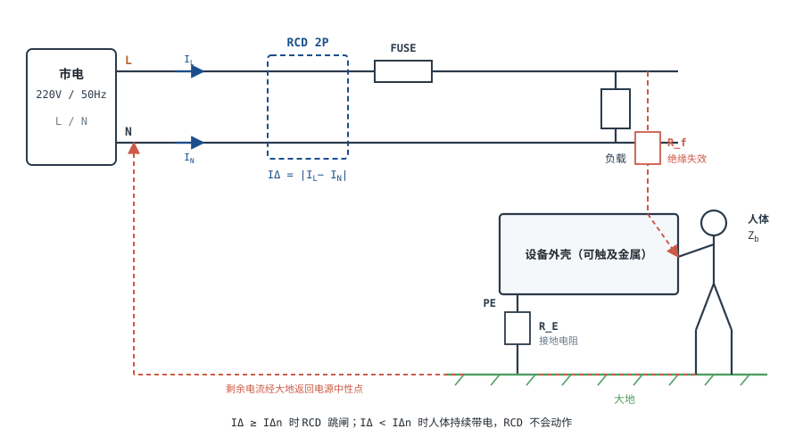
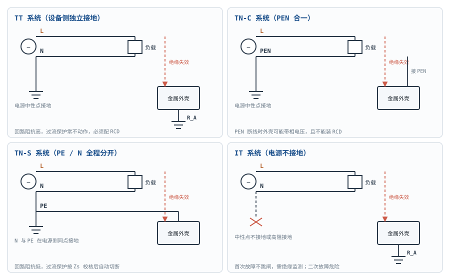

# 安全用电与触电防护 Electrical Safety & Shock Protection

在[市电与三相电基础](mains-three-phase.md)里，插座是 220V 相电压；在[变压器原理](transformer.md)里，隔离变压器能把一次侧与二次侧分开。但"220V 会不会电死人"这个问题，答案不在电压一个数上：它取决于**流过人体的电流有多大、持续多久、走哪条路径**，而电流又由电压和一组会随条件剧变的阻抗共同决定。

安全章的正确性比篇幅重要。本章把结论分成两层：

| 层次 | 内容 | 能不能直接照做 |
|---|---|---|
| **A 有出处的定量判据** | 人体阻抗量级、IEC 60479 的电流—时间区间、RCD 动作值、TT/TN 的回路公式、绝缘距离量级 | 可用来估算、校核与选型，但必须代入现场实测值 |
| **B 现场判断** | 配电制式选型、RCD 类型与级配、接地电阻、等电位做法、带电作业许可 | 不能；必须由持证电气人员按现场适用标准确认，本章标 `::: warning 待专业复核` |

读法建议：先把 A 层判据记成数量级，再用 B 层复核清单约束现场结论。凡是"这样做就安全"的写法都要改成"在满足某几项条件时，才能把风险降到可接受水平"——这不是措辞谨慎，而是因为触电的后果由现场条件决定，不由一句口号决定。

::: warning 本章有 13 项结论必须由持证电气人员复核
本章区分「有出处的定量判据」与「依赖现场条件的判断」。凡是标 `待专业复核` 的段落，
以及文末《复核清单》里的 13 项，都**不能**作为现场施工或带电作业的直接依据——
它们的作用是让你知道"该问什么"，而不是"照做即可"。
:::


## 1. 设计动机

::: motivation 三个真实的摔跤现场
**场景一：拔了插头就摸板子。** 开关电源断电后，400V/470µF 的电解电容仍存着约 37.6J 能量。用螺丝刀直接短接会炸出电弧、熔掉工具尖端；用手碰则可能灼伤。断电只切断了能量来源，没有清空储能。

**场景二：外壳麻手却不跳闸。** 设备绝缘轻微破损，外壳带上 220V，但漏电流只有几毫安；保险丝不熔、断路器不跳。这类故障不会自己"报错"，只会等人去摸，而人一摸就成了回路的一部分。

**场景三：装了 30mA 漏保就以为万无一失。** 双手同时碰到 L 和 N 时，电流从一只手进、另一只手出，L 与 N 的电流差接近零，RCD 完全不动作；如果单手碰 L、身体又站在干燥绝缘垫上，电流同样可能小到不触发 30mA 阈值。
:::

这一章要交付的不是一份"照着做"的检查表，而是四个判断能力：

| 你想判断 | 先查什么 | 判据 |
|---|---|---|
| 这个电压能不能碰 | 人体阻抗与环境（干湿、接触面积、路径） | $I_b=U_c/Z_b$，再对照电流—时间区间 |
| 这条回路能不能自动断电 | 接地制式、回路阻抗实测值 | TN 校核 $Z_s$；TT 校核 $R_A$ 与 RCD |
| 漏保能不能救人 | RCD 类型、额定剩余动作电流、安装位置 | $I_\Delta\ge I_{\Delta n}$，且动作时间在标称范围内 |
| 这块板能不能带电作业 | 全部能量源清单与作业许可 | 隔离、验电、放电、许可，四项齐全 |

**不懂会在哪摔跤**，具体是这四条：

1. 把"安全电压"当成物理常数，认为 36V 或 12V 在任何环境下都安全，忽略了潮湿、破皮、大面积接触和医疗场景。
2. 把 RCD 当成"防触电总开关"，不知道它不限制电流、不防 L—N 同时接触、也不能替代绝缘与接地。
3. 只断一根线就动手，或只关开关不断路，结果火线仍连着设备，或遭遇光伏、UPS、发电机反送电。
4. 用防静电接地代替保护接地，或反过来，把两种目标完全不同的"接地"混成一条线。

## 2. 定义与直观：触电是"电流—时间—路径"共同作用的事件

### 2.1 电压是原因，电流是结果，伤害是时间的积分

**电击（electric shock）**指电流通过人体引起的生理效应。必须同时给出四个量，讨论才有意义：

- **接触电压 $U_c$**：人体同时触及的两点之间的电压，V。注意不是"电源标称电压"——人可能只承受其中一部分。
- **触电电流 $I_b$**：流过人体的电流，A 或 mA。
- **通电时间 $T$**：电流持续的时间，s 或 ms。
- **电流路径**：从哪只手进、从哪只手或脚出，决定流经心脏的比例。

电压只是"驱动力"，真正造成组织损伤、肌肉强直和心室颤动的是电流及其持续时间。同一个 220V，干燥指尖轻触可能只有几毫安，湿手紧握金属外壳可能是几百毫安，差两个数量级——差别全在阻抗和接触条件上。所以"安全电压"这个词，只有在给定阻抗、路径、时间和环境之后才有定义；脱离这些条件说"某某伏是安全电压"，是把一个条件结论偷换成了普适常数。

### 2.2 人体阻抗：一个会随电压"自己变小"的电阻

人体可以粗略等效成"两个皮肤阻抗 + 一个体内阻抗"的串联：

$$Z_b \approx Z_{s1}+Z_i+Z_{s2}$$

其中 $Z_b$ 是人体总阻抗，$\Omega$；$Z_{s1}$、$Z_{s2}$ 是两个接触点的皮肤阻抗，$\Omega$；$Z_i$ 是体内阻抗，$\Omega$，量级为几百欧，与电流路径有关。干燥完整的角质层像一层薄绝缘，皮肤阻抗可达数十千欧；一旦潮湿、出汗、破皮，或电压高到把角质层击穿，皮肤阻抗会骤降，总阻抗主要由体内阻抗决定。



IEC 60479-1 给出的是按接触电压、干湿条件与人群分位的表格，不是单一电阻值。工程上可按下面的量级记（50Hz、干燥、手—手路径，成人）：

| 接触电压（AC 有效值） | 人体总阻抗量级 | 说明 |
|---|---|---|
| 25 V | 1.5~3 kΩ | 皮肤阻抗仍占主导 |
| 50 V | 1.4~2.6 kΩ | 接近 SELV 上限 |
| 100 V | 1.2~2 kΩ | 角质层开始明显击穿 |
| 220 V | 1.0~1.5 kΩ | 本章算例取 1 kΩ，属偏保守的低阻抗假设 |
| 700 V | 0.7~1.1 kΩ | 总阻抗主要由体内阻抗决定 |

表中区间大致对应 5%~50% 分位；95% 分位更高，个体差异可达数倍。**潮湿、大面积接触、金属粉尘、出汗**会把阻抗进一步拉低；IEC 60479-1 对水湿条件给出更低的表值，同一电压下电流可升到干燥时的数倍。反过来，仅指尖轻触、皮肤干燥且接触面积很小时，阻抗会高得多，这也是"有时候摸一下只是麻"的原因——但这不能当作安全判据，因为接触条件随时会变。

::: analogy 会吸水的墙
把皮肤想成一堵干燥的砖墙：平时很挡水，雨一淋就渗。电压像水压，电压越高越容易把墙"压穿"；潮湿和破皮则相当于墙上本来就有裂缝。类比的边界：墙被压穿是永久损坏，皮肤阻抗在电压撤去后能部分恢复，但已经造成的组织损伤和心室颤动不会自动撤销。
:::

### 2.3 电流路径与心脏电流系数

同样的体电流，走左手到右脚和走左手到右手，流经心脏的比例不同。IEC 60479-1 用**心脏电流系数 $F$** 把各种路径折算到"左手—双脚"这一参考路径：

$$I_h=F\,I_b$$

$I_h$ 是等效心脏电流，A；$I_b$ 是体电流，A；$F$ 无量纲。常用取值（成人，50/60Hz）：

| 电流路径 | $F$ | 含义 |
|---|---|---|
| 左手→双脚、双手→双脚 | 1.0 | 最不利参考路径，标准曲线的基准 |
| 右手→左脚 | 0.8 | 略低于参考路径 |
| 左手→腹部 | 0.7 | 仍接近心脏 |
| 左手→右手 | 0.4 | 横向穿过胸腔，比例较低但绝不是"安全" |
| 背部→右手 | 0.3 | 路径较长，比例更低 |

其余路径和更多取值见 IEC 60479-1 的对应表格。$F$ 是统计折算系数，不是精确解剖比例；它只用于把"体电流"换算成"等效致颤电流"，不能反过来推出"某条路径一定没事"。举例：体电流 220mA、左手→右手，$I_h=0.4\times220=88$ mA，仍然远超摆脱阈，也足以造成强烈肌肉收缩和呼吸抑制。

## 3. 定量关系：判据、保护与接地

### 3.1 三个基本式

$$I_b=\frac{U_c}{Z_b},\qquad Q=\int_0^T i_b(t)\,dt\approx \bar I_b\,T,\qquad I_h=F\,I_b$$

符号与单位：

- $I_b$：体电流，A（工程上常用 mA）；
- $U_c$：接触电压，V；
- $Z_b$：人体总阻抗，$\Omega$；
- $Q$：通过人体的电荷量，C；用 mA·s 表示时数值上等于 mC；
- $T$：通电时间，s；
- $\bar I_b$：时间平均电流，A；
- $I_h$：等效心脏电流，A；$F$：心脏电流系数，无量纲。

三个式子的适用条件必须写清：$Z_b$ 不是常数，随电压、湿度、接触面积和时间变化；$Q$ 的积分式对任意波形都成立，但"平均电流 × 时间"只在电流近似恒定时可用；$F$ 只适用于工频交流的路径折算，直流和高频见 IEC 60479-2。**任何把 $Z_b$ 当固定 1kΩ 算完就下结论的做法，都只能当量级估算，不能当安全保证。**

### 3.2 IEC 60479 的电流—时间区间

IEC 60479-1（我国对应标准为 GB/T 13870.1）对 15~100Hz 交流、左手—双脚路径、成年人的效应分成四个区间：

| 区间 | 边界（50Hz，左手—双脚，成人） | 典型生理效应 |
|---|---|---|
| AC-1 | 0~0.5 mA | 感知阈以下或刚可感知，通常无反应 |
| AC-2 | 0.5~5 mA | 可自主摆脱，无有害生理效应 |
| AC-3 | 5 mA 至曲线 c1 | 肌肉收缩、呼吸困难、可逆的心脏节律紊乱；通常不致室颤 |
| AC-4 | 超过曲线 c1 | 心室颤动概率上升；AC-4.1 约 5% 以下、AC-4.2 约 5%~50%、AC-4.3 约 50% 以上 |

几个关键点：

- **感知阈约 0.5mA，摆脱阈约 5mA**（成人、工频）。超过摆脱阈后，手可能被"吸住"甩不开，实际通电时间由别人发现并断电的时间决定，而不是由受害者自己决定。
- **区间边界是曲线，不是直线**。曲线 c1 在 0.1~1s 段可用 $Q\approx30$ mA·s 的筛查线近似；1s 以上边界趋于平缓，不能再按 $1/t$ 外推。精确形状以 IEC 60479-1 的图为准，本章只用这条筛查线做快速判断。
- **30mA 的 RCD 与 30mA·s 的筛查线，数值相同、量纲不同**：前者是剩余电流的额定动作值（A），后者是电荷量（A·s）。把两者混为一谈，就会得出"30mA 漏保等于 30mA·s 保护"的错误结论。
- **人体条件不同，阈值不同**：儿童、老人、心脏病患者、湿手、大面积接触的阈值都更低；医疗场景（体内、植入）另有 GB 9706.1-2020 的微安级漏电流要求，不能用家用判据套。

### 3.3 RCD 的动作判据

剩余电流动作保护器（RCD，俗称漏电保护器；北美称 GFCI）检测 L 与 N 的电流差：

$$I_\Delta=\lvert I_L-I_N\rvert$$

$I_\Delta$ 是剩余电流，A；$I_L$、$I_N$ 分别是流过 RCD 的相线与中性线电流，A。正常时两者相等，$I_\Delta\approx0$；有人触电或设备漏电时，一部分电流经人体/PE/大地返回，差值不再为零。

对 AC 型 RCCB，GB/T 16916.1（IDT IEC 61008-1）规定的最大动作时间如下（$I_{\Delta n}$ 为额定剩余动作电流）：

| 剩余电流 | 最大动作时间 | 说明 |
|---|---|---|
| $0.5I_{\Delta n}$（30mA 型为 15mA） | 不动作 | 防误动，允许长期存在 |
| $1I_{\Delta n}$（30mA） | 0.3 s | 保证动作 |
| $2I_{\Delta n}$（60mA） | 0.15 s | — |
| $5I_{\Delta n}$（150mA） | 0.04 s | 典型快速动作 |
| 更大剩余电流 | ≤0.04 s | 上限 |

动作时间内通过人体的电荷量近似为：

$$Q_{\mathrm{RCD}}\approx I_b\,t_{\mathrm{trip}}$$

举例：体电流 220mA，RCD 在 5 倍额定值以上于 0.04s 内动作，$Q\approx0.22\times0.04=8.8$ mC。与 30mA·s 的致颤筛查线相比，约为其 29%——这是"RCD 把风险压低"的定量含义，但**不是零**：40ms 的 220mA 仍足以造成强烈肌肉收缩、惊吓和摔倒，二次伤害（从梯子跌落、碰倒设备）往往比电击本身更致命。

RCD 的能力边界必须逐条记住：

1. **不限制电流**：它只在动作后切断电路，动作前的电流由电压和阻抗决定。
2. **不防 L—N 同时接触**：双手分别碰 L 和 N 时，电流不经过大地，$I_\Delta\approx0$，RCD 不动作。
3. **不防两相同时接触**：三相场合双手碰两根相线，同理。
4. **依赖回路**：TT 系统靠它切断故障；TN 系统里它是附加保护，不能替代过流保护与 $Z_s$ 校核。
5. **类型要匹配**：AC 型只对正弦剩余电流可靠；脉动直流用 A 型，平滑直流用 B 型。光伏、充电桩、变频器场合的直流分量可能让 AC 型拒动，选型按厂家资料与适用标准确认。
6. **会失效**：电子式 RCD 依赖辅助电源，雷击、潮湿、老化都可能让它"看着在、实际不动"。定期按试验按钮检查只是最低要求，不能证明其动作时间合格。

::: warning 待专业复核
RCD 装在总闸还是插座回路、选 AC/A/B 哪一型、额定值取 30mA 还是 100mA、是否需要延时级配——这些结论依赖：① 配电系统制式（TT/TN-C/TN-S/IT）；② 回路内是否存在直流剩余电流与谐波；③ 上级保护的选择性与防误动要求；④ 当地施工与验收规范。实际须由持证电气人员按 GB/T 16895.21 与 GB/T 16916.1/16917.1 核算，并用 RCD 测试仪实测动作时间与动作电流。
:::

### 3.4 接地形式：TT / TN-C / TN-S / IT

低压配电的接地形式用两个字母加一个后缀描述：第一个字母表示**电源侧**是否接地（T=直接接地，I=不接地或经高阻抗接地）；第二个字母表示**设备外露可导电部分**是否与电源中性点连接（T=独立接地，N=接中性线）；后缀 C/S 表示中性线与保护线是合一（PEN）还是全程分开（PE+N）。



| 制式 | 电源侧 | 设备外壳 | 故障回路 | 切断方式 | 主要失效模式 |
|---|---|---|---|---|---|
| **TT** | 中性点直接接地 | 独立接地极 $R_A$ | L→外壳→$R_A$→大地→电源接地 | 主要靠 RCD | $R_A$ 过大或断线；无 RCD 时外壳长期带故障电压 |
| **TN-C** | 中性点接地，PEN 合一 | 接 PEN | L→PEN→电源 | 过流保护 | PEN 断线时外壳可能带相电压；不能装 RCD |
| **TN-S** | 中性点接地，N/PE 全程分开 | 接 PE | L→PE→电源 | 过流保护 | PE 断线；PE 与 N 错接 |
| **IT** | 中性点不接地或高阻接地 | 独立接地 | 第一次故障只有电容电流 | 绝缘监测报警；第二次故障切断 | 第一次故障被忽略，第二次成相间短路 |

**TN 系统的判据**是回路阻抗足够小，使过流保护在允许时间内切断：

$$Z_s\le\frac{U_0}{I_a}$$

$Z_s$ 是故障回路阻抗（相线 + PE/PEN + 电源内阻），$\Omega$；$U_0$ 是相电压，V；$I_a$ 是保证保护电器在规定时间内动作的电流，A。对 220V、C16 断路器，$I_a$ 取磁脱扣上限 $10\times16=160$ A，则 $Z_s\le220/160=1.375$ $\Omega$；B16 取 $5\times16=80$ A，则 $Z_s\le2.75$ $\Omega$。

**TT 系统的判据**是接地电阻与 RCD 配合，使外壳故障电压不超过约定接触电压限值（正常条件 50V）：

$$R_A\le\frac{50\ \text{V}}{I_{\Delta n}}$$

$R_A$ 是设备侧接地极电阻，$\Omega$；$I_{\Delta n}$ 是 RCD 额定剩余动作电流，A。30mA 时 $R_A\le50/0.03=1667$ $\Omega$；100mA 时只有 500 $\Omega$；300mA 时 167 $\Omega$。故障电流近似为：

$$I_f=\frac{U_0}{R_A+R_B}$$

$R_B$ 是电源侧接地电阻，$\Omega$。这个电流往往远小于断路器的磁脱扣值——这正是 TT 必须配 RCD 的原因，接地极本身并不能"把电压降到零"。

TN-C 的特殊危险在于 **PEN 断线**：断点下游的所有外壳通过 PEN 串在一起，负载电流被迫经大地返回，外壳对地电压可达 $I_{\text{load}}R_E$；如果断点在入户处且三相负载不平衡，外壳甚至可能接近相电压。同时，TN-C 中 PEN 兼作保护线，不允许装 RCD（RCD 会因正常工作电流的分配而误动，且 PEN 不允许被开关或断开）。TN-C-S 在入户处把 PEN 分成 PE 与 N 后，才允许在分开点下游装 RCD。

**TN-S 与 RCD 的配合**：TN-S 中 PE 与 N 全程分开，正常工作电流只走 N，RCD 能把"经 PE 返回的剩余电流"与"工作电流"区分开，因此可以装 RCD；但 TN-S 的主保护仍是过流保护，RCD 只是附加保护，不能替代 $Z_s$ 校核。真正危险的是把 PE 与 N 在 RCD 下游短接：剩余电流被 N 分流，RCD 可能拒动。

::: warning 待专业复核
"我家/我们厂到底是 TT 还是 TN"不能靠插座外观判断。本结论依赖：① 供电公司提供的进线制式与中性点接地方式；② 入户处 PEN 是否已分离、分离点在哪里；③ 接地极实测电阻与土壤条件；④ 是否允许装 RCD、装在哪一级。实际须由持证电气人员按 GB/T 16895.1、GB/T 16895.21 与当地供电规范查线、实测并出具记录。把 TN-C 当 TN-S 用、或在 PEN 上装 RCD，都是会出人命的错。
:::

### 3.5 等电位联结与重复接地

**等电位联结（equipotential bonding）**的目的不是"把电导走"，而是让所有**同时可触及**的金属部分在故障期间处于同一电位，从而把接触电压压到接近零。主等电位联结把 PE 母排、进户金属水管、燃气管（按规范要求）、结构钢筋、电信接地等连到同一端子；辅助等电位联结用于浴室、泳池、医疗等特殊场所。

故障时，若人体同时触及外壳与一根远端接地的金属管，两者之间的电压近似为：

$$U_{touch}\approx I_f\,R_{bond}$$

$I_f$ 是流经联结导体的故障电流，A；$R_{bond}$ 是联结导体与接头电阻，$\Omega$。联结良好时 $R_{bond}$ 在 $10^{-2}$ $\Omega$ 量级，100A 故障电流只产生约 1V 的电位差；没有联结时，外壳可能经接地极升到数百伏，人与水管之间就承受了全部压差。**等电位不是"重复接地"**：重复接地是把 PEN 或 PE 在多点再次接地，降低断线后的风险；等电位是把可触及金属互相短接，降低人体承受的电压。两者的目的和做法都不同。

### 3.6 绝缘配合：电气间隙与爬电距离

绝缘配合要同时满足两类距离：

- **电气间隙（clearance）**：两导体之间穿过空气的最短距离，防御瞬时过电压（雷击、开关浪涌）造成的空气击穿；
- **爬电距离（creepage）**：沿绝缘表面的最短距离，防御长期工作电压下灰尘、潮气、污秽造成的漏电起痕（tracking）。

两者由不同因素决定：间隙主要看**冲击耐受电压**与海拔；爬电距离主要看**工作电压、污染等级、材料组、表面形状**。以 250V、污染等级 2、材料组 IIIa 的常见情形为例，基本绝缘的电气间隙在 1.5~3mm 量级、爬电距离在 2.5~4mm 量级；加强绝缘按约两倍取（约 6mm 间隙 / 8mm 爬电）。**这些只是量级，不是可以直接抄到图纸上的数值**——同样 250V，污染等级从 2 升到 3、或材料组从 I 降到 IIIb，表值会明显变大；开槽、加筋、涂覆也会改变爬电路径。

::: warning 待专业复核
绝缘距离的具体数值必须查产品适用标准（信息技术/音视频设备查 GB 4943.1-2022，低压成套设备查 GB/T 16935.1 与相应产品标准），并按**实测工作电压、污染等级、材料组、过电压类别、海拔**逐项取表。本结论依赖：① 产品类别与适用标准版本；② 工作电压是有效值还是峰值、是否含瞬态；③ PCB 材料与阻燃等级；④ 结构的污染等级。实际须由安规工程师或认证机构确认，不能按本章量级直接放行。
:::

### 3.7 安全电压的边界：ELV、SELV 与"36V"

"安全电压"在标准里对应几个不同概念，不能混用：

- **ELV（特低电压）**：GB/T 3805-2008 按环境与接触条件给出限值；我国历史上曾用 42/36/24/12/6V 作为"安全电压"等级，那是特定标准体系下的**标称值**，不是"低于它就无害"的物理阈值。
- **SELV（安全特低电压）**：GB/T 16895.21 / IEC 60364-4-41 规定，正常条件下交流不超过 50V、直流不超过 120V，并且必须由隔离电源供电、与大地无回路、与其他回路隔离。**SELV 的"安全"是整套系统共同保证的，不是单看 50V 这个数字。**
- **ES1 能量源**：GB 4943.1-2022 用 ES1/ES2/ES3 对能量源分级，ES1 以下按正常条件不构成电击危险；限值随接触条件（干燥/潮湿）与标准表格取值，不能拿家用的 30V 量级去套医疗或浸水场景。

为什么不能说"36V 就是安全电压"？因为 36V 下的人体电流仍由阻抗决定：干燥、1kΩ 时是 36mA，已经超过摆脱阈；潮湿、破皮、500Ω 时是 72mA，足以在不到半秒内逼近 30mA·s 的致颤筛查线。**安全电压是"条件 + 限值 + 系统结构"的合成结论**，离开条件就只剩下一个数字。

::: warning 待专业复核
某个具体场所该用 50V、36V、24V 还是 12V，取决于：① 环境是干燥、潮湿还是浸水；② 接触面积与是否有人体阻抗降低（出汗、破皮、医疗电极）；③ 电源是否为隔离的 SELV/PELV；④ 是否属于 GB 9706.1-2020 的医疗场景。实际须由电气设计人员按 GB/T 3805-2008、GB/T 16895.21 与相应场所规范确定，不能按"36V 就行"拍板。
:::

## 4. 典型计算

### 4.1 算例一：220V、1kΩ、100ms 落在哪个区间，RCD 能救到什么程度

**需求**：单手误触 220V/50Hz 相线，脚踩地，人体总阻抗按 1kΩ 估算；触电持续 100ms。判断电流、等效心脏电流、电荷量，并计算 30mA RCD 动作时能把它压到多少。

**第一步，体电流**：

$$I_b=\frac{220}{1000}=0.22\ \text{A}=220\ \text{mA}$$

**第二步，等效心脏电流**（左手→双脚，$F=1.0$）：

$$I_h=1.0\times220=220\ \text{mA}$$

**第三步，100ms 内的电荷量**：

$$Q=0.22\times0.1=0.022\ \text{C}=22\ \text{mC}=22\ \text{mA}\cdot\text{s}$$

**第四步，对照判据**。22mA·s 低于 30mA·s 的致颤筛查线，按这条筛查线折算，它仍在 AC-3 一侧、接近曲线 c1，尚未进入"高概率室颤"的 AC-4 深水区；但 220mA 是摆脱阈（5mA）的 44 倍，肌肉会强直收缩，人可能无法自主摆脱，也可能因惊吓跌倒。更关键的是：人体阻抗在电压作用下会继续下降，实际电流会高于 220mA，持续时间也不由受害者决定。**"100ms 还没到筛查线"不等于安全，只说明它落在需要立刻断电才有意义的区间。**

**第五步，RCD 动作后**。RCD 的保证动作门限是 30mA（15mA 时标准要求不动作），220mA 是 30mA 额定值的 7.3 倍，超过 5 倍，RCD 应在 0.04s 内动作：

$$Q_{\mathrm{RCD}}\le0.22\times0.04=8.8\ \text{mC}=8.8\ \text{mA}\cdot\text{s}$$

约为 30mA·s 筛查线的 29%。若触电持续 1s，电荷量升到 220mA·s，是筛查线的 7.3 倍，已经深入 AC-4 区；RCD 的价值就是把"1s"截成"40ms"。

```echarts
{
  "tooltip": {"trigger": "axis"},
  "legend": {"data": ["电荷 Q = 220 mA × t", "致颤筛查线 30 mA·s", "RCD 动作上限 40 ms"], "bottom": 0, "textStyle": {"fontSize": 12}},
  "grid": {"left": 68, "right": 28, "top": 34, "bottom": 58},
  "xAxis": {"type": "value", "name": "持续时间 t / ms", "nameLocation": "middle", "nameGap": 30, "min": 0, "max": 200, "interval": 20, "axisLabel": {"fontSize": 11}},
  "yAxis": {"type": "value", "name": "电荷 Q / mC", "nameLocation": "middle", "nameGap": 46, "min": 0, "max": 50, "interval": 10, "axisLabel": {"fontSize": 11}},
  "series": [
    {"name": "电荷 Q = 220 mA × t", "type": "line", "showSymbol": false, "lineStyle": {"width": 2.6, "color": "#1a4f8b"}, "data": [[0,0],[20,4.4],[40,8.8],[60,13.2],[80,17.6],[100,22.0],[120,26.4],[136.4,30.0],[160,35.2],[180,39.6],[200,44.0]]},
    {"name": "致颤筛查线 30 mA·s", "type": "line", "showSymbol": false, "lineStyle": {"width": 2, "color": "#cc5a47", "type": "dashed"}, "data": [[0,30],[200,30]]},
    {"name": "RCD 动作上限 40 ms", "type": "line", "showSymbol": false, "lineStyle": {"width": 1.8, "color": "#4f9e63", "type": "dotted"}, "data": [[40,0],[40,50]]}
  ]
}
```

图中蓝线按 $Q=220\,\text{mA}\times t$ 计算，$t=136.4$ ms 时到达 30mC；绿虚线是 RCD 在 5 倍额定值以上的动作上限 40ms，对应 8.8mC。三条线把"不动作会怎样"和"动作后能压到多少"画在同一张图上。

**第六步，结论与前提**。RCD 能把风险降到可接受水平，前提是：① RCD 完好且在有效期内；② 类型与现场剩余电流匹配（纯交流可用 AC 型，含脉动/平滑直流要用 A/B 型）；③ 触电电流确实经过 RCD 的检测回路；④ 动作时间不超过标称值；⑤ 人没有同时接触 L 与 N。缺任何一条，这个 8.8mC 都不成立。

### 4.2 算例二：TT 系统的接地电阻与 RCD 配合

**需求**：某 TT 系统，30mA RCD，设备侧接地电阻实测 $R_A=100$ $\Omega$，电源侧 $R_B=4$ $\Omega$，相电压 220V。判断故障时外壳电压、过流保护能否切断，以及 RCD 是否兜底。

**第一步，判据要求**：

$$R_A\le\frac{50}{0.03}=1667\ \Omega$$

实测 100Ω 小于 1667Ω，满足"配合条件"。

**第二步，故障电流**（忽略人体并联的微小影响）：

$$I_f=\frac{220}{100+4}=2.12\ \text{A}$$

**第三步，过流保护能否切断**。C16 断路器的磁脱扣需要 160A，2.12A 只有额定电流的 0.13 倍，热脱扣不会动作。**TT 系统里，过流保护对这类接地故障基本无效。**

**第四步，外壳电压**：

$$U_{touch}\approx I_f R_A=2.12\times100=212\ \text{V}$$

212V 远高于 50V 的约定接触电压限值；人若触及外壳，体电流约 $212/1000=212$ mA。也就是说，**接地极并没有把外壳"钳到零伏"**，它只是给 RCD 提供了一条可检测的回路。

**第五步，RCD 动作**。2.12A 是 30mA 的 70.7 倍，RCD 在 0.04s 内动作，$Q\le0.212\times0.04=8.5$ mC。若 RCD 失效，212V 会长期存在，下一次触碰可能致命。

**结论**：TT 系统的安全链条是"接地极 → RCD → 动作时间"，接地电阻合格只是让 RCD 有电流可测，不是安全的全部。RCD 失效时 TT 没有第二道过流保护可依赖，所以定期测试和巡检不是形式主义。

### 4.3 算例三：TN 系统中断路器能否在规定时间内切断

**需求**：TN-S 系统，220V，C16 断路器，实测故障回路阻抗 $Z_s=2$ $\Omega$。判断断路器能否可靠切断；若换成 B16 呢？

**第一步，判据**：

$$Z_s\le\frac{U_0}{I_a}$$

C16 的 $I_a=10\times16=160$ A，要求 $Z_s\le220/160=1.375$ $\Omega$。实测 2Ω 超标。

**第二步，实际故障电流**：

$$I_f=\frac{220}{2}=110\ \text{A}$$

110A 小于 160A，不能保证磁脱扣；热脱扣在 110A（6.9 倍额定）下可能要数秒才动作。这段时间里，PE 上的电压降 $U=110\times R_{PE}$ 可能达到几十伏到上百伏，人触碰外壳就有电击风险。

**第三步，换 B16**。B 型磁脱扣下限 $5\times16=80$ A，要求 $Z_s\le220/80=2.75$ $\Omega$；2Ω 满足，110A 大于 80A，可以磁脱扣。**同一个回路，断路器曲线不同，对 $Z_s$ 的要求就不同**——这就是为什么验收要实测 $Z_s$，而不是"装了断路器就行"。

**第四步，结论**。TN 系统的保护逻辑是"低阻抗 → 大故障电流 → 过流保护快速切断"，RCD 只是附加保护。$Z_s$ 超标时，正确做法是加大 PE/相线截面、缩短线路、调整保护电器，而不是"再加一个漏保"糊过去。

### 4.4 算例四：储能电容的电荷量与泄放时间

**需求**：开关电源一次侧有 400V/470µF 电解电容，断电后需要判断残余能量、泄放电阻取值与等待时间。

**第一步，储能**：

$$E=\frac{1}{2}CU^2=\frac{1}{2}\times470\times10^{-6}\times400^2=37.6\ \text{J}$$

$E$ 是储能，J；$C$ 是电容，F；$U$ 是电压，V。37.6J 约等于把 1kg 物体举高 3.8m 的能量，集中在毫秒级释放时足以灼伤皮肤、熔化工具有尖端。

**第二步，泄放时间常数**：

$$\tau=RC$$

取 $R=100$ k$\Omega$：$\tau=100\times10^3\times470\times10^{-6}=47$ s。放到 50V 以下需要：

$$t=\tau\ln\frac{U_0}{U_t}=47\times\ln\frac{400}{50}=47\times2.079=97.7\ \text{s}$$

**第三步，功耗权衡**。100kΩ 泄放电阻在 400V 下长期耗散 $P=U^2/R=400^2/100000=1.6$ W，对小型电源已经不可接受；改用 1MΩ，功耗降到 0.16W，但 $\tau=470$ s，放到 50V 要 977s（约 16 分钟）。**泄放电阻永远在"放电快"和"待机功耗"之间取舍**，不能只按其中一个指标选。

**第四步，二次危险**。① 介质吸收（dielectric absorption）会让电容在放电后**电压回升**，放完电过几分钟再测仍可能有几十伏；② 多只电容串联/并联时，总能量相加，单只放电不等于整组放电；③ 400V 直接短接 0.1Ω 回路，峰值电流可达数千安，产生电弧、熔融金属喷溅和强光，必须用带绝缘手柄的专用放电工具与限流电阻。

**结论**：断电后必须执行"验电 → 放电 → 复验"三步，泄放电阻只是设计措施，不能替代作业程序。具体放电方法、等待时间和验收判据依赖设备结构与标准要求，属 B 类现场判断。

**电池的二次危险与电容不同**：12V/100Ah 铅酸电池储存约 1.2kWh，短路电流可达数百至上千安，能在几秒内把扳手烧红、引燃线束；锂电池热失控会持续放热并喷出可燃气体；直流电弧没有工频过零点，拉弧后不易自熄，必须用直流额定断路器，不能拿交流开关凑合。拆装电池前先断开负极、取下戒指手表、用绝缘工具，并确认通风（铅酸电池充电会析氢）。

### 4.5 算例五：36V 在潮湿条件下还安全吗

**需求**：某"36V 安全电压"照明回路，人站在潮湿地面、皮肤破损，接触阻抗降到 500Ω。判断体电流与电荷量。

**第一步，体电流**：

$$I_b=\frac{36}{500}=0.072\ \text{A}=72\ \text{mA}$$

**第二步，达到 30mA·s 筛查线所需时间**：

$$t=\frac{30\ \text{mA}\cdot\text{s}}{72\ \text{mA}}=0.417\ \text{s}$$

不到半秒就达到致颤筛查线；若接触持续 1s，$Q=72$ mA·s，是筛查线的 2.4 倍。作为对比，干燥、1kΩ 时 $I_b=36$ mA，仍高于 5mA 摆脱阈，手可能被"吸住"。

**结论**：36V 的"安全"只在"干燥、正常皮肤、有限接触面积、短时间"这组条件下成立。潮湿、破皮、大面积金属接触会把条件全部破坏，此时 36V 与"安全"之间没有等号。真正要保证的是 SELV 系统结构（隔离电源、不接地、基本绝缘完好）与现场条件，而不是铭牌上的数字。

## 5. 工程含义

### 5.1 数量级速查

| 量 | 量级 | 出处/说明 |
|---|---|---|
| 感知阈（50Hz） | 0.5 mA | IEC 60479-1 |
| 摆脱阈（50Hz，成人） | 5 mA | IEC 60479-1 |
| 致颤筛查线（0.1~1s） | 30 mA·s | 曲线 c1 的工程近似 |
| 30mA RCD 动作时间 | 0.04~0.3 s | GB/T 16916.1（依剩余电流倍数） |
| 人体总阻抗（220V，干燥） | 1.0~1.5 kΩ | IEC 60479-1 量级 |
| 约定接触电压限值 | 50 V AC | GB/T 16895.21 |
| SELV 上限 | 50 V AC / 120 V DC | GB/T 16895.21 |
| TN 的 $Z_s$ 上限（C16，220V） | 1.375 $\Omega$ | $Z_s\le U_0/I_a$ |
| TT 的 $R_A$ 上限（30mA） | 1667 $\Omega$ | $R_A\le50/I_{\Delta n}$ |
| 基本绝缘距离（250V，PD2） | 1.5~3 mm 间隙 / 2.5~4 mm 爬电 | GB 4943.1-2022 量级 |
| 加强绝缘距离 | 约 2 倍基本绝缘 | 同上 |
| 400V/470µF 储能 | 37.6 J | $\frac12CU^2$ |

这张表的用法是"先定位、再精算"：现场拿到一个数，先看它落在哪个量级，再决定要不要查标准表、做实测。**任何一格都不能脱离条件单独引用**——尤其是绝缘距离和人体阻抗，条件一变，数值可以差一倍以上。

### 5.2 验电、放电与带电作业

**停电作业的五步**（顺序不能换）：

1. **识别全部能量源**：市电、UPS、光伏、发电机、电池、电容、互感器、气压/机械储能。只断空开不等于隔离，光伏在光照下直流侧始终带电。
2. **隔离与上锁挂牌（LOTO）**：断开所有极（不是只断 N），上锁、挂牌，钥匙由作业人保管；确认没有并联回路和反送电。
3. **验电**：用合格且在有效期内的验电器（低压两极式，符合 IEC 61243-3 的量级），先在已知带电体上自测，确认验电器正常；再逐相测量 L—PE、L—N、N—PE。氖泡螺丝刀只能当辅助，不能作为唯一判据。
4. **放电与接地**：电容、电缆、滤波器先经限流电阻放电，必要时挂接地棒；注意介质吸收导致的电压回升，放完复测。
5. **复查与许可**：确认无电压、无反送电、无感应电压后再作业；作业中保持隔离，收工前清点工具与接地线。

**带电作业**只在"不具备停电条件 + 完成风险评估 + 有作业许可"时才允许，且必须由持证人员按相应电压等级规程执行：绝缘手套/绝缘垫/绝缘工具、护目镜与电弧防护服、双人监护、明确的安全距离。低压也有电弧风险——220V 短路电流可达数千安，弧光灼伤和熔融金属喷溅同样致命。具体许可制度、安全距离与 PPE 等级按 GB 26860 与当地规程执行。

::: warning 待专业复核
验电器的电压等级与型式、验电顺序、接地棒布置、带电作业的安全距离与 PPE 等级、作业票制度——这些都不是本章能替你定的。本结论依赖：① 电压等级与系统制式；② 是否存在反送电、光伏直流侧、UPS 等特殊能量源；③ 当地电力安全规程与作业许可制度；④ 作业人员资质。实际须由持证电气人员按 GB 26860 与现场适用的行业规程编制作业方案并履行许可手续。任何"我看没电了"都不构成验电结论。
:::

### 5.3 ESD 接地 ≠ 保护接地

两者都叫"接地"，目标、阻抗和能量量级完全不同，混用会同时破坏两套保护：

| 维度 | ESD 接地 | 保护接地（PE） |
|---|---|---|
| 目标 | 泄放静电荷，保护器件 | 承载故障电流，保护人身 |
| 典型阻抗 | 腕带 1 M$\Omega$（限流），台垫/地线按 ESD 标准 | m$\Omega$~$\Omega$ 量级，越低越好 |
| 典型能量 | HBM 2kV/100pF 约 0.2 mJ | 220V 故障可达数十至数百焦耳 |
| 失效后果 | 器件损伤、批量不良 | 电击、起火 |
| 标准 | IEC 61340-5-1、ANSI/ESD S20.20 | GB/T 16895.21 |

为什么腕带要串 1MΩ？不是为了"接地更好"，而是为了在人体误碰带电体时把电流限制在 0.22mA 量级（220V/1MΩ），同时又能泄放静电荷。**这根 1MΩ 电阻也决定了 ESD 地线绝不能当 PE 用**：它承受不了故障电流，会烧断、引燃，而且故障时外壳根本得不到低阻通路。反过来，PE 也不能直接当 ESD 地：低阻抗不等于等电位，工频干扰和地环路会破坏静电泄放的可控性。正确做法是 ESD 工作台通过 1MΩ 电阻（或经认证的 ESD 接地单元）接到公共接地点，再按 ESD 标准接入大地；保护接地按配电规范独立做。

**能量对比**：HBM 2kV/100pF 的 $E=\frac12\times100\times10^{-12}\times(2000)^2=0.2$ mJ；400V/470µF 是 37.6J，相差约 19 万倍。ESD 的能量通常不足以伤人，却足以打坏芯片；储能电容的能量足以伤人，两者的防护目标不能互换。把两者混为一谈，就会在错误的地方省掉该有的保护。

## 6. 常见坑

::: pitfall 常见坑
- **断电后直接摸大电容**：现象——拔掉插头后手碰电容引脚，被电弧灼伤或打得手臂发麻。原因——电解电容储存 $37.6$J 量级能量，泄放电阻可能失效或根本没装；介质吸收还会让放电后的电压回升。解决——按"验电→经限流电阻放电→复测"执行，多只电容逐只放电，必要时挂接地棒；不要用螺丝刀直接短接。
- **以为"关了开关"就没电**：现象——只关了面板开关就拆线，手碰火线被电。原因——单极开关可能断的是 N，火线仍连设备；或存在光伏、UPS、发电机反送电；或电容残余电荷。解决——断开所有极并上锁挂牌，验电器先在已知带电体上自检，再测 L—PE、L—N、N—PE；确认无反送电。
- **把 PE 当 N 用，或 PE 断线**：现象——设备外壳麻手、RCD 偶尔跳闸，或外壳长期带 220V。原因——PE 是保护线，正常不流工作电流；当 N 用会让外壳带电位；PE 断线后外壳失去低阻通路。解决——L/N/PE 严格分开，PE 只接外壳与等电位端子；用导通测试确认 PE 全程连通，不能用"灯亮不亮"代替。
- **把 RCD 当万能保护**：现象——装了 30mA 漏保，双手同时碰 L 和 N 仍触电；或光伏逆变器旁的 AC 型 RCD 拒动。原因——L—N 同时接触时剩余电流接近零；平滑直流剩余电流会让 AC 型 RCD 拒动；RCD 不限制动作前的电流。解决——RCD 只作附加保护，仍要绝缘、接地、隔离；含直流分量的场合按标准选 A/B 型并核对厂家资料。
- **把 36V/12V 当成普适安全阈值**：现象——在潮湿环境用 36V 照明，认为"安全电压不会出事"。原因——人体阻抗在潮湿、破皮、大面积接触时骤降，36V/500Ω 就是 72mA。解决——按环境选 ELV/SELV 限值并保证隔离电源结构；潮湿场所、医疗场景按更严的标准降额。
- **在 TN-C 系统里装 RCD，或把 PEN 当 PE**：现象——RCD 频繁误动或根本不动作；断 PEN 后整排设备外壳带电。原因——PEN 兼作工作线与保护线，正常工作电流就会造成 $I_\Delta\ne0$；PEN 不允许被开关或断开。解决——按供电制式设计，TN-C 不装 RCD；需要 RCD 时在 PEN 分离为 PE+N 之后的下游安装，分离点按规范做重复接地。
- **验电器不自检，或拿氖泡当判据**：现象——验电显示"无电"，一碰却带电。原因——验电器电池耗尽/损坏，或氖泡在低电压、直流、感应电压下不亮；验电前没有在已知带电体上验证。解决——使用合格的两极式验电器，先自检再验电，逐相测量 L—PE、L—N、N—PE；对反送电和感应电压单独排查。
- **把 ESD 地线当保护地线**：现象——防静电台垫的接地线被接到设备外壳，故障时整条线烧断。原因——ESD 地线串了 1MΩ 限流电阻，承受不了故障电流；两种接地的目标不同。解决——ESD 接地与 PE 分开，各自按标准做；不要把腕带/台垫的地线接到 PE 母排上充当保护接地。
:::

## 7. 自测题

<details><summary>双手分别碰到 L 和 N，人体阻抗 1kΩ，持续 200ms。体电流、等效心脏电流、电荷量各是多少？30mA RCD 会动作吗？</summary>

体电流 $I_b=220/1000=220$ mA。左手→右手路径 $F=0.4$，等效心脏电流 $I_h=0.4\times220=88$ mA。

200ms 内电荷 $Q=0.22\times0.2=44$ mC，是 30mA·s 筛查线的 1.47 倍。

RCD 不会动作：电流从 L 经双手流回 N，没有经大地返回，$I_\Delta\approx0$。这正是"RCD 不防 L—N 同时接触"的典型场景，也是必须保留绝缘、隔离和作业程序的理由。88mA 的等效心脏电流已足以造成强烈肌肉收缩和呼吸抑制，不能因为"筛查线倍数不高"就认为没事。
</details>

<details><summary>30mA 的 RCD，剩余电流 15mA、30mA、60mA、220mA 时分别会怎样？220mA 时动作时间内通过人体的电荷量是多少？</summary>

15mA 等于 $0.5I_{\Delta n}$，标准要求不动作（防误动）；30mA 等于 $1I_{\Delta n}$，应在 0.3s 内动作；60mA 等于 $2I_{\Delta n}$，应在 0.15s 内动作；220mA 约为 $7.3I_{\Delta n}$，超过 5 倍，应在 0.04s 内动作。

220mA、0.04s 时 $Q=0.22\times0.04=8.8$ mC，约为 30mA·s 筛查线的 29%。注意 0.04s 是标准上限，实际器件通常更快，但不能拿"典型值"代替标准上限做安全论证。
</details>

<details><summary>TT 系统、30mA RCD、$R_A=100\Omega$、$R_B=4\Omega$、220V。故障时外壳电压多少？C16 断路器会跳吗？RCD 起什么作用？</summary>

故障电流 $I_f=220/(100+4)=2.12$ A；外壳电压 $U_{touch}\approx2.12\times100=212$ V。

C16 的磁脱扣需要 160A，2.12A 连额定电流的 0.13 倍都不到，热脱扣也不会动作，所以过流保护不起作用。

RCD 检测到 2.12A（约 70 倍 $I_{\Delta n}$），在 0.04s 内切断，$Q\le0.212\times0.04=8.5$ mC。若 RCD 失效，212V 会长期存在——TT 系统里 RCD 是主保护，接地极只是为它提供故障回路。
</details>

<details><summary>TN-S 系统、220V、C16 断路器，实测 $Z_s=2\Omega$。断路器能可靠切断吗？换成 B16 呢？应该怎么处理？</summary>

C16 要求 $Z_s\le220/(10\times16)=1.375\Omega$，实测 2Ω 超标。故障电流只有 $220/2=110$ A，小于 160A，不能保证磁脱扣；热脱扣在 6.9 倍额定下可能延迟数秒，这段时间外壳带危险电压。

换 B16：$I_a=5\times16=80$ A，要求 $Z_s\le2.75\Omega$，2Ω 满足，110A 大于 80A，可以磁脱扣。

正确处理是降低回路阻抗（加大 PE/相线截面、缩短线路）或按实测 $Z_s$ 选配合适的保护电器，并复测 $Z_s$；不能只加一个 RCD 就认为问题解决，因为 RCD 不解决过流保护失效和 PE 压降问题。
</details>

<details><summary>设备外壳摸上去麻手，但断路器不跳、RCD 也不跳。列出至少三种可能原因和排查顺序。</summary>

可能原因：① PE 未接或断线，外壳通过高阻路径带电，漏电流小于 30mA；② TT 系统没有装 RCD，或 RCD 失效/选了 AC 型遇到直流剩余电流；③ N—PE 短接，剩余电流被旁路，RCD 拒动；④ 外壳电压来自 Y 电容/EMI 滤波器的泄漏电流，电压可能很高但电流很小；⑤ 接线错误，外壳误接到 N 或相线。

排查顺序：断电→上锁挂牌→验电→测 PE 导通与 N—PE 绝缘→检查 RCD 动作（用测试仪测动作电流与时间）→查 Y 电容与接线。**麻手本身就是故障信号，不能"再观察观察"**；在查清前应停用设备并挂牌。
</details>

<details><summary>为什么"36V 安全电压"在潮湿环境可能不安全？用 500Ω 接触阻抗算一下。</summary>

$I_b=36/500=72$ mA。达到 30mA·s 筛查线只需 $30/72=0.417$ s；持续 1s 就是 72mA·s，是筛查线的 2.4 倍。72mA 也远高于 5mA 摆脱阈，手可能被吸住无法自主摆脱。

所以 36V 的安全性是"干燥、正常皮肤、有限接触面积、短时间"这组条件的合成结论。潮湿、破皮、大面积金属接触会同时降低阻抗、延长时间，36V 不再等于安全。真正要保证的是 SELV 系统结构（隔离电源、不接地、基本绝缘完好）与现场条件。
</details>

<details><summary>400V/470µF 电容断电后，储能是多少？用 100kΩ 泄放电阻放到 50V 以下要多久？这个电阻有什么问题？</summary>

$E=\frac12CU^2=0.5\times470\times10^{-6}\times400^2=37.6$ J。

$\tau=RC=100\times10^3\times470\times10^{-6}=47$ s；放到 50V 的时间 $t=47\ln(400/50)=47\times2.079=97.7$ s。

问题：100kΩ 在 400V 下长期耗散 $400^2/100000=1.6$ W，对小型电源太大；改用 1MΩ 功耗降到 0.16W，但放到 50V 要 977s（约 16 分钟）。泄放电阻在"放电快"和"待机功耗"之间取舍，且介质吸收会让电压回升，所以作业程序必须"验电→放电→复测"，不能只依赖泄放电阻。
</details>

<details><summary>ESD 腕带的 1MΩ 电阻是干什么的？为什么 ESD 地线不能当保护接地用？</summary>

1MΩ 的作用是限流：人体误碰 220V 时，电流被限制在 $220/10^6=0.22$ mA 量级，同时仍能缓慢泄放静电荷。它不是"接地更好"的措施，而是"在泄放电荷与限制人体电流之间取平衡"。

不能当 PE 用，因为：① 1MΩ 承受不了故障电流，会烧断或引燃；② 故障时外壳得不到低阻通路，接触电压仍然危险；③ 两者的标准与目标不同（IEC 61340-5-1 vs GB/T 16895.21）。能量上也差得远：HBM 2kV/100pF 只有 0.2mJ，400V/470µF 是 37.6J，相差约 19 万倍。
</details>

<details><summary>同事说：“我拔了插头，用手摸一下电容引脚没事，不用放电。”这句话错在哪？</summary>

错在把"某一次没出事"当成了"下次也不会出事"。拔插头只切断了能量来源，电容仍存着约 37.6J；泄放电阻可能失效、根本没装，或需要近百秒才放到安全电压；介质吸收还会让放电后的电压回升。用手碰可能被电弧灼伤，而"上次没事"只是因为那次电容恰好已放电、接触点恰好没形成低阻回路，属于运气，不是判据。

正确做法是"验电 → 经限流电阻放电 → 复测电压"，并确认多只电容、串联电容组都放过电。安全结论必须来自可复现的程序和测量，不能来自个别经验。
</details>

## 8. 参考资料

- **GB 4943.1-2022《音视频、信息技术和通信技术设备 第1部分：安全要求》**（IDT IEC 62368-1:2018）：ES1/ES2/ES3 能量源分级、绝缘配合、电气间隙与爬电距离表。本章 §3.6 的距离量级与 §3.7 的 ES1 口径以该标准为准；具体数值按工作电压、污染等级、材料组查表，不直接引用本章量级。
- **IEC 60479-1:2018《电流对人和家畜的效应 第1部分：通用部分》**（我国对应标准为 GB/T 13870.1）：人体阻抗表、15~100Hz 交流电流—时间区间 AC-1~AC-4、心脏电流系数 $F$。本章 §2.2、§2.3、§3.2 的判据与量级来自该标准；30mA·s 筛查线是对曲线 c1 的工程近似，精确边界以标准图为准。
- **IEC 60479-2《电流对人和家畜的效应 第2部分：特殊方面》**：直流、高频与短时脉冲电流的附加判据。本章只讲工频，直流与高频场景必须查该部分，不能直接套用 AC-1~AC-4。
- **GB/T 16895.1《低压电气装置 第1部分：基本原则、一般特性评估和定义》**（IDT IEC 60364-1）：TT/TN-C/TN-S/IT 的定义与系统特性。本章 §3.4 的制式表以该标准的口径为准。
- **GB/T 16895.21《低压电气装置 第4-41部分：安全防护 电击防护》**（IDT IEC 60364-4-41）：50V 约定接触电压限值、SELV/PELV、TN 的 $Z_s\cdot I_a\le U_0$、TT 的 $R_A\le50/I_{\Delta n}$。本章 §3.4、§3.7 的公式与限值来自该标准。
- **GB/T 16916.1《家用和类似用途的不带过电流保护的剩余电流动作断路器（RCCB）第1部分：一般规则》**（IDT IEC 61008-1）：$I_{\Delta n}$、$0.5I_{\Delta n}$ 不动作、1/2/5 倍额定剩余电流的动作时间。本章 §3.3 的动作时间表以该标准为准，具体以器件说明书与认证版本核对。
- **GB/T 16935.1《低压供电系统内设备的绝缘配合 第1部分：原理、要求和试验》**（IDT IEC 60664-1）：电气间隙、爬电距离、污染等级、材料组与过电压类别。本章 §3.6 的"间隙看冲击、爬电看工作电压+污染"的口径来自该标准。
- **GB/T 3805-2008《特低电压（ELV）限值》**：特低电压的限值与适用条件。本章 §3.7 对"36V 不是普适安全阈值"的说明以该标准与 GB/T 16895.21 的 SELV 定义为基础。
- **GB 9706.1-2020《医用电气设备 第1部分：基本安全和基本性能的通用要求》**：患者漏电流与 2×MOPP 的医疗场景要求。医疗场景的阈值远低于家用，本章只作边界提示，具体设计必须按该标准执行。
- **IEC 61340-5-1《静电学 第5-1部分：电子器件的静电防护 通用要求》与 ANSI/ESD S20.20**：ESD 接地、人体模型、腕带电阻的量级。本章 §5.3 的 1MΩ 与 0.2mJ 对比以这两份文件的口径为基础。
- **GB 26860《电力安全工作规程 发电厂和变电站电气部分》**：停电、验电、接地、上锁挂牌的作业顺序。本章 §5.2 的五步流程参照该规程的工程原则，具体作业票与许可制度按现场适用规程执行。
- **Practical Electronics for Inventors（Scherz & Monk）**：Safety 一章的器件级做法与工程经验，用于交叉核对本章的实践建议。
- **HSE 电气安全 FAQ（英国健康与安全执行局）**：RCD 不能防护所有类型触电；检修前须可靠隔离所有能量源、释放储能，并使用合适检测设备证明无电。<https://www.hse.gov.uk/electricity/faq.htm>
- **OSHA 1910.333（美国法规，仅作 LOTO 工程原则参考，不是中国法规）**：上锁挂牌、由合格人员验电、排查反送电与电容储能。<https://www.osha.gov/laws-regs/regulations/standardnumber/1910/1910.333>

## 9. 复核清单（给持证电气人员）

以下 13 项是主审核从本章内容里逐条挑出的"依赖现场/器件/规范版本"的结论。逐项确认前，本章只能当**工程估算与排查线索**用。

| # | 结论 | 为什么必须复核 | 依据/查什么 |
|---|---|---|---|
| 1 | 30 mA·s 是 0.1~1 s 段的**工程筛查线**，不是 IEC 60479-1 原文的精确边界；"220V/1kΩ/100ms 落在 AC-3 一侧、接近 c1" | 标准给的是区间曲线，判读依赖电流路径与持续时间取值 | IEC 60479-1 原图、具体接触路径 |
| 2 | 人体阻抗表（25~700 V，5%~50% 分位）与算例取 1 kΩ | 受干湿、接触面积、皮肤状态、路径影响巨大 | 现场条件或实测 |
| 3 | RCD 动作时间表（1×0.3 s、2×0.15 s、5×0.04 s）与"30 mA 保证动作、15 mA 不动作" | 适用于 **AC 型 RCCB**；RCBO、A/B 型、延时型、电子式不同 | 器件说明书与认证版本 |
| 4 | TN 的 $Z_s\le U_0/I_a$，以及 C16(160 A)/B16(80 A) 的 $I_a$ 取值 | $I_a$ 取决于脱扣曲线与规定切断时间；$Z_s$ 必须实测 | 断路器脱扣曲线、实测 $Z_s$ |
| 5 | TT 的 $R_A\le 50/I_{\Delta n}$ 与 50 V 接触电压限值 | 正常/潮湿/医疗/施工场所限值不同 | $R_A$、$R_B$、RCD 动作时间实测 |
| 6 | 现场制式判定（TT / TN-C / TN-S / TN-C-S / IT） | 不能靠插座外观或经验判断 | 供电部门或持证人员查线 |
| 7 | TN-C 不装 RCD、TN-C-S 分离点下游装 RCD、PEN 不允许开关或断开 | 与当地供电规范强相关 | GB/T 16895.21 与当地规范 |
| 8 | 绝缘距离（基本 1.5~3 mm 间隙 / 2.5~4 mm 爬电；加强约 6/8 mm） | 必须按工作电压、污染等级、材料组、过电压类别、海拔查表 | GB 4943.1-2022 / GB/T 16935.1 的表 |
| 9 | 36 V / ELV / SELV 的适用性 | 限值随干燥/潮湿/浸水、是否隔离电源、是否医疗场景变化 | GB/T 3805-2008、GB/T 16895.21、GB 9706.1-2020 |
| 10 | 等电位联结范围与导体截面（含燃气管是否可联结） | 涉及建筑与燃气规范 | GB/T 16895.21/23 与当地规范 |
| 11 | 停电、验电、放电、带电作业流程与 PPE/安全距离/作业票 | 本章五步只是工程原则 | GB 26860 与当地电力安全规程 |
| 12 | 电容放电等待时间与 50 V 判据、泄放电阻设计；电池（铅酸析氢、锂电热失控、直流电弧） | 取决于设备结构、电容组、电池类型 | 厂家资料与设备结构 |
| 13 | ESD 接地（1 MΩ 腕带/台垫）与 PE 的分离做法 | 两者目的不同，混接会同时失去两种保护 | IEC 61340-5-1 / ANSI/ESD S20.20 |

> 复核记录建议：逐条写"确认人 / 日期 / 依据版本 / 结论"，附在本页或对应项目文档里。
> 本章内容按仓库《内容标准》（`docs/CONTENT-STANDARD.md`）的 A 类（有出处）与 B 类（现场判断）分层写作，
> A 类的数字可复算，B 类的结论必须落地到具体项目现场。
