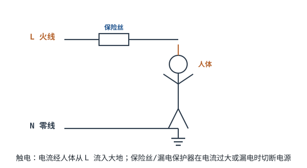

# 安全用电与触电防护 Electrical Safety & Shock Protection

前面讲的都是"怎么让电路工作"，这一章讲"怎么不让电伤人"。市电 220V 足以致命——流过心脏的电流超过几十毫安就可能室颤。这是全书唯一一章"错了会出人命"的内容，务必认真。

## 1. 设计动机

::: motivation 为什么安全是第一优先级
设备可以烧、板子可以重做，人不能出事。触电、起火、电容放电、热表面烫伤——硬件工程师每天都在和这些风险打交道。保险丝、漏电保护器、接地、绝缘、放电电阻，这些不是"锦上添花"，是保命的底线。
:::

## 2. 原理图

## 3. 触电是怎么回事（只给结论）

::: analogy 电流像穿过心脏的"小偷"
触电的危险不在于电压多高，而在于**流过心脏的电流多大、持续多久**。人体阻抗不是固定值：皮肤干湿、接触面积、电压高低、电流路径和通电时间都会显著改变它；电压升高还会击穿皮肤角质层使阻抗骤降，潮湿时接触阻抗可降到干燥时的数十分之一以下，电流随之大幅增大。不能用一个固定电阻把"安不安全"算出来。
:::

人体对 50/60Hz 交流电流的大致反应（工程经验值）：

| 流过人体电流 | 大致感受/后果 |
|---|---|
| < 1 mA | 几乎无感 |
| 1~5 mA | 麻，能自主挣脱 |
| 10~20 mA | 肌肉痉挛，可能"被吸住"甩不开 |
| 50 mA 以上 | 呼吸困难、心室颤动风险 |
| 100 mA 以上、持续数秒 | 可致命 |

关键：**电流要形成回路才危险**。一手摸火线、脚踩地（或另一手摸零线/地线），电流穿过心脏，最危险。

## 4. 防护手段（结论）

- **保险丝/断路器**：电流过大时切断，防过流起火。
- **剩余电流动作保护器 RCD/漏电保护器（GFCI）**：检测 L 和 N 电流之差（漏到人体/大地的电流）；**30mA 是额定剩余动作电流**——差值达到该值即动作（通常 ≤0.1s 跳闸）。它**并不限制**触电瞬间通过人体的电流大小，而是靠**大幅缩短通电时间**来减小通过人体的能量；它**保护不了**人同时触及相线 L 与中性线 N 的情形（此时剩余电流几乎为零），也**不能替代**保护接地或绝缘。
- **保护接地 PE**：设备金属外壳接大地，绝缘失效时外壳电位≈0，人摸上去不触电；同时漏电流触发保护。
- **隔离变压器**：把设备与大地隔离，人单线接触不形成回路。
- **低电压安全特低电压 SELV**：如 12V/24V，干燥环境下即使触电也不致命。

::: advanced 进阶：为什么 50/60Hz 特别危险
正常静息心率约 1Hz，50/60Hz 工频与之**并不接近**；工频电流之所以最危险，原因是：**致颤阈值低**，且容易落入心肌的**易损期（vulnerable period）**诱发心室颤动；人体对工频电流的阻抗较低；一旦电流路径经过心脏（如手—手、手—脚），风险最高。高频（如射频）电流倾向于从皮肤表面流过（趋肤效应），反而较少穿过心脏。所以同样毫安级电流，工频最危险。静电放电虽达上万伏，但能量极小、时间极短，通常只伤人不致命。
:::

## 5. 带数字的算例

::: example 估算触电电流（仅作量级参考，不构成安全保证）
1. **场景**：手湿（接触阻抗取约 1kΩ，仅为举例量级），身体踩地电阻忽略，碰 220V 火线。
2. **电流**：$I=V/R=220/1000=$ **约 220 mA**——远超过致命阈值，非常危险。
3. **阻抗不能按固定值算**：皮肤/接触阻抗随湿度、接触面积、电压、电流路径和通电时间显著变化；电压升高会击穿角质层使阻抗骤降。即使是干燥的手，220V 也可能致命，**不存在"某电压下肯定安全"的结论**。
4. **结论**：潮湿、金属环境下触电危险显著增大；保护接地、绝缘和 RCD 是多重防线，RCD 靠缩短通电时间降低能量，且不防 L—N 同时接触，不能单独依赖。
:::

## 6. 常见坑

::: pitfall 常见坑
- **断电后直接碰大电容**：现象——设备断电后仍被电一下。原因——大电解电容等储能元件储存的电荷没放掉。解决——维修前先用带绝缘手柄的工具经泄放电阻给电容放电（高容值元件必要时短路接地），这是硬规矩。
- **以为"关了开关"就没电**：现象——只断了零线，火线仍连设备；或被其他回路**反送电（backfeed）**带上电。原因——开关接错线/单极开关断的是零线，或存在反送电、电容等储能元件残余电荷。**失电确认（验电）流程**：① 断电后**上锁挂牌（LOTO）**，防止他人误合闸，钥匙由作业人保管；② 使用**合格且在有效期内**的验电器，先在已知带电体上**自测**，确认验电器正常；③ 分别测量**相线—地、中性线—地**，确认两处均无电；④ 排查反送电与电容/储能元件残余电荷，必要时先放电再动手；⑤ 最稳妥是直接拔下插头。
- **设备外壳不接地**：现象——摸麻手，但不跳闸。原因——绝缘轻微损坏让外壳带 220V，但漏电流小不够触发保护。解决——金属外壳必须接 PE，配漏电保护器。
:::

## 7. 自测题

同样碰 220V，为什么湿手比干手危险得多？

湿手时皮肤角质层被浸湿，接触阻抗骤降（量级可从干燥时的数百千欧降到 1kΩ 以下，因人而异）；若电流路径经过心脏，同样电压下电流可由毫安级升到数百毫安，风险急剧增大。阻抗受湿度、接触面积、电压和路径影响显著，不能用固定电阻估算安全。

漏电保护器（RCD）和普通保险丝有什么区别？

保险丝只在**电流过大**（短路）时熔断；RCD 检测 L/N 电流之差，差值达到**额定剩余动作电流 30mA** 即动作（通常 ≤0.1s）。RCD 靠**缩短通电时间**降低通过人体的能量，并不限制触电瞬间的电流大小；人同时触及 L 与 N 时剩余电流几乎为零，RCD 不动作；它也不能替代保护接地与绝缘。保险丝防不了人触电——人体电阻大、电流远达不到熔断值。

设备金属外壳为什么要接 PE 地线？

绝缘一旦损坏，外壳会带上 220V。接 PE 后外壳被钳在地电位，人摸上去几乎无电流；同时漏电流经 PE 入地，触发漏电保护器/熔断保险丝切断电源。

## 8. 参考资料

- NEETS — Safety Practices
- Practical Electronics for Inventors (Scherz & Monk) — Safety chapter
- [Lessons In Electric Circuits — Shock Current](https://www.ibiblio.org/kuphaldt/electricCircuits/)
- [HSE 电气安全 FAQ（英国健康与安全执行局）](https://www.hse.gov.uk/electricity/faq.htm)：RCD（额定 ≤30mA）只在特定类型触电中限制能量、挽救生命，**不能防护所有类型触电**；接触约 50V AC 以上即可能致伤，潮湿或金属环境中风险更高；检修前须可靠隔离所有能量源、释放储能，并使用合适检测设备证明无电。
- [OSHA 1910.333 电气作业规范（**美国法规，仅作工程原则参考，不是中国法规**）](https://www.osha.gov/laws-regs/regulations/standardnumber/1910/1910.333)：断电后上锁挂牌（LOTO）；由合格人员使用检测设备核实无电，并排查误感应电压与反送电（backfeed）；电容等高容值元件先放电、短路接地后方可作业。
