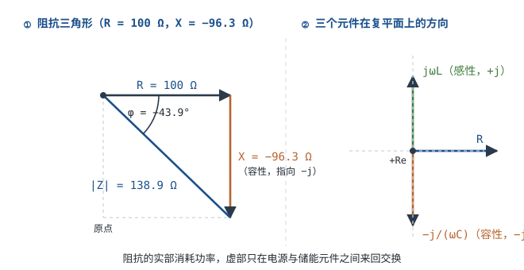

# 阻抗与导纳 Impedance & Admittance

直流里只有电阻 $R$，[欧姆定律与焦耳定律](ohms-law.md)写成 $I=V/R$ 就够了。但把 0.1µF 电容接到 50Hz 市电上，它几乎是开路（容抗 31.8kΩ）；同一颗电容接到 100MHz 的噪声上，它几乎是短路（容抗 0.016Ω）。同一个元件，阻碍作用差了两百万倍——**阻碍不是常数，而是频率的函数**。

把这些随频率变化的阻碍统一成一个量，就是**阻抗（Impedance）**。它在复数域里写成 $Z=R+jX$，实部消耗功率、虚部来回交换能量。有了它，交流电路就能套用欧姆定律的形式：$\dot V=Z\dot I$。这一章讲清三件事：$j\omega$ 是怎么从微分方程里长出来的、串联并联分压怎么在复数上做、以及为什么"用万用表量电阻"量不出阻抗。

## 1. 设计动机

::: motivation 三个绕不开阻抗的地方
**场景一：去耦电容到底在滤什么。** 0.1µF 的陶瓷电容在 50Hz 下的容抗是 31.8kΩ，对电源纹波几乎没作用；但在 10MHz 下容抗只有 0.159Ω，噪声被它旁路到地。如果不知道阻抗随频率变，"加个电容就好了"和"加了没用"都无法解释。

**场景二：耦合电容的低频截止。** 一级音频放大器的输入耦合电容取 1µF、后级输入阻抗 10kΩ。20Hz 时容抗 7.96kΩ，与 10kΩ 分压后幅度只剩 78%，低频掉了 2.1dB；50Hz 时也只恢复到 95.3%。**电容"够大"是相对负载阻抗而言的**，而这个判断只能靠阻抗算。

**场景三：示波器探头一接上，电路就变了。** 10× 探头是 10MΩ 并联约 15pF。测一个 1MΩ 源阻抗的分压器，直流时读数已经偏低 4.8%；到 100kHz，15pF 的容抗只有 106kΩ，读数偏低 82.5%。探头不是"透明的"，它自己就是一个阻抗负载。
:::

这三个场景的共同点是：**电路在直流下算对了，不等于在交流下对**。直流只问"阻值多少"，交流要问"在什么频率下、阻抗多大、相位差多少"。后者才是工程中真正会遇到的问题。

| 你想解决 | 先算 | 判据 |
|---|---|---|
| 耦合/旁路电容取多大 | $X_C=1/(2\pi fC)$ | $X_C$ 相对负载阻抗足够小（如 ≤1%） |
| 电感/磁珠选多大 | $X_L=2\pi fL$ | 在工作频段内 $X_L$ 远大于串联阻抗 |
| 分压/衰减网络准不准 | $V_{out}=V_{in}Z_2/(Z_1+Z_2)$ | 复数分压后取模，别只算实部 |
| 谐振点在哪、危险吗 | $f_0=1/(2\pi\sqrt{LC})$ | 串联谐振阻抗最小，并联谐振阻抗最大 |
| 测量结果可不可信 | 探头/表笔输入阻抗 | 输入阻抗 ≥ 被测阻抗的 10 倍（经验值） |

**不懂会在哪摔跤**，具体是这四条：

1. 把电容当成"隔直通交"的开关，忘了它只在足够高的频率下才是低阻抗，结果低频增益掉一半。
2. 算交流电流时只拿电阻 $R$ 去除电压，忽略了电抗，算出的电流比实际大几倍。
3. 并联支路直接把两个阻抗相加，得到完全错误的等效阻抗。
4. 去耦电容按容值选，不看自谐振频率，在需要滤波的频段上它其实已经是电感。

## 2. 定义与直观：复数阻抗与相量域欧姆定律

### 2.1 从"阻碍电流"到复数

**阻抗（Impedance）**定义为正弦稳态下，元件两端电压相量与电流相量之比：

$$Z=\frac{\dot V}{\dot I}=R+jX$$

符号与单位：

- $Z$：阻抗，$\Omega$；
- $R$：电阻（实部），$\Omega$，消耗有功功率；
- $X$：电抗（虚部），$\Omega$，不消耗平均功率；
- $j$：虚数单位，$j^2=-1$（电气工程用 $j$ 而不用 $i$，避免与电流混淆）。

阻抗有两种等价写法：直角坐标 $Z=R+jX$ 便于加减（串联），极坐标 $Z=\lvert Z\rvert\angle\varphi$ 便于乘除（分压、并联）。两者互换：

$$\lvert Z\rvert=\sqrt{R^2+X^2},\qquad \varphi=\arctan\frac{X}{R}$$

其中 $\lvert Z\rvert$ 是阻抗模，$\Omega$；$\varphi$ 是阻抗角，也就是电压超前电流的角度，度或 rad。$X>0$ 为感性（电压超前电流），$X<0$ 为容性（电流超前电压）。

**导纳（Admittance）**是阻抗的倒数：

$$Y=\frac{1}{Z}=G+jB$$

其中 $Y$ 是导纳，单位西门子（S）；$G$ 是电导，S；$B$ 是电纳，S。并联电路用导纳相加最省事，这一点在 §3.2 会看到具体差别。

### 2.2 感抗与容抗的来历：从微分方程到 $j\omega$

阻抗不是定义出来的，是从元件的微分方程推出来的。电感的方程是 $v=L\,di/dt$。设电流为正弦：

$$i(t)=I_p\sin(\omega t+\varphi_i)$$

求导得

$$\frac{di}{dt}=\omega I_p\cos(\omega t+\varphi_i)=\omega I_p\sin(\omega t+\varphi_i+90^{\circ})$$

代回 $v=L\,di/dt$：

$$v(t)=\omega L I_p\sin(\omega t+\varphi_i+90^{\circ})$$

对比可见两件事：**幅值放大了 $\omega L$ 倍，相位提前了 90°**。用相量写（相量与正弦量一一对应），幅值比是 $\omega L$、相位是 $+90^{\circ}$，而 $e^{j90^{\circ}}=j$，所以

$$Z_L=\frac{\dot V}{\dot I}=j\omega L$$

电感的"阻碍"与频率成正比：频率越高，电流变化越快，反电动势越大。

电容的方程是 $i=C\,dv/dt$。设 $v(t)=V_p\sin(\omega t+\varphi_v)$，同样求导得 $i=\omega C V_p\sin(\omega t+\varphi_v+90^{\circ})$，所以

$$Z_C=\frac{\dot V}{\dot I}=\frac{1}{j\omega C}=\frac{-j}{\omega C}$$

电容的"阻碍"与频率成反比：频率越高，同样的 $dv/dt$ 需要更大的电流，等效阻碍越小。$1/j=-j$ 把相位翻到 $-90^{\circ}$，正好对应"电流超前电压 90°"。

::: advanced 为什么可以把 d/dt 换成 jω
对正弦稳态，所有电压电流都是 $e^{j\omega t}$ 的倍数：$v(t)=\mathrm{Re}[\dot V e^{j\omega t}]$。对它求导：

$$\frac{d}{dt}\left(\dot V e^{j\omega t}\right)=j\omega\,\dot V e^{j\omega t}$$

也就是说，**在相量域里，微分算子 $d/dt$ 就是乘 $j\omega$**。于是 $v=L\,di/dt$ 变成 $\dot V=j\omega L\dot I$，$i=C\,dv/dt$ 变成 $\dot I=j\omega C\dot V$，微分方程退化成了代数方程——这正是相量法的全部价值。

这条替换有两个前提：**线性时不变**与**正弦稳态**。瞬态过程（上电、开关动作）里 $e^{j\omega t}$ 的假设不成立，要回到拉普拉斯域用 $s$ 代替 $j\omega$，或者直接解时域微分方程；非正弦周期信号要先分解成各次谐波，再对每个频率分别用阻抗计算。复数运算的入门见[数学基础：复数、dB 与拉氏变换直觉](math-basics.md)。
:::

### 2.3 幅频与相频：一张图看全

阻抗随频率变化的规律，可以画成两条曲线：**幅频特性** $\lvert Z\rvert$ 对 $f$，**相频特性** $\varphi$ 对 $f$。对 RLC 串联支路（$R=100\,\Omega$、$L=10$ mH、$C=1$ µF）：

- **低频区**（$f\ll f_0$）：容抗 $1/(\omega C)$ 主导，$\lvert Z\rvert$ 随频率下降，$\varphi\to-90^{\circ}$；
- **谐振点**（$f=f_0$）：感抗与容抗相等、互相抵消，$\lvert Z\rvert=R$ 取最小值，$\varphi=0$；
- **高频区**（$f\gg f_0$）：感抗 $\omega L$ 主导，$\lvert Z\rvert$ 随频率上升，$\varphi\to+90^{\circ}$。

在双对数坐标上，低频段是一条斜率 $-20$ dB/十倍频的直线，高频段是 $+20$ dB/十倍频的直线，两条直线的交点就是谐振点。这个"两段直线 + 一个拐点"的图像，比记公式有用得多。




## 3. 定量关系：串并联、分压与谐振

### 3.1 公式、符号与单位

| 关系 | 公式 | 符号与单位 | 适用条件 |
|---|---|---|---|
| 电阻 | $Z_R=R$ | $\Omega$ | 理想电阻，忽略寄生 |
| 电感 | $Z_L=j\omega L$ | $L$ 单位 H | 线性电感，忽略匝间电容 |
| 电容 | $Z_C=1/(j\omega C)=-j/(\omega C)$ | $C$ 单位 F | 线性电容，忽略 ESL |
| 阻抗模与角 | $\lvert Z\rvert=\sqrt{R^2+X^2}$，$\varphi=\arctan(X/R)$ | $\Omega$、度 | 串联等效 |
| 串联 | $Z=\sum Z_k$ | $\Omega$ | 同一电流 |
| 并联 | $Y=\sum Y_k$，$Y=1/Z$ | S | 同一电压 |
| 分压 | $\dot V_{out}=\dot V_{in}\dfrac{Z_2}{Z_1+Z_2}$ | V | 无负载效应 |
| 欧姆定律（相量） | $\dot I=\dot V/Z$ | A | 正弦稳态 |
| 谐振频率 | $f_0=\dfrac{1}{2\pi\sqrt{LC}}$ | Hz | 理想 L、C |
| 品质因数（串联） | $Q=\dfrac{1}{R}\sqrt{\dfrac{L}{C}}$ | 无量纲 | $R$ 为回路总电阻 |
| 通频带 | $BW=f_0/Q$ | Hz | 单谐振回路 |

把 RLC 三种元件的幅值与相位集中成一张表，做题时直接查：

| 元件 | 阻抗 $Z$ | 幅值 $\lvert Z\rvert$ | 相位 $\varphi$ | 频率趋势 |
|---|---|---|---|---|
| 电阻 | $R$ | $R$ | $0^{\circ}$ | 与频率无关 |
| 电感 | $j\omega L$ | $\omega L$ | $+90^{\circ}$ | 随频率线性上升 |
| 电容 | $-j/(\omega C)$ | $1/(\omega C)$ | $-90^{\circ}$ | 随频率反比下降 |
| 串联 RLC | $R+j(\omega L-1/\omega C)$ | $\sqrt{R^2+(\omega L-1/\omega C)^2}$ | $\arctan\dfrac{\omega L-1/\omega C}{R}$ | 先降后升 |

### 3.2 串联、并联与分压

**串联**：电流相同，电压相加，所以阻抗直接相加：

$$Z_{series}=Z_1+Z_2+\cdots$$

**并联**：电压相同，电流相加，所以**导纳**相加：

$$Y_{parallel}=Y_1+Y_2+\cdots\qquad\Longleftrightarrow\qquad Z_{parallel}=\frac{1}{\frac{1}{Z_1}+\frac{1}{Z_2}+\cdots}$$

两个阻抗并联时有简便式：

$$Z_{parallel}=\frac{Z_1Z_2}{Z_1+Z_2}$$

以 $R=100\,\Omega$ 与 $C=1$ µF 在 1kHz 为例（$\omega=6283.2$ rad/s，$X_C=159.15\,\Omega$）：

- **串联**：$Z=100-j159.15$，$\lvert Z\rvert=\sqrt{100^2+159.15^2}=187.96\,\Omega$，$\varphi=\arctan(-159.15/100)=-57.86^{\circ}$；
- **并联**：$Y=1/100+j\omega C=0.01+j0.006283$ S，$\lvert Y\rvert=\sqrt{0.01^2+0.006283^2}=0.01181$ S，$\lvert Z\rvert=1/0.01181=84.67\,\Omega$，$\varphi=-32.14^{\circ}$。

同一个电阻、同一个电容，串联得 188Ω，并联得 84.7Ω，差了 2.2 倍。**并联不能用阻抗直接相加**（那会得到 $100-j159$ 的错误结果，正好是串联值），必须用导纳相加或乘积除以和。

**分压**是复数的，公式形式与直流相同：

$$\dot V_{out}=\dot V_{in}\frac{Z_2}{Z_1+Z_2}$$

但结果要分别看模和相位：模决定幅度衰减，相位决定相移。$RC$ 低通的截止频率 $f_c=1/(2\pi RC)$ 就是"$\lvert Z_C\rvert=R$"那一点，此时 $\lvert V_{out}/V_{in}\rvert=1/\sqrt2=-3$ dB、相移 $-45^{\circ}$——这两个数字不是定义出来的，是复数分压代入 $X_C=R$ 的自然结果。

### 3.3 谐振时的阻抗行为

谐振的定义是感抗与容抗大小相等：

$$\omega_0L=\frac{1}{\omega_0C}\ \Longrightarrow\ \omega_0=\frac{1}{\sqrt{LC}},\qquad f_0=\frac{1}{2\pi\sqrt{LC}}$$

对本章的 $L=10$ mH、$C=1$ µF：$\omega_0=1/\sqrt{10^{-2}\times10^{-6}}=1/10^{-4}=10^4$ rad/s，$f_0=10^4/2\pi=1591.5$ Hz。

**串联谐振**：$Z=R+j(\omega_0L-1/\omega_0C)=R$，阻抗最小、电流最大。回路电流 $I=V/R$，电感与电容上的电压大小相等、方向相反：

$$V_L=V_C=Q\,V,\qquad Q=\frac{1}{R}\sqrt{\frac{L}{C}}$$

本例 $\sqrt{L/C}=\sqrt{10^{-2}/10^{-6}}=100\,\Omega$，$R=100\,\Omega$，所以 $Q=1$。$Q=1$ 时 $V_L=V_C=V$；若把 $R$ 换成 10Ω，$Q=10$，1V 的源会在 L、C 上各产生 10V 电压——**元件耐压要按 $Q$ 倍源电压选，不能按源电压选**。

**并联谐振**：理想 LC 并联在 $\omega_0$ 处阻抗无穷大；实际电感有串联损耗 $r$ 时，谐振阻抗是有限值：

$$Z_{\max}\approx\frac{L}{Cr}=Q^2r=Q\sqrt{\frac{L}{C}}$$

用同一组 $L=10$ mH、$C=1$ µF，取 $r=10\,\Omega$：$Q=\omega_0L/r=10^4\times10^{-2}/10=10$，$Z_{\max}=10^2\times10=1000\,\Omega$。精确计算在 $\omega_0$ 处得到 $1005\,\Omega\angle-5.7^{\circ}$，与近似值 1000Ω 相差 0.5%——近似式在 $Q\ge10$ 时足够用。

对比一下同一组元件的两种接法：**串联谐振阻抗 10Ω（最小），并联谐振阻抗约 1000Ω（最大），相差 $Q^2=100$ 倍**。这就是"谐振到底是选频还是短路"取决于接法的原因，[RLC 电路与谐振](rlc-resonance.md)会对选频与阻尼展开。

### 3.4 阻抗与功率

阻抗的实部消耗有功功率，虚部只在电源与储能元件之间往返：

$$P=I_{rms}^2R=V_{rms}I_{rms}\cos\varphi,\qquad Q=I_{rms}^2X=V_{rms}I_{rms}\sin\varphi,\qquad S=V_{rms}I_{rms}$$

其中 $P$ 是有功功率，W；$Q$ 是无功功率，var；$S$ 是视在功率，VA；$\cos\varphi=R/\lvert Z\rvert$ 是功率因数。注意这里的 $Q$ 是**无功功率**，与 §3.3 的品质因数是同一个字母、不同的量，靠单位（var 与无量纲）区分。

例：220V/50Hz 接到 $Z=100+j75\,\Omega$ 的负载上。$\lvert Z\rvert=\sqrt{100^2+75^2}=125\,\Omega$，$I=220/125=1.76$ A：

$$P=1.76^2\times100=309.8\ \text{W},\qquad Q=1.76^2\times75=232.3\ \text{var},\qquad S=220\times1.76=387.2\ \text{VA}$$

验算：$\sqrt{P^2+Q^2}=\sqrt{309.8^2+232.3^2}=387.2$ VA，与 $S$ 一致；$\cos\varphi=100/125=0.8$，$387.2\times0.8=309.8$ W 也一致。

这条关系解释了为什么"阻抗角"在电力与电源设计里比"阻抗模"还重要：同样的电压电流，相位差越大，有功越小、线路与器件的电流应力却不变。

### 3.5 适用条件与失效边界

阻抗这套工具的适用条件必须写清：

1. **线性时不变**：$R$、$L$、$C$ 不随电压电流变。铁芯电感在饱和后电感量骤降，陶瓷电容在直流偏置下容量可掉一半以上（具体以数据手册为准），此时"一个 $Z$"不再成立。
2. **正弦稳态**：所有量同频。非正弦要分解成各次谐波，每个频率各算一次再叠加；瞬态要回到时域或 $s$ 域。
3. **集总假设**：元件尺寸远小于波长（工程判据 $l<\lambda/10$）。100MHz 时波长 3m，一根 30cm 的导线就不能再当"理想连接"，要按传输线处理。
4. **单一工作点**：$Z$ 是在某个频率、某个偏置、某个温度下的值。宽频应用要给出阻抗—频率曲线，而不是一个数。

## 4. 典型计算

### 4.1 算例一：RLC 串联支路的 $\lvert Z\rvert$ 与相角

**电路**：$R=100\,\Omega$、$L=10$ mH、$C=1$ µF 串联，源电压 1V（有效值），频率 1kHz。求感抗、容抗、总阻抗、相角、电流与各元件电压。

**第一步，感抗**：

$$X_L=2\pi fL=2\pi\times1000\times10\times10^{-3}=62.83\ \Omega$$

**第二步，容抗**：

$$X_C=\frac{1}{2\pi fC}=\frac{1}{2\pi\times1000\times10^{-6}}=\frac{1}{6.2832\times10^{-3}}=159.15\ \Omega$$

**第三步，净电抗与阻抗**：

$$X=X_L-X_C=62.83-159.15=-96.32\ \Omega$$

$$Z=R+jX=100-j96.32\ \Omega,\qquad \lvert Z\rvert=\sqrt{100^2+96.32^2}=\sqrt{10000+9278}=138.85\ \Omega$$

**第四步，相角**：

$$\varphi=\arctan\frac{-96.32}{100}=-43.93^{\circ}$$

写成极坐标：$Z=138.85\angle-43.93^{\circ}\,\Omega$。负角表示**电流超前电压**，负载呈容性。

**第五步，电流**（1V 有效值）：

$$I=\frac{V}{\lvert Z\rvert}=\frac{1}{138.85}=7.202\ \text{mA}$$

相量形式：$\dot I=7.202\angle+43.93^{\circ}$ mA。

**第六步，各元件电压**：

$$V_R=IR=7.202\times10^{-3}\times100=0.7202\ \text{V}$$

$$V_L=IX_L=7.202\times10^{-3}\times62.83=0.4525\ \text{V}$$

$$V_C=IX_C=7.202\times10^{-3}\times159.15=1.1463\ \text{V}$$

注意 $V_C=1.146$ V **大于源电压 1V**。这不是算错：$V_L$ 与 $V_C$ 相位相反，互相抵消一部分，源电压只需提供它们的差值。

**第七步，验算**（相量三角形）：

$$\sqrt{V_R^2+(V_L-V_C)^2}=\sqrt{0.7202^2+(0.4525-1.1463)^2}=\sqrt{0.5187+0.4813}=1.000\ \text{V}$$

与源电压 1V 一致，误差来自舍入（精确值 0.9998）。

**第八步，用分贝表示**：$\lvert Z\rvert=138.85\,\Omega$ 即 $20\lg138.85=42.85$ dBΩ。分贝在这里只是把大范围数值压缩，真正有物理意义的还是 $\lvert Z\rvert$ 与 $\varphi$ 两个数。

### 4.2 算例二：同一条支路在两个频率下的行为对比

**问题**：同一条 $R=100\,\Omega$、$L=10$ mH、$C=1$ µF 的支路，分别工作在 100Hz 与 10kHz，阻抗、相角、电流有什么不同？谐振点在哪？

**100Hz**（$\omega=628.32$ rad/s）：

$$X_L=2\pi\times100\times0.01=6.283\ \Omega,\qquad X_C=\frac{1}{2\pi\times100\times10^{-6}}=1591.55\ \Omega$$

$$X=6.283-1591.55=-1585.27\ \Omega,\qquad \lvert Z\rvert=\sqrt{100^2+1585.27^2}=1588.42\ \Omega$$

$$\varphi=\arctan\frac{-1585.27}{100}=-86.39^{\circ},\qquad I=\frac{1}{1588.42}=0.6296\ \text{mA}$$

**10kHz**（$\omega=62832$ rad/s）：

$$X_L=2\pi\times10^4\times0.01=628.32\ \Omega,\qquad X_C=\frac{1}{2\pi\times10^4\times10^{-6}}=15.915\ \Omega$$

$$X=628.32-15.915=612.40\ \Omega,\qquad \lvert Z\rvert=\sqrt{100^2+612.40^2}=620.51\ \Omega$$

$$\varphi=\arctan\frac{612.40}{100}=+80.73^{\circ},\qquad I=\frac{1}{620.51}=1.6116\ \text{mA}$$

**谐振点**：

$$f_0=\frac{1}{2\pi\sqrt{LC}}=\frac{1}{2\pi\sqrt{10^{-2}\times10^{-6}}}=\frac{1}{2\pi\times10^{-4}}=1591.5\ \text{Hz}$$

在 $f_0$ 处 $X_L=X_C=2\pi\times1591.5\times0.01=100\,\Omega$，$\lvert Z\rvert=R=100\,\Omega$，$\varphi=0$，$I=10$ mA。

把这条支路的完整扫描列成表，注意每个数都能用上面的公式复算：

| 频率 | $X_L$ / Ω | $X_C$ / Ω | $\lvert Z\rvert$ / Ω | $\varphi$ | $I$ (1V) / mA |
|---|---|---|---|---|---|
| 100 Hz | 6.28 | 1591.55 | 1588.42 | −86.39° | 0.630 |
| 200 Hz | 12.57 | 795.77 | 789.57 | −82.72° | 1.267 |
| 500 Hz | 31.42 | 318.31 | 303.82 | −70.78° | 3.291 |
| 800 Hz | 50.27 | 198.94 | 179.18 | −56.08° | 5.581 |
| 1 kHz | 62.83 | 159.15 | 138.85 | −43.93° | 7.202 |
| 1.2 kHz | 75.40 | 132.63 | 115.22 | −29.78° | 8.679 |
| 1.5 kHz | 94.25 | 106.10 | 100.70 | −6.76° | 9.931 |
| 1.592 kHz | 100.00 | 100.00 | 100.00 | 0° | 10.000 |
| 1.7 kHz | 106.81 | 93.63 | 100.87 | +7.52° | 9.914 |
| 2 kHz | 125.66 | 79.58 | 110.11 | +24.74° | 9.082 |
| 3 kHz | 188.50 | 53.05 | 168.36 | +53.56° | 5.940 |
| 5 kHz | 314.16 | 31.83 | 299.52 | +70.50° | 3.339 |
| 10 kHz | 628.32 | 15.92 | 620.51 | +80.73° | 1.612 |

```echarts
{
  "tooltip": {"trigger": "axis"},
  "legend": {"data": ["|Z| 串联 RLC"], "bottom": 0, "textStyle": {"fontSize": 12}},
  "grid": {"left": 70, "right": 28, "top": 34, "bottom": 56},
  "xAxis": {"type": "log", "name": "频率 f / Hz", "nameLocation": "middle", "nameGap": 30,
            "min": 100, "max": 10000, "axisLabel": {"fontSize": 11}},
  "yAxis": {"type": "value", "name": "|Z| / Ω", "nameLocation": "middle", "nameGap": 50,
            "min": 0, "max": 1800, "axisLabel": {"fontSize": 11}},
  "series": [
    {"name": "|Z| 串联 RLC", "type": "line", "smooth": true, "symbolSize": 5,
     "lineStyle": {"width": 2.6, "color": "#1a4f8b"}, "itemStyle": {"color": "#1a4f8b"},
     "data": [[100,1588.42],[200,789.57],[500,303.82],[800,179.18],[1000,138.85],[1200,115.22],[1500,100.70],[1591.5,100.00],[1700,100.87],[2000,110.11],[3000,168.36],[5000,299.52],[10000,620.51]]}
  ]
}
```

读这张表要抓住三点：

1. **低频是容性、高频是感性、中间有一个纯电阻点**。相角从 −86.4° 连续变到 +80.7°，中间穿过 0°。
2. **阻抗的"不对称"**：100Hz 的 $\lvert Z\rvert$ 是 1588Ω，10kHz 是 620Ω，虽然两个频率都远离谐振点，但差距 2.6 倍——因为 $X_C$ 按 $1/f$ 变、$X_L$ 按 $f$ 变，同一组元件在低频端的偏离更剧烈。
3. **电流在谐振点最大**（10mA），偏离谐振后迅速下降；但"迅速"是相对的：1kHz 时仍有一半以上（7.2mA），5kHz 只剩三分之一。带宽由 $Q$ 决定，本例 $Q=1$，曲线很平。

### 4.3 算例三：完整设计——50Hz 耦合电容与探头负载

**需求 A**：一级音频放大器的输入耦合电容，后级输入阻抗 $R_L=10$ kΩ。要求在 20Hz 处的幅度损失不超过 0.5%（即 $\lvert H\rvert\ge0.995$）。求最小电容，并核算 50Hz 时的衰减与相移。

**第 1 步，把指标翻译成容抗上限**。耦合电容与负载构成高通，幅度传递函数：

$$\lvert H\rvert=\frac{R_L}{\sqrt{R_L^2+X_C^2}}\ge0.995$$

两边平方并整理：

$$X_C\le R_L\sqrt{\frac{1}{0.995^2}-1}=10000\times\sqrt{0.010075}=10000\times0.10038=1003.8\ \Omega$$

**第 2 步，反算电容**：

$$C\ge\frac{1}{2\pi f X_C}=\frac{1}{2\pi\times20\times1003.8}=\frac{1}{126,146}=7.93\ \mu\text{F}$$

按 IEC 60063 的 E6 系列取 **10µF**。

**第 3 步，验算 20Hz**：

$$X_C=\frac{1}{2\pi\times20\times10\times10^{-6}}=795.8\ \Omega$$

$$\lvert H\rvert=\frac{10000}{\sqrt{10000^2+795.8^2}}=\frac{10000}{10031.6}=0.99685$$

幅度损失 $1-0.99685=0.315\%$，满足 0.5% 的要求。换算成分贝：$20\lg0.99685=-0.0274$ dB。相移 $\arctan(795.8/10000)=4.55^{\circ}$。

**第 4 步，核算 50Hz**：

$$X_C=\frac{1}{2\pi\times50\times10\times10^{-6}}=318.3\ \Omega,\qquad \lvert H\rvert=\frac{10000}{\sqrt{10000^2+318.3^2}}=0.99949$$

损失 0.051%，相移 1.82°。50Hz 下已经基本无影响。

**第 5 步，对照"随手取 1µF"**：

| 电容 | 20Hz 容抗 | 20Hz 幅度 | 20Hz 相移 | 50Hz 容抗 | 50Hz 幅度 | 50Hz 相移 |
|---|---|---|---|---|---|---|
| 1 µF | 7957.7 Ω | 0.7825（−2.13 dB） | 38.51° | 3183.1 Ω | 0.9529（−0.419 dB） | 17.66° |
| 4.7 µF | 1693.1 Ω | 0.9860（−0.123 dB） | 9.61° | 677.3 Ω | 0.9977（−0.020 dB） | 3.87° |
| 10 µF | 795.8 Ω | 0.9968（−0.027 dB） | 4.55° | 318.3 Ω | 0.9995（−0.004 dB） | 1.82° |

1µF 在 20Hz 只剩 78% 幅度，在 50Hz 也有 4.7% 的衰减和 17.7° 相移。**"1µF 够大了"这句话没有意义，必须相对负载阻抗与最低工作频率来说**。若只要求 50Hz 处损失小于 0.5%，则 $X_C\le1003.8\,\Omega$，$C\ge1/(2\pi\times50\times1003.8)=3.17\ \mu\text{F}$，取 4.7µF 即可。

**需求 B**：用 10× 示波器探头（$10\,\text{M}\Omega\parallel15\,\text{pF}$）测量一个 $1\,\text{M}\Omega+1\,\text{M}\Omega$ 分压器的中点，源电压 1V。分压器理想输出 0.5V，实际读数是多少？

**第 1 步，探头阻抗**。电阻与电容并联，用导纳算：

$$Y_p=\frac{1}{10^7}+j2\pi f\times15\times10^{-12}$$

阻抗模 $\lvert Z_p\rvert=1/\lvert Y_p\rvert$。在直流（$f=0$）时 $Y_p=10^{-7}$ S，$\lvert Z_p\rvert=10$ MΩ。

**第 2 步，逐频点计算**（探头并在分压器下臂 $1\,\text{M}\Omega$ 上）：

| 频率 | 探头容抗 | 探头阻抗模 | 下臂并联后 | 输出 / V | 相对 0.5V 的误差 |
|---|---|---|---|---|---|
| 0（直流） | ∞ | 10.0 MΩ | 0.909 MΩ | 0.4762 | −4.76% |
| 1 kHz | 10.61 MΩ | 7.28 MΩ | 0.879 MΩ | 0.4679 | −6.43% |
| 10 kHz | 1.061 MΩ | 1.055 MΩ | 0.513 MΩ | 0.3392 | −32.15% |
| 100 kHz | 106.1 kΩ | 106.1 kΩ | 95.9 kΩ | 0.0875 | −82.50% |

**第 3 步，给出一个频点的完整代入**（10kHz）：

$$X_C=\frac{1}{2\pi\times10^4\times15\times10^{-12}}=1.061\times10^6\ \Omega$$

$$\lvert Z_p\rvert=\frac{10^7\times1.061\times10^6}{\sqrt{(10^7)^2+(1.061\times10^6)^2}}=\frac{1.061\times10^{13}}{1.0056\times10^7}=1.055\times10^6\ \Omega$$

下臂 $1\,\text{M}\Omega$ 与它并联：

$$R_{lower}=\frac{10^6\times1.055\times10^6}{10^6+1.055\times10^6}=5.134\times10^5\ \Omega$$

$$V_{out}=\frac{5.134\times10^5}{10^6+5.134\times10^5}=0.3392\ \text{V}$$

**第 4 步，结论**。直流时探头 10MΩ 已经造成 −4.8% 的负载误差；10kHz 时 15pF 使误差扩大到 −32%；100kHz 时读数只剩真值的 17.5%。这不是探头"坏了"，而是它的输入电容在起作用——所以探头要配补偿电容，高阻节点测量要换 FET 探头或有源探头。具体探头参数以厂商手册为准。

## 5. 工程含义

### 5.1 工程数量级表

**容抗数量级**（$X_C=1/(2\pi fC)$，单位 Ω）：

| 电容 | 50 Hz | 1 kHz | 100 kHz | 1 MHz |
|---|---|---|---|---|
| 1 nF | 3.183 M | 159.15 k | 1.592 k | 159.15 |
| 100 nF | 31.83 k | 1.592 k | 15.92 | 1.592 |
| 1 µF | 3.183 k | 159.15 | 1.592 | 0.159 |
| 10 µF | 318.3 | 15.92 | 0.159 | 0.0159 |
| 100 µF | 31.83 | 1.592 | 0.0159 | 0.00159 |
| 1000 µF | 3.183 | 0.159 | 0.00159 | $1.59\times10^{-4}$ |

**感抗数量级**（$X_L=2\pi fL$，单位 Ω）：

| 电感 | 50 Hz | 1 kHz | 100 kHz | 1 MHz |
|---|---|---|---|---|
| 1 µH | 0.000314 | 0.00628 | 0.628 | 6.283 |
| 100 µH | 0.0314 | 0.628 | 62.83 | 628.3 |
| 1 mH | 0.314 | 6.283 | 628.3 | 6283 |
| 10 mH | 3.142 | 62.83 | 6283 | 62832 |
| 100 mH | 31.42 | 628.3 | 62832 | $6.28\times10^5$ |

两张表放在一起看，得到一条重要的数量级直觉：**在 50Hz 的电力世界里，1µF 才 3.2kΩ，要"低阻抗"必须上几十到几百 µF；在 1MHz 的世界里，1nF 只有 159Ω，几十 nF 就足以旁路。** 同一颗电容在两个世界里是完全不同的器件。

**常见阻抗量级**：

| 对象 | 典型阻抗 | 备注 |
|---|---|---|
| 市电回路导线（单程 2m、1.5mm²，去回共 4m） | 约 46 mΩ | 20°C 铜，$R=\rho L/A$ |
| PCB 走线（10mm、0.25mm 宽、1oz） | 约 20 mΩ | 约 40 个方块 × 0.49mΩ |
| 耳机 | 32 Ω / 600 Ω 标称 | 1kHz 下的标称值 |
| 同轴电缆特征阻抗 | 50 Ω / 75 Ω | 传输线概念，不是直流电阻 |
| 示波器 10× 探头 | 10 MΩ ∥ 约 15 pF | 随频率下降 |
| 数字万用表电压档 | 10 MΩ 典型 | 直流输入阻抗 |
| 运放输入 | >1 GΩ ∥ 几 pF（典型） | 具体以数据手册为准 |
| 良好绝缘 | >100 MΩ | 500V DC 下测 |

### 5.2 「用万用表量电阻」和「测阻抗」的区别

万用表电阻档测的是**直流电阻**，本质是给一个已知电流、量电压，只对 $f=0$ 有效。阻抗是频率的函数，两者在被测件不是纯电阻时会给出完全不同的结果：

- **量电容**：欧姆档给电容充电，读数从 0 开始上升，最后显示 OL。上升速度由表内测试电流与容量决定：若测试电流为 1µA，$dV/dt=I/C=10^{-6}/10^{-6}=1$ V/s，1µF 每秒涨 1V，很快到达量程上限；100µF 则只有 0.01 V/s。**读数在变，本身就说明被测件不是电阻。**
- **量电感**：读数接近绕线直流电阻（可能只有几 Ω），而 1kHz 下 10mH 的感抗有 62.83Ω，两者差一个数量级以上。
- **量电解电容**：直流电阻档读数接近 OL（漏电流很小），但它真正的交流阻抗在 100kHz 可能只有 0.0159Ω（理想容抗）——实际被 ESR 支配，典型 100µF/25V 的 ESR 在 0.1~0.5Ω 量级（以数据手册为准）。

正确做法是用 **LCR 表或阻抗分析仪**，并且**指定测试频率与测试电平**：同一个 100µF 电容，100Hz 与 100kHz 下的等效串联电阻、容量都可能不同。看阻抗必须带频率，就像看速度必须带参考系。

### 5.3 自谐振：真实元件的阻抗曲线

理想电容的阻抗随频率单调下降，真实电容不是。引脚与内部电极有寄生电感 ESL，构成串联 LC：

$$f_{SRF}=\frac{1}{2\pi\sqrt{L_{ESL}C}}$$

以 100nF、ESL=2nH 的贴片电容为例：

$$f_{SRF}=\frac{1}{2\pi\sqrt{2\times10^{-9}\times100\times10^{-9}}}=\frac{1}{2\pi\times1.414\times10^{-8}}=11.25\ \text{MHz}$$

- 低于 $f_{SRF}$：呈容性，$\lvert Z\rvert$ 随频率下降；
- 等于 $f_{SRF}$：$\lvert Z\rvert$ 只剩 ESR，最小；
- 高于 $f_{SRF}$：呈感性，$\lvert Z\rvert$ 随频率上升。

在 100MHz 时，理想 100nF 的容抗是 $1/(2\pi\times10^8\times10^{-7})=0.0159\,\Omega$，而 2nH 的感抗是 $2\pi\times10^8\times2\times10^{-9}=1.257\,\Omega$——**实际阻抗是理想值的 79 倍**。所以"用 100nF 滤 100MHz"是无效的，要么换更小的电容（容值小、SRF 高），要么直接用磁珠/馈通电容。

电解电容的 ESR 更大、SRF 更低（典型几十 kHz 到几百 kHz），高频去耦必须与陶瓷电容并联；而并联本身又会引入反谐振峰，这属于电源完整性的范畴，不在本章展开。工程上的稳妥做法是看厂商给出的**阻抗—频率曲线**，而不是只算容抗。

### 5.4 阻抗对测量、匹配与选型的影响

**测量**：任何测量都是"把仪表阻抗并在被测电路上"。经验判据是输入阻抗 ≥ 被测源阻抗的 10 倍，误差才小于 10%。§4.3 的探头例子说明，直流满足 10 倍（10MΩ 对 1MΩ）时误差仍有 4.8%，因为 10 倍只保证 9% 的负载误差，要 1% 就得 100 倍。

**分压与衰减**：电阻分压器的误差来自负载阻抗；电容分压器的分压比由容量反比决定，与频率无关（理想情况），所以高压探头常用电容分压 + 电阻分压的组合，并用可调补偿电容校准。

**匹配**：高频链路的"阻抗匹配"指负载阻抗等于源的特征阻抗（50Ω、75Ω、100Ω 差分），目的是不反射。它与本章的低频阻抗是同一个概念在不同频段的表现：低频看 $\lvert Z\rvert$ 与 $\varphi$，高频还要看它是复数还是实数、随频率是否平坦。

**选型**：耦合电容看最低工作频率下的容抗，旁路电容看目标频段的阻抗曲线，电感看饱和电流与直流电阻，磁珠看目标频段的阻抗峰。这些参数在数据手册里都是曲线，不是单个数字——**阻抗从来不是一个数，而是一条曲线上的一个点**。

## 6. 常见坑

::: pitfall 常见坑
- **用万用表电阻档量电容、电感，还把读数当阻抗**：现象——量电容读数从 0 慢慢爬到 OL，量 10mH 电感显示 5Ω，于是认为"电容坏了/电感只有 5Ω"。原因——电阻档只测直流，电容在直流下是开路、电感在直流下只剩绕线电阻；阻抗是频率的函数。解决——用 LCR 表并指定测试频率（如 1kHz/100kHz），或按数据手册的阻抗—频率曲线判断。
- **算交流电流只除以电阻 R**：现象——$R=100\,\Omega$、$L=10$ mH、$C=1$ µF 在 1kHz 下，按 1V/100Ω 算出 10mA，实测只有 7.2mA，误差 39%。原因——电流由 $\lvert Z\rvert=138.85\,\Omega$ 决定，不是由 $R$ 决定；电抗同样限制电流。解决——先算 $X=X_L-X_C$，再算 $\lvert Z\rvert=\sqrt{R^2+X^2}$，最后 $I=V/\lvert Z\rvert$。
- **并联支路直接把阻抗相加**：现象——100Ω 与 1µF 在 1kHz 并联，算成 $100-j159=188\,\Omega$，实际是 84.7Ω，差 2.2 倍。原因——并联时电压相同、电流相加，应该加的是导纳不是阻抗。解决——先算 $Y=1/Z_1+1/Z_2$，再取倒数；或用 $Z_1Z_2/(Z_1+Z_2)$。
- **以为电容上的电压一定小于源电压**：现象——按分压直觉选 1V 源下 1V 耐压的电容，实测电容两端 1.15V 甚至 $Q$ 倍源电压。原因——谐振附近 $V_L$ 与 $V_C$ 大小接近、相位相反，单个元件电压可以远高于源电压。解决——按 $Q$ 倍源电压选耐压，$Q$ 由 $R$、$L$、$C$ 算出；开关机瞬态还要再留余量。
- **忽略自谐振，以为容值越大滤波越好**：现象——加了 100nF 去耦，100MHz 的噪声一点没降；或者多个电容并联后某个频段噪声反而变大。原因——电容的 ESL 使其在 $f_{SRF}$ 以上呈感性，容值越大 SRF 越低。解决——按目标频段选容值（高频用小容值），必要时用磁珠或馈通电容；并联组合要看整体阻抗曲线。
- **耦合电容按"经验值"拍，不算低频截止**：现象——音频放大器低频发闷、方波下垂，或者传感器信号在 50Hz 就衰减 5%。原因——耦合电容与负载构成高通，$X_C$ 相对负载阻抗不够小。解决——先定最低工作频率与允许衰减，反算 $X_C$ 上限再选容值；同时核对相移是否影响环路稳定。
:::

## 7. 自测题

<details><summary>1µF 电容在 50Hz、1kHz、1MHz 下的容抗各是多少？这三个数说明什么？</summary>

$X_C=1/(2\pi fC)$，$C=10^{-6}$ F。

50Hz：$X_C=1/(2\pi\times50\times10^{-6})=1/(3.1416\times10^{-4})=3183.1\,\Omega$。

1kHz：$X_C=1/(2\pi\times10^3\times10^{-6})=1/(6.2832\times10^{-3})=159.15\,\Omega$。

1MHz：$X_C=1/(2\pi\times10^6\times10^{-6})=1/6.2832=0.159\,\Omega$。

频率提高 20 倍（50Hz→1kHz），容抗降到 1/20；提高 20000 倍（50Hz→1MHz），容抗降到 1/20000。说明容抗与频率成严格反比，同一条 $1/f$ 规律贯穿整个频段——这也是双对数坐标上容抗是一条斜率 −20dB/十倍频直线的原因。
</details>

<details><summary>R=10Ω、L=10mH、C=1µF 串联，1kHz 下阻抗模、相角、电流（1V 源）各是多少？电路呈容性还是感性？</summary>

$X_L=2\pi\times1000\times0.01=62.83\,\Omega$；$X_C=1/(2\pi\times1000\times10^{-6})=159.15\,\Omega$。

$X=62.83-159.15=-96.32\,\Omega$；$\lvert Z\rvert=\sqrt{10^2+96.32^2}=\sqrt{100+9278}=96.84\,\Omega$。

$\varphi=\arctan(-96.32/10)=-84.07^{\circ}$，呈容性（电流超前电压）。

$I=1/96.84=10.33$ mA。

注意：把 R 从 100Ω 换成 10Ω 后，$\lvert Z\rvert$ 从 138.85Ω 降到 96.84Ω，电流从 7.2mA 升到 10.3mA——电阻越小，电抗越主导，相角越接近 −90°。
</details>

<details><summary>100Ω 与 1µF 在 1kHz 下并联，等效阻抗是多少？如果误按串联算会得到多少？</summary>

并联用导纳：$Y=1/100+j2\pi\times1000\times10^{-6}=0.01+j0.006283$ S。

$\lvert Y\rvert=\sqrt{0.01^2+0.006283^2}=\sqrt{1\times10^{-4}+3.948\times10^{-5}}=0.01181$ S。

$\lvert Z\rvert=1/0.01181=84.67\,\Omega$，$\varphi=-\arctan(0.006283/0.01)=-32.14^{\circ}$。

误按串联：$Z=100-j159.15$，$\lvert Z\rvert=187.96\,\Omega$，是正确值的 2.22 倍。

结论：并联必须加导纳；阻抗直接相加只对串联成立。
</details>

<details><summary>L=1mH、C=100nF 的串联回路，谐振频率、特性阻抗 $\sqrt{L/C}$、Q（R=10Ω）、通频带各是多少？</summary>

$f_0=1/(2\pi\sqrt{LC})=1/(2\pi\sqrt{10^{-3}\times10^{-7}})=1/(2\pi\times10^{-5})=15.92$ kHz。

特性阻抗 $\sqrt{L/C}=\sqrt{10^{-3}/10^{-7}}=\sqrt{10^4}=100\,\Omega$。

$Q=(1/R)\sqrt{L/C}=100/10=10$。

$BW=f_0/Q=15915/10=1592$ Hz。

谐振时 $\lvert Z\rvert=R=10\,\Omega$，电流最大；L、C 上的电压是源电压的 $Q=10$ 倍，1V 源会在元件上产生 10V——耐压必须按这个选。
</details>

<details><summary>0.1µF 耦合电容接 10kΩ 负载，50Hz 下幅度衰减多少 dB？要满足 50Hz 处损失小于 0.5%，电容至少要多大？</summary>

$X_C=1/(2\pi\times50\times10^{-7})=31831\,\Omega$。

$\lvert H\rvert=10000/\sqrt{10000^2+31831^2}=10000/33365=0.2997$。

$20\lg0.2997=-10.47$ dB，幅度只剩 30%——这个电容在 50Hz 完全不够用。

要损失小于 0.5%：$X_C\le R_L\sqrt{1/0.995^2-1}=10000\times0.10038=1003.8\,\Omega$。

$C\ge1/(2\pi\times50\times1003.8)=3.17\,\mu\text{F}$，取 E6 系列的 4.7µF。

验算 4.7µF：$X_C=677.3\,\Omega$，$\lvert H\rvert=10000/\sqrt{10000^2+677.3^2}=0.99773$，损失 0.23%，合格。
</details>

<details><summary>为什么"用电阻档量出来是 5Ω 的电感"在 1kHz 下可能有 62.8Ω 的阻抗？这两个数矛盾吗？</summary>

不矛盾，它们测的是不同的东西。

电阻档测的是直流电阻 $R_{DC}$（绕线铜阻），对应 $f=0$ 时的阻抗实部；5Ω 是绕线电阻。

1kHz 下，10mH 的感抗 $X_L=2\pi\times1000\times0.01=62.83\,\Omega$；总阻抗 $\lvert Z\rvert=\sqrt{R_{DC}^2+X_L^2}=\sqrt{5^2+62.83^2}=63.03\,\Omega$。

所以同一个电感，直流下阻抗 5Ω，1kHz 下 63Ω，相差 12.6 倍。阻抗是频率的函数，报阻抗必须同时报频率，否则这个数没有意义。
</details>

## 8. 参考资料

- **Lessons In Electric Circuits, Vol. II – AC**（Tony R. Kuphaldt，ibiblio 公开版）：*Chapter 2 Complex Numbers* 给复数运算与相量表示；*Chapter 3 Reactance and Impedance – Inductive*、*Chapter 4 Reactance and Impedance – Capacitive*、*Chapter 5 Reactance and Impedance – R, L, and C* 分别给感抗、容抗与 RLC 组合阻抗的推导。本章 §2.2 的"微分方程 → $j\omega$"讲法与该书一致。<https://www.ibiblio.org/kuphaldt/electricCircuits/>
- **《电路》**（邱关源，高等教育出版社）："正弦稳态电路的分析"一章定义阻抗与导纳、相量形式的欧姆定律、阻抗串并联与分压；"电路的频率响应"一章给谐振、品质因数与通频带。本章 §3.1 的符号与单位口径与该书一致。
- **Tektronix, ABCs of Probes Primer**：*Probe Loading* 一节说明 10MΩ 并联约 15pF 的探头如何对被测电路产生分压与分流；本章 §4.3 的探头负载表按该节口径计算，具体探头的输入电容与补偿范围以厂商手册为准。
- **Horowitz and Hill, The Art of Electronics, 3rd ed.**：*Chapter 1 Foundations* 中关于电抗、阻抗分压与 RC 滤波的数量级讨论；本章"耦合电容看最低工作频率、旁路电容看目标频段"的选型口径与该书一致。
- **IEC 60063, Preferred number series for resistors and capacitors**：E6/E12/E24 标称值系列；本章耦合电容的 4.7µF、10µF 取值按 E6 系列选取。
