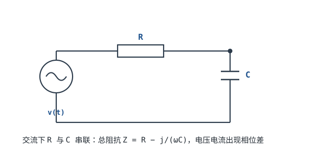

# 阻抗与导纳 Impedance & Admittance

直流里只有电阻 R，欧姆定律 $I=V/R$。交流下电容和电感也会"阻碍"电流，而且阻碍大小还**随频率变**，并让电压电流错开相位。把这些统一成一个概念——**阻抗 Z**——就能在交流下继续套用欧姆定律。

## 1. 设计动机

::: motivation 为什么需要阻抗
为什么同一颗 0.1µF 电容，对直流像开路、对 100MHz 像短路？为什么耳机要配 32Ω 还是 600Ω？为什么电源去耦电容在高频才有效？答案全在"阻抗随频率变化"。阻抗是从直流世界跨入交流/射频世界的钥匙。
:::

## 2. 原理图

## 3. 三个元件的阻抗（只给结论）

在角频率 $\omega=2\pi f$ 下，单个元件对交流的"阻碍"叫阻抗 Z（单位仍是欧姆 Ω）：

| 元件 | 阻抗 | 直觉 |
|---|---|---|
| 电阻 R | $Z_R = R$ | 与频率无关 |
| 电容 C | $Z_C = \dfrac{1}{j\omega C}$（容抗 $X_C=\dfrac{1}{2\pi f C}$） | 频率越高阻抗越小 |
| 电感 L | $Z_L = j\omega L$（感抗 $X_L=2\pi f L$） | 频率越高阻抗越大 |

符号含义：$f$ 是频率（Hz），$\omega=2\pi f$ 角频率，$j$ 是虚数单位（表示电压电流相位错开 90°）；$X_C$、$X_L$ 是容抗/感抗的大小。

::: analogy 电容/电感对频率的"态度"
- **电容像弹簧**：你动得越快（频率高），它越挡不住（阻抗小）——高频容易通过。
- **电感像飞轮**：你动得越快，它惯性越大越挡得住（阻抗大）——高频被挡住。
所以电容通高频、隔直流；电感通直流、隔高频。
:::

## 4. 阻抗怎么合并

阻抗也能像电阻一样串并联，只是要用**复数**加减（实部电阻、虚部电抗）：

$$Z_{\text{总}}=Z_1+Z_2 \quad(\text{串联});\qquad \frac{1}{Z_{\text{总}}}=\frac{1}{Z_1}+\frac{1}{Z_2}\quad(\text{并联})$$

总阻抗的**大小** $|Z|$ 决定电流大小（$I=V/|Z|$），它的**幅角**决定电压电流的相位差。

**导纳 Y** 是阻抗的倒数：$Y=1/Z$（单位西门子 S），并联电路用导纳相加更方便。

::: advanced 进阶：复数与相位
电容阻抗 $1/(j\omega C)=-j/(\omega C)$，虚部为负（电流超前电压 90°）；电感 $j\omega L$，虚部为正（电流滞后电压 90°）。RC 串联时 $Z=R-j/(\omega C)$，模 $|Z|=\sqrt{R^2+X_C^2}$，相位角 $\phi=-\arctan(X_C/R)$。这就是 RC 低通/高通滤波器相位特性的来源。完整复数运算见 [math-basics](math-basics.md)。
:::

## 5. 带数字的算例

::: example 一颗 0.1µF 电容对不同频率的阻抗
1. **容抗公式** $X_C=1/(2\pi f C)$，C=0.1µF=1e-7 F。
2. **直流（f≈0）**：$X_C\to\infty$，开路——电容隔直。
3. **f=1kHz**：$X_C=1/(2\pi\times10^3\times10^{-7})\approx$ **1592 Ω ≈ 1.6kΩ**。
4. **f=1MHz**：$X_C=1/(2\pi\times10^6\times10^{-7})\approx$ **1.6 Ω**——高频下几乎短路。
5. **工程结论**：同一个电容，低频是高阻、高频是低阻，这就是它能"通交流、隔直流"并做高频去耦的原因。
:::

::: example 1mH 电感呢
$X_L=2\pi f L$，L=1mH：f=1kHz 时 $X_L\approx6.3$ Ω（接近短路）；f=100MHz 时 $X_L\approx628$ Ω（明显阻挡）。频率越高，电感越像开路。
:::

## 6. 常见坑

::: pitfall 常见坑
- **拿直流电阻档去测电容/电感的"阻抗"**：现象——用万用表电阻档量电容，读数飘忽不定。原因——电阻档只测直流（f=0），电容直流开路、读数无意义；阻抗是频率的函数。解决——看阻抗必须指定频率，用阻抗分析仪/电桥测。
- **以为 0.1µF 去耦电容在所有频率都有效**：现象——高频噪声还是没滤掉。原因——频率极高时电容自身引线电感让总阻抗重新上升。解决——大小电容搭配（大电容滤低频、小电容滤高频），并尽量短走线。
- **把阻抗大小和电阻混为一谈**：现象——算电流时只取实部。原因——阻抗模 $|Z|=\sqrt{R^2+X^2}$，不是 R+X。解决——同时考虑电阻和电抗，总阻碍是复数的模。
:::

## 7. 自测题

电容对直流和对高频，分别像什么？

直流（f=0）→ 容抗无穷大 → **开路**；高频 → 容抗很小 → **近似短路**。电容通高频、隔直流。

1µF 电容在 50Hz 市电下容抗多大？

$X_C=1/(2\pi\times50\times10^{-6})=1/(3.14\times10^{-4})\approx$ **3183 Ω ≈ 3.2kΩ**。这就是小电容不能直接跨在市电上做滤波的原因（容抗太大，要几百 µF）。

阻抗和电阻是一回事吗？

不是。电阻是阻抗的**实部**；阻抗还包含随频率变的**虚部（电抗）**。直流下电抗为 0，阻抗就等于电阻；交流下必须用复数阻抗。

## 8. 参考资料

- [Lessons In Electric Circuits — Chapter 32: AC (Impedance)](https://www.ibiblio.org/kuphaldt/electricCircuits/)
- [Falstad 交流阻抗仿真](https://www.falstad.com/circuit/)
- Design with Operational Amplifiers (Franco) — Impedance chapter
