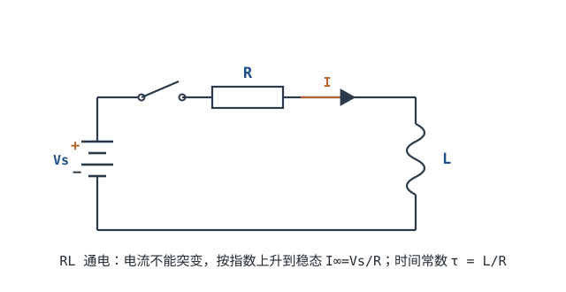
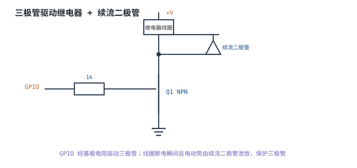

# 电感原理与 RL 暂态 Inductor & RL Transient

[电容](capacitor-rc.md)的规则是"电压不能突变"，电感正好是它的镜像：**电流不能突变**。电感是绕成圈的导线，通电后把能量存进磁场；你想突然改变电流，它就用感生电动势"顶"回来。这个"顶"在正常工作时是开关电源储能的机制，在关断一瞬间却能把几十伏的电路打出几千伏的尖峰——继电器、电磁阀、电机、甚至一段 PCB 走线，都会遇到。

这一章的主线：先从 $L=\Phi/I$ 和 $V=L\,dI/dt$ 建立直觉，再解出 RL 通电/断电的指数曲线，然后用真实数字算清"不加续流二极管会打出多高电压""加了二极管电流要多久才掉下去""饱和以后电感还是不是这个电感"，最后用一个 12V 继电器的续流回路设计收尾。

## 1. 设计动机

::: motivation 四个每天都在发生的场景
**继电器和电磁阀。** 12V 继电器线圈典型 0.1~1H、几十到几百欧。驱动管关断的瞬间，线圈电流被迫归零，$V=L\,dI/dt$ 会把集电极/漏极电压打到几十千伏（理论值），几十伏的驱动管一次就击穿。必须在线圈两端反并续流二极管，或者用齐纳/TVS 钳位。

**开关电源。** Buck 的电感在开关管导通时储能、关断时放能，$V_L=L\,dI/dt$ 决定了纹波电流。电感选小了纹波大、选大了响应慢；饱和了电感量骤降，电流会在一两个开关周期内冲上去。

**电机与 PWM。** 电机绕组是电感，PWM 关断时同样要续流；H 桥还要考虑死区和体二极管。没有续流路径，MOSFET 的漏极尖峰可能超过额定电压。

**PCB 走线。** 每毫米走线约 1nH（典型量级）。10mm 就是 10nH；如果电流以 1A/ns 变化，感应压降 $10\times10^{-9}\times10^{9}=10$V——地弹、电源噪声、信号串扰很多都来自这条公式。
:::

| 你遇到的问题 | 先算 | 判据 |
|---|---|---|
| 驱动管关断时击穿 | $V=L\frac{\Delta I}{\Delta t}$ | 尖峰低于管子额定电压并留降额 |
| 继电器释放太慢/太快 | $t=\tau\ln\frac{I_0+V_c/R}{I_t+V_c/R}$ | 释放时间落在要求窗口 |
| 电感发热、啸叫 | $I_{\text{rms}}$、$I_{\text{sat}}$、DCR | 峰值电流低于饱和电流，温升在允许范围 |
| 开关电源纹波大 | $\Delta I=\frac{V_L}{L}\Delta t$ | 纹波电流在设计值内 |
| 地弹/电源噪声 | $V=L\frac{di}{dt}$ | 感应压降小于噪声预算 |

**不算会摔在哪**，三个有具体数字的代价：

1. **不接续流二极管。** 0.5H、100mA 的继电器线圈，若开关在 1µs 内把电流切断，理想尖峰是 $0.5\times0.1/10^{-6}=50000$V。实际电路会被寄生电容、电弧和雪崩限制，但用 100pF 的寄生电容估算，峰值仍有 $0.1\times\sqrt{0.5/100\times10^{-12}}=7071$V——远高于常见 40V/60V 驱动管的耐压。管子不是"偶尔坏"，是每次关断都在雪崩。
2. **只看电感量，不看饱和电流。** 10µH、标称饱和 4A 的电感，过 8A 时电感量可能掉到 3µH 以下；同样的 12V 电压下，$di/dt$ 从 $12/10\mu=1.2$A/µs 变成 $12/3\mu=4$A/µs，电流失控得更快，过流保护还没来得及动作。
3. **忽略走线电感。** 10nH 的走线在 10A/100ns 的开关边沿下产生 $10\times10^{-9}\times10^{8}=1$V 的地弹；如果边沿是 10A/10ns，就是 10V。数字电路里"地是 0V"只是低频近似。

## 2. 定义与直观

### 2.1 电感是什么：$L=\Phi/I$

电感是导线绕成的线圈。电流 $I$ 流过时产生磁场，磁通穿过线圈。定义

$$
L=\frac{\Phi}{I}
$$

其中 $\Phi$ 是**磁链**（flux linkage），等于匝数 $N$ 乘以单匝磁通 $\phi$，即 $\Phi=N\phi$，单位韦伯（Wb）或伏秒（V·s）；$I$ 是流过线圈的电流（A）；$L$ 是电感量（Inductance），单位亨利（H）。$1\text{H}=1\text{Wb/A}=1\text{V}\cdot\text{s/A}$。

磁链和电流的关系来自磁路。对截面积 $A_e$、有效磁路长度 $l_e$、相对磁导率 $\mu_r$、匝数 $N$ 的线圈：

$$
L=\frac{N\phi}{I}=\frac{\mu_0\mu_rN^2A_e}{l_e}
$$

其中 $\mu_0=4\pi\times10^{-7}\ \text{H/m}$ 是真空磁导率，$A_e$ 单位 $\text{m}^2$，$l_e$ 单位 m。这个式子说明：**电感量正比于匝数的平方、正比于磁导率和截面积、反比于磁路长度。** 想让电感大，就多绕几圈（平方关系最有效）、用高磁导率的磁芯、把磁路做短做粗。

实际电感数据手册常给 $A_L$ 值（nH/N²），此时 $L=N^2A_L$。例如 $A_L=100$nH/N²、绕 10 匝，$L=100\times10^2=10\mu$H。这是选磁芯时最常用的算式。

1H 也是很大的单位。1H 电感在 1A 电流下储能 0.5J；常见的功率电感是 µH 级，继电器线圈是 0.1~1H 级，共模扼流圈可以到 mH 级。



::: analogy 电感像一列有惯性的火车
- 电感量 $L$ = 列车的**质量**（惯性）；
- 电流 $I$ = 列车的**速度**；
- 电压 $V_L$ = 推动列车的**力**。

想让列车瞬间从 0 加速到 100km/h，需要无穷大的力；想让它在瞬间停住，也需要无穷大的制动力。电感同理：电流不能突变，想让它快速变化，就要施加很大的电压。

这个类比也有边界：火车的惯性让速度连续，但刹车时能量变成热；电感的能量回到电路里，可能变成高压、电弧或别人的电源。火车的"质量"不随速度变，而铁芯电感的电感量会随电流（饱和）和频率变化。
:::

### 2.2 电压是电流的变化率：$V_L=L\,dI/dt$

对 $\Phi=LI$ 两边求导，并用法拉第电磁感应定律，得到电感的动态关系：

$$
V_L=L\frac{dI}{dt}
$$

其中 $V_L$ 是电感两端电压（V），$dI/dt$ 是电流变化率（A/s）。按关联参考方向（电流从电压正端流入），电流增大时 $V_L$ 为正，电感吸收能量；电流减小时 $V_L$ 为负，电感释放能量。物理上，感生电动势总是**反抗**电流的变化（楞次定律），所以叫"反电动势"（Back EMF）。

两个直接推论：

- **直流稳态下电感相当于短路。** 电流不变时 $dI/dt=0$，$V_L=0$；理想电感对直流没有阻碍。真实电感还有绕组电阻 DCR，稳态电流由外电路和 DCR 共同决定。
- **电流变化越快，电压越高。** 1mH 的电感上电流以 1A/µs 上升，电压就是 $10^{-3}\times10^{6}=1000$V。这就是关断瞬间产生高压的原因，也是开关电源利用电感储能的基础。

### 2.3 储能：$E=\frac{1}{2}LI^2$

电感储存的磁场能量等于建立电流过程中电源做的功：

$$
E=\int_0^t V_L I\,dt=\int_0^{I}L I\,dI=\frac{1}{2}LI^2
$$

其中 $E$ 是储能（J），$L$ 是电感量（H），$I$ 是电流（A）。和电容的 $\frac12CV^2$ 对照：电容储能看**电压**的平方，电感储能看**电流**的平方。

| 电感 | 电流 | 储能 |
|---|---|---|
| 10µH | 1A | $0.5\times10\times10^{-6}\times1^2=5\ \mu\text{J}$ |
| 10µH | 10A | $0.5\times10\times10^{-6}\times10^2=0.5\ \text{mJ}$ |
| 1mH | 1A | $0.5\times1\times10^{-3}\times1^2=0.5\ \text{mJ}$ |
| 1mH | 10A | $0.5\times1\times10^{-3}\times10^2=50\ \text{mJ}$ |
| 0.5H（继电器） | 0.1A | $0.5\times0.5\times0.1^2=2.5\ \text{mJ}$ |
| 50mH（电磁阀） | 0.5A | $0.5\times50\times10^{-3}\times0.5^2=6.25\ \text{mJ}$ |

同样 1mH，电流从 1A 增到 10A，储能从 0.5mJ 增到 50mJ，是 100 倍——**电感储能的危险来自大电流**。继电器线圈 2.5mJ 不算大，但它在 1µs 内释放就是 2.5kW 的瞬时功率；储能大不大是一回事，释放得多快是另一回事。

### 2.4 电流不能突变，电压可以突变

由 $V_L=L\,dI/dt$，如果电流在 $\Delta t\to0$ 内跳变 $\Delta I$，需要的电压趋于无穷大。真实开关、驱动管和寄生电容给不出无穷大电压，所以**电感电流只能连续变化**；反过来，电感两端电压可以在一瞬间从 0 跳到几十伏（开关断开的那一刻），电流仍从原值开始衰减。

把电容和电感放在一起对照，这张表值得记住：

| | 电容 | 电感 |
|---|---|---|
| 状态量 | 电压 $V_C$ | 电流 $I_L$ |
| 不能突变 | $V_C$ | $I_L$ |
| 基本关系 | $I_C=C\,dV_C/dt$ | $V_L=L\,dI_L/dt$ |
| 直流稳态 | 开路 | 短路（只剩 DCR） |
| 储能 | $\frac12CV^2$ | $\frac12LI^2$ |
| 时间常数 | $\tau=RC$ | $\tau=L/R$ |
| 阻抗 | $1/(j\omega C)$ | $j\omega L$ |

所以分析直流电路时，先把电容拿掉（开路）、把电感换成导线（短路），再算工作点；分析瞬态时，电容电压和电感电流是"不能跳"的状态量，用它们作初始条件解微分方程。**把这两条记反，静态工作点和瞬态波形会同时错。**

## 3. 定量关系

### 3.1 通电：RL 电流的指数上升

把 $V_S$、$R$、$L$ 串联，$t=0$ 合上开关，初始电流为 0。对回路列 KVL：

$$
V_S=V_R+V_L=RI+L\frac{dI}{dt}
$$

这是一个一阶线性微分方程。代入 $I(0)=0$，解为

$$
I(t)=I_\infty\left(1-e^{-t/\tau}\right),\qquad I_\infty=\frac{V_S}{R},\qquad \tau=\frac{L}{R}
$$

其中 $V_S$ 是电源电压（V），$R$ 是回路总电阻（$\Omega$，包括绕组 DCR 和外接电阻），$I_\infty$ 是稳态电流（A），$\tau$ 是 RL 时间常数（s），$L$ 是电感（H）。

验证：$t=0$ 时 $I=0$；$t\to\infty$ 时 $I\to V_S/R$；$t=0$ 时 $dI/dt=V_S/L$，初始电流斜率为 $V_S/L$，与 $I$ 无关。量纲：$\text{H}/\Omega=(\text{V}\cdot\text{s/A})/(\text{V/A})=\text{s}$。

电感两端电压是

$$
V_L(t)=V_S e^{-t/\tau}
$$

$t=0$ 时电感承受全部电源电压（因为电流还不能跳，$V_R=0$），随后指数衰减到 0。**通电瞬间电感"顶住"电源，电流慢慢爬；这和电容通电瞬间"短路"、电压慢慢爬正好对偶。**

| $t/\tau$ | $1-e^{-t/\tau}$ | 说明 |
|---|---|---|
| 0.5 | 39.35% | 电流到 39% |
| 1 | 63.21% | 一个时间常数 |
| 2 | 86.47% | |
| 3 | 95.02% | 常说的"基本建立" |
| 5 | 99.33% | 工程上认为到达稳态 |
| 7 | 99.91% | |

```echarts
{
  "animation": false,
  "tooltip": {"trigger": "axis"},
  "legend": {"data": ["通电 I/I∞", "断电（纯 LR）I/I0"], "bottom": 0, "textStyle": {"fontSize": 12}},
  "grid": {"left": 64, "right": 28, "top": 30, "bottom": 62},
  "xAxis": {"type": "value", "name": "t / τ", "nameLocation": "middle", "nameGap": 30, "min": 0, "max": 5, "axisLabel": {"fontSize": 11}},
  "yAxis": {"type": "value", "name": "归一化电流 (%)", "min": 0, "max": 100, "axisLabel": {"fontSize": 11}},
  "series": [
    {"name": "通电 I/I∞", "type": "line", "smooth": true, "showSymbol": false,
     "lineStyle": {"width": 2.6, "color": "#1a4f8b"},
     "data": [[0, 0], [0.25, 22.12], [0.5, 39.35], [0.75, 52.76], [1, 63.21], [1.25, 71.35], [1.5, 77.69], [1.75, 82.62], [2, 86.47], [2.5, 91.79], [3, 95.02], [4, 98.17], [5, 99.33]]},
    {"name": "断电（纯 LR）I/I0", "type": "line", "smooth": true, "showSymbol": false,
     "lineStyle": {"width": 2.2, "color": "#b5642e", "type": "dashed"},
     "data": [[0, 100], [0.25, 77.88], [0.5, 60.65], [0.75, 47.24], [1, 36.79], [1.25, 28.65], [1.5, 22.31], [1.75, 17.38], [2, 13.53], [2.5, 8.21], [3, 4.98], [4, 1.83], [5, 0.67]]}
  ]
}
```

图中断电曲线是纯 LR 回路（无二极管、无钳位）的指数衰减；接入续流二极管后，衰减按 3.2 节的修正公式，曲线不再是这条纯指数。

### 3.2 断电：开路、续流与钳位

断电瞬间是电感最危险、也最能体现工程功力的地方。分三种情况。

**情况一：直接开路。** 开关在 $\Delta t$ 内把电流从 $I_0$ 切到 0，电感两端产生

$$
V=L\frac{\Delta I}{\Delta t}
$$

$\Delta t$ 越小，电压越高。以 $L=0.5$H、$I_0=100$mA 为例：

| 电流切断时间 $\Delta t$ | 理想尖峰 $V=L I_0/\Delta t$ |
|---|---|
| 1µs | 50kV |
| 10µs | 5kV |
| 100µs | 500V |
| 1ms | 50V |

真实电路里，开关的寄生电容、线圈的分布电容、空气击穿和半导体雪崩会把电压限制在某个值，但限制的过程往往就是器件损坏的过程。用电感储能和寄生电容的能量守恒可以估算峰值：

$$
\frac12LI_0^2=\frac12CV_{\text{peak}}^2\quad\Longrightarrow\quad V_{\text{peak}}=I_0\sqrt{\frac{L}{C}}
$$

取 $L=0.5$H、$I_0=100$mA：寄生电容 100pF 时 $V_{\text{peak}}=0.1\times\sqrt{0.5/10^{-10}}=7071$V；1nF 时 2236V；10nF 时 707V。振荡频率 $f=1/(2\pi\sqrt{LC})$：100pF 时 22.5kHz，1nF 时 7.12kHz。**这就是继电器、电磁阀断电时"打火"的定量来源**，也是为什么驱动管的耐压不能只看电源电压。

**情况二：反并续流二极管。** 在线圈两端反并一只二极管（阴极接电源正端），开关关断后，线圈电流经二极管继续流动。回路 KVL 变成

$$
L\frac{dI}{dt}+RI+V_F=0
$$

其中 $V_F$ 是二极管正向压降（V）。解为

$$
I(t)=\left(I_0+\frac{V_F}{R}\right)e^{-t/\tau}-\frac{V_F}{R},\qquad \tau=\frac{L}{R}
$$

电流不是纯指数衰减到 0，而是在有限时间 $T$ 内到 0：

$$
T=\tau\ln\left(1+\frac{I_0R}{V_F}\right)
$$

到达某个比例 $fI_0$ 的时间是

$$
t_f=\tau\ln\frac{I_0+V_F/R}{fI_0+V_F/R}
$$

**二极管把线圈电压钳在约 $-V_F$（相对原电流方向），开关管只承受 $V_{CC}+V_F$。** 代价是电流衰减变慢，继电器释放变慢。

有一个反直觉的细节：如果续流回路是理想短路（$V_F=0$），电流按 $I_0e^{-t/\tau}$ 衰减，到 10% 需要 $2.303\tau$；而 $V_F=0.7$V 的二极管会让电流掉得更快一点（因为二极管压降在帮着"刹车"）。以 0.5H、120Ω、100mA 为例，理想短路到 10% 是 9.59ms，0.7V 二极管是 7.92ms。但和 24V 钳位相比，二极管仍然慢得多。

**情况三：齐纳/TVS 钳位。** 把二极管换成齐纳管或 TVS，线圈电压被钳在 $V_C$（钳位电压）。同样的方程，把 $V_F$ 换成 $V_C$：

$$
T=\tau\ln\left(1+\frac{I_0R}{V_C}\right),\qquad t_f=\tau\ln\frac{I_0+V_C/R}{fI_0+V_C/R}
$$

钳位电压越高，电流掉得越快、释放越快，但开关管承受的电压也越高（$V_{CC}+V_C$），钳位器件吸收的脉冲能量也越大。这是一条明确的速度—耐压权衡。

用同一组参数（0.5H、120Ω、100mA、$\tau=4.167$ms）把三种方案放在一起：

| 方案 | 线圈关断电压 | 到 30% 电流的时间 | 到 0 的时间 | 开关管承受电压 |
|---|---|---|---|---|
| 直接开路 | 数千伏（受寄生限制） | 极快 | 极快 | 击穿 |
| 续流二极管 $V_F=0.7$V | −0.7V | 4.51ms | 12.08ms | 12.7V |
| 24V 钳位 | −24V | 1.11ms | 1.69ms | 36V |
| 40V 钳位 | −40V | 0.73ms | 1.09ms | 52V |

（表中数值按本节公式计算，线圈参数见 4.1 节；钳位行的开关管电压按 $12+V_C$ 估算，忽略钳位支路的二极管压降。实际 TVS 的钳位电压高于标称，要按数据手册的 $V_{\text{clamp}}$ 重新核算。）

### 3.3 磁饱和与直流偏置：$L$ 不是常数

上面的公式都假设 $L$ 是常数。真实磁芯电感不是：磁芯的磁感应强度 $B$ 随磁场强度 $H$ 上升，到某个值后磁芯饱和，磁导率骤降，电感量跟着掉。饱和磁感应强度记作 $B_{\text{sat}}$。

对匝数 $N$、磁芯截面积 $A_e$ 的电感，磁链最大值为 $\Phi_{\text{sat}}=NB_{\text{sat}}A_e$，于是饱和电流

$$
I_{\text{sat}}=\frac{\Phi_{\text{sat}}}{L}=\frac{NB_{\text{sat}}A_e}{L}
$$

举例：$L=10\mu$H、$N=10$、$A_e=10\ \text{mm}^2=10\times10^{-6}\ \text{m}^2$、$B_{\text{sat}}=0.4$T（MnZn 功率铁氧体的典型量级，以磁芯数据手册为准）：

$$
I_{\text{sat}}=\frac{10\times0.4\times10\times10^{-6}}{10\times10^{-6}}=4\ \text{A}
$$

如果磁芯截面积只有 $7.5\ \text{mm}^2$，同样 10µH 的饱和电流降到 3A。超过饱和电流后，电感量可能掉到标称值的 30%~50%，同样的电压下 $dI/dt$ 成倍增加，电流迅速失控。

数据手册通常给两个"额定电流"：

- **$I_{\text{sat}}$（饱和电流）**：电感量相对初始值下降某个百分比（常见 20%~30%）时的电流，具体判据看厂商定义；
- **$I_{\text{temp}}$（温升电流）**：线圈温升达到规定值（常见 40°C）时的电流，受 DCR 和散热限制。

两个都要满足。只按 $I_{\text{sat}}$ 选，可能长期过热；只按 $I_{\text{temp}}$ 选，可能在峰值电流下饱和。

饱和还会改变时间常数和纹波。以 Buck 为例，$L=10\mu$H、$V_{in}=12$V、$V_{out}=5$V、$f=500$kHz、$D=5/12=0.4167$，导通期间电感电压约 $V_{in}-V_{out}=7$V，纹波电流

$$
\Delta I=\frac{(V_{in}-V_{out})D}{Lf}=\frac{7\times0.4167}{10\times10^{-6}\times500\times10^3}=\frac{2.917}{5}=0.583\ \text{A}
$$

如果电感在峰值电流下饱和到 6µH，同样的伏秒积会产生 $0.583\times(10/6)=0.972$A 的纹波，峰值电流更高、更容易触发过流。**所以"10µH"只是一个在特定电流、特定频率下才成立的值。**

### 3.4 感抗、自谐振与磁珠

理想电感的阻抗是

$$
Z_L=j\omega L,\qquad |Z_L|=2\pi fL
$$

频率越高、电感越大，阻抗越高；直流时阻抗为 0（理想电感是短路）。10µH 和 1mH 在不同频率下的感抗：

| 电感 | 50Hz | 1kHz | 100kHz | 1MHz | 10MHz |
|---|---|---|---|---|---|
| 10µH | 3.14mΩ | 62.8mΩ | 6.28Ω | 62.8Ω | 628Ω |
| 1mH | 0.314Ω | 6.28Ω | 628Ω | 6.28kΩ | 62.8kΩ |

（表内按 $2\pi fL$ 计算，例如 $2\pi\times10^5\times10\times10^{-6}=6.28\Omega$。）

真实电感还有绕组 DCR、匝间电容和磁芯损耗。频率高到一定程度，匝间电容的容抗小于感抗，电感"变成电容"；这个转折点叫自谐振频率（SRF）。在 SRF 附近，电感的阻抗不再按 $2\pi fL$ 上升，而是出现一个峰值后下降。选电感时要确认工作频率远低于 SRF，否则它滤不掉你想要的噪声，还可能和周边电容谐振。

**磁珠（Ferrite Bead）不是"高频电感"。** 它用高损耗磁材料，把高频噪声变成热，阻抗曲线在几十到几百 MHz 有一个电阻性峰值；它没有可观的储能，也不能当功率电感用。具体选型见[电感器与磁珠](../components/inductors-ferrite-beads.md)。

## 4. 典型计算

### 4.1 算例一：继电器线圈的通电与吸合

**参数**：12V 继电器线圈，$R=120\Omega$，$L=0.5$H（典型量级，具体以继电器数据手册为准），由低边三极管/MOSFET 驱动。

**稳态电流**：

$$
I_\infty=\frac{V_S}{R}=\frac{12}{120}=0.1\ \text{A}=100\ \text{mA}
$$

**线圈功耗**：

$$
P=I^2R=0.1^2\times120=1.2\ \text{W}
$$

**时间常数**：

$$
\tau=\frac{L}{R}=\frac{0.5}{120}=4.167\times10^{-3}\ \text{s}=4.167\ \text{ms}
$$

**吸合时间**：继电器线圈的吸合电流通常按额定电流的某个比例给出（常见 must-operate 为额定电压的 70%~80%，具体以数据手册为准）。设吸合需要 75% 的稳态电流，即 75mA：

$$
t=\tau\ln\frac{1}{1-0.75}=4.167\times1.386=5.78\ \text{ms}
$$

5τ=20.8ms 才到 99.3%，但继电器在 75% 电流时就已经吸合，所以"5τ 才动作"是高估。

**热态核算**：铜线电阻随温度上升，$\alpha\approx0.00393\ ^\circ\text{C}^{-1}$。从 25°C 升到 85°C（ΔT=60°C）：

$$
R_{85}=120\times\left[1+0.00393\times(85-25)\right]=120\times1.236=148.3\ \Omega
$$

12V 下热态电流 $I=12/148.3=80.9$mA；如果电源只有 10.8V（12V−10%），$I=10.8/148.3=72.8$mA。**同一只继电器，冷态 100mA 能吸合，热态 72.8mA 可能就吸不住了。** 若吸合电流按 75mA 计，85°C 时需要的电压是 $0.075\times148.3=11.12$V，10.8V 的电源不够；若继电器 must-operate 只有额定的 70%（70mA），需要 $0.07\times148.3=10.38$V，10.8V 才够。选型时必须按最高温度和最低电源电压核算。

### 4.2 算例二：不加续流二极管时的关断电压

接上例：$L=0.5$H、$I_0=100$mA。假设驱动管在 1µs 内关断，理想尖峰

$$
V=L\frac{\Delta I}{\Delta t}=0.5\times\frac{0.1}{1\times10^{-6}}=50000\ \text{V}
$$

即使关断时间放宽到 100µs，也有 500V——仍然远高于常见 40V/60V 管子的耐压。

用寄生电容估算实际峰值（能量守恒 $\frac12LI_0^2=\frac12CV^2$）：

$$
V_{\text{peak}}=I_0\sqrt{\frac{L}{C}}=0.1\times\sqrt{\frac{0.5}{100\times10^{-12}}}=0.1\times70710=7071\ \text{V}
$$

（取 $C=100$pF。）如果寄生电容是 1nF，峰值 2236V；10nF 时 707V。振荡频率 $f=1/(2\pi\sqrt{LC})$：100pF 时

$$
f=\frac{1}{2\pi\sqrt{0.5\times100\times10^{-12}}}=\frac{1}{2\pi\times7.071\times10^{-6}}=22.5\ \text{kHz}
$$

**结论**：不接续流二极管时，驱动管每次关断都在承受远高于电源的尖峰，靠雪崩"硬扛"。40V 的管子、60V 的管子都可能被击穿；即使侥幸没坏，长期雪崩也会退化。这不是"概率问题"，是设计缺陷。

### 4.3 算例三：续流二极管的电流、能量与释放时间

仍用上例，在线圈两端反并一只 $V_F=0.7$V 的二极管。

**电流到零的时间**：

$$
T=\tau\ln\left(1+\frac{I_0R}{V_F}\right)=4.167\times\ln\left(1+\frac{0.1\times120}{0.7}\right)=4.167\times\ln(18.14)=4.167\times2.898=12.08\ \text{ms}
$$

**到 30% 电流（释放判据）的时间**：

$$
t_{0.3}=4.167\times\ln\frac{0.1+0.7/120}{0.03+0.7/120}=4.167\times\ln\frac{0.10583}{0.03583}=4.167\times1.083=4.51\ \text{ms}
$$

**二极管流过的总电荷**：

$$
Q=\int_0^T I\,dt=346\ \mu\text{C}
$$

（由 $I(t)=(I_0+V_F/R)e^{-t/\tau}-V_F/R$ 在 $0\sim T$ 上积分得到。）

**二极管吸收的能量**：

$$
E_D=V_FQ=0.7\times346\times10^{-6}=242\ \mu\text{J}
$$

**能量分配**：线圈初始储能 $E_0=\frac12LI_0^2=0.5\times0.5\times0.1^2=2.5$mJ；其中二极管吸收 242µJ（约 9.7%），线圈电阻消耗 $2.5-0.242=2.258$mJ（约 90.3%）。**大部分能量其实消耗在线圈电阻上，二极管只承担一小部分**——这是很多人直觉相反的地方。

**二极管平均功耗**（在 12.08ms 的衰减期间）：

$$
P_{D,\text{avg}}=\frac{242\times10^{-6}}{12.08\times10^{-3}}=20.1\ \text{mW}
$$

峰值电流 100mA、平均电流 28.7mA、反向电压 12V。1N4148 这类小信号二极管的正向电流在数百 mA 量级、反向耐压 75V 级（以数据手册为准），这个工况绰绰有余；如果线圈电流到 1A，就要换更大电流的管子或肖特基。

**对比 24V 钳位**：把二极管换成 24V 齐纳/TVS，

$$
t_{0.3}=4.167\times\ln\frac{0.1+24/120}{0.03+24/120}=4.167\times\ln\frac{0.3}{0.23}=4.167\times0.2657=1.11\ \text{ms}
$$

释放快了 4 倍，但开关管要承受 $12+24=36$V（忽略二极管压降）。如果 TVS 的实际钳位电压是 38V，开关管就是 50V，60V 管子已用掉 83%，只剩约 17% 的余量，要换 80V 或更低钳位的器件。**"快"和"耐压"必须一起算。**

### 4.4 完整设计：12V 继电器线圈的续流回路

这是一个从需求到验算走完整遍的设计例子。

**需求与假设**：

| 项目 | 要求/假设 |
|---|---|
| 电源 | 12V ±10%（10.8~13.2V） |
| 负载 | 12V 继电器线圈，$R=120\Omega$，$L=0.5$H（典型量级，以数据手册为准） |
| 稳态电流 | 100mA |
| 驱动 | 低边 NPN 或 N-MOSFET（图以 NPN 为例），额定电压 60V |
| 释放要求 | 命令撤销后 15ms 内电流降到 30% 以下 |
| 环境 | −20~85°C |
| 继电器吸合 | must-operate 按额定的 75% 计（9V/75mA，假设，具体以数据手册为准） |



**第 1 步：稳态工作点。**

$$
I_\infty=\frac{12}{120}=0.1\ \text{A},\qquad P=12\times0.1=1.2\ \text{W},\qquad E_0=\frac12\times0.5\times0.1^2=2.5\ \text{mJ}
$$

**第 2 步：通电时间。** $\tau=0.5/120=4.167$ms；到 75% 电流 $t=4.167\times\ln4=5.78$ms；5τ=20.8ms 到 99.3%。线圈在 5.8ms 左右吸合，20ms 后电流完全建立。

**第 3 步：不接续流二极管的后果。** 1µs 关断 → 50kV 理想尖峰；100pF 寄生 → 7.07kV 峰值。60V 开关管的额定电压只有尖峰的 0.85%，必然击穿。**所以续流回路不是"可选优化"，是必须项。**

**第 4 步：选续流二极管并算释放时间。** 取 $V_F=0.7$V：

$$
T=4.167\times\ln\left(1+\frac{12}{0.7}\right)=4.167\times\ln18.14=12.08\ \text{ms}
$$

$$
t_{0.3}=4.167\times\ln\frac{0.1+0.00583}{0.03+0.00583}=4.51\ \text{ms}
$$

4.51ms $<$ 15ms，满足释放要求。**注意这里用的是"到 30% 电流"，不是"到 0"；到 0 要 12.08ms，继电器的释放判据通常按电流降到某个比例，具体看数据手册。**

**第 5 步：二极管功耗与选型。**

$$
Q=346\ \mu\text{C},\qquad E_D=0.7\times346\times10^{-6}=242\ \mu\text{J},\qquad P_{D,\text{avg}}=20.1\ \text{mW}
$$

峰值 100mA、平均 28.7mA、反向 12V。选 1N4148（正向电流数百 mA 量级、反向耐压 75V 级，以数据手册为准）或同等的小信号二极管；如果线圈电流更大，按峰值电流和平均功耗选肖特基/快恢复管。

**第 6 步：开关管电压。** 有续流二极管时，关断瞬间开关管电压（$V_{CE}$ 或 $V_{DS}$）被钳在

$$
V_{CE}=V_{DS}=V_{CC}+V_F=12+0.7=12.7\ \text{V}
$$

60V 管子的降额按 80% 算是 48V，12.7V 只占 26%，非常安全。**如果没有二极管，这个数字就是几千伏，降额讨论没有意义。**

**第 7 步：热态与最低电源核算。** 85°C 时线圈电阻 $R_{85}=120\times[1+0.00393\times60]=148.3\Omega$；10.8V 时电流 $I=10.8/148.3=72.8$mA。若继电器 must-operate 是 75mA，则吸合所需的电压为 $0.075\times148.3=11.12$V，10.8V 不够——**冷机测试正常、热机偶发不吸合**的典型原因。解决：选 must-operate ≤70%（70mA，对应 10.38V）的继电器，或保证 85°C 时电源不低于 11.2V，或改用 9V 线圈（同样功率下电流更大，对压降更宽容，但要核对线圈温升）。

**第 8 步：热态释放时间。** 热态 $\tau=0.5/148.3=3.37$ms，电流 72.8mA：

$$
t_{0.3}=3.37\times\ln\frac{0.0728+0.7/148.3}{0.3\times0.0728+0.7/148.3}=3.37\times1.071=3.61\ \text{ms}
$$

比冷态 4.51ms 还快，因为电阻大了、$\tau$ 小了。释放要求仍然满足。

**第 9 步：备选方案。** 如果释放要求收紧到 2ms 以内，续流二极管不够，需要 24V 钳位：

$$
t_{0.3}=4.167\times\ln\frac{0.1+0.2}{0.03+0.2}=1.11\ \text{ms}
$$

但 MOSFET 要承受 36V 以上（TVS 实际钳位可能到 38V，开关管就是 50V），60V 管要重新降额，或换 80V 管。钳位器件还要吸收约 2.5mJ 的脉冲能量，按数据手册的浪涌曲线核对。

**第 10 步：验算汇总。**

| 项目 | 数值 | 是否满足 |
|---|---|---|
| 稳态电流/功耗 | 100mA / 1.2W | 设计输入 |
| 通电到 75% | 5.78ms | 吸合正常 |
| 无续流尖峰（1µs） | 50kV 理想、7.07kV（100pF） | 不允许 |
| 有续流二极管时开关管电压 | 12.7V | 满足 60V 降额 |
| 释放到 30% | 4.51ms（冷）/3.61ms（热） | 满足 15ms |
| 二极管平均功耗 | 20.1mW | 满足 |
| 85°C、10.8V 吸合 | 72.8mA $<$ 75mA | **不满足，需选 70% 或提高电压** |

**结论**：续流二极管选 1N4148 级、反并在线圈两端；MOSFET 60V 足够；释放时间 4.5ms 满足 15ms。唯一不达标的是热态吸合余量——这说明**续流回路设计不只是"加一只二极管"，还要把线圈温升、电源容差和继电器 must-operate 放在一起核算**。

## 5. 工程含义

### 5.1 数量级速查

| 对象 | 典型电感量 | 典型电流 | 储能/说明 |
|---|---|---|---|
| PCB 走线 | 0.5~1.5nH/mm | 取决于负载 | 10mm 约 10nH，高频下不可忽略 |
| 0402/0603 磁珠 | 几十~几百 nH（100MHz 阻抗 30~1000Ω） | 几十~几百 mA | 损耗型，不储能 |
| Buck 功率电感 | 1~100µH | 0.5~20A | 储能 $E=\frac12LI^2$，按饱和/温升选 |
| 共模扼流圈 | 1~100mH | 0.1~10A | 抑制共模噪声 |
| 继电器线圈 | 0.1~1H | 10~200mA | 本章算例 0.5H/100mA |
| 电磁阀 | 10~500mH | 0.2~5A | 电感大、关断能量大 |
| 电机绕组 | 0.1~10mH | 视功率 | PWM 关断需续流 |
| 变压器初级 | 几 mH~几 H | 视功率/频率 | 耦合与励磁电流另算 |

这些是典型量级，具体器件以数据手册为准。

### 5.2 选型：四个电流/频率参数

选功率电感不只看电感量，至少要看四个参数：

- **$I_{\text{sat}}$（饱和电流）**：电感量下降 20%~30% 时的电流。开关电源要按**峰值电流**（不是平均电流）选，并留 20%~30% 余量。Buck 的峰值是 $I_{out}+\Delta I/2$；以 3.3 节的 Buck 为例，若输出 3A、纹波 0.583A，峰值 3.29A，$I_{\text{sat}}$ 至少 4A。
- **$I_{\text{temp}}$（温升电流）**：线圈温升 40°C 时的电流，由 DCR 和散热决定。长期工作要按这个值降额。
- **DCR（直流电阻）**：决定导通损耗 $P=I^2R_{DCR}$。10µH、50mΩ 的电感过 3A，损耗 $3^2\times0.05=0.45$W，压降 $3\times0.05=0.15$V；在 5V/3A 的输出上，这相当于输出功率的 3%，压降 0.15V，不能忽略。
- **SRF（自谐振频率）**：要远高于工作频率和需要滤除的噪声频段，否则电感在目标频段已经"变成电容"。

对继电器/电磁阀线圈，选型参数不是电感量，而是**线圈电阻、额定电压、must-operate/must-release 电流、释放时间**，以及最高环境温度下的温升。电感量只影响吸合/释放的动态过程。

### 5.3 关断策略比较

| 方案 | 线圈关断电压 | 释放速度 | 开关管电压 | 成本/体积 | 适用 |
|---|---|---|---|---|---|
| 直接开路 | 数千伏（寄生限制） | 极快 | 击穿 | 0 | 禁止 |
| 续流二极管 | −0.7V | 慢（本例 4.51ms） | $V_{CC}+0.7$ | 最低 | 通用继电器、电磁阀，释放要求不紧 |
| 齐纳/TVS | −$V_C$ | 快（本例 1.11ms） | $V_{CC}+V_C$ | 中 | 需要快速释放、或不能反并二极管 |
| RC 吸收 | 由 R、C 决定 | 中 | 中 | 中 | AC 线圈、无法加二极管的场合 |
| 有源钳位 | 设定值 | 可调 | 较高 | 高 | 高频、能量回馈、需要精确控制 |

选择原则：**先看释放时间要求，再看开关管耐压，最后看成本和体积。** 不要为了"保险"一味加高钳位电压，钳位越高，管子越危险；也不要为了省一只二极管，让管子长期雪崩。

### 5.4 RL 模型什么时候不够用

本章的指数公式建立在四个假设上：$L$ 是常数、$R$ 是常数、没有寄生电容、电感之间没有耦合。真实电路里：

- **饱和**：$L$ 随电流下降，$dI/dt$ 不再恒定，指数解失效；大电流下要按 L–I 曲线分段计算或仿真。
- **寄生电容**：绕组匝间电容、PCB 分布电容与 $L$ 形成谐振，关断尖峰和振铃频率由 $\sqrt{LC}$ 决定，不能只用 $L\,dI/dt$。
- **磁芯损耗**：高频下磁滞和涡流损耗让电感发热，等效串联电阻随频率上升；磁珠就是靠这个工作的。
- **趋肤效应与邻近效应**：高频电流集中在导体表面，DCR 变成 AC 电阻，损耗比直流计算大。
- **温度**：铜线电阻随温度上升（+0.393%/°C），磁芯的 $B_{\text{sat}}$ 随温度下降（铁氧体在 100°C 附近通常比 25°C 低），高温下饱和电流更小。
- **耦合**：变压器、共模扼流圈、相邻走线之间的互感不能忽略，单电感模型要扩展成耦合电感模型。

工程判断的关键和电容一章一样：**知道自己正在用哪个近似，以及它在什么条件下失效。** 继电器续流、低频 RL 暂态用本章模型足够；开关电源的饱和、高频振铃、EMC 耦合要更细的模型和实测。

## 6. 常见坑

::: pitfall 常见坑
- **驱动继电器/电磁阀不接续流二极管**：现象——三极管或 MOSFET 用几次就击穿，或者关断时示波器看到几百伏到几千伏的尖峰。原因——电感电流不能突变，关断瞬间 $V=L\,dI/dt$ 产生高压；寄生电容和雪崩只是限制峰值，不能消除能量。解决——线圈两端反并续流二极管（阴极接电源正），或按释放要求用齐纳/TVS 钳位；二极管要按峰值电流、平均功耗和反向电压选。
- **直流分析时把电感当开路**：现象——算静态工作点时电流算成 0，或者认为电感"不通直流"。原因——把电容和电感的规则记反了；直流稳态 $dI/dt=0$，电感电压为 0，相当于**短路**（只剩 DCR）。解决——直流分析先把电感换成导线、电容拿掉；再单独做瞬态/交流分析。
- **只看电感量，不看饱和电流和温升电流**：现象——电源满载时电感啸叫、电流波形出现"拐点"、过流保护频繁动作。原因——峰值电流超过 $I_{\text{sat}}$，电感量骤降，$dI/dt$ 变大；或者超过 $I_{\text{temp}}$，线圈长期过热。解决——按峰值电流选 $I_{\text{sat}}$ 并留 20%~30% 余量，按有效值选 $I_{\text{temp}}$，同时核对 DCR 损耗和 SRF。
- **续流二极管方向接反**：现象——一上电电源就短路、驱动管瞬间烧毁，或者继电器根本不吸合。原因——二极管阴极应接电源正端（线圈上端），阳极接开关端；接反时电源经二极管直接短路。解决——按"正常工作时二极管反偏、关断时正偏"检查；上电前用万用表二极管档确认方向。
- **用普通整流管做高频续流**：现象——PWM 驱动电磁阀/电机时二极管发热、开关管尖峰大、效率低。原因——普通整流管反向恢复慢，关断时反向电流大，增加损耗和噪声。解决——高频场合用快恢复或肖特基二极管，按工作频率和峰值电流选；继电器这种低速开关可以用 1N4148/1N4007 级。
- **忽略线圈温升和电源容差**：现象——冷机正常、热机偶发不吸合；或者换了电源就出现"继电器抖动"。原因——铜线电阻随温度上升约 0.393%/°C，must-operate 电流不变时所需电压上升；电源下限再叠加，余量不够。解决——按最高温度、最低电源电压核算线圈电流，选 must-operate 余量足够的继电器，或提高驱动电压/改用更低额定电压的线圈。
:::

## 7. 自测题

<details><summary>12V、120Ω、0.5H 的继电器线圈，稳态电流、时间常数、到 63.2% 和 95% 的时间各是多少？</summary>

稳态电流：

$$
I_\infty=\frac{12}{120}=0.1\ \text{A}=100\ \text{mA}
$$

时间常数：

$$
\tau=\frac{L}{R}=\frac{0.5}{120}=4.167\ \text{ms}
$$

到 63.2% 就是 1τ：

$$
t_{63.2\%}=4.167\ \text{ms}
$$

到 95%：

$$
t_{95\%}=\tau\ln\frac{1}{1-0.95}=4.167\times2.996=12.48\ \text{ms}
$$

3τ=12.5ms，对应 $1-e^{-3}=95.02\%$，与 12.48ms 的差别只是舍入；**3τ 是 95%，不是 90%**。

</details>

<details><summary>0.5H、100mA 的线圈，开关在 1µs 内切断电流，理想尖峰多高？储能多少？若寄生电容 1nF，峰值多少？为什么 40V 的驱动管会坏？</summary>

理想尖峰：

$$
V=L\frac{\Delta I}{\Delta t}=0.5\times\frac{0.1}{1\times10^{-6}}=50000\ \text{V}
$$

储能：

$$
E=\frac12LI^2=\frac12\times0.5\times0.1^2=2.5\times10^{-3}\ \text{J}=2.5\ \text{mJ}
$$

寄生电容 1nF 时的峰值（能量守恒 $\frac12LI^2=\frac12CV^2$）：

$$
V_{\text{peak}}=I\sqrt{\frac{L}{C}}=0.1\times\sqrt{\frac{0.5}{10^{-9}}}=0.1\times22361=2236\ \text{V}
$$

40V 管的额定电压只有 2236V 的 1.8%。管子会在雪崩区被击穿；即使瞬间没坏，每次关断都消耗能量，长期会退化。正确做法是反并续流二极管，把线圈电压钳在 −0.7V。

</details>

<details><summary>接上题，反并一只 $V_F=0.7$V 的二极管。电流到 30% 要多久？到零要多久？二极管吸收多少能量？</summary>

时间常数仍是 4.167ms。

到 30%：

$$
t_{0.3}=4.167\times\ln\frac{0.1+0.7/120}{0.03+0.7/120}=4.167\times\ln\frac{0.10583}{0.03583}=4.51\ \text{ms}
$$

到零：

$$
T=4.167\times\ln\left(1+\frac{0.1\times120}{0.7}\right)=4.167\times\ln18.14=12.08\ \text{ms}
$$

二极管吸收的能量：先算总电荷 $Q\approx346\mu$C，再乘 $V_F$：

$$
E_D=V_FQ=0.7\times346\times10^{-6}=242\ \mu\text{J}
$$

初始储能 2.5mJ，二极管只吸收约 9.7%，其余 90.3% 消耗在线圈电阻上。

</details>

<details><summary>一个 10µH、10 匝、磁芯截面积 10mm² 的电感，$B_{\text{sat}}=0.4$T，饱和电流大约多少？如果实际电流到 8A，会发生什么？</summary>

饱和电流：

$$
I_{\text{sat}}=\frac{NB_{\text{sat}}A_e}{L}=\frac{10\times0.4\times10\times10^{-6}}{10\times10^{-6}}=4\ \text{A}
$$

（$A_e=10\ \text{mm}^2=10\times10^{-6}\ \text{m}^2$。）

电流到 8A 时，电感已经深度饱和，电感量可能掉到标称值的 30%~50%。同样的电压下 $dI/dt$ 成倍增加：12V 时从 $12/10\mu=1.2$A/µs 变成 $12/3\mu=4$A/µs，电流失控更快，过流保护可能来不及动作。所以选电感要按**峰值电流**选 $I_{\text{sat}}$，并留 20%~30% 余量，不能只看标称电感量。

</details>

<details><summary>10µH 和 1mH 的电感，在 100kHz 和 1MHz 下的感抗各是多少？为什么说电感"直流短路、高频开路"？</summary>

$Z=2\pi fL$。

10µH：

- 100kHz：$2\pi\times10^5\times10\times10^{-6}=6.28\Omega$；
- 1MHz：$2\pi\times10^6\times10\times10^{-6}=62.8\Omega$。

1mH：

- 100kHz：$2\pi\times10^5\times1\times10^{-3}=628\Omega$；
- 1MHz：$2\pi\times10^6\times1\times10^{-3}=6283\Omega$。

直流（$f=0$）时 $Z=0$，理想电感是短路；频率越高 $Z$ 越大，所以"高频开路"。但真实电感有 DCR、匝间电容和 SRF，高频下可能反而变成电容，不能无限外推。

</details>

<details><summary>继电器线圈 120Ω、0.5H，must-operate 为额定的 75%（75mA）。25°C 时 12V 能吸合，85°C、电源 10.8V 时呢？</summary>

85°C 线圈电阻：

$$
R_{85}=120\times[1+0.00393\times(85-25)]=120\times1.236=148.3\ \Omega
$$

10.8V 时电流：

$$
I=\frac{10.8}{148.3}=0.0728\ \text{A}=72.8\ \text{mA}
$$

72.8mA $<$ 75mA，**不满足吸合条件**。要让 75mA 流过 148.3Ω，需要

$$
V=0.075\times148.3=11.12\ \text{V}
$$

所以 12V−10% 的电源在 85°C 下不够。解决：选 must-operate ≤70%（70mA，对应 10.38V）的继电器，或保证高温时电源不低于 11.2V，或改用更低额定电压的线圈（同时核对温升）。

</details>

## 8. 参考资料

- [Lessons In Electric Circuits, Volume I – DC（Kuphaldt）](https://www.ibiblio.org/kuphaldt/electricCircuits/)：*Chapter 15 Inductors* 讲电感的物理、$L=\Phi/I$、储能与串并联；*Chapter 16 RC and L/R Time Constants* 讲 RL 暂态与时间常数。本章的指数解、能量账和"电流不能突变"按该两章的结构重写。
- The Art of Electronics, 3rd ed.（Horowitz and Hill），*Chapter 1 Foundations*：电感、RL 时间常数、感抗与继电器驱动的工程讲法；本章的"续流二极管 + 释放时间"口径参考该书。
- Practical Electronics for Inventors, 4th ed.（Scherz and Monk），*Chapter 2 Theory*：电感、RL 暂态、继电器与变压器的入门推导；本章的火车惯性类比和线圈算例参考该书。
- 王兆安、刘进军《电力电子技术》（机械工业出版社），「电力电子器件」一章中器件的过电压保护与缓冲电路（Snubber）：本章 3.2 节和 5.3 节的钳位/缓冲思路与该章一致，具体参数按器件数据手册核算。
- Vishay Semiconductors, *1N4148 / 1N4448 Small-Signal Diode* 数据手册：正向电流、反向耐压、反向恢复时间与结电容；本章二极管选型按该手册的量级校核，具体数值以对应版本为准。
- IEC 61810-1, *Electromechanical elementary relays – Part 1: General and safety requirements*：继电器吸合/释放时间、线圈参数与试验条件的定义；本章 must-operate/must-release 的用法参考该标准及厂商数据手册。
- Murata / TDK 功率电感数据手册：L–I 曲线、$I_{\text{sat}}$ 与 $I_{\text{temp}}$ 的定义与测试条件；本章 3.3 节和 5.2 节的选型口径按这些定义。
