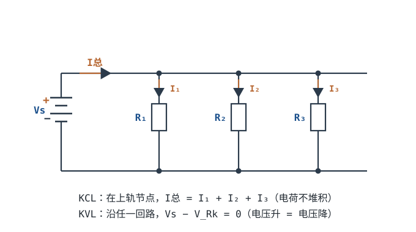
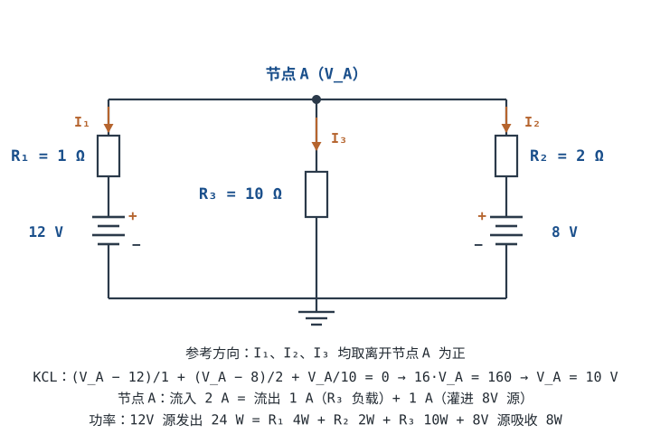
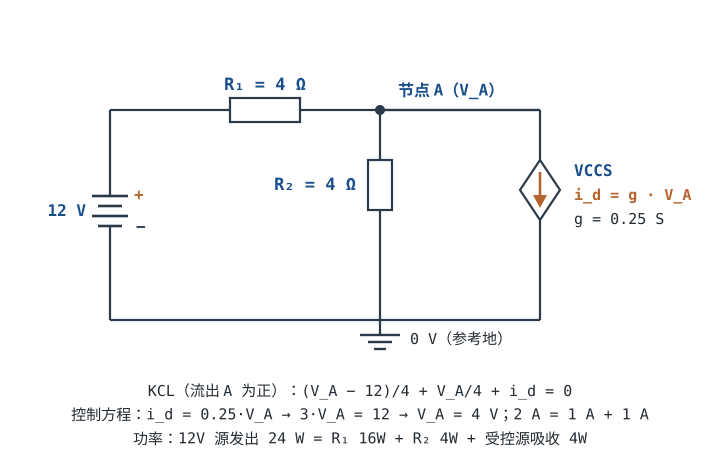

# 基尔霍夫定律 KCL / KVL Kirchhoff's Laws

分压分流是"一眼能看出串并联"的简单情况。但真实电路会有多个电源、桥形网络、互相套着的回路——这时欧姆定律单独使不动了，需要两条更根本的守恒定律：**基尔霍夫电流定律 KCL**（Kirchhoff's Current Law）和**基尔霍夫电压定律 KVL**（Kirchhoff's Voltage Law）。它们是所有电路分析的地基，也是 SPICE 内部真正在解的东西。

两条定律本身只有一行公式，难点全在**符号约定**和**怎么把受控源塞进方程**。这一章把这两件事讲到能动手算为止。

## 1. 设计动机

::: motivation 为什么需要这两条定律
一个电桥电路（四个电阻搭成菱形），你没法直接说出哪个串哪个并。但只要列出"节点上电流进出相等"和"绕一圈电压和为零"两组方程，任何复杂电阻网络都能解出来。万用表排查时，"这个节点进来多少电流、出去多少"也是 KCL 的直觉。
:::

具体一点，下面这些活都绕不开 KCL/KVL：

- **两路电源并在一起供电**（电池 + 适配器、双电源冗余、PoE + 本地电源）。谁出多少电流、会不会倒灌，是 KCL 一句话的事，但算错就会烧稳压器。
- **电流采样**。分流器（Shunt）上 10mΩ 流过 3A 产生 30mV，本质是 KVL：沿"分流器 + 走线 + 负载"绕一圈，电压升等于电压降。
- **压降预算**。5V/3A 的负载，线多长、多粗、中间有几个连接器，还能不能保证负载端 ≥4.75V——这是 KVL 的应用题，不是"经验"。
- **看运放/晶体管的小信号模型**。里面的受控源（VCVS、VCCS）怎么列方程，决定了你能不能自己推出闭环增益、输出电阻。
- **看懂仿真报错**。SPICE 报 "singular matrix" 或 "no DC path to ground"，本质是 KCL 方程写不出来（有节点悬空、有回路只有电压源）。

**不懂会在哪摔跤**：

1. 把两个稳压器输出直接并起来，以为"电流自动均分"。实际上内阻小的那个承担几乎全部电流，另一个被倒灌——后面算例一会给出精确数字。
2. 认为"同一根导线处处等电位"，于是忽略地线电阻。实测某节点比仿真低 0.3V，查了三天，其实是 10mm 长的细走线。
3. 看到方程解出负电流就以为算错了，重算三遍还是负的。其实负号只是"实际方向与假设相反"。

## 2. 定义与直观：节点、支路、回路与参考方向

### 节点与支路

- **节点（Node）**：两条及以上支路的公共连接点。用理想导线连起来的一整片导体算**同一个**节点——这一点在真实 PCB 上是个近似，后面 §5 会算它什么时候失效。
- **支路（Branch）**：两个节点之间的一段电路。同一支路内电流处处相同；一条支路可以含多个串联元件（比如"电压源 + 内阻"算一条支路）。
- **回路（Loop）**：由若干支路首尾相接构成的闭合路径。
- **网孔（Mesh）**：内部不再包含其他支路的回路，只对**平面电路**（能画在平面上不交叉）有定义。平面电路里网孔数 = 独立 KVL 方程数。

一张图里的三样东西要能立刻指出来：节点（圆点）、支路（两圆点之间的线段）、回路（沿箭头走一圈能回到起点）。

### 参考方向与关联参考方向

电流的真实方向往往事先不知道，所以工程上的做法是：**先任意假定一个参考方向（Reference Direction），用箭头画在图上，然后按这个方向列方程**。算出来是正数，说明实际方向与箭头一致；是负数，说明相反。**负号是信息，不是错误。**

电压同理，用 "+/−" 标出参考极性。两者组合起来有一条关键约定：

| 约定 | 电流方向 | 功率公式 | $p>0$ 的含义 |
|---|---|---|---|
| **关联参考方向**（Passive Sign Convention） | 从电压 "+" 端流入 | $p=vi$ | 元件**吸收**功率 |
| 非关联参考方向 | 从电压 "−" 端流入 | $p=-vi$ | 元件**吸收**功率 |

工程上最省事的记法是：**无源元件（电阻、电容、电感）按关联参考方向标，电源按非关联标**，这样电阻算出来 $p=vi>0$ 永远是发热，电源算出来 $p=vi>0$ 永远是输出。符号一乱，功率守恒验算就对不上——这是新手最常见的"结果看着对、验算通不过"。

### 两条定律

**KCL（基尔霍夫电流定律，节点电流守恒）**：

$$\sum_{k} i_k = 0 \qquad\text{（对任一节点）}\qquad\Longleftrightarrow\qquad \sum I_{in}=\sum I_{out}$$

含义：**流入任一节点的电流之和 = 流出该节点的电流之和**。电荷不会在节点凭空产生或消失。

**KVL（基尔霍夫电压定律，回路电压守恒）**：

$$\sum_{k} v_k = 0 \qquad\text{（沿任一闭合回路绕行一周）}\qquad\Longleftrightarrow\qquad \sum V_{rise}=\sum V_{drop}$$

含义：**沿任意闭合回路走一圈，所有电压升之和 = 所有电压降之和**。

符号约定写清楚才好用：绕行方向上，电压**降**取正、电压**升**取负（或者反过来，但整道题必须一致）。本书统一用"沿绕行方向电压降为正"。

::: analogy 三通水管与环山公路
- KCL = 水管三通：进来几股水流，出去几股水流，总量守恒，不可能凭空多出来。
- KVL = 绕山一圈：你从起点出发，上坡累计多少米、下坡累计多少米，回到起点时净高度变化为 0。
:::

两条定律的物理来源值得说一句，因为它决定了适用边界：

- **KCL 来自电荷守恒**：节点上不能积累净电荷（集总假设下）。
- **KVL 来自能量守恒**（静电场是保守场）：绕一圈做功为零。

所以它们不是"电路的公理"，而是**在集总假设下成立的推论**。什么时候这个假设崩，§5 会用具体数字给出边界。

## 3. 定量关系：两条守恒式与受控源

### 把定律写成可解的方程

对含电阻的电路，把元件方程 $v=iR$（关联参考方向）代进 KVL，就得到可以直接解的形式。以单回路为例：

$$V_s - iR_1 - iR_2 = 0 \quad\Longrightarrow\quad i=\frac{V_s}{R_1+R_2}$$

这一步看着平淡，但它是所有后续方法的种子：**KVL 给出方程，元件方程把未知量统一成电流（或电压），于是 n 个方程解 n 个未知量。**

### 方程够不够：独立方程数

这是最容易被跳过、也最容易出错的一步：

- n 个节点的电路，**独立 KCL 方程只有 n−1 个**（因为所有节点的 KCL 加起来恒等于 0，少一个才独立）。选一个节点做参考地，它的电压已知为 0，方程自然省略。
- b 条支路、n 个节点的电路，**独立 KVL 方程数 = b−(n−1)**（平面电路里就等于网孔数）。
- 两者相加 $ (n-1)+[b-(n-1)] = b $，正好等于支路数——这就是"未知量数 = 方程数"的保证。

拿本章算例一核对：2 个节点（A 与地）、3 条支路，所以独立 KCL 1 个、独立 KVL 2 个，合计 3 个方程，对应 3 条支路电流——数目对得上，方程才解得出来。

实际做题时更常见的错误不是"少列方程"，而是**多列了不独立的方程**（比如对四个节点都列 KCL），解出来是矛盾的或者求解器报奇异矩阵。

### 受控源怎么处理

受控源（Controlled Source，也叫 Dependent Source）的电压或电流不由自己决定，而由电路**别处的**电压或电流决定。四种类型：

| 类型 | 英文缩写 | 控制量 | 输出量 | 系数单位 | 典型器件 |
|---|---|---|---|---|---|
| 电压控制电压源 | VCVS | 某处电压 | 电压 | V/V（无量纲增益） | 运放的开环模型 |
| 电压控制电流源 | VCCS | 某处电压 | 电流 | A/V = S（跨导） | MOSFET/BJT 的小信号模型 |
| 电流控制电流源 | CCCS | 某支路电流 | 电流 | A/A（无量纲增益） | BJT 电流镜 |
| 电流控制电压源 | CCVS | 某支路电流 | 电压 | V/A = Ω（跨阻） | 跨阻放大器（TIA） |

处理受控源有三条铁律：

1. **列 KCL/KVL 时，把它当作独立源照写**，先给它的电流或电压起个名字（如 $i_d$、$v_d$），写进方程；
2. **补一条控制方程**，把控制量用同一批未知量（通常就是节点电压）表示出来；
3. **先数未知量再动笔**：受控源**不增加**独立未知量，它只是把"某个源"和"某处电压/电流"绑在一起；方程总数必须等于未知量总数。

还有一条容易忽略的：**叠加定理只对独立源成立**。求多个独立源共同作用时，受控源必须始终保留在电路里，不能像独立源那样"置零"。

::: advanced 进阶：KCL/KVL 的矩阵形式——SPICE 到底在解什么
把每条支路电流排成向量 $\mathbf{i}$，每个节点电压排成 $\mathbf{e}$，KCL 与 KVL 可以写成极简的两行：

$$\mathbf{A}\mathbf{i}=\mathbf{0},\qquad \mathbf{v}=\mathbf{A}^{\mathsf{T}}\mathbf{e}$$

其中 $\mathbf{A}$ 是关联矩阵（行 = 节点，列 = 支路，元素取 ±1 表示该支路连到该节点及方向）。再把元件方程 $\mathbf{v}=\mathbf{Z}\mathbf{i}$（或 $\mathbf{i}=\mathbf{Y}\mathbf{v}$）代进去，就得到节点法方程：

$$\mathbf{A}\mathbf{Y}\mathbf{A}^{\mathsf{T}}\mathbf{e}=\mathbf{A}\mathbf{i}_s$$

左边那个 $\mathbf{A}\mathbf{Y}\mathbf{A}^{\mathsf{T}}$ 就是**节点导纳矩阵**。SPICE 的 MNA（Modified Nodal Analysis）在此基础上为电压源和受控源多加一行一列，所以你能在网表里看到"多出来的未知量"。

理解这一点以后，仿真报错 "singular matrix" 就不再神秘：它等价于"节点导纳矩阵不可逆"，常见原因是有节点没有任何到地的直流通路（KCL 写不出来）或者两个电压源并联（KVL 矛盾）。
:::

## 4. 典型计算：两个完整算例与一次压降预算

### 算例一：两个电源并联给同一个负载（只含独立源）

**电路**：$V_{s1}=12$ V 串 $R_1=1\,\Omega$，$V_{s2}=8$ V 串 $R_2=2\,\Omega$，两者上端并在节点 A，节点 A 经 $R_3=10\,\Omega$ 到地。

**第 1 步 选参考点、定未知量**：地 = 0V，唯一未知节点电压 $V_A$。

**第 2 步 标参考方向**：三条支路电流都取"离开节点 A 为正"：

$$i_1=\frac{V_A-12}{1},\qquad i_2=\frac{V_A-8}{2},\qquad i_3=\frac{V_A-0}{10}$$

**第 3 步 列 KCL**（流出 A 的电流之和为零）：

$$\frac{V_A-12}{1}+\frac{V_A-8}{2}+\frac{V_A}{10}=0$$

**第 4 步 解方程**：两边乘 10：

$$10(V_A-12)+5(V_A-8)+V_A=0\;\Longrightarrow\;16V_A=160\;\Longrightarrow\;V_A=10\ \text{V}$$

**第 5 步 回代求电流**：

$$i_1=\frac{10-12}{1}=-2\ \text{A},\qquad i_2=\frac{10-8}{2}=+1\ \text{A},\qquad i_3=\frac{10}{10}=1\ \text{A}$$

读法：$i_1=-2$ A 表示实际有 **2A 从 12V 电源流向节点 A**；$i_2=+1$ A 表示有 **1A 从节点 A 流进 8V 电源**（它在被充电）；$i_3=1$ A 是负载电流。

**第 6 步 验算一：代回 KCL**。以"流入节点 A 为正"重写：$2-1-1=0$ ✓。

**第 7 步 验算二：功率守恒**。

- 12V 电源发出：$12\times2=24$ W；
- 8V 电源吸收（被充电）：$8\times1=8$ W；
- $R_1$ 耗散：$i_1^2R_1=2^2\times1=4$ W；
- $R_2$ 耗散：$i_2^2R_2=1^2\times2=2$ W；
- $R_3$ 耗散：$i_3^2R_3=1^2\times10=10$ W。

发出 24W，吸收 $8+4+2+10=24$ W ✓ 完全平账。功率守恒是比"代回方程"更强的验算，因为它同时检查了每个电流的**方向和大小**。

**工程结论**：内阻小的电源（1Ω）承担了 2A，内阻大的（2Ω）不但不供电，还被倒灌 1A。如果 8V 是可充电池，这是正常充电；如果 8V 是一颗不可反向导通的 LDO 输出，这 1A 会灌进它的输出级。所以两路电源并联必须加二极管 OR-ing、理想二极管控制器或均流电路——三条路的区别只是导通损耗（理想二极管最低），本质都是**用单向性换掉这条倒灌路径**。

### 算例二：含受控源的单节点电路

**电路**：$V_s=12$ V 串 $R_1=4\,\Omega$ 到节点 A；节点 A 经 $R_2=4\,\Omega$ 到地；另有 VCCS 从 A 流向地，电流 $i_d=g\,V_A$，跨导 $g=0.25$ S（教学取值；真实器件的跨导典型在 mS 量级，功率器件可达上百 mS，具体以数据手册为准）。

**第 1 步 数未知量**：节点电压 $V_A$ 一个，受控源电流 $i_d$ 一个，**共 2 个未知量**。

**第 2 步 列 KCL**（流出 A 为正，受控源照写）：

$$\frac{V_A-12}{4}+\frac{V_A}{4}+i_d=0$$

**第 3 步 补控制方程**（VCCS 的电流由 $V_A$ 决定）：

$$i_d=g\,V_A=0.25V_A$$

方程数 2 = 未知量数 2 ✓。

**第 4 步 代入求解**：把控制方程代入 KCL：

$$\frac{V_A-12}{4}+\frac{V_A}{4}+0.25V_A=0$$

两边乘 4：

$$(V_A-12)+V_A+V_A=0\;\Longrightarrow\;3V_A=12\;\Longrightarrow\;V_A=4\ \text{V}$$

**第 5 步 回代**：

$$i_{R1}=\frac{12-4}{4}=2\ \text{A},\qquad i_{R2}=\frac{4}{4}=1\ \text{A},\qquad i_d=0.25\times4=1\ \text{A}$$

**第 6 步 验算一：KCL**。$2=1+1$ ✓。

**第 7 步 验算二：功率守恒**。12V 源发出 $12\times2=24$ W；$R_1$ 耗散 $2^2\times4=16$ W；$R_2$ 耗散 $1^2\times4=4$ W；受控源吸收 $V_A i_d=4\times1=4$ W；合计 $16+4+4=24$ W ✓。

如果跨导翻倍到 $g=0.5$ S，同样代入：$(V_A-12)+V_A+2V_A=0\Rightarrow4V_A=12\Rightarrow V_A=3$ V，各电流变成 2.25A / 0.75A / 1.5A。**受控源越"强"，节点电压被拉得越低**——这正是一个负反馈结构的定性行为：受控源从节点抽走的电流越多，节点电压越低，而它抽的电流又正比于该电压，最终稳定在一个平衡点。

### 完整设计算例：用 KVL 做压降预算，反推线径

**需求**：5V 电源给 3A 负载供电，线长 1.5m（单程），中间经过 2 个连接器（每个接触电阻按 10mΩ 计）和 1 个保险丝（15mΩ）。要求负载端电压 **≥ 4.75V**。

**第 1 步 算允许总压降**：

$$V_{\text{drop,max}}=5.00-4.75=0.250\ \text{V}=250\ \text{mV}$$

**第 2 步 扣掉固定压降**（连接器与保险丝，由 KVL 逐项相加）：

$$V_{\text{fixed}}=2\times(10\,\text{m}\Omega\times3\,\text{A})+(15\,\text{m}\Omega\times3\,\text{A})=60+45=105\ \text{mV}$$

**第 3 步 剩下的留给导线**（一去一回两根线）：

$$V_{\text{wire,max}}=250-105=145\ \text{mV}\;\Longrightarrow\;\text{每根线}\;72.5\ \text{mV}$$

**第 4 步 反推单根导线允许电阻**：

$$R_{\text{wire,max}}=\frac{72.5\ \text{mV}}{3\ \text{A}}=24.2\ \text{m}\Omega$$

**第 5 步 反推截面积**（铜在 20°C 的电阻率 $\rho=0.0172\ \Omega\cdot\text{mm}^2/\text{m}$）：

$$A=\frac{\rho L}{R}=\frac{0.0172\times1.5}{0.0242}=1.066\ \text{mm}^2$$

**第 6 步 逐档验算**（每档都按同一套公式算，不是估计）：

| 截面积 | 单线电阻 $R=\rho L/A$ | 单线压降 $IR$ | 双线压降 | 负载端电压 | 判定 |
|---|---|---|---|---|---|
| 0.5 mm² | 0.0172×1.5/0.5 = 51.6 mΩ | 154.8 mV | 309.6 mV | 4.585 V | ✗ |
| 0.75 mm² | 34.4 mΩ | 103.2 mV | 206.4 mV | 4.689 V | ✗ |
| 1.0 mm² | 25.8 mΩ | 77.4 mV | 154.8 mV | 4.740 V | ✗（差 10mV） |
| 1.5 mm² | 17.2 mΩ | 51.6 mV | 103.2 mV | 4.792 V | ✓ |
| 2.5 mm² | 10.3 mΩ | 31.0 mV | 61.9 mV | 4.833 V | ✓ |

**第 7 步 温度校核**：铜的电阻温度系数 $\alpha=0.00393\ /{}^\circ\text{C}$。若线束内部温度到 60°C，相对 20°C 的修正系数：

$$1+\alpha\Delta T=1+0.00393\times40=1.157$$

1.5 mm² 的导线压降变成 $103.2\times1.157=119.4$ mV，负载端 $5.000-0.105-0.119=4.776$ V，余量只剩 **26mV**。2.5 mm² 则为 $61.9\times1.157=71.6$ mV，负载端 4.823V，余量 73mV。

**第 8 步 结论**：按 25°C 算 1.5mm² 刚好合格，但高温余量只有 26mV，连接器老化后接触电阻还会上升。**最终选 2.5mm²**，或把电源设定值抬到 5.1V 再配合 1.5mm²。

**第 9 步 验算**：整条回路的电阻

$$R_{\text{loop}}=2\times10.3\,\text{m}\Omega+20\,\text{m}\Omega+15\,\text{m}\Omega=20.6+20+15=55.6\ \text{m}\Omega$$

压降 $=3\times0.0556=0.167$ V，负载端 $5-0.167=4.833$ V ✓ 与表格一致；回路损耗 $P=I^2R=9\times0.0556=0.50$ W，与"3A 在 167mV 上耗掉 0.5W"一致。

这个算例的意义在于：**"能不能供上电"不是拍脑袋，是一张可以逐项相加的 KVL 表格**。工程上把它叫做压降预算（Voltage Drop Budget），和电源余量、连接器寿命一起构成供电设计的三件套。

## 5. 工程含义：数量级、失效边界与真实导线的阻抗

### 铜导线的电阻与压降

铜的电阻率取 $\rho=0.0172\ \Omega\cdot\text{mm}^2/\text{m}$（20°C），单根 1m 导线：

$$R=\frac{\rho L}{A}=\frac{0.0172\times1}{A\ [\text{mm}^2]}$$

| 截面积 | 1m 电阻 | 1A 压降 | 3A 压降 | 5A 压降 | 10A 压降 / 10A 损耗 |
|---|---|---|---|---|---|
| 0.5 mm² | 34.4 mΩ | 34.4 mV | 103 mV | 172 mV | 344 mV / 3.44 W |
| 0.75 mm² | 22.9 mΩ | 22.9 mV | 68.8 mV | 115 mV | 229 mV / 2.29 W |
| 1.0 mm² | 17.2 mΩ | 17.2 mV | 51.6 mV | 86.0 mV | 172 mV / 1.72 W |
| 2.5 mm² | 6.88 mΩ | 6.88 mV | 20.6 mV | 34.4 mV | 68.8 mV / 0.688 W |
| 6.0 mm² | 2.87 mΩ | 2.87 mV | 8.60 mV | 14.3 mV | 28.7 mV / 0.287 W |

读法：**10A 走 0.5mm² 的线，每米就要白白烧掉 3.4W**，还会明显发热。这就是"大电流必须粗线/铜排"的定量依据。注意这只是一根线；回路里有两根（去 + 回），压降要翻倍。

### PCB 走线的方块电阻

1 盎司铜厚 35µm，方块电阻（Sheet Resistance）：

$$R_\square=\frac{\rho}{t}=\frac{17.2\times10^{-9}\ \Omega\cdot\text{m}}{35\times10^{-6}\ \text{m}}=4.91\times10^{-4}\ \Omega\approx0.49\ \text{m}\Omega/\text{方块}$$

一条走线的电阻 = 方块数 × $R_\square$，方块数 = 长度 / 宽度。例如 0.25mm 宽、10mm 长的走线：

$$\text{方块数}=\frac{10}{0.25}=40\;\Longrightarrow\;R=40\times0.49=19.6\ \text{m}\Omega$$

走 3A 时压降 $3\times0.0196=58.9$ mV、损耗 $9\times0.0196=0.177$ W。这就是为什么大电流走线要铺铜、要多打过孔、要避开细颈——每多一个"方块"，就多 0.49mΩ。走线载流能力（温升）要按 IPC-2152 的图表查，不能用电阻反推。

### KCL/KVL 什么时候不成立

两条定律建立在**集总参数假设**上：电路尺寸远小于信号波长，导线是理想等电位体，节点不积累电荷。判据通常取 $l<\lambda/10$，其中

$$\lambda=\frac{v}{f},\qquad v=\frac{c}{\sqrt{\varepsilon_r}}$$

FR-4 的 $\varepsilon_r\approx4.2$，所以 $v=3\times10^8/\sqrt{4.2}=1.46\times10^8$ m/s：

| 频率 | 真空波长 | FR-4 波长 | 集总假设上限 $\lambda/10$（FR-4） |
|---|---|---|---|
| 10 MHz | 30 m | 14.6 m | 1.46 m |
| 100 MHz | 3 m | 1.46 m | 146 mm |
| 1 GHz | 300 mm | 146 mm | 14.6 mm |

也就是说，**1GHz 下走线超过约 15mm 就不能再当"理想导线"**，必须按传输线处理（分布参数、反射、阻抗匹配）。KVL 此时要补上"回路内变化磁通"的项：

$$\sum_k v_k = -\frac{d\Phi}{dt}$$

这正是变压器、电感、电流环的工作原理，也是"地弹（Ground Bounce）"的根源。

**地弹的数量级**：一条 50nH 的接地回路（典型 PCB 过孔 + 走线的量级），电流在 10ns 内变化 1A：

$$v=L\frac{di}{dt}=50\times10^{-9}\times\frac{1}{10\times10^{-9}}=5\ \text{V}$$

**5V 的地弹**。这就是为什么去耦电容要紧贴芯片、地平面要完整、大电流回路面积要小——所有"接地规矩"都能用这一个乘法解释。

**共阻抗耦合**：两个电路共用一段 19.6mΩ 的地线，一个 2A 的脉冲电流会在上面产生 $2\times0.0196=39.2$ mV 的噪声，直接叠加到另一个电路的参考地上。对 12 位、3.3V 的 ADC（1 LSB = 0.806mV）来说，这就是 **48 个 LSB** 的误差。

### 电流测量就是 KVL

分流器测电流的本质：在回路里插一个已知小电阻，量它两端电压。10mΩ 的分流器过 3A 产生 30mV——这是 KVL 的直接应用，也是万用表"电流档负担电压（Burden Voltage）"的来源。同样是 10A，用 10mΩ 会掉 100mV、自己发热 1W；把分流器做到 1mΩ，压降只剩 10mV、损耗 0.1W，但 10mV 的满量程信号对放大器的失调与噪声要求立刻上一个台阶——这就是"量程、压降、精度"三者互相拉扯的地方。

### 并联支路的电流分配（KCL 的工程形态）

KCL 最简单的工程应用，就是判断"两路电源/两颗管子/两条走线各分多少电流"。规律只有一条：**并联时电流按电导（电阻的倒数）分配**。算例一给出的就是最朴素的版本：内阻 1Ω 的支路分到 2A，内阻 2Ω 的支路不但没分到，还被倒灌。同一套公式可以解释：

- 两颗 MOSFET 并联，$R_{ds(on)}$ 小的承担更多电流（详见[串联、并联与分压分流](series-parallel.md)中的均流一节）；
- 两条不同宽度/长度的走线并联，宽的承担更多；
- 电池与适配器同时供电，内阻低的先出力。

## 6. 常见坑

::: pitfall 常见坑
- **电流方向随便假定后，算出负值不知道意味着什么**：现象——列方程解出某支路电流是 −1A，于是推翻重算。原因——一开始的箭头方向假设反了。解决——负值只表示真实方向与你画的箭头相反，**大小完全正确**；在答案里写清"实际方向与参考方向相反"即可。算例一里 8V 电源支路的 −1A 就是真实的"被倒灌 1A"，不是算错。
- **参考方向与关联参考方向混用，功率符号全错**：现象——代回方程都对，功率一算不守恒。原因——$p=vi$ 只有在**关联参考方向**下才表示吸收功率；电流从 "−" 端流入时必须用 $p=-vi$。解决——固定约定：无源元件按关联标、电源按非关联标；算完用"发出 = 吸收"验算一次，对不上就是符号问题。算例一里 8V 电源是"吸收 8W"，写成"发出"就会得到 $24=16$ 的矛盾。
- **KVL 绕回路时漏算一个元件或重复算**：现象——列出来的方程加起来对不上电源电压，或者解出的电流是 1.5 倍/一半。原因——绕圈时路径没闭合，或把并联支路算重了。解决——用笔尖沿着一条具体的闭合路径走一圈，逐个元件记录升/降，**不跳步**；含电压源的回路优先选"经过电源的网孔"。
- **受控源漏了控制方程**：现象——两个未知量只列了一个方程，解不出来；或者强行当独立源求解，得到一个与电路无关的数。原因——把受控源当成了可以自由取值的独立源。解决——先数未知量（节点电压 + 受控源电流），再补控制方程；最后核对"未知量数 = 方程数"。算例二就是 2 个未知量配 2 个方程。
- **把"同一节点"当成理想等电位**：现象——仿真显示某点 0V，实测有 200mV；或者 ADC 读数随负载电流变化。原因——真实导线和地平面有 mΩ 级电阻、nH 级电感，KCL/KVL 里"节点是一个点"的假设在强电流/高 di/dt 下失效。解决——大电流回路单独走线、单点接地或完整地平面、去耦电容紧贴芯片；把压降按 §5 的表格算一遍再布板。
- **用 KVL 处理含变化磁通的回路**：现象——变压器副边、开关电源电感、电流互感器上"绕一圈电压不为零"，以为定律错了。原因——KVL 的 $\sum v=0$ 形式只对**回路内磁通不变化**的集总回路成立，含变化磁通时要补 $-d\Phi/dt$ 项。解决——把电感/变压器当作元件用 $v=L\,di/dt$ 或互感模型处理，不要试图"绕回路抵消"。
:::

## 7. 自测题

某节点有三条支路：流入 2A、流入 3A，第三条支路电流是多少？方向呢？

KCL：流入 = 流出。总流入 $2+3=5$ A，所以第三条支路必须**流出 5A**。若你之前在第三条支路上标的是"流入"，那么它的代数值就是 **−5A**——负号表示实际方向与参考方向相反，大小仍是 5A。

验算：把三条支路都按"流入为正"写，$2+3+(-5)=0$ ✓。

一个回路里：电源升 5V，一个电阻降 3V，另一个元件压降是多少？如果这个元件是电感，结论还成立吗？

KVL（电压降为正）：$-5+3+v_2=0\Rightarrow v_2=2$ V，即另一个元件上有 **2V 压降**。

如果它是电感，**结论要小心**：稳态直流下电感相当于短路（只剩绕线电阻），这 2V 就落在绕线电阻上；而"电感两端电压"由 $L\,di/dt$ 决定，瞬态时这个 2V 会变。KVL 本身仍然成立，只是电感的电压不再由"恒定压降"描述，而由它自己的微分方程描述。

算例一的电路里，8V 电源实际是发出还是吸收功率？多少瓦？怎么验算？

**吸收 8W**（在被充电）。$i_2$ 的参考方向是"离开节点 A 流入 8V 电源"，实际值 +1A，所以 1A 确实流进电源的正端，电源吸收功率 $p=8\times1=8$ W。

验算用功率守恒：发出 = 12V 电源的 $12\times2=24$ W；吸收 = 8V 电源 8W + $R_1$ 4W + $R_2$ 2W + $R_3$ 10W = 24W ✓。如果误把 8V 电源当成"发出 8W"，账就变成"发出 $24+8=32$ W、吸收 $4+2+10=16$ W"，两边对不上——这个矛盾正是发现符号错误的信号。

算例二里把跨导改成 g=0.5S，节点电压变成多少？受控源吸收多少功率？

KCL 仍是 $\dfrac{V_A-12}{4}+\dfrac{V_A}{4}+i_d=0$，控制方程 $i_d=0.5V_A$，代入后乘 4：

$$(V_A-12)+V_A+2V_A=0\;\Longrightarrow\;4V_A=12\;\Longrightarrow\;V_A=3\ \text{V}$$

电流：$i_{R1}=(12-3)/4=2.25$ A，$i_{R2}=3/4=0.75$ A，$i_d=0.5\times3=1.5$ A。

KCL 验算：$2.25=0.75+1.5$ ✓。受控源吸收 $3\times1.5=4.5$ W；功率验算：$12\times2.25=27$ W 发出，$2.25^2\times4=20.25$ W + $0.75^2\times4=2.25$ W + 4.5W = 27W ✓。

对比 $g=0.25$ S 时的 4V：**受控源越强，节点电压越低**，因为它在同样的节点电压下抽走更多电流。

你用万用表测某节点，发现比 KVL 预算低了 0.3V，负载电流是 3A。最可能是什么问题？怎么定位？

按 KVL 反推：$R_{\text{extra}}=\dfrac{0.3\ \text{V}}{3\ \text{A}}=100\ \text{m}\Omega$ 的额外串联电阻。

对照 §5 的表格：0.5mm² 的导线 1m 才 34.4mΩ，所以 100mΩ 相当于 **3 米 0.5mm² 的线**，或者一个**接触电阻严重劣化的连接器/端子/保险丝座**（正常应在 10mΩ 量级）。

定位方法：在带载状态下，用万用表**直流毫伏档**逐段测量（电源输出端 → 连接器 → 线 → 负载端），哪一段的压降异常就是它。注意必须在**带载**时测，空载时电流为零、压降也为零，什么也查不出来。

两个 5V 电源并联给一个 2Ω 负载供电，内阻分别是 0.1Ω 和 0.05Ω。求节点电压与各支路电流，并说明电流按什么规律分配。

设节点电压 $V$，KCL（流出为正）：

$$\frac{V-5}{0.1}+\frac{V-5}{0.05}+\frac{V}{2}=0$$

两边乘 0.1：$(V-5)+2(V-5)+0.05V=0\Rightarrow3V-15+0.05V=0\Rightarrow3.05V=15\Rightarrow V=4.918$ V。

电流：$i_1=\dfrac{5-4.918}{0.1}=0.82$ A，$i_2=\dfrac{5-4.918}{0.05}=1.64$ A，负载 $i_3=\dfrac{4.918}{2}=2.46$ A。

KCL 验算：$0.82+1.64=2.46$ ✓。注意 $i_2/i_1=2.0$，而 $R_1/R_2=0.1/0.05=2$——**电流按内阻反比分配**，内阻小一半的电源出力多一倍。这就是"两路电源并联会自动均流"这个说法的精确版本：它只在两路内阻相等时才均流。

100MHz 的信号在 FR-4 上走 20cm，还能用 KCL/KVL 的集总模型吗？

不能。FR-4 中 $v=c/\sqrt{\varepsilon_r}=3\times10^8/\sqrt{4.2}=1.46\times10^8$ m/s，$\lambda=v/f=1.46\times10^8/10^8=1.46$ m，集总假设上限 $\lambda/10=146$ mm。

20cm = 200mm > 146mm，**已经超出**，必须按传输线处理（考虑反射、阻抗匹配、终端电阻），否则会出现"仿真对、实测振铃"的经典问题。经验上更保守的判据是看上升时间：当走线延时超过信号上升时间的 1/6 时，就该当传输线了。

## 8. 参考资料

- **Lessons In Electric Circuits, Vol. I – DC**（Tony R. Kuphaldt，ibiblio 公开版）：*Ch 6 Divider Circuits and Kirchhoff's Laws*（KCL/KVL 的定义与节点/回路法入门）、*Ch 10 DC Network Analysis*（节点法、网孔法、叠加与戴维南定理的系统推导）。<https://www.ibiblio.org/kuphaldt/electricCircuits/>
- **《电路》**（邱关源，高等教育出版社）："电路模型和电路定律"一章——参考方向、关联参考方向、KCL/KVL、受控源四类型；"电阻电路的一般分析"一章——独立方程数与节点法/网孔法的系统化。本章"方程够不够：独立方程数"一节的计数口径与《电路》一致。
- **Practical Electronics for Inventors, 4th ed.**（Paul Scherz & Simon Monk）：*Chapter 2 · Theory* 中 Kirchhoff's Laws 与回路方程小节，对应本章"把定律写成可解的方程"的列写流程。
- **Sedra & Smith, Microelectronic Circuits**：*Chapter 2 · Operational Amplifiers*——用 VCVS 建模理想/有限增益运放，正是本章"受控源 + KCL"方法的标准应用；闭环增益 $G=-\dfrac{R_f/R_1}{1+(1+R_f/R_1)/A}$ 就是一次受控源求解的结果。
- **《电力电子技术》**（王兆安、刘进军，机械工业出版社）："电力电子器件"一章中器件的串联和并联使用一节——并联支路电流分配、均流电阻与降额，对应本章 §5 末的 KCL 工程形态。
