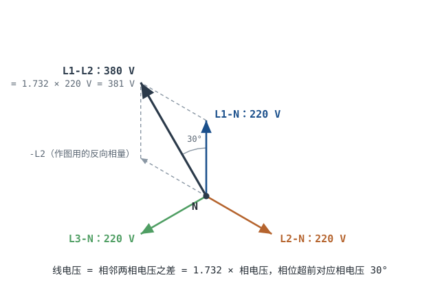
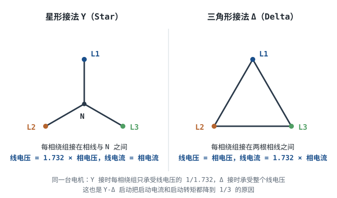

# 市电与三相电基础 Mains & Three-Phase Power

墙上插座两个孔或三个孔，量出来 220V；车间配电柜里三根相线，两两之间量出来 380V。同一套电网，为什么有两个电压？工厂的电机为什么用三根线而不是两根？为什么一根"平时不带电"的中性线断了，会烧掉一批根本没过载的设备？

这一章把三相电从"三个互差 120° 的正弦"讲到"选一根电缆、配一个断路器"。它接在[直流与交流、频率、相位与有效值](dc-ac.md)之后——那里已经把单相正弦的有效值、峰值与相位讲透，这里只增加"三个"这个维度；变压器的匝比与磁通在[变压器原理](transformer.md)；触电、接地与保护电器的边界在[安全用电与触电防护](electrical-safety.md)，本章涉及安全的部分与那章保持同一口径。

## 1. 设计动机

::: motivation 五个现场
**现场一：电机接法凭感觉。** 一台铭牌标"380V，Δ 接"的 7.5kW 电机，被改成 Y 接接到 380V 电网上，理由是"Y 接电流小、更省"。事实是每相绕组只得到 $380/\sqrt3=219.4$ V，是额定 380V 的 57.7%，转矩按电压平方掉到 33.3%，带载启动即堵转，堵转电流长时间维持，绕组过热。

**现场二：中性线断。** 一栋楼总配电箱的中性线端子松脱，同一回路上 A 相接了 10A 的单相负载、B 相接了 5A 的单相负载。中性线一断，这两个负载就串联在两根相线的 380V 之间：A 相承受 126.7V，B 相承受 253.3V（额定 220V 的 115%）。如果 B 相只接 1A 的负载，它承受 345.5V，是额定的 157%。一批电源适配器、LED 驱动、接触器线圈就是这样成批损坏的。

**现场三：把两根相线当 220V 用。** 380V 是线电压，接到 220V 设备上，设备承受 1.73 倍额定电压。开关电源的输入电解电容、压敏电阻、整流桥通常是最先失效的器件。

**现场四：中性线按"平衡时为零"减半。** 三相四线回路按三相平衡设计，中性线取相线的一半截面；实际负载全是开关电源、LED 灯、变频器。三相同为 12A（基波）、三次谐波为基波的 30% 时，中性线电流 10.8A，相当于相电流有效值 12.53A 的 86%，而它的截面只有一半。

**现场五：用单相公式算三相电流。** 直接算 $7500/380=19.7$ A（漏了 $\sqrt3$），或者算 $7500/(1.732\times380)=11.4$ A（漏了效率与功率因数），正确值是 15.4A。两个方向都能错 25% 以上：前者把电缆选大一档，后者选小一档长期过载。
:::

本章的产出是几张能直接查的表和一条从需求到验算的计算路线：

| 你想解决 | 先算 | 判据 |
|---|---|---|
| 三相设备接哪几根线 | 相电压还是线电压 | 铭牌接法与该国标称电压配对 |
| 选电缆截面 | $I_n=\dfrac{P}{\sqrt3 U_L\eta\cos\varphi}$ | 修正后载流量 ≥ 断路器额定 ≥ 负载电流 |
| 选断路器 | 启动电流倍数 | 磁脱扣下限高于启动电流，热脱扣能过启动 |
| 算线路压降 | $\Delta U=\sqrt3 I(R\cos\varphi+X\sin\varphi)$ | 稳态 ≤5%，启动 ≤10% |
| 中性线要多粗 | 不平衡电流 + 三次谐波 | 与相线等截面，或按实测电流选 |
| 判断"有没有电" | L—PE、L—N、N—PE 逐相测 | 验电器先自检，见安全章 |

四个必须记住的数：$\sqrt3=1.732$；$220\times\sqrt3=381$（标称 380）；相间 120°；380V 电机的速算 **2A/kW**（成立条件是 $\eta\cos\varphi\approx0.76$，见 §5.1）。

**不懂会在哪摔跤**，具体是这四条：

1. 把线电压当相电压（或反过来），设备承受 1.73 倍或被欠压到 58%，前者击穿、后者堵转。
2. 星形/三角形接错，电机转矩只剩 1/3 或绕组过压 1.73 倍，两种都烧。
3. 把中性线当成"没电线"：减截面、串开关、装保险，断零时单相负载承受接近线电压。
4. 断路器只按额定电流选、不看脱扣曲线与电缆载流量的配合，启动跳闸或者过载不跳。

## 2. 定义与直观：三个 120° 的正弦

### 2.1 三相电是什么

**三相电（Three-phase power）**：由三个频率相同、幅值相等、相位互差 $120^{\circ}$ 的正弦电压源，按星形（Y）或三角形（Δ）连接构成的供电系统。

三个相电压的瞬时值写成一组式子，后面所有结论都从这里出发：

$$u_1=U_m\sin\omega t,\qquad u_2=U_m\sin\left(\omega t-120^{\circ}\right),\qquad u_3=U_m\sin\left(\omega t+120^{\circ}\right)$$

符号与单位：$u_1,u_2,u_3$ 是三相瞬时相电压，V；$U_m$ 是峰值，V；$\omega=2\pi f$ 是角频率，rad/s（50Hz 时 $2\pi\times50=314.16$ rad/s）；$t$ 是时间，s；有效值 $U_{ph}=U_m/\sqrt2$，V。

三个单位相量的和为零——把三个箭头首尾相接正好回到原点。这条几何事实有两个直接后果：三相对称时中性线里没有基波电流；三相瞬时功率与时间无关（§2.3）。

**相序（Phase sequence）**：L1→L2→L3 依次滞后 $120^{\circ}$ 叫正序。任意两根相线对调就变成反序，三相电机随之反转。对风机、水泵、压缩机这类有明确转向的设备，反序可能损坏机械或让油泵不上油，所以现场用相序表或相序保护器确认。

**五根线各自干什么**（TN-S 系统，L1/L2/L3 + N + PE）：

| 线 | 作用 | 正常运行时 | 检修时的边界条件 |
|---|---|---|---|
| L1/L2/L3 相线 | 送电，两两之间是线电压 | 对地约 220V | 上级开关断开也可能反送电，必须验电 |
| N 中性线 | 单相负载的回流路径，变压器中性点接地 | 三相对称时基波电流为零 | 中性线断开后仍可能通过负载带 220V 电位 |
| PE 保护线 | 接设备外壳，故障时把外壳钳在地电位 | 正常无电流 | 以"PE 完好且接地电阻合格"为前提；PE 断线时外壳可能带危险电压 |


### 2.2 线电压为什么是 √3 倍

相电压是一根相线对中性线的电压，线电压是两根相线之间的电压。线电压就是两个相电压之差：

$$u_{12}=u_1-u_2=U_m\left[\sin\omega t-\sin\left(\omega t-120^{\circ}\right)\right]$$

用和差化积 $\sin A-\sin B=2\cos\frac{A+B}{2}\sin\frac{A-B}{2}$，取 $A=\omega t$、$B=\omega t-120^{\circ}$：

$$u_{12}=U_m\cdot2\cos\left(\omega t-60^{\circ}\right)\sin60^{\circ}=\sqrt3\,U_m\sin\left(\omega t+30^{\circ}\right)$$

两个结论同时出来了：**幅值是相电压的 $\sqrt3$ 倍**（$2\sin60^{\circ}=\sqrt3$），**相位超前对应相电压 $30^{\circ}$**（$\cos(\omega t-60^{\circ})=\sin(\omega t+30^{\circ})$）。用相量写更短：

$$\left|\vec U_{12}\right|=\left|\vec U_1-\vec U_2\right|=2U_{ph}\cos30^{\circ}=\sqrt3\,U_{ph}$$



几何直觉比公式好记：两个长度相等、夹角 $60^{\circ}$ 的向量相加（$\vec U_1$ 与 $-\vec U_2$ 的夹角正是 $60^{\circ}$），合向量把菱形分成两个等边三角形，长度就是 $\sqrt3$ 倍边长。相量图上，三个相电压构成一个 $120^{\circ}$ 的"奔驰标"，线电压是这个菱形的**长对角线**，短对角线长度恰好等于相电压。

代入数字：

$$U_L=\sqrt3\times220=1.732\times220=381.05\ \text{V}$$

标称值是 380V（GB/T 156-2017 规定我国 50Hz 低压配电标称电压 220/380V），反向换算：

$$U_{ph}=\frac{380}{\sqrt3}=\frac{380}{1.732}=219.4\ \text{V}$$

**380/220 = 1.7273，与 $\sqrt3=1.7321$ 差 0.28%**。这不是物理关系有偏差，而是标称值取整：两个数分别取整到"看起来整"的值，比值就不再精确。同理 IEC 60038 的 230/400 也有 400/230 = 1.7391，与 $\sqrt3$ 差 0.41%。记住这一点，看到别人用 380/220 硬算 √3 时就不会被绕进去。

### 2.3 为什么偏偏是 120°，为什么非要用三根线

对称多相系统有一个漂亮的性质：**相数 $m\ge3$ 时，对称正弦的瞬时功率恒定**。三相是最小的那个相数，所以工程上选三相——再少（两相）瞬时功率仍脉动，再多（四相、六相）导线更贵。

单相的瞬时功率并不恒定。设 $u=\sqrt2U\sin\omega t$、$i=\sqrt2I\sin(\omega t-\varphi)$：

$$p(t)=u\,i=UI\left[\cos\varphi-\cos\left(2\omega t-\varphi\right)\right]$$

平均值是 $UI\cos\varphi$，但它在 $UI(\cos\varphi-1)$ 与 $UI(\cos\varphi+1)$ 之间以 $2f$（50Hz 系统是 100Hz）脉动。三相则不同，把三对电压电流相加，交叉项两两抵消，只剩常数：

$$p_3(t)=3U_{ph}I_{ph}\cos\varphi=\sqrt3\,U_L I_L\cos\varphi$$

下面这张图把同一份 10kW 功率画了两遍：单相在 $-1.76$ kW 到 $+21.76$ kW 之间摆动，三相是一条 10.0 kW 的直线。

```echarts
{
  "animation": false,
  "tooltip": {"trigger": "axis"},
  "legend": {"data": ["单相 10 kW（cos φ = 0.85）", "三相 10 kW（平衡）"], "bottom": 0, "textStyle": {"fontSize": 12}},
  "grid": {"left": 66, "right": 26, "top": 36, "bottom": 58},
  "xAxis": {"type": "category", "name": "时间 t / ms", "nameLocation": "middle", "nameGap": 30,
            "data": [0,1,2,3,4,5,6,7,8,9,10,11,12,13,14,15,16,17,18,19,20], "axisLabel": {"fontSize": 11}},
  "yAxis": {"type": "value", "name": "瞬时功率 p(t) / kW", "nameLocation": "middle", "nameGap": 48,
            "min": -4, "max": 24, "interval": 4, "axisLabel": {"fontSize": 11}},
  "series": [
    {"name": "单相 10 kW（cos φ = 0.85）", "type": "line", "showSymbol": false, "smooth": true,
     "lineStyle": {"width": 2.6, "color": "#b5642e"},
     "data": [0.00,-1.73,1.02,7.20,14.45,20.00,21.73,18.98,12.80,5.55,0.00,-1.73,1.02,7.20,14.45,20.00,21.73,18.98,12.80,5.55,0.00]},
    {"name": "三相 10 kW（平衡）", "type": "line", "showSymbol": false,
     "lineStyle": {"width": 2.6, "color": "#1a4f8b"},
     "data": [10.0,10.0,10.0,10.0,10.0,10.0,10.0,10.0,10.0,10.0,10.0,10.0,10.0,10.0,10.0,10.0,10.0,10.0,10.0,10.0,10.0]}
  ]
}
```

图里每 1ms 取一点，所以采样到的极值是 21.73 kW 与 $-1.73$ kW；解析值是 $UI(1+\cos\varphi)=11764.7\times1.85=21.76$ kW 与 $UI(\cos\varphi-1)=-1.76$ kW，两者差异只来自采样间隔。单相的峰值是平均值的 $21.76/10=2.18$ 倍，谷值为负——每个 100Hz 功率周期里，有

$$\Delta t_{-}=\frac{2\varphi}{2\omega}=\frac{\varphi}{\omega}=\frac{0.5548}{314.16}=1.77\ \text{ms}$$

的时间在把功率**倒送**回电网（$\varphi=\arccos0.85=0.5548$ rad），一个 20ms 工频周期里出现两次，合计 3.5ms。

这个 2f 脉动的直接后果是转矩脉动。电机转矩 $T=P/\omega_m$，功率脉动就意味着转矩脉动，单相电机的振动与噪声很大一部分来自这里。

::: analogy 三缸发动机与单缸发动机
单缸四冲程发动机每 720° 曲轴角只做功一次，其余三个行程靠飞轮储能，转速与扭矩都在脉动；三缸机把三个缸按 $720^{\circ}/3=240^{\circ}$ 错开，做功行程互相搭接，输出就平稳得多。

类比的边界：发动机的平稳靠飞轮与曲轴的机械惯性储能，三相电的平稳是电磁功率本身恒定（对称正弦时 $p(t)$ 与时间无关），不依赖储能；240° 是四冲程 720° 均分的结果，120° 是正弦一个周期 360° 均分的结果，两个角度不是同一个来源。
:::

::: advanced 旋转磁场：为什么三相电机不需要启动绕组
三相绕组在空间上互差 $120^{\circ}$ 电角度，通入互差 $120^{\circ}$ 的三相电流，每相产生的脉动磁动势叠加起来：

$$F(\theta,t)=F_m\left[\cos\omega t\cos\theta+\cos\left(\omega t-120^{\circ}\right)\cos\left(\theta-120^{\circ}\right)+\cos\left(\omega t+120^{\circ}\right)\cos\left(\theta+120^{\circ}\right)\right]$$

用积化和差 $\cos A\cos B=\frac{1}{2}\left[\cos(A-B)+\cos(A+B)\right]$ 逐项展开，$\cos(A+B)$ 那一组交叉项两两抵消，剩下：

$$F(\theta,t)=\frac{3}{2}F_m\cos\left(\omega t-\theta\right)$$

幅值恒为 $1.5F_m$，波峰位置满足 $\theta=\omega t$，以同步角速度旋转——这就是"圆形旋转磁场"，也是三相异步电机能自启动、转矩平稳的根本原因。

单相绕组只产生 $F_m\cos\omega t\cos\theta$，可分解为两个幅值 $F_m/2$、转向相反的旋转磁场；转子静止时两者产生的转矩正好抵消，所以单相异步电机没有启动转矩，必须靠电容移相或电阻分相"造"出第二相。这也解释了为什么三相电机结构更简单、同容量下体积更小。
:::

以 7.5kW、4 极电机为例，同步转速 $n_s=60f/p=60\times50/2=1500$ r/min，额定转矩：

$$T=9550\times\frac{P}{n}=9550\times\frac{7.5}{1440}=49.7\ \text{N}\cdot\text{m}$$

（异步电机额定转速略低于同步转速，取 1440 r/min、转差率 4%。）单相供电时这个转矩会在 0 到接近 2 倍之间以 100Hz 脉动，三相供电时基波转矩恒定，只剩齿谐波造成的高频小脉动。

### 2.4 星形与三角形

三个绕组只有两种接法：一端接在一起（星形），或首尾相接成闭环（三角形）。



| 接法 | 线电压与相电压 | 线电流与相电流 | 中性点 | 典型用途 |
|---|---|---|---|---|
| 星形 Y | $U_L=\sqrt3\,U_{ph}$ | $I_L=I_{ph}$ | 有，可引出中性线 N | 配电变压器低压侧、需要同时供 220V 与 380V 的场合 |
| 三角形 Δ | $U_L=U_{ph}$ | $I_L=\sqrt3\,I_{ph}$ | 无 | 电机运行绕组、大功率加热负载 |

两种接法的功率公式是同一条：

$$P=\sqrt3\,U_L I_L\cos\varphi=3U_{ph}I_{ph}\cos\varphi$$

原因很简单：Y 接时 $U_L=\sqrt3U_{ph}$、$I_L=I_{ph}$；Δ 接时 $U_L=U_{ph}$、$I_L=\sqrt3I_{ph}$。无论哪种，代入都得到 $3U_{ph}I_{ph}\cos\varphi$。**所以"三角形接法功率大 3 倍"是错的**——同一个负载改接法，绕组承受的电压变了，功率才跟着变；只看公式，两种接法的表达式相同。

**星-三角（Y-Δ）启动**是这条关系的直接应用。启动时先把绕组接成 Y，每相只承受 $U_L/\sqrt3$，相电流降到 Δ 接的 $1/\sqrt3$；线电流又因为 Y 接的 $I_L=I_{ph}$ 再降一次，总共降到直接启动的 $1/3$：

$$\frac{I_{st,Y}}{I_{st,\Delta}}=\frac{1}{\sqrt3}\times\frac{1}{\sqrt3}=\frac13$$

转矩与电压平方成正比，也降到 $1/3$。7.5kW 电机直接启动 92.5A，Y 启动时 30.8A。代价是启动转矩只剩 1/3，所以只适用于轻载启动（风机、水泵）并且**运行时必须是 Δ 接**的电机——如果电机铭牌要求运行在 Y 接，就没有"先 Y 后 Δ"这回事。

### 2.5 中性线里到底有什么电流

三相对称时，中性线的基波电流为零。这句话被误读成"中性线可以省掉"，是现场事故的主要来源之一。中性线里至少有两种电流：

1. **不平衡电流**：三相负载不一样时，三个相电流的相量和不为零。两相各 10A、第三相 0 时，中性线电流是 10A——不是 20A，也不是 0。
2. **三次谐波（及 3 的倍数次）电流**：不带功率因数校正的开关电源与 LED 驱动，输入电流是尖顶波，三次谐波含量常见 30%~80%。三次谐波在 B、C 两相的相位是 $3\times(-120^{\circ})=-360^{\circ}\equiv0^{\circ}$，与 A 相同相，**在中性线里代数相加**，等于每相三次谐波电流的 3 倍。

两件事叠加，就会出现"三相看起来平衡、中性线却发烫"的现象：三相同为 12A（基波）、三次谐波为基波的 30%，中性线基波为 0，三次谐波为 $3\times0.3\times12=10.8$ A；相电流的有效值是 $12\times\sqrt{1+0.3^2}=12.53$ A，所以中性线电流达到相电流的 $10.8/12.53=86\%$。

三次谐波还有一个副作用：Δ 接的绕组里，三次谐波电流在闭合三角形内部环流，不流到线路上；Y 接则把它全部放进中性线。这也解释了三相变压器常见的接法——高压侧接成 Δ，为三次谐波提供环流通路，不让它进入电网；低压侧接成 Y 并引出中性线（如 Dyn11），因为它要同时提供 380V 线电压与 220V 相电压，代价是三次谐波电流全部集中到中性线上。所以谐波负载回路的中性线必须与相线等截面。

## 3. 定量关系

### 3.1 公式、符号与单位

符号约定：下标 L 表示线量（Line），ph 表示相量（Phase）；$U_L$、$I_L$ 是线电压、线电流的有效值，$U_{ph}$、$I_{ph}$ 是相电压、相电流的有效值；$\varphi$ 是**同一相**的相电压与相电流之间的相位差。这个记法与[直流与交流、频率、相位与有效值](dc-ac.md)里的 $V_{rms}$、$\varphi$ 口径一致，只是多了线/相两组量。

| 关系 | 公式 | 符号与单位 | 适用条件 |
|---|---|---|---|
| 星形线电压 | $U_L=\sqrt3\,U_{ph}$ | V | 三相对称、Y 接 |
| 星形线电流 | $I_L=I_{ph}$ | A | Y 接 |
| 三角形线电流 | $I_L=\sqrt3\,I_{ph}$ | A | 三相对称、Δ 接 |
| 三角形线电压 | $U_L=U_{ph}$ | V | Δ 接 |
| 三相有功 | $P=\sqrt3\,U_L I_L\cos\varphi$ | W | 对称正弦稳态 |
| 三相无功 | $Q=\sqrt3\,U_L I_L\sin\varphi$ | var | 对称正弦稳态 |
| 三相视在 | $S=\sqrt3\,U_L I_L$ | VA | 对称正弦稳态 |
| 单相瞬时功率 | $p(t)=UI\left[\cos\varphi-\cos\left(2\omega t-\varphi\right)\right]$ | W | 单相正弦 |
| 三相瞬时功率 | $p_3(t)=3U_{ph}I_{ph}\cos\varphi$ | W | 三相对称正弦 |
| 中性线基波 | $\vec I_N=\vec I_a+\vec I_b+\vec I_c$ | A | 三相四线 |
| 中性线三次谐波 | $I_{N3}=3I_3$ | A | 三相的三次谐波同相 |
| 中性线总有效值 | $I_N=\sqrt{I_{N1}^2+I_{N3}^2}$ | A | 基波与谐波正交 |
| 电机额定电流 | $I_n=\dfrac{P}{\sqrt3\,U_L\eta\cos\varphi}$ | A | 三相异步电机 |
| 电机转矩 | $T=9550\,P/n$ | $\text{N}\cdot\text{m}$；P 用 kW，n 用 r/min | 额定点附近 |
| 同步转速 | $n_s=60f/p$ | r/min；p 为极对数 | 异步电机 |
| 线路压降 | $\Delta U=\sqrt3\,I\left(R\cos\varphi+X\sin\varphi\right)$ | V | 三相对称、集中参数 |
| 导体电阻 | $R=\rho L/A$ | $\Omega$；$\rho$ 为 $\Omega\cdot\text{mm}^2/\text{m}$ | 工频、忽略集肤效应 |
| 星三角启动 | $I_{st,Y}=I_{st,\Delta}/3$ | A | 同一电机、同一电网 |

### 3.2 √3 U I cos φ 的来历

单相功率是 $U_{ph}I_{ph}\cos\varphi$，三相就是三个单相相加：

$$P=3U_{ph}I_{ph}\cos\varphi=3\times\frac{U_L}{\sqrt3}\times I_L\cos\varphi=\sqrt3\,U_L I_L\cos\varphi$$

推导只用了一次替换：Y 接时 $U_{ph}=U_L/\sqrt3$。Δ 接时换成 $I_{ph}=I_L/\sqrt3$，结果一样。注意 Δ 接的线电流与相电流之间差 $30^{\circ}$，但功率要按"同一相绕组的电压与电流"算，所以公式里的 $\varphi$ 仍是相电压与相电流的相位差，不要拿线电流的相位去套。

### 3.3 线量与相量的换算

| 已知 | Y 接 | Δ 接 |
|---|---|---|
| 线电压 380V | 相电压 219.4V | 相电压 380V |
| 相电流 10A | 线电流 10A | 线电流 17.32A |
| 线电流 30A | 相电流 30A | 相电流 17.32A |
| 每相阻抗 $Z$ | $I_{ph}=U_{ph}/Z$ | $I_{ph}=U_L/Z$ |

一张表可以替代大部分推导：**Y 接"电压降 √3、电流不变"，Δ 接"电流升 √3、电压不变"**。

### 3.4 中性线电流的合成规则

不同次数的电流不能直接代数相加，要分三步：

1. **基波按相量加**：把三个相电流 $I_a$、$I_b$、$I_c$ 按各自相电压的相位（$0^{\circ}$、$-120^{\circ}$、$+120^{\circ}$，再加上各相的功率因数角）写成相量再求和，得到 $I_{N1}$。
2. **3 的倍数次谐波按代数加**：三次、九次、十五次谐波在三相中同相，$I_{N3}=3I_3$、$I_{N9}=3I_9$。五次、七次谐波是负序/正序，仍按相量和，三相对称时相互抵消。
3. **各次有效值平方和开方**：不同频率的正弦在一个周期内正交，$I_N=\sqrt{I_{N1}^2+I_{N3}^2+I_{N5}^2+\cdots}$。

工程上只需要记住两条：不平衡看基波相量和，谐波看三次谐波的 3 倍；中性线电流可能比任何一相的电流都大。

"可能比相电流大"有一个可算的门槛。设每相三次谐波与基波之比为 $h$，三相对称时中性线只有三次谐波：

$$I_N=3hI_1,\qquad I_{ph}=I_1\sqrt{1+h^2}\ \Rightarrow\ \frac{I_N}{I_{ph}}=\frac{3h}{\sqrt{1+h^2}}$$

令比值等于 1，得 $9h^2=1+h^2$，即 $h=1/\sqrt8=0.354$。**三次谐波含量超过约 35% 时，就算三相对称，中性线电流的有效值也已经超过相电流**；含量 80% 时比值是 $3\times0.8/\sqrt{1+0.64}=1.87$，接近相电流的两倍。

### 3.5 电机：电流、转矩、转速与启动

额定电流由输出功率反推，效率与功率因数都在分母上：

$$I_n=\frac{P_{out}}{\sqrt3\,U_L\,\eta\cos\varphi}$$

7.5kW、$\eta=0.87$、$\cos\varphi=0.85$、380V 代入，得 15.41A（§4.4 完整算）。速算口诀"380V 电机 2A/kW"对应的条件是 $\eta\cos\varphi=0.76$：$1000/(1.732\times380\times0.76)=2.0$ A/kW。小电机的 $\eta\cos\varphi$ 低，实际电流比 2A/kW **大**；大电机的 $\eta\cos\varphi$ 高，实际电流比 2A/kW **小**（§5.1 的表）。

同步转速 $n_s=60f/p$：2 极 3000、4 极 1500、6 极 1000、8 极 750 r/min。异步电机实际转速低 1%~5%，用转差率 $s=(n_s-n)/n_s$ 表示。转矩 $T=9550P/n$，同一功率下极数越多转速越低、转矩越大。

启动特性是选断路器的依据（典型量级，以铭牌与样本为准）：

| 项目 | 典型范围 | 说明 |
|---|---|---|
| 直接启动电流倍数 | 5~7 倍额定 | 鼠笼电机，功率越大倍数略低 |
| 启动转矩倍数 | 1.8~2.2 倍额定 | 重载启动要核对 |
| 最大转矩倍数 | 2.0~2.4 倍额定 | 决定会不会堵转 |
| 星三角启动电流 | 直接启动的 1/3 | 启动转矩同样 1/3 |
| 软启动/变频启动 | 1.5~3 倍额定，可调 | 变频器还有 V/f 与低频转矩问题 |

### 3.6 线路压降与载流量

三相线路的压降按每根相线的阻抗算，$\sqrt3$ 来自线电压与相电压的关系：

$$\Delta U=\sqrt3\,I\left(R\cos\varphi+X\sin\varphi\right),\qquad R=\rho\frac{L}{A}$$

其中 $\Delta U$ 是线电压的降落，V；$I$ 是线电流，A；$R$、$X$ 是每根相线的电阻与电抗，$\Omega$；$L$ 是线路长度，m；$A$ 是导体截面，$\text{mm}^2$；$\rho$ 是电阻率，取热态值：铜在 70°C（PVC 电缆的长期工作温度）取 $0.0209\ \Omega\cdot\text{mm}^2/\text{m}$，由 $0.0175\times(1+0.00393\times50)=0.0209$ 得到；XLPE 电缆按 90°C 取 $0.0223$。低压电缆的电抗约 0.07~0.09 $\Omega$/km，截面小时可以忽略，但算启动压降时保留更稳。

压降的相对值 $\Delta U\%=\Delta U/U_L\times100\%$。判据：稳态时电动机端子电压偏差 ±5%（GB 50052-2009），启动时常用"端子电压不低于额定的 90%"作为控制线（频繁启动取更严，具体以项目采用的规范与供电部门要求为准）。

载流量要满足三档不等式：

$$I_b\le I_{\text{br}}\le I_{z,\text{corr}}$$

其中 $I_b$ 是负载计算电流，A；$I_{\text{br}}$ 是断路器额定电流，A；$I_{z,\text{corr}}=I_z\times k_{\text{温度}}\times k_{\text{成组}}$ 是修正后的电缆载流量，A。第一档保证断路器不误动，第二档保证电缆被断路器保护。短路热稳定（$I^2t$）与断路器分断能力另按 GB 50054-2011 校核，本章不展开——它取决于变压器容量与线路阻抗，不是靠本章这几个公式能算出来的。

### 3.7 适用条件与失效边界

- **对称性**：$\sqrt3$ 关系只在三相对称（或只考虑正序分量）时成立。三相负载不平衡时，中性点电位漂移，三个相电压不再相等，线电压仍然近似对称（因为电源内阻小），但相电压会偏离 220V。
- **正弦性**：谐波存在时，有效值按各次平方和计算，功率不能只算基波；三次谐波在中性线叠加，$\sqrt3$ 关系对谐波不成立（三次谐波是零序，线电压里没有）。
- **集中参数**：50Hz 的波长 6000km，建筑内几十米到几百米的线路完全可以当集中参数处理；到了 MHz 级或长距离输电，就必须按分布参数算。
- **稳态**：本节所有公式给的都是稳态有效值。短路瞬间有直流分量与非周期分量，启动瞬间有 5~7 倍电流与压降，都不能用稳态公式外推。
- **仪表口径**：万用表读的是有效值；非正弦电流要真有效值表，钳形表的带宽与波峰因数限制同样适用（见[直流与交流、频率、相位与有效值](dc-ac.md) §5.3）。
- **标准口径**：220/380 与 230/400 是两套标称值，容差带也不同，不能在同一张图纸上混写（§5.2）。

## 4. 典型计算

### 4.1 算例一：220/380 与容差带的账

**需求**：核对我国低压配电的标称值、$\sqrt3$ 关系与容差范围，并说明与 IEC 230/400 的差别。

**第一步，标称值与 √3 的关系**：

$$U_L=220\times1.732=381.05\ \text{V}\ \Rightarrow\ \text{标称 }380\ \text{V}$$

$$U_{ph}=380/1.732=219.4\ \text{V}\ \Rightarrow\ \text{标称 }220\ \text{V}$$

比值的偏差：$380/220=1.7273$，$(1.7321-1.7273)/1.7321=0.28\%$。

**第二步，GB/T 12325-2008 的容差**：380V 三相供电电压偏差 ±7%，220V 单相 +7%/-10%：

$$U_{L,\min}=380\times0.93=353.4\ \text{V},\qquad U_{L,\max}=380\times1.07=406.6\ \text{V}$$

$$U_{ph,\min}=220\times0.90=198.0\ \text{V},\qquad U_{ph,\max}=220\times1.07=235.4\ \text{V}$$

把线电压上下限换回相电压：$353.4/1.732=204.0$ V，$406.6/1.732=234.7$ V——与单相 198.0~235.4V 不完全重合，因为两个偏差限值本来就是分别规定的。

**第三步，IEC 60038:2009 的口径**：50Hz 系统标称 230/400V，容差 ±10%：

$$U_{ph}=207\sim253\ \text{V},\qquad U_L=360\sim440\ \text{V}$$

**第四步，两套标称值能不能互通**：

$$\frac{220}{230}=0.9565\ (-4.3\%),\qquad \frac{380}{400}=0.9500\ (-5.0\%)$$

两个比值都落在 ±10% 以内，所以按 IEC 容差带设计的 230/400V 设备在我国 220/380V 电网上通常能工作，反之亦然。但"能工作"不等于"可以混写"：铭牌、图纸、合同必须按所在国标准写一套值。**同一台设备标 230V，IEC 允许的上限是 253V；我国 220V 系统的上限只有 235.4V**，做出口产品时如果按 235.4V 校核裕量，到了 253V 的电网就会偏紧。

**第五步，400V 设备接 380V 电网的后果**：电压低 5%，转矩按平方降到 $(380/400)^2=0.9025$，即 $-9.75\%$；反过来 380V 设备接 400V，电压高 5.26%，磁通同比上升，铁损与温升都要重新核算。短期运行通常能撑住，长期要看绝缘等级与温升裕量。

### 4.2 算例二：不平衡负载加三次谐波的中性线电流

**需求**：三相四线回路，A/B/C 相电流分别为 12A、8A、4A，功率因数接近 1，负载为开关电源，三次谐波含量 30%。求中性线电流，并判断按"相线一半截面"选中性线是否可行。

**第一步，基波相量和**。取 A 相为参考：

$$\vec I_a=12\angle0^{\circ},\quad \vec I_b=8\angle(-120^{\circ}),\quad \vec I_c=4\angle120^{\circ}$$

实部：$12+8\cos(-120^{\circ})+4\cos120^{\circ}=12-4-2=6.0$ A。

虚部：$0+8\sin(-120^{\circ})+4\sin120^{\circ}=0-6.928+3.464=-3.464$ A。

$$\left|\vec I_{N1}\right|=\sqrt{6.0^2+(-3.464)^2}=\sqrt{36+12.0}=6.93\ \text{A}$$

**第二步，三次谐波**。三相同相，代数相加：

$$I_{N3}=0.30\times(12+8+4)=0.30\times24=7.2\ \text{A}$$

**第三步，总有效值**：

$$I_N=\sqrt{6.93^2+7.2^2}=\sqrt{48.0+51.8}=\sqrt{99.8}=9.99\ \text{A}\approx10.0\ \text{A}$$

**第四步，判断**。最大相电流 12A，中性线 10.0A，是它的 83%。这个 83% 远高于"平衡时为零"的设计假设：若按平衡负载把中性线截面减到相线的一半甚至更小，设计依据就与实际电流不符。举一个会出事的量级：相线 25mm²（穿管 80A，40°C 修正后 69.6A）、中性线取 6mm²（34A，修正后 29.6A），相电流 40A 时中性线 33.2A，已经是修正后载流量的 112%，长期运行必然发热老化。

**第五步，极端情形**：三相同为 12A（基波）、三次谐波 30% 时，基波完全抵消，中性线只剩 $3\times0.3\times12=10.8$ A，相当于相电流有效值 12.53A 的 86%。**"三相平衡所以中性线没电流"这句话，只对纯基波、纯线性负载成立。**

### 4.3 算例三：中性线断开后的电压重分配

**需求**：三相四线，中性线在负载上游断开。A 相接 10A 的单相负载（等效电阻 $R_A=220/10=22\ \Omega$），B 相接 5A 的负载（$R_B=220/5=44\ \Omega$），C 相空载。求两个负载上的电压。

**第一步，等效电路**。中性线断开后，两个负载串联在 L1 与 L2 之间，两端电压是线电压 380V：

$$R_{\text{总}}=22+44=66\ \Omega,\qquad I=\frac{380}{66}=5.758\ \text{A}$$

**第二步，分压**：

$$U_A=5.758\times22=126.7\ \text{V}\ (-42.4\%)$$

$$U_B=5.758\times44=253.3\ \text{V}\ (+15.1\%)$$

**验算**：$126.7+253.3=380.0$ V，与线电压一致；也可用分压比直接算 $380\times44/66=253.3$ V，一致。

**第三步，更极端的情况**。A 相 10A、B 相只有 1A（$R_B=220\ \Omega$）：

$$I=\frac{380}{22+220}=\frac{380}{242}=1.570\ \text{A},\qquad U_B=1.570\times220=345.5\ \text{V}$$

345.5V 是额定 220V 的 **1.57 倍**，已经接近线电压 380V 的 91%。负载越轻，承受的过压越严重——这与直觉相反，但分压规律就是如此。

**第四步，适用条件**。断零造成过压，需要同时满足三个条件：中性线在负载上游断开；不同相的单相负载仍然接通；没有断零保护或中性线重复接地等后备措施。三个条件缺一个，后果就不同：三相负载完全平衡时断开中性线，各相电压基本不变（但中性点电位不再被固定，任何不平衡都会立刻重新分配）；负载全部断开时当然也没有过压。

**第五步，安全边界**。TN-C 系统里 PEN 线同时承担中性线与保护线，PEN 一旦断开，设备外壳也会失去接地通路，可能带危险电压。此时"外壳不带电"的前提（PE 完好且接地电阻合格）已经不成立，剩余电流动作保护器（RCD）只能在存在剩余电流通路时动作，靠把通电时间缩短（30mA 型在 1 倍额定剩余电流下保证 0.3s、5 倍以上 0.04s，GB/T 16916.1）来降低通过人体的能量；它既不能限制触电瞬间的电流，也不保护同时触及 L 与 N 的情形。所以断零防护的正确做法是：中性线不装开关与熔断器、保证机械强度与连接可靠、重要场合做中性线重复接地或断零保护——而不是"装个漏电保护器就放心"。这一口径与[安全用电与触电防护](electrical-safety.md)一致。

### 4.4 算例四：7.5kW 电机进线的四个判据

**需求**：

| 项目 | 要求 |
|---|---|
| 电源 | 380V/50Hz，三相四线，TN-S |
| 负载 | 7.5kW、4 极三相异步电机，$\eta=0.87$，$\cos\varphi=0.85$，直接启动按 6 倍 |
| 线路 | 桥架敷设，长 50m，环境 40°C，单回路 |
| 判据 | 载流量、启动不跳闸、稳态压降 ≤5%、启动压降 ≤10% |

（$\eta$、$\cos\varphi$、启动倍数均为示例值，实际以铭牌与样本为准。）

**判据一：额定电流与载流量**

$$I_n=\frac{7500}{1.732\times380\times0.87\times0.85}=\frac{7500}{486.7}=15.41\ \text{A}$$

分母逐项：$1.732\times380=658.2$，$\times0.87=572.6$，$\times0.85=486.7$。速算 2A/kW 给 15.0A，偏低 2.7%。

选 20A 断路器，要求修正后载流量不低于 20A。40°C 环境对 PVC 电缆的温度修正系数取 0.87（30°C 基准，见表 §5.1）：

| 截面 | 穿管 B2 载流量 | 修正后 | 与 20A 断路器比 |
|---|---|---|---|
| 4 mm² | 26 A | $26\times0.87=22.6$ A | 通过，余量 13% |
| 6 mm² | 34 A | $34\times0.87=29.6$ A | 通过，余量 48% |

**判据二：启动电流与断路器脱扣**

$$I_{st}=6\times15.41=92.45\ \text{A}$$

断路器 20A，启动电流相当于 $92.45/20=4.62$ 倍额定。B 型磁脱扣 3~5 倍、C 型 5~10 倍、D 型 10~20 倍（GB/T 10963.1-2005）：4.62 倍落在 B 型的动作区间内，**可能**瞬时跳闸（标准只规定 3 倍以下不动作、5 倍以上必动作，区间内不保证）；低于 C 型的下限 5 倍，磁脱扣不动作；远低于 D 型下限 10 倍，更不动作。

但热脱扣还要看启动时间：4.62 倍下热元件在几秒到几十秒内动作，重载或大惯量负载启动超过 5s 时，C 型也可能误跳。结论：**选 20A D 型（或带可调磁脱扣的电动机保护型断路器），过载保护交给热继电器，整定 16A**（1.0~1.05 倍额定电流）。

**判据三：稳态压降**

铜在 70°C（VV 聚氯乙烯电缆的长期工作温度）取 $\rho=0.0209\ \Omega\cdot\text{mm}^2/\text{m}$，6mm²、50m：

$$R=0.0209\times\frac{50}{6}=0.1742\ \Omega,\qquad X=0.08\times\frac{50}{1000}=0.0040\ \Omega$$

$$\Delta U=1.732\times15.41\times(0.1742\times0.85+0.0040\times0.527)$$

$$=1.732\times15.41\times(0.1481+0.0021)=1.732\times15.41\times0.1502=4.01\ \text{V}$$

$$\Delta U\%=\frac{4.01}{380}=1.05\%\ \le 5\%\ \checkmark$$

**判据四：启动压降**

启动功率因数低（取 0.35），按同一公式：

$$\Delta U_{st}=1.732\times92.45\times(0.1742\times0.35+0.0040\times0.937)=1.732\times92.45\times0.0647=10.4\ \text{V}$$

$$\Delta U_{st}\%=10.4/380=2.73\%$$

若按最保守的 $\cos\varphi=1$（把电抗与功率因数都按最不利取）估上界：

$$\Delta U_{st}=1.732\times92.45\times0.1742=27.9\ \text{V},\qquad 27.9/380=7.34\%$$

两个算法都低于 10% 的控制线，但保守估法只剩 2.7 个百分点余量。

**对照 4mm²**：稳态 $R=0.2613\ \Omega$，$\Delta U=5.98$ V $=1.57\%$；启动保守估 $1.732\times92.45\times0.2613=41.8$ V $=11.0\%>10\%$，被启动判据否掉。所以虽然 4mm² 的载流量勉强够，仍选 6mm²。

**汇总**：

| 判据 | 计算 | 结果 | 判定 |
|---|---|---|---|
| 载流量 | $34\times0.87=29.6$ A ≥ 20 A | 6 mm² | 通过，余量 48% |
| 启动电流 | $92.45/20=4.62$ 倍 | 20A D 型 | 磁脱扣不动作 |
| 稳态压降 | 4.01 V = 1.05% | ≤5% | 通过 |
| 启动压降 | 10.4~27.9 V = 2.73%~7.34% | ≤10% | 通过 |

**结论**：VV-0.6/1kV 4×6mm²（三相加 PE，电机不需要中性线）、20A D 型断路器、16A 热继电器、接触器按 AC-3 类别选。短路热稳定与断路器分断能力按 GB 50054-2011 另行校核。

### 4.5 算例五：三相配电箱的进线

**需求**：安装容量 30kW，需用系数 0.8，平均功率因数 0.85，进线长 30m，桥架敷设，环境 40°C。

**第一步，计算电流**：

$$P_c=30\times0.8=24\ \text{kW},\qquad S=\frac{24}{0.85}=28.24\ \text{kVA}$$

$$I=\frac{28240}{1.732\times380}=\frac{28240}{658.2}=42.9\ \text{A}$$

**第二步，断路器**：选 50A，$42.9/50=85.8\%$，留 14% 余量。

**第三步，电缆**：要求修正后载流量 ≥ 50A。

- 10mm² 穿管：$46\times0.87=40.0$ A $<50$ A，不满足（断路器保护不了电缆）；
- 16mm² 穿管：$61\times0.87=53.1$ A $\ge50$ A，满足。

**第四步，压降**（16mm²、30m，PVC 电缆 70°C）：

$$R=0.0209\times\frac{30}{16}=0.0392\ \Omega,\qquad X=0.08\times0.03=0.0024\ \Omega$$

$$\Delta U=1.732\times42.9\times(0.0392\times0.85+0.0024\times0.527)=1.732\times42.9\times0.0346=2.57\ \text{V}$$

$$\Delta U\%=2.57/380=0.68\%$$

**第五步，中性线**：这个箱子带大量单相负载与开关电源，中性线必须与相线等截面（16mm²），不能按"平衡时为零"减半。若末端还有大量 LED 与 IT 负载，要按 §4.2 的方法实测或估算三次谐波，必要时再放大中性线。

**结论**：5×16mm²（L1/L2/L3 + N + PE）、50A 断路器、压降 0.68%。

## 5. 工程含义

### 5.1 工程数量级表

**表一：380V 三相异步电机的额定电流**（按 $I=P/(\sqrt3U\eta\cos\varphi)$ 计算，$\eta$、$\cos\varphi$ 为表中假设值，实际以铭牌为准）：

| $P$ / kW | $\eta$ | $\cos\varphi$ | $\eta\cos\varphi$ | $I$ / A | 速算 $2P$ / A |
|---|---|---|---|---|---|
| 0.75 | 0.72 | 0.75 | 0.540 | 2.1 | 1.5 |
| 1.5 | 0.77 | 0.83 | 0.639 | 3.6 | 3.0 |
| 2.2 | 0.81 | 0.82 | 0.664 | 5.0 | 4.4 |
| 3.0 | 0.82 | 0.81 | 0.664 | 6.9 | 6.0 |
| 4.0 | 0.845 | 0.82 | 0.693 | 8.8 | 8.0 |
| 5.5 | 0.855 | 0.84 | 0.718 | 11.6 | 11.0 |
| 7.5 | 0.87 | 0.85 | 0.740 | 15.4 | 15.0 |
| 11 | 0.875 | 0.85 | 0.744 | 22.5 | 22.0 |
| 15 | 0.885 | 0.86 | 0.761 | 29.9 | 30.0 |
| 18.5 | 0.89 | 0.86 | 0.765 | 36.7 | 37.0 |
| 22 | 0.89 | 0.87 | 0.774 | 43.2 | 44.0 |
| 30 | 0.90 | 0.87 | 0.783 | 58.2 | 60.0 |
| 37 | 0.91 | 0.87 | 0.792 | 71.0 | 74.0 |
| 45 | 0.915 | 0.88 | 0.805 | 84.9 | 90.0 |
| 55 | 0.92 | 0.88 | 0.810 | 103.2 | 110 |
| 75 | 0.925 | 0.88 | 0.814 | 140.0 | 150 |

速算在 11~22kW 区间误差约 2%（11kW 时 $-2.1\%$，22kW 时 $+1.9\%$）；4kW 及以下口诀偏小 9%~29%，30kW 以上口诀偏大 3%~7%。方向上都是"小电机的实际电流比口诀大、大电机的实际电流比口诀小"，因为 $\eta\cos\varphi$ 随容量上升。

**表二：铜芯 PVC 绝缘电缆的载流量**（3 根负载导体、30°C 环境；B2 = 穿管敷设，E = 空气中/桥架敷设。典型量级，以 GB/T 16895.15 对应表与电缆厂家数据为准）：

| 截面 / mm² | 1.5 | 2.5 | 4 | 6 | 10 | 16 | 25 | 35 |
|---|---|---|---|---|---|---|---|---|
| B2 穿管 / A | 14.5 | 19.5 | 26 | 34 | 46 | 61 | 80 | 99 |
| E 空气 / A | 17.5 | 24 | 32 | 41 | 57 | 76 | 96 | 119 |
| B2、40°C 修正 / A | 12.6 | 17.0 | 22.6 | 29.6 | 40.0 | 53.1 | 69.6 | 86.1 |

**表三：修正系数**（典型值，以标准表格为准）：

| 环境温度（PVC，30°C 基准） | 25°C | 30°C | 35°C | 40°C | 45°C | 50°C |
|---|---|---|---|---|---|---|
| 系数 | 1.03 | 1.00 | 0.94 | 0.87 | 0.79 | 0.71 |

| 成组回路数（空气中并列） | 1 | 2 | 3 | 4 | 5 | 6 |
|---|---|---|---|---|---|---|
| 系数 | 1.00 | 0.80 | 0.70 | 0.65 | 0.60 | 0.57 |

温度系数与成组系数是**相乘**的。40°C、3 回路并列时，6mm² 的实际载流量是 $34\times0.87\times0.70=20.7$ A，刚好卡在 20A 断路器上——这种情况下要么放大截面，要么分开敷设。

**表四：断路器的脱扣曲线**（GB/T 10963.1-2005 / IEC 60898-1）：

| 曲线 | 磁脱扣范围 | 典型用途 |
|---|---|---|
| B | 3~5 倍额定 | 纯阻性负载、住宅照明插座 |
| C | 5~10 倍额定 | 一般配电、照明混合负载 |
| D | 10~20 倍额定 | 电机、变压器、大涌流负载 |

常用额定电流：6、10、16、20、25、32、40、50、63、80、100、125A。选型顺序永远是"先算电流，再算启动与压降，最后按载流量校验"，而不是反过来先挑一个"差不多"的开关。

### 5.2 220/380 与 230/400：两套标称值不能混

| 项目 | 我国（GB/T 156-2017） | IEC 60038:2009 |
|---|---|---|
| 标称相电压/线电压 | 220/380 V | 230/400 V |
| 电压偏差 | 380V ±7%，220V +7%/-10%（GB/T 12325） | ±10% |
| 相电压范围 | 198.0~235.4 V | 207~253 V |
| 线电压范围 | 353.4~406.6 V | 360~440 V |

两套标称值在容差内可以互通（§4.1），但工程上有三个必须分清的地方：

1. **铭牌写一套**：出口欧洲的设备写 230/400V，国内设备写 220/380V，不要为了"兼容"写成 220-230/380-400V，那会让认证与验收都失去依据。
2. **校核用哪套容差**：按 220V +7% 校核的 235.4V 上限，比 IEC 的 253V 低 7%；做宽压输入设计时按最宽的 253V 取，做国内产品时按 235.4V 取，两者不能互相替代。
3. **400V 设备接 380V**：电压低 5%，转矩低 9.75%（§4.1），风机水泵类负载的转速与风量/流量都会下降；反过来 380V 设备接 400V，磁通高 5.26%，铁损与温升上升，长期运行要重新核算绝缘裕量。

### 5.3 电机铭牌上的接法怎么读

铭牌上电压与接法是**按顺序配对**的，这是最容易读错的一行：

| 铭牌写法 | 含义 | 我国 380V 电网怎么接 |
|---|---|---|
| 380V，Δ | 绕组额定 380V，Δ 接 | Δ |
| 380/220V，Y/Δ | 380V 用 Y、220V 用 Δ | Y |
| 220/380V，Δ/Y | 220V 用 Δ、380V 用 Y | Y |
| 380/660V，Δ/Y | 380V 用 Δ、660V 用 Y | Δ |

判断方法只有一个：**看绕组额定电压**。绕组额定 220V 的电机，在 380V 电网上必须 Y 接（$380/\sqrt3=220$）；绕组额定 380V 的电机，必须 Δ 接。凭"Y 接省电""Δ 接有劲"猜，两种错法都会烧：

- 该 Y 接却接成 Δ：绕组承受 380V，是额定的 1.73 倍，磁通饱和，空载电流剧增，几分钟到几十分钟烧毁。
- 该 Δ 接却接成 Y：绕组只承受 219.4V，是额定的 57.7%，转矩降到 33.3%，带载启动困难、堵转电流长时间维持，同样会过热。

**Y-Δ 启动的适用条件**再强调一次：只能用于"运行时 Δ 接"的电机，且负载启动转矩不超过额定的 1/3。运行时必须 Y 接的电机，不能做 Y-Δ 启动。

### 5.4 中性线、谐波与保护

把 §2.5、§3.4、§4.2 的结论固化成四条做法：

1. **中性线不装开关、不装熔断器**，截面不小于相线（有谐波时按实测或放大）。三相四线回路的中性线断开，后果是单相负载承受接近线电压（§4.3）。
2. **谐波负载单独评估**。三次谐波含量超过约 35%（§3.4 的 $h=1/\sqrt8$）时，仅谐波一项就能让中性线电流超过相电流，按基波选型必然偏小。
3. **PE 与 N 严格分开**（TN-S）。PE 从变压器中性点引出后与 N 全程分开、不再合并；PE 允许做重复接地，但不允许与 N 再短接——一旦短接，正常工作电流就会分流到 PE 与接地网，外壳带电位。设备外壳接 PE。
4. **保护电器分层**：断路器管短路，热继电器/过载保护管过载，RCD 管剩余电流。三者的口径不同，不能互相替代——RCD 的额定剩余动作电流 30mA、动作时间随剩余电流倍数在 0.04~0.3s 之间（GB/T 16916.1），它靠缩短通电时间降低通过人体的能量，不限制触电瞬间的电流大小，也不保护同时触及 L 与 N 的情形；TN 系统的主保护仍是过流保护与 $Z_s$ 校核，RCD 只是附加保护。这几条与[安全用电与触电防护](electrical-safety.md)的口径完全一致。

接地系统的定义（TN/TT/IT）见 GB/T 16895.1-2008：第一个字母表示电源中性点是否接地（T 接地、I 不接地），第二个字母表示设备外壳是否直接接大地（T 直接接地、N 接保护线）。TN-S 的 S 表示保护线与中性线全程分开，TN-C 则是合一为 PEN。**PEN 断开的后果比 N 断开更严重**：既失去中性线，又失去保护接地，外壳可能带危险电压——此时"外壳不带电"的前提已经不成立，只能靠 RCD 缩短故障持续时间，而不能指望它防住所有情形。

### 5.5 这些公式什么时候不成立

- **三相严重不平衡**：$\sqrt3$ 关系对线电压仍近似成立（电源内阻小），但相电压会偏离 220V，中性点漂移，按 220V 算的单相负载电流全部失准。
- **谐波含量高**：功率、有效值、中性线电流都要按各次谐波分别算，基波公式只是近似。
- **长线路或大电流**：线路阻抗不可忽略，压降与短路电流都要按实际阻抗算，不能只看变压器容量。
- **启动与短路暂态**：5~7 倍启动电流、十几到几十倍短路电流，伴随直流分量与电压暂降，稳态公式不能外推。
- **变频器输出**：PWM 脉冲不是正弦，普通万用表读数系统性偏离真有效值，电机侧的 $\sqrt3$ 关系也不再直接适用（见[直流与交流、频率、相位与有效值](dc-ac.md) §5.3）。
- **高频与长距离**：50Hz 的集总假设在建筑内成立，到了开关电源的 MHz 频段就不成立。

## 6. 常见坑

::: pitfall 常见坑
- **凭"Y 接省电"改接法**：现象——电机带载启动困难、堵转、绕组发热冒烟。原因——绕组额定 380V 的电机接成 Y，每相只得到 219.4V，转矩降到 33.3%。解决——按铭牌"电压-接法"配对表接（§5.3），不确定时量每相绕组电阻并核对铭牌，改接法前先确认绕组额定电压。

- **中性线断开，单相设备成批损坏**：现象——同一回路上不同相的单相设备有的过压烧毁、有的欠压不工作。原因——中性线断开后，不同相的负载串联在线电压之间，负载越轻承受的电压越高（§4.3 算例：10A 与 1A 负载，轻载侧承受 345.5V）。解决——中性线不装开关与熔断器、连接可靠、重要场合做重复接地或断零保护；检修时把中性线也当带电体验电。

- **中性线按"平衡时为零"减半**：现象——三相电流看起来平衡，中性线发热、端子变色、绝缘老化。原因——开关电源类负载的三次谐波在中性线同相叠加，三相同为 12A 基波、谐波 30% 时中性线 10.8A，相当于相电流有效值的 86%（§2.5）。解决——谐波负载回路中性线与相线等截面，或按实测中性线电流选型。

- **用单相公式算三相电流**：现象——电缆与断路器选小一档，长期过载；或者选大一档，浪费且保护配合变差。原因——漏掉 $\sqrt3$、效率或功率因数，两个方向都能错 25% 以上（§1 现场五）。解决——固定用 $I_n=P/(\sqrt3U_L\eta\cos\varphi)$，算完用 2A/kW 速算交叉核对。

- **断路器曲线选错**：现象——电机一启动就跳闸；换成大一档后过载又不跳，电缆先坏。原因——C 型磁脱扣 5~10 倍、D 型 10~20 倍，启动电流 4.6 倍都低于两者的磁脱扣下限，只能靠热脱扣动作，长启动就误跳；而放大额定值会让电缆失去保护。解决——电机回路用 D 型或电动机保护型断路器，过载交给热继电器，按 $I_b\le I_{\text{br}}\le I_{z,\text{corr}}$ 校验配合（§3.6）。

- **把 PE 当 N 用，或在插座处把 N 与 PE 短接**：现象——外壳麻手、RCD 频繁误动或该动时不动。原因——PE 正常不流工作电流，短接后工作电流分流到 PE 与接地网，外壳带电位；RCD 检测的是 L 与 N 的电流差，短接点位置不同会导致误动或拒动。解决——TN-S 系统 N 与 PE 全程分开、不再合并，外壳接 PE，PE 不装开关。这里的"外壳不带电"以"PE 完好且接地电阻合格"为前提，PE 断线或接地电阻过大时前提不成立，外壳可能带危险电压。

- **以为"380V 没电"就安全**：现象——拉下开关后用万用表测两根相线之间没有电压，就认为可以作业。原因——单极开关可能只断了其中一相或断了中性线，其余相线对地仍有 220V；也可能存在反送电与电容残余电荷。解决——按[安全用电与触电防护](electrical-safety.md)的验电流程：断开所有极并上锁挂牌、验电器先在已知带电体上自检、再逐相测量 L—PE、L—N、N—PE、排查反送电与储能元件，确认无电再动手。
:::

## 7. 自测题

<details><summary>我国低压配电标称 220/380V。用 √3 算，220V 对应的线电压是 381.05V，为什么标称写 380V？380/220=1.7273 与 1.7321 差多少？</summary>

线电压与相电压的关系是 $U_L=\sqrt3 U_{ph}$，代入 $220\times1.732=381.05$ V；反向 $380/1.732=219.4$ V。

标称值取整到"看起来整"的数（220、380），所以两个标称值之比 $380/220=1.7273$ 与 $\sqrt3=1.7321$ 不再精确相等，相对偏差 $(1.7321-1.7273)/1.7321=0.28\%$。

同样的现象在 IEC 60038 的 230/400 上也有：$400/230=1.7391$，偏差 0.41%。这说明偏差来自标称值取整，不是物理关系有误。工程上算电流、算压降用哪个数都可以（差 0.3% 远小于容差），但写图纸与铭牌必须按标准的一套值。
</details>

<details><summary>7.5kW、380V 三相异步电机，η=0.87、cos φ=0.85。求额定电流；若直接启动按 6 倍，20A 断路器会不会因启动跳闸？</summary>

$$I_n=\frac{7500}{1.732\times380\times0.87\times0.85}=\frac{7500}{486.7}=15.41\ \text{A}$$

启动电流 $I_{st}=6\times15.41=92.45$ A，相对 20A 断路器是 $92.45/20=4.62$ 倍。

B 型磁脱扣 3~5 倍：4.62 落在动作区间内，**可能**瞬时跳闸（标准只保证 3 倍以下不动作、5 倍以上必动作）。C 型 5~10 倍：4.62 低于下限 5 倍，磁脱扣不动作。D 型 10~20 倍：同样不动作。

但 C 型的热脱扣在 4.62 倍下几秒到几十秒会动作，重载长启动可能误跳。所以选 20A D 型（或电动机保护型），过载保护用热继电器整定 16A。验算：$I_b=15.41\le I_n=20\le I_z=29.6$（6mm²、40°C 修正后），三档不等式成立。
</details>

<details><summary>三相四线，中性线在负载上游断开。A 相接 10A 负载（R=22Ω），B 相接 1A 负载（R=220Ω）。求两个负载上的电压，并说明这个结论成立需要什么条件。</summary>

中性线断开后，两个负载串联在 L1-L2 的线电压 380V 之间：

$$R_{\text{总}}=22+220=242\ \Omega,\qquad I=380/242=1.570\ \text{A}$$

$$U_A=1.570\times22=34.5\ \text{V},\qquad U_B=1.570\times220=345.5\ \text{V}$$

验算：$34.5+345.5=380.0$ V，等于线电压。

轻载（1A）那一相承受 345.5V，是额定 220V 的 1.57 倍，接近线电压的 91%；重载那一相只剩 34.5V。**负载越轻，过压越严重**。

结论成立的条件：中性线在负载上游断开、不同相的单相负载仍接通、没有断零保护或重复接地等后备措施，三个条件同时满足。若三相负载完全平衡，断开中性线后各相电压基本不变；若负载全部断开，也不会有过压。
</details>

<details><summary>三相四线回路，A/B/C 相电流 12A、8A、4A，功率因数接近 1，三次谐波含量 30%。求中性线电流，并说明为什么中性线不能按相线截面的一半选。</summary>

基波按相量相加。取 A 相为参考：

实部 $12+8\cos(-120^{\circ})+4\cos120^{\circ}=12-4-2=6.0$ A；虚部 $0+8\sin(-120^{\circ})+4\sin120^{\circ}=0-6.928+3.464=-3.464$ A。

$$I_{N1}=\sqrt{6.0^2+3.464^2}=\sqrt{36+12.0}=6.93\ \text{A}$$

三次谐波在三相同相（$3\times(-120^{\circ})=-360^{\circ}\equiv0^{\circ}$），代数相加：

$$I_{N3}=0.3\times(12+8+4)=7.2\ \text{A}$$

总有效值（不同频率正交，平方和开方）：

$$I_N=\sqrt{6.93^2+7.2^2}=\sqrt{48.0+51.8}=9.99\ \text{A}\approx10.0\ \text{A}$$

最大相电流 12A，中性线 10.0A，是它的 83%。若按"平衡时为零"把中性线截面减到相线的一半甚至更小，设计依据就与实际电流不符：例如相线 25mm²、中性线 6mm²（40°C 修正后 29.6A），相电流 40A 时中性线 33.2A，已达修正后载流量的 112%，会发热老化。极端情形：三相同为 12A 基波、三次谐波 30% 时，基波完全抵消，中性线 $3\times0.3\times12=10.8$ A，仍是相电流有效值的 86%。
</details>

<details><summary>为什么星-三角启动能把启动电流和启动转矩都降到 1/3？什么情况下不能用？</summary>

Y 接时每相绕组承受 $U_L/\sqrt3$，相电流是 Δ 接的 $1/\sqrt3$；Y 接的线电流又等于相电流，所以线电流总共是 Δ 接的 $\frac{1}{\sqrt3}\times\frac{1}{\sqrt3}=\frac13$。转矩与电压平方成正比，$(1/\sqrt3)^2=1/3$。以 7.5kW 电机为例：直接启动 92.45A，Y 启动 30.8A。

不能用的情形：① 运行时必须 Y 接的电机（Y-Δ 启动要求运行时是 Δ 接）；② 负载启动转矩超过额定的 1/3（重载、大惯量、带压启动的压缩机），Y 启动转矩不足以带动负载，长时间堵转反而更危险；③ 需要频繁启停的场合（切换过程的二次冲击与电弧）。

替代方案：软启动器、变频器、绕线转子电机串电阻启动。
</details>

<details><summary>同样线电压、同样每相电流、同样导线截面：三相三线比单相两线多送多少功率？折成"每根导线"和"每兆瓦用铜"又各是多少？</summary>

同样线电压 $U_L$、同样每相电流 $I$、同样截面：单相两线 $P_1=U_L I\cos\varphi$，三相三线 $P_3=\sqrt3 U_L I\cos\varphi$，所以

$$\frac{P_3}{P_1}=\sqrt3=1.732$$

也就是"多送 1.732 倍"。

但三相用了 3 根线、单相只用 2 根。折成每根导线：$P_3/(3I)=\sqrt3 U_L\cos\varphi/3=0.577U_L\cos\varphi$，$P_1/(2I)=0.5U_L\cos\varphi$，比值 $0.577/0.5=1.155$，即同样铜量多送 15.5% 的功率。反过来，送同样功率需要的导线总用量之比是 $\sqrt3/2=0.866$，省 13.4% 的铜。

注意这个数字依赖比较基准。若换成"对地电压相同"的基准（单相一线一地 $U$，三相星形相电压也是 $U$、线电压 $\sqrt3U$），三相同样功率只需单相 1/3 的电流，导线总用量是单相的 50%——但三相的线间绝缘要按 $\sqrt3$ 倍设计。所以引用"省多少铜"时必须同时说明基准，否则数字没有意义。
</details>

## 8. 参考资料

- **GB/T 156-2017《标准电压》**：我国 50Hz 低压配电的标称电压 220/380V；本章 §2.2、§4.1 的标称值口径按该标准。
- **GB/T 12325-2008《电能质量 供电电压偏差》**：220V 单相供电电压偏差 +7%/-10%、380V 三相 ±7%；本章 §4.1 的 198.0~235.4V、353.4~406.6V 由该范围算出。
- **IEC 60038:2009《标准电压》**：50Hz 系统标称 230/400V、容差 ±10%；本章 §4.1、§5.2 的两套标称值对比按该标准。
- **GB 50052-2009《供配电系统设计规范》**：低压配电电压 220/380V，电动机端子电压偏差 ±5%；本章 §3.6、§4.4 的压降判据按该口径。
- **GB 50054-2011《低压配电设计规范》**：导体截面选择、载流量校验与保护配合（$I_b\le I_n\le I_z$）、短路热稳定；本章 §3.6、§4.4、§4.5 的选型流程按该规范，短路电流计算未展开。
- **GB/T 16895.15-2002《建筑物电气装置 第5部分：电气设备的选择和安装 第523节：布线系统载流量》**（等同采用 IEC 60364-5-52）：载流量表、环境温度与成组修正系数；本章 §5.1 表二、表三为典型量级，具体数值以标准表与电缆厂家数据为准。
- **GB/T 14549-1993《电能质量 公用电网谐波》**：380V 电网电压总谐波畸变率限值 5%、奇次 4%、偶次 2%；本章 §2.5、§3.4 讨论的三次谐波问题与该标准的限值口径对应，具体限值以标准表格为准。
- **GB/T 10963.1-2005《电气附件 家用及类似场所用过电流保护断路器 第1部分》**（等同采用 IEC 60898-1）：B/C/D 型磁脱扣范围 3~5、5~10、10~20 倍额定；本章 §4.4、§5.1 表四按该标准。
- **GB/T 16895.1-2008《低压电气装置 第1部分：基本原则、一般特性评估和定义》**（等同采用 IEC 60364-1）：TN/TT/IT 接地系统的定义；本章 §5.4 的术语按该标准。
- **Lessons In Electric Circuits, Vol. II – AC**（Tony R. Kuphaldt，ibiblio 公开版）：*Chapter 10 Polyphase AC Circuits* 给三相系统、Y/Δ 接法与相量关系的讲法；本章 §2.2~§2.4 的结构与该章一致。<https://www.ibiblio.org/kuphaldt/electricCircuits/>
- **《电路》**（邱关源，高等教育出版社）：「三相电路」一章给对称三相电源、线量与相量、三相功率的严格定义；本章 §3.2 的 $P=\sqrt3U_LI_L\cos\varphi$ 推导按该书口径。
- **《电机学》**（汤蕴璆等，机械工业出版社）：「三相异步电动机」给旋转磁场、同步转速、转差率、转矩与启动特性；本章 §2.3 的进阶推导与 §3.5 的转矩公式按该书口径，具体电机参数以铭牌与样本为准。
