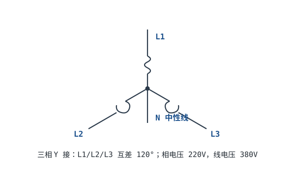

# 市电与三相电基础 Mains & Three-Phase Power

墙上插座是 220V，工厂里却是 380V；有的插头是三脚、有的是两脚。这一章讲清楚市电到底是什么：单相 220V 和三相 380V 的关系、火线零线地线各干什么。这是安全用电和电源设计的前提。

## 1. 设计动机

::: motivation 为什么要分清火线零线地线
接反了可能触电、设备可能烧、保险丝可能接在零线上起不到保护。做电源产品、接插座、设计配电，都必须知道哪根是 L（火线）、哪根是 N（零线）、哪根是 PE（地线）。工厂设备用三相 380V，家用是单相 220V，它们来自同一套三相系统。
:::

## 2. 原理图与三相波形



```echarts
{
  "tooltip": {"trigger": "axis"},
  "legend": {"data": ["L1", "L2", "L3"], "bottom": 0, "textStyle": {"fontSize": 13}},
  "grid": {"left": 56, "right": 24, "top": 26, "bottom": 56},
  "xAxis": {"type": "category", "name": "角度", "data": [0,30,60,90,120,150,180,210,240,270,300,330,360], "axisLabel": {"fontSize": 11}},
  "yAxis": {"type": "value", "name": "电压", "min": -1.2, "max": 1.2, "axisLabel": {"fontSize": 11}},
  "series": [
    {"name": "L1", "type": "line", "smooth": true, "showSymbol": false, "lineStyle": {"width": 2.4, "color": "#1a4f8b"},
     "data": [0,0.5,0.866,1,0.866,0.5,0,-0.5,-0.866,-1,-0.866,-0.5,0]},
    {"name": "L2", "type": "line", "smooth": true, "showSymbol": false, "lineStyle": {"width": 2.4, "color": "#b5642e"},
     "data": [-0.866,-1,-0.866,-0.5,0,0.5,0.866,1,0.866,0.5,0,-0.5,-0.866]},
    {"name": "L3", "type": "line", "smooth": true, "showSymbol": false, "lineStyle": {"width": 2.4, "color": "#4f9e63"},
     "data": [0.866,0.5,0,-0.5,-0.866,-1,-0.866,-0.5,0,0.5,0.866,1,0.866]}
  ]
}
```

## 3. 单相与三相（只给结论）

::: analogy 三相像三个步调一致又错开的水车
三相电是三组交流电源，频率相同、相位互差 120°。它们的瞬时功率加起来几乎恒定（不像单相那样每秒脉动 100 次），所以电机转得平稳、输电效率高。
:::

- **相电压**：一根相线对中性线 N 的电压。我国是 **220V**（有效值）。
- **线电压**：两根相线之间的电压。是相电压的 $\sqrt3$ 倍：$380V=220\times\sqrt3$。
- **家用插座**：取三相中的**一相 + 中性线**，得到 220V（火线 L、零线 N）。
- **工厂动力**：用**三根相线**，得到 380V，驱动三相电机。

三根线的分工：

| 线 | 作用 | 带电？ |
|---|---|---|
| L 火线 | 送来电压 | 正常运行对地约 220V；上级开关断开、隔离变压器二次侧等情况下不为 220V，检修前必须验电 |
| N 零线 | 电流回路，变压器中性点接地 | 正常时对地≈0V |
| PE 地线 | 安全保护，接设备外壳 | 正常无电流 |

::: advanced 进阶：为什么线电压是 √3 倍
两根相线的电压是两个互差 120° 的正弦波之差。用相量（复数）相减，$|V_{line}|=|V_{phase}-V_{phase}\angle120^{\circ}|=\sqrt3\,V_{phase}$。220×1.732≈380V。这就是 √3 的来历。
:::

## 4. 带数字的算例

::: example 家用插座与工业插座
1. **家里墙上插座**：L 对 N = 220V，给手机充电器、电视供电。
2. **工厂三相插座**：L1-L2、L2-L3、L3-L1 两两都是 380V，接三相电机；同时任意一相对 N 仍是 220V，可给控制电路供电。
3. **一台 380V/3kW 三相电机**：每根相线电流 $I=P/(\sqrt3\times V_{line})=3000/(1.732\times380)\approx4.6$ A。
:::

## 5. 常见坑

::: pitfall 常见坑
- **把 PE 地线当零线用**：现象——设备外壳带电、跳闸。原因——PE 是保护线，正常不流工作电流；当零线用会让外壳带电位。解决——L、N、PE 严格分开，PE 只接外壳。
- **以为零线没电**：现象——断零线后，触摸"零线"被电。原因——零线一旦在前端断开，通过负载与火线连通，对地带上 220V。解决——检修前先验电，任何线都当可能带电处理。
- **三相负载不平衡导致零线电流大**：现象——零线发热。原因——三相负载不均，中性线流过不平衡电流。解决——尽量把单相负载平均分到三相上。
:::

## 6. 自测题

<details><summary>家用 220V 和工业 380V 是什么关系？</summary>

同一套三相系统：220V 是**相电压**（一根相线对中性线），380V 是**线电压**（两根相线之间），$380=220\times\sqrt3$。家用取一相一零，工业用三根相线。
</details>

<details><summary>PE 地线和 N 零线有什么区别？</summary>

N 是**工作回路**，正常有电流；PE 是**保护线**，只在故障时流过漏电电流，接设备外壳。二者在变压器中性点共地，但到了用户端不能互换、不能短接。
</details>

<details><summary>为什么工厂用三相而不是单相？</summary>

三相瞬时功率更平稳（电机转矩脉动小）、输电省铜（同样功率下导线总用量少）、三相电机结构简单可靠。大功率场合几乎都用三相。
</details>

## 7. 参考资料

- Practical Electronics for Inventors (Scherz & Monk) — AC Mains & Three-Phase
- NEETS — Three-Phase Circuits
- [Lessons In Electric Circuits — Polyphase AC Circuits](https://www.ibiblio.org/kuphaldt/electricCircuits/)
