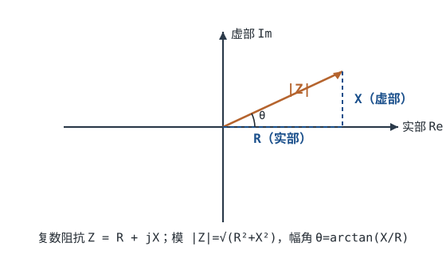
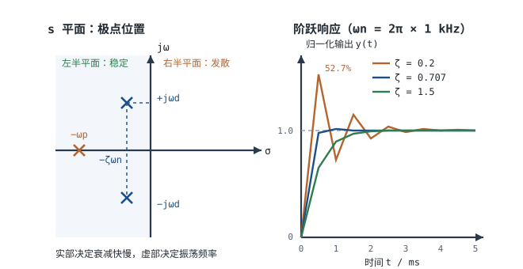

---

id: math-basics
title: "数学基础：复数、dB 与拉氏变换直觉 Math Basics: Complex Numbers, dB, Laplace"
part: 1
chapter: 数学基础
order: 70
tags: [复数, dB, 对数, 拉氏变换, s域, 数学基础]
difficulty: 2
status: published
sources:
  - Lessons In Electric Circuits, Vol. II – AC（Kuphaldt）, Chapter 2 Complex Numbers（直角/极坐标互换、四则运算与共轭）；Chapter 8 Filters（一阶/二阶响应、截止频率与 dB）
  - 《电路》（邱关源，高等教育出版社）「相量法」与「线性动态电路的复频域分析」两章（相量法的前提、拉普拉斯变换与 s 域阻抗）
  - IEC 60027-3:2002《Letter symbols to be used in electrical technology – Part 3: Logarithmic and related quantities, and their units》— 功率量按 10 lg、场量按 20 lg 的 dB 定义
  - Sedra & Smith, Microelectronic Circuits, 7th ed., Section 1.6 Frequency Response of Amplifiers（dB、伯德图、一阶极点与主极点近似）
  - Ogata, Modern Control Engineering, 5th ed., Chapter 5 Transient and Steady-State Response Analyses（一阶/二阶系统的极点、阻尼比、超调与建立时间）
  - Analog Devices, MT-048《Op Amp Noise Relationships: 1/f Noise, RMS Noise, and Equivalent Noise Bandwidth》— 噪声密度、等效噪声带宽与 RMS 噪声的换算口径
---

# 数学基础：复数、dB 与拉氏变换直觉 Math Basics: Complex Numbers, dB, Laplace

在[直流与交流、频率、相位与有效值](dc-ac.md)里，一个正弦量被拆成幅值、频率、相位三个数；在[阻抗与导纳](impedance.md)里，这三个数被压进一个复数 $Z=R+jX$；到了[一阶滤波器](../opamp/first-order-filters.md)和[稳定性：伯德图、相位裕度与补偿](../opamp/stability-bode.md)，同一个系统又改用 $H(s)$ 和 dB 来描述。三套语言看起来各说各话，底层其实是同一组数学：复数、对数、指数、极点。

这一章不追求数学严格性，目标是"工程最小集"：几张可查的表、几个能从头算到尾的算例、一套判断"这套数学什么时候不成立"的边界。读完应当能独立完成四件事：把 $30+j40$ 与 $60-j80$ 并联算出模和相角；把一条链路的增益与损耗逐级相加；由极点位置说出过冲和建立时间；把噪声密度乘上噪声带宽得到 RMS 噪声。

## 1. 设计动机

::: motivation 三次"电路没错、数学错了"的现场
**现场一：并联阻抗直接相加。** 一个 $30+j40\ \Omega$ 的感性支路与一个 $60-j80\ \Omega$ 的容性支路并联，有人图省事写成 $30+j40+60-j80=90-j40$，得到 $98.49\ \Omega\angle-23.96^{\circ}$。正确答案是 $50.77\ \Omega\angle+23.96^{\circ}$：模差了 1.94 倍，相角的符号还反了——把感性负载算成了容性。相位一反，功率因数、补偿方向和采样对齐全部跟着错。

**现场二：dB 口径混用。** 一级电压增益 100 的放大器，输入阻抗 1kΩ、输出接 50Ω 负载。按 $20\log_{10}100$ 算出 40dB；按真正的功率比算是 $10\log_{10}(100^2\times1000/50)=53.0$ dB。两者差 13dB，也就是功率差 20 倍。用 40dB 去做链路预算，后级会被低估 20 倍，ADC 量程直接选错。

**现场三：一阶模型套二阶系统。** 用一条 RC 的时间常数去估 LDO 或运放环路的阶跃响应，结论是"一阶系统没有过冲"。实际环路是二阶、阻尼比只有 0.2，阶跃过冲 52.7%，3.3V 的轨在负载跳变时冲到 5.0V，后级芯片被过压打坏。
:::

三个现场的共性：**公式本身没写错，错在选错了模型、用错了口径**。

本章的四张表，就是用来在动手算之前先做一次"口径确认"：

| 表 | 回答什么问题 | 在哪一节 |
|---|---|---|
| 复数运算表 | 什么时候用直角坐标、什么时候用极坐标 | §2.1、§3.2 |
| dB 对照表 | 这个数是电压比还是功率比，10 还是 20 | §2.3、§5.1 |
| 极点—响应表 | 一阶还是二阶，过冲和建立时间各是多少 | §2.4、§5.1 |
| 时间常数—频率表 | τ、$f_c$、上升时间怎么互换 | §5.1 |

遇到具体问题时，先在下表定位，再决定要不要精算：

| 你想解决 | 先算 | 判据 |
|---|---|---|
| 并联/分压的模与相位 | 极坐标乘除、直角坐标加减 | 先问一句"这一步是加减还是乘除" |
| 多级增益预算 | 各级 dB 直接相加 | 功率用 10log、电压用 20log，不混用 |
| 过冲与建立时间 | 阻尼比 $\zeta$、自然频率 $\omega_n$ | $\zeta\ge0.707$ 时过冲小于 5% |
| 噪声有效值 | 噪声密度乘 $\sqrt{BW}$ | 单极点系统噪声带宽是 $\pi f_c/2$，不是 $f_c$ |
| 这套模型还能不能用 | LTI、单一频率、稳态、线性 | 任一条不满足就换工具 |

**不懂会在哪摔跤**，具体是这四条：

1. 把并联当串联算，阻抗模差近 2 倍、相角反号，补偿网络越补越振。
2. 把电压增益的 20log 当成功率增益，链路预算差 10~20dB，接收灵敏度算错一个数量级。
3. 把 $s=j\omega$ 用到上电、短路、开关瞬间，算不出浪涌和过冲，器件耐压与保险丝选小。
4. 把一阶 RC 的 $2.2\tau$ 上升时间套到二阶或高阶系统，建立时间估短一半，ADC 采样窗口不够。

## 2. 定义与直观

### 2.1 复数：一支带角度的箭头

复数有两个等价写法。**直角坐标**写成实部加虚部，**极坐标**写成模加角度：

$$z=a+jb=r\angle\theta,\qquad j^2=-1$$

符号与单位：

- $a$：实部，无量纲（在阻抗里单位是 $\Omega$）；
- $b$：虚部，无量纲（在阻抗里单位是 $\Omega$）；
- $j$：虚数单位，$j^2=-1$，电气工程用 $j$ 而不用 $i$，避免与电流混淆；
- $r$：模，$r=\lvert z\rvert\ge0$，与 $a$、$b$ 同单位；
- $\theta$：幅角，rad 或度，表示相对实轴逆时针旋转的角度。

两种写法之间用下面两式互换：

$$r=\sqrt{a^2+b^2},\qquad \theta=\operatorname{atan2}(b,a)$$

$$a=r\cos\theta,\qquad b=r\sin\theta$$

这里必须用四象限反正切 $\operatorname{atan2}(b,a)$，不能用 $\arctan(b/a)$。当 $a<0$ 时，$\arctan(b/a)$ 会落到错误的象限，角度差 $180^{\circ}$。例如 $-3+j4$ 的正确幅角是 $126.87^{\circ}$，而 $\arctan(4/-3)=-53.13^{\circ}$——后者正好是把感性算成了容性。



::: analogy 复数是一支可以旋转和伸缩的箭头
把复数想成平面上的一支箭头：长度是"大小"，角度是"方向"。

- **加、减**：两支箭头首尾相接，所以按实部、虚部分别加减；
- **乘**：长度相乘、角度相加，相当于"把一支箭头按另一支的长度伸缩、再旋转它的角度"；
- **除**：长度相除、角度相减；
- **乘 $j$**：长度不变、角度加 $90^{\circ}$，就是"原地转四分之一圈"。

类比的边界：箭头是静态的，而相量背后有一个以 $\omega$ 转动的整体因子 $e^{j\omega t}$；复数本身只记录"转多快、从哪开始"里的幅度和初相，不记录频率。
:::

复数四则的规则可以浓缩成一张表。"用哪种坐标"比"背公式"更重要：

| 运算 | 直角坐标 | 极坐标 | 适用场景 |
|---|---|---|---|
| 加/减 | 实部、虚部分别加减 | 先转直角坐标 | 串联阻抗、KVL |
| 乘 | $(a+jb)(c+jd)=(ac-bd)+j(ad+bc)$ | 模相乘、角相加 | 阻抗乘积、相量旋转 |
| 除 | 分子分母同乘分母共轭 | 模相除、角相减 | 并联阻抗、分压 |
| 共轭 | $z^{*}=a-jb$ | $r\angle-\theta$ | 求倒数、求模方 |
| 模 | $\sqrt{a^2+b^2}$ | 直接读 $r$ | 求电流大小 |
| 倒数 | $\dfrac{1}{z}=\dfrac{z^{*}}{\lvert z\rvert^2}$ | $\dfrac{1}{r}\angle-\theta$ | 阻抗转导纳 |

举三个能口算的例子，把"哪种坐标方便"坐实：

$$(3+j4)+(6-j8)=9-j4$$

$$(3+j4)(6-j8)=18-j24+j24-j^2 32=18+32=50$$

乘法用极坐标更快：$5\angle53.13^{\circ}\times10\angle-53.13^{\circ}=50\angle0^{\circ}$。除法用共轭：

$$\frac{3+j4}{6-j8}=\frac{(3+j4)(6+j8)}{6^2+8^2}=\frac{-14+j48}{100}=-0.14+j0.48=0.5\angle106.26^{\circ}$$

注意最后一步：商的模是 $5/10=0.5$，角是 $53.13^{\circ}-(-53.13^{\circ})=106.26^{\circ}$，与直角坐标结果一致。**乘除走极坐标、加减走直角坐标**，这条习惯能消掉大部分符号错误。

### 2.2 相量法：为什么可以"只算幅度和相位"

相量（Phasor）是正弦量在单一频率下的复数表示。约定用余弦为参考：

$$v(t)=V_m\cos(\omega t+\varphi_v)\quad\Longleftrightarrow\quad\dot V=V_m\angle\varphi_v$$

（若改以正弦为参考，所有初相整体平移 $90^{\circ}$，幅度与相位差不变；本手册其他章节多用正弦参考，比较相位时注意参考量。）

其中 $V_m$ 是峰值，V；$\omega$ 是角频率，rad/s；$\varphi_v$ 是初相，rad。写成复指数形式：

$$v(t)=\operatorname{Re}\left[\dot V e^{j\omega t}\right]$$

对时间求导，$e^{j\omega t}$ 不变，只是前面多出一个 $j\omega$：

$$\frac{d}{dt}\left(\dot V e^{j\omega t}\right)=j\omega\,\dot V e^{j\omega t}$$

这就是相量法的全部秘密：**在单一频率的正弦稳态下，微分算子 $d/dt$ 等价于乘 $j\omega$**。于是 $v=L\,di/dt$ 变成 $\dot V=j\omega L\dot I$，$i=C\,dv/dt$ 变成 $\dot I=j\omega C\dot V$，微分方程退化成代数方程。电感、电容的阻抗 $j\omega L$、$1/(j\omega C)$ 都是这条替换的直接结果，详见[阻抗与导纳](impedance.md)。

但这条替换有前提，而且每一条都能在工程上被违反：

| 前提 | 满足时能做什么 | 违反时的典型现象 | 该换什么工具 |
|---|---|---|---|
| 线性（Linearity） | 各频率分量分别计算再叠加 | 二极管整流、铁芯饱和、限幅 | 分段线性/时域仿真/描述函数 |
| 时不变（Time-invariant） | 传递函数不随时间变 | 开关电源、混频器、斩波 | 时变系统分析、分段线性 |
| 单一频率 | 所有量共用 $e^{j\omega t}$，可约掉 | 方波、PWM、多音信号 | 傅里叶分解，每个频率各算一次 |
| 正弦稳态 | 只保留稳态解 | 上电、短路、负载跳变 | 拉普拉斯/时域微分方程 |

还有一条容易忽略：**相量只保留幅度和相位，不保留频率和绝对时间**。所以"相量相加"只对同频信号有意义；两个不同频率的相量相加，结果是没有任何物理意义的复数。不同频率的波形必须在时域相加，或者各自算完再叠加。

::: advanced 为什么 $e^{j\omega t}$ 是 LTI 系统的"特征函数"
对线性时不变系统，输入 $e^{st}$（$s$ 为复数）时，输出必然是 $H(s)e^{st}$——形状不变，只被一个复数缩放。把 $s=j\omega$ 代入，输入就是等幅正弦，输出是同一频率、幅度乘 $\lvert H(j\omega)\rvert$、相位加 $\angle H(j\omega)$ 的正弦。

这就是"为什么可以只算幅度和相位"的严格答案：LTI 系统不产生新频率，只改变每个频率分量的幅度和相位。反过来，只要系统是非线性的（产生新频率）或时变的（参数随开关变化），$e^{j\omega t}$ 就不再是特征函数，相量法失效。
:::

### 2.3 分贝：把乘法变成加法

分贝（decibel, dB）是两个功率之比的常用对数，乘以 10：

$$L_P=10\log_{10}\frac{P_2}{P_1}$$

当场量（电压、电流）在同一阻抗上比较时，因为 $P=V^2/R$，功率比等于电压比的平方，于是：

$$L_V=10\log_{10}\frac{V_2^2}{V_1^2}=20\log_{10}\frac{V_2}{V_1}$$

符号与单位：$L_P$、$L_V$ 是"级"（level），单位 dB，严格说是无量纲；$P_2/P_1$、$V_2/V_1$ 是比值。IEC 60027-3 把这两条口径分别定义为功率量与场量的级差，工程上简称为"10log"和"20log"。

为什么差 2 倍？因为**功率正比于电压的平方**，平方在对数里变成乘 2。这不是两套定义，而是同一套定义在"同阻抗"条件下的两种写法。一旦阻抗不同，20log 算出的就只是电压比，不再等于功率比——这一点在 §3.3 展开。

常用的换算值必须记熟。下表每一行都能用 $10^{L/20}$（电压）与 $10^{L/10}$（功率）复算：

| dB | 电压比 $10^{L/20}$ | 功率比 $10^{L/10}$ | 记忆口径 |
|---|---|---|---|
| 0 | 1.000 | 1.000 | 不变 |
| 1 | 1.122 | 1.259 | 约 +12% 电压、+26% 功率 |
| 3 | 1.413 | 1.995 | 电压 ×1.41、功率 ×2（半功率点） |
| 6 | 1.995 | 3.981 | 电压 ×2、功率 ×4 |
| 10 | 3.162 | 10.00 | 电压 ×3.16、功率 ×10 |
| 20 | 10.00 | 100.0 | 电压 ×10、功率 ×100 |
| 40 | 100.0 | 10000 | 电压 ×100、功率 ×10⁴ |
| 60 | 1000 | 10⁶ | 电压 ×1000、功率 ×10⁶ |
| −3 | 0.708 | 0.501 | 电压 ×0.707、功率减半 |
| −6 | 0.501 | 0.251 | 电压减半、功率 1/4 |
| −20 | 0.100 | 0.010 | 电压 1/10、功率 1/100 |

三个最常用的锚点：**+6dB 电压翻倍、+20dB 电压十倍、+3dB 功率翻倍**。注意 3dB 对应电压 ×1.413 而不是 ×1.5，6dB 对应功率 ×3.98 而不是 ×4——工程上按 2 和 4 记没问题，但做预算时要清楚误差在 1% 量级。

dB 还可以带绝对参考，变成绝对量：

| 记号 | 参考量 | 换算 | 典型用途 |
|---|---|---|---|
| dBm | 1 mW | $P=10^{L/10}\ \text{mW}$ | 射频功率、接收灵敏度 |
| dBW | 1 W | $P=10^{L/10}\ \text{W}$ | 发射功率 |
| dBV | 1 V（有效值） | $V=10^{L/20}\ \text{V}$ | 音频电平 |
| dBµV | 1 µV（有效值） | $V=10^{L/20}\ \mu\text{V}$ | EMC、天线端口 |
| dBc | 载波功率 | 相对载波 | 谐波、杂散、相位噪声 |

0dBm 是 1mW，但它对应的电压取决于阻抗：50Ω 上是 $\sqrt{0.001\times50}=0.2236$ V，600Ω 上是 $\sqrt{0.001\times600}=0.7746$ V。**dBm 是功率，不能直接当电压用**；看到"−80dBm"要先问负载阻抗，才能换成 µV。

dB 的工程价值有三条：级联系统的增益与损耗直接相加；极大的动态范围被压成两三位数；人耳与视觉的响应本来就接近对数。代价是"比值的比"不再直观——+3dB 再加 +3dB 是 +6dB（电压 ×2），不是"3 加 3 等于 6 倍"。

### 2.4 极点、时间常数与阻尼比：响应形状由极点位置决定

一阶系统的传递函数写成标准形式：

$$H(s)=\frac{K}{1+s/\omega_p}$$

它在 $s=-\omega_p$ 有一个实极点，时间常数 $\tau=1/\omega_p$，$-3$dB 截止频率 $f_c=\omega_p/(2\pi)=1/(2\pi\tau)$。单位阶跃响应是：

$$y(t)=K\left(1-e^{-t/\tau}\right)$$

几个必须记住的点：$t=\tau$ 到 63.2%，$2\tau$ 到 86.5%，$3\tau$ 到 95.0%，$4\tau$ 到 98.2%，$5\tau$ 到 99.3%，$6.9\tau$ 到 99.9%。10%~90% 上升时间 $t_r=\tau\ln9=2.197\tau\approx2.2\tau$；到 1% 的建立时间 $t_s=\tau\ln100=4.605\tau$。

二阶系统写成标准形式：

$$H(s)=\frac{\omega_n^2}{s^2+2\zeta\omega_n s+\omega_n^2}$$

它的两个极点是：

$$s_{1,2}=-\zeta\omega_n\pm j\omega_n\sqrt{1-\zeta^2}$$

符号与单位：$\omega_n$ 是无阻尼自然频率，rad/s；$\zeta$ 是阻尼比，无量纲；极点的实部 $-\zeta\omega_n$ 决定衰减快慢，虚部 $\omega_n\sqrt{1-\zeta^2}$ 决定振荡频率。品质因数与阻尼比的关系是 $Q=1/(2\zeta)$。

三种情形：

- $\zeta<1$：一对共轭复极点，欠阻尼，阶跃响应有超调与振铃；
- $\zeta=1$：两个重合实极点，临界阻尼，无超调，是"不过冲前提下最快"的参考点；
- $\zeta>1$：两个不同实极点，过阻尼，响应更慢但没有振荡。

欠阻尼时的超调量、峰值时间与 2% 建立时间有闭式：

$$M_p=\exp\left(-\frac{\pi\zeta}{\sqrt{1-\zeta^2}}\right),\qquad t_p=\frac{\pi}{\omega_n\sqrt{1-\zeta^2}},\qquad t_s\approx\frac{4}{\zeta\omega_n}$$



把同一自然频率、不同阻尼比的响应画在一起，形状差异一目了然：

```echarts
{
  "animation": false,
  "tooltip": {"trigger": "axis"},
  "legend": {"data": ["ζ=0.2", "ζ=0.707", "ζ=1.5"], "bottom": 0, "textStyle": {"fontSize": 12}},
  "grid": {"left": 66, "right": 26, "top": 34, "bottom": 58},
  "xAxis": {"type": "value", "name": "时间 t / ms", "nameLocation": "middle", "nameGap": 30,
            "min": 0, "max": 5, "interval": 0.5, "axisLabel": {"fontSize": 11}},
  "yAxis": {"type": "value", "name": "归一化输出 y(t)", "nameLocation": "middle", "nameGap": 44,
            "min": 0, "max": 1.7, "interval": 0.2, "axisLabel": {"fontSize": 11}},
  "series": [
    {"name": "ζ=0.2", "type": "line", "showSymbol": false, "smooth": false,
     "lineStyle": {"width": 2.4, "color": "#b5642e"},
     "data": [[0,0],[0.125,0.2648],[0.25,0.8278],[0.375,1.3256],[0.5,1.5255],[0.625,1.4073],[0.75,1.1162],[0.875,0.8452],[1,0.725],[1.125,0.7755],[1.25,0.9253],[1.375,1.0722],[1.5,1.1432],[1.625,1.1231],[1.75,1.0465],[1.875,0.9672],[2,0.9257],[2.125,0.9328],[2.25,0.9717],[2.375,1.0144],[2.5,1.0383],[2.625,1.0365],[2.75,1.0169],[2.875,0.994],[3,0.9803],[3.125,0.9802],[3.25,0.9901],[3.375,1.0023],[3.5,1.01],[3.625,1.0106],[3.75,1.0057],[3.875,0.9993],[4,0.9949],[4.125,0.9943],[4.25,0.9967],[4.375,1.0001],[4.5,1.0026],[4.625,1.0031],[4.75,1.0019],[4.875,1.0001],[5,0.9987]]},
    {"name": "ζ=0.707", "type": "line", "showSymbol": false, "smooth": false,
     "lineStyle": {"width": 2.4, "color": "#1a4f8b"},
     "data": [[0,0],[0.125,0.2098],[0.25,0.5587],[0.375,0.8299],[0.5,0.9795],[0.625,1.036],[0.75,1.0419],[0.875,1.029],[1,1.0145],[1.125,1.0046],[1.25,0.9997],[1.375,0.9982],[1.5,0.9983],[1.625,0.999],[1.75,0.9995],[1.875,0.9999],[2,1],[2.125,1.0001],[2.25,1.0001],[2.375,1],[2.5,1],[2.625,1],[2.75,1],[2.875,1],[3,1],[3.125,1],[3.25,1],[3.375,1],[3.5,1],[3.625,1],[3.75,1],[3.875,1],[4,1],[4.125,1],[4.25,1],[4.375,1],[4.5,1],[4.625,1],[4.75,1],[4.875,1],[5,1]]},
    {"name": "ζ=1.5", "type": "line", "showSymbol": false, "smooth": false,
     "lineStyle": {"width": 2.4, "color": "#2f7d4f"},
     "data": [[0,0],[0.125,0.1545],[0.25,0.3602],[0.375,0.5243],[0.5,0.6474],[0.625,0.7388],[0.75,0.8065],[0.875,0.8566],[1,0.8938],[1.125,0.9213],[1.25,0.9417],[1.375,0.9568],[1.5,0.968],[1.625,0.9763],[1.75,0.9824],[1.875,0.987],[2,0.9904],[2.125,0.9929],[2.25,0.9947],[2.375,0.9961],[2.5,0.9971],[2.625,0.9978],[2.75,0.9984],[2.875,0.9988],[3,0.9991],[3.125,0.9994],[3.25,0.9995],[3.375,0.9996],[3.5,0.9997],[3.625,0.9998],[3.75,0.9999],[3.875,0.9999],[4,0.9999],[4.125,0.9999],[4.25,1],[4.375,1],[4.5,1],[4.625,1],[4.75,1],[4.875,1],[5,1]]}
  ]
}
```

图中 $\omega_n=2\pi\times1000\ \text{rad/s}$，采样点按 §3.4 的解析式算出。$\zeta=0.2$ 的峰值 1.5255 对应 52.6% 过冲，与解析式给出的 52.66% 一致（离散采样点略低于连续峰值）。

把极点位置与响应形态的对应关系固化成表，比记公式更有用：

| 极点位置 | 响应形态 | 时域特征 | 工程含义 |
|---|---|---|---|
| 负实轴单极点 $-\omega_p$ | 单调指数 | $\tau=1/\omega_p$，无过冲 | RC、一阶低通 |
| 左半平面共轭极点，$\zeta<1$ | 衰减振荡 | 超调、振铃、峰值时间 $t_p$ | 欠阻尼环路、LC 滤波 |
| 重实根，$\zeta=1$ | 临界阻尼 | 无过冲，建立较慢 | 保守补偿目标 |
| 两个负实根，$\zeta>1$ | 过阻尼 | 无过冲，更慢 | 大裕量、慢速系统 |
| 虚轴上（$\zeta=0$） | 等幅振荡 | 不衰减 | 理想 LC、未阻尼振荡器 |
| 右半平面 | 发散 | 幅度指数上升 | 正反馈、失稳 |

阻尼比还能与相位裕度（Phase Margin, PM）对应。对单位负反馈的二阶系统，近似关系如下表；这张表是"伯德图上的度数"与"时域上的过冲"之间的桥：

| $\zeta$ | 0.1 | 0.2 | 0.3 | 0.5 | 0.707 | 1.0 |
|---|---|---|---|---|---|---|
| 过冲 $M_p$ | 72.9% | 52.7% | 37.2% | 16.3% | 4.3% | 0 |
| 相位裕度 PM | $11.4^{\circ}$ | $22.6^{\circ}$ | $33.3^{\circ}$ | $51.8^{\circ}$ | $65.5^{\circ}$ | — |
| $Q=1/(2\zeta)$ | 5.0 | 2.5 | 1.67 | 1.0 | 0.707 | 0.5 |

结论：**想要过冲小于 5%，$\zeta$ 至少 0.7，对应 PM 约 $65^{\circ}$**；PM 只有 $22.6^{\circ}$ 时，时域上就是 52.7% 的过冲。这也是[稳定性：伯德图、相位裕度与补偿](../opamp/stability-bode.md)里把 $45^{\circ}\sim60^{\circ}$ 当作设计下限的原因。

### 2.5 拉普拉斯与 $s=j\omega$ 的直觉

拉普拉斯变换把一个时间函数 $f(t)$ 映射成复变量 $s=\sigma+j\omega$ 的函数：

$$F(s)=\int_0^{\infty}f(t)e^{-st}\,dt$$

工程上不必手算积分，只需要理解三件事：

1. **$s$ 是"测试信号" $e^{st}$ 的代号**。$e^{st}=e^{\sigma t}e^{j\omega t}$：$e^{j\omega t}$ 负责振荡，$e^{\sigma t}$ 负责包络。$\sigma<0$ 时包络衰减，$\sigma=0$ 时等幅，$\sigma>0$ 时发散。
2. **LTI 系统对 $e^{st}$ 的响应是 $H(s)e^{st}$**。把元件方程里的 $d/dt$ 换成 $s$，电感变成 $sL$、电容变成 $1/(sC)$，电路就变成"复数域上的电阻网络"，解代数方程即可。
3. **$s=j\omega$ 是虚轴，对应正弦稳态**。把 $\sigma$ 置零，$e^{st}$ 退化成等幅正弦，$H(j\omega)$ 就是频率响应，也就是伯德图上的那条曲线。

三种工具的分工可以用一张表说清：

| 工具 | 变量 | 输入 | 输出 | 适用场景 |
|---|---|---|---|---|
| 相量法 | $j\omega$ | 单一频率正弦稳态 | 幅度与相位 | 交流稳态、阻抗、滤波器频响 |
| 傅里叶 | $j\omega$ | 周期/绝对可积信号 | 频谱 | 谐波、噪声、EMC |
| 拉普拉斯 | $s=\sigma+j\omega$ | 任意因果信号（含初值） | $s$ 域表达式 | 瞬态、稳定性、控制系统 |

适用边界必须写清：

- **传递函数只对 LTI 系统有定义**。非线性系统（二极管、饱和铁芯）和时变系统（开关变换器）没有统一的 $H(s)$，只能分段线性化或数值仿真。
- **$H(s)$ 的定义默认零初始条件**。电容有初压、电感有初流时，要先在 $s$ 域里加初值源，不能直接把 $H(s)$ 乘输入。
- **$s=j\omega$ 只在虚轴上有物理意义**。$\sigma>0$ 对应发散信号，$\sigma<0$ 对应衰减信号，都不是稳态正弦。
- **傅里叶变换存在的条件是收敛**。稳定系统的收敛域包含虚轴，所以 $H(j\omega)$ 可以直接由 $H(s)$ 令 $s=j\omega$ 得到；不稳定系统不能这样代入。
- **"极点都在左半平面"是稳定性的判据**，但只对线性系统成立。开关电源的小信号模型在工作点附近线性化后可以用，大信号行为（启动、短路）不能。

## 3. 定量关系

### 3.1 公式、符号与单位

| 关系 | 公式 | 符号与单位 | 适用条件 |
|---|---|---|---|
| 直角↔极坐标 | $r=\sqrt{a^2+b^2}$，$\theta=\operatorname{atan2}(b,a)$ | $a,b,r$ 同单位；$\theta$ 为 rad 或度 | 任意复数 |
| 加减 | $(a+jb)\pm(c+jd)=(a\pm c)+j(b\pm d)$ | 同单位 | 任意复数 |
| 乘 | $(a+jb)(c+jd)=(ac-bd)+j(ad+bc)$ | 同单位 | 任意复数 |
| 除 | $\dfrac{a+jb}{c+jd}=\dfrac{(a+jb)(c-jd)}{c^2+d^2}$ | 同单位 | 分母非零 |
| 共轭与模方 | $z z^{*}=a^2+b^2=\lvert z\rvert^2$ | 同单位平方 | 任意复数 |
| 倒数 | $\dfrac{1}{z}=\dfrac{z^{*}}{\lvert z\rvert^2}$ | $1/$单位 | $z\ne0$ |
| 相量导数 | $\dfrac{d}{dt}\leftrightarrow j\omega$ | $\omega$ 为 rad/s | 单一频率正弦稳态 |
| dB（功率） | $L_P=10\log_{10}(P_2/P_1)$ | dB | 任意功率比 |
| dB（电压） | $L_V=20\log_{10}(V_2/V_1)$ | dB | 同阻抗，或仅表示电压比 |
| 绝对功率级 | $L_{\text{dBm}}=10\log_{10}(P/1\ \text{mW})$ | dBm | 功率 |
| 一阶传函 | $H(s)=\dfrac{K}{1+s/\omega_p}$ | $K$ 无量纲，$\omega_p$ 为 rad/s | 单极点 LTI |
| 一阶阶跃 | $y(t)=K(1-e^{-t/\tau})$，$\tau=1/\omega_p$ | s | $t\ge0$ |
| 一阶上升时间 | $t_r=2.197\tau\approx2.2\tau$ | s | 10%~90% |
| 二阶传函 | $H(s)=\dfrac{\omega_n^2}{s^2+2\zeta\omega_n s+\omega_n^2}$ | $\omega_n$ 为 rad/s；$\zeta$ 无量纲 | 二阶 LTI |
| 二阶极点 | $s_{1,2}=-\zeta\omega_n\pm j\omega_n\sqrt{1-\zeta^2}$ | rad/s | $\zeta<1$ 为共轭 |
| 二阶超调 | $M_p=\exp\left(-\dfrac{\pi\zeta}{\sqrt{1-\zeta^2}}\right)$ | 无量纲（比例） | $0<\zeta<1$，无零点 |
| 噪声有效值 | $V_{n,\text{rms}}=e_n\sqrt{BW_n}$ | $e_n$ 为 V/√Hz；$BW_n$ 为 Hz | 白噪声、带宽内增益平坦 |
| 单极点噪声带宽 | $BW_n=\dfrac{\pi}{2}f_c$ | Hz | 一阶低通 |
| 充电到阈值 | $t=-\tau\ln\left(1-\dfrac{V}{V_\infty}\right)$ | s | 一阶 RC，$0<V<V_\infty$ |
| 一阶幅频 | $\lvert H(j\omega)\rvert=\dfrac{1}{\sqrt{1+(f/f_c)^2}}$ | 无量纲 | 一阶低通 |
| 方波谐波 | $A_n=\dfrac{4A}{n\pi}$，$n$ 为奇数 | $A$ 为方波幅度，V | 对称方波 |

### 3.2 复数四则：从定义推一遍

乘法按分配律展开，利用 $j^2=-1$：

$$(a+jb)(c+jd)=ac+jad+jbc+j^2bd=(ac-bd)+j(ad+bc)$$

除法把分母"实数化"，分子分母同乘分母的共轭：

$$\frac{a+jb}{c+jd}=\frac{(a+jb)(c-jd)}{(c+jd)(c-jd)}=\frac{(ac+bd)+j(bc-ad)}{c^2+d^2}$$

倒数令分子为 1，直接得到：

$$\frac{1}{a+jb}=\frac{a-jb}{a^2+b^2}$$

这三条式子解释了为什么**倒数与除法在极坐标下只是"模取倒数、角取相反数"**：共轭把角度翻号，模方把长度归一。

再强调一次象限。$\theta=\arctan(b/a)$ 只在 $a>0$ 时给出正确象限；当 $a<0$ 时，正确角度是 $\arctan(b/a)+180^{\circ}$（或 $-180^{\circ}$，取决于 $b$ 的符号）。工程代码里直接用 `atan2(b, a)`，不要自己判断。一个具体反例：$Z=-3+j4$，$\lvert Z\rvert=5$，$\operatorname{atan2}(4,-3)=126.87^{\circ}$，而 $\arctan(4/-3)=-53.13^{\circ}$，两者相差 $180^{\circ}$。

### 3.3 10log 还是 20log：差 2 倍的来源

设两个电压 $V_2$、$V_1$ 分别加在 $R_2$、$R_1$ 上，功率比是：

$$\frac{P_2}{P_1}=\frac{V_2^2/R_2}{V_1^2/R_1}=\left(\frac{V_2}{V_1}\right)^2\frac{R_1}{R_2}$$

取对数：

$$10\log_{10}\frac{P_2}{P_1}=20\log_{10}\frac{V_2}{V_1}+10\log_{10}\frac{R_1}{R_2}$$

所以：

- $R_1=R_2$ 时，最后一项为 0，20log 就是功率比，两个口径等价；
- $R_1\ne R_2$ 时，20log 只是电压比，必须补上 $10\log_{10}(R_1/R_2)$ 才是功率比。

用 §1 的例子验算：电压增益 100，输入 1kΩ、输出 50Ω。

$$L_P=20\log_{10}100+10\log_{10}\frac{1000}{50}=40.0+13.01=53.01\ \text{dB}$$

与直接算 $10\log_{10}(100^2\times20)=53.01$ dB 一致。**"电压增益 40dB"与"功率增益 53dB"可以同时成立，因为参考阻抗变了**。写规格书时如果只写 dB 不写口径，这个歧义就会留给下一个人。

::: advanced 为什么 20log 的定义在工程上仍然成立
IEC 60027-3 把"场量级"定义为 $L_F=20\log_{10}(F/F_0)$，其中 $F$ 是电压、电流、声压等"平方律量"。这个定义不要求阻抗相同，它描述的是"场量本身"的级差；只有当需要把它解释为功率比时，才需要同阻抗或补阻抗修正。

所以正确的说法不是"电压必须用 20log、功率必须用 10log"，而是：**先确定你要表达的是功率比还是场量比，再选系数；两者混用时要补阻抗项**。
:::

### 3.4 一阶与二阶响应的推导

::: advanced 一阶与二阶的解析解
**一阶。** 微分方程 $\tau\,dy/dt+y=Kx$，输入单位阶跃 $x=1$、初值 $y(0)=0$，解为：

$$y(t)=K\left(1-e^{-t/\tau}\right)$$

令 $y/K=0.632$ 得 $t=\tau\ln(1/0.368)=\tau$，所以"一个时间常数到 63.2%"不是经验值，而是 $1-e^{-1}$ 的直接结果。上升到 90% 的时间是 $\tau\ln10=2.303\tau$，上升到 10% 是 $\tau\ln(10/9)=0.105\tau$，两者相减得 $t_r=2.197\tau$。

**二阶。** 特征方程 $s^2+2\zeta\omega_n s+\omega_n^2=0$ 的根即极点。$\zeta<1$ 时令 $\omega_d=\omega_n\sqrt{1-\zeta^2}$，单位阶跃响应为：

$$y(t)=1-e^{-\zeta\omega_n t}\left[\cos(\omega_d t)+\frac{\zeta}{\sqrt{1-\zeta^2}}\sin(\omega_d t)\right]$$

对 $y(t)$ 求导并令其为零，第一个峰值出现在 $t_p=\pi/\omega_d$，代回得 $M_p=e^{-\pi\zeta/\sqrt{1-\zeta^2}}$。$\zeta=0.2$ 时 $M_p=e^{-0.6414}=0.5266$，即 52.66%；$\zeta=0.707$ 时 $M_p=e^{-3.1416}=0.0432$，即 4.32%。

建立时间 $t_s\approx4/(\zeta\omega_n)$ 是"包络衰减到 2%"的近似：包络是 $e^{-\zeta\omega_n t}$，令其等于 0.02 得 $t=\ln50/(\zeta\omega_n)=3.912/(\zeta\omega_n)$，工程上取 4。这个近似不考虑振荡的最后一个峰，也不适用于有零点或纯延迟的系统，误差通常在 10%~20%。
:::

### 3.5 指数与对数的四个工程用法

**用法一：充放电与阈值时刻。** 一阶 RC 的充电：

$$V_C(t)=V_\infty\left(1-e^{-t/\tau}\right),\qquad \tau=RC$$

反过来解时间：

$$t=-\tau\ln\left(1-\frac{V_C}{V_\infty}\right)$$

例：5V 经 10kΩ 给 100nF 充电，$\tau=10^4\times100\times10^{-9}=1.0$ ms，充到 3.3V 的时间是

$$t=-1.0\ \text{ms}\times\ln\left(1-\frac{3.3}{5}\right)=-1.0\times\ln0.34=1.079\ \text{ms}$$

这个式子在所有"等阈值"的场合都能用：上电复位、比较器翻转、555 定时、软启动。注意它假设电源是理想阶跃、电容是理想电容；实际还要加比较器延迟、电容容差和介质吸收。

**用法二：滤波器的幅频与 dB。** 一阶低通的幅频：

$$\lvert H(j\omega)\rvert=\frac{1}{\sqrt{1+(f/f_c)^2}}$$

在 $f=f_c$ 处 $\lvert H\rvert=1/\sqrt2=-3.01$ dB，相移 $-45^{\circ}$；在 $f=10f_c$ 处 $\lvert H\rvert=1/\sqrt{101}=0.0995=-20.04$ dB，相移 $-84.3^{\circ}$。这就是"一阶系统每十倍频衰减 20dB"的来源：$20\log_{10}10=20$ dB。换成倍频程，$20\log_{10}2=6.02$ dB，所以 $-20$ dB/十倍频 $=-6$ dB/倍频程。

**用法三：噪声的 RMS 换算。** 白噪声的功率谱密度 $e_n$ 单位是 V/√Hz，带宽内的 RMS 噪声是：

$$V_{n,\text{rms}}=e_n\sqrt{BW_n}$$

对一阶低通，噪声带宽不是 $-3$dB 带宽，而是 $BW_n=(\pi/2)f_c\approx1.571f_c$。原因是噪声功率要对 $\lvert H\rvert^2$ 积分：

$$\int_0^\infty\frac{1}{1+(f/f_c)^2}\,df=\frac{\pi}{2}f_c$$

所以用 $f_c$ 直接乘会低估 $\sqrt{\pi/2}=1.253$ 倍，即 1.96dB。两个互不相关的等值噪声源相加，总 RMS 是 $\sqrt{2}$ 倍，即 +3dB；$N$ 个等值独立源相加是 $\sqrt{N}$ 倍，即 $10\log_{10}N$ dB。注意这里"相加"的是功率，不是电压。

**用法四：伯德图与数量级。** 对数坐标把乘除变成加减：增益相乘变成 dB 相加，频率乘 10 变成横轴平移一个十倍频。常用锚点：$\log_{10}2=0.3010$，$\log_{10}3=0.4771$，$\ln2=0.6931$，$\ln10=2.3026$，$e^{-1}=0.3679$。记住这几个数，估算时不用计算器。

### 3.6 适用条件与失效边界

- **线性**：叠加原理不成立时，相量法与 $H(s)$ 都不能直接用。二极管整流、铁芯饱和、运放限幅都属于这一类。
- **时不变**：开关电源的占空比在周期内变化，严格说是周期时变系统；小信号分析要在工作点附近线性化，大信号要用时域仿真。
- **单一频率与稳态**：多频信号要分解成各次谐波分别计算；上电、短路、负载跳变要用拉普拉斯或时域解。
- **集总假设**：元件尺寸远小于波长（工程判据 $l<\lambda/10$）。100MHz 时波长 3m，30cm 的走线就不能再当理想导线。
- **噪声模型**：$e_n\sqrt{BW}$ 假设噪声是白噪声、高斯分布、各源独立。1/f 噪声要在拐点频率以下单独积分；相关噪声源不能按平方和相加。
- **极点模型**：二阶近似只在工作点附近、且没有明显零点与纯延迟时成立。实际环路有零点、ESR 零点和传输延迟，过冲可能比二阶公式更大。
- **dB 的电压口径**：不同阻抗之间不能直接用 20log 当功率增益，必须补 $10\log(R_1/R_2)$。

## 4. 典型计算

### 4.1 算例一：复数阻抗的手算全过程

**电路**：10V 有效值、$\omega=10^4$ rad/s（$f=1591.55$ Hz）的交流源，并联两个支路：

- 支路 1：$R_1=30\ \Omega$ 与 $L=4$ mH 串联；
- 支路 2：$R_2=60\ \Omega$ 与 $C=1.25$ µF 串联。

求并联后的等效阻抗（直角坐标与极坐标）、总电流、两支路电流，并验算功率。

**第一步，算电抗。** 角频率 $\omega=10^4$ rad/s：

$$X_L=\omega L=10^4\times4\times10^{-3}=40.0\ \Omega$$

$$X_C=\frac{1}{\omega C}=\frac{1}{10^4\times1.25\times10^{-6}}=\frac{1}{0.0125}=80.0\ \Omega$$

**第二步，写成直角坐标。** 串联支路的阻抗直接相加：

$$Z_1=30+j40\ \Omega,\qquad Z_2=60-j80\ \Omega$$

**第三步，转极坐标。** 支路 1：

$$\lvert Z_1\rvert=\sqrt{30^2+40^2}=\sqrt{2500}=50.0\ \Omega,\qquad \theta_1=\operatorname{atan2}(40,30)=53.13^{\circ}$$

支路 2：

$$\lvert Z_2\rvert=\sqrt{60^2+80^2}=\sqrt{10000}=100.0\ \Omega,\qquad \theta_2=\operatorname{atan2}(-80,60)=-53.13^{\circ}$$

所以 $Z_1=50.0\angle53.13^{\circ}\ \Omega$、$Z_2=100.0\angle-53.13^{\circ}\ \Omega$。一个感性、一个容性，角度正好相反。

**第四步，并联用"积除以和"。** 先算乘积与和：

$$Z_1Z_2=50.0\times100.0\angle(53.13^{\circ}-53.13^{\circ})=5000\angle0^{\circ}\ \Omega^2$$

$$Z_1+Z_2=(30+60)+j(40-80)=90-j40\ \Omega$$

和的模与角：

$$\lvert Z_1+Z_2\rvert=\sqrt{90^2+40^2}=\sqrt{9700}=98.49\ \Omega,\qquad \angle=\operatorname{atan2}(-40,90)=-23.96^{\circ}$$

**第五步，极坐标除法。** 模相除、角相减：

$$Z=\frac{Z_1Z_2}{Z_1+Z_2}=\frac{5000\angle0^{\circ}}{98.49\angle-23.96^{\circ}}=50.77\angle+23.96^{\circ}\ \Omega$$

**第六步，转回直角坐标。** 用 $a=r\cos\theta$、$b=r\sin\theta$：

$$a=50.77\cos23.96^{\circ}=50.77\times0.9138=46.39\ \Omega$$

$$b=50.77\sin23.96^{\circ}=50.77\times0.4061=20.62\ \Omega$$

$$Z=46.39+j20.62\ \Omega$$

**第七步，用导纳与共轭验算。** 这是最值得养成的习惯：换一条路径重算，结果必须一致。

$$Y_1=\frac{1}{30+j40}=\frac{30-j40}{30^2+40^2}=\frac{30-j40}{2500}=0.012-j0.016\ \text{S}$$

$$Y_2=\frac{1}{60-j80}=\frac{60+j80}{60^2+80^2}=\frac{60+j80}{10000}=0.006+j0.008\ \text{S}$$

$$Y=Y_1+Y_2=0.018-j0.008\ \text{S}$$

$$\lvert Y\rvert=\sqrt{0.018^2+0.008^2}=\sqrt{0.000388}=0.01970\ \text{S},\qquad \lvert Z\rvert=\frac{1}{0.01970}=50.77\ \Omega$$

导纳的角是 $\operatorname{atan2}(-0.008,0.018)=-23.96^{\circ}$，取倒数后角度翻号，得 $+23.96^{\circ}$，与第五步一致。

**第八步，总电流。** 10V 有效值：

$$I=\frac{V}{\lvert Z\rvert}=\frac{10}{50.77}=0.19698\ \text{A}=197.0\ \text{mA}$$

相量形式为 $197.0\angle-23.96^{\circ}$ mA——电流滞后电压 $23.96^{\circ}$，因为等效阻抗呈感性。

**第九步，两支路电流与 KCL 验算。**

$$I_1=\frac{10\angle0^{\circ}}{50\angle53.13^{\circ}}=0.200\angle-53.13^{\circ}\ \text{A}=0.120-j0.160\ \text{A}$$

$$I_2=\frac{10\angle0^{\circ}}{100\angle-53.13^{\circ}}=0.100\angle+53.13^{\circ}\ \text{A}=0.060+j0.080\ \text{A}$$

$$I_1+I_2=0.180-j0.080\ \text{A}\ \Longrightarrow\ \lvert I\rvert=\sqrt{0.180^2+0.080^2}=0.19698\ \text{A}$$

与第八步一致，且角度 $\operatorname{atan2}(-0.08,0.18)=-23.96^{\circ}$ 也对上。

**第十步，功率验算。** 有功与无功：

$$P=I^2R=0.19698^2\times46.39=1.800\ \text{W},\qquad Q=I^2X=0.19698^2\times20.62=0.800\ \text{var}$$

视在功率与功率因数：

$$S=VI=10\times0.19698=1.9698\ \text{VA},\qquad \cos\varphi=\frac{46.39}{50.77}=0.9138$$

分到两个支路：$P_1=I_1^2R_1=0.2^2\times30=1.200$ W，$P_2=0.1^2\times60=0.600$ W，合计 1.800W；$Q_1=0.2^2\times40=1.600$ var（感性），$Q_2=0.1^2\times(-80)=-0.800$ var（容性），合计 0.800var。两条支路的无功部分相互抵消，最终等效阻抗的角度从 $53^{\circ}$ 降到 $24^{\circ}$。

| 量 | 直角坐标 | 极坐标 | 单位 |
|---|---|---|---|
| $Z_1$ | $30+j40$ | $50.00\angle53.13^{\circ}$ | Ω |
| $Z_2$ | $60-j80$ | $100.0\angle-53.13^{\circ}$ | Ω |
| $Z_1+Z_2$ | $90-j40$ | $98.49\angle-23.96^{\circ}$ | Ω |
| $Z_1Z_2$ | $5000$ | $5000\angle0^{\circ}$ | Ω² |
| $Z$ | $46.39+j20.62$ | $50.77\angle+23.96^{\circ}$ | Ω |
| $I$ | $180-j80$ | $197.0\angle-23.96^{\circ}$ | mA |

**这个算例的教训**：并联不能把阻抗直接相加（那会得到 $90-j40$，角度是 $-23.96^{\circ}$）；乘法与除法在极坐标下最快；直角坐标只用来做加减和最终落地。四条运算、三次换坐标，任何一步丢了象限，符号就会反。

### 4.2 算例二：一条 2.4GHz 接收链路的 dB 预算

**需求**：2.4GHz 链路，发射功率 0dBm，发射电缆损耗 1.5dB，收发天线各 2.15dBi，距离 100m，接收端 LNA 增益 12dB、带通滤波损耗 2dB、混频器损耗 7dB、中频放大 30dB。求中频输出端（ADC 前）的信号功率与 50Ω 上的电压。

**第一步，自由空间路径损耗。** 2.4GHz 的波长：

$$\lambda=\frac{c}{f}=\frac{3\times10^8}{2.4\times10^9}=0.125\ \text{m}$$

距离 $d=100$ m，路径损耗：

$$L_{fs}=20\log_{10}\frac{4\pi d}{\lambda}=20\log_{10}\frac{4\pi\times100}{0.125}=20\log_{10}10053=80.05\ \text{dB}$$

**第二步，逐级相加。** dB 的好处在这里：所有增益取正、损耗取负，直接相加。

| 环节 | 增益/损耗 (dB) | 累计 (dBm) |
|---|---|---|
| 发射功率 | 0 | 0 |
| 发射电缆 | −1.5 | −1.50 |
| 发射天线 | +2.15 | +0.65 |
| 自由空间 | −80.05 | −79.40 |
| 接收天线 | +2.15 | −77.25 |
| LNA | +12 | −65.25 |
| 带通滤波 | −2 | −67.25 |
| 混频器 | −7 | −74.25 |
| 中频放大 | +30 | −44.25 |

接收端功率 $P=-44.25$ dBm。

**第三步，换算成功率。** 

$$P=10^{-44.25/10}\ \text{mW}=10^{-4.425}\ \text{mW}=3.758\times10^{-5}\ \text{mW}=3.758\times10^{-8}\ \text{W}$$

**第四步，换算成 50Ω 上的电压。** 

$$V_{rms}=\sqrt{PR}=\sqrt{3.758\times10^{-8}\times50}=\sqrt{1.879\times10^{-6}}=1.371\times10^{-3}\ \text{V}=1.371\ \text{mV}$$

**第五步，验算。** 用 dBµV 口径：$V=1.371$ mV 对应 $20\log_{10}(1371)=62.74$ dBµV；而 $-44.25$ dBm 在 50Ω 上对应 $10\log_{10}(P/1\text{mW})+107=62.74$ dBµV（50Ω 下 0dBm=107dBµV，因为 $0.2236\text{V}=2.236\times10^5\ \mu\text{V}$，$20\log=107$）。两条路径一致。

**结论与工程含义**：链路总增益 $0-1.5+2.15-80.05+2.15+12-2-7+30=-44.25$ dB，其中路径损耗 80dB 是主导项。如果误把功率当电压、用 20log 算某级的"功率增益"，或者漏掉天线增益的 2.15dBi，结果会差几个 dB 到十几 dB。dB 预算的纪律是：**每一行只写一个环节、单位统一写 dB、绝对量单独标 dBm**。

### 4.3 算例三：把噪声密度换算成 RMS 噪声（完整设计）

**需求**：一个 1MΩ 源阻抗的传感器，输出信号 1mV RMS，测量带宽 200kHz（单极点抗混叠滤波），要求信噪比不低于 20dB。判断电阻热噪声是否可接受；若不够，给出改法。

**第一步，算电阻的热噪声密度。** 电阻热噪声的功率谱密度是 $4kTR$，电压密度：

$$e_n=\sqrt{4kTR}=\sqrt{4\times1.380649\times10^{-23}\times300\times1\times10^6}$$

$$e_n=\sqrt{1.6568\times10^{-14}}=1.287\times10^{-7}\ \text{V}/\sqrt{\text{Hz}}=128.7\ \text{nV}/\sqrt{\text{Hz}}$$

**第二步，算噪声带宽。** 单极点低通的等效噪声带宽是 $\pi/2$ 倍 $-3$dB 带宽：

$$BW_n=\frac{\pi}{2}\times200\times10^3=314159\ \text{Hz},\qquad \sqrt{BW_n}=560.5\ \sqrt{\text{Hz}}$$

**第三步，算 RMS 噪声。** 

$$V_{n,\text{rms}}=128.7\ \text{nV}/\sqrt{\text{Hz}}\times560.5\ \sqrt{\text{Hz}}=72.1\ \mu\text{V}$$

**第四步，算信噪比。** 

$$SNR=20\log_{10}\frac{1\ \text{mV}}{72.1\ \mu\text{V}}=20\log_{10}13.87=22.8\ \text{dB}$$

满足 20dB 要求，余量 2.8dB。

**第五步，对比"直接用 3dB 带宽"的错误。** 若忽略 $\pi/2$，用 200kHz 直接乘：

$$V_{n}'=128.7\ \text{nV}\times\sqrt{200000}=57.6\ \mu\text{V},\qquad SNR'=24.8\ \text{dB}$$

噪声被低估 $72.1/57.6=1.253$ 倍，即 1.96dB。对 20dB 的要求看似仍满足，但余量从 2.8dB 虚增到 4.8dB——**误差方向是乐观的，这正是工程上最危险的方向**。

**第六步，判断噪声源。** 若运放电压噪声是 10nV/√Hz，贡献 $10\times560.5=5.6\ \mu\text{V}$，比电阻的 72.1µV 低 22.2dB，可以忽略。若源阻抗降到 10kΩ，电阻噪声变成 $128.7/\sqrt{100}=12.87$ nV/√Hz，即 $12.87\times560.5=7.2\ \mu\text{V}$，与运放的 5.6µV 合成为 $\sqrt{7.2^2+5.6^2}=9.1\ \mu\text{V}$，此时运放噪声不能再忽略。

**第七步，改法。** 要把 SNR 提到 30dB，需要 $V_n\le1\text{mV}/31.62=31.6\ \mu\text{V}$。保持单极点，解出允许带宽：

$$BW_n=\left(\frac{31.6\ \mu\text{V}}{128.7\ \text{nV}}\right)^2=6.03\times10^4\ \text{Hz},\qquad f_c=\frac{2}{\pi}BW_n=38.4\ \text{kHz}$$

即把带宽从 200kHz 降到 38.4kHz；或者把源阻抗从 1MΩ 降到约 192kΩ（噪声降 $\sqrt{5.2}=2.28$ 倍），或者对 6 次独立采样做平均（$\sqrt{6}=2.45$ 倍，约 7.8dB）。

**验算**：$128.7\ \text{nV}\times\sqrt{1.5708\times38400}=128.7\times245.6=31.61\ \mu\text{V}$，$20\log_{10}(1000/31.61)=30.0$ dB。

这个算例把四个数学工具串在一起：指数/对数（噪声密度定义在根号里）、$\pi/2$（积分出来的噪声带宽）、dB（SNR）、平方根（多源与平均）。**任何一步用错，误差都在 2~3dB 量级，足以让一个勉强达标的设计变成不达标**。

### 4.4 算例四：方波的谐波与带宽

**需求**：一个 ±1V 的对称方波，基频 1kHz。求前几次谐波的幅度与相对基波的 dB；前三次奇次谐波携带多少能量；若要求 10%~90% 上升时间 10ns，需要多宽的带宽。

**第一步，傅里叶级数。** 对称方波（幅度 $A=1$V）的展开式：

$$v(t)=\frac{4A}{\pi}\left(\sin\omega t+\frac{1}{3}\sin3\omega t+\frac{1}{5}\sin5\omega t+\cdots\right)$$

**第二步，各次谐波幅度。** 

$$A_1=\frac{4\times1}{\pi}=1.273\ \text{V},\qquad A_3=\frac{1.273}{3}=0.4244\ \text{V},\qquad A_5=\frac{1.273}{5}=0.2546\ \text{V},\qquad A_7=\frac{1.273}{7}=0.1819\ \text{V}$$

对应的 RMS 是幅度除以 $\sqrt2$：基波 0.900V，三次 0.300V，五次 0.180V。

**第三步，相对基波的 dB。** 

$$L_3=20\log_{10}\frac{1}{3}=-9.54\ \text{dB},\qquad L_5=20\log_{10}\frac{1}{5}=-13.98\ \text{dB},\qquad L_7=20\log_{10}\frac{1}{7}=-16.90\ \text{dB}$$

**第四步，能量分布。** 方波总 RMS 是 1V（因为 $v^2$ 恒为 1）。基波能量占比：

$$\frac{A_1^2/2}{1^2}=\frac{1.273^2/2}{1}=0.8106=81.1\%$$

前三次奇次谐波（1、3、5 次）：

$$\frac{8}{\pi^2}\left(1+\frac{1}{9}+\frac{1}{25}\right)=0.8106\times1.1511=0.9331=93.3\%$$

前四次奇次谐波（加到 7 次）是 95.0%。这就是"方波的边沿由高次谐波决定"的定量版本：基波只给出 81% 的能量，剩下的 19% 分布在无穷多次谐波里。

**第五步，带宽与上升时间。** 一阶系统的上升时间与带宽的常用关系：

$$BW\approx\frac{0.35}{t_r}$$

要求 $t_r=10$ ns，则 $BW=0.35/(10\times10^{-9})=35$ MHz。若用 20MHz 示波器测量，示波器自身的上升时间约 $0.35/20\text{MHz}=17.5$ ns，与信号卷积后：

$$t_{r,\text{meas}}=\sqrt{10^2+17.5^2}=20.2\ \text{ns}$$

看到的边沿比真实值慢一倍。反过来，想准确看 10ns 边沿，示波器带宽至少是信号带宽的 3~5 倍，即 100MHz 以上。

| 谐波次数 | 幅度 (V) | RMS (V) | 相对基波 (dB) | 累计能量 |
|---|---|---|---|---|
| 1 | 1.273 | 0.900 | 0 | 81.1% |
| 3 | 0.4244 | 0.300 | −9.54 | 90.1% |
| 5 | 0.2546 | 0.180 | −13.98 | 93.3% |
| 7 | 0.1819 | 0.129 | −16.90 | 95.0% |

## 5. 工程含义

### 5.1 工程数量级表

**dB 精确对照表**（每一行由 $10^{L/20}$ 与 $10^{L/10}$ 复算）：

| dB | 电压比 | 功率比 | 典型场景 |
|---|---|---|---|
| 0.1 | 1.0116 | 1.0233 | 校准余量、测量不确定度 |
| 0.5 | 1.0593 | 1.1220 | 连接器损耗 |
| 1 | 1.1220 | 1.2589 | 小损耗、滤波器纹波 |
| 3 | 1.4125 | 1.9953 | 半功率点、−3dB 带宽 |
| 6 | 1.9953 | 3.9811 | 电压翻倍 |
| 10 | 3.1623 | 10.000 | 功率十倍 |
| 20 | 10.000 | 100.00 | 电压十倍 |
| 40 | 100.00 | 10000 | 两级 20dB 级联 |
| 60 | 1000.0 | 10⁶ | 电压一千倍 |
| −3 | 0.7079 | 0.5012 | 截止频率 |
| −20 | 0.1000 | 0.0100 | 衰减到 1/10 |

**时间常数—频率—上升时间对照表**（$\tau=1/(2\pi f_c)$，$t_r=2.2\tau$，1% 建立 $4.6\tau$）：

| $\tau$ | $f_c=1/(2\pi\tau)$ | $t_r\approx2.2\tau$ | 1% 建立 $\approx4.6\tau$ | 典型场景 |
|---|---|---|---|---|
| 10 µs | 15.9 kHz | 22 µs | 46 µs | 音频去加重、慢速滤波 |
| 100 µs | 1.59 kHz | 220 µs | 460 µs | 按键消抖、ADC 抗混叠 |
| 1 ms | 159 Hz | 2.2 ms | 4.6 ms | 上电复位、软启动 |
| 10 ms | 15.9 Hz | 22 ms | 46 ms | 电源缓启动、热时间常数 |
| 100 ms | 1.59 Hz | 220 ms | 460 ms | 机械/热系统 |
| 1 s | 0.159 Hz | 2.2 s | 4.6 s | 温度控制、电池模型 |

**极点位置—响应速查表**：

| 极点 | 响应 | 关键参数 | 过冲 |
|---|---|---|---|
| 单实极点 $-\omega_p$ | 单调指数 | $\tau=1/\omega_p$ | 0 |
| 共轭极点，$\zeta=0.2$ | 强振铃 | $M_p=52.7\%$，$Q=2.5$ | 52.7% |
| 共轭极点，$\zeta=0.707$ | 轻微过冲 | $M_p=4.3\%$，PM≈$65.5^{\circ}$ | 4.3% |
| 重实根 $\zeta=1$ | 临界阻尼 | 无过冲，$Q=0.5$ | 0 |
| 两实根 $\zeta=2$ | 过阻尼 | 慢，$Q=0.25$ | 0 |
| 右半平面 | 发散 | 时间常数由实部决定 | 持续增长 |

**对数锚点表**：

| 表达式 | 值 | 用途 |
|---|---|---|
| $\log_{10}2$ | 0.3010 | 倍频程换算 |
| $\log_{10}3$ | 0.4771 | 三次谐波 −9.54dB |
| $\log_{10}e$ | 0.4343 | 自然对数转常用对数 |
| $\ln2$ | 0.6931 | 半衰期、−3dB |
| $\ln10$ | 2.3026 | 十倍频、decade |
| $\ln100$ | 4.6052 | 1% 建立时间 |
| $e^{-1}$ | 0.3679 | 一个时间常数剩 36.8% |
| $e^{-\pi}$ | 0.0432 | $\zeta=0.707$ 的超调 |

### 5.2 什么时候会违反假设

四条边界，每条都配一个会出事的具体场景：

1. **非线性**：铁芯电感在磁通接近 $B_{sat}$（硅钢约 1.7T）时进入饱和，电感量骤降，$j\omega L$ 不再是常数；二极管在正偏/反偏之间切换，不能用一个 $Z$ 描述。此时要分段线性化或直接时域仿真。
2. **时变**：Buck 电路的开关管每周期通断，拓扑在变；用平均模型可以得到小信号传递函数，但开关纹波与瞬态过冲必须用时域。
3. **多频**：方波、PWM、音频信号含大量谐波；相量只能逐频率计算，不能把不同频率的相量相加。EMC 扫描、谐波分析都属于这一类。
4. **瞬态**：上电涌流、短路、负载跳变时，$e^{j\omega t}$ 的稳态假设不成立；要用拉普拉斯或时域解，$s$ 域的初值不能漏。

还有两条"软边界"经常被忽略：

- **集总假设**：100MHz 时波长 3m，30cm 的走线已经是 $\lambda/10$，分布参数不可忽略；此时"一个阻抗"要换成传输线参数。
- **噪声的统计假设**：$e_n\sqrt{BW}$ 假设白噪声、高斯、各源独立。1/f 噪声在拐点以下要单独积分；多个相关噪声源不能简单平方和。

### 5.3 对选型、布线、调试的实际影响

**链路预算决定增益级数与 ADC 量程。** §4.2 的接收链路输出 $-44.25$ dBm，即 1.371mV；3.3V、12 位 ADC 的 1 LSB 是 $3.3/4096=0.806$ mV。信号只有 1.7 LSB，必须在 ADC 前再加约 40dB 增益（×100），才能把信号抬到 137mV（约 170 LSB）。**dB 预算不是纸面练习，它直接决定要不要多一级放大器**。

**极点位置决定补偿与裕度。** $\zeta=0.2$ 对应 PM $22.6^{\circ}$、过冲 52.7%；$\zeta=0.707$ 对应 PM $65.5^{\circ}$、过冲 4.3%。同一个环路，只把相位裕度从 $22^{\circ}$ 补到 $65^{\circ}$，时域过冲就从 52.7% 降到 4.3%——这就是[稳定性：伯德图、相位裕度与补偿](../opamp/stability-bode.md)里补偿网络存在的理由。

**噪声带宽决定滤波器的截止频率。** §4.3 中，把 $f_c$ 从 200kHz 降到 38.4kHz，RMS 噪声从 72.1µV 降到 31.6µV，SNR 从 22.8dB 升到 30dB。反过来，如果只看"信号带宽 200kHz"就选 $f_c=200$kHz，会低估噪声 1.96dB，还会把"刚好达标"误判成"有 4.8dB 余量"。

**复数阻抗决定探头与电缆的负载效应。** 10× 示波器探头是 10MΩ 并联约 15pF。直流时对 1MΩ 源已有 $1\text{M}/(1\text{M}+10\text{M})=9.1\%$ 的负载误差；1MHz 时 15pF 的容抗只有 10.6kΩ，探头阻抗降到约 10.6kΩ，分压后只剩 $10.6\text{k}/(1\text{M}+10.6\text{k})=1.05\%$，波形几乎看不见。到 10MHz 容抗 1.06kΩ，误差更大——"探头一接上波形就变"不是玄学，是复数分压。详见[示波器](../practice/oscilloscope.md)。

**用 dB 写规格，用倍数做计算。** 规格书写"增益 40dB、噪声系数 3dB、回波损耗 20dB"，是因为 dB 可加、可读、可比较；真正算电压、电流时再换回倍数。两套表示之间来回换，是硬件工程师的基本功。

### 5.4 算完自查六问

每次做完复数/ dB / 极点计算，按下面六问过一遍，能拦住大多数错误：

| # | 自查问题 | 典型错误 | 正确做法 |
|---|---|---|---|
| 1 | 单位统一了吗？ | Ω 与 kΩ 混算、µF 与 nF 混算 | 先全部换成 SI 基本单位再代入 |
| 2 | 这是比值还是绝对值？ | 把 dB 当 dBm、把增益当功率 | 比值写 dB，绝对功率写 dBm |
| 3 | 电压比还是功率比？ | 10log/20log 混用 | 先判断量纲，再看阻抗是否相同 |
| 4 | 阻抗相同吗？ | 不同阻抗直接用 20log 当功率增益 | 补 $10\log(R_1/R_2)$ |
| 5 | 象限对吗？ | 用 arctan 代替 atan2 | 用 atan2，并检查实部符号 |
| 6 | 模型前提满足吗？ | 把 $s=j\omega$ 用于瞬态 | 检查 LTI、单频、稳态、线性 |

## 6. 常见坑

::: pitfall 常见坑
- **并联阻抗直接相加**：现象——两个支路并联，算出 $90-j40\ \Omega$，实际是 $50.77\angle23.96^{\circ}\ \Omega$，模差 1.94 倍、相角反号。原因——串联才相加，并联要按导纳相加或"积除以和"。解决——并联一律先转极坐标做除法，或用 $Y=Y_1+Y_2$ 再取倒数；算完用两条路径互验。
- **把 20log 当成功率增益**：现象——电压增益 100 被写成 40dB，链路预算少算 13dB（20 倍功率），ADC 量程选小。原因——20log 只在同阻抗时等于功率比。解决——先问"我要表达功率比还是电压比"；不同阻抗时补 $10\log(R_1/R_2)$，或直接算 $10\log(P_2/P_1)$。
- **用 arctan 代替 atan2，象限错 180°**：现象——$-3+j4$ 算出 $-53.13^{\circ}$，把感性负载判成容性，补偿方向做反。原因——$\arctan(b/a)$ 只覆盖 $(-90^{\circ},90^{\circ})$。解决——用 $\operatorname{atan2}(b,a)$；手算时先画点，看它落在哪个象限。
- **把 $s=j\omega$ 用到瞬态或开关电路**：现象——仿真/手算显示"没有过冲"，实测上电冲到 2 倍电源电压。原因——$j\omega$ 只描述稳态正弦，瞬态要用 $s$ 域或时域。解决——上电、短路、负载跳变一律用时域/拉普拉斯；开关电路用分段线性或平均模型。
- **用一阶 RC 估二阶及更高阶系统**：现象——按 $2.2\tau$ 估建立时间，实际振铃 50%、建立时间翻倍。原因——忽略了第二个极点、LC 谐振或反馈环路的阻尼比。解决——先确定系统阶数与 $\zeta$；用 $M_p$、$t_p$、$t_s$ 的闭式，或直接看相位裕度。
- **噪声带宽直接用 −3dB 带宽**：现象——噪声算小 1.96dB，SNR 虚高，设计"刚好达标"却在量产中失效。原因——单极点系统的等效噪声带宽是 $\pi f_c/2=1.571f_c$。解决——白噪声一律乘 $\sqrt{\pi/2}$；1/f 噪声在拐点以下单独积分。
- **dB 值当倍数直接相加**：现象——"+3dB 再加 +3dB 等于 6 倍"或"20dB+20dB=40 倍"。原因——dB 相加对应倍数相乘。解决——记住 +3dB 是 ×2 功率、+6dB 是 ×2 电压；dB 相加后要换回倍数再验算。
:::

## 7. 自测题

<details><summary>把 $Z=30+j40\ \Omega$ 转成极坐标，并用共轭求 $1/Z$；再用极坐标除法验算。</summary>

模：$\lvert Z\rvert=\sqrt{30^2+40^2}=\sqrt{2500}=50\ \Omega$。

幅角：$\theta=\operatorname{atan2}(40,30)=53.13^{\circ}$，所以 $Z=50\angle53.13^{\circ}\ \Omega$。

共轭法：$\dfrac{1}{30+j40}=\dfrac{30-j40}{30^2+40^2}=\dfrac{30-j40}{2500}=0.012-j0.016\ \text{S}$。

极坐标法：$\dfrac{1}{50\angle53.13^{\circ}}=0.02\angle-53.13^{\circ}=0.02\cos53.13^{\circ}-j0.02\sin53.13^{\circ}=0.012-j0.016\ \text{S}$。

两者一致。验算：$0.012^2+0.016^2=0.000144+0.000256=0.0004$，开方得 $0.02\ \text{S}$，正好是 $1/50$。
</details>

<details><summary>一级放大器电压增益 100，输入阻抗 1kΩ，输出接 50Ω 负载。它的功率增益是多少 dB？如果只看 20log100 会差多少？</summary>

电压增益 $A_V=100$，输入功率 $P_{in}=V_{in}^2/1000$，输出功率 $P_{out}=(100V_{in})^2/50$。

功率比：

$$\frac{P_{out}}{P_{in}}=\frac{10000V_{in}^2/50}{V_{in}^2/1000}=10000\times\frac{1000}{50}=10000\times20=2\times10^5$$

功率增益：

$$10\log_{10}(2\times10^5)=10\times(5+0.3010)=53.01\ \text{dB}$$

只看 $20\log_{10}100=40$ dB，少算 $53.01-40=13.01$ dB，即功率差 $10^{1.301}=20$ 倍。

差额正好是 $10\log_{10}(1000/50)=10\log_{10}20=13.01$ dB，与 §3.3 的阻抗修正项一致。
</details>

<details><summary>R=10kΩ、C=10nF 的一阶 RC 低通：时间常数、截止频率、10%~90% 上升时间、到 1% 的建立时间各是多少？5V 阶跃下，多久到 3.3V？</summary>

$\tau=RC=10^4\times10\times10^{-9}=1.0\times10^{-4}\ \text{s}=100\ \mu\text{s}$。

$f_c=1/(2\pi\tau)=1/(2\pi\times10^{-4})=1591.5\ \text{Hz}$。

上升时间 $t_r=2.2\tau=220\ \mu\text{s}$；1% 建立时间 $t_s=4.6\tau=460\ \mu\text{s}$。

到 3.3V：

$$t=-\tau\ln\left(1-\frac{3.3}{5}\right)=-100\ \mu\text{s}\times\ln0.34=100\ \mu\text{s}\times1.0788=107.9\ \mu\text{s}$$

验算：$1-e^{-1.0788}=1-0.34=0.66$，$5\times0.66=3.3$ V，一致。
</details>

<details><summary>二阶系统 $\omega_n=2\pi\times1000$ rad/s、$\zeta=0.2$：极点在哪？超调、峰值时间、2% 建立时间各是多少？对应的相位裕度大约多少？</summary>

极点：

$$s_{1,2}=-0.2\times6283.2\pm j6283.2\sqrt{1-0.04}=-1256.6\pm j6156.2\ \text{rad/s}$$

超调：

$$M_p=e^{-\pi\times0.2/\sqrt{0.96}}=e^{-0.6414}=0.5266=52.66\%$$

峰值时间：

$$t_p=\frac{\pi}{6156.2}=5.103\times10^{-4}\ \text{s}=0.510\ \text{ms}$$

2% 建立时间：

$$t_s\approx\frac{4}{0.2\times6283.2}=3.183\ \text{ms}$$

相位裕度（单位负反馈二阶系统）约 $22.6^{\circ}$，与 §2.4 的表一致。工程含义：这个环路过冲超过 50%，必须加补偿把 $\zeta$ 提到 0.7 附近。
</details>

<details><summary>1MΩ 电阻在 300K 下的噪声密度是多少？经过 200kHz 单极点低通后 RMS 噪声是多少？如果误用 200kHz 直接乘，会低估多少 dB？</summary>

噪声密度：

$$e_n=\sqrt{4kTR}=\sqrt{4\times1.380649\times10^{-23}\times300\times10^6}=128.7\ \text{nV}/\sqrt{\text{Hz}}$$

噪声带宽 $BW_n=(\pi/2)\times200\text{kHz}=314159$ Hz，$\sqrt{BW_n}=560.5$。

$$V_{n,\text{rms}}=128.7\ \text{nV}\times560.5=72.1\ \mu\text{V}$$

误用 200kHz：

$$V_n'=128.7\ \text{nV}\times\sqrt{200000}=57.6\ \mu\text{V}$$

比值 $72.1/57.6=1.253$，即 $20\log_{10}1.253=1.96$ dB——噪声被低估 1.96dB。
</details>

<details><summary>±1V、1kHz 方波：基波和三次谐波的幅度各是多少？三次谐波比基波低多少 dB？前三次奇次谐波携带总能量的百分之多少？</summary>

基波幅度：

$$A_1=\frac{4\times1}{\pi}=1.273\ \text{V}$$

三次谐波：

$$A_3=\frac{A_1}{3}=0.4244\ \text{V}$$

相对基波：

$$20\log_{10}\frac{1}{3}=-9.54\ \text{dB}$$

前三次奇次谐波（1、3、5 次）能量占比：

$$\frac{8}{\pi^2}\left(1+\frac{1}{9}+\frac{1}{25}\right)=0.8106\times1.1511=0.9331=93.3\%$$

其中基波单独占 $81.1\%$。验算：总 RMS 为 1V，前三次谐波的平方和 $0.900^2+0.300^2+0.180^2=0.810+0.090+0.032=0.932$，与 93.3% 一致。
</details>

<details><summary>为什么 $H(s)$ 不能直接用来算上电瞬间的输出？什么条件下可以把 $s$ 换成 $j\omega$？</summary>

$H(s)$ 是零初始条件下的输入输出比，描述的是系统本身的传递关系；上电瞬间电容有初压、电感有初流，输入也不是阶跃的单一频率信号，必须先处理初值和瞬态。直接把 $H(s)$ 乘输入，等于假设"初值为零、输入从 $t=-\infty$ 就存在"，与上电过程不符。

把 $s$ 换成 $j\omega$ 需要同时满足：

1. 系统是线性时不变的，存在 $H(s)$；
2. 收敛域包含虚轴（系统稳定）；
3. 输入是单一频率的正弦稳态，暂态已经衰减；
4. 只关心稳态响应，不关心上电/切换瞬间。

四条缺一，就要回到拉普拉斯/时域，或者做分段线性化。
</details>

## 8. 参考资料

- **Lessons In Electric Circuits, Vol. II – AC**（Tony R. Kuphaldt，ibiblio 公开版）：*Chapter 2 Complex Numbers* 给直角/极坐标互换、四则运算与共轭的讲法；*Chapter 8 Filters* 给一阶/二阶响应、截止频率与 dB 的工程口径。本章 §2.1、§3.2 的复数运算与 §3.5 的滤波口径与该书一致。<https://www.ibiblio.org/kuphaldt/electricCircuits/>
- **《电路》**（邱关源，高等教育出版社）：「相量法」一章给相量表示、相量法的前提与相量图；「线性动态电路的复频域分析」一章给拉普拉斯变换、s 域阻抗与初值处理。本章 §2.2、§2.5 的适用边界按该书口径整理。
- **IEC 60027-3:2002** *Letter symbols to be used in electrical technology – Part 3: Logarithmic and related quantities, and their units*：功率量按 $10\lg$、场量按 $20\lg$ 定义，并规定 dB 与 Np 的换算。本章 §2.3、§3.3 的 dB 口径以该标准为准。
- **Sedra & Smith, Microelectronic Circuits, 7th ed.**：*Section 1.6 Frequency Response of Amplifiers* 给 dB、伯德图、一阶极点与主极点近似；本章 §2.4、§3.5 的一阶/二阶讲法与之一致。
- **Ogata, Modern Control Engineering, 5th ed.**：*Chapter 5 Transient and Steady-State Response Analyses* 给一阶/二阶系统的极点、阻尼比、超调、峰值时间与建立时间公式；本章 §3.4 的解析解与 §5.1 的极点表按该书口径整理。
- **Analog Devices, MT-048** *Op Amp Noise Relationships: 1/f Noise, RMS Noise, and Equivalent Noise Bandwidth*：噪声密度、等效噪声带宽 $\pi/2$ 因子与 RMS 噪声的换算；本章 §3.5、§4.3 的噪声算例按该文口径，具体器件噪声以数据手册为准。
