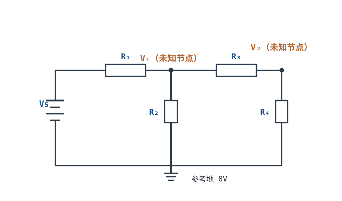

# 节点法与网孔法（进阶）Nodal & Mesh Analysis

上一章 KCL/KVL 是原理，这一章把它变成**可机械执行的解题流程**。电路复杂了以后，靠眼力猜串并联会错，需要一套固定套路：**节点法**（列节点电压方程）或**网孔法**（列回路电流方程）。日常工作里用得最多的是节点法，这里以它为主，网孔法作为对照。

::: motivation 为什么还要专门学方法
你不需要背，也不需要手解十个方程——现代 SPICE 一秒就算完。但你需要看懂"软件在解什么、为什么结果是这个节点电压"，这样仿真结果异常时才知道往哪查。节点法的本质就是"对每个未知节点列 KCL"，看懂一次终身受用。
:::

## 1. 原理图

## 2. 节点法四步（只给流程）

1. **选参考地**：挑一个节点当 0V（通常接电源负端/最多支路的那根线）。
2. **标未知节点电压**：其余节点电压 $V_1, V_2,\dots$ 就是未知量。
3. **对每个未知节点列 KCL**：流出该节点的所有支路电流之和 = 0，支路电流用 $(V_{node}-V_{other})/R$ 表示。
4. **解方程组**：n 个未知节点 → n 个线性方程，解出每个节点电压。

对上图电路，节点 V₁ 的方程（流出为正）：

$$\frac{V_1-V_s}{R_1}+\frac{V_1}{R_2}+\frac{V_1-V_2}{R_3}=0$$

节点 V₂ 的方程：

$$\frac{V_2-V_1}{R_3}+\frac{V_2}{R_4}=0$$

符号含义：每个分数就是"从该节点流到另一节点的电流"（两端压差除以电阻），加起来等于 0 即 KCL。

::: advanced 进阶：网孔法对照与数值求解
网孔法选"内网孔电流"为未知量，沿每个网孔列 KVL（电阻压降之和 = 电压源升）。节点法对"节点少、支路多"的电路更省方程；网孔法适合"平面、内网孔少"的电路。两者数学上等价。

代入数值 $V_s=12V,\ R_1=R_3=R_4=1k\Omega,\ R_2=2k\Omega$：
节点 V₂ 方程给出 $V_2=V_1\cdot R_4/(R_3+R_4)=V_1/2$；代入 V₁ 方程：$(V_1-12)/1 + V_1/2 + (V_1-V_2)/1=0$，解得 $V_1=4.8V,\ V_2=2.4V$。验证：R₁ 电流 $(12-4.8)/1k=7.2mA$，R₂ 电流 $4.8/2k=2.4mA$，R₃ 电流 $(4.8-2.4)/1k=2.4mA$，R₄ 电流 $2.4/1k=2.4mA$，节点 V₁ 进出 $7.2=2.4+2.4+2.4$ 成立。
:::

## 3. 工程师的真实用法

实际工作中你**几乎从不手算**——而是：

- 在脑子里用节点法做**数量级估算**："这个节点电压大概在电源的几分之几"；
- 把电路丢进 LTspice/Falstad 仿真，看节点电压与估算是否吻合；
- 仿真不对时，用节点法思路判断"哪个节点方程被我漏了"。

::: example 用节点法快速估个数
上面电路中，若 $R_1=R_3=R_4=1k$、$R_2=2k$，VS=12V。估算：V₂ 经 R₃/R₄ 分压大约是 V₁ 的一半；V₁ 经 R₁ 从 12V 送来，又被 R₂、R₃ 两条路拉低。手算得 V₁≈4.8V、V₂≈2.4V——和直觉"比 6V 低、但不是 0"一致。
:::

## 4. 常见坑

::: pitfall 常见坑
- **参考地选错或漏标，方程里出现悬浮节点**：现象——列完方程解不出来，或解出离谱电压。原因——有节点没接参考地也没列方程，电流无回路。解决——先画好地、确认每个节点都通过某条路径连到地，再动笔。
- **支路电流方向符号写反**：现象——方程列对了但结果符号乱。原因——把 $(V_1-V_2)/R_3$ 写成 $(V_2-V_1)/R_3$。解决——固定一条规则："流出本节点为正"，分子永远是本节点电压减相邻节点电压。
- **手算过度依赖解析解**：现象——为一个三节点电路推导半小时。原因——真实电路里有二极管/运放/电源，非线性，解析解根本写不出。解决——会列方程即可，交给 SPICE；手算只用于 sanity check。
:::

## 5. 自测题

节点法里为什么要选一个参考地？不选会怎样？

电压是**两点之差**，必须指定一个 0V 参考，其余节点电压才有意义。选参考地后它的方程自动消失（已知 = 0），未知量少一个。不选参考地，所有电压都是相对值，方程之间差一个全局常数，解不唯一。

节点法和网孔法哪个更"通用"？平面外的电路（有交叉连线）怎么办？

节点法本质上更通用（不要求电路是平面的）。网孔法严格只对**平面电路**（能画在纸上不交叉）成立。遇到立体/交叉网络，用节点法或直接上 SPICE。

上面示例中若 R₂ 改成开路（∞），V₁ 大约变成多少？

R₂ 开路后，电流只能走 R₃→R₄ 一条路，V₁ 经 R₁、R₃、R₄ 串联，$V_1=12\times(R_3+R_4)/(R_1+R_3+R_4)=12\times2/3=8V$，V₂ 再分一半 = 4V。开路等于那条支路电流为 0，方程里对应项消失。

## 6. 参考资料

- [Lessons In Electric Circuits — Chapter 10: DC Network Analysis](https://www.ibiblio.org/kuphaldt/electricCircuits/)
- [Khan Academy — Node voltage method](https://www.khanacademy.org/science/electrical-engineering)
- [Falstad Circuit JS 在线仿真器](https://www.falstad.com/circuit/)
