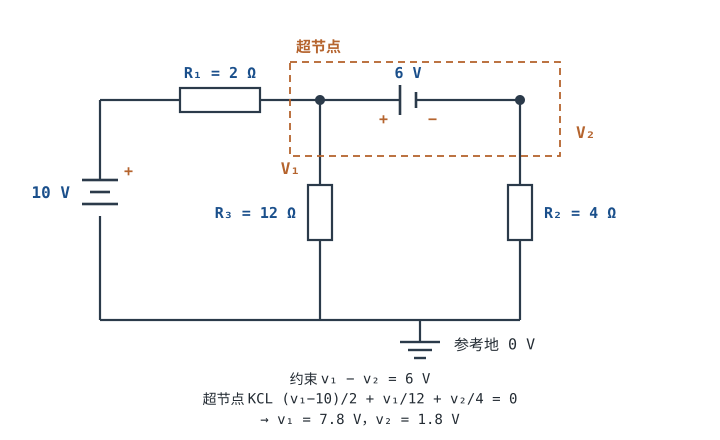
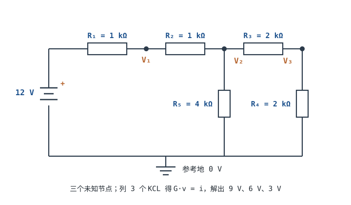
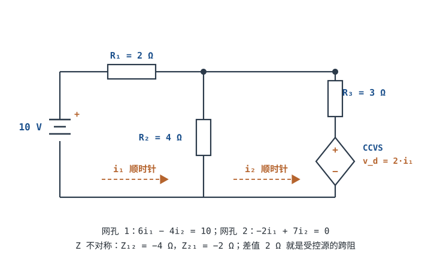

# 节点法与网孔法（进阶）Nodal & Mesh Analysis

[基尔霍夫定律 KCL / KVL](kcl-kvl.md) 给出了两条守恒式，但面对一个三节点、六条支路的网络，光有定律还不够：未知量选谁？方程列几个？电压源串在两个节点之间怎么处理？符号写反了怎么发现？**节点法（Nodal Analysis）**和**网孔法（Mesh Analysis）**就是把这些动作固定成流程的两套方法。

节点法以节点电压为未知量，对每个未知节点列 KCL，最后写成矩阵 $\mathbf{G}\mathbf{v}=\mathbf{i}$；网孔法以网孔电流为未知量，对每个网孔列 KVL，写成 $\mathbf{Z}\mathbf{i}=\mathbf{v}$。SPICE 内部的 MNA（Modified Nodal Analysis）就是节点法的扩展，所以看懂节点法，等于看懂了仿真器在解什么。这一章把两套流程、方程数核算、超节点/超网孔、受控源导致的矩阵不对称，以及三个能复算的工程算例讲完。

## 1. 设计动机

::: motivation 三个必须用系统方法的地方
**场景一：三节点网络的验算。** 一个 12 V 电源经 $R_1=1$ kΩ 到节点 $V_1$，再经 $R_2=1$ kΩ 到 $V_2$、经 $R_3=2$ kΩ 到 $V_3$；$V_2$ 经 $R_5=4$ kΩ 到地，$V_3$ 经 $R_4=2$ kΩ 到地。靠"串并联眼力"已经很难判断，但列三个 KCL 方程、解一个 $3\times3$ 矩阵，得到 $V_1=9$ V、$V_2=6$ V、$V_3=3$ V，代回每条支路都严丝合缝。**矩阵不是数学装饰，它是把"眼力"换成"流程"的工具。**

**场景二：仿真报 "singular matrix"。** 电路里有一个节点只通过电容接到别处，直流分析时这个节点没有直流通路，KCL 方程退化成 $0=0$，矩阵奇异。看懂方程数核算，就知道该查"哪个节点没有到地的直流路径"，而不是盲目改仿真设置。

**场景三：运放增益误差。** 反相放大器用理想运放算是 $-R_f/R_1=-10$，但真实开环增益 $A_0=10^5$ 时，节点方程解出来是 $-9.9989$，增益误差 $-0.011\%$。这个数不是仿真软件的专利，手列一个节点方程就能算出来；它决定了你选 0.1% 电阻还是 1% 电阻。
:::

把常见任务压成一张表：

| 你想解决 | 先用什么 | 判据 |
|---|---|---|
| 求某个节点电压 | 节点法，列 KCL | 方程数 = 未知节点数 |
| 求某个支路电流 | 节点法解出电压后回代，或网孔法 | 支路电流 = 相邻网孔电流之差 |
| 含电压源跨接两节点 | 超节点 | 少一个未知量，多一条电压约束 |
| 含电流源被两网孔共用 | 超网孔 | 少一个未知量，多一条电流约束 |
| 含受控源 | 先当独立源写，再补控制方程 | 未知量数 = 方程数，矩阵一般不对称 |
| 仿真结果异常 | 数独立方程、查浮空节点 | 矩阵非奇异、KCL 残差接近 0 |

**不懂会在哪摔跤**，具体是这四条：

1. 对有 $n$ 个节点的电路列 $n$ 个 KCL。实际上只有 $n-1$ 个独立，多出来的一个会让方程组线性相关，手算时表现为"消元后出现 $0=0$"，仿真时表现为奇异矩阵。
2. 把电压源当普通支路，用 $(V_1-V_2)/0$ 算电流。理想电压源的内阻为零，这条支路的电流是未知量，必须用超节点或 MNA 的附加变量处理。
3. 受控源只写进 KCL，忘了补控制方程，未知量比方程多一个，解不出来；或者把受控源当独立源，解出一个与电路无关的数。
4. 解出负电流就以为算错。负号只表示实际方向与参考方向相反，大小是对的；功率验算才能确认符号体系有没有错。

## 2. 定义与直观：未知量怎么选

### 2.1 节点、支路、回路、网孔

- **节点（Node）**：两条及以上支路的公共连接点。用理想导线连起来的一整片导体算同一个节点；真实 PCB 上这条"理想导线"有 mΩ 级电阻，§5.4 会算它什么时候失效。
- **支路（Branch）**：两个节点之间的一段电路。同一支路内电流处处相同；一条支路可以包含多个串联元件。
- **回路（Loop）**：若干支路首尾相接构成的闭合路径。
- **网孔（Mesh）**：内部不再包含其他支路的回路，只对**平面电路（Planar Circuit）**有定义。平面电路可以画在纸上而支路不交叉；网孔数等于独立 KVL 方程数。

### 2.2 节点法：以"海拔"为未知量

节点法先选一个节点做**参考节点（Reference Node）**，规定它的电压为 0 V，相当于给整张电路图定一个"海平面"。其余每个节点相对参考点的电压就是未知量，共 $n-1$ 个。对每个未知节点写 KCL：流出该节点的支路电流代数和为零。支路电流用两端节点电压差除以电阻（或乘以电导）表示，于是 $n-1$ 个 KCL 变成 $n-1$ 个线性方程。

这个图像的好处是：**节点电压是"绝对高度"，支路电流是"高度差除以阻力"**。参考点选在哪里不影响任何支路电流与电压差，只影响所有节点电压的共同偏移量；选得好的参考点（通常是最多支路交汇的负端/地）能让方程最简洁。

### 2.3 网孔法：以"环流"为未知量

网孔法给每个网孔假设一个顺时针（或统一逆时针）的**网孔电流（Mesh Current）**，共 $b-n+1$ 个。对每个网孔沿顺时针方向列 KVL：电阻上的电压降之和等于电压源升之和。网孔电流是数学量，不一定等于某条真实支路的电流；两个相邻网孔共用的支路，真实电流是两者之差。

网孔法的前提是**平面电路**。如果电路画在纸上必然交叉（例如三维结构、多层互连），网孔的定义就不成立，应改用节点法。对平面电路，网孔数恰好等于独立 KVL 方程数，这是它"方程少"的原因。

### 2.4 两种方法的对偶

| 项目 | 节点法 | 网孔法 |
|---|---|---|
| 未知量 | 节点电压，$n-1$ 个 | 网孔电流，$b-n+1$ 个 |
| 方程来源 | KCL | KVL |
| 矩阵形式 | $\mathbf{G}\mathbf{v}=\mathbf{i}$ | $\mathbf{Z}\mathbf{i}=\mathbf{v}$ |
| 无源网络矩阵 | 对称 | 对称 |
| 电压源 | 接地则固定节点；跨节点则用超节点 | 直接进入方程右边 |
| 电流源 | 直接进入方程右边 | 共用的电流源用超网孔 |
| 适用范围 | 任意连通网络 | 仅平面网络 |
| 典型场景 | 节点少、支路多；SPICE | 网孔少、平面结构；手算 |

::: analogy 海拔与环流
节点法像给每个城市标海拔：先定海平面（参考地），每个城市的海拔就是未知量；两城之间的"水流"由海拔差和管路阻力决定。网孔法像给一张平面地图上的每个独立环路标一个环流：环路内部的支路流量，是相邻环流叠加的结果。两套坐标描述同一张路网，选哪套只看哪种未知量更少。
:::

## 3. 定量关系：矩阵、独立方程与受控源

### 3.1 节点法的系统化步骤与 G·v=i

**步骤一：选参考节点。** 通常选电源负端、地，或支路最多的节点。参考节点电压记为 0 V。

**步骤二：标未知节点电压。** 其余节点依次标 $v_1,v_2,\dots,v_{n-1}$。

**步骤三：对每个未知节点列 KCL。** 统一约定"流出本节点为正"：从节点 $i$ 流向节点 $j$ 的电流写成 $(v_i-v_j)g_{ij}$，其中 $g_{ij}=1/R_{ij}$ 是两节点间支路的电导。

**步骤四：把方程整理成矩阵。** 对只有电阻和独立电流源的网络，方程可以机械地写成：

$$G_{ii}=\sum_{j\ne i} g_{ij},\qquad G_{ij}=-g_{ij}\ (i\ne j),\qquad i_i=\sum I_{s,\text{into }i}$$

其中 $G_{ii}$ 是节点 $i$ 的自电导（连到该节点的所有电导之和），$G_{ij}$ 是节点 $i$ 与 $j$ 之间的互电导（取负），$i_i$ 是流入节点 $i$ 的独立电流源之和。矩阵形式：

$$\mathbf{G}\mathbf{v}=\mathbf{i}$$

**步骤五：解方程。** 高斯消元或矩阵求逆，得到各节点电压。

**步骤六：回代与验算。** 用节点电压算每条支路电流，代回每个节点的 KCL；再用功率守恒做第二重验算。

以图中两节点电路为例：$V_s=12$ V，$R_1=1$ kΩ、$R_2=2$ kΩ、$R_3=1$ kΩ、$R_4=1$ kΩ。电导分别为 $1$、$0.5$、$1$、$1$ mS。对 $V_1$、$V_2$ 列 KCL（流出为正）：

$$\frac{V_1-12}{1}+\frac{V_1}{2}+\frac{V_1-V_2}{1}=0,\qquad \frac{V_2-V_1}{1}+\frac{V_2}{1}=0$$

整理成矩阵（单位 mS 与 mA）：

$$\begin{bmatrix}2.5&-1\\-1&2\end{bmatrix}\begin{bmatrix}V_1\\V_2\end{bmatrix}=\begin{bmatrix}12\\0\end{bmatrix}$$

解得 $V_1=6$ V、$V_2=3$ V。验算：$R_1$ 电流 $(12-6)/1\text{ k}=6$ mA，$R_2$ 电流 $6/2\text{ k}=3$ mA，$R_3$ 电流 $(6-3)/1\text{ k}=3$ mA，$R_4$ 电流 $3/1\text{ k}=3$ mA；节点 $V_1$ 流入 $6$ mA，流出 $3+3=6$ mA，节点 $V_2$ 流入 $3$ mA、流出 $3$ mA，KCL 成立。

### 3.2 网孔法的适用条件与 Z·i=v

**适用条件**：电路必须是平面电路，且每个网孔都能明确定义。含交叉互连、三维结构、分布参数的网络，网孔法要么不适用，要么需要引入"窗口"处理，工程上直接换节点法更省事。

**步骤一：画网孔、标网孔电流。** 所有网孔电流取同一方向（通常顺时针），共 $b-n+1$ 个。

**步骤二：对每个网孔列 KVL。** 沿网孔电流方向绕行，电阻压降取正、电压源升取正（或统一相反，但全题一致）。

**步骤三：整理成矩阵。** 对无源电阻网络：

$$Z_{ii}=\sum_{k\in\text{mesh }i} R_k,\qquad Z_{ij}=-R_{ij}\ (i\ne j),\qquad v_i=\sum V_{s,\text{rise in direction }i}$$

其中 $Z_{ii}$ 是网孔 $i$ 内所有电阻之和，$Z_{ij}$ 是网孔 $i$ 与 $j$ 共用电阻的负值，$v_i$ 是沿网孔方向电压升之和。矩阵形式：

$$\mathbf{Z}\mathbf{i}=\mathbf{v}$$

**步骤四：解出网孔电流，回代求支路电流。** 共用支路的电流等于相邻网孔电流之差；只有单个网孔经过的支路，电流就是该网孔电流。

网孔法的"方程少"是有代价的：网孔电流是数学量，物理支路电流要再做减法；含电流源时还要引入超网孔。节点法则直接给出每个节点的电压，回代支路电流很直接。工程手算里，**节点少选节点法，网孔少选网孔法**，没有绝对优劣。

### 3.3 独立方程数核算

这是最容易被跳过、也最容易让仿真报错的一步。对 $n$ 个节点、$b$ 条支路的连通电路：

- 独立 KCL 方程数：$n-1$（所有节点的 KCL 相加恒等于 0，有一个不独立）；
- 独立 KVL 方程数：$b-(n-1)=b-n+1$（平面电路中等于网孔数）；
- 两者之和：$(n-1)+(b-n+1)=b$，正好等于支路数。

| 节点数 $n$ | 支路数 $b$ | 独立 KCL $n-1$ | 独立 KVL $b-n+1$ | 合计 |
|---|---|---|---|---|
| 3 | 5 | 2 | 3 | 5 |
| 4 | 6 | 3 | 3 | 6 |
| 10 | 15 | 9 | 6 | 15 |
| 20 | 30 | 19 | 11 | 30 |

节点法的未知量是 $n-1$ 个节点电压；网孔法的未知量是 $b-n+1$ 个网孔电流。**方程数必须等于未知量数**，多一个少一个都不行：

- 少列一个：欠定，解不唯一，手算时自由变量消不掉；
- 多列一个：过定，方程线性相关，矩阵奇异或最小二乘给出矛盾解。

含理想电压源时，MNA（Modified Nodal Analysis）会为每个独立电压源增加一个支路电流未知量，同时增加一条电压约束方程，未知量与方程数仍然相等：

$$\begin{bmatrix}\mathbf{G}&\mathbf{B}\\\mathbf{C}&\mathbf{D}\end{bmatrix}\begin{bmatrix}\mathbf{v}\\\mathbf{i}_V\end{bmatrix}=\begin{bmatrix}\mathbf{i}_s\\\mathbf{v}_s\end{bmatrix}$$

其中 $\mathbf{v}$ 是节点电压向量，$\mathbf{i}_V$ 是电压源支路电流向量，$\mathbf{v}_s$ 是电压源约束向量。对 $n$ 个节点、$m$ 个独立电压源的电路，MNA 未知量数是 $(n-1)+m$。这就是为什么 SPICE 网表里电压源会"多出一个电流变量"。

### 3.4 超节点与超网孔

**超节点（Supernode）**处理跨接在两个非参考节点之间的理想电压源。设电压源接在节点 $a$、$b$ 之间，电压为 $V_s$：

1. 把 $a$、$b$ 合并成一个"超节点"，对超节点边界列一条 KCL：流出 $a$ 与流出 $b$ 的所有外部支路电流之和为零（电压源内部电流在相加时抵消）；
2. 补一条电压约束 $v_a-v_b=V_s$（极性按电压源正端定）；
3. 未知量仍是两个节点电压，方程仍是两条，数目不变。

**算例**：$V_s=10$ V 经 $R_1=2\,\Omega$ 到节点 1；节点 1 与节点 2 之间接 6 V 电压源（正端在节点 1）；节点 1 经 $R_3=12\,\Omega$ 到地；节点 2 经 $R_2=4\,\Omega$ 到地。

电压约束：

$$v_1-v_2=6$$

超节点 KCL（流出为正，电压源支路电流不写进外部支路）：

$$\frac{v_1-10}{2}+\frac{v_1}{12}+\frac{v_2}{4}=0$$

把 $v_1=v_2+6$ 代入：

$$\frac{v_2-4}{2}+\frac{v_2+6}{12}+\frac{v_2}{4}=0$$

两边乘 12：

$$6(v_2-4)+(v_2+6)+3v_2=0\ \Longrightarrow\ 10v_2-18=0\ \Longrightarrow\ v_2=1.8\ \text{V}$$

所以 $v_1=7.8$ V。验算：$R_1$ 电流 $(10-7.8)/2=1.1$ A；$R_3$ 电流 $7.8/12=0.65$ A；$R_2$ 电流 $1.8/4=0.45$ A。节点 1 的 KCL：流入 $1.1$ A，流出 $R_3$ 的 $0.65$ A，其余 $0.45$ A 经 6 V 源流向节点 2；节点 2 的 KCL：流入 $0.45$ A，流出 $R_2$ 的 $0.45$ A，平衡。功率：10 V 源发出 $11$ W；$R_1$ 耗散 $1.1^2\times2=2.42$ W；$R_3$ 耗散 $0.65^2\times12=5.07$ W；$R_2$ 耗散 $0.45^2\times4=0.81$ W；6 V 源吸收 $6\times0.45=2.7$ W；合计 $2.42+5.07+0.81+2.7=11.0$ W，平账。

**超网孔（Supermesh）**处理被两个网孔共用的理想电流源。设电流源在网孔 1、2 的公共支路上，电流为 $I_s$：

1. 把网孔 1、2 合并成一个超网孔，沿外边界列一条 KVL（公共支路上的电流源电压未知，绕外边界时被跳过）；
2. 补一条电流约束（方向按电流源箭头定，写成 $i_1-i_2=I_s$ 或 $i_2-i_1=I_s$，全题统一）；
3. 方程数仍等于网孔数。

**算例**：网孔 1 含 10 V 电源与 $R_1=2\,\Omega$，网孔 2 含 $R_2=3\,\Omega$ 与 $R_3=1\,\Omega$，两网孔共用一条 2 A 电流源（方向使 $i_2-i_1=2$ A）。超网孔外边界 KVL：

$$10=2i_1+(3+1)i_2$$

电流约束 $i_2=i_1+2$，代入：

$$10=2i_1+4(i_1+2)=6i_1+8\ \Longrightarrow\ i_1=\frac{1}{3}\ \text{A},\qquad i_2=\frac{7}{3}\ \text{A}$$

验算：$2i_1+4i_2=2/3+28/3=30/3=10$ V，KVL 成立；公共支路电流 $i_2-i_1=2$ A，与电流源一致。

**电源处理的速查**：

| 电源位置 | 节点法 | 网孔法 |
|---|---|---|
| 电压源接参考节点 | 该节点电压已知，直接去掉一个未知量 | 直接进方程右边 |
| 电压源跨两个非参考节点 | 超节点 + 电压约束 | 直接进方程右边（若在网孔边界） |
| 电流源接参考节点 | 直接进方程右边 | 若在网孔边界，直接给定网孔电流 |
| 电流源被两网孔共用 | 直接进方程右边 | 超网孔 + 电流约束 |

### 3.5 受控源为什么让矩阵失去对称性

受控源（Controlled Source）的电压或电流由电路中**别处**的电压或电流决定。四种类型：VCVS（电压控制电压源）、VCCS（电压控制电流源）、CCCS（电流控制电流源）、CCVS（电流控制电压源）。处理规则只有两条：

1. 列 KCL/KVL 时先把它当独立源照写，给它的电压或电流起一个名字；
2. 补一条控制方程，把控制量用同一批未知量表示，保证未知量数等于方程数。

**为什么矩阵会失去对称性？** 对只含电阻的无源网络，节点导纳矩阵满足 $G_{ij}=G_{ji}$，网孔阻抗矩阵满足 $Z_{ij}=Z_{ji}$。这不是巧合，而是**互易性（Reciprocity）**：在节点 $i$ 注入电流、在节点 $j$ 测电压，与在 $j$ 注入、在 $i$ 测，结果相同。电阻是双向对称元件，所以矩阵对称。

受控源打破的正是这种双向对称。看一个 VCCS 的例子：节点 1 经 $R_1=1$ kΩ 接 10 V 源、经 $R_2=1$ kΩ 接地，所以 $G_{11}=2$ mS；节点 2 经 $R_3=1$ kΩ 接地，$G_{22}=1$ mS；另有一个 VCCS，从节点 2 流向地，电流 $i_d=gv_1$，$g=0.5$ mS。对节点 2 列 KCL：

$$\frac{v_2}{1\text{ k}}+gv_1=0\ \Longrightarrow\ 0.5v_1+v_2=0$$

对节点 1：

$$\frac{v_1-10}{1\text{ k}}+\frac{v_1}{1\text{ k}}=0\ \Longrightarrow\ 2v_1=10\ \Longrightarrow\ v_1=5\ \text{V}$$

于是 $v_2=-2.5$ V。矩阵形式（mS、mA）：

$$\begin{bmatrix}2&0\\0.5&1\end{bmatrix}\begin{bmatrix}v_1\\v_2\end{bmatrix}=\begin{bmatrix}10\\0\end{bmatrix}$$

$G_{12}=0$，$G_{21}=0.5$ mS，**矩阵不对称**。物理含义：改变 $v_1$ 会改变受控源从节点 2 抽走的电流；改变 $v_2$ 却不会反过来影响节点 1。这种"单向作用"正是放大、开关、隔离的本质，也是主动电路与无源网络的分界。

网孔法同理。§4.2 的 CCVS 例子给出

$$\mathbf{Z}=\begin{bmatrix}6&-4\\-2&7\end{bmatrix}\ \Omega$$

$Z_{12}=-4\,\Omega$ 来自共享电阻 $R_2=4\,\Omega$；$Z_{21}=-2\,\Omega$ 却是 $-4+2$，多出来的 $+2\,\Omega$ 是受控源的跨阻。**如果矩阵对称，说明网络互易；如果不对称，说明存在受控源或非线性有源元件。** 这不是算错，而是电路本身的性质。

| 网络类型 | 节点矩阵 | 网孔矩阵 | 互易性 |
|---|---|---|---|
| 纯电阻 | $G_{ij}=G_{ji}$ | $Z_{ij}=Z_{ji}$ | 满足 |
| 含独立源 | 仍对称（源在右边） | 仍对称（源在右边） | 满足 |
| 含受控源 | 一般 $G_{ij}\ne G_{ji}$ | 一般 $Z_{ij}\ne Z_{ji}$ | 不满足 |
| 含非线性元件 | 小信号模型下仍可能不对称 | 同左 | 一般不满足 |

矩阵不对称本身不代表方程无解，但它意味着网络不互易：求解时要用一般 LU 分解，并检查条件数。对称矩阵可以用 Cholesky 分解、共轭梯度等高效算法；不对称矩阵没有这些便利。SPICE 对含受控源的电路一律按一般矩阵处理。

### 3.6 适用条件与失效边界

1. **线性元件。** 节点法/网孔法列的是线性方程；二极管、三极管、饱和电感是非线性的，要先在工作点附近线性化，得到小信号模型再列方程。SPICE 用牛顿迭代反复线性化，本质仍是"每轮解一个线性节点方程"。
2. **理想电源模型要自洽。** 两个不同电压的理想电压源并联，KVL 矛盾；理想电流源串联，KCL 矛盾；理想电流源开路，电流无路可走。这些拓扑在方程层面表现为无解或奇异矩阵。
3. **每个节点要有到地的直流路径。** 只通过电容连接的节点，直流分析时没有直流通路，KCL 退化为 $0=0$；SPICE 通常用 $g_{min}$（默认约 $10^{-12}$ S，不同实现略有差异）为高阻节点提供数值上的直流通路，但得到的直流电压没有物理意义。
4. **理想运放要加约束。** 理想运放不是电阻，不能直接写 $v_+/R$；要用"虚短"约束加输入电流为零，或者用有限增益模型加受控源。MNA 为运放输出支路增加电流变量，是标准做法。
5. **数值条件。** 节点导纳矩阵的元素可能跨越十几个数量级（1 mΩ 分流器与 1 GΩ 绝缘同处一网），双精度浮点的有效位数会被条件数吃掉。§5.5 给出数量级估计。

## 4. 典型计算

### 4.1 算例一：三节点网络的节点法（矩阵、解、代回验算）

**电路**：$V_s=12$ V，$R_1=1$ kΩ（电源到 $V_1$），$R_2=1$ kΩ（$V_1$ 到 $V_2$），$R_3=2$ kΩ（$V_2$ 到 $V_3$），$R_4=2$ kΩ（$V_3$ 到地），$R_5=4$ kΩ（$V_2$ 到地）。

**第 1 步，选参考点、定未知量。** 底部为 0 V，未知量为 $v_1,v_2,v_3$，共 3 个；独立 KCL 也是 3 个。支路数 $b=6$（电源支路 + 5 个电阻），独立 KVL 数 $b-n+1=6-4+1=3$，与网孔数一致。

**第 2 步，算电导。** $G_1=1/1\text{ k}=1$ mS，$G_2=1$ mS，$G_3=1/2\text{ k}=0.5$ mS，$G_4=0.5$ mS，$G_5=1/4\text{ k}=0.25$ mS。

**第 3 步，对每个节点列 KCL（流出为正）。**

节点 $V_1$：

$$\frac{v_1-12}{1}+\frac{v_1-v_2}{1}=0\ \Longrightarrow\ 2v_1-v_2=12$$

节点 $V_2$：

$$\frac{v_2-v_1}{1}+\frac{v_2-v_3}{2}+\frac{v_2}{4}=0\ \Longrightarrow\ -v_1+1.75v_2-0.5v_3=0$$

节点 $V_3$：

$$\frac{v_3-v_2}{2}+\frac{v_3}{2}=0\ \Longrightarrow\ -0.5v_2+v_3=0$$

**第 4 步，写成矩阵。** 电压单位 V，电流单位 mA，电导单位 mS：

$$\begin{bmatrix}2&-1&0\\-1&1.75&-0.5\\0&-0.5&1\end{bmatrix}\begin{bmatrix}v_1\\v_2\\v_3\end{bmatrix}=\begin{bmatrix}12\\0\\0\end{bmatrix}$$

矩阵行列式：

$$\det\mathbf{G}=2(1.75\times1-0.25)-(-1)(-1\times1-0)=2\times1.5-1=2.0\ \text{mS}^3\ne0$$

所以解唯一。

**第 5 步，消元求解。** 由节点 $V_3$ 方程：$v_3=0.5v_2$。代入节点 $V_2$ 方程：

$$-v_1+1.75v_2-0.5\times0.5v_2=0\ \Longrightarrow\ v_1=1.5v_2$$

代入节点 $V_1$ 方程：

$$2\times1.5v_2-v_2=12\ \Longrightarrow\ 3v_2-v_2=12\ \Longrightarrow\ v_2=6\ \text{V}$$

于是

$$v_1=1.5\times6=9\ \text{V},\qquad v_3=0.5\times6=3\ \text{V}$$

**第 6 步，回代支路电流。**

$$i_{R1}=\frac{12-9}{1\text{ k}}=3\ \text{mA},\qquad i_{R2}=\frac{9-6}{1\text{ k}}=3\ \text{mA}$$

$$i_{R3}=\frac{6-3}{2\text{ k}}=1.5\ \text{mA},\qquad i_{R5}=\frac{6}{4\text{ k}}=1.5\ \text{mA},\qquad i_{R4}=\frac{3}{2\text{ k}}=1.5\ \text{mA}$$

**第 7 步，逐节点验算 KCL。**

- 节点 $V_1$：流入 $3$ mA，流出 $3$ mA，平衡；
- 节点 $V_2$：流入 $3$ mA，流出 $1.5+1.5=3$ mA，平衡；
- 节点 $V_3$：流入 $1.5$ mA，流出 $1.5$ mA，平衡。

**第 8 步，功率验算。** 12 V 源发出 $12\times3=36$ mW；$R_1$ 耗散 $3^2\times1=9$ mW；$R_2$ 耗散 $3^2\times1=9$ mW；$R_3$ 耗散 $1.5^2\times2=4.5$ mW；$R_5$ 耗散 $1.5^2\times4=9$ mW；$R_4$ 耗散 $1.5^2\times2=4.5$ mW；合计 $9+9+4.5+9+4.5=36$ mW，平账。

**结论**：$v_1=9$ V、$v_2=6$ V、$v_3=3$ V；矩阵行列式非零，解唯一；KCL 与功率双重验算通过。这个例子说明：**节点法的"机械"之处在于，列方程时不需要判断串并联，只需要对每个节点把流出电流加起来。**

### 4.2 算例二：含受控源的网孔法

**电路**：网孔 1 顺时针电流 $i_1$，含 10 V 电压源（升）、$R_1=2\,\Omega$、共享电阻 $R_2=4\,\Omega$；网孔 2 顺时针电流 $i_2$，含 $R_2$、$R_3=3\,\Omega$ 与一个 CCVS，电压 $v_d=2\,\Omega\times i_1$，极性使它在网孔 2 的顺时针方向上是电压降。

**第 1 步，数未知量与方程数。** 网孔电流 $i_1,i_2$ 两个；受控源不增加独立未知量，只增加一条控制方程 $v_d=2i_1$。总共 2 个未知量、2 条网孔 KVL，必要时把 $v_d$ 当中间量。

**第 2 步，网孔 1 的 KVL。**

$$10=(R_1+R_2)i_1-R_2i_2=(2+4)i_1-4i_2=6i_1-4i_2$$

**第 3 步，网孔 2 的 KVL。** 沿顺时针：$R_2$ 上压降 $4(i_2-i_1)$，$R_3$ 上压降 $3i_2$，CCVS 上压降 $v_d=2i_1$，电压升为零：

$$0=4(i_2-i_1)+3i_2+2i_1=-2i_1+7i_2$$

**第 4 步，写成矩阵。**

$$\begin{bmatrix}6&-4\\-2&7\end{bmatrix}\begin{bmatrix}i_1\\i_2\end{bmatrix}=\begin{bmatrix}10\\0\end{bmatrix}$$

注意 $Z_{12}=-4\,\Omega$、$Z_{21}=-2\,\Omega$，**矩阵不对称**。若没有受控源，共享电阻应同时给出 $-4$ 和 $-4$；现在 $Z_{21}$ 多了 $+2\,\Omega$，这就是 CCVS 的跨阻。

**第 5 步，求解。** 由第二式 $2i_1=7i_2$，即 $i_1=3.5i_2$。代入第一式：

$$6\times3.5i_2-4i_2=21i_2-4i_2=17i_2=10\ \Longrightarrow\ i_2=\frac{10}{17}=0.5882\ \text{A}$$

$$i_1=3.5\times\frac{10}{17}=\frac{35}{17}=2.0588\ \text{A}$$

**第 6 步，回代支路量与验算。**

$$i_{R2}=i_1-i_2=\frac{35-10}{17}=\frac{25}{17}=1.4706\ \text{A}$$

$$v_d=2i_1=\frac{70}{17}=4.1176\ \text{V}$$

网孔 1 验算：$6\times2.0588-4\times0.5882=12.3529-2.3529=10$ V；网孔 2 验算：$-2\times2.0588+7\times0.5882=-4.1176+4.1176=0$ V。

**第 7 步，功率验算。** 10 V 源发出 $10\times2.0588=20.588$ W；$R_1$ 耗散 $2\times2.0588^2=8.4775$ W；$R_2$ 耗散 $4\times1.4706^2=8.6505$ W；$R_3$ 耗散 $3\times0.5882^2=1.0381$ W；CCVS 吸收 $v_d i_2=4.1176\times0.5882=2.4221$ W；合计 $8.4775+8.6505+1.0381+2.4221=20.588$ W，平账。

**第 8 步，说明为什么不能靠"受控源=电阻"的直觉。** 如果把 CCVS 误当成 $2\,\Omega$ 电阻，网孔 2 的方程会变成

$$0=-4i_1+(4+3+2)i_2=-4i_1+9i_2$$

解得 $i_1=2.3684$ A、$i_2=1.0526$ A，与正确值相比分别偏 $+15.0\%$ 与 $+78.9\%$。原因很直接：电阻的电压正比于**流过它自己的电流** $i_2$，而 CCVS 的电压正比于**别处的电流** $i_1$。把受控源当电阻，等于把"单向控制"改成了"双向欧姆关系"，方程就变了。

这也是"不能用节点法直觉"的地方：节点法里你会自然地想"节点电压越高，流出电流越大"，但受控源可以从一个节点抽走电流、却在另一个节点注入，电压与电流之间不再是同一个端口上的正比关系。节点法不是不能解这个电路，但这个 CCVS 是理想电压源，要为它增加一个支路电流未知量（MNA），再把控制量 $i_1=(10-v_1)/2$ 用节点电压表示，步骤比网孔法绕。**选方法的原则是：受控源在哪个方法的方程里更容易表达，就用哪个方法。**

### 4.3 完整设计：反相放大器增益误差的节点法核算

**需求**：设计一个反相放大器，增益 $-10.0$，增益误差不超过 $\pm0.5\%$；输入信号 $\pm0.5$ V，输出负载 $10$ kΩ，闭环带宽不低于 $100$ kHz；信号源内阻不超过 $2\,\Omega$。

**第 1 步，选电阻。** 取 $R_1=1$ kΩ、$R_f=10$ kΩ，理想增益

$$G_{ideal}=-\frac{R_f}{R_1}=-\frac{10\text{ k}}{1\text{ k}}=-10.0$$

**第 2 步，列节点方程。** 反相端节点电压记为 $v_-$，同相端接地为 0 V。对 $v_-$ 列 KCL（流出为正）：

$$\frac{v_- - V_s}{R_1}+\frac{v_- - V_o}{R_f}=0$$

运放有限增益模型：

$$V_o=A_0(0-v_-)\ \Longrightarrow\ v_-=-\frac{V_o}{A_0}$$

**第 3 步，代入消元。** 把 $v_-=-V_o/A_0$ 代入 KCL：

$$\frac{-\frac{V_o}{A_0}-V_s}{R_1}+\frac{-\frac{V_o}{A_0}-V_o}{R_f}=0$$

两边乘 $R_1R_f$：

$$R_f\left(-\frac{V_o}{A_0}-V_s\right)+R_1\left(-\frac{V_o}{A_0}-V_o\right)=0$$

整理：

$$-V_o\frac{R_1+R_f}{A_0}-R_1V_o=R_fV_s$$

$$\frac{V_o}{V_s}=-\frac{R_f}{R_1+\frac{R_1+R_f}{A_0}}=-\frac{R_f/R_1}{1+\frac{1+R_f/R_1}{A_0}}$$

**第 4 步，代入数值。** $R_f/R_1=10$，$A_0=10^5$：

$$1+\frac{1+10}{10^5}=1+\frac{11}{10^5}=1.00011$$

$$G=-\frac{10}{1.00011}=-9.99890$$

相对理想值 $-10$ 的误差：

$$\frac{G-G_{ideal}}{G_{ideal}}=\frac{-9.99890+10}{-10}=-0.000110=-0.0110\%$$

**第 5 步，误差预算。** 0.1% 电阻的比值容差最坏情况：

$$\frac{R_f(1+0.1\%)}{R_1(1-0.1\%)}=\frac{1.001}{0.999}=1.002002\ \Longrightarrow\ +0.2002\%$$

信号源内阻 $R_s=2\,\Omega$ 与 $R_1$ 串联，等效输入电阻变成 $1.002$ kΩ：

$$G'=-\frac{10}{1.002}=-9.98004\ \Longrightarrow\ -0.1996\%$$

三项绝对值相加：$0.0110\%+0.2002\%+0.1996\%=0.4108\%<0.5\%$，满足指标。各项的符号不同，最坏情况按绝对值相加是保守估计。

| 误差来源 | 数值 | 对增益的影响 |
|---|---|---|
| 运放有限增益 $A_0=10^5$ | $1.00011$ | $-0.0110\%$ |
| 电阻 0.1% 容差（最坏） | $1.001/0.999$ | $+0.2002\%$ |
| 源内阻 $2\,\Omega$ | $1.002$ | $-0.1996\%$ |
| 合计（绝对值相加） | — | $0.4108\%$ |
| 指标 | — | $\pm0.5\%$ |

**第 6 步，带宽核算。** 闭环增益为 10 时，闭环 $-3$ dB 带宽近似

$$f_{-3\text{dB}}\approx\frac{GBW}{|G|}=\frac{GBW}{10}$$

若选 $GBW=1$ MHz 的运放，带宽正好 $100$ kHz，没有余量；选 $GBW\ge1.1$ MHz 留 10% 余量，或直接选 $10$ MHz 的通用运放，带宽约 $1$ MHz。具体 GBW 以数据手册的测试条件为准。

**第 7 步，节点方程验算。** 取 $V_s=0.5$ V，$V_o=-4.99945$ V：

$$v_-=-\frac{-4.99945}{10^5}=49.9945\ \mu\text{V}$$

$$i_{R1}=\frac{49.9945\ \mu\text{V}-0.5\ \text{V}}{1\text{ k}\Omega}=-0.499950\ \text{mA}$$

$$i_{Rf}=\frac{49.9945\ \mu\text{V}-(-4.99945\ \text{V})}{10\text{ k}\Omega}=0.499950\ \text{mA}$$

两电流大小相等、方向相反，节点 KCL 残差为 0，说明节点方程解正确。

**第 8 步，边界与未计入项。** 上述预算只算增益误差，没有算运放失调电压与输入偏置电流：$1$ mV 的输入失调经增益 10 会变成 $10$ mV 输出，对 $5$ V 满量程是 $0.2\%$ 的附加误差；$1$ nA 偏置电流在 $10$ kΩ 反馈电阻上产生 $10$ µV 输出，可忽略。若总误差预算也包含失调，要选低失调运放或加调零。**"增益误差 0.41%"和"总输出误差 0.41%"不是一回事，数据手册上的失调、漂移、噪声要逐项加进来。**

## 5. 工程含义

### 5.1 工程数量级表

| 量 | 典型范围 | 说明 |
|---|---|---|
| 手算未知节点数 | 2–5 | 超过 5 个建议直接仿真 |
| 板级 SPICE 节点数 | $10$–$10^3$ | 取决于器件模型与寄生提取 |
| 支路数/节点数 $b/n$ | 1.2–2.0 | 平面稀疏网络的经验范围 |
| 电阻 | $1$ mΩ–$1$ GΩ | 分流器到绝缘电阻 |
| 电导 | $1$ kS–$1$ nS | 与电阻互为倒数 |
| 节点电压 | $1$ mV–$100$ V | 小信号到母线 |
| 支路电流 | $1$ µA–$100$ A | 偏置到功率 |
| 矩阵条件数 | $1$–$10^{12}$ | 混合量级时恶化 |

**手算与仿真的分界**不是绝对的。一个 5 节点、8 支路的网络，手算矩阵要十几分钟；一个 20 节点网络，手算容易出错，但"列方程—检查量纲—看数量级"仍然是理解仿真结果的最好方式。工程上常见的做法是：**手算 2–3 个关键节点做数量级估计，仿真跑全网络，再用 KCL 与功率守恒抽验。**

### 5.2 SPICE 在解什么：MNA 与奇异矩阵

SPICE 的直流工作点分析本质上就是解 MNA 方程：

$$\begin{bmatrix}\mathbf{G}&\mathbf{B}\\\mathbf{C}&\mathbf{D}\end{bmatrix}\begin{bmatrix}\mathbf{v}\\\mathbf{i}_V\end{bmatrix}=\begin{bmatrix}\mathbf{i}_s\\\mathbf{v}_s\end{bmatrix}$$

$\mathbf{G}$ 是节点导纳矩阵，$\mathbf{B}$、$\mathbf{C}$ 描述电压源与节点的连接，$\mathbf{D}$ 通常为零。对每个理想电压源，MNA 增加一个支路电流未知量和一条电压约束，所以矩阵比纯节点法大，但仍然是稀疏的。

**"singular matrix" 的四个常见原因**：

1. **浮空节点**：某节点只通过电容或电流源连接，直流下没有到地通路。解决：加高阻值泄放电阻，或检查是否漏了地连接。
2. **电压源环路**：两个不同电压的理想电压源并联，KVL 矛盾。解决：加均流电阻或改成电流源模型。
3. **电流源开路**：理想电流源所在支路没有闭合路径。解决：检查拓扑，补上回路。
4. **受控源控制量丢失**：控制电压/电流没有定义，矩阵某行全零。解决：补控制方程或检查参考方向。

SPICE 通常用 $g_{min}$（默认约 $10^{-12}$ S，不同仿真器略有差异）为高阻节点提供一条数值上的直流通路，避免纯浮空导致的奇异；但这只是数值补救，得到的浮空节点电压没有物理意义。**看到 "singular matrix"，先数节点和电压源，再看每个节点有没有直流通路，比反复调收敛参数有效。**

### 5.3 手算与仿真的分工

- **手算适合**：2–5 个未知节点、验证拓扑、估算数量级、检查仿真是否离谱、推导符号表达式（如运放增益公式）。
- **仿真适合**：非线性器件、大网络、温度/容差扫描、频域与瞬态、蒙特卡洛。
- **两者结合**：手算给出"应该是多少"，仿真给出"实际是多少"；两者差一个数量级，通常是模型、单位或参考点出错，而不是仿真精度不够。

一个实用的自检流程：

1. 用节点法估算关键节点电压，误差允许 20%；
2. 仿真后看 KCL 残差（各节点电流之和应接近 0，相对误差 $<10^{-6}$）；
3. 看功率守恒（电源发出 ≈ 电阻/器件吸收）；
4. 改动一个电阻，观察节点电压变化方向是否符合直觉；
5. 若不符，先查参考点、单位（mA 与 A、kΩ 与 Ω）和受控源控制量。

### 5.4 "节点"不是等电位体

节点法的"节点"是理想导线连接的一片导体，现实里这段导体有电阻和电感。1 oz 铜厚约 $35$ µm，铜的电阻率取 $\rho=1.72\times10^{-8}\ \Omega\cdot\text{m}$，方块电阻

$$R_\square=\frac{\rho}{t}=\frac{1.72\times10^{-8}}{35\times10^{-6}}=4.91\times10^{-4}\ \Omega\approx0.49\ \text{m}\Omega/\text{方块}$$

10 mm 长、0.25 mm 宽的走线有 $10/0.25=40$ 个方块，电阻 $40\times0.49=19.6$ mΩ，取 $20$ mΩ；流过 1 A 时压降

$$V=I R=1\times0.020=20\ \text{mV}$$

对 12 位、3.3 V 的 ADC，1 LSB 是

$$\frac{3.3}{2^{12}}=\frac{3.3}{4096}=0.8057\ \text{mV}$$

20 mV 相当于 $20/0.8057=24.8$ 个 LSB。**同一个"节点"在 PCB 两端可能差 20 mV，足以让 ADC 末几位跳动。** 所以大电流回路要单独走线、模拟地与功率地单点连接、ADC 用开尔文接法；节点法的"等电位"假设只对理想导线成立。

### 5.5 数值条件：什么时候矩阵会"病态"

节点导纳矩阵的条件数粗略等于"最大电导/最小电导"之比。一个 1 mΩ 的分流器（$G=1000$ S）与一个 1 GΩ 的绝缘电阻（$G=10^{-9}$ S）同处一网，电导比是 $10^{12}$。双精度浮点约 16 位十进制有效数字，条件数 $10^{12}$ 意味着结果只剩约 4 位可信；条件数 $10^{8}$ 则剩约 8 位。

$$10^{12}\times2.22\times10^{-16}=2.22\times10^{-4}$$

也就是约 $0.02\%$ 的相对误差下限。工程上避免病态的做法：

- 不要在同一方程组里混用 $1$ mΩ 与 $1$ GΩ 量级的元件，必要时做尺度缩放；
- 用 SI 单位统一量纲，避免 mA 与 A、kΩ 与 Ω 混写；
- 对高阻节点加泄漏电阻，或改用更稳定的建模方式；
- 仿真后检查残差，而不是只看节点电压的小数点。

## 6. 常见坑

::: pitfall 常见坑
- **对 $n$ 个节点列 $n$ 个 KCL**：现象——手算消元出现 $0=0$，或仿真报奇异矩阵。原因——所有节点的 KCL 相加恒等于 0，只有 $n-1$ 个独立。解决——先选参考地，只对其余 $n-1$ 个节点列方程；列完数一遍方程数是否等于未知量数。
- **把理想电压源当普通电阻支路**：现象——列节点方程时出现 $(v_1-v_2)/0$，或者强行取一个很小的电阻导致电流巨大。原因——理想电压源的内阻为零，支路电流是未知量，不能由欧姆定律直接写。解决——电压源接参考节点时直接固定该节点电压；跨两个非参考节点时用超节点加电压约束；或用 MNA 增加支路电流变量。
- **受控源漏控制方程，或把它当独立源**：现象——未知量比方程多一个，解不出来；或者解出一个与电路无关的数。原因——受控源的电压/电流由别处控制量决定，不是自由变量。解决——先把它当独立源写进 KCL/KVL，再补一条控制方程，最后核对未知量数 = 方程数。
- **看到矩阵不对称就以为算错**：现象——反复检查符号，仍不对称。原因——含受控源的网络不满足互易性，$G_{ij}\ne G_{ji}$ 是物理事实。解决——用 §3.5 的方法确认不对称项来自哪个受控源；对称只对纯无源网络成立。
- **网孔法用在非平面电路上**：现象——网孔数数不清，方程数与未知量数对不上。原因——网孔只对平面电路有定义，交叉互连的网络没有"内网孔"。解决——改用节点法；或者把交叉点拆成节点，重新画成平面图（如果拓扑允许）。
- **单位混用**：现象——解出的节点电压差 1000 倍，或电流差 $10^6$ 倍。原因——mA 与 A、kΩ 与 Ω、µF 与 F 混在一个方程里。解决——统一到 SI 基本单位再列方程，最后再换算；矩阵的每一行量纲必须一致。
:::

## 7. 自测题

把 §4.1 的电源从 12 V 改成 24 V，其余电阻不变，三个节点电压变成多少？为什么？

电路是线性的，所有独立源同时放大 $k$ 倍，所有节点电压与支路电流也放大 $k$ 倍（叠加定理）。所以

$$v_1=9\times2=18\ \text{V},\qquad v_2=6\times2=12\ \text{V},\qquad v_3=3\times2=6\ \text{V}$$

验算节点 $V_2$：流入 $(18-12)/1\text{ k}=6$ mA；流出 $(12-6)/2\text{ k}=3$ mA 与 $12/4\text{ k}=3$ mA，合计 6 mA，KCL 成立。功率也按 $k^2=4$ 倍放大：$36$ mW 变成 $144$ mW。

一个电路有 6 个节点、9 条支路，含 1 个独立电压源。节点法、网孔法、MNA 各有多少未知量与方程？

节点法：未知节点电压 $n-1=5$ 个，列 5 条 KCL。

网孔法：网孔电流 $b-n+1=9-6+1=4$ 个，列 4 条 KVL。

MNA：在 5 个节点电压之外，为 1 个独立电压源增加 1 个支路电流未知量，共 $5+1=6$ 个未知量；方程是 5 条 KCL 加 1 条电压约束，共 6 条。

如果电压源接在参考节点与某节点之间，该节点电压直接已知，节点法可少列一个未知量（4 个）；MNA 仍保留全部 5 个节点电压并增加 1 个电源电流，共 6 个未知量，只是电压约束直接给出该节点电压。若电压源跨两个非参考节点，用超节点：未知量仍是 5 个，方程是 4 条超节点/普通节点 KCL 加 1 条电压约束，仍是 5 条。

用超节点法求：10 V 源经 2 Ω 到节点 1，节点 1 与节点 2 之间接 6 V 源（正端在节点 1），节点 1 经 12 Ω 到地，节点 2 经 4 Ω 到地。求 v₁、v₂ 与 6 V 源中的电流。

约束 $v_1-v_2=6$。超节点 KCL：

$$\frac{v_1-10}{2}+\frac{v_1}{12}+\frac{v_2}{4}=0$$

代入 $v_1=v_2+6$：

$$\frac{v_2-4}{2}+\frac{v_2+6}{12}+\frac{v_2}{4}=0$$

乘 12：$6(v_2-4)+(v_2+6)+3v_2=0$，即 $10v_2-18=0$，所以 $v_2=1.8$ V、$v_1=7.8$ V。

6 V 源中的电流由节点 1 的 KCL 求：外部流入节点 1 的电流 $(10-7.8)/2=1.1$ A，流出 $R_3$ 的电流 $7.8/12=0.65$ A，剩下 $1.1-0.65=0.45$ A 从节点 1 经 6 V 源流向节点 2。验算节点 2：流入 $0.45$ A，流出 $1.8/4=0.45$ A，平衡。

某 VCCS 电路的节点矩阵为 G=[[2,0],[0.5,1]] mS，电流向量 i=[10,0] mA。求 v₁、v₂，并解释为什么 G₁₂≠G₂₁。

第一行：$2v_1=10$，所以 $v_1=5$ V。

第二行：$0.5v_1+v_2=0$，所以 $v_2=-2.5$ V。

$G_{12}=0$、$G_{21}=0.5$ mS，矩阵不对称。原因是 VCCS 从节点 2 抽电流、却由节点 1 的电压控制：$v_1$ 变化会改变节点 2 的 KCL，而 $v_2$ 变化不会反过来影响节点 1。纯电阻网络满足互易性，矩阵才对称；受控源是单向作用，破坏互易性。矩阵不对称不代表算错，只说明网络不是无源互易网络。

两个网孔共用一个 2 A 电流源，网孔 1 含 2 Ω 与 10 V 源，网孔 2 含 3 Ω 与 1 Ω。用超网孔求 i₁、i₂。

设电流源方向使 $i_2-i_1=2$ A。超网孔外边界 KVL：

$$10=2i_1+(3+1)i_2$$

代入 $i_2=i_1+2$：

$$10=2i_1+4(i_1+2)=6i_1+8\ \Longrightarrow\ i_1=\frac{1}{3}\ \text{A}$$

$$i_2=\frac{1}{3}+2=\frac{7}{3}\ \text{A}$$

验算：$2\times(1/3)+4\times(7/3)=2/3+28/3=30/3=10$ V，KVL 成立；$i_2-i_1=2$ A，电流约束成立。

反相放大器 R₁=1 kΩ、R_f=100 kΩ、A₀=10⁵，理想增益是多少？有限增益下实际增益与误差是多少？

理想增益：

$$G_{ideal}=-\frac{100\text{ k}}{1\text{ k}}=-100$$

有限增益公式：

$$G=-\frac{R_f/R_1}{1+\frac{1+R_f/R_1}{A_0}}=-\frac{100}{1+\frac{101}{10^5}}=-\frac{100}{1.00101}=-99.8991$$

误差：

$$\frac{-99.8991+100}{-100}=-0.001009=-0.1009\%$$

开环增益 $10^5$ 时，闭环增益 100 的误差约 $0.1\%$。若要求 $0.01\%$，只把 $A_0$ 提高到 $10^6$ 也只能把有限增益误差压到约 $0.0101\%$，仍略高于目标；要留裕量可取 $A_0\ge2\times10^6$，而且电阻容差与失调必须另外分配预算。

## 8. 参考资料

- **Lessons In Electric Circuits, Vol. I – DC**（Tony R. Kuphaldt，ibiblio 公开版）：*Chapter 10 DC Network Analysis* 系统讲节点法、网孔法、超节点/超网孔、叠加与戴维南定理；本章 §3.1–§3.4 的流程与该书一致。<https://www.ibiblio.org/kuphaldt/electricCircuits/>
- **《电路》**（邱关源，高等教育出版社）："电阻电路的一般分析"一章讲节点法、网孔法、独立方程数与受控源处理；"含有运算放大器的电阻电路"一章讲理想运放与节点方程。本章的方程数核算与运放算例口径与该书一致。
- **Sedra & Smith, Microelectronic Circuits**：*Chapter 2 Operational Amplifiers* 用节点方程与受控源模型分析反相/同相放大器，给出有限增益误差公式；本章 §4.3 的推导与该书同源。
- **Ho, Ruehli and Brennan, "The Modified Nodal Approach to Network Analysis"**，*IEEE Trans. Circuits and Systems*, vol. CAS-22, no. 6, pp. 504–509, 1975：MNA 的原始论文，说明为什么电压源要增加支路电流未知量；本章 §3.3 与 §5.2 的矩阵形式依据该文。
- **Nagel, SPICE2: A Computer Program to Simulate Semiconductor Circuits**，*Memo ERL-M520*, University of California Berkeley, 1975：SPICE 的经典实现文档，节点分析、$g_{min}$ 与收敛策略的出处；本章"奇异矩阵"排查思路与该文档一致。
- **Khan Academy — Electrical Engineering**：节点电压法与网孔电流法的入门练习，可用于核对本章自测题的手算步骤。<https://www.khanacademy.org/science/electrical-engineering>
