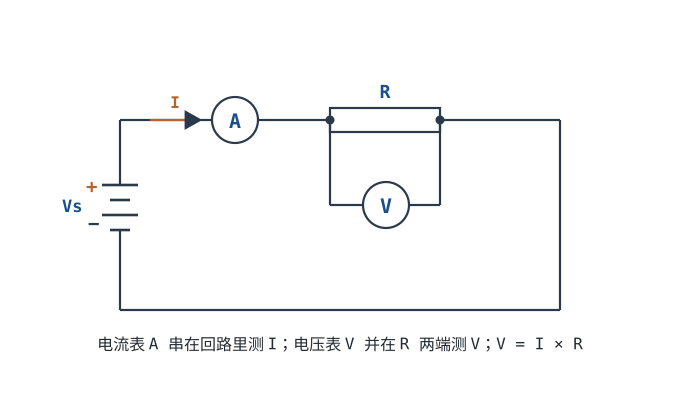

# 欧姆定律与焦耳定律 Ohm's Law & Joule Heating

上一章认识了 V、I、R、P 四个量。这一章给出它们之间最核心的两个关系式：欧姆定律（电压电流电阻的关系）和焦耳定律（电流怎么发热）。这是整本手册里被用得最多的公式。

## 1. 设计动机

::: motivation 为什么它是硬件第一定律
拿到一个电阻、一个电源，你想知道"电流多大、电阻多烫、要不要加散热"——所有这些都从 $V=IR$ 开始。限流电阻选多大、LED 串多大电阻、MOS 管导通时发热多少，全靠这一个公式反复用。不会欧姆定律，就只能靠猜；会了，大多数直流问题都能算个八九不离十。
:::

## 2. 原理图

## 3. 欧姆定律（只给结论）

$$V = I \cdot R \qquad\Longleftrightarrow\qquad I = \frac{V}{R} \qquad\Longleftrightarrow\qquad R = \frac{V}{I}$$

符号含义：

- $V$：电阻两端的电压（伏特 V）；
- $I$：流过电阻的电流（安培 A）；
- $R$：电阻阻值（欧姆 Ω）。

直觉：**电压是"因"，电阻是"阻碍"，电流是"果"**。同样电压下，电阻翻倍电流减半；同样电阻下，电压翻倍电流翻倍。

::: analogy 水压与节流阀
水管两端水压差越大、阀门开得越大（电阻越小），水流越急。把阀门关小一半（R 翻倍），在同样水压下水流减半——这就是 $I=V/R$。
:::

## 4. 焦耳定律（发热）

电流流过电阻会发热，发热功率就是上一章的 $P=I^2R$。把它写成热量形式：

$$Q = I^{2} R \, t$$

符号含义：$Q$ 是 t 秒内产生的热量（焦耳 J），$I$ 是电流（A），$R$ 是电阻（Ω），$t$ 是时间（s）。

这就是**为什么导线太细会发烫、为什么电阻有额定功率、为什么保险丝会烧断**——电流热效应。

::: advanced 进阶：欧姆定律对谁成立
欧姆定律 $V=IR$ 只对**线性电阻**（金属膜、碳膜、绕线等）成立，且在其工作温度范围内。对二极管、LED、电池、半导体这类非线性器件，$V/I$ 不是常数，不能直接套——它们的电流电压曲线是弯的，要分段或用小信号模型。焦耳定律 $P=VI=I^2R$ 对任何耗散功率的元件都成立（R 换成当时的等效电阻即可）。
:::

## 5. 带数字的算例

::: example LED 限流电阻怎么算
1. **需求**：3.3V 电源点亮一颗红光 LED，LED 正常压降约 1.8V，希望电流 5 mA。
2. **电阻上分压**：电源 3.3V 减去 LED 的 1.8V = **1.5V** 落在限流电阻上。
3. **算电阻**：$R = V_R/I = 1.5/0.005 = 300$ Ω（取标称 300Ω 或就近 330Ω）。
4. **算电阻发热**：$P_R = V_R \times I = 1.5 \times 0.005 = 0.0075$ W，用普通 0805（1/8W）绰绰有余。
5. **验算 LED**：$V_{LED}=1.8V$、$I=5mA$，LED 自身耗散 $1.8\times0.005=9$ mW，安全。
:::

::: example 同一电阻，两种电压下差多少
一个 100 Ω 电阻：加 5V 时 $I=5/100=50$ mA，发热 $P=I^2R=0.05^2\times100=0.25$ W；加到 20V（4 倍电压）时，电流变成 200 mA（4 倍），发热 $P=0.2^2\times100=4$ W（16 倍！）。**功率随电压平方增长**，这就是为什么过压会瞬间烧毁元件。
:::

## 6. 常见坑

::: pitfall 常见坑
- **忘了扣掉器件压降，直接 $R=V_{cc}/I$**：现象——LED 比预期暗很多或烧得不规律。原因——LED/二极管自身有 1.8V 压降，不能拿电源电压直接除。解决——限流电阻上的电压 = 电源电压 − 器件压降，再除以目标电流。
- **电阻功率只按 $VI$ 粗算，不留余量**：现象——0805 电阻通电后发黄、开裂。原因——电阻实际耗散接近或超过额定功率，且高温下降额。解决——计算 $P=I^2R$ 后，额定功率至少取 2 倍以上；高功率场合改用 1206/2512 或加散热。
- **把"电阻开路"和"电阻短路"搞反**：现象——测到电流为 0 以为电阻变小。原因——电阻烧断后是**开路**（电阻无穷大，电流为 0）；焊锡/碎屑搭上两脚才是**短路**（电阻≈0，电流暴涨）。解决——用电阻档离线测：开路读数 OL/无穷大，短路读数≈0。
:::

## 7. 自测题

5V 电源接一个 100Ω 电阻，电流多少？电阻发热几瓦？

$I=V/R=5/100=$ **0.05 A = 50 mA**。发热 $P=I^2R=0.05^2\times100=$ **0.25 W**（也可用 $P=V^2/R=25/100=0.25$ W 验算）。

用 9V 电池点亮同一颗 1.8V / 5mA 的 LED，限流电阻要多大？电阻耗散几瓦？

电阻上分压 $=9-1.8=7.2$ V。$R=7.2/0.005=$ **1440 Ω ≈ 1.5kΩ**。电阻耗散 $P=7.2\times0.005=$ **0.036 W**——此时大部分功率浪费在限流电阻上（LED 只耗 9 mW），所以高压小电流驱动 LED 效率很低。

一个 10Ω 电阻，加 3V 和加 30V，功率差多少倍？这说明什么？

功率 $P=V^2/R$：3V 时 $0.9$ W，30V 时 $90$ W，差 **100 倍**（电压 10 倍 → 功率 10²=100 倍）。说明功率对电压极其敏感，**过压会以平方关系摧毁元件**，选型必须留足电压余量。

## 8. 参考资料

- [Lessons In Electric Circuits — Chapter 3: Ohm's Law](https://www.ibiblio.org/kuphaldt/electricCircuits/)
- Practical Electronics for Inventors (Scherz & Monk) — Ohm's Law & Power chapter
- [Khan Academy · Ohm's law](https://www.khanacademy.org/science/electrical-engineering)
