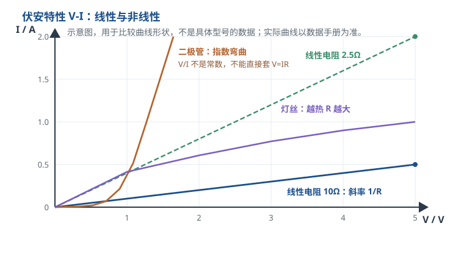

# 欧姆定律与焦耳定律 Ohm's Law & Joule Heating

在[电压、电流、电阻与功率](voltage-current-power.md)里，四个量是分开定义的：电压是两点势差，电流是电荷流量，电阻是阻碍，功率是能量转移速率。本章把它们连起来，回答工程上被问得最多的两个问题：**给定电压和电阻，电流多大？给定电流和电阻，发热多少？**

前一个问题的答案是欧姆定律，后一个问题的答案是焦耳定律。所有限流电阻、分压网络、电流采样、保险丝、导线线径、MOS 管导通损耗，都是这两个式子的反复应用。本章的主线是：先讲局部（一个电阻），再讲全电路（含电源内阻），再讲非线性（二极管、LED、灯丝），最后把公式放回真实导线、接触电阻和温度里，用一个完整的采样电阻设计收尾。

## 1. 设计动机

::: motivation 为什么它是硬件第一定律
**场景一：LED 直接接 5V。** LED 不是电阻，它的正向压降在导通后几乎不变，电流由外部限流决定。5V 直接加在红光 LED 上，电流只受电源内阻、导线电阻和 LED 动态电阻限制，很容易冲到几百 mA，瞬间烧毁。正确做法是串一只限流电阻，让电阻承担 $5-V_F$ 的压差。

**场景二：三极管基极直接接 3.3V GPIO。** BJT 的基极-发射极也是一个 PN 结，导通后压降约 0.7V；没有基极电阻，基极电流会大到把 GPIO 或三极管烧掉。基极电阻的算法，就是欧姆定律。

**场景三：电流采样。** 要测 0~2A 的负载电流，常用一只 25mΩ 的采样电阻，把电流转换成 50mV 电压。它满量程耗散 $2^2\times0.025=0.1$ W，看起来很小，但采样电阻的温漂、焊接电阻、走线电阻都会直接影响测量精度。

这三个场景的共同点是：**电路拓扑可能完全正确，但电流、压降、功耗没有算，器件就会在"看起来很正常"的电压下烧掉。** 5V 常被当成"安全电压"，但 5V 加在 10Ω 上就是 0.5A、2.5W；加在 0.05Ω 的接触电阻上，理论上会试图流过 100A、耗散 500W。决定破坏力的是电流和功率，不是电压数值本身。
:::

欧姆定律和焦耳定律之所以是"第一定律"，是因为它们把电路从"接对了没有"推进到"能不能长期工作"。接对只是功能正确；算过电流、压降、功耗，才是工程正确。

| 你想解决 | 先算 | 判据 |
|---|---|---|
| LED 亮度不对/烧毁 | $I=(V_{CC}-V_F)/R$ | $I$ 不超过 LED 额定电流 |
| 电阻发烫/开路 | $P=I^2R$ 或 $P=V^2/R$ | $P$ 不超过降额后的额定功率 |
| 导线/连接器发热 | $V=IR$、$P=I^2R$ | 压降在允许范围，温升在载流曲线内 |
| 电池带载掉压 | $I=E/(R+r)$ | 端电压不低于负载最低工作电压 |
| 采样电阻精度不够 | $V=IR$、$P=I^2R$ | 功耗、温漂、走线电阻都在误差预算内 |

## 2. 定义与直观

### 2.1 欧姆定律的三种写法

对一只线性电阻，电压、电流、电阻满足：

$$V=IR\qquad\Longleftrightarrow\qquad I=\frac{V}{R}\qquad\Longleftrightarrow\qquad R=\frac{V}{I}$$

其中 $V$ 是电阻**两端**的电压，单位伏特（V）；$I$ 是**流过**电阻的电流，单位安培（A）；$R$ 是电阻，单位欧姆（$\Omega$）。三个式子是同一个关系的三种代数变形，不是三条独立的定律。

直觉上：**电压是推动力，电阻是阻碍，电流是结果。** 同样电压下电阻翻倍，电流减半；同样电阻下电压翻倍，电流翻倍。把电压想成水管两端的水压差、电阻想成阀门开度，就得到 $I=V/R$ 的水路版本：阀门关小一半，同样水压下流量减半。这个类比的边界是：水管流量有惯性，电流几乎瞬间建立；且水管里的"阻力"随流量非线性变化，而理想电阻的 $R$ 是常数。

用的时候必须满足两个前提：

1. **$V$ 和 $I$ 属于同一个元件。** 不能把电源电压当成某个串联电阻两端的电压；串联电路里电源电压被多个元件分掉，电阻上只分到其中一部分。
2. **$V$ 和 $I$ 取关联参考方向。** 电流从电压的 $+$ 端流入时，$V=IR$ 取正号；如果电流从 $+$ 端流出，公式要写成 $V=-IR$，或者把电流取负。符号错了，算出来的功率正负也会错。

欧姆定律的实质不是"电压等于电流乘电阻"这句同义反复，而是断言：**在恒定温度、恒定材料和几何尺寸下，流过导体的电流与两端电压成正比，比值 $R$ 是常数。** 这个"成正比"是需要实验验证的物理规律，不是数学定义。对大多数金属和碳膜电阻，在正常工作范围内它成立得很好；对二极管、LED、灯丝、热敏电阻，它不成立。

从场的角度看，欧姆定律的局部形式是

$$\mathbf{J}=\sigma\mathbf{E}$$

其中 $\mathbf{J}$ 是电流密度，单位 $\text{A/m}^2$；$\sigma$ 是电导率，单位 $\text{S/m}$；$\mathbf{E}$ 是电场强度，单位 $\text{V/m}$。这个式子说明"电流密度正比于电场"，比 $V=IR$ 更基本。把 $\mathbf{J}$ 沿截面积分、$\mathbf{E}$ 沿长度积分，就得到 $I=V/R$，再整理成 $V=IR$。集总电路里我们直接用 $V=IR$，不需要每次都回到场论。

电阻的几何来源是

$$R=\rho\frac{L}{A}$$

其中 $\rho$ 是电阻率，单位 $\Omega\cdot\text{m}$；$L$ 是导体长度，单位 m；$A$ 是截面积，单位 $\text{m}^2$。这个式子解释了为什么细线比粗线热、长线比短线压降大：长度加倍，电阻加倍；截面积加倍，电阻减半。

### 2.2 线性与非线性：欧姆定律对谁成立

把一只元件的电压作横轴、电流作纵轴，画出的曲线叫**伏安特性（V-I characteristic）**。欧姆定律成立的条件，就是这条曲线是一条**过原点的直线**：电压加倍，电流也加倍，比值 $V/I$ 处处相同。

三类典型形状：

- **线性电阻**：金属膜、碳膜、绕线电阻在额定范围内近似直线，斜率是 $1/R$。$R$ 不随电压、电流变（理想情况下）。
- **二极管/LED**：正向导通后电流随电压指数上升，曲线非常陡。电压稍微增加，电流可能成倍增加；$V/I$ 不是常数，不能拿一个"额定电阻"套。
- **灯丝/热敏电阻**：电流让温度升高，温度又改变电阻。灯丝是正温度系数（越热电阻越大），曲线向下弯；NTC 热敏电阻是负温度系数（越热电阻越小），曲线向上翘。两者都不是欧姆元件。

对非线性器件，欧姆定律并没有"完全失效"，而是不能再用一个常数 $R$。工程上有两种用法：

1. **静态电阻** $R_{\text{static}}=V/I$：工作点上的电压除以电流，用来估算该点的等效损耗，但换个工作点就变。
2. **动态电阻** $r_{\text{dyn}}=dV/dI$：工作点附近电压微小变化与电流微小变化的比值，用于小信号模型。二极管的小信号电阻约 $nV_T/I$，其中 $V_T=kT/q$ 是热电压；取 $T=300$ K、$k=1.380649\times10^{-23}$ J/K、$q=1.602176634\times10^{-19}$ C，得 $V_T=1.380649\times10^{-23}\times300/(1.602176634\times10^{-19})\approx25.85$ mV，常取 25.9mV。

焦耳定律 $P=VI$ 对非线性器件仍然成立；$P=I^2R$ 只在"$R$ 取该工作点的等效电阻"时成立。把 LED 的 $V_F/I$ 当成常数电阻去算别的电流，是典型的错误。

::: advanced 进阶：二极管为什么"电压一变、电流就爆"
理想二极管方程写成 $I=I_S(e^{V/(nV_T)}-1)$，其中 $I_S$ 是反向饱和电流，$n$ 是理想因子（通常 1~2），$V_T=kT/q\approx25.9$ mV（室温）。在导通区，电流近似按指数变化。取 $n=2$，电压增加 100mV，电流变为原来的

$$\frac{I_2}{I_1}=e^{100\text{mV}/(2\times25.9\text{mV})}=e^{1.93}\approx6.9$$

倍。也就是说，LED 两端电压只多了 0.1V，电流就可能涨近 7 倍。这就是"恒压源直接驱动 LED 很危险"的定量原因：电源电压的小波动、LED 温度的小变化，都会造成电流的大波动。实际 LED 还有串联体电阻，会稍微缓和这个指数，但趋势不变。具体数值以器件数据手册的 V-I 曲线为准。
:::

### 2.3 全电路欧姆定律：电源也有内阻

前面的 $V=IR$ 描述的是一个电阻。真实电源（电池、适配器、信号源）内部也有电阻，叫**内阻** $r$。把电源的电动势记为 $E$，外接负载记为 $R$，整个回路满足：

$$E=I(R+r)\qquad\Longrightarrow\qquad I=\frac{E}{R+r}$$

负载两端的**端电压**是

$$V_{\text{terminal}}=E-Ir$$

其中 $E$ 是电动势，单位 V；$r$ 是内阻，单位 $\Omega$；$R$ 是负载电阻，单位 $\Omega$；$I$ 是回路电流，单位 A。

举个完整例子：一只 9V 电池，内阻按 1.5Ω 估算（典型量级，具体以数据手册为准），接 100Ω 负载。

$$I=\frac{9}{100+1.5}=\frac{9}{101.5}\approx0.08867\ \text{A}=88.67\ \text{mA}$$

$$V_{\text{terminal}}=9-0.08867\times1.5=9-0.133=8.867\ \text{V}$$

负载功率：

$$P_{\text{load}}=I^2R=0.08867^2\times100\approx0.786\ \text{W}$$

内阻损耗：

$$P_r=I^2r=0.08867^2\times1.5\approx0.0118\ \text{W}=11.8\ \text{mW}$$

效率：

$$\eta=\frac{P_{\text{load}}}{EI}=\frac{0.786}{9\times0.08867}\approx98.5\%$$

如果把这节电池短路，$R=0$，电流将是 $I_{sc}=E/r=9/1.5=6$ A。实际电池和电源都有保护，不能真的短接；这个数字只用来说明"内阻决定了短路电流的上限"。

全电路欧姆定律解释了很多"电压够但带不动"的现象：电池旧了，内阻变大，空载电压可能还是 9V，一接负载端电压就掉；汽车启动时电池电压瞬间跌到 10V 以下，也是因为启动电流在內阻上产生了大压降。**看电源不能只看空载电压，还要看内阻和带载能力。**

### 2.4 焦耳定律：电流怎样变成热

电流流过电阻，电场力做功，电能转化为热。功率就是前面定义的 $P=VI$。把欧姆定律代进去，得到焦耳定律的三种常用形式：

$$P=VI=I^2R=\frac{V^2}{R}$$

其中 $P$ 是功率，单位 W；$V$ 是电阻两端电压，单位 V；$I$ 是流过电阻的电流，单位 A；$R$ 是电阻，单位 $\Omega$。$t$ 秒内产生的热量是

$$Q=I^2Rt$$

其中 $Q$ 是热量，单位 J；$t$ 是时间，单位 s。能量形式就是 $E=Pt=I^2Rt$。

推导只有两步：

- 由 $V=IR$，代入 $P=VI$ 得 $P=(IR)I=I^2R$；
- 由 $I=V/R$，代入 $P=VI$ 得 $P=V(V/R)=V^2/R$。

三个形式在数学上等价，但工程上各有适用场景：串联电路电流相同，用 $P=I^2R$ 方便；并联电路电压相同，用 $P=V^2/R$ 方便；已知电压和电流，直接用 $P=VI$。

焦耳定律解释了三个常见现象：

- **导线太细会发烫**：$R=\rho L/A$，截面积小则 $R$ 大；同样的电流下 $P=I^2R$ 更大。
- **电阻有额定功率**：长期耗散的热必须通过封装、焊盘、PCB 铜箔传到环境；散热跟不上，温度就超限。
- **保险丝会烧断**：保险丝是故意设计的小截面导体，电流超过额定后 $I^2R$ 加热到熔点，切断回路。烧断是它的功能，不是"质量不好"。

对非线性器件，$P=VI$ 仍然成立；$P=I^2R$ 和 $P=V^2/R$ 只在 $R$ 取工作点等效电阻时成立。对随时间变化的电压/电流，瞬时功率是 $p(t)=v(t)i(t)$，平均功率要对一个周期积分，不能简单拿峰值相乘。

## 3. 定量关系

### 3.1 公式、符号与单位

把本章的公式集中列出，并写清适用条件：

| 公式 | 已知 | 求 | 适用条件 |
|---|---|---|---|
| $V=IR$ | $I,R$ | $V$ | 欧姆元件，关联参考方向，恒温 |
| $I=V/R$ | $V,R$ | $I$ | 同上 |
| $R=V/I$ | $V,I$ | $R$ | 静态电阻定义，可用于非线性工作点 |
| $P=VI$ | $V,I$ | $P$ | 任何二端元件的瞬时功率 |
| $P=I^2R$ | $I,R$ | $P$ | $R$ 为工作点等效电阻 |
| $P=V^2/R$ | $V,R$ | $P$ | 同上 |
| $Q=I^2Rt$ | $I,R,t$ | $Q$ | $R$ 在时间内近似不变 |
| $R=\rho L/A$ | $\rho,L,A$ | $R$ | 均匀截面导体 |
| $R(T)=R_{20}[1+\alpha(T-20)]$ | $R_{20},\alpha,T$ | $R(T)$ | 线性温度系数近似 |
| $E=I(R+r)$ | $E,R,r$ | $I$ | 含内阻的电源回路 |

符号与单位：

- $V$：电压，V；$I$：电流，A；$R$：电阻，$\Omega$；
- $P$：功率，W；$Q$：热量，J；$t$：时间，s；
- $\rho$：电阻率，$\Omega\cdot\text{m}$；$L$：长度，m；$A$：截面积，$\text{m}^2$；
- $R_{20}$：20°C 时的电阻，$\Omega$；$\alpha$：电阻温度系数，$1/^{\circ}\text{C}$；
- $E$：电源电动势，V；$r$：电源内阻，$\Omega$。

这里的 $R=V/I$ 与 $V=IR$ 要区分：前者是**定义**，对任何二端元件都成立，算出来的是工作点的静态电阻；后者是**定律**，只对欧姆元件成立，断言 $R$ 不随工作点变。把定义当成定律，就会得出"LED 的电阻是 180Ω，所以加 5V 会流过 27.8mA"这类错误结论——实际电流由 LED 的 V-I 曲线和限流元件共同决定。

### 3.2 三个功率公式怎么选

| 场景 | 相同的量 | 推荐公式 | 结论 |
|---|---|---|---|
| 串联 | 电流 $I$ | $P=I^2R$ | 电阻越大，发热越多 |
| 并联 | 电压 $V$ | $P=V^2/R$ | 电阻越小，发热越多 |
| 已知 $V,I$ | 两者都已知 | $P=VI$ | 直接相乘 |
| 已知 $P,R$ | — | $I=\sqrt{P/R}$ 或 $V=\sqrt{PR}$ | 反推工作点 |

串联时电流处处相同，所以 $P$ 与 $R$ 成正比：**大电阻更热**。并联时电压相同，所以 $P$ 与 $R$ 成反比：**小电阻更热**。这个结论和直觉相反的地方在于，"电阻大"不等于"功率大"，要看接法。

用一个具体例子把这件事钉死：一只 100Ω 和一只 10Ω 电阻。

**串联，电流 1A：**

$$P_{100}=1^2\times100=100\ \text{W},\qquad P_{10}=1^2\times10=10\ \text{W}$$

100Ω 发热是 10Ω 的 10 倍；总功率 110W，总电压 $1\times(100+10)=110$ V。

**并联，电压 10V：**

$$P_{100}=\frac{10^2}{100}=1\ \text{W},\qquad P_{10}=\frac{10^2}{10}=10\ \text{W}$$

这次 10Ω 发热是 100Ω 的 10 倍；总功率 11W，总电流 $10/100+10/10=0.1+1=1.1$ A。

同一只 100Ω 电阻，在串联 1A 的例子里耗散 100W，在并联 10V 的例子里只耗散 1W。电阻没变，工作点变了。**所以"这颗电阻多少瓦"必须结合电路来问；脱离电路的功率数字没有意义。**

### 3.3 电阻的几何与温度

电阻的几何公式已经在 2.1 节给出：

$$R=\rho\frac{L}{A}$$

温度对电阻的影响，在一段范围内可以线性近似：

$$R(T)=R_{20}\left[1+\alpha(T-20)\right]$$

其中 $R_{20}$ 是 20°C 时的电阻，$\alpha$ 是电阻温度系数（单位 $1/^{\circ}\text{C}$），$T$ 是温度（°C）。铜的 $\alpha\approx0.00393\ ^{\circ}\text{C}^{-1}$，也就是每升高 1°C，电阻增加约 0.393%。

一根 20°C 时 1Ω 的铜导体，升温到 80°C：

$$R_{80}=1\times[1+0.00393\times(80-20)]
=1\times(1+0.2358)=1.236\ \Omega$$

增加了 23.6%。如果它两端维持 5V，电流会从 5A 降到 $5/1.236=4.045$ A，降了约 19%。铜导线、电机绕组、继电器线圈都有这种"越热电阻越大、电流越小"的正温度系数。

精密电阻的温漂用 ppm/°C 表示。$100\ \text{ppm}/^{\circ}\text{C}=100\times10^{-6}\ /^{\circ}\text{C}=0.01\%/^{\circ}\text{C}$。一只 100Ω、100ppm/°C 的电阻，温度从 25°C 升到 85°C（升高 60°C）：

$$\Delta R=100\times100\times10^{-6}\times60=0.6\ \Omega$$

相对变化 $0.6/100=0.6\%$。常见厚膜电阻的 TCR 约 100~200ppm/°C，金属膜约 50ppm/°C，精密箔电阻可以做到 1ppm/°C 以下；具体以数据手册为准。对比一下：同样升温 60°C，铜导线变化 23.6%，厚膜电阻只变化 0.6%~1.2%，相差约 20~40 倍。**所以"导线电阻"和"电阻器电阻"对温度的敏感度完全不是一个量级。**

自热会让问题复杂化：电流产生热，热让温度升高，温度又改变电阻。如果 TCR 为正，电阻变大、电流变小，是负反馈；如果 TCR 为负（NTC），电阻变小、电流变大，可能形成正反馈甚至热失控。设计 NTC 测温、PTC 自恢复保险丝、灯丝限流时，必须把这条反馈路径算进去。

### 3.4 适用条件与失效边界

欧姆定律的适用条件可以总结为四个"恒定"：

1. **材料与几何恒定**：均匀导体、固定截面积；接触面积变化、导线断裂、焊点开裂都会让 $R$ 变。
2. **温度恒定**：TCR 不为零时，$R$ 随温度变；大电流自热会破坏恒温假设。
3. **线性工作区**：V-I 曲线过原点且是直线；二极管、LED、灯丝、热敏电阻、压敏电阻不满足。
4. **集总近似**：元件尺寸远小于波长；高频下电压、电流沿导线分布，$V=IR$ 的集总形式不够用。

焦耳定律的适用条件更宽：$P=VI$ 对任何二端元件都成立，包括非线性器件、电源、甚至瞬时变化的信号；$P=I^2R$ 和 $P=V^2/R$ 需要 $R$ 的定义，对非线性器件要用工作点等效电阻，对时变电阻要在时间上积分。

工程上还有几个容易忽略的边界：

- **电压额定值独立于欧姆定律。** 电阻的最大工作电压、电容的耐压、绝缘的击穿电压，都不是 $V=IR$ 能算出来的；它们是材料和结构决定的极限。
- **脉冲功率与平均功率不同。** 一只电阻能承受的短脉冲功率可能远高于连续额定功率，也可能因为局部热点而更低；必须查数据手册的脉冲功率曲线，不能拿平均功率代替峰值。
- **接触电阻不是常数。** 连接器触点的接触电阻随压力、氧化、磨损、电流变化；mΩ 级接触电阻在大电流下会产生可观的压降和热。
- **高频下电阻不再是"电阻"。** 寄生电感和电容会让阻抗随频率变，此时要用 $Z=R+j\omega L+1/(j\omega C)$ 描述，欧姆定律的直流形式只是低频近似。

## 4. 典型计算

### 4.1 算例一：LED 限流电阻

**需求**：5V 电源点亮一颗红光 LED，LED 正向压降按 1.8V 计（典型值，具体以数据手册为准），目标电流 10mA。求限流电阻、实际电流、电阻功耗，并验算。

**第一步，算电阻上的压降**。LED 与电阻串联，电源电压被两者分掉：

$$V_R=V_{CC}-V_F=5-1.8=3.2\ \text{V}$$

**第二步，算电阻**：

$$R=\frac{V_R}{I}=\frac{3.2}{0.01}=320\ \Omega$$

E24 系列里没有 320Ω，取邻近的 **330Ω**（IEC 60063 的 E24 标称值）。

**第三步，用实际阻值反算电流**：

$$I=\frac{3.2}{330}\approx0.009697\ \text{A}=9.697\ \text{mA}$$

比目标 10mA 低 3%，肉眼几乎看不出差别。

**第四步，算电阻功耗**：

$$P_R=I^2R=0.009697^2\times330\approx0.0310\ \text{W}=31.0\ \text{mW}$$

0603 电阻额定 0.1W，占比 $0.031/0.1=31\%$，低于 50% 的降额目标，合适。0402 电阻额定约 0.0625W，占比 $0.031/0.0625\approx49.6\%$，已经接近降额上限，长期高温环境建议用 0603。

**第五步，算 LED 功耗与总效率**：

$$P_{\text{LED}}=V_F I=1.8\times0.009697\approx0.01745\ \text{W}=17.45\ \text{mW}$$

总功耗 $31.0+17.45=48.45$ mW，LED 占比 $17.45/48.45\approx36\%$。也就是说，5V 供电、1.8V LED、10mA 的方案，约 64% 的功率浪费在限流电阻上。

**第六步，对比 9V 方案**。同样 1.8V、10mA：

$$R=\frac{9-1.8}{0.01}=720\ \Omega\quad\longrightarrow\quad\text{取 }750\ \Omega$$

$$I=\frac{7.2}{750}=0.0096\ \text{A}=9.6\ \text{mA}$$

$$P_R=0.0096^2\times750\approx0.0691\ \text{W}=69.1\ \text{mW}$$

0603 的 0.1W 已被占到 69%，超过 50% 降额目标，应换 0805（0.125W，占 55.3%）或更大。LED 自身仍只有 $1.8\times0.0096=17.28$ mW，效率 $17.28/(69.1+17.28)\approx20\%$。**同样一颗 LED，9V 方案的限流电阻发热是 5V 方案的 2.2 倍，效率从 36% 掉到 20%。** 这就是"高压小电流驱动 LED 不划算"的定量原因。

**第七步，看错误做法**。如果忘了扣 LED 压降，直接 $R=5/0.01=500\ \Omega$，实际电流是

$$I=\frac{5-1.8}{500}=0.0064\ \text{A}=6.4\ \text{mA}$$

LED 会明显偏暗。如果把 LED 直接接 5V、不加电阻，电流只受寄生参数限制，可能达到数百 mA，结温迅速升高，几秒内烧毁。

### 4.2 算例二：为什么 5V 小信号也会烧

很多人觉得 5V 对人没有危险，就以为它对器件也安全。但**对人安全不等于对器件安全**。下面这张表固定电压 5V，只改变电阻：

| 电阻 | 5V 下电流 | 5V 下功率 | 相对 0402 额定 0.0625W | 相对 0603 额定 0.1W |
|---|---|---|---|---|
| 1MΩ | 5µA | 25µW | 0.04% | 0.025% |
| 10kΩ | 0.5mA | 2.5mW | 4% | 2.5% |
| 400Ω | 12.5mA | 62.5mW | 100% | 62.5% |
| 100Ω | 50mA | 250mW | 4 倍 | 2.5 倍 |
| 50Ω | 100mA | 500mW | 8 倍 | 5 倍 |
| 20Ω | 250mA | 1.25W | 20 倍 | 12.5 倍 |
| 10Ω | 500mA | 2.5W | 40 倍 | 25 倍 |
| 1Ω | 5A | 25W | 400 倍 | 250 倍 |
| 0.05Ω | 100A（理论） | 500W（理论） | — | — |

表里的功率都按 $P=V^2/R$ 算：$5^2/400=0.0625$ W，$5^2/100=0.25$ W，$5^2/10=2.5$ W，$5^2/0.05=500$ W。电流按 $I=V/R$ 算：$5/10=0.5$ A，$5/0.05=100$ A。

两个关键结论：

- **0402 电阻在 5V 下，只要阻值小于 400Ω 就超过额定功率。** 因为 $R_{\min}=V^2/P=25/0.0625=400\ \Omega$。0603 的临界值是 $25/0.1=250\ \Omega$。一颗 10Ω 的 0603 接在 5V 上，功率 2.5W，是额定的 25 倍，几秒钟就会发黄、冒烟。
- **0.05Ω 的接触电阻接在 5V 上，理论上要流过 100A、耗散 500W。** 实际电流会被电源内阻、线缆电阻、保护电路限制，但哪怕只到 10A，接触点上的 $10^2\times0.05=5$ W 也足以烧黑触点。

反过来，1MΩ 电阻接 5V 只有 5µA、25µW，连发热都感觉不到。**所以"5V 会不会烧"这个问题没有统一答案，必须问：接在多小的电阻上？电源能提供多大电流？** 低阻值、大电流、小封装，这三个条件凑在一起，5V 一样能烧。

### 4.3 算例三：导线与接触电阻

**需求**：2 米长、0.5mm² 的铜导线，给 3A 负载供电。求导线电阻、压降、功耗；再算两个 20mΩ 接触电阻的影响。

**导线电阻**：

$$R=\rho\frac{L}{A}=1.68\times10^{-8}\times\frac{2}{0.5\times10^{-6}}
=0.0672\ \Omega$$

**3A 下压降**：

$$V=IR=3\times0.0672=0.2016\ \text{V}$$

**3A 下功耗**：

$$P=I^2R=9\times0.0672=0.6048\ \text{W}$$

**5A 下**：压降 $5\times0.0672=0.336$ V，功耗 $25\times0.0672=1.68$ W。电流增加 67%，功耗增加 178%（因为 $P\propto I^2$）。

**接触电阻**：两个触点共 $2\times0.02=0.04\ \Omega$。

- 3A：压降 $3\times0.04=0.12$ V，功耗 $9\times0.04=0.36$ W；
- 5A：压降 $0.2$ V，功耗 $25\times0.04=1$ W；
- 10A：压降 $0.4$ V，功耗 $100\times0.04=4$ W。

**总影响**（3A、2 米线、两个触点）：

$$V_{\text{total}}=0.2016+0.12=0.3216\ \text{V}$$

$$P_{\text{total}}=0.6048+0.36=0.9648\ \text{W}$$

在 5V 系统里，0.322V 是 6.4%；在 12V 系统里是 2.7%；在 24V 系统里是 1.3%。**同样一根线，系统电压越低，线损占比越大。** 这就是为什么 5V/2A 的 USB 充电线要粗、要短，而 24V/2A 的工业线可以细一些。

注意：0.96W 的总功耗并不直接等于某个温升。温升取决于导线截面积、绝缘、环境温度、连接器材料和散热条件。**功耗是"发热量"，温升是"散热结果"，两者不能混为一谈。** 大电流设计要查线缆/连接器的载流—温升曲线，不能只算功率。

### 4.4 算例四：完整设计——25mΩ 电流采样电阻

这是一个从需求到验算的完整设计例子。

**需求**：

- 测量 0~2A 的负载电流；
- 满量程输出 50mV 给 ADC；
- 负载供电 5V，最大 2A；
- 环境温度最高 60°C；
- 目标精度 1%（不含 ADC 自身误差）；
- PCB 空间允许 1206 封装。

**第一步，算采样电阻**：

$$R_{\text{shunt}}=\frac{V_{\text{FS}}}{I_{\text{FS}}}=\frac{0.05}{2}=0.025\ \Omega=25\ \text{m}\Omega$$

**第二步，算功耗**：

$$P_{2A}=I^2R=2^2\times0.025=0.1\ \text{W}$$

$$P_{1A}=1^2\times0.025=0.025\ \text{W}=25\ \text{mW}$$

**第三步，选封装并验算降额**。1206 厚膜电阻额定 0.25W（典型值），2A 时占 $0.1/0.25=40\%$，低于 50% 降额目标，合适。60°C 低于常见的 70°C 降额拐点，不需要额外折减；如果环境升到 100°C，按 70~155°C 线性降额，允许功率为 $0.25\times(155-100)/(155-70)\approx0.162$ W，此时 0.1W 占 61.8%，余量变小，应换 2512（1W）或降低电流。

**第四步，算负载压降（burden voltage）**：

$$V_{\text{burden}}=I_{\text{FS}}R=2\times0.025=0.05\ \text{V}=50\ \text{mV}$$

对 5V 负载，这是 1.0%；对 3.3V 负载，这是 $0.05/3.3=1.52\%$。如果负载对 3.3V 很敏感，50mV 的 burden 已经不可忽略，应改用更小的采样电阻（如 10mΩ、满量程 20mV），再加一级放大。

**第五步，算温漂误差**。假设采样电阻的 TCR 为 100ppm/°C，自热温升 50°C：

$$\frac{\Delta R}{R}=100\times10^{-6}\times50=0.005=0.5\%$$

满量程 2A 时对应 $2\times0.005=0.01$ A=10mA 的误差。这个误差是"增益误差"性质的，可以通过校准部分消除，但温漂会随温度变，校准只能在一个温度点做。

**第六步，做误差预算**。假设电阻初始精度 1%、TCR 引入 0.5%、ADC 增益误差 0.5%（假设值，实际以 ADC 数据手册为准），按均方根合成：

$$\varepsilon_{\text{RSS}}=\sqrt{1^2+0.5^2+0.5^2}\%=\sqrt{1.5}\%\approx1.22\%$$

最坏情况线性相加是 $1+0.5+0.5=2\%$。两者都超过 1% 的目标。要真正做到 1%，需要选 0.1% 的采样电阻、低 TCR（如 25ppm/°C）、并对 ADC 做增益校准；或者接受 1.5%~2% 的精度并放宽指标。

**第七步，检查布局误差**。如果 PCB 走线、焊锡、过孔在采样路径上额外引入 10mΩ，相对 25mΩ 就是 $10/25=40\%$ 的误差——比电阻本身精度大得多。解决方法是**开尔文接法（Kelvin / 4-wire）**：电流从电阻的两端大焊盘流入流出，电压检测从电阻内部的两个小焊盘引出，让测量路径不经过大电流走线。这是 mΩ 级采样电阻的标准做法。

**第八步，验算工作点**：

| 负载电流 | 采样电压 | 采样功耗 |
|---|---|---|
| 0.5A | 12.5mV | 6.25mW |
| 1A | 25mV | 25mW |
| 2A | 50mV | 100mW |

三组都满足 $V=IR$ 和 $P=I^2R$，且 2A 时功耗 0.1W，低于 1206 在 60°C 下的允许值。

**结论**：选 25mΩ、1%、0.25W、1206 封装的采样电阻，开尔文接法；5V/2A 下 burden 1%、功耗 40% 额定；若负载是 3.3V 或要求 1% 精度，改用 10mΩ + 放大，或选 0.1%、低 TCR 的型号并校准。

## 5. 工程含义

### 5.1 工程数量级表

| 对象 | 典型量级 | 说明 |
|---|---|---|
| 信号链路电阻 | 1kΩ~1MΩ | 兼顾噪声、功耗与输入偏置 |
| LED 限流电阻 | 100Ω~10kΩ | 由 $V_{CC}$、$V_F$、目标电流决定 |
| 电流采样电阻 | 1mΩ~1Ω | 大电流用 mΩ，小电流可用 Ω 级 |
| 上拉/下拉电阻 | 1kΩ~100kΩ | 太大易受噪声，太小费电 |
| 铜导线电阻 | 0.004~0.034Ω/m | 4mm²~0.5mm²，20°C |
| 连接器接触电阻 | 5~50mΩ/触点 | 具体以连接器数据手册为准 |
| PCB 铜箔（1oz） | 约 0.48mΩ/方块 | 10 方块约 4.8mΩ |
| 厚膜电阻 TCR | 100~200ppm/°C | 金属膜约 50ppm/°C |
| 铜的 TCR | 约 3930ppm/°C | 即 0.393%/°C |
| 贴片电阻额定功率 | 0402 约 1/16W，0603 约 1/10W，0805 约 1/8W，1206 约 1/4W | 典型值，以数据手册为准 |

这张表的作用是"先估数量级，再精算"。看到 10A 的电流，就知道 mΩ 级采样电阻、粗导线、大电流连接器是必需项；看到 1µA 的偏置电流，就知道 MΩ 级电阻上的压降不能忽略。

### 5.2 选型与降额

选电阻不只看阻值，至少要看五个参数：阻值、精度、额定功率、TCR、最大工作电压。

- **功率**：长期工作按额定的 50%~70% 降额；高温、密闭、无铜箔散热时更保守。脉冲/浪涌要查脉冲功率曲线，不能拿连续额定值套。
- **精度**：1% 是通用值，0.1% 用于采样、电桥、精密分压；精度和 TCR 要一起看，1% 电阻配 200ppm/°C 的 TCR，在 60°C 温升下可能再引入 1.2% 误差。
- **TCR**：精密应用选 25ppm/°C 或更低；普通限流、上拉可以放宽。
- **最大工作电压**：电阻不仅有功率上限，还有电压上限；高压场合即使功率没超，电压也可能超。
- **封装与散热**：同样 0.1W，0402 的散热面积远小于 1206；高温环境优先大封装。

导线和连接器的选型逻辑不同：它们没有"阻值"可选，只有截面积、材料、镀层、接触结构。选型的核心是**载流—温升曲线**，而不是欧姆定律算出来的电阻。欧姆定律帮你算压降和功耗，温升还要看散热。

### 5.3 温度与漂移

温度对电路的影响有三条路径：

1. **电阻值漂移**：$R(T)=R_{20}[1+\alpha(T-20)]$。铜的 23.6%/60°C 远大于精密电阻的 0.6%/60°C；导线、绕组、继电器线圈的漂移往往被低估。
2. **器件工作点漂移**：LED 的 $V_F$ 随温度下降（约 -2mV/°C 量级，具体看器件），恒压驱动时电流会随温度上升；二极管、三极管、基准源都有温度系数。
3. **热失控风险**：NTC、灯丝、某些陶瓷电容在某些条件下电阻随温度下降，电流增大又让温度更高，形成正反馈。设计时要保证在最坏温度下仍有足够的限流或保护。

工程做法是**按最高工作温度算最坏情况**：用 $R(T_{\max})$ 而不是 25°C 的标称值，用 $V_F(T_{\max})$ 而不是室温典型值，用降额后的额定功率而不是标称功率。数据手册里的典型值只是"典型"，设计要按最大/最小值。

### 5.4 什么时候欧姆定律不够用

- **非线性器件**：二极管、LED、BJT、MOSFET 的沟道、电池、灯丝、热敏电阻、压敏电阻。用数据手册的 V-I 曲线、分段线性模型或小信号模型，不要用一个常数 $R$。
- **高频**：电阻的寄生电感/电容、导线的分布参数变得重要，要用阻抗 $Z$ 和传输线模型；见[阻抗与导纳](impedance.md)。
- **高压**：击穿、爬电距离、绝缘等级由材料和结构决定，不是 $V=IR$ 能预测的；见[安全用电与触电防护](electrical-safety.md)。
- **大电流/高温**：接触电阻、熔断、热失控、材料软化都会让"常数 $R$"失效；要按载流—温升曲线和热模型设计。
- **脉冲/瞬态**：峰值功率、能量、脉冲宽度共同决定是否损坏；平均功率相同，脉冲形状不同，失效模式也不同。

欧姆定律是**局部、线性、集总、恒温**的近似。焦耳定律更普遍：$P=VI$ 对任何元件都成立；$P=I^2R$ 需要 $R$ 的定义。工程判断的关键，是知道自己正在用哪个近似、它什么时候会失效。

## 6. 常见坑

::: pitfall 常见坑
- **忘了扣掉 LED/二极管的正向压降**：现象——按 $R=V_{CC}/I$ 算出的电阻装上后，LED 明显偏暗；或者换一颗 LED 就烧。原因——LED 自身有 $V_F$，限流电阻上的电压是 $V_{CC}-V_F$，不是 $V_{CC}$。解决——先算 $V_R=V_{CC}-V_F$，再 $R=V_R/I$；用实际阻值反算电流，并核对 LED 的额定电流与功耗。
- **用电源电压代入 $P=V^2/R$ 算串联电阻**：现象——算出的电阻功率偏大很多，选了过大封装；或者反过来，用电阻两端电压算错。原因——$V$ 必须是**该电阻两端**的电压；串联电路里电源电压被多个元件分掉。解决——先求电阻上的压降，再代 $P=V^2/R$；或者用 $P=I^2R$，因为串联电流处处相同。
- **认为"电阻越大越热"或"电阻越小越热"**：现象——并联时小电阻更热，串联时大电阻更热，和直觉对不上。原因——功率取决于工作点：串联电流相同，$P=I^2R$ 与 $R$ 成正比；并联电压相同，$P=V^2/R$ 与 $R$ 成反比。解决——先判断串联还是并联，再选公式；不确定就回到 $P=VI$，分别算每个电阻的 $V$ 和 $I$。
- **忽略导线和接触电阻**：现象——5V/2A 的设备末端只有 4.5V，或者连接器摸着发烫。原因——导线电阻、触点电阻与负载串联，产生 $IR$ 压降和 $I^2R$ 发热；低压大电流系统尤其敏感。解决——算回路电阻（去线+回线+触点），核对压降占比和温升；大电流用粗线、短路径、低接触电阻连接器。
- **把欧姆定律直接套在二极管、LED、电池上**：现象——用 $R=V/I$ 算出"LED 电阻 180Ω"，再算 5V 下电流 27.8mA，实际完全不对。原因——这些器件的 V-I 曲线非线性，$V/I$ 随工作点变，不是一个常数。解决——用数据手册的 V-I 曲线、$V_F$ 与额定电流、分段模型或小信号模型；焦耳定律仍可用 $P=VI$，但 $P=I^2R$ 要用工作点等效电阻。
- **电阻功率不降额**：现象——0603 电阻长期工作在 0.1W，几个月后发黄、阻值漂移甚至开路。原因——额定功率是特定温度下的上限，实际环境温度、铜箔散热、密闭壳体都会降低有效额定值。解决——按降额曲线把实际功耗压到额定的 50%~70% 以下；高温或密闭环境换 0805/1206，或并联分摊。
- **把电阻开路和短路搞反**：现象——测到回路电流为 0，以为电阻"变小了"；或者电阻两端电压为 0，以为电阻"断了"。原因——电阻烧断后是**开路**（$R\to\infty$，电流为 0，两端可能仍有电压）；焊锡/碎屑搭桥才是**短路**（$R\approx0$，电流暴涨，两端电压接近 0）。解决——断电后用电阻档离线测：开路读数 OL/无穷大，短路读数接近 0；再结合通电时的电压、电流交叉判断，不要只看一个读数。
:::

## 7. 自测题

5V 加在 100Ω 电阻上，电流和功率各是多少？改加 20V 呢？功率差多少倍？

5V 时：$I=V/R=5/100=0.05$ A=50mA；$P=I^2R=0.05^2\times100=0.25$ W；用 $P=V^2/R=25/100=0.25$ W 验算，一致。

20V 时：$I=20/100=0.2$ A=200mA；$P=0.2^2\times100=4$ W；用 $P=400/100=4$ W 验算，一致。

电压变为 4 倍，电流变为 4 倍，功率变为 $4^2=16$ 倍（$0.25\times16=4$ W）。这说明功率对电压是平方关系，过压非常危险。

一只 9V 电池，内阻 1.5Ω，接 100Ω 负载。求回路电流、端电压、负载功率、内阻损耗和效率。

回路电流：$I=E/(R+r)=9/(100+1.5)=9/101.5\approx0.08867$ A=88.67mA。

端电压：$V_t=E-Ir=9-0.08867\times1.5=9-0.133=8.867$ V。

负载功率：$P_{\text{load}}=I^2R=0.08867^2\times100\approx0.786$ W。

内阻损耗：$P_r=I^2r=0.08867^2\times1.5\approx0.0118$ W=11.8mW。

效率：$\eta=P_{\text{load}}/(EI)=0.786/(9\times0.08867)\approx98.5\%$。

验算：$P_{\text{load}}+P_r=0.786+0.0118=0.7978$ W；$EI=9\times0.08867=0.798$ W，一致（舍入误差）。

用 5V 点亮一颗 $V_F=2.0$V、额定 20mA 的 LED，限流电阻取多大？电阻功耗多少？0603（0.1W）够不够？

电阻压降：$V_R=5-2.0=3.0$ V。

电阻：$R=3.0/0.02=150\ \Omega$（150Ω 是 E24 标称值）。

电阻功耗：$P_R=I^2R=0.02^2\times150=0.06$ W=60mW。

0603 额定 0.1W，占比 $60/100=60\%$，超过 50% 的降额目标，长期高温下不合适；建议换 0805（0.125W，占比 $60/125=48\%$）或更大。LED 自身功耗 $2.0\times0.02=40$ mW；总功耗 100mW，效率 40%。

一只 25mΩ 的采样电阻过 3A 电流，采样电压和功耗各是多少？选 0.5W 的 1206 封装，降额是否合适？

采样电压：$V=IR=3\times0.025=0.075$ V=75mV。

功耗：$P=I^2R=9\times0.025=0.225$ W=225mW。

0.5W 封装占比 $0.225/0.5=45\%$，低于 50% 降额目标，合适；如果用 0.25W 封装，占比 $0.225/0.25=90\%$，余量太小，不建议。注意 25mΩ 在 3A 下的 burden 是 75mV，对 3.3V 负载约占 2.3%，要核对负载的最低工作电压。

为什么 5V 也能烧电阻？请用 0603（0.1W）和 10Ω 电阻算一遍，并说明 0402（1/16W）在 5V 下的临界阻值。

10Ω、5V 下：$I=5/10=0.5$ A；$P=V^2/R=25/10=2.5$ W，或 $P=I^2R=0.25\times10=2.5$ W。

0603 额定 0.1W，2.5W 是额定的 25 倍，几秒内就会过热、发黄甚至烧毁。

0402 额定 0.0625W，5V 下的临界阻值 $R_{\min}=V^2/P=25/0.0625=400\ \Omega$；阻值小于 400Ω 就超额定。所以"5V 安全"只对人成立，对低阻值、小封装器件并不成立。

一只 100Ω、100ppm/°C 的电阻，温度从 25°C 升到 85°C，阻值变化多少？同样温升下，1Ω 的铜导线变化多少？两者说明什么？

电阻：$\Delta R=100\times100\times10^{-6}\times(85-25)=100\times10^{-4}\times60=0.6\ \Omega$，相对变化 $0.6/100=0.6\%$。

铜导线：$\Delta R=1\times0.00393\times60=0.2358\ \Omega$，相对变化 23.6%。

两者相差约 $23.6/0.6\approx39$ 倍。说明铜导线、绕组、继电器线圈的温漂远大于精密电阻；设计大电流路径或精密测量时，不能把导线当成"恒定电阻"，要按最高温度核算。

## 8. 参考资料

- [Lessons In Electric Circuits, Volume I – DC（Kuphaldt）](https://www.ibiblio.org/kuphaldt/electricCircuits/)：Chapter 2《Ohm's Law》讲 V、I、R 的关系、功率计算与非线性导电（Nonlinear conduction）；本章的欧姆定律、焦耳定律与非线性讨论均按该章结构重写。
- The Art of Electronics, 3rd ed.（Horowitz and Hill），Chapter 1《Foundations》：电阻类型、温度系数、功率额定与电源内阻的工程讲法；本章 TCR 与降额的数值口径参考该书。
- Practical Electronics for Inventors, 4th ed.（Scherz and Monk），Chapter 2《Theory》：欧姆定律、焦耳定律、电池内阻与导线电阻的入门推导；本章全电路欧姆定律的讲法参考该书。
- Vishay CRCW 系列厚膜贴片电阻数据手册：Power Derating 曲线（70°C 以上线性降额、155°C 降为零）与脉冲功率限制；本章 0.1W/0.25W 的降额算例按该曲线演示，具体型号以各自数据手册为准。
- IEC 60063, Preferred number series for resistors and capacitors：E24/E96 标称值系列；本章 330Ω、750Ω 等取值按 E24 选取。
- IPC-2152, Standard for Determining Current Carrying Capacity in Printed Board Design, 2009：PCB 铜箔载流—温升的计算依据；本章导线/铜箔部分只给数量级，实际走线宽度按该标准或制造商数据核对。
