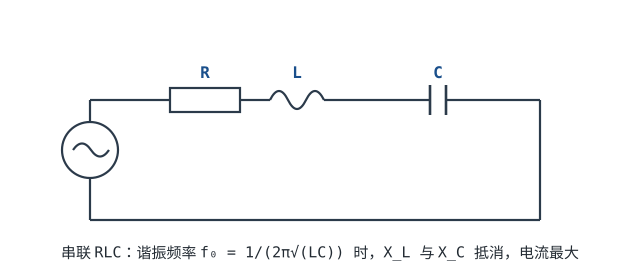
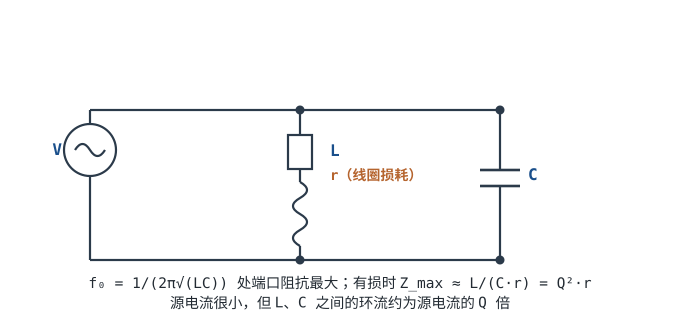

# RLC 电路与谐振 RLC Circuits & Resonance

同一组 $L$、$C$，接成串联和接成并联，在同一个频率上会表现出**完全相反**的阻抗：串联时阻抗最小、电流最大；并联时阻抗最大、源电流最小。这个频率就是**谐振频率（Resonant Frequency）** $f_0$。收音机选台、无线充电线圈补偿、开关电源 EMI 滤波器、晶振与传感器，全都围绕这一个点做文章。

但"谐振"本身没有好坏。它可以是选频的利器，也可以是电源网络上突然冒出来的尖峰；可以让线圈电流放大几十倍，也可以让电容承受几十倍于源电压的电压。判断它到底帮你还是害你，靠的是四个量：$f_0$、特征阻抗 $\sqrt{L/C}$、品质因数 $Q$、阻尼比 $\zeta$。这一章把这四个量讲成一套能算、能选、能验算的工具。

## 1. 设计动机

::: motivation 三个绕不开谐振的场景
**场景一：收音机选台。** 天线同时收到目标台 $1.000$ MHz 和邻台 $1.200$ MHz。中频滤波器前面的 LC 回路 $Q=50$，在 $1.2f_0$ 处把邻台衰减多少？代入本章的带通公式，幅度只剩 $0.0545$，即 $-25.3$ dB。**"选频"不是形容词，是一个可以算出来的分贝数。**

**场景二：去耦网络自己谐振。** 一颗 100 nF 的贴片电容与一段约 1 µH 的供电走线，在 $f_0=1/(2\pi\sqrt{LC})=503$ kHz 附近形成并联谐振，阻抗可能从毫欧级升到千欧级。开关噪声恰好落在这个频段时，去耦不但没起作用，反而把噪声"顶"了起来。**谐振点必须被算出来，否则你不知道自己是在滤波还是在造天线。**

**场景三：无线充电线圈失谐。** 一个量测为 24 µH 的线圈，配 68 nF 谐振电容，理论 $f_0=124.6$ kHz。线圈受压变形、磁片气隙变化或电容温漂，都可能让 $f_0$ 偏几个百分点；而高 $Q$ 回路的通带可能只有 2 kHz 宽，偏一点就明显失谐，效率下降、开关管应力上升。**高 $Q$ 带来高选择性的同时，也带来对容差的高敏感。**
:::

把这三个场景抽象成一张表，遇到问题时先问"我到底要它谐振在哪、Q 多大、谁来阻尼"：

| 你想解决 | 先算 | 判据 |
|---|---|---|
| 选频回路选得准不准 | $f_0=1/(2\pi\sqrt{LC})$、$Q=f_0/BW$ | 目标信号落在通带内，干扰落在通带外 |
| 线圈/天线在目标频率谐振 | $C=1/((2\pi f_0)^2L)$、$Z_0=\sqrt{L/C}$ | 实际 $f_0$ 偏差小于通带的 1/10 |
| 电源/滤波器会不会振铃 | $\zeta=1/(2Q)$、阶跃响应 | 过冲与建立时间满足负载与器件应力 |
| 电容耐压够不够 | $V_{C,peak}=\sqrt2\,Q V_{drive,rms}$ | 额定电压 ≥ 计算峰值的 2 倍 |
| 谐振点会不会被寄生参数拉走 | 电感 SRF、电容 ESL、容差 | 工作频率远低于 SRF，容差引起的 $f_0$ 偏移可接受 |

**不懂会在哪摔跤**，具体是这四条：

1. 把并联谐振当成"开路"，按无穷大阻抗设计，结果实际只有 $100$ kΩ，泄漏电阻、负载和偏置电流把节点电压拉得面目全非。
2. 用 $f_0\pm BW/2$ 当半功率点。低 $Q$ 时这个近似误差很大：$Q=2$ 时算术中点给出 $-2.58$ dB，而真正的 $-3$ dB 点在 $1.281f_0$ 与 $0.781f_0$。
3. 用"元件 Q"代替"有载 Q"。线圈本身 $Q=100$，接上 50 Ω 源和 50 Ω 负载后，有载 $Q$ 可能只剩 $9$，带宽宽了 11 倍。
4. 只按源电压选电容耐压。串联谐振时电容电压是源电压的 $Q$ 倍，$Q=50$ 的回路里 1 V 驱动就能在电容上产生 50 V。

## 2. 定义与直观：两种谐振，两种阻抗极值

### 2.1 谐振的定义

**谐振（Resonance）**指正弦稳态下，电路中感抗与容抗大小相等、相互抵消，端口电压与电流同相的状态。对串联回路，条件是

$$\omega_0 L=\frac{1}{\omega_0 C}$$

对并联回路，理想情况下同样由这一条件定义；计入线圈损耗后，严格定义要改成"端口电压与电流同相"（功率因数为 1），谐振频率会略微偏离 $\omega_0=1/\sqrt{LC}$，偏离量由 $Q$ 决定。这个差别在本章 §3.2 会用具体数字说明。

### 2.2 串联：阻抗最小、电流最大

串联 RLC 的阻抗是三个元件阻抗的直接相加：

$$Z_s=R+j\left(\omega L-\frac{1}{\omega C}\right)$$

在 $f_0$ 处虚部为零，$Z_s=R$，阻抗模取最小值，回路电流 $I=V/R$ 取最大值，所以串联谐振也叫**电流谐振（Current Resonance）**。此时电感与电容上的电压大小相等、相位相反：

$$V_L=V_C=Q\,V$$

其中 $V$ 是源电压有效值，$Q$ 是品质因数。**源电压只有 1 V，元件上却可能有几十伏**，这是串联谐振最容易被忽略的工程后果。



### 2.3 并联：阻抗最大、电压最高

并联回路的阻抗用导纳算：

$$Y_p=j\omega C+\frac{1}{r+j\omega L},\qquad Z_p=\frac{1}{Y_p}$$

其中 $r$ 是线圈的等效串联电阻（绕线电阻、集肤效应与磁芯损耗折算到串联模型的总和）。理想无损耗时，$f_0$ 处 $Y_p=0$、$Z_p\to\infty$；实际有 $r$ 时，阻抗是有限值，在谐振附近达到最大，所以并联谐振也叫**电压谐振（Voltage Resonance）**。



并联谐振时有一个反直觉的现象：**源电流很小，但 L、C 支路内部的环流很大**。环流与源电流之比约等于 $Q$。这解释了为什么无线充电的并联补偿电容要按很大的无功电流选型，也解释了为什么并联谐振回路的线圈发热可能远大于"输出功率"给人的直觉。

串联与并联的对比可以压成一张表：

| 项目 | 串联谐振 | 并联谐振（有损） |
|---|---|---|
| 谐振时端口阻抗 | 最小，$Z=R$ | 最大，$Z_{\max}\approx L/(Cr)$ |
| 源电流 | 最大，$I=V/R$ | 最小，$I\approx V/Z_{\max}$ |
| 元件电压 | $V_L=V_C=QV$ | 端口电压最大，元件环流 $Q$ 倍 |
| 常用叫法 | 电流谐振 | 电压谐振 |
| 典型用途 | 选频、陷波、EMI 吸收 | 选频放大、振荡器槽路、无线充电补偿 |

### 2.4 能量图像：L 与 C 在交换，源只补损耗

谐振不是"没有能量损耗"，而是**无功功率在 L 与 C 之间来回倒手，电源只需要补充电阻消耗掉的那一部分**。在理想串联回路里，电流峰值时能量全在电感（$\frac12LI^2$），电压峰值时能量全在电容（$\frac12CV^2$），两者周期性地互换，总储能近似不变。

这个图像直接给出品质因数的能量定义：一个周期内储存的能量与损耗能量之比，乘以 $2\pi$，就是 $Q$。§3.2 会用它推出 $Q=\omega_0L/R$。

::: analogy 弹簧-质量系统
把电感看成质量 $m$（惯性，电流不能突变），把电容看成弹簧（电压不能突变，$1/C$ 对应劲度系数 $k$），把电阻看成阻尼器。质量-弹簧系统的固有角频率是 $\omega_0=\sqrt{k/m}$，对应电路的 $\omega_0=1/\sqrt{LC}$；阻尼越小人越"荡得起来"，对应 $Q$ 越高、阶跃过冲越大。这个类比不是修辞：二阶微分方程的形式完全一样，所以频域的 $Q$ 和时域的阻尼比可以互相换算，$Q=1/(2\zeta)$。
:::

## 3. 定量关系：f₀、Q、带宽与阻尼

### 3.1 谐振频率与特征阻抗

由 $\omega_0L=1/(\omega_0C)$ 直接解出：

$$\omega_0=\frac{1}{\sqrt{LC}},\qquad f_0=\frac{\omega_0}{2\pi}=\frac{1}{2\pi\sqrt{LC}}$$

**特征阻抗（Characteristic Impedance）**定义为谐振时感抗（或容抗）的大小：

$$Z_0=\sqrt{\frac{L}{C}}=\omega_0L=\frac{1}{\omega_0C}$$

它不是"回路里某个电阻"，而是谐振时 L 与 C 之间交换无功功率的"阻抗尺度"。串联回路的 $Q$ 就是特征阻抗与回路总电阻之比：

$$Q=\frac{Z_0}{R}=\frac{\omega_0L}{R}=\frac{1}{\omega_0CR}=\frac{1}{R}\sqrt{\frac{L}{C}}$$

符号与单位：

| 符号 | 含义 | 单位 | 备注 |
|---|---|---|---|
| $f_0$ | 谐振频率 | Hz | 理想 L、C 下由 $LC$ 乘积唯一决定 |
| $\omega_0$ | 谐振角频率 | rad/s | $\omega_0=2\pi f_0$ |
| $Z_0$ | 特征阻抗 | $\Omega$ | 只由 $L/C$ 比值决定，与频率无关 |
| $Q$ | 品质因数 | 无量纲 | 串联用 $Z_0/R$，并联用 $R_p/Z_0$ |
| $BW$ | 通频带 | Hz | 半功率点之间的宽度 |
| $\zeta$ | 阻尼比 | 无量纲 | $\zeta=1/(2Q)$ |

三个结论要记牢：

- $f_0$ 只由乘积 $LC$ 决定，$L$ 加倍、$C$ 减半，$f_0$ 不变；
- $Z_0$ 只由比值 $L/C$ 决定，$L$ 与 $C$ 同时加倍，$Z_0$ 不变、$f_0$ 减半；
- 同样的 $L$、$C$，$R$ 越小 $Q$ 越高、带宽越窄，但谐振频率不变。

### 3.2 Q 的三种等价定义

品质因数有三种常用定义，它们回答的是同一个问题的三个侧面：

**定义一：能量比。** 谐振时储存的能量与每周期损耗能量之比，乘以 $2\pi$：

$$Q=2\pi\frac{W_{stored}}{W_{lost,cycle}}=\omega_0\frac{W_{stored}}{P_{loss}}$$

**定义二：带宽比。** 谐振频率与半功率带宽之比：

$$Q=\frac{f_0}{BW}$$

**定义三：元件阻抗比。** 谐振时储能元件的阻抗与回路损耗电阻之比：

$$Q=\frac{Z_0}{R}=\frac{\omega_0L}{R}\quad\text{（串联）},\qquad Q=\frac{R_p}{Z_0}=\frac{\omega_0L}{r}\quad\text{（并联）}$$

**它们什么时候等价？** 对一个孤立的、只有单一谐振模式的串联 RLC 回路，在谐振点上三种定义给出**严格相同**的数。推导如下：谐振时总储能（用峰值电流 $I$ 表示）为 $W_{stored}=\frac12LI^2$，电阻上的平均损耗为 $P_{loss}=\frac12I^2R$，代入定义一：

$$Q=\omega_0\frac{\frac12LI^2}{\frac12I^2R}=\frac{\omega_0L}{R}$$

与定义三一致。定义二则来自带通传递函数在半功率点的解，§3.3 会证明 $BW=f_0/Q$ 对串联 RLC 是精确的，不是近似。

**它们什么时候不等价？** 有三种常见情况：

1. **有载 Q 与无载 Q。** 定义一、三里的 $R$ 如果只算线圈和电容的损耗，得到的是无载 $Q$（unloaded Q）；把源内阻、负载电阻也算进去，得到的是有载 $Q$（loaded Q）。有载 $Q$ 才是你实际测到的带宽对应的那个 $Q$。
2. **并联回路的损耗模型。** 用串联 $r$ 表示线圈损耗时 $Q=\omega_0L/r$；用并联 $R_p$ 表示时 $Q=R_p/Z_0$。两者通过 $R_p\approx Q^2r$ 换算，这个换算在 $Q\ge10$ 时误差很小，$Q$ 低时要回到精确模型。
3. **多谐振模式或分布参数。** 电感有匝间电容、电容有 ESL，真实元件在更高频率还有第二个谐振点；此时"一个 $Q$"描述不了整条阻抗曲线，必须看厂商的阻抗—频率曲线。

并联有损回路的谐振频率也会下降。令端口导纳的虚部为零，可解出功率因数为 1 的频率：

$$\omega_p=\omega_0\sqrt{1-\frac{1}{Q^2}}$$

$Q=100$ 时 $\omega_p=0.99995\omega_0$，只低 $0.005\%$，直接用 $1/\sqrt{LC}$ 完全够用；$Q=5$ 时 $\omega_p=0.9799\omega_0$，低了 $2.0\%$，这时就必须用精确式。**高 $Q$ 近似之所以好用，是因为误差按 $1/(2Q^2)$ 缩小，不是因为公式本身更"正确"。**

把三种定义放进同一张表，做题时先确定"题目问的是哪一个 $Q$"：

| 定义 | 表达式 | 怎么测 | 适用与陷阱 |
|---|---|---|---|
| 能量比 | $Q=\omega_0 W_{stored}/P_{loss}$ | 量储能与损耗，难直接测 | 最基本；有载时把外部损耗算进去 |
| 带宽比 | $Q=f_0/BW$ | 扫频找 $-3$ dB 点 | 最常用；必须是单谐振、半功率定义 |
| 阻抗比 | $Q=Z_0/R$ 或 $R_p/Z_0$ | LCR 表量 L、C、R | 最方便；先确认串/并联等效模型 |

### 3.3 通频带、半功率点与选择性

串联 RLC 以电阻电压（或回路电流）为输出时，归一化传递函数是

$$H(j\omega)=\frac{1}{1+jQ\left(\frac{\omega}{\omega_0}-\frac{\omega_0}{\omega}\right)}$$

半功率点满足 $|H|=1/\sqrt2$，即括号里的虚部等于 $\pm1$：

$$Q\left(\frac{\omega}{\omega_0}-\frac{\omega_0}{\omega}\right)=\pm1$$

解这个二次方程，得到两个正根：

$$\omega_{hi}=\omega_0\left(\sqrt{1+\frac{1}{4Q^2}}+\frac{1}{2Q}\right),\qquad \omega_{lo}=\omega_0\left(\sqrt{1+\frac{1}{4Q^2}}-\frac{1}{2Q}\right)$$

两者相减：

$$BW=\frac{\omega_{hi}-\omega_{lo}}{2\pi}=\frac{\omega_0}{2\pi Q}=\frac{f_0}{Q}$$

这个结果是**精确的**，不是高 $Q$ 近似。注意两个半功率点的**几何平均**严格等于 $f_0$：

$$\omega_{hi}\omega_{lo}=\omega_0^2$$

而它们的算术平均略高于 $f_0$，偏移量随 $Q$ 降低而增大。$Q=40$、$f_0=1$ MHz 时，精确半功率点是 $1.012578$ MHz 与 $0.987578$ MHz，算术平均 $1.000078$ MHz，比 $f_0$ 高 $78$ Hz；用 $f_0\pm BW/2$ 近似得到 $1.0125$ MHz 与 $0.9875$ MHz，每个点差 $78$ Hz，占带宽的 $0.31\%$。工程上 $Q\ge10$ 时这个近似够用，$Q<3$ 时要老老实实解二次方程。

**选择性**用偏离谐振点后的衰减衡量。远离谐振时 $|H|\approx 1/(Q|\omega/\omega_0-\omega_0/\omega|)$。以 $Q=40$ 为例：

| 频率 | $\omega/\omega_0-\omega_0/\omega$ | $|H|$ | 衰减 |
|---|---|---|---|
| $1.5f_0$ | $1.5-0.6667=0.8333$ | $0.02999$ | $-30.46$ dB |
| $2.0f_0$ | $2.0-0.5=1.5$ | $0.01666$ | $-35.56$ dB |
| $3.0f_0$ | $3.0-0.3333=2.6667$ | $0.00937$ | $-40.57$ dB |

衰减斜率在远离谐振后趋于 $\pm20$ dB/十倍频：频率每升高十倍，$|H|$ 降到约 $1/10$。这就是二阶带通滤波器的基本形状。

下图按同一个公式画出 $Q=1,2,5,10$ 的归一化幅频响应，数据点全部由 $|H|$ 的表达式算得：

```echarts
{
  "tooltip": {"trigger": "axis"},
  "legend": {"data": ["Q=1", "Q=2", "Q=5", "Q=10"], "bottom": 0, "textStyle": {"fontSize": 12}},
  "grid": {"left": 64, "right": 28, "top": 34, "bottom": 58},
  "xAxis": {"type": "log", "name": "f / f0", "nameLocation": "middle", "nameGap": 30,
            "min": 0.2, "max": 5, "axisLabel": {"fontSize": 11}},
  "yAxis": {"type": "value", "name": "|H| / dB", "nameLocation": "middle", "nameGap": 48,
            "min": -45, "max": 2, "axisLabel": {"fontSize": 11}},
  "series": [
    {"name": "Q=1", "type": "line", "smooth": true, "showSymbol": false, "lineStyle": {"width": 2.2, "color": "#8a9aa8"},
     "data": [[0.2,-13.81],[0.3,-10.09],[0.4,-7.33],[0.5,-5.12],[0.6,-3.3],[0.8,-0.8],[1.0,0.0],[1.25,-0.8],[1.5,-2.29],[2.0,-5.12],[3.0,-9.09],[5.0,-13.81]]},
    {"name": "Q=2", "type": "line", "smooth": true, "showSymbol": false, "lineStyle": {"width": 2.2, "color": "#5b8db8"},
     "data": [[0.2,-19.69],[0.3,-15.78],[0.4,-12.7],[0.5,-10.0],[0.6,-7.44],[0.8,-2.58],[1.0,0.0],[1.25,-2.58],[1.5,-5.77],[2.0,-10.0],[3.0,-14.69],[5.0,-19.69]]},
    {"name": "Q=5", "type": "line", "smooth": true, "showSymbol": false, "lineStyle": {"width": 2.4, "color": "#2f6d9e"},
     "data": [[0.2,-27.61],[0.3,-23.64],[0.4,-20.46],[0.5,-17.58],[0.6,-14.69],[0.8,-7.83],[1.0,0.0],[1.25,-7.83],[1.5,-12.64],[2.0,-17.58],[3.0,-22.52],[5.0,-27.61]]},
    {"name": "Q=10", "type": "line", "smooth": true, "showSymbol": false, "lineStyle": {"width": 2.6, "color": "#1a4f8b"},
     "data": [[0.2,-33.63],[0.3,-29.64],[0.4,-26.45],[0.5,-23.54],[0.6,-20.6],[0.8,-13.27],[1.0,0.0],[1.25,-13.27],[1.5,-18.48],[2.0,-23.54],[3.0,-28.53],[5.0,-33.63]]}
  ]
}
```

读图抓住两点：$Q$ 越大，峰越尖、通带越窄；所有曲线在 $f/f_0=1$ 处都过 $0$ dB，且关于谐振点不完全对称——低频侧与高频侧在同一个 $|H|$ 处对应的频率，几何平均才是 $f_0$。

### 3.4 阻尼比：从频域 Q 到时域阶跃

把串联 RLC 的电容电压作为输出，传递函数写成标准二阶形式：

$$H(s)=\frac{\omega_0^2}{s^2+2\zeta\omega_0 s+\omega_0^2},\qquad \zeta=\frac{1}{2Q}=\frac{R}{2}\sqrt{\frac{C}{L}}$$

其中 $s$ 是拉普拉斯变量，$\zeta$ 是**阻尼比（Damping Ratio）**，无量纲；$\omega_0$ 是自然角频率。特征方程的根决定阶跃响应形态：

- $\zeta>1$（$Q<0.5$）：**过阻尼**，两个不相等负实根，无过冲，响应慢；
- $\zeta=1$（$Q=0.5$）：**临界阻尼**，重根，无过冲，是"不过冲前提下最快"的近似；
- $0<\zeta<1$（$Q>0.5$）：**欠阻尼**，一对共轭复根，有振荡和过冲；
- $\zeta=0$（$Q\to\infty$）：无阻尼，等幅振荡（理想 LC）。

欠阻尼阶跃响应（阶跃幅度 $V$，输出为电容电压）：

$$v_C(t)=V\left[1-e^{-\zeta\omega_0 t}\left(\cos\omega_d t+\frac{\zeta}{\sqrt{1-\zeta^2}}\sin\omega_d t\right)\right],\qquad \omega_d=\omega_0\sqrt{1-\zeta^2}$$

临界阻尼：

$$v_C(t)=V\left[1-e^{-\omega_0 t}(1+\omega_0 t)\right]$$

过阻尼：

$$v_C(t)=V\left\{1-\frac{1}{2\sqrt{\zeta^2-1}}\left[(\zeta+\sqrt{\zeta^2-1})e^{-(\zeta-\sqrt{\zeta^2-1})\omega_0 t}-(\zeta-\sqrt{\zeta^2-1})e^{-(\zeta+\sqrt{\zeta^2-1})\omega_0 t}\right]\right\}$$

欠阻尼的**超调量**与**峰值时间**有闭式解：

$$M_p=e^{-\frac{\pi\zeta}{\sqrt{1-\zeta^2}}},\qquad t_p=\frac{\pi}{\omega_d}=\frac{\pi}{\omega_0\sqrt{1-\zeta^2}}$$

以 $f_0=100$ kHz（$\omega_0=6.2832\times10^5$ rad/s）为例，按上式计算并用 $2\%$ 误差带数值求最后一个越界点，得到：

| $\zeta$ | $Q$ | 过冲 $M_p$ | 峰值时间 $t_p$ | $2\%$ 建立时间 $t_s$ | 响应形态 |
|---|---|---|---|---|---|
| $0.25$ | $2.0$ | $44.43\%$ | $5.16$ µs | $22.47$ µs | 欠阻尼，明显振铃 |
| $0.50$ | $1.0$ | $16.30\%$ | $5.77$ µs | $12.85$ µs | 欠阻尼，可接受 |
| $0.707$ | $0.707$ | $4.32\%$ | $7.07$ µs | $9.49$ µs | 最大平坦（巴特沃斯） |
| $1.00$ | $0.50$ | $0$ | 无 | $9.28$ µs | 临界阻尼 |
| $2.00$ | $0.25$ | $0$ | 无 | $23.68$ µs | 过阻尼，慢 |

读表要注意三件事：

1. **$Q=0.707$ 对应 $\zeta=0.707$，不是 $Q=1$。** 最大平坦响应要求 $\zeta=1/\sqrt2$，即 $Q\approx0.707$。$Q=1$（$\zeta=0.5$）会有 $16.3\%$ 的过冲。
2. **临界阻尼对应 $Q=0.5$。** 想让阶跃"不过冲"，串联电阻要满足 $R=2Z_0=2\sqrt{L/C}$。对 $L=100$ µH、$C=100$ pF，$Z_0=1000\,\Omega$，所以 $R=2000\,\Omega$ 才临界阻尼；用 $10\,\Omega$ 时 $Q=100$，阶跃会剧烈振铃。
3. **建立时间近似式要慎用。** 欠阻尼常用 $t_s\approx4/(\zeta\omega_0)$，但临界阻尼时这个近似给出 $6.37$ µs，实际 $2\%$ 建立时间是 $9.28$ µs（精确判据为 $5.83/\omega_0$）。过阻尼则要看主导极点 $s_1=-\omega_0(\zeta-\sqrt{\zeta^2-1})$，用 $t_s\approx4/|s_1|$ 估算：$\zeta=2$ 时 $|s_1|=0.268\omega_0$，$4/|s_1|=23.76$ µs，与表中的 $23.68$ µs 接近。

### 3.5 适用条件与失效边界

这套公式建立在四个前提上，任何一个不成立，算出来的 $f_0$ 与 $Q$ 就只是"理想值"：

1. **线性时不变。** 电感磁芯饱和后 $L$ 骤降，陶瓷电容在直流偏置下容量可掉一半以上（具体以数据手册为准），此时 $f_0$ 会随工作点漂移。
2. **集总假设。** 元件尺寸远小于波长。100 MHz 时波长 3 m，一段 30 cm 的引线已经接近 $\lambda/10$ 的集总上限，要按传输线处理。
3. **单一谐振模式。** 真实电感有匝间电容，真实电容有 ESL，各自还有自谐振频率（SRF）。工作频率接近 SRF 时，"电感"可能已经呈容性，$f_0$ 公式里的 $L$ 不再是常数。
4. **源与负载不改变回路。** 公式里的 $R$ 必须是**回路总电阻**，包括源内阻与负载折算电阻。只算线圈电阻，得到的是无载 $Q$；计入无源负载后，有载 $Q$ 通常更低、带宽通常更宽。

## 4. 典型计算

### 4.1 算例一：给定 L、C，求 f₀ 与特征阻抗

**题目**：$L=100$ µH、$C=100$ pF 的串联回路，回路总电阻 $R=10\,\Omega$。求谐振频率、特征阻抗、$Q$、带宽、半功率点，以及 $2f_0$ 处的衰减。

**第 1 步，算 $LC$ 乘积**：

$$LC=100\times10^{-6}\times100\times10^{-12}=10^{-4}\times10^{-10}=10^{-14}\ \text{s}^2$$

**第 2 步，开方**：

$$\sqrt{LC}=\sqrt{10^{-14}}=10^{-7}\ \text{s}$$

**第 3 步，谐振频率**：

$$f_0=\frac{1}{2\pi\sqrt{LC}}=\frac{1}{2\pi\times10^{-7}}=\frac{1}{6.2832\times10^{-7}}=1.591549\times10^6\ \text{Hz}\approx1.5915\ \text{MHz}$$

角频率 $\omega_0=2\pi f_0=1.0\times10^7$ rad/s。

**第 4 步，特征阻抗**：

$$Z_0=\sqrt{\frac{L}{C}}=\sqrt{\frac{100\times10^{-6}}{100\times10^{-12}}}=\sqrt{10^6}=1000\ \Omega$$

**第 5 步，Q 与带宽**：

$$Q=\frac{Z_0}{R}=\frac{1000}{10}=100,\qquad BW=\frac{f_0}{Q}=\frac{1.5915\times10^6}{100}=15.915\ \text{kHz}$$

**第 6 步，半功率点**（精确式）：

$$f_{hi}=f_0\left(\sqrt{1+\frac{1}{4Q^2}}+\frac{1}{2Q}\right)=1.5915\times10^6\times\left(\sqrt{1.000025}+0.005\right)$$

$$\sqrt{1.000025}=1.0000125,\qquad f_{hi}=1.591549\times10^6\times(1.0000125+0.005)=1.591549\times10^6\times1.0050125=1.599527\ \text{MHz}$$

$$f_{lo}=1.591549\times10^6\times(1.0000125-0.005)=1.591549\times10^6\times0.9950125=1.583612\ \text{MHz}$$

两者之差 $15.915$ kHz，与 $f_0/Q$ 一致；几何平均 $\sqrt{1.599527\times1.583612}=1.591549$ MHz，回到 $f_0$。

**第 7 步，$2f_0$ 处的衰减**：

$$|H(2f_0)|=\frac{1}{\sqrt{1+Q^2\left(2-\frac12\right)^2}}=\frac{1}{\sqrt{1+100^2\times1.5^2}}=\frac{1}{\sqrt{1+22500}}=0.006667$$

$$20\lg(0.006667)=-43.52\ \text{dB}$$

**第 8 步，验算谐振时的元件电压**：源电压 1 V 有效值时，$V_L=V_C=QV=100\ \text{V}$（有效值），对应峰值 $141\ \text{V}$。如果电容额定 50 V，早就不够——**耐压必须按峰值并留余量，不能按源电压有效值选**。

### 4.2 算例二：给定 Q，求带宽与半功率点

**题目**：某 1 MHz 中频滤波器的谐振回路测得 $Q=40$，求带宽、精确半功率点、算术近似误差，以及 $2$ MHz 处的衰减。

**第 1 步，带宽**：

$$BW=\frac{f_0}{Q}=\frac{1.000\times10^6}{40}=25.0\ \text{kHz}$$

**第 2 步，精确半功率点**：

$$\frac{1}{2Q}=\frac{1}{80}=0.0125,\qquad \sqrt{1+\frac{1}{4Q^2}}=\sqrt{1+\frac{1}{6400}}=\sqrt{1.00015625}=1.0000781$$

$$f_{hi}=10^6\times(1.0000781+0.0125)=1.012578\ \text{MHz}$$

$$f_{lo}=10^6\times(1.0000781-0.0125)=0.987578\ \text{MHz}$$

**第 3 步，核对算术近似**：$f_0\pm BW/2=1.0125$ MHz 与 $0.9875$ MHz。与精确值各差 $78$ Hz，而 $78/25000=0.31\%$。同时注意精确半功率点的算术平均是 $1.000078$ MHz，比 $f_0$ 高 $78$ Hz——**半功率点不以 $f_0$ 为算术中心**，低 $Q$ 时这个偏差会变得明显。

**第 4 步，$2$ MHz 处衰减**：

$$|H(2f_0)|=\frac{1}{\sqrt{1+40^2\times(2-0.5)^2}}=\frac{1}{\sqrt{1+3600}}=0.016664$$

$$20\lg(0.016664)=-35.56\ \text{dB}$$

**第 5 步，验算**：$f_{hi}\times f_{lo}=1.012578\times0.987578=1.000000$（MHz²），几何平均严格回到 1 MHz；$f_{hi}-f_{lo}=25.000$ kHz，与 $BW$ 一致。

### 4.3 完整设计：500 kHz 开关电源的 LC 输入滤波器

**需求**：5 V 母线、1 A 负载，开关节点为 0–5 V、占空比 0.5 的方波，开关频率 $f_{sw}=500$ kHz。要求在 500 kHz 处至少衰减 **55 dB**，直流压降不超过 **100 mV**，空载时滤波器不能有明显振铃。

**第 1 步，把衰减指标翻译成 $f_0$ 上限。** 二阶 LC 低通在远高于 $f_0$ 时近似 $|H|\approx(f_0/f)^2$。要求 $55$ dB，即幅度比 $10^{-55/20}=1/562.3$，所以

$$\left(\frac{f_0}{f_{sw}}\right)^2\le\frac{1}{562.3}\ \Longrightarrow\ f_0\le\frac{500\ \text{kHz}}{\sqrt{562.3}}=\frac{500}{23.71}=21.1\ \text{kHz}$$

取 $f_0\approx16$ kHz，留出约 5 dB 余量。

**第 2 步，选电感、算电容。** 取 $L=100$ µH（1 A 级功率电感的典型量级，DCR 约 50 mΩ，具体以数据手册为准），由 $f_0=1/(2\pi\sqrt{LC})$ 反解：

$$C=\frac{1}{(2\pi f_0)^2L}=\frac{1}{(2\pi\times16\times10^3)^2\times100\times10^{-6}}$$

$$(2\pi\times16\times10^3)^2=1.0106\times10^{10},\qquad C=\frac{1}{1.0106\times10^{10}\times10^{-4}}=9.895\times10^{-7}\ \text{F}$$

取 E6 系列的 **1 µF**。实际谐振频率：

$$f_0=\frac{1}{2\pi\sqrt{100\times10^{-6}\times1\times10^{-6}}}=\frac{1}{2\pi\times10^{-5}}=15.915\ \text{kHz}$$

**第 3 步，核算 500 kHz 衰减。** 特征阻抗：

$$Z_0=\sqrt{\frac{L}{C}}=\sqrt{\frac{10^{-4}}{10^{-6}}}=\sqrt{100}=10\ \Omega$$

500 kHz 处：

$$X_L=2\pi\times5\times10^5\times10^{-4}=314.16\ \Omega,\qquad X_C=\frac{1}{2\pi\times5\times10^5\times10^{-6}}=0.3183\ \Omega$$

理想电容分压：

$$|H|=\frac{X_C}{\sqrt{X_L^2+X_C^2}}=\frac{0.3183}{\sqrt{314.16^2+0.3183^2}}=1.0132\times10^{-3}$$

$$20\lg(1.0132\times10^{-3})=-59.89\ \text{dB}$$

加上阻尼网络 $R_d=10\,\Omega$ 与 $C_d=4.7$ µF 并联后，500 kHz 处 $C$ 与 $R_d$ 的并联阻抗为

$$Z_{sh}=\frac{1}{\frac{1}{0.3183}+\frac{1}{10}}=0.3085\ \Omega$$

$$|H|=\frac{0.3085}{\sqrt{314.16^2+0.3085^2}}=9.820\times10^{-4},\qquad 20\lg(9.820\times10^{-4})=-60.16\ \text{dB}$$

比理想值只差 $0.27$ dB，仍比 55 dB 指标多 $5.16$ dB 余量。

**第 4 步，算方波基波与三次谐波输出。** 0–5 V、50% 方波的基波峰值是 $2V_{pp}/\pi=2\times5/\pi=3.183$ V，三次谐波是 $3.183/3=1.061$ V。输出基波：

$$V_{out,1}=3.183\times9.820\times10^{-4}=3.126\ \text{mV}$$

三次谐波（1.5 MHz）处 $X_L=942.48\,\Omega$、$X_C=0.1061\,\Omega$，并联阻尼后 $|H|=1.114\times10^{-4}$，输出 $1.061\times1.114\times10^{-4}=0.118$ mV。谐波衰减更快，滤波后的残余主要是基波。

**第 5 步，算电感纹波与电容纹波电压。** 方波加在电感上，电感电流纹波：

$$\Delta I=\frac{V_{in}D(1-D)}{Lf_{sw}}=\frac{5\times0.5\times0.5}{100\times10^{-6}\times5\times10^5}=\frac{1.25}{50}=0.025\ \text{A}=25\ \text{mA}$$

电容电压纹波（理想三角波近似）：

$$\Delta V=\frac{\Delta I}{8f_{sw}C}=\frac{0.025}{8\times5\times10^5\times10^{-6}}=\frac{0.025}{4}=6.25\ \text{mV}$$

**第 6 步，阻尼与振铃。** 无阻尼时，空载 $Q$ 只由电感 DCR 与电容 ESR 决定，理论上可以很高，阶跃会振铃。加 $R_d=10\,\Omega$、$C_d=4.7$ µF 后，阻尼支路在谐振附近并到电容上，阻尼后的 $Q$ 近似

$$Q_d=\frac{R_d}{Z_0}=\frac{10}{10}=1.0$$

二阶低通的峰值是 $Q/\sqrt{1-1/(4Q^2)}=1/\sqrt{0.75}=1.1547$，即 $+1.25$ dB 的轻微抬升，属于可接受范围。满载时 1 A 负载等效为 $5\,\Omega$，与 $R_d=10\,\Omega$ 并联后 $Q\approx(10\parallel5)/10=0.333$，过阻尼、无峰值；空载才是最坏情况。若要求更平坦，把 $R_d$ 降到 $7.5\,\Omega$ 可把空载 $Q$ 压到约 $0.75$（忽略 $C_d$ 的串联阻抗），代价是 500 kHz 处衰减略降。

**第 7 步，核算直流压降与器件应力。** 电感 DCR 50 mΩ 在 1 A 下产生

$$V_{drop}=I_{DC}\times R_{DCR}=1\times0.05=50\ \text{mV}$$

小于 100 mV 指标。电感峰值电流 $1+0.025/2=1.0125$ A，选饱和电流 ≥1.5 A 的型号留余量；电容耐压按 5 V 母线选 10 V 或 16 V，纹波电流约 $\Delta I/\sqrt{12}=7.2$ mA，普通陶瓷电容即可承受。

**第 8 步，逐项验算并列表**：

| 指标 | 要求 | 计算值 | 判定 |
|---|---|---|---|
| 500 kHz 衰减 | ≥55 dB | 60.16 dB | 通过，余量 5.16 dB |
| 直流压降 | ≤100 mV | 50 mV | 通过 |
| 输出纹波 | 未规定，记录 | 6.25 mV | 可接受 |
| 空载阻尼 | 无明显振铃 | $Q_d\approx1$，峰值 +1.25 dB | 通过 |
| 谐振频率 | ≤21.1 kHz | 15.915 kHz | 通过 |

**结论**：$L=100$ µH、$C=1$ µF、$f_0=15.915$ kHz、$Z_0=10\,\Omega$，配 $R_d=10\,\Omega$、$C_d=4.7$ µF 阻尼，满足 55 dB 与 100 mV 两项指标。实际电路中源阻抗、负载电流、电感饱和与电容偏压都会改变 $f_0$ 与 $Q$，打样后必须用网络分析仪或频率扫描实测验证；**以上元件值为设计起点，不是无条件可用的"标准答案"**。

## 5. 工程含义

### 5.1 工程数量级表

**表一：$f_0$ 随 $L$、$C$ 的变化（单位 Hz）**

| $L$ \ $C$ | 100 pF | 1 nF | 10 nF |
|---|---|---|---|
| 10 µH | 5.033 M | 1.592 M | 503.3 k |
| 100 µH | 1.592 M | 503.3 k | 159.15 k |
| 1 mH | 503.3 k | 159.15 k | 50.33 k |

**表二：特征阻抗 $Z_0=\sqrt{L/C}$（单位 Ω）**

| $L$ \ $C$ | 100 pF | 1 nF | 10 nF |
|---|---|---|---|
| 10 µH | 316.2 | 100.0 | 31.62 |
| 100 µH | 1000 | 316.2 | 100.0 |
| 1 mH | 3162 | 1000 | 316.2 |

两张表放在一起看：**同样的 $L$、$C$ 数量级，$f_0$ 与 $Z_0$ 不能同时任意选**。想要 1 MHz、$Z_0=1000\,\Omega$，表里最接近的是 $L=100$ µH、$C=100$ pF 这一格（实际 $f_0=1.592$ MHz）；要精确落在 1 MHz，就按下面的公式反解：$L=Z_0/(2\pi f_0)=159.15$ µH，$C=1/(2\pi f_0Z_0)=159.15$ pF。降低 $Z_0$ 到 100 Ω 就要把 $L/C$ 比值降 100 倍，$f_0$ 会跟着变。设计时先定 $f_0$ 与 $Z_0$，再解出 $L$、$C$：

$$L=\frac{Z_0}{2\pi f_0},\qquad C=\frac{1}{2\pi f_0 Z_0}$$

**表三：$f_0=1$ MHz 时 $Q$ 与带宽、阻尼比的对应**

| $Q$ | $BW=f_0/Q$ | $\zeta=1/(2Q)$ | 典型形态 |
|---|---|---|---|
| 5 | 200 kHz | 0.100 | 宽带 |
| 10 | 100 kHz | 0.050 | 选频初现 |
| 20 | 50 kHz | 0.025 | 较尖 |
| 40 | 25 kHz | 0.0125 | 中频滤波常用 |
| 50 | 20 kHz | 0.010 | 高选择性 |
| 100 | 10 kHz | 0.005 | 窄带，容差敏感 |
| 200 | 5 kHz | 0.0025 | 高选择性 LC/陶瓷滤波器 |

**表四：真实元件的典型量级**（仅给数量级，具体以数据手册与实测为准）

| 对象 | 典型量级 | 对谐振的影响 |
|---|---|---|
| 贴片 MLCC 的 ESL | 0.5–2 nH | 与容量形成串联自谐振，频率越高越明显 |
| 100 nF 贴片电容的 SRF | 约 10–20 MHz | 高于 SRF 后呈感性，不能再当电容 |
| 功率电感的 SRF | 约 1–50 MHz | 感量越大通常 SRF 越低 |
| 空心线圈 $Q$（100 kHz–1 MHz） | 约 50–200 | 线径、绕法与骨架损耗决定 |
| 石英晶体的 $Q$ | $10^4$–$10^6$ | 极高选择性，也极窄带 |
| 片式功率电感 $Q$（1–10 MHz） | 约 20–100 | 磁芯损耗限制 |

### 5.2 容差、温度与有载 Q

谐振频率对 $L$、$C$ 的敏感度是"平方根的一半"：

$$\frac{\Delta f_0}{f_0}\approx-\frac12\left(\frac{\Delta L}{L}+\frac{\Delta C}{C}\right)$$

若电感 +10%、电容 +5%，则

$$\frac{f_0'}{f_0}=\frac{1}{\sqrt{1.10\times1.05}}=\frac{1}{\sqrt{1.155}}=0.9305$$

即 $f_0$ 偏低 $6.95\%$。对 $f_0=1$ MHz、$BW=25$ kHz（$Q=40$）的回路，$6.95\%$ 是 $69.5$ kHz，接近三个带宽——**元件容差足以让高 $Q$ 回路完全失谐**。所以高选择性回路要么用 1% 级元件，要么预留可调电容/可调电感，要么在出厂时逐个校准。

温度也会移动 $f_0$：电容介质（NP0/C0G 与 X7R 的温漂差一个数量级以上）、电感磁芯的磁导率随温度变化，都会进入上面的公式。具体系数查元件数据手册，不要用"典型值"替代。

**有载 Q** 的算法很直接：把源内阻与负载折算进回路总电阻。对串联回路，

$$Q_L=\frac{\omega_0L}{R_{coil}+R_s+R_L}$$

例如 $L=100$ µH、$C=100$ pF、$R_{coil}=10\,\Omega$，无载 $Q=1000/10=100$；接上 $R_s=50\,\Omega$ 与 $R_L=50\,\Omega$ 后，总电阻 $110\,\Omega$，$Q_L=1000/110=9.09$，带宽从 $15.9$ kHz 展宽到 $175$ kHz，约为原来的 11 倍。**测到的带宽对应的是有载 Q，不是线圈标称 Q**；用线圈 Q 去推算系统带宽，是最常见的 10 倍量级错误之一。

### 5.3 无线充电线圈的谐振匹配

以一个小功率无线充电线圈为例：量测 $L=24.0$ µH（典型量级 10–30 µH，实际以绕制与厂商数据为准），目标谐振频率取 $125$ kHz（Qi 规范的工作频段为 87–205 kHz，具体版本以 WPC 发布为准）。串联补偿电容由 $f_0$ 反解：

$$C=\frac{1}{(2\pi f_0)^2L}=\frac{1}{(2\pi\times125\times10^3)^2\times24\times10^{-6}}$$

$$(2\pi\times125\times10^3)^2=6.1685\times10^{11},\qquad C=\frac{1}{6.1685\times10^{11}\times24\times10^{-6}}=6.755\times10^{-8}\ \text{F}=67.55\ \text{nF}$$

取 E12 系列的 **68 nF**，实际谐振频率：

$$f_0=\frac{1}{2\pi\sqrt{24\times10^{-6}\times68\times10^{-9}}}=\frac{1}{2\pi\times1.2775\times10^{-6}}=124.58\ \text{kHz}$$

相对目标 $125$ kHz 偏低 $0.333\%$。特征阻抗与 $Q$：

$$Z_0=\sqrt{\frac{L}{C}}=\sqrt{\frac{24\times10^{-6}}{68\times10^{-9}}}=\sqrt{352.9}=18.79\ \Omega$$

设线圈在 125 kHz 的交流电阻 $R_{ac}=0.35\,\Omega$（实测值；典型量级 0.1–0.5 Ω，以实测为准），则

$$Q=\frac{Z_0}{R_{ac}}=\frac{18.79}{0.35}=53.68,\qquad BW=\frac{124.58\ \text{kHz}}{53.68}=2.321\ \text{kHz}$$

若用 1 V 有效值的基波驱动，谐振时回路电流与电容电压：

$$I=\frac{V}{R_{ac}}=\frac{1}{0.35}=2.857\ \text{A},\qquad V_C=QV=53.68\ \text{V}$$

电容电压的有效值是 $53.68$ V，对应峰值 $53.68\times\sqrt2=75.9$ V。额定电压至少选 $100$ V；若按 2 倍峰值降额，则要选 $160$ V 以上的电容。线圈导线要能承受约 3 A 有效值。**这就是"谐振匹配"的真实代价：1 V 有效值驱动换来 54 V 有效值、76 V 峰值的电容电压，以及 2.9 A 线圈电流**。实际逆变器是方波驱动，还要考虑谐波、开关损耗、线圈温升与失谐保护；上述计算只用于确定电容初值与器件应力下限。

失谐有多敏感？若电感因气隙变化 +10%、电容因温漂 +5%，由 §5.2 的公式 $f_0$ 偏低 $6.95\%$，即从 $124.58$ kHz 降到约 $115.9$ kHz，偏移 $8.7$ kHz，是带宽 $2.32$ kHz 的 $3.7$ 倍——回路已经严重失谐。**高 $Q$ 无线充电系统必须把谐振点作为闭环控制或在线校准的对象，不能只靠一次计算。**

### 5.4 对选型与布线的实际影响

- **电容耐压按 $Q$ 倍源电压选。** 串联谐振时 $V_{C,rms}=QV_{rms}$，峰值还要再乘 $\sqrt2$；并联谐振的端口电压也可能被 $Q$ 放大。额定电压至少留 2 倍峰值余量，开关瞬态还要再降额。
- **电容介质选 C0G/NP0。** 谐振回路对容量稳定度敏感，X7R 的电压系数与温漂会让 $f_0$ 漂移；C0G 的容量随电压、温度基本不变，代价是容量密度低。
- **电感要看 SRF 与饱和电流。** 工作频率必须远低于 SRF；功率回路的峰值电流要低于饱和电流并留 20% 以上余量，否则 $L$ 骤降、$f_0$ 上冲。
- **减小谐振回路的环路面积。** 高 $Q$ 回路对寄生参数敏感，环路面积越大，寄生电感与耦合越强，实测 $f_0$ 越容易偏离计算值。
- **预留调试手段。** 高 $Q$ 回路建议预留可调电容、可调电感或串联小电阻的位置；打样后用频率扫描确认 $f_0$、$BW$ 与峰值阻抗。

## 6. 常见坑

::: pitfall 常见坑
- **把并联谐振当成"开路"，按无穷大阻抗设计**：现象——仿真里谐振点阻抗无穷大，实物只有几十到几百 kΩ，偏置电流把节点拉偏。原因——理想 LC 并联只在无损耗时阻抗无穷大，真实线圈有 $r$，峰值阻抗只有 $L/(Cr)=Q^2r$。解决——先量线圈 $r$ 与 $C$，按 $Z_{\max}=L/(Cr)$ 估算，再决定是否需要更高的 $Q$ 或缓冲电路。
- **用 $f_0\pm BW/2$ 当半功率点**：现象——低 $Q$ 时按算术中点算出的衰减不是 $-3$ dB（例如 $Q=2$ 时只有 $-2.58$ dB），带宽被低估。原因——半功率点关于 $f_0$ 是几何对称而不是算术对称。解决——用精确式 $f_{hi,lo}=f_0(\sqrt{1+1/(4Q^2)}\pm1/(2Q))$；$Q\ge10$ 时才可以用 $\pm BW/2$ 近似。
- **把元件 Q 当有载 Q**：现象——线圈标称 $Q=100$，装到板上实测带宽宽了十倍。原因——源内阻与负载电阻都并在/串在回路里，有载 $Q$ 由总电阻决定。解决——把 $R_s$、$R_L$ 折算进总电阻重算 $Q_L$；用实测带宽反推有载 $Q$。
- **忽略串联谐振的电容电压放大**：现象——1 V 驱动、$Q=50$ 的回路，电容上打火或击穿。原因——$V_C=QV$，电容电压是源电压的 $Q$ 倍。解决——按 $Q$ 倍源电压选耐压，并核算开关瞬态与失谐时的过压。
- **电感工作在 SRF 以上**：现象——按 $L=100$ µH 设计的 10 MHz 滤波器完全不起作用。原因——电感匝间电容在 SRF 以上把它变成电容，$2\pi fL$ 不再是感性阻抗。解决——选 SRF 远高于工作频率的电感；高频段改用磁珠、馈通电容或传输线结构。
- **把 $Q$ 与阻尼比的方向记反**：现象——想要"不过冲"，把 $Q$ 调到 1，结果仍有 $16.3\%$ 过冲。原因——临界阻尼对应 $\zeta=1$、$Q=0.5$，不是 $Q=1$。解决——记住 $\zeta=1/(2Q)$；要求无过冲时按 $R=2\sqrt{L/C}$ 设计，要求最大平坦时取 $Q=0.707$。
:::

## 7. 自测题

<details><summary>L=1 mH、C=10 nF、R=31.6 Ω 的串联回路，谐振频率、特征阻抗、Q、带宽各是多少？</summary>

$$LC=10^{-3}\times10^{-8}=10^{-11},\qquad \sqrt{LC}=3.162\times10^{-6}\ \text{s}$$

$$f_0=\frac{1}{2\pi\times3.162\times10^{-6}}=50.33\ \text{kHz}$$

$$Z_0=\sqrt{\frac{10^{-3}}{10^{-8}}}=\sqrt{10^5}=316.2\ \Omega$$

$$Q=\frac{316.2}{31.6}=10.01,\qquad BW=\frac{50.33\ \text{kHz}}{10.01}=5.03\ \text{kHz}$$

验算：$\omega_0=2\pi\times50.33\times10^3=3.162\times10^5$ rad/s，$\omega_0L=316.2\,\Omega$，$1/(\omega_0C)=316.2\,\Omega$，两者相等，谐振条件成立。
</details>

<details><summary>f₀=1 MHz、Q=50 的串联回路，带宽与精确半功率点是多少？1.5 MHz 处衰减多少 dB？</summary>

$$BW=\frac{10^6}{50}=20\ \text{kHz}$$

$$\frac{1}{2Q}=0.01,\qquad \sqrt{1+\frac{1}{4Q^2}}=\sqrt{1.0001}=1.00005$$

$$f_{hi}=10^6\times(1.00005+0.01)=1.01005\ \text{MHz},\qquad f_{lo}=10^6\times(1.00005-0.01)=0.99005\ \text{MHz}$$

两者之差 $20.0$ kHz，几何平均 $\sqrt{1.01005\times0.99005}=1.000000$ MHz。

1.5 MHz 处：

$$|H|=\frac{1}{\sqrt{1+50^2(1.5-0.6667)^2}}=\frac{1}{\sqrt{1+2500\times0.6944}}=\frac{1}{\sqrt{1737}}=0.02399$$

$$20\lg(0.02399)=-32.40\ \text{dB}$$
</details>

<details><summary>L=100 µH、C=100 pF 的串联回路，要临界阻尼需要多大电阻？此时 Q 是多少？若 R=10 Ω，阶跃响应过冲约多少？</summary>

临界阻尼 $\zeta=1$，即 $Q=0.5$。串联回路：

$$R=2Z_0=2\sqrt{\frac{L}{C}}=2\times1000=2000\ \Omega$$

此时 $Q=Z_0/R=1000/2000=0.5$，$\zeta=1/(2Q)=1$。

若 $R=10\,\Omega$，则 $Q=100$，$\zeta=0.005$。过冲

$$M_p=e^{-\pi\zeta/\sqrt{1-\zeta^2}}=e^{-\pi\times0.005/0.9999875}=e^{-0.015708}=0.9844$$

即约 $98.4\%$ 的过冲——几乎等幅振荡。实际电路里 DCR 与负载会提供一些阻尼，但仍会严重振铃。
</details>

<details><summary>同一组 L=100 µH、C=100 pF、线圈损耗 r=10 Ω，串联谐振与并联谐振的阻抗各是多少？相差多少倍？</summary>

串联：谐振时 $Z_s=r=10\,\Omega$（最小）。

并联：$Q=\omega_0L/r$。先算

$$\omega_0=\frac{1}{\sqrt{LC}}=\frac{1}{10^{-7}}=10^7\ \text{rad/s},\qquad \omega_0L=10^7\times10^{-4}=1000\ \Omega$$

$$Q=\frac{1000}{10}=100$$

峰值阻抗

$$Z_{\max}=\frac{L}{Cr}=Q^2r=100^2\times10=10^5\ \Omega=100\ \text{k}\Omega$$

两者之比 $10^5/10=10^4=Q^2$。同一个回路，串联时是 10 Ω 的"短路"，并联时是 100 kΩ 的"开路"，差别就是 $Q^2$——这就是接法决定谐振性质的原因。
</details>

<details><summary>用能量定义证明串联 RLC 的 Q=ω₀L/R。</summary>

谐振时回路电流为正弦，设峰值为 $I$。电感储能随时间变化，但在电流峰值瞬间电容电压为零，总储能全在电感：

$$W_{stored}=\frac12LI^2$$

电阻上的平均损耗功率：

$$P_{loss}=\frac12I^2R$$

代入能量定义

$$Q=\omega_0\frac{W_{stored}}{P_{loss}}=\omega_0\frac{\frac12LI^2}{\frac12I^2R}=\frac{\omega_0L}{R}$$

也可以用每周期损耗验证：一周期损耗 $W_{lost}=P_{loss}T=\frac12I^2R\cdot\frac{2\pi}{\omega_0}$，于是

$$Q=2\pi\frac{W_{stored}}{W_{lost}}=2\pi\frac{\frac12LI^2}{\frac12I^2R\cdot2\pi/\omega_0}=\frac{\omega_0L}{R}$$

两种写法给出同一个结果，说明能量比定义与阻抗比定义在串联回路上严格一致。
</details>

<details><summary>f₀=100 kHz、Q=10 的回路，阻尼比、带宽、阶跃过冲与 2% 建立时间大约是多少？</summary>

$$\zeta=\frac{1}{2Q}=\frac{1}{20}=0.05,\qquad BW=\frac{f_0}{Q}=10\ \text{kHz}$$

过冲：

$$M_p=e^{-\pi\times0.05/\sqrt{1-0.0025}}=e^{-0.1572}=0.8545$$

即 $85.45\%$。

峰值时间：

$$t_p=\frac{\pi}{\omega_0\sqrt{1-\zeta^2}}=\frac{\pi}{2\pi\times10^5\times0.99875}=5.025\ \mu\text{s}$$

2% 建立时间用近似式 $t_s\approx4/(\zeta\omega_0)$：

$$t_s\approx\frac{4}{0.05\times6.2832\times10^5}=127.3\ \mu\text{s}$$

高 $Q$ 回路"频域很尖"的代价，就是时域要振荡很久才稳定。
</details>

## 8. 参考资料

- **Lessons In Electric Circuits, Vol. II – AC**（Tony R. Kuphaldt，ibiblio 公开版）：*Chapter 6 Resonance* 给串联/并联谐振、品质因数与带宽的定义；*Chapter 8 Filters* 给低通、高通、带通、带阻的频响与半功率点口径。本章 §3.2 的三种 $Q$ 定义与 §3.3 的带宽推导与该书一致。<https://www.ibiblio.org/kuphaldt/electricCircuits/>
- **《电路》**（邱关源，高等教育出版社）："电路的频率响应"一章讲谐振频率、特性阻抗、品质因数、通频带与阻尼；本章的串联/并联对偶、$Q$ 的能量定义与该书口径一致。
- **Horowitz and Hill, The Art of Electronics, 3rd ed.**：*Chapter 1 Foundations* 中关于电感、电容、LC 谐振、$Q$、阻尼与阶跃响应的数量级讨论；本章"高 $Q$ 窄带、低 $Q$ 宽带"的工程判断与该书一致。
- **IEC 60063, Preferred number series for resistors and capacitors**：E6/E12/E24 标称值系列；本章 68 nF、1 µF 等取值按该系列选取。
- **Wireless Power Consortium, Qi Specification, Power Class 0**：工作频率范围 87–205 kHz 与线圈谐振补偿的基本要求；具体限值与测试方法以 WPC 发布的对应版本文档为准。<https://www.wirelesspowerconsortium.com/>
- **Falstad Circuit Simulator**：在线 RLC 谐振与阶跃响应演示，可用于核对本章的 $f_0$、$Q$ 与波形形状。<https://www.falstad.com/circuit/>
