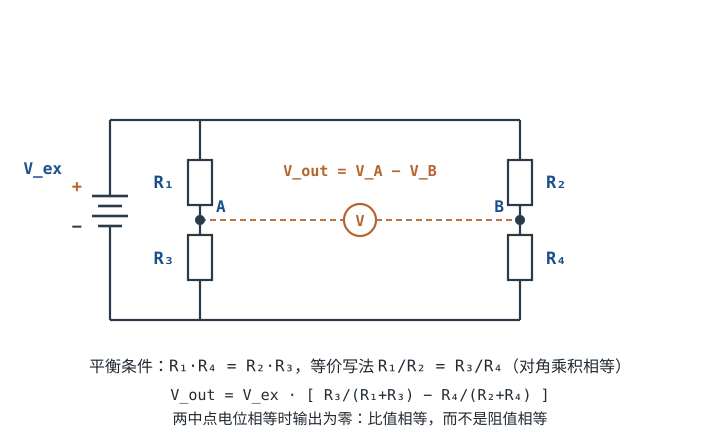

# 串联、并联与分压分流 Series / Parallel, Voltage & Current Divider

欧姆定律解决了"一个电阻"的问题。真实电路里电阻总是一个个串起来、并起来，这一章讲两种基本接法，以及由此引出的**分压**和**分流**——它们是电位配置、电平搬移、电流采样里出现频率最高的两个电路。

这一章结束后你应该能：一眼判断两个元件是串还是并、算出等效电阻、写对分压比，并且**知道分压器接上负载以后会偏多少**。最后一项是新手和熟手的分水岭。

## 1. 设计动机

::: motivation 为什么到处都是分压电路
MCU 的 ADC 只能测 0~3.3V，但电池可能有 12V，怎么办？用两个电阻串起来分压，取其中一个上的电压送 ADC。要把 LED 亮度调暗、要给传感器偏置一个中间电压、要把 5V 降到 3.3V——本质都是分压。看懂串并联，就读懂了无源直流电路的大半。
:::

分压器和分流器在工程里反复出现，因为它们是**最便宜、最常用的无源电平变换手段**：

- **ADC 量程扩展**：把 0~30V 压到 0~3V，两个电阻即可，成本几分钱；
- **传感器偏置**：把运放的同相端抬到 Vcc/2，单电源运放才能放大交流信号；
- **电桥**：惠斯通电桥就是两条分压支路比出来的差，称重、应变、压力、温度全靠它；
- **电流采样**：采样电阻本身就是"分流器"，测它上面的压降就得到电流；
- **并联扩容**：一个大电流开关管做不动，就把几颗并起来分担电流；
- **串联限流**：LED、稳压管、继电器线圈前面串一个电阻，是最便宜的限流办法。

**不懂这一章会摔在哪**，三个真实场景：

1. **分压器接上负载就塌**。10kΩ/10kΩ 分压 5V 得到 2.5V，接一个 10kΩ 的负载后实测只有 1.67V——偏差 33%。如果这是 ADC 前端，整条测量链的量程标定就全错了。
2. **两个电源直接并联**。12V 与 8V 的电源并在一起，低压那个不但不供电，还会被**倒灌**1A（这个电流在[基尔霍夫定律](kcl-kvl.md)一节的算例里会完整算一遍）。轻则稳压器发热，重则反向击穿。
3. **大电流并管不均流**。两颗导通电阻 10mΩ 与 7mΩ 的管子并联扛 100A，按电阻反比分配，7mΩ 那颗扛 58.8A、功耗 24.2W，另一颗只扛 41.2A、功耗 17.0W。热的更热，最后烧的是那颗"更好"的管子。

这三件事的共同点是：**都能用两个分数的加减算清楚，但不算就会踩**。

## 2. 定义与直观：串联、并联与"既不是串也不是并"

先把话说准。"串"和"并"不是看图上画得像不像，而是看**节点**。

- **节点（Node）**：两条及以上支路的公共连接点。用理想导线直接连起来的一整片导体，算同一个节点。
- **支路（Branch）**：两个节点之间的一段电路；同一支路内电流处处相同。
- **串联（Series）**：两个元件**首尾相接**，并且它们的公共连接点**不再引出第三条支路**。此时两个元件流过同一个电流。
- **并联（Parallel）**：两个元件**接在同一对节点上**（两端分别共节点）。此时两个元件两端电压相同。
- **等效电阻（Equivalent Resistance）**：若一个电阻接在同一对端子上，端口的电压—电流关系与原来的网络完全相同，这个电阻就是该网络的等效电阻。等效只保证"对外一样"，内部可以天差地别。


判定串并联的三步法，比背口诀可靠：

1. **合并节点**：把电源轨、地、所有用导线直连的点合并，逐个编号；
2. **看两端**：对每个元件问一句"它两端各是哪两个节点"；
3. **对号入座**：两个元件共用**两个**节点 → 并联；只共用**一个**节点且该点没有第三条支路 → 串联；其余情况（共用两个节点之间还搭着别的元件、或共用一个节点但该点还有第三条路）→ **既不是串联也不是并联**，得用 KCL/KVL 或星三角变换。

第 3 步是重点。很多"看起来是串并联"的电路其实是桥形：惠斯通电桥的四个电阻，任意两个都不满足严格的串或并，这也是为什么它必须用 KCL/KVL 那套方程来解。本节后面画出的电桥就是这种结构。

::: analogy 串并联的水路直觉
- **串联** = 几节水管**首尾相接**：水流只有一条路，所以电流处处相同；总"阻碍"是各段相加。
- **并联** = 几根水管**并排接到同一水压**：每根两端水压相同（电压相同）；总水流是各支管之和，支管越多总阻碍越小。
:::

这个类比在"分压"上还有一个很好用的推论：**串联时谁的水管粗（电阻小），谁两端的水压差就小**。所以分压器里想取到大电压，就让下臂电阻大；这也是后面分压公式的直观来源。

**串联与并联的对照**（只记这几条）：

| | 串联 Series | 并联 Parallel |
|---|---|---|
| 电流 | 处处相同 $I$ | 各支路相加 $I=I_1+I_2$ |
| 电压 | 各元件相加 $V=V_1+V_2$ | 各支路相同 $V$ |
| 等效电阻 | $R_{\text{总}}=R_1+R_2$ | $\dfrac{1}{R_{\text{总}}}=\dfrac{1}{R_1}+\dfrac{1}{R_2}$ |
| 谁决定总量 | 电阻大的分压多 | 电阻小的分流多 |

两个好用的特例：

- **n 个相同电阻 R 串联** → $nR$；
- **n 个相同电阻 R 并联** → $R/n$；两个不同电阻并联：$R_{\text{总}}=\dfrac{R_1 R_2}{R_1+R_2}$（"积除以和"）。

## 3. 定量关系：等效电阻、分压、分流与负载效应

### 等效电阻的推导

**串联**：串联时两个电阻流过同一个电流 $I$，由 KVL，总电压是两段电压之和：

$$V = V_1 + V_2 = I R_1 + I R_2 = I\,(R_1+R_2) \quad\Longrightarrow\quad R_{\text{eq}} = R_1 + R_2$$

符号与单位：$V$ 是整组电阻两端的总电压（V），$I$ 是流过它们的电流（A），$R_1,R_2$ 是两个电阻（Ω），$R_{\text{eq}}$ 是等效电阻（Ω）。结论对 n 个电阻是 $R_{\text{eq}}=\sum_i R_i$。

**并联**：并联时两个电阻两端是同一个电压 $V$，由 KCL，总电流是两支路电流之和：

$$I = I_1 + I_2 = \frac{V}{R_1} + \frac{V}{R_2} = V\left(\frac{1}{R_1}+\frac{1}{R_2}\right) \quad\Longrightarrow\quad \frac{1}{R_{\text{eq}}} = \frac{1}{R_1}+\frac{1}{R_2}$$

两个电阻时化成"积除以和"：

$$R_{\text{eq}} = \frac{R_1 R_2}{R_1+R_2} = \frac{100\times 300}{100+300} = \frac{30000}{400} = 75\ \Omega$$

（代入 $R_1=100\,\Omega$、$R_2=300\,\Omega$，结果 75Ω。）

引入电导 $G=1/R$（单位西门子 S）后，并联就是加法：$G_{\text{eq}}=\sum_i G_i$。这也是为什么工程上并联电容、并联电源用"相加"更顺手。

**并联等效电阻必然小于最小的那一支**，证明只需一行：

$$\frac{1}{R_{\text{eq}}} = \sum_i \frac{1}{R_i} > \frac{1}{R_{\min}} \quad\Longrightarrow\quad R_{\text{eq}} < R_{\min}$$

这个不等式解释了一个常见误判：**并联不是"电阻变大"，而是"多开了一条路"**。

### 分压公式

两个电阻串联，取 $R_2$ 上的电压：

$$V_{out} = V_{in}\cdot \frac{R_2}{R_1+R_2}$$

符号含义：$V_{in}$ 是加在整串电阻上的总电压（V），$R_1$ 是上臂（接 $V_{in}$ 那一侧）、$R_2$ 是下臂（接地那一侧），$V_{out}$ 是从 $R_2$ 两端取出的电压（V）。

推导只有两步：串联电流 $I=\dfrac{V_{in}}{R_1+R_2}$，再乘 $R_2$：

$$V_{out}=I\cdot R_2=\frac{V_{in}}{R_1+R_2}\cdot R_2$$

**分压比只由电阻比值决定，与总阻值无关**——这是分压器最有用也最容易被误用的性质：比值决定电压，总阻值决定电流和输出阻抗。

### 分流公式

两个电阻并联，求 $R_1$ 支路分到的电流：

$$I_1 = I_{total}\cdot \frac{R_2}{R_1+R_2}$$

符号含义：$I_{total}$ 是流进并联组的总电流（A），$I_1$ 是流过 $R_1$ 的电流（A）。注意分子是**另一条**支路的电阻：**电阻大的支路分到的电流反而小**（反比关系）。

推导：并联电压相同 $V=I_{total}\cdot R_{\text{eq}}$，再除以 $R_1$：

$$I_1=\frac{V}{R_1}=\frac{I_{total}R_{\text{eq}}}{R_1}=I_{total}\cdot\frac{R_2}{R_1+R_2}$$

通式按电导分配更不容易写错：$I_k = I_{total}\cdot\dfrac{G_k}{\sum_i G_i}$。

::: advanced 进阶：分压比的两个灵敏度
对上式取对数再求偏导，可以看出"电阻精度如何变成电压误差"：

$$\frac{\partial \ln V_{out}}{\partial \ln R_1}=-\frac{R_1}{R_1+R_2},\qquad \frac{\partial \ln V_{out}}{\partial \ln R_2}=+\frac{R_1}{R_1+R_2}$$

含义：$R_1$ 与 $R_2$ 各变化 1%，输出电压朝相反方向各变 $\frac{R_1}{R_1+R_2}$%。当 $R_1/R_2=9$ 时，这个系数是 0.9，所以两只 ±1% 电阻最坏给出约 ±1.8% 的分压比误差。这就是为什么 1% 电阻做的分压器不能当 0.1% 精度的基准——想要更准，要么选 0.1% 电阻，要么标定，要么改用基准芯片。
:::

### 分压器的输出电阻与负载效应

到目前所有公式都有一个隐含前提：**输出端没有接任何东西**。真实电路里输出总要接到 ADC、运放或下一级电路，这就引出这一节最重要的结论。

从输出端往里看，分压器是一个戴维南等效（Thévenin Equivalent）：

$$V_{\text{th}}=V_{in}\frac{R_2}{R_1+R_2},\qquad R_{\text{th}}=R_1\parallel R_2=\frac{R_1R_2}{R_1+R_2}$$

$R_{\text{th}}$ 就是**输出电阻**，单位 Ω。接上负载 $R_L$ 后，负载与下臂并联，分压比被改写：

$$V_{out}' = V_{in}\cdot\frac{R_2\parallel R_L}{R_1 + R_2\parallel R_L}$$

定义相对误差 $\varepsilon = \dfrac{V_{out}'-V_{out}}{V_{out}}$，代入并化简可得一个非常干净的式子：

$$\varepsilon=-\frac{x}{x+k},\qquad x=\frac{R_1}{R_1+R_2},\quad k=\frac{R_L}{R_2}$$

当负载远大于输出电阻（$k\gg x$）时，一阶近似更进一步简化成一句可以背下来的话：

$$\varepsilon\approx-\frac{R_{\text{th}}}{R_L}$$

**分压误差 ≈ 输出电阻 ÷ 负载电阻。** 这条近似把"负载效应（Loading Effect）"从一个定性说法变成了可算的数：

- 要让误差 ≤ 1%，需要 $R_L \ge 100\,R_{\text{th}}$；
- 要让误差 ≤ 5%，需要 $R_L \ge 20\,R_{\text{th}}$；
- 接一个等于 $R_{\text{th}}$ 的负载，误差就是 −50%。

### 惠斯通电桥与平衡条件

把两条分压支路并接在同一个激励源 $V_{ex}$ 上，取两个中点之差，就是惠斯通电桥（Wheatstone Bridge）。



两个中点的电压（都相对下端节点）：

$$V_A=V_{ex}\frac{R_3}{R_1+R_3},\qquad V_B=V_{ex}\frac{R_4}{R_2+R_4}$$

输出是两者之差：

$$V_{out}=V_A-V_B=V_{ex}\left(\frac{R_3}{R_1+R_3}-\frac{R_4}{R_2+R_4}\right)$$

**平衡条件**：令 $V_{out}=0$，交叉相乘化简：

$$\frac{R_3}{R_1+R_3}=\frac{R_4}{R_2+R_4}\;\Longrightarrow\;R_2R_3+R_3R_4=R_1R_4+R_3R_4\;\Longrightarrow\;R_1R_4=R_2R_3$$

即 **对角乘积相等**，等价写法是 $\dfrac{R_1}{R_2}=\dfrac{R_3}{R_4}$。

平衡的意义不只是"输出为零"：它是**比值相等**，所以激励源漂移、环境温度同时改变四个臂时，比值结构会把共模变化抵消掉。这就是电桥能测出微伏级不平衡量的原因。

::: advanced 进阶：电桥灵敏度与四分之一桥、半桥、全桥
设四个臂都是 $R$，只有一个臂变化 $\Delta R$（四分之一桥，Quarter Bridge），把 $\delta=\Delta R/R$ 代入：

$$V_{out}=V_{ex}\left(\frac{1}{2}-\frac{R+\Delta R}{2R+\Delta R}\right)=V_{ex}\cdot\frac{-\delta}{2(2+\delta)}\approx -V_{ex}\frac{\delta}{4}$$

$\delta\ll1$ 时输出正比于 $\delta$，系数是 $V_{ex}/4$。同理可推：

| 组桥方式 | 变化臂数 | 输出（小信号，一阶） | 相对灵敏度 |
|---|---|---|---|
| 四分之一桥 | 1 个臂 | $\pm V_{ex}\,\delta/4$ | 1 |
| 半桥 | 2 个相邻臂反向 | $V_{ex}\,\delta/2$ | 2 |
| 全桥 | 4 个臂两两反向 | $V_{ex}\,\delta$ | 4 |

推导半桥：左支路上臂 $R+\Delta R$、下臂 $R-\Delta R$，则 $V_A=V_{ex}\frac{R-\Delta R}{2R}=V_{ex}\frac{1-\delta}{2}$；右支路不变，$V_B=V_{ex}/2$，故 $V_{out}=-V_{ex}\delta/2$。全桥把左右两条支路都换成反向变化，两半相加即得 $V_{ex}\delta$。

工程含义很直接：**同样应变下，全桥输出是四分之一桥的 4 倍**，这就是称重传感器（通常全桥）比单片应变片好用的原因；代价是四片应变片都要粘贴、配桥并做温度补偿，装配工序远多于单片方案。
:::

## 4. 典型计算：从分压器到电桥

::: example 算例一：用分压器测 12V 电池（含负载效应核算）
1. **需求**：MCU 的 ADC 满量程 3.3V，要测 0~15V 的电池组。
2. **选比例**：要把 15V 衰减到 3.3V 以下，衰减比 $3.3/15\approx0.22$。
3. **取 R₁=100kΩ（上）、R₂=27kΩ（下）**：分压比 $27/(100+27)=27/127=0.2126$。
4. **验算满量程**：15V 时 $V_{out}=15\times0.2126=3.189$ V，不超 3.3V（余量 0.111V）。
5. **验算常用点**：12V 时 $V_{out}=12\times0.2126=2.551$ V。
6. **反推**：ADC 读到 2.551V 时，电池电压 $=2.551/0.2126=12.0$ V，软件里乘一个系数即可。
7. **算输出电阻**：$R_{\text{th}}=100\text{k}\parallel27\text{k}=2700/127=21.26$ kΩ。
8. **核算 ADC 漏电的影响**：若 ADC 输入漏电流为 1µA（典型量级，以所选 ADC 数据手册为准），在 $R_{\text{th}}$ 上产生 $1\,\mu\text{A}\times21.26\,\text{k}\Omega=21.3$ mV 的误差，相对 2.551V 是 0.83%——可接受，但已经吃掉不少 12 位精度。
9. **核算误接负载的后果**：若有人在这个节点上并一个 100kΩ 电阻，则 $R_2\parallel R_L=27\text{k}\parallel100\text{k}=2700/127=21.26$ kΩ，输出变成 $15\times21.26/(100+21.26)=2.63$ V（15V 输入），相对原来的 3.189V 低了 17.5%——这就是"接上就变"的典型现场。
:::

::: example 算例二：两个电阻并联（等效、分流、功率三验算）
$R_1=100\,\Omega$、$R_2=300\,\Omega$ 并联，接在 10V 电源上。

1. **等效电阻**：$R_{\text{eq}}=\dfrac{100\times300}{100+300}=\dfrac{30000}{400}=75\ \Omega$，比最小的 100Ω 还小。
2. **总电流**：$I=V/R_{\text{eq}}=10/75=133.3$ mA。
3. **各支路电流**：$I_1=10/100=100$ mA，$I_2=10/300=33.3$ mA。
4. **用分流公式验证**：$I_1=I_{total}\dfrac{R_2}{R_1+R_2}=133.3\times\dfrac{300}{400}=100$ mA ✓。
5. **用功率守恒验证**：总功率 $P=VI=10\times0.1333=1.333$ W；两只电阻各自 $P_1=10\times0.1=1.0$ W、$P_2=10\times0.0333=0.333$ W，相加 $1.333$ W ✓。也可以写成 $P=V^2/R_{\text{eq}}=100/75=1.333$ W。
6. **选型提醒**：$R_1$ 上 1.0W，必须用 2W 以上电阻；用 1/4W 的 0805 会瞬间冒烟。
:::

::: example 完整设计算例：24V 电池组到 12 位 ADC 的分压前端
**需求**（这一步必须先写清楚，否则后面全是拍脑袋）：

| 项目 | 要求 |
|---|---|
| 输入范围 | 0~30V（24V 电池组充满电留余量） |
| ADC | 12 位，$V_{ref}=3.3$ V，满量程读数 4095 |
| 分压器静态电流 | ≤ 0.5mA（电池待机不能一直耗电） |
| 25°C 下总误差 | ≤ 2%（含电阻容差与 ADC 漏电） |
| 输出 | 加 RC 滤波，抑制电机噪声 |

**第 1 步 定分压比**：满量程留 10% 余量，30V 对应 3.0V，故比例 $=3.0/30=0.1$。

**第 2 步 定比值**：$\dfrac{R_2}{R_1+R_2}=0.1\Rightarrow R_1=9R_2$。

**第 3 步 选标称值**（IEC 60063 的 E96 系列，±1%）：取 $R_2=10.0$ kΩ，$R_1=90.9$ kΩ。实际比例 $=\dfrac{10.0}{100.9}=0.09911$，比目标 0.1 低 0.89%。

**第 4 步 核算量程**：30V 时 $V_{out}=30\times0.09911=2.973$ V ≤ 3.0V ✓；3.3V 满量程对应输入 $3.3/0.09911=33.3$ V，过压也能读得出来。

**第 5 步 核算电流与功耗**：$I=\dfrac{30}{100.9\text{k}}=297\ \mu\text{A}\le500\ \mu\text{A}$ ✓；功耗 $P=30\times297\,\mu\text{A}=8.9$ mW，两只 0.1W 电阻绰绰有余。

**第 6 步 算输出电阻**：$R_{\text{th}}=90.9\text{k}\parallel10.0\text{k}=\dfrac{909}{100.9}=9.01$ kΩ。

**第 7 步 核算 ADC 漏电**：按 1µA 计，误差电压 $=1\,\mu\text{A}\times9.01\,\text{k}\Omega=9.0$ mV，相对 2.973V 是 **0.30%**。

**第 8 步 核算电阻容差**：±1% 最坏情况（$R_2$ 取 +1%、$R_1$ 取 −1%）比例上限 $=\dfrac{10.1}{90.0+10.1}=0.10090$；下限 $=\dfrac{9.9}{91.8+9.9}=0.09734$。相对标称 0.09911 分别是 **+1.8%** 与 **−1.8%**。

**第 9 步 误差合成与迭代**：最坏 $1.8\%+0.30\%=2.1\%$，超出 2% 的要求 → **不达标**。改用 0.1% 电阻：容差项降到 ±0.18%，合计 $0.18\%+0.30\%=0.48\%$ ✓。这就是为什么精密分压要用 0.1% 电阻，而不是"多算几遍"。

**第 10 步 加 RC 滤波并核算建立时间**：取 $C=100$ nF 到地，时间常数 $\tau=R_{\text{th}}C=9.01\,\text{k}\Omega\times100\,\text{nF}=0.901$ ms。12 位 ADC 的 0.5 LSB 对应电压 $\dfrac{3.3}{2^{12}}\times0.5=\dfrac{3.3}{8192}=0.403$ mV；从 0 阶跃到 3.0V 后，误差收敛到 0.403mV 以下需要 $t=\tau\ln\dfrac{3.0}{0.000403}=0.901\,\text{ms}\times8.9=8.0$ ms。结论：**每通道采样周期不要快于 8ms**（约 125 次/秒），否则读数会低于真值。

**第 11 步 最终物料**：$R_1=90.9$ kΩ 0.1% 25ppm/°C、$R_2=10.0$ kΩ 0.1% 25ppm/°C、$C=100$ nF X7R 50V（工作电压 30V，留 1.6 倍余量；陶瓷电容有直流偏压降容效应，实际容值以数据手册曲线为准）。

**验算汇总**：30V → 2.973V；量程上限 33.3V；静态电流 297µA；输出电阻 9.01kΩ；漏电误差 0.30%；容差误差 ±0.18%；建立时间 8.0ms。全部满足需求，且每一步都能复算。
:::

## 5. 工程含义：取值数量级与代价

### 分压器阻值取多少

分压比只和比值有关，但**总阻值决定三件事**：静态电流（耗电）、输出电阻（负载能力）、噪声与漏电敏感度。以 $V_{in}=5$ V、$R_1=R_2$ 为例：

| 总阻值 $R_1+R_2$ | 静态电流 | 静态功耗 | 输出电阻 $R_{\text{th}}$ | 适用场合 |
|---|---|---|---|---|
| 1 kΩ | 5 mA | 25 mW | 500 Ω | 驱动能力要求高、不怕耗电 |
| 10 kΩ | 0.5 mA | 2.5 mW | 5 kΩ | 通用甜点区 |
| 100 kΩ | 50 µA | 0.25 mW | 50 kΩ | 电池待机、低功耗 |
| 1 MΩ | 5 µA | 25 µW | 500 kΩ | 只在带运放缓冲时可用 |

（每行都可由 $I=V/R$、$P=VI$、$R_{\text{th}}=R/2$ 复算。）

经验区间是 **1 kΩ~100 kΩ**：低于 1kΩ 白耗电，高于 100kΩ 时输出电阻已经大到怕漏电、怕噪声、怕 ADC 采样保持的反冲。真正的高阻场合（比如 1MΩ 以上）必须后面跟一个运放缓冲。

### 负载比与误差的对照

取 $R_1=R_2$（比例为 1/2），误差公式 $\varepsilon=-\dfrac{1}{2k+1}$，$k=R_L/R_2$：

| 负载比 $k$ | 0.5 | 1 | 2 | 5 | 10 | 20 | 50 | 100 |
|---|---|---|---|---|---|---|---|---|
| 相对误差 | −50.0% | −33.3% | −20.0% | −9.09% | −4.76% | −2.44% | −0.99% | −0.50% |

```echarts
{
  "animation": false,
  "tooltip": {"trigger": "axis", "valueFormatter": null},
  "grid": {"left": 66, "right": 30, "top": 44, "bottom": 62},
  "xAxis": {"type": "log", "name": "负载比 k = R_L / R₂", "nameLocation": "middle", "nameGap": 32, "min": 0.5, "max": 100, "axisLabel": {"fontSize": 11}},
  "yAxis": {"type": "value", "name": "相对误差 %", "min": -60, "max": 0, "axisLabel": {"fontSize": 11}},
  "series": [
    {"name": "相对误差", "type": "line", "smooth": true, "symbolSize": 7,
     "lineStyle": {"width": 2.6, "color": "#b5642e"}, "itemStyle": {"color": "#b5642e"},
     "data": [[0.5, -50.0], [1, -33.3], [2, -20.0], [5, -9.09], [10, -4.76], [20, -2.44], [50, -0.99], [100, -0.50]]}
  ]
}
```

这张图是"**分压器只能驱动比自身输出电阻大 100 倍的负载**"的定量版本：想守住 1%，$k$ 得 50 以上；只要求 5%，$k\ge10$ 就够。原始经验说法"取负载阻抗的 1/10 以下"其实就是 $k\ge10$，对应 4.76% 误差——够用，但要知道它意味着 5% 的误差预算已经花光。

**分压器不能当电源用**，这是同一条公式的另一面：10kΩ/10kΩ 分压在 5V 下输出 2.5V，输出电阻 5kΩ。接一个 2.5kΩ 的负载（若输出真是 2.5V，本该取 1mA），实际只得到 $2.5\times\dfrac{2.5}{5+2.5}=0.833$ V、0.33mA。想要"带载不掉压"，只有两条路：把分压电阻同比做小（耗电换刚度），或者加运放缓冲（用有源器件换刚度）。

### 电桥的工程价值

电桥的价值在于把"一个电阻的绝对变化"变成"两条支路的**比值差**"，从而消掉共模：

- **温度**：四个臂同处一个温度场，温漂同时作用于分子分母，比值近似不变；
- **激励源**：$V_{ex}$ 的漂移按比例缩放 $V_A$ 与 $V_B$，差值只受比值差支配；
- **小信号放大**：应变片 $GF\approx2$、应变 500µε 时 $\delta=GF\cdot\varepsilon=2\times500\times10^{-6}=0.001$，在 350Ω 应变片上就是 $\Delta R=0.35\,\Omega$。5V 激励下四分之一桥输出 $V_{ex}\delta/4=5\times0.001/4=1.25$ mV——必须用 100~1000 倍增益的仪表放大器才够 ADC 用。
- **引线电阻**：Pt100 用两线制时，每根引线 0.2Ω 会让桥臂多出 0.4Ω。按 Pt100 的 $\alpha=0.00385\ \Omega/(\Omega\cdot{}^\circ\text{C})$ 折算，温度误差 $\Delta T=\dfrac{0.4}{100\times0.00385}=1.04\ ^\circ\text{C}$——这就是三线制/四线制的由来。

### 并联均流：为什么大电流要并管，什么时候要加均流电阻

单管的电流能力受封装、键合线、热阻三重限制，所以大电流电源动辄并 2~8 颗管子。并管的总导通电阻按并联算，看似"白赚"，实际有个陷阱：**两颗管子的 $R_{ds(on)}$ 不可能相等**，而并联时电流按电阻**反比**分配。

设两颗管子 $R_1=10$ mΩ、$R_2=7$ mΩ，总电流 100A，各自串一个均流电阻（Ballast Resistor）$R_b$，则

$$I_1=I_{total}\frac{R_2+R_b}{R_1+R_2+2R_b},\qquad I_2=I_{total}\frac{R_1+R_b}{R_1+R_2+2R_b}$$

代入不同 $R_b$（每组都按上式计算）：

| 均流电阻 $R_b$ | $I_1$（10mΩ 管） | $I_2$（7mΩ 管） | 不平衡度 $I_2/I_1$ | 均流电阻总损耗 |
|---|---|---|---|---|
| 0 | 41.2 A | 58.8 A | 1.43 | 0 W |
| 1 mΩ | 42.1 A | 57.9 A | 1.375 | 5.1 W |
| 2 mΩ | 42.9 A | 57.1 A | 1.33 | 10.2 W |
| 5 mΩ | 44.4 A | 55.6 A | 1.25 | 25.3 W |
| 23 mΩ | 47.6 A | 52.4 A | 1.10 | 115 W |

（损耗按 $\sum I_k^2R_b$ 逐项算：$R_b=5$ mΩ 时 $44.4^2\times0.005+55.6^2\times0.005=9.9+15.4=25.3$ W；$R_b=23$ mΩ 时 $47.6^2\times0.023+52.4^2\times0.023=52.2+63.1=115$ W。）

表格给出一个不太"教科书"但真实的结论：**均流电阻要把 3mΩ 的失配压到 10%，需要 23mΩ——比两颗管子本身的导通电阻（7~10mΩ）还大一倍以上，代价是 115W 白白发热**。实际能接受的一般是 5mΩ 级，得到 ±11% 的不平衡，代价 25W。由此得到三条工程做法：

1. **并管必须同型号、同批次、同封装**，最好同一盘料，把初始失配压到最小；
2. **布局与散热对称**：走线长度、过孔数量、铜箔面积一致，让热阻也对称——MOSFET 的 $R_{ds(on)}$ 在 $V_{gs}$ 远高于阈值时是**正温度系数**（约 +0.3~+0.7%/°C 量级，以数据手册曲线为准），热的管子电阻变大、电流自动往回让，这是直流静态下的天然负反馈；
3. **均流电阻真正不可省的地方**：BJT、二极管、IGBT 的 $V_{be}$/$V_f$/$V_{ce(sat)}$ 是**负温度系数**，热了电流更大，会热失控；以及在 $V_{gs}$ 接近阈值的工作区（线性区、热插拔限流、缓启动），MOSFET 也可能呈负温度系数。这些场合必须靠发射极/源极电阻强行拉平，或者干脆降额使用。

另外两个并管必须注意的点：开关瞬间的**动态均流**靠的是驱动对称（栅极电阻独立、走线等长），不是直流均流电阻；并联 MOS 的栅极容易互相振荡，通常每管栅极独立串 10~100Ω 电阻（典型量级，具体按器件与布线调整）。

### 串联限流的代价

串联电阻限流是"电压源驱动"的变通做法：电流由 $(V_{supply}-V_f)/R$ 决定，电阻上白白消耗 $(V_{supply}-V_f)\cdot I$。以 1.8V/20mA 的 LED 为例：

| 电源 | 限流电阻 | 电阻损耗 | LED 功率 | 效率 |
|---|---|---|---|---|
| 5 V | $(5-1.8)/0.02=160\ \Omega$ | $3.2\times0.02=64$ mW | 36 mW | 36% |
| 12 V | $(12-1.8)/0.02=510\ \Omega$ | $10.2\times0.02=204$ mW | 36 mW | 15% |
| 24 V | $(24-1.8)/0.02=1110\ \Omega$ | $22.2\times0.02=444$ mW | 36 mW | 7.5% |

结论很直接：**限流电阻的代价随电源电压线性增长，效率随之线性下降**。24V 下 92.5% 的电能变成了电阻的热。更要命的是电阻必须按 0.444W 选型（实际取 1W），而 LED 只用到 36mW。所以高压驱动 LED 一律改用恒流源或开关恒流；串联限流只适合"电压比 $V_f$ 高不了多少"的场合。

## 6. 常见坑

::: pitfall 常见坑
- **分压输出端接了负载，电压被拉低**：现象——理论算出来分压 2.5V，接上传感器/ADC 后只剩 1.8V 甚至更低。原因——负载与下臂并联，等效电阻变小、分压比改变；本质是分压器有输出电阻 $R_{\text{th}}=R_1\parallel R_2$，误差约等于 $R_{\text{th}}/R_L$。解决——先算 $R_{\text{th}}$，要求 $R_L\ge100R_{\text{th}}$（1% 误差）；做不到就加电压跟随器缓冲，或整体降低分压电阻阻值（用功耗换刚度）。
- **并联后误以为电阻变大**：现象——两个电阻并联后用欧姆档量，读数比任一个都小，怀疑表坏了。原因——并联是增加导电通路，等效电阻必然小于最小值；由 $1/R_{\text{eq}}=\sum 1/R_i>1/R_{\min}$ 可证。解决——记住"并联越并越小，串联越串越大"；反查时用"积除以和"或电导相加。
- **分压电阻取值太大，拾取噪声/被输入偏置电流影响**：现象——ADC 读数乱跳、不准，手一碰电路板数字就变。原因——$R_1/R_2$ 取到 MΩ 级时节点阻抗高，易耦合工频与空间噪声；ADC 漏电或运放输入偏置电流在高阻上产生压降（1µA×1MΩ=1V，足以毁掉结果）。解决——分压电阻通常取 1k~100kΩ；必须用高阻时，在分压点后加运放缓冲，并在 ADC 前加 100nF 级滤波电容。
- **电桥四臂不匹配，零点不为零**：现象——空载时电桥输出几毫伏而不是 0，且随温度慢慢漂。原因——四臂电阻的初值/温度系数不一致，平衡条件 $R_1R_4=R_2R_3$ 被破坏；也可能是引线电阻被算进了桥臂。解决——用同批次、同温度系数的配对电阻（或直接买四臂一体的桥式传感器），必要时加调零电位器；两线制 RTD 改三线/四线制消除引线电阻。
- **串联限流电阻功率不够**：现象——电阻通电几分钟后发黄、阻值漂移、甚至开路。原因——只按"阻值对不对"选型，没算 $P=I^2R$；24V 驱动 20mA LED 时电阻上就有 0.44W，用 1/4W 件必然过热。解决——先算 $(V_{supply}-V_f)\cdot I$，额定功率取 2 倍以上余量，并注意高温降额。
- **把分压器当稳压电源用**：现象——空载电压很准，一接负载（继电器、蜂鸣器、无线模块）就掉到几乎为零。原因——分压器输出电阻是 kΩ 级，只能驱动 µA~几十 µA 级负载。解决——负载电流超过 $V_{out}/(20R_{\text{th}})$ 就不要用分压器，改用 LDO、基准源或运放缓冲。
:::

## 7. 自测题

<details><summary>R₁=100kΩ、R₂=100kΩ 串联，输入 5V，从 R₂ 上输出多少伏？如果输出端再接一个 100kΩ 负载呢？</summary>

空载：分压比 $R_2/(R_1+R_2)=100/200=0.5$，$V_{out}=5\times0.5=$ **2.5V**。

接 100kΩ 负载后：下臂变成 $100\text{k}\parallel100\text{k}=50$ kΩ，输出 $V_{out}'=5\times\dfrac{50}{100+50}=$ **1.667V**。

误差 $\varepsilon=(1.667-2.5)/2.5=-33.3\%$。注意一阶近似 $\varepsilon\approx-R_{\text{th}}/R_L=-50/100=-50\%$ 在这里偏大了一半——因为 33% 已不是小误差；精确式 $\varepsilon=-x/(x+k)$ 代入 $x=0.5$、$k=1$ 得 $-0.5/1.5=-33.3\%$，与直接算的结果一致。所以**一阶近似只在误差小于约 10% 时才好用**。

结论：**这个分压器只能驱动远大于 50kΩ 的负载**。
</details>

<details><summary>要把 20V 分压到 4V（衰减到 1/5），R₁=200kΩ 时 R₂ 取多大？</summary>

由 $\dfrac{R_2}{R_1+R_2}=\dfrac{1}{5}$ 得 $5R_2=R_1+R_2$，即 $4R_2=R_1=200\text{k}$，所以 $R_2=$ **50kΩ**。

验算：$20\times\dfrac{50}{250}=4.0$ V ✓。取 E96 标称 49.9kΩ 时输出 $20\times\dfrac{49.9}{249.9}=3.994$ V，误差 −0.15%。
</details>

<details><summary>两个 10Ω 电阻并联，等效电阻多少？再接一个 10Ω 上去呢？如果三个电阻分别是 10Ω、10Ω、5Ω 呢？</summary>

两个并联：$10/2=$ **5Ω**；三个相同电阻并联：$10/3\approx$ **3.3Ω**。n 个相同 R 并联就是 R/n。

混合情况用"积除以和"递推：两个 10Ω 先并成 5Ω，再与 5Ω 并联，得 $5/2=$ **2.5Ω**。直接用通式验算：$\dfrac{1}{R}=\dfrac{1}{10}+\dfrac{1}{10}+\dfrac{1}{5}=0.1+0.1+0.2=0.4$ S，$R=1/0.4=2.5$ Ω ✓。
</details>

<details><summary>惠斯通电桥四个臂 R₁=R₂=R₃=1kΩ、R₄=1001Ω，激励 5V，输出多少？这个输出说明了什么？</summary>

$V_A=5\times\dfrac{1000}{1000+1000}=2.500$ V；$V_B=5\times\dfrac{1001}{1000+1001}=5\times\dfrac{1001}{2001}=2.5012$ V。

$V_{out}=V_A-V_B=2.500-2.5012=$ **−1.25 mV**。

说明两件事：一是**电阻只差 0.1%，输出只有 1.25mV**，电桥的灵敏度很低，必须靠后级放大（通常 100~1000 倍）；二是这个 1.25mV 与一阶公式 $-V_{ex}\delta/4=-5\times0.001/4=-1.25$ mV 完全吻合，$R_4$ 变化 1Ω 对应 $\delta=0.001$。
</details>

<details><summary>两颗 MOSFET 并联，导通电阻 10mΩ 与 7mΩ，总电流 100A。不加均流电阻时各扛多少？最热那颗耗散多少瓦？</summary>

并联电流按电阻反比分配：$I_1=100\times\dfrac{7}{10+7}=41.2$ A，$I_2=100\times\dfrac{10}{17}=58.8$ A。

耗散：$P_1=I_1^2R_1=41.2^2\times0.01=17.0$ W，$P_2=58.8^2\times0.007=24.2$ W。

注意**总损耗与均流无关**：$I^2R_{\text{eq}}=100^2\times\dfrac{10\times7}{17}=100^2\times4.12\,\text{m}\Omega=41.2$ W，正好等于 $17.0+24.2$。所以不均流的危害不是"总损耗变大"，而是**把损耗集中到一颗管子上**：24.2W 的那颗结温更高，寿命更短，先坏。这也是为什么并管要做热对称布局，而不只是算总电阻。
</details>

<details><summary>某 24V 供电的指示灯用串联电阻限流：LED 压降 1.8V、目标 20mA，电阻取多大？电阻上白白浪费多少功率？为什么说"电源电压越高，串联限流越亏"？</summary>

电阻值 $R=\dfrac{24-1.8}{0.02}=1110\ \Omega$（取标称 1.1kΩ）。

电阻损耗 $P_R=(24-1.8)\times0.02=22.2\times0.02=0.444$ W；LED 只有 $1.8\times0.02=0.036$ W，效率 $0.036/(0.036+0.444)=7.5\%$。

"越亏"的定量原因是：电阻上的压降是 $V_{supply}-V_f$，随电源电压线性增长；而 LED 电流不变，所以电阻损耗与 $(V_{supply}-V_f)$ 成正比。5V 时效率 36%，12V 时 15%，24V 时 7.5%——每提高一档电源，效率就掉一半左右。解决办法是恒流驱动（开关恒流或线性恒流源），让"多余电压"不再落在电阻上。
</details>

## 8. 参考资料

- **Lessons In Electric Circuits, Vol. I – DC**（Tony R. Kuphaldt，ibiblio 公开版）：*Ch 5 Series and Parallel Circuits*（串并联定义与等效）、*Ch 6 Divider Circuits and Kirchhoff's Laws*（分压器与分流器）、*Ch 8 DC Metering Circuits*（惠斯通电桥的测量接法）。<https://www.ibiblio.org/kuphaldt/electricCircuits/>
- **Practical Electronics for Inventors, 4th ed.**（Paul Scherz & Simon Monk）：*Chapter 2 · Theory* 的 Voltage Dividers、Thevenin's Theorem 小节——分压器的戴维南模型与负载效应，与本章"分压器的输出电阻与负载效应"一节推导一致。
- **《电路》**（邱关源，高等教育出版社）："电阻电路的等效变换"一章（串并联等效、Y-Δ 变换）、"电路定理"一章（戴维南与诺顿等效）。本章 $R_{\text{th}}=R_1\parallel R_2$ 的结论即戴维南等效的特例。
- **《电力电子技术》**（王兆安、刘进军，机械工业出版社）："电力电子器件"一章中器件的串联和并联使用一节——并管均流、降额与 $V_{ce(sat)}$/$V_f$ 负温度系数导致的热失控。
- **IEC 60063:2015** *Preferred number series for resistors and capacitors*：E24/E96/E192 标称值系列，本章所有"取标称值"（90.9k、10.0k、49.9k）均按此标准。
