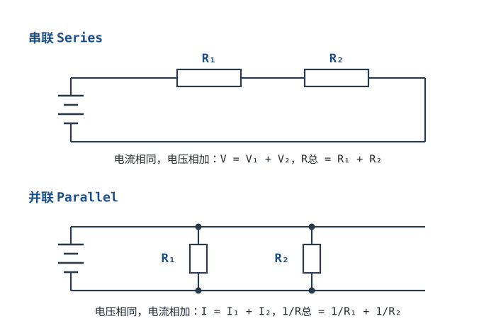

# 串联、并联与分压分流 Series / Parallel, Voltage & Current Divider

欧姆定律解决了"一个电阻"的问题。真实电路里电阻总是一个个串起来、并起来，这一章讲两种基本接法，以及由此引出的**分压**和**分流**——它们是电位配置、电平搬移、电流采样里出现频率最高的两个电路。

## 1. 设计动机

::: motivation 为什么到处都是分压电路
MCU 的 ADC 只能测 0~3.3V，但电池可能有 12V，怎么办？用两个电阻串起来分压，取其中一个上的电压送 ADC。要把 LED 亮度调暗、要给传感器偏置一个中间电压、要把 5V 降到 3.3V——本质都是分压。看懂串并联，就是看懂了 80% 的无源直流电路。
:::

## 2. 原理图

## 3. 两种接法的结论（只记这几条）

::: analogy 串并联的水路直觉
- **串联** = 几节水管**首尾相接**：水流只有一条路，所以电流处处相同；总"阻碍"是各段相加。
- **并联** = 几根水管**并排接到同一水压**：每根两端水压相同（电压相同）；总水流是各支管之和，支管越多总阻碍越小。
:::

| | 串联 Series | 并联 Parallel |
|---|---|---|
| 电流 | 处处相同 $I$ | 各支路相加 $I=I_1+I_2$ |
| 电压 | 各元件相加 $V=V_1+V_2$ | 各支路相同 $V$ |
| 等效电阻 | $R_{\text{总}}=R_1+R_2$ | $\dfrac{1}{R_{\text{总}}}=\dfrac{1}{R_1}+\dfrac{1}{R_2}$ |

两个好用的特例：

- **n 个相同电阻 R 串联** → $nR$；
- **n 个相同电阻 R 并联** → $R/n$；两个不同电阻并联：$R_{\text{总}}=\dfrac{R_1 R_2}{R_1+R_2}$（"积除以和"）。

## 4. 分压与分流公式

**分压（两个电阻串联，取 R₂ 上的电压）**：

$$V_{out} = V_{in}\cdot \frac{R_2}{R_1+R_2}$$

**分流（两个电阻并联，求 R₁ 支路分到的电流）**：

$$I_1 = I_{total}\cdot \frac{R_2}{R_1+R_2}$$

符号含义：$V_{in}/I_{total}$ 是加在整组电阻上的总电压/总电流；$R_1,R_2$ 是两个电阻；$V_{out}$ 是从 R₂ 上"取出来"的电压。注意分流里**电阻大的支路分到的电流反而小**（反比）。

::: advanced 进阶：为什么分压公式长这样
串联电流相同 $I=V_{in}/(R_1+R_2)$，R₂ 上的电压 $V_{out}=I\cdot R_2=V_{in}R_2/(R_1+R_2)$。分流同理：并联电压相同 $V=I_{total}R_{\text{总}}$，再 $I_1=V/R_1$，化简得 $I_1=I_{total}R_2/(R_1+R_2)$。都是欧姆定律的直接推论。
:::

## 5. 带数字的算例

::: example 用 ADC 测 12V 电池（分压）
1. **需求**：MCU 的 ADC 最大只能测 3.3V，现在要测 0~15V 的电池。
2. **选比例**：要把 15V 衰减到 3.3V，衰减比 $3.3/15\approx0.22$。
3. **取 R₁=100kΩ（上）、R₂=27kΩ（下）**：分压比 $27/(100+27)\approx0.213$。
4. **验算**：电池 15V 时，$V_{out}=15\times0.213\approx3.2$ V，刚好不超 ADC 量程；电池 12V 时 $V_{out}\approx2.56$ V。
5. **反推**：ADC 读到 2.56V 时，电池电压 = $2.56/0.213\approx12$ V，软件里乘个系数即可。
:::

::: example 两个电阻并联等效
R₁=100Ω、R₂=300Ω 并联：$R_{\text{总}}=(100\times300)/(100+300)=30000/400=$ **75Ω**——比最小的 100Ω 还小。接在 10V 上总电流 $I=10/75\approx133$ mA；其中 R₁ 支路 $I_1=10/100=100$ mA，R₂ 支路 $I_2=10/300\approx33$ mA，加起来 133 mA，符合分流公式。
:::

## 6. 常见坑

::: pitfall 常见坑
- **分压输出端接了负载，电压被拉低**：现象——理论算出来分压 2.5V，接上传感器/ADC 后只剩 1.8V。原因——负载与 R₂ 并联，等效电阻变小，分压比改变。解决——让分压电阻远小于负载输入阻抗（一般取负载阻抗的 1/10 以下），或用运放缓冲（电压跟随器）。
- **并联后误以为电阻变大**：现象——两个电阻并联后用欧姆档量，读数比任一个都小。原因——并联增加导电通路，等效电阻必然变小。解决——记住"并联越并越小，串联越串越大"。
- **分压电阻取值太大，拾取噪声/被输入偏置电流影响**：现象——ADC 读数乱跳、不准。原因——R₁/R₂ 取到 MΩ 级时，高阻抗节点易耦合噪声，运放/ADC 输入偏置电流在电阻上产生压降。解决——分压电阻通常取 1k~100kΩ，兼顾功耗与噪声。
:::

## 7. 自测题

R₁=100kΩ、R₂=100kΩ 串联，输入 5V，从 R₂ 上输出多少伏？

分压比 $R_2/(R_1+R_2)=100/200=0.5$，$V_{out}=5\times0.5=$ **2.5V**。两个相等电阻串联正好对半分。

要把 20V 分压到 4V（衰减到 1/5），R₁=200kΩ 时 R₂ 取多大？

$R_2/(R_1+R_2)=1/5 \Rightarrow 5R_2=R_1+R_2 \Rightarrow 4R_2=R_1=200k \Rightarrow R_2=$ **50kΩ**（取标称 49.9k/51k 均可）。

两个 10Ω 电阻并联，等效电阻多少？再接一个 10Ω 上去呢？

两个并联 $=10/2=$ **5Ω**；三个相同电阻并联 $=10/3\approx$ **3.3Ω**。n 个相同 R 并联就是 R/n。

## 8. 参考资料

- [Lessons In Electric Circuits — Chapter 5: Series & Parallel Circuits](https://www.ibiblio.org/kuphaldt/electricCircuits/)
- Practical Electronics for Inventors (Scherz & Monk) — Series/Parallel & Voltage Divider
- [Khan Academy — Circuit elements](https://www.khanacademy.org/science/electrical-engineering)
