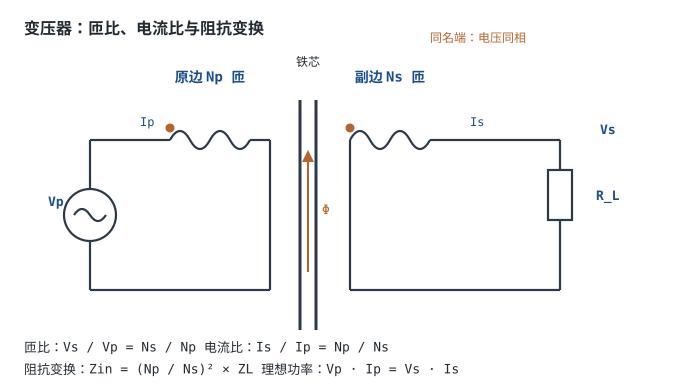

---

id: transformer
title: 变压器原理 Transformer
part: 1
chapter: 变压器、市电与安全
order: 55
tags: [变压器, 互感, 变压比, 隔离, 市电]
difficulty: 1
status: published
sources:
  - Lessons In Electric Circuits, Vol. II – AC（Kuphaldt）, Chapter 9 Transformers（互感、匝比、阻抗变换、同名端与变压器损耗）
  - 《电路》（邱关源，高等教育出版社）「含有耦合电感的电路」一章（耦合电感、理想变压器、变电压/变电流/变阻抗与同名端）
  - 《电机学》（汤蕴璆等，机械工业出版社）变压器一章（空载与负载运行、励磁电流与磁化电感、铁损铜损、效率与温升）
  - IEC 61558-1:2017《Safety of power transformers, power supplies, reactors and similar products – Part 1 — General requirements and tests》— 小型电源变压器的绝缘、温升与耐压试验口径
  - IEC 60076-1《Power transformers – Part 1 — General》— 损耗、温升与额定容量的术语口径（大功率变压器）
  - Steinmetz, C. P., "On the Law of Hysteresis", AIEE Transactions, Vol. 9, 1892 — 磁滞损耗经验式 $P\propto fB^{1.6}$ 的来源
  - TDK, Ferrite Cores 产品目录与 PC40 材料数据 — MnZn 铁氧体的饱和磁通密度与损耗曲线；具体数值以数据手册为准
---

# 变压器原理 Transformer

市电是 220V 交流，芯片要 3.3V 或 5V，中间那一步通常由变压器完成。变压器靠两个绕在同一磁芯上的线圈、通过磁场耦合，实现电压变换、电流变换、阻抗变换和电气隔离，而且不消耗有源器件。这一章从理想变压器讲到真实磁芯：励磁电流从哪来、铁损和铜损怎么算、磁通什么时候饱和、同名端接反会发生什么，最后用四个算例把匝数、线径、温升和饱和余量全部落地。

交流电的另一半故事在[直流与交流、频率、相位与有效值](dc-ac.md)：有效值、峰值与 $V/f$ 是本章所有磁通计算的输入；三相侧的故事在[市电与三相电基础](mains-three-phase.md)；隔离与触电的边界在[安全用电与触电防护](electrical-safety.md)。

## 1. 设计动机

::: motivation 三个"变压器选错"的现场
**现场一：按直流功率选变压器。** 一个 12V/1A 的直流负载，用 12V/1A（12VA）的变压器经桥式整流、4700µF 电容滤波。直流电流只有 1A，但次级实际有效值电流是 1.53A（§4.2 会完整算一遍），变压器长期工作在 153% 额定电流下，铜损超标 2.34 倍，半年后绕组发黑。正确做法是按 18.3VA 选，或者按 RMS 电流降额。

**现场二：把 120V/60Hz 的变压器接到 220V/50Hz。** 磁通密度正比于 $V/f$：$(220/50)/(120/60)=2.2$，磁通升到 2.2 倍，硅钢片深度饱和，空载电流从几十毫安冲到几安，几分钟就冒烟。变压器的铭牌上，频率和电压一样重要。

**现场三：反激变压器同名端接反。** 开关管导通时，副边整流二极管本该反偏储能；同名端一接反，二极管在导通期间直通，把变压器的储能直接短路到输出电容，开关管电流瞬间冲到限流点，轻则无输出，重则炸管。同名端不是"画图习惯"，是拓扑能否工作的前提。
:::

变压器在工程里反复出现，因为它是少数能同时完成四件事的无源器件：

- **升降压**：220V 到 12V、12V 到 300V，靠匝比；
- **变流**：降压的同时电流按反比放大，2A 的次级只要 128mA 的初级；
- **变阻抗**：$Z_1=n^2Z_2$，把 8Ω 扬声器反射成 2.7kΩ，让功放"看到"合适的负载；
- **电气隔离**：原副边没有导线直连，把电网地与设备地分开，是安全与抗干扰的基础。

**不懂会在哪摔跤**，具体是这四条：

1. 按直流功率选变压器，忽略整流电容滤波的 RMS 电流，变压器长期过载。
2. 只看电压不看频率，50Hz/60Hz 互换后磁通升 20%~120%，饱和烧毁。
3. 同名端接反，反激无输出、正激直通、并联绕组环流。
4. 以为"隔离变压器之后两手摸线都安全"，忽略了副边两根线之间仍有 220V 压差。

| 你想解决 | 先算 | 判据 |
|---|---|---|
| 选变压器容量 | 次级 RMS 电流，不是直流电流 | 变压器 VA ≥ 次级 $V_{rms}I_{rms}$ |
| 匝数与磁通 | $B=V/(4.44fNA_e)$ | 最坏电压下 $B\le0.7\sim0.8B_{sat}$ |
| 会不会饱和 | 方波用 $B=Vt_{on}/(NA_e)$ | 含直流偏置时留更大余量 |
| 效率与温升 | $P_{cu}+P_{core}$ | 总损耗×热阻 ≤ 绝缘等级允许温升 |
| 同名端 | 电压同相端打点 | 反激副边二极管接非同名端 |

## 2. 定义与直观：从理想变压器到真实磁芯

### 2.1 变压器是什么：两个线圈共享磁通

**变压器（Transformer）**是把两个或多个绕组绕在同一个磁芯上，通过交变磁通把能量从原边（Primary）传到副边（Secondary）的器件。原边接交流源，副边接负载，两边没有导线直连。

三个关键词：

- **磁通（Flux）$\Phi$**：穿过磁芯截面的磁力线总量，Wb；
- **磁通密度（Flux Density）$B$**：单位面积的磁通，$B=\Phi/A_e$，T；
- **磁芯（Core）**：把磁场"约束"在高磁导率路径里的材料，硅钢片用于 50Hz，铁氧体用于几十 kHz 以上。



::: analogy 变压器像一对齿轮
齿轮用齿数比换转速和扭矩：大齿轮带小齿轮，转速升高、扭矩变小，功率不变。变压器用匝数比换电压和电流：原边匝数多、副边匝数少，电压降低、电流变大，功率不变（理想情况）。

类比的边界：齿轮是机械接触，变压器是磁场耦合，两边电气隔离；齿轮可以连续变速，变压器只对交流有效，频率不变；齿轮有齿隙和摩擦，变压器有漏感和损耗。
:::

### 2.2 理想变压器的三组关系

理想变压器假设：无损耗、无漏感、磁芯磁导率无穷大、励磁电流为零。它有三组关系：

$$\frac{V_s}{V_p}=\frac{N_s}{N_p}=\frac{1}{n},\qquad \frac{I_s}{I_p}=\frac{N_p}{N_s}=n,\qquad Z_1=n^2Z_2$$

符号与单位：$V_p$、$V_s$ 是原、副边电压有效值，V；$I_p$、$I_s$ 是原、副边电流有效值，A；$N_p$、$N_s$ 是匝数，无量纲；$n=N_p/N_s$ 是原边对副边的匝比；$Z_1$ 是从原边看进去的等效阻抗，$Z_2$ 是副边负载阻抗，$\Omega$。

前两式来自法拉第电磁感应与磁动势平衡，第三式是前两式的推论（§3.2 给推导）。理想变压器功率守恒：

$$V_pI_p=V_sI_s$$

**同名端（Dot Convention）**：两个绕组上打点的端子，电压相位相同。原边打点端电压上升时，副边打点端电压也上升。同名端决定了绕组串联时是相加还是相减、并联时会不会环流、反激时二极管朝哪边接。打点不是元件参数，而是绕向的约定；实际变压器出厂时用引线颜色或标记点表示。

一个能口算的例子：原边 2200 匝、副边 120 匝，匝比 $n=2200/120=18.333$。原边接 220V，副边：

$$V_s=V_p\frac{N_s}{N_p}=220\times\frac{120}{2200}=12.0\ \text{V}$$

副边接 6Ω 负载，电流 $I_s=12/6=2$ A，输出功率 24W；理想情况下原边电流：

$$I_p=\frac{I_s}{n}=2\times\frac{120}{2200}=0.1091\ \text{A}=109.1\ \text{mA}$$

验算：$220\times0.1091=24.0$ W，与副边一致。实际变压器有励磁与损耗，原边电流会到 128mA 左右（§4.1）。

注意**额定容量用 VA 而不是 W**：变压器的发热由电压和电流的有效值决定，与负载的功率因数无关；一台 24VA 的变压器，带 24W 纯电阻负载可以，带功率因数 0.7 的负载只能出 16.8W 有功。这也是变压器铭牌写 "24VA" 而不是 "24W" 的原因。

### 2.3 真实变压器：励磁、损耗与漏感

理想变压器假设磁芯磁导率无穷大，励磁电流为零。真实磁芯的磁导率有限，建立磁通需要**励磁电流（Magnetizing Current）**，它滞后电压 $90^{\circ}$，不传递有功功率。磁芯还有**铁损（Core Loss）**，对应一个与电压同相的**铁损电流**。两者合成**空载电流**：

$$I_0=\sqrt{I_m^2+I_c^2}$$

其中 $I_m$ 是励磁电流，A；$I_c$ 是铁损电流，A；$I_0$ 是空载电流，A。空载时副边开路，原边并不是"没有电流"，而是流过 $I_0$；小变压器的 $I_0$ 通常是额定电流的 5%~20%（典型量级，随容量与材料变化）。

**漏感（Leakage Inductance）**：不是所有磁通都同时链过两个绕组，有一部分只链过一个绕组，等效为串联电感。漏感导致负载时电压跌落、开关关断时电压尖峰。小功率工频变压器的漏感通常是励磁电感的 1% 量级（0.5%~5%，随绕制方式变化）；高频变压器漏感更小，但仍是反激缓冲电路要处理的主要能量。

真实变压器的损耗分两部分：

- **铜损（Copper Loss）**：绕组电阻上的 $I^2R$，随负载电流平方增长；
- **铁损（Core Loss）**：磁滞损耗与涡流损耗，近似只与电压、频率、磁通密度有关，负载变化时基本不变。

| 项目 | 理想变压器 | 真实变压器 |
|---|---|---|
| 励磁电流 | 0 | $I_0=\sqrt{I_m^2+I_c^2}$，以励磁分量为主，接近 $90^{\circ}$ 滞后 |
| 磁芯 | $\mu_r\to\infty$ | 有限 $\mu_r$，有饱和点 |
| 损耗 | 0 | 铜损 $I^2R$ + 铁损（磁滞+涡流） |
| 漏感 | 0 | 1%~5% 的励磁电感量级 |
| 电压调整率 | 0 | 小变压器 5%~15% |
| 隔离 | 理想 | 受绝缘、爬电距离、耐压限制 |

### 2.4 磁通与饱和：$B$ 的三个工程式

法拉第定律是全部磁通计算的起点：

$$v(t)=N\frac{d\Phi}{dt}=NA_e\frac{dB}{dt}$$

其中 $v$ 是绕组电压，V；$N$ 是匝数；$\Phi$ 是磁通，Wb；$A_e$ 是磁芯有效截面积，$\text{m}^2$；$B$ 是磁通密度，T。把它在一个开关周期内积分，得到工程上最常用的**伏秒式**：

$$\Delta B=\frac{V\,t}{NA_e}$$

- 方波/开关波形：$V$ 是导通期间绕组上的电压，$t$ 是导通时间 $t_{on}$，$\Delta B$ 是磁通摆幅；
- 正弦 50Hz：把 $B(t)=B_{\max}\sin\omega t$ 代入，得到峰值磁通：

$$B_{\max}=\frac{V_{rms}}{4.44\,fNA_e}$$

系数 $4.44=2\pi/\sqrt2$ 来自正弦积分：$V_{rms}=\omega NA_eB_{\max}/\sqrt2=2\pi fNA_eB_{\max}/\sqrt2$。

**饱和（Saturation）**：磁通密度超过材料的 $B_{sat}$ 后，磁导率骤降，电感量塌陷，电流急剧上升。硅钢片的 $B_{sat}$ 约 1.7~2.0T，MnZn 铁氧体约 0.35~0.45T（100°C），铁粉芯约 0.7~1.0T（典型量级，以数据手册为准）。设计时不能贴着 $B_{sat}$ 用，要留余量，因为：

- 市电有 ±10% 容差，最坏情况电压更高；
- 合闸瞬间有剩磁与偏磁，磁通可能冲到稳态的 2 倍；
- 高温下铁氧体的 $B_{sat}$ 下降；
- 直流偏置（如推挽/反激的 CCM 工作）会把工作点整体抬高。

工程判据：**最坏工况下 $B_{\max}\le0.7\sim0.8B_{sat}$**；有直流偏置或合闸冲击时，余量还要更大。

一个判断饱和的算例：反激变压器 $N_p=60$ 匝、$A_e=125\ \text{mm}^2=1.25\times10^{-4}\ \text{m}^2$，输入 310V，导通 5µs：

$$\Delta B=\frac{310\times5\times10^{-6}}{60\times1.25\times10^{-4}}=\frac{1.55\times10^{-3}}{7.5\times10^{-3}}=0.2067\ \text{T}$$

若铁氧体在 100°C 的 $B_{sat}=0.39$ T，则占 $0.2067/0.39=53.0\%$，有 1.89 倍余量。若导通时间因启动或低压输入变成 10µs，$\Delta B=0.413$ T，超过 $B_{sat}$，磁芯饱和、电流失控。**同一个匝数，导通时间翻倍就会饱和**，所以反激必须有限流与软启动。

## 3. 定量关系：匝比、励磁、损耗与饱和

### 3.1 公式、符号与单位

| 关系 | 公式 | 符号与单位 | 适用条件 |
|---|---|---|---|
| 电压比 | $V_s/V_p=N_s/N_p=1/n$ | V、匝、无量纲 | 理想/忽略漏感与压降 |
| 电流比 | $I_s/I_p=N_p/N_s=n$ | A、匝 | 理想、无励磁电流 |
| 阻抗变换 | $Z_1=n^2Z_2$ | $\Omega$ | 理想变压器 |
| 功率守恒 | $V_pI_p=V_sI_s$ | W、VA | 理想 |
| 效率 | $\eta=\dfrac{P_{out}}{P_{out}+P_{cu}+P_{core}}$ | 无量纲 | 任意 |
| 磁化电感 | $L_m=\dfrac{\mu_0\mu_rN_p^2A_e}{l_e}$ | H；$A_e$ 为 $\text{m}^2$，$l_e$ 为 m | 线性磁芯、无气隙 |
| 励磁电流 | $I_m=\dfrac{V_p}{\omega L_m}$ | A；$\omega$ 为 rad/s | 正弦稳态 |
| 空载电流 | $I_0=\sqrt{I_m^2+I_c^2}$ | A | $I_c=P_{core}/V_p$ |
| 正弦磁通 | $B_{\max}=\dfrac{V_{rms}}{4.44fNA_e}$ | T；$f$ 为 Hz | 正弦、无直流偏置 |
| 方波磁通 | $\Delta B=\dfrac{Vt_{on}}{NA_e}$ | T；$t_{on}$ 为 s | 方波/开关波形 |
| 磁滞损耗 | $P_h\propto fB^{1.6}$ | W | Steinmetz 经验式 |
| 涡流损耗 | $P_e\propto f^2B^2t^2/\rho$ | W；$t$ 为片厚 | 叠片/铁氧体 |
| 铜损 | $P_{cu}=\sum I_k^2R_k$ | W | 各绕组 |
| 面积积 | $A_eA_w=\dfrac{S}{2.22fBJK_w}$ | $\text{m}^4$；$S$ 为 VA，$J$ 为 $\text{A/m}^2$ | 双绕组、正弦 |
| 集肤深度 | $\delta=\sqrt{\dfrac{\rho}{\pi f\mu_0}}$ | m | 铜，20°C |
| 温升 | $\Delta T=P_{loss}R_{\theta}$ | K；$R_{\theta}$ 为 K/W | 自然对流/强制风冷 |
| 电压调整率 | $\Delta V\approx I(R\cos\varphi+X\sin\varphi)$ | V | 感性负载、近似 |

### 3.2 阻抗变换 $Z_1=n^2Z_2$ 的推导

原边电压、副边电压满足 $V_p=nV_s$（$n=N_p/N_s$），电流满足 $I_p=I_s/n$。副边负载 $Z_2=V_s/I_s$，从原边看进去：

$$Z_1=\frac{V_p}{I_p}=\frac{nV_s}{I_s/n}=n^2\frac{V_s}{I_s}=n^2Z_2$$

推导只用了两个定义，没有近似。**匝比平方是阻抗变换的系数**：降压变压器（$n>1$）把副边阻抗放大 $n^2$ 倍，升压变压器把副边阻抗缩小 $n^2$ 倍。

例：220V/12V 变压器，$n=N_p/N_s=2200/120=18.333$。副边接 8Ω 扬声器，从原边看：

$$Z_1=18.333^2\times8=336.1\times8=2689\ \Omega$$

验算：原边 220V 下电流 $220/2689=81.8$ mA，功率 $220\times0.0818=18.0$ W；副边 12V 下电流 $12/8=1.5$ A，功率 $12\times1.5=18.0$ W，一致。**阻抗变换不产生功率，只是把"低阻大电流"换成"高阻小电流"**，这正是电子管功放、射频匹配网络用变压器的原因。

### 3.3 励磁电流、磁化电感与空载电流

磁化电感由磁芯几何与磁导率决定：

$$L_m=\frac{\mu_0\mu_rN_p^2A_e}{l_e}$$

其中 $\mu_0=4\pi\times10^{-7}$ H/m；$\mu_r$ 是相对磁导率，无量纲；$N_p$ 是原边匝数；$A_e$ 是有效截面积，$\text{m}^2$；$l_e$ 是有效磁路长度，m。励磁电流：

$$I_m=\frac{V_p}{\omega L_m}=\frac{V_p}{2\pi fL_m}$$

它滞后电压 $90^{\circ}$，只建立磁场、不传递有功功率。铁损电流 $I_c=P_{core}/V_p$ 与电压同相，代表磁滞与涡流的发热。空载电流是两者的矢量和。

用 §4.3 的设计参数算一遍：$N_p=1650$、$A_e=5.0\times10^{-4}\ \text{m}^2$、$l_e=0.2$ m、取 $\mu_r\approx5000$（工作点附近的有效值，典型量级，以 B-H 曲线为准）：

$$L_m=\frac{4\pi\times10^{-7}\times5000\times1650^2\times5.0\times10^{-4}}{0.2}=42.8\ \text{H}$$

$$I_m=\frac{220}{2\pi\times50\times42.8}=16.4\ \text{mA}$$

铁损 0.918W 对应 $I_c=0.918/220=4.17$ mA，所以空载电流：

$$I_0=\sqrt{16.4^2+4.17^2}=16.9\ \text{mA}$$

占额定原边电流 128.4mA 的 13.2%，落在小变压器 5%~20% 的典型区间内。

两个工程推论：

1. **磁化电感不能太小**。$L_m$ 小则 $I_m$ 大，空载损耗与温升都上去；但 $L_m$ 也不能无限大，否则磁芯体积、匝数、漏感都跟着涨。工频变压器通常把 $I_m$ 控制在额定电流的 5%~15%。
2. **低频会饱和**。$I_m=V/(\omega L_m)$，频率越低励磁电流越大；同时 $B_{\max}=V/(4.44fNA_e)$ 也随频率下降而上升。所以变压器有一个最低工作频率，低于它就会饱和——这就是 50Hz/60Hz 不能随意互换、变频器要"恒压频比"的原因。

### 3.4 铁损、铜损与效率

**铁损**由两部分组成：

- **磁滞损耗**：磁畴反复翻转消耗的能量，Steinmetz 经验式 $P_h\propto fB^{1.6}$，指数在 1.6~2.0 之间；
- **涡流损耗**：交变磁场在铁芯内感应环流，$P_e\propto f^2B^2t^2/\rho$，$t$ 是叠片厚度，$\rho$ 是电阻率。

所以 50Hz 用 0.35~0.5mm 的硅钢片叠压，片间绝缘；高频用电阻率高的铁氧体，把涡流压到可以接受。铁损近似与负载无关，只随电压、频率、磁通密度变。

**铜损**是各绕组 $I^2R$ 之和，随负载电流平方增长：

$$P_{cu}=\sum_k I_k^2R_k$$

效率：

$$\eta=\frac{P_{out}}{P_{out}+P_{cu}+P_{core}}$$

把 $P_{cu}$ 写成 $kP_{out}^2$、$P_{core}$ 视为常数，对负载求极值，可得**最大效率发生在铜损等于铁损时**：

$$P_{cu}=P_{core}$$

§4.3 的设计中，满载铜损 2.503W、铁损 0.918W，最大效率点在：

$$P_{out}=24\times\sqrt{\frac{0.918}{2.503}}=24\times0.606=14.5\ \text{VA}$$

即 60.6% 负载。这也是为什么变压器铭牌上的最高效率通常标在 50%~75% 负载，而不是满载——**长期运行的平均负载落在最高效率点附近，比"满载效率最高"更省电**。

### 3.5 磁通密度、饱和与面积积

把 §2.4 的三个式子合成设计流程：

1. **由功率与频率选磁芯面积积**：

$$A_eA_w=\frac{S}{2.22fBJK_w}$$

其中 $S$ 是视在功率，VA；$f$ 是频率，Hz；$B$ 是工作磁通密度，T；$J$ 是电流密度，$\text{A/m}^2$；$K_w$ 是窗口填充系数（铜占窗口面积的比例，典型 0.25~0.4）；$A_e$、$A_w$ 分别是磁芯截面积与窗口面积，$\text{m}^2$。

这个式子的推导只用两条：$V=4.44fNA_eB$ 与窗口里铜的总面积 $N_pA_{wp}+N_sA_{ws}=K_wA_w$，且两个绕组各承担一半铜面积、同一电流密度。

2. **由磁通定匝数**：

$$N_p=\frac{V_{p,rms}}{4.44fBA_e}$$

3. **由匝比定副边**：

$$N_s=N_p\frac{V_s}{V_p}$$

4. **校核最坏工况**：把最高输入电压代回 $B_{\max}$，要求不超过 $0.7\sim0.8B_{sat}$。

**气隙（Air Gap）**：在磁芯里垫一层非磁性材料，等效增大磁阻、降低 $L_m$、提高饱和电流。反激变压器故意留气隙，因为它的"变压器"其实在储能——能量储在气隙的磁场里，没有气隙时很小的直流偏置就会饱和。工频变压器不需要气隙，追求最大励磁电感。

**偏磁与磁通步行（Flux Walking）**：推挽、半桥、全桥如果正负伏秒不平衡，磁通会逐周期向一边累积，几周期后饱和。解决方法是串联隔直电容、电流模式控制、或者加磁通复位绕组。反激在 CCM 下有直流偏置，$B_{max}=B_{dc}+\Delta B/2$，必须把直流项算进去。

### 3.6 适用条件与失效边界

- **理想模型**：忽略励磁、漏感、损耗、压降。只适合估算匝比与电流，不能用来算温升与电压调整率。
- **线性磁芯**：$B$ 接近 $B_{sat}$ 时 $\mu_r$ 骤降，$L_m$ 不再是常数，所有基于固定电感的公式失效。
- **频率范围**：工频硅钢片不能直接用于 20kHz（涡流损耗爆炸）；铁氧体也不能用于 50Hz（$B_{sat}$ 低、匝数多到绕不下）。
- **正弦假设**：$4.44$ 系数只对正弦成立；方波、PWM 要用伏秒式 $\Delta B=Vt/(NA_e)$。
- **隔离并非万无一失**：原副边之间有寄生电容，高频共模电流会耦合；隔离变压器也不能消除副边两根线之间的电压差。
- **温升与绝缘**：损耗算对了不代表能长期运行，还要按 IEC 61558-1 的温升限值与绝缘等级校核；具体限值以标准表格与认证要求为准。

## 4. 典型计算

### 4.1 算例一：220V→12V 的匝比、电流与反射阻抗

**需求**：220V/50Hz 输入，12V/2A 输出，效率按 0.85 估算。求匝比、匝数、原副边电流、反射阻抗与线径。

**第一步，匝比**：

$$n=\frac{N_p}{N_s}=\frac{V_p}{V_s}=\frac{220}{12}=18.333$$

**第二步，选匝数**。取原边 2200 匝（每伏 10 匝，便于记忆与绕制）：

$$N_s=\frac{N_p}{n}=\frac{2200}{18.333}=120.0\ \text{匝}$$

验算：$220\times120/2200=12.0$ V，一致。实际空载电压会高 5%~10%（电压调整率），带载后回到 12V 附近。

**第三步，电流**。副边 2A，输出功率：

$$P_{out}=12\times2=24\ \text{W}$$

效率 0.85 时输入功率：

$$P_{in}=\frac{24}{0.85}=28.24\ \text{W},\qquad I_p=\frac{28.24}{220}=128.4\ \text{mA}$$

理想情况（无损耗）的原边电流是 $24/220=109.1$ mA，实际多出的 19.3mA 用于励磁与损耗。

**第四步，反射阻抗**。副边负载 $R_L=12/2=6\ \Omega$：

$$Z_1=n^2R_L=18.333^2\times6=336.1\times6=2017\ \Omega$$

验算：原边 220V 下理想电流 $220/2017=109.1$ mA，与第三步的理想值一致；实际 128.4mA 中包含励磁与损耗分量。

**第五步，线径**。取电流密度 $J=3\ \text{A/mm}^2$（小功率自然对流变压器的典型值 2.5~3.5，以温升试验为准）：

$$A_{wp}=\frac{0.1284}{3}=0.0428\ \text{mm}^2\ \Longrightarrow\ d_p=\sqrt{\frac{4\times0.0428}{\pi}}=0.233\ \text{mm}$$

取标称 0.25mm（截面积 0.0491mm²，$J=2.61\ \text{A/mm}^2$）。

$$A_{ws}=\frac{2.0}{3}=0.667\ \text{mm}^2\ \Longrightarrow\ d_s=\sqrt{\frac{4\times0.667}{\pi}}=0.921\ \text{mm}$$

取 0.9mm（截面积 0.636mm²，$J=3.14\ \text{A/mm}^2$）；若绕制困难，可用两股 0.63mm 并绕。

**第六步，结论**。$N_p:N_s=2200:120$，原边 0.25mm、副边 0.9mm，副边 2A 时原边 128mA，反射阻抗 2017Ω。这四个数就是后面 §4.3 完整设计的输入。

### 4.2 算例二：桥式整流后接电容时的有效值电流与温升口径

**需求**：12V/1A 直流输出，变压器次级 12V 有效值，桥式整流（每只二极管压降按 0.8V），滤波电容 4700µF，50Hz。求次级有效值电流、二极管电流、电容纹波电流，并判断变压器容量与温升。

**第一步，次级峰值与整流后峰值**：

$$V_{p,sec}=\sqrt2\times12=16.97\ \text{V}$$

桥式整流每个半周有两只二极管导通：

$$V_{pk}=16.97-2\times0.8=15.37\ \text{V}$$

**第二步，纹波**。全波整流每 10ms 充一次电，放电期间近似恒流 1A：

$$\Delta V=\frac{I}{2fC}=\frac{1}{2\times50\times4700\times10^{-6}}=\frac{1}{0.47}=2.128\ \text{V}$$

$$V_{\min}=15.37-2.128=13.24\ \text{V}$$

**第三步，导通角**。二极管在次级电压高于电容电压时导通。设导通半角为 $\theta_c$：

$$\theta_c=\arccos\frac{V_{\min}}{V_{p,sec}}=\arccos\frac{13.24}{16.97}=\arccos0.780=38.71^{\circ}$$

一个半周 $180^{\circ}$ 里导通 $2\theta_c=77.4^{\circ}$，占空比 $77.4/180=43.0\%$。

**第四步，次级电流波形**。把导通期间的电流近似为余弦段 $i(\theta)=I_p\cos\theta$，$\lvert\theta\rvert\le\theta_c$。由平均电流等于 1A：

$$I_{avg}=\frac{1}{\pi}\int_{-\theta_c}^{\theta_c}I_p\cos\theta\,d\theta=\frac{2I_p\sin\theta_c}{\pi}=1\ \text{A}$$

$$I_p=\frac{\pi}{2\sin38.71^{\circ}}=\frac{3.1416}{2\times0.6252}=2.512\ \text{A}$$

次级有效值：

$$I_{sec,rms}=I_p\sqrt{\frac{\theta_c+\sin\theta_c\cos\theta_c}{\pi}}=2.512\times\sqrt{\frac{0.6756+0.6252\times0.7805}{\pi}}$$

$$I_{sec,rms}=2.512\times\sqrt{0.3704}=2.512\times0.6086=1.529\ \text{A}$$

**第五步，各支路电流**。每只二极管只在半个周期导通：

$$I_{D,avg}=\frac{1}{2}=0.500\ \text{A},\qquad I_{D,rms}=\frac{1.529}{\sqrt2}=1.081\ \text{A}$$

电容纹波电流由 KCL 得到：

$$I_{C,rms}=\sqrt{I_{sec,rms}^2-I_{dc}^2}=\sqrt{1.529^2-1^2}=\sqrt{2.338-1}=1.156\ \text{A}$$

| 电流 | 数值 | 说明 |
|---|---|---|
| 直流输出 | 1.000 A | 负载电流 |
| 次级有效值 | 1.529 A | 变压器绕组发热按这个值 |
| 每只二极管平均 | 0.500 A | 正向损耗按这个值 |
| 每只二极管有效值 | 1.081 A | 发热按这个值 |
| 电容纹波有效值 | 1.156 A | 电容纹波电流额定值按这个值 |

**第六步，变压器容量**。次级视在功率：

$$S_{sec}=12\times1.529=18.34\ \text{VA}$$

直流输出只有 12W，但变压器要按 18.34VA 选，是直流功率的 1.53 倍。用 12VA 的变压器，绕组长期过载 53%，铜损是额定值的 $1.53^2=2.34$ 倍。**这就是"按直流功率选变压器"出错的定量原因**。

**第七步，二极管温升**。按 $V_f=0.8$ V、每只平均 0.5A：

$$P_D=0.8\times0.5=0.40\ \text{W}$$

DO-41 封装的自然对流热阻约 $80^{\circ}\text{C/W}$（典型量级，以数据手册为准），温升：

$$\Delta T=0.40\times80=32^{\circ}\text{C}$$

环境 40°C 时结温约 72°C，低于 150°C 上限，可用；若环境 70°C，结温 102°C，仍可用但余量变小。

**第八步，电容纹波与寿命口径**。电容 ESR 取 0.05Ω（4700µF/25V 电解的典型量级，以数据手册为准）：

$$P_C=I_{C,rms}^2R_{ESR}=1.156^2\times0.05=0.0668\ \text{W}$$

4700µF/25V、105°C 电解电容的额定纹波电流典型为 1.2~1.8A（以数据手册为准），本例 1.156A 约为额定值的 64%~96%，需要按具体型号核对。寿命按"芯温每降 10°C 翻倍"的工程口径估算：若额定 2000h/105°C，实际芯温 65°C：

$$L=2000\times2^{(105-65)/10}=2000\times2^4=32000\ \text{h}$$

**温升口径的关键**：电容的纹波电流额定值本身已经包含了允许的芯温，所以工程判据是"**实际纹波电流 ≤ 额定值 × 温度/频率修正系数**"，而不是"平均电流"。实际有效值比平均值高 15.6%，用平均电流 1A 去查表，看起来更安全，实际更热。

**结论**：12V/1A 直流负载要选 18.3VA 以上的变压器；二极管按平均 0.5A、有效值 1.08A 选；电容按 1.16A 纹波电流选，并核对 105°C 额定值与频率修正。整流滤波的"直流功率"与变压器的"VA"之间差 1.5 倍，这个系数来自导通角，不是拍脑袋的余量。

### 4.3 算例三：完整设计——24VA 工频变压器的磁芯、匝数与饱和余量

**需求**：

| 项目 | 要求 |
|---|---|
| 输入 | 220V ±10%，50Hz |
| 输出 | 12V/2A（24VA） |
| 效率 | ≥85% |
| 环境 | 40°C，B 级绝缘（热点 130°C） |
| 磁芯 | EI 型硅钢片，$B_{sat}\ge1.7$ T |
| 最坏磁通 | ≤0.8 $B_{sat}$ |

**第 1 步，功率与电流**。输出 24W，按效率 0.85：

$$P_{in}=28.24\ \text{W},\qquad I_p=\frac{28.24}{220}=128.4\ \text{mA},\qquad I_s=2.0\ \text{A}$$

**第 2 步，面积积**。取 $B=1.2$ T、$J=3\times10^6\ \text{A/m}^2$、$K_w=0.3$：

$$A_eA_w=\frac{24}{2.22\times50\times1.2\times3\times10^6\times0.3}=\frac{24}{1.1988\times10^8}=2.002\times10^{-7}\ \text{m}^4=20.02\ \text{cm}^4$$

（用输出视在功率 24VA 估算；实际初级还要多约 18% 的损耗，所以下面选磁芯时留 20% 余量。）

**第 3 步，选磁芯几何**。取中柱 20mm×25mm、窗宽 12mm、窗高 40mm 的 EI 片（示例几何，实际型号以供应商图纸为准）：

$$A_e=20\times25=500\ \text{mm}^2=5.0\times10^{-4}\ \text{m}^2$$

$$A_w=12\times40=480\ \text{mm}^2=4.8\times10^{-4}\ \text{m}^2$$

$$A_eA_w=5.0\times10^{-4}\times4.8\times10^{-4}=2.4\times10^{-7}\ \text{m}^4=24.0\ \text{cm}^4$$

比需求 20.02cm⁴ 多 19.9%，覆盖效率带来的额外负担。

**第 4 步，原边匝数**：

$$N_p=\frac{220}{4.44\times50\times1.2\times5.0\times10^{-4}}=\frac{220}{0.1332}=1651.7\ \text{匝}$$

取 1650 匝。反算磁通：

$$B_{\max}=\frac{220}{4.44\times50\times1650\times5.0\times10^{-4}}=1.201\ \text{T}$$

**第 5 步，副边匝数**：

$$N_s=1650\times\frac{12}{220}=90.0\ \text{匝}$$

**第 6 步，最坏磁通与饱和余量**。市电 +10% 到 242V：

$$B_{\max,+10\%}=1.201\times1.1=1.321\ \text{T}$$

与 $B_{sat}=1.7$ T 比：$1.321/1.7=77.7\%$，余量 $1.7/1.321=1.29$ 倍。满足"最坏 ≤0.8 $B_{sat}$"的要求，但余量不算大；若硅钢片 $B_{sat}$ 只有 1.6T，则 82.6%，偏紧，应增加匝数或加大 $A_e$。

**第 7 步，励磁与空载电流**。取 $\mu_r=5000$、$l_e=0.2$ m：

$$L_m=\frac{4\pi\times10^{-7}\times5000\times1650^2\times5.0\times10^{-4}}{0.2}=42.8\ \text{H}$$

$$I_m=\frac{220}{2\pi\times50\times42.8}=16.4\ \text{mA}$$

铁损按第 9 步的 0.918W，$I_c=0.918/220=4.17$ mA：

$$I_0=\sqrt{16.4^2+4.17^2}=16.9\ \text{mA}$$

占额定 128.4mA 的 13.2%，正常。

**第 8 步，线径与窗口填充**。按 $J=3\ \text{A/mm}^2$：

- 原边：$0.1284/3=0.0428\ \text{mm}^2$，取 0.25mm（0.0491mm²，$J=2.61$）；
- 副边：$2.0/3=0.667\ \text{mm}^2$，取 0.9mm（0.636mm²，$J=3.14$）。

窗口占用：

$$A_{cu}=1650\times0.0491+90\times0.636=81.0+57.3=138.3\ \text{mm}^2$$

填充系数 $138.3/480=28.8\%$，与假设的 $K_w=0.3$ 一致；加上漆包线漆膜、层间绝缘与骨架，实际约 40%，仍能绕下。

**第 9 步，损耗与效率**。取平均匝长 0.13m（示例绕制尺寸），铜电阻率 $1.72\times10^{-8}\ \Omega\cdot\text{m}$：

$$R_p=\frac{1.72\times10^{-8}\times1650\times0.13}{4.91\times10^{-8}}=75.2\ \Omega$$

$$R_s=\frac{1.72\times10^{-8}\times90\times0.13}{6.36\times10^{-7}}=0.316\ \Omega$$

$$P_{cu}=(28.24/220)^2\times75.2+2.0^2\times0.3163=1.238+1.265=2.503\ \text{W}$$

铁芯质量：体积 $5.0\times10^{-4}\times0.2=1.0\times10^{-4}\ \text{m}^3=100\ \text{cm}^3$，密度 7.65g/cm³：

$$m=100\times7.65=765\ \text{g}=0.765\ \text{kg}$$

取 1.2W/kg（1.2T/50Hz，常见硅钢片牌号的量级，以损耗曲线为准）：

$$P_{core}=0.765\times1.2=0.918\ \text{W}$$

$$\eta=\frac{24}{24+2.503+0.918}=\frac{24}{27.421}=87.52\%$$

满足 ≥85% 的要求。

**第 10 步，温升**。总损耗：

$$P_{loss}=2.503+0.918=3.421\ \text{W}$$

24VA 级 EI 变压器自然对流的热阻约 8~12°C/W（典型量级，以温升试验为准），取 10°C/W：

$$\Delta T=3.421\times10=34.2^{\circ}\text{C}$$

环境 40°C 时绕组平均温度 74.2°C，热点再高 10~15°C，约 84~89°C，低于 B 级 130°C 的热点限值。若装在密闭壳内，环境温度可能到 55°C，平均温度 89°C、热点 100~104°C，仍可用但余量变小；此时应降额或改用 F 级绝缘。

**第 11 步，合闸涌流与保险丝**。最坏合闸角（电压过零）时，磁通可达稳态峰值的 2 倍再加上剩磁，铁芯深度饱和，涌流可达额定电流的 10~20 倍，持续几个周期。128.4mA 的 15 倍约 1.9A，慢熔保险丝取 2~3A 或串 NTC 限流；快熔保险丝会误断。具体倍数与合闸角、剩磁、绕组电阻有关，以实测为准。

**设计汇总**：

| 项目 | 数值 | 验算 |
|---|---|---|
| 磁芯 | $A_e=5.0\ \text{cm}^2$，$A_w=4.8\ \text{cm}^2$ | $A_eA_w=24.0\ \text{cm}^4\ge20.02$ |
| 原边 | 1650 匝，0.25mm | $B=1.201$ T @220V |
| 副边 | 90 匝，0.9mm | $12.0$ V |
| 最坏磁通 | 1.321 T @242V | 占 1.7 T 的 $77.7\%$ |
| 空载电流 | 16.9 mA | 13.2% 额定 |
| 铜损 | 2.503 W | $I^2R$ 逐项 |
| 铁损 | 0.918 W | 0.765kg×1.2W/kg |
| 效率 | 87.52% | ≥85% |
| 温升 | 34.2 K | 3.421W×10K/W |
| 填充 | 28.8% | ≤30% 假设 |

### 4.4 算例四：反激变压器的饱和验算

**需求**：反激变压器 $N_p=60$ 匝、$A_e=125\ \text{mm}^2$，输入 310V（220V 整流后），最大导通 5µs，铁氧体在 100°C 的 $B_{sat}=0.39$ T。判断是否饱和；若导通时间因启动爬到 10µs 呢？

**第一步，伏秒式**：

$$\Delta B=\frac{V_{in}t_{on}}{N_pA_e}=\frac{310\times5\times10^{-6}}{60\times125\times10^{-6}}$$

分母 $60\times125\times10^{-6}=7.5\times10^{-3}$，分子 $1.55\times10^{-3}$：

$$\Delta B=0.2067\ \text{T}$$

**第二步，饱和余量**：

$$\frac{\Delta B}{B_{sat}}=\frac{0.2067}{0.39}=53.0\%$$

余量 1.89 倍，安全。若工作在 CCM，还要加上直流偏置 $B_{dc}$，要求 $B_{dc}+\Delta B/2\le0.8B_{sat}$。

**第三步，导通时间翻倍**：

$$\Delta B'=\frac{310\times10\times10^{-6}}{7.5\times10^{-3}}=0.4133\ \text{T}$$

$0.4133>0.39$，饱和。饱和后电感量骤降，原边电流从"斜坡"变成"尖峰"，开关管与采样电阻立刻过流。**反激必须有限流点、软启动与最短关断时间**，不能在启动或低压输入时让 $t_{on}$ 无限增大。

**第四步，气隙的作用**。反激的能量储在气隙磁场里，气隙越大，同样电流下的 $B$ 越低、饱和电流越大，但 $L_m$ 越小、同样的功率需要更大的电流或更高的频率。设计时按"最大电流不饱和"反推气隙，再用匝数把 $L_m$ 调回所需值。

## 5. 工程含义

### 5.1 工程数量级表

**容量—效率—空载电流对照**（典型量级，具体以产品数据手册为准）：

| 容量 | 典型效率 | 空载电流/额定 | 典型用途 |
|---|---|---|---|
| 10 VA | 75%~85% | 15%~25% | 小信号、继电器、仪表 |
| 25 VA | 82%~88% | 10%~18% | 12V/2A 适配器、工控 |
| 50 VA | 85%~90% | 8%~15% | 音频、工业控制 |
| 100 VA | 88%~92% | 6%~12% | 设备电源、音响 |
| 250 VA | 90%~94% | 4%~8% | 大功率设备 |
| 1 kVA | 93%~96% | 2%~5% | 隔离变压器、UPS |

**面积积与容量对照**（50Hz、$B=1.2$ T、$J=3\ \text{A/mm}^2$、$K_w=0.3$，按 §3.5 公式复算）：

| 容量 $S$ | 需求 $A_eA_w$ | 60Hz 时 | $B=1.5$T、$J=4$ 时 |
|---|---|---|---|
| 10 VA | 8.34 cm⁴ | 6.95 cm⁴ | 5.00 cm⁴ |
| 25 VA | 20.9 cm⁴ | 17.4 cm⁴ | 12.5 cm⁴ |
| 50 VA | 41.7 cm⁴ | 34.8 cm⁴ | 25.0 cm⁴ |
| 100 VA | 83.4 cm⁴ | 69.5 cm⁴ | 50.1 cm⁴ |
| 250 VA | 209 cm⁴ | 174 cm⁴ | 125 cm⁴ |

**饱和磁通密度对照**（典型量级，以数据手册为准）：

| 材料 | $B_{sat}$（25°C） | $B_{sat}$（100°C） | 常用设计上限 | 典型频率 |
|---|---|---|---|---|
| 取向硅钢片 | 1.7~2.0 T | 接近室温值 | 1.2~1.5 T | 50/60Hz |
| MnZn 铁氧体 | 0.45~0.55 T | 0.35~0.45 T | 0.2~0.3 T | 20kHz~500kHz |
| 铁粉芯 | 0.7~1.0 T | 略降 | 0.4~0.6 T | 10kHz~1MHz |
| 非晶合金 | 1.5~1.6 T | 略降 | 1.0~1.2 T | 50Hz~20kHz |

**铜的集肤深度**（20°C，$\delta=66.1/\sqrt{f}$ mm）：

| 频率 | 50 Hz | 1 kHz | 10 kHz | 65 kHz | 100 kHz | 1 MHz |
|---|---|---|---|---|---|---|
| 集肤深度 | 9.35 mm | 2.09 mm | 0.661 mm | 0.259 mm | 0.209 mm | 0.066 mm |

50Hz 时 9.35mm 远大于常用线径，实心线即可；65kHz 时 0.259mm，超过 0.5mm 的线径就明显吃亏，要用多股并绕或利兹线。

### 5.2 选型：功率、电压、频率、温升、绝缘

选变压器按下面五步，任何一步漏掉都可能返工：

1. **算视在功率**：副边 $V_{rms}I_{rms}$；整流电容滤波时按 §4.2 的 1.5 倍系数估，或直接算导通角。
2. **核对频率与电压**：铭牌上的 50/60Hz 与 220/230V 要同时满足；50Hz 设备接 60Hz 通常更安全（$B$ 降低，但铁损随频率上升，温升仍要核对），60Hz 设备接 50Hz 可能饱和。
3. **算温升**：总损耗 × 热阻，叠加环境温度；密闭壳内按 55~70°C 环境估。
4. **核对绝缘**：原副边之间、绕组对铁芯之间的绝缘与爬电距离按 IEC 61558-1；加强绝缘的耐压试验电压典型 3kVAC 量级，具体以标准条款与认证机构要求为准。
5. **留降额**：长期满载按 80% 额定，高温、高海拔、密闭壳再降额。

**为什么不按 W 选**：变压器的发热由电流有效值决定，而负载的功率因数、整流波形都会让"W"与"VA"脱节。24VA 的变压器带 24W 纯电阻可以，带功率因数 0.7 的负载只能出 16.8W 有功；反过来说，一个 12W 的直流负载经电容滤波整流，变压器要 18.3VA。**VA 是发热口径，W 是有功口径**，两者不能混。

### 5.3 同名端、极性与组别

同名端的四条规则，覆盖大多数现场问题：

1. **串联相加**：一个绕组的非同名端接另一个绕组的同名端，电压相加。两个 12V 绕组串联得 24V。
2. **串联相减**：同名端接同名端，电压相减。两个 12V 绕组串联得 0V；如果接错，输出电压不对甚至为零。
3. **并联**：同名端接同名端、非同名端接非同名端，且两个绕组电压必须一致；否则环流只受漏感限制，迅速过热。
4. **整流**：桥式整流对极性不敏感；中心抽头全波整流、反激/正激的副边二极管对极性敏感。

**反激与正激的区别**：

- **反激（Flyback）**：开关导通时副边二极管反偏，能量储在磁芯气隙；开关关断时二极管导通，把能量送到输出。副边同名端接二极管阴极，非同名端接阳极。
- **正激（Forward）**：开关导通时副边二极管导通，能量直接传到输出；同名端与二极管方向要保证"导通时传能"。

**测试方法**：把两个绕组串联，加低压交流（如 12V），测总电压。若接近两绕组电压之和，说明串联相加、同名端如标记；若接近差值，说明反了。测试时电压要低，避免空载励磁过高。

三相变压器的极性用"组别"表示，如 Dyn11、Yyn0；组别决定原副边线电压的相位差，并联运行必须组别相同。详见[市电与三相电基础](mains-three-phase.md)。

### 5.4 效率、温升与寿命

变压器不是"效率越高越好"这么简单，要结合负载曲线看：

- 铁损固定，铜损随负载平方增长；最高效率点在 $P_{cu}=P_{core}$，本例是 60.6% 负载。
- 长期运行在 40%~70% 负载，效率高、温升低、寿命长；长期满载，铜损是半载的 4 倍，温升显著上升。
- 温升每降 10°C，绝缘寿命约翻倍（Arrhenius 经验）；这就是"降额使用"的定量依据。

同一台 24VA 变压器在不同负载下的效率（按 §4.3 的 $P_{cu}=2.503$W、$P_{core}=0.918$W 计算）：

```echarts
{
  "animation": false,
  "tooltip": {"trigger": "axis"},
  "legend": {"data": ["效率 η"], "bottom": 0, "textStyle": {"fontSize": 12}},
  "grid": {"left": 66, "right": 26, "top": 34, "bottom": 58},
  "xAxis": {"type": "value", "name": "负载 / 额定", "nameLocation": "middle", "nameGap": 30,
            "min": 0, "max": 1.2, "interval": 0.1, "axisLabel": {"fontSize": 11}},
  "yAxis": {"type": "value", "name": "效率 η / %", "nameLocation": "middle", "nameGap": 44,
            "min": 50, "max": 90, "interval": 10, "axisLabel": {"fontSize": 11}},
  "series": [
    {"name": "效率 η", "type": "line", "showSymbol": false, "smooth": true,
     "lineStyle": {"width": 2.6, "color": "#1a4f8b"},
     "data": [[0.05,56.49],[0.1,71.79],[0.15,78.7],[0.2,82.5],[0.25,84.81],[0.3,86.3],[0.35,87.28],[0.4,87.92],[0.45,88.34],[0.5,88.6],[0.55,88.74],[0.6,88.78],[0.65,88.76],[0.7,88.68],[0.75,88.56],[0.8,88.4],[0.85,88.21],[0.9,88.0],[0.95,87.77],[1.0,87.52],[1.05,87.26],[1.1,86.99],[1.15,86.71],[1.2,86.43]]}
  ]
}
```

曲线在 0.6 附近最高（88.78%），满载 87.52%，1.2 倍过载降到 86.43%。**过载时效率下降不多，但铜损按平方增长、温升快速上升**，所以"效率看起来还行"不能作为过载的依据；要看温升与绝缘寿命。

## 6. 常见坑

::: pitfall 常见坑
- **按直流功率选变压器**：现象——12V/1A 直流负载配 12VA 变压器，运行半年绕组发黑、空载发热。原因——电容滤波整流的次级有效值电流是直流电流的 1.53 倍，铜损是额定的 2.34 倍。解决——按 §4.2 算导通角与 RMS 电流，变压器容量取 $V_{rms}I_{rms}$，并留 20% 余量。
- **50Hz/60Hz 设备直接互换**：现象——60Hz 变压器接 50Hz 市电后嗡嗡响、空载电流暴涨、几分钟过热。原因——$B\propto V/f$，频率从 60Hz 降到 50Hz 而电压不变时磁通升 20%；若电压同时从 120V 升到 220V，磁通升 2.2 倍。解决——核对铭牌 $V/f$；50Hz 设备接 60Hz 通常安全，反向必须降额或换变压器。
- **同名端接反**：现象——两个绕组串联输出电压为零或偏低；反激无输出、开关管过流；并联绕组环流发热。原因——打点端电压同相，串联/并联/整流的方向由同名端决定。解决——按 §5.3 的串联测试确认极性；反激副边二极管接非同名端，正激接同名端。
- **以为隔离变压器之后两手摸线都安全**：现象——用了 1:1 隔离变压器，单手摸一根线没事，两手同时摸两根线触电。原因——隔离只切断了副边对地的回路，副边两根线之间仍有 220V 压差。解决——隔离变压器用于检修与抗干扰，不代替绝缘、接地与漏电保护；带电作业必须按安全规程。
- **用平均电流选整流管与电容**：现象——1A 直流负载用 1A 二极管，运行发热；电容按 1A 选，纹波电流超标、鼓包。原因——二极管有效值 1.08A、电容纹波 1.16A，发热按有效值算。解决——二极管按 $I_{F(AV)}$ 与 $I_{FSM}$ 双口径选，电容按纹波电流额定值与温度/频率修正选。
- **忽略偏磁与合闸涌流**：现象——推挽/半桥变压器工作几分钟后饱和、炸管；工频变压器合闸时保险丝误断。原因——正负伏秒不平衡导致磁通步行；合闸角最坏时磁通可达稳态 2 倍加剩磁。解决——加隔直电容/电流模式控制/磁通复位；合闸用慢熔保险丝或 NTC 限流，按最坏工况校核 $B$。
- **把空载电流当成零**：现象——设计时按"空载不耗电"估算，实际空载电流 15% 额定，待机功耗与温升都超。原因——励磁电流与铁损电流存在，$I_0=\sqrt{I_m^2+I_c^2}$。解决——按 $L_m$ 与铁损算 $I_0$，待机功耗按 $V I_0\cos\varphi_0$ 估，必要时加待机断电。
:::

## 7. 自测题

<details><summary>原边 2200 匝、副边 120 匝，原边接 220V，副边接 6Ω 负载。求副边电压、电流、输出功率、理想原边电流与反射阻抗；效率 0.85 时原边实际电流是多少？</summary>

匝比 $n=N_p/N_s=2200/120=18.333$。

副边电压：$V_s=220\times120/2200=12.0$ V。

副边电流：$I_s=12/6=2.0$ A；输出功率 $P=12\times2=24$ W。

理想原边电流：$I_p=I_s/n=2/18.333=0.1091$ A=109.1mA。

反射阻抗：$Z_1=n^2R_L=18.333^2\times6=2017\ \Omega$。

验算：$220/2017=109.1$ mA；$220\times0.1091=24.0$ W。

效率 0.85 时：$P_{in}=24/0.85=28.24$ W，$I_p=28.24/220=128.4$ mA。多出的 19.3mA 是励磁与损耗分量。
</details>

<details><summary>一个 50Hz 变压器原边 500 匝、磁芯 $A_e=200\ \text{mm}^2$，接 230V 时磁通密度是多少？若要求 $B\le1.5$ T，原边至少要多少匝？</summary>

$A_e=200\ \text{mm}^2=2.0\times10^{-4}\ \text{m}^2$。

$$B=\frac{230}{4.44\times50\times500\times2.0\times10^{-4}}=\frac{230}{22.2}=10.36\ \text{T}$$

远超硅钢片的 1.7~2.0T，磁芯深度饱和。

要求 $B=1.5$ T：

$$N=\frac{230}{4.44\times50\times1.5\times2.0\times10^{-4}}=\frac{230}{0.0666}=3453\ \text{匝}$$

至少 3453 匝，实际取 3500 匝并复核窗口能否绕下。这个例子说明"匝数少、磁通大"是最常见的饱和原因；反过来，匝数过多会绕不下、铜损增加。
</details>

<details><summary>12V/1A 直流负载，变压器次级 12V 有效值，桥式整流（每只 0.8V）、4700µF 电容、50Hz。次级有效值电流是多少？为什么 12VA 的变压器不够？</summary>

峰值 $V_{p,sec}=16.97$ V，整流后 $V_{pk}=15.37$ V，纹波 $\Delta V=1/(2\times50\times4700\times10^{-6})=2.128$ V，最低电压 13.24V。

导通半角 $\theta_c=\arccos(13.24/16.97)=38.7^{\circ}$，导通占空比 43.0%。

电流峰值 $I_p=\pi/(2\sin38.7^{\circ})=2.512$ A。

次级有效值：

$$I_{sec,rms}=2.512\times\sqrt{\frac{0.6756+0.6252\times0.7805}{\pi}}=1.529\ \text{A}$$

次级视在功率 $12\times1.529=18.34$ VA。12VA 变压器过载 $1.529/1=53\%$，铜损是额定的 $1.53^2=2.34$ 倍，所以不够；应选 18.3VA 以上并留余量。
</details>

<details><summary>两个 12V 副边绕组，同名端如标记。串联能得多少伏？接反呢？并联要注意什么？</summary>

串联相加（一个绕组的非同名端接另一个的同名端）：$12+12=24$ V。

串联相减（同名端接同名端）：$12-12=0$ V；实际因绕组不完全对称，会有几伏的差值电压，但接成 24V 的负载会严重欠压。

并联：必须同名端接同名端、非同名端接非同名端，且两个绕组电压一致（匝数相同、绕制对称）。若极性接反，两个绕组形成闭合回路，回路电压是两倍绕组电压，电流只受漏感与绕组电阻限制，会迅速过热；即使极性正确，电压不完全相等也会有环流，所以并联前要实测或串小电阻均流。
</details>

<details><summary>24VA 变压器，满载铜损 2.503W、铁损 0.918W。满载效率是多少？半载效率是多少？最大效率在多少负载？</summary>

满载：$\eta=24/(24+2.503+0.918)=24/27.421=87.52\%$。

半载：输出 12W，铜损按电流平方变为 $2.503\times0.5^2=0.626$ W：

$$\eta=12/(12+0.626+0.918)=12/13.544=88.60\%$$

最大效率条件 $P_{cu}=P_{core}$：

$$P_{out}=24\times\sqrt{0.918/2.503}=24\times0.606=14.5\ \text{VA}$$

即 60.6% 负载，效率约 88.78%。半载效率已经接近最高点，满载反而略低——这就是"变压器不必按满载效率选"的原因。
</details>

<details><summary>反激变压器 $N_p=60$ 匝、$A_e=125\ \text{mm}^2$、输入 310V、导通 5µs。磁通摆幅是多少？若铁氧体 $B_{sat}=0.39$ T，是否饱和？导通 10µs 呢？</summary>

5µs：

$$\Delta B=\frac{310\times5\times10^{-6}}{60\times125\times10^{-6}}=\frac{1.55\times10^{-3}}{7.5\times10^{-3}}=0.2067\ \text{T}$$

占 $B_{sat}$ 的 $0.2067/0.39=53.0\%$，安全。

10µs：

$$\Delta B=\frac{310\times10\times10^{-6}}{7.5\times10^{-3}}=0.4133\ \text{T}>0.39\ \text{T}$$

饱和。饱和后电感量骤降、电流尖峰，必须靠限流、软启动、最短关断时间保护；CCM 下还要把直流偏置 $B_{dc}$ 加进去，要求 $B_{dc}+\Delta B/2\le0.8B_{sat}$。
</details>

<details><summary>为什么变压器不能变换纯直流？如果原边接一个方波呢？</summary>

纯直流产生的磁通恒定，$d\Phi/dt=0$，副边感应电压为零；同时原边只剩导线电阻，电流会很大。所以纯直流不能变压。

原边接方波时，磁通在正负之间摆动，$d\Phi/dt$ 在跳变瞬间很大，副边会感应出尖峰；稳态方波也能传递功率，但磁通摆幅必须满足 $\Delta B=Vt_{on}/(NA_e)$，否则饱和。开关电源先把直流斩成高频方波，再用高频变压器变压，本质就是利用"变化的磁通"。

频率越低，同样电压下磁通摆幅越大，所以变压器有最低工作频率；这也是 50Hz 变压器不能直接用在 10Hz 的原因。
</details>

## 8. 参考资料

- **Lessons In Electric Circuits, Vol. II – AC**（Tony R. Kuphaldt，ibiblio 公开版）：*Chapter 9 Transformers* 给互感、匝比、阻抗变换、同名端与变压器损耗的讲法；本章 §2.2、§3.2、§5.3 的口径与该章一致。<https://www.ibiblio.org/kuphaldt/electricCircuits/>
- **《电路》**（邱关源，高等教育出版社）：「含有耦合电感的电路」一章给耦合电感、理想变压器、变电压/变电流/变阻抗与同名端；本章 $Z_1=n^2Z_2$ 的推导与同名端约定按该书口径。
- **《电机学》**（汤蕴璆等，机械工业出版社）：变压器一章给空载与负载运行、磁动势平衡、励磁电流与磁化电感、铁损铜损、效率与温升；本章 §2.3、§3.3、§3.4 的物理图像与该书一致。
- **IEC 61558-1:2017** *Safety of power transformers, power supplies, reactors and similar products – Part 1: General requirements and tests*：小型电源变压器的绝缘、温升限值与耐压试验；本章 §5.2 的绝缘与温升口径按该标准，具体限值以标准表格与认证机构要求为准。
- **IEC 60076-1** *Power transformers – Part 1: General*：损耗、温升、额定容量的术语定义；本章 VA 与 W 的区分、效率与温升的表述参照该标准。
- **Steinmetz, C. P., "On the Law of Hysteresis", AIEE Transactions, Vol. 9, 1892**：磁滞损耗经验式 $P_h\propto fB^{1.6}$ 的来源；本章 §3.4 的指数范围按该文与后续材料数据整理。
- **TDK, Ferrite Cores 产品目录与 PC40 材料数据**：MnZn 铁氧体的饱和磁通密度、初始磁导率与损耗曲线；本章 §2.4、§5.1 的 0.35~0.45T 与 0.2~0.3T 设计上限为典型量级，具体以所用材料的数据手册为准。
