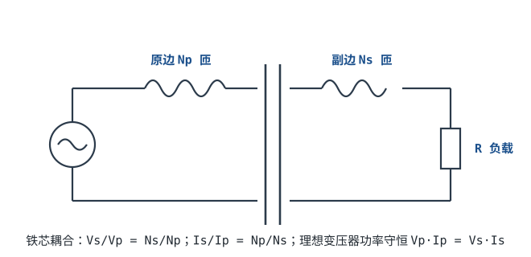

# 变压器原理 Transformer

为什么市电是 220V 交流而不是直流？一个关键原因：**交流可以用变压器随便升降压**，直流不行。变压器靠两个线圈绕在同一铁芯上、通过磁场互相耦合，实现电压变换和电气隔离。这一章讲它的直觉和基本公式。

## 1. 设计动机

::: motivation 变压器解决了什么
发电厂在很远的地方，输电要减少损耗就得用高压（几百 kV），但家里插座不能用几百 kV——要靠一级级变压器降到 220V。手机充电器把 220V 降到 5V，也靠变压器（开关电源里高频变压器）。它还能把"电网地"和"你的设备地"隔离开，防止触电。
:::

## 2. 原理图

## 3. 变压比（只给结论）

理想变压器的原、副边电压比等于线圈匝数比：

$$\frac{V_s}{V_p} = \frac{N_s}{N_p}$$

功率守恒（理想变压器无损耗）：

$$V_p \cdot I_p = V_s \cdot I_s \qquad\Longrightarrow\qquad \frac{I_s}{I_p} = \frac{N_p}{N_s}$$

符号含义：$V_p$、$I_p$ 是原边电压/电流，$V_s$、$I_s$ 是副边，$N_p$、$N_s$ 是两边匝数。

直觉：**副边匝数多就升压（$N_s>N_p$），匝数少就降压**。升压的同时电流变小（功率守恒），降压的同时电流变大。

::: analogy 齿轮变速
变压器像一对咬合的齿轮：原边是大齿轮（匝多）带副边小齿轮（匝少），副边转得快但力小（电压低、电流大）；反过来就升压。功率（转速×扭矩）两边守恒。
:::

::: advanced 进阶：为什么只能交流
变压器靠**变化的磁场**在副边感应出电压。直流产生的磁场不变，副边感应电压为 0——所以变压器不能变压直流（这也是为什么开关电源先把直流斩成高频交流再用小变压器）。实际变压器有励磁电流、漏感、铜损铁损，效率约 95~99%。
:::

## 4. 带数字的算例

::: example 220V 变 12V 的电源变压器
1. **需求**：把 220V 市电降到 12V 给电路板。
2. **变压比**：$N_s/N_p=12/220\approx1/18.3$。
3. **选匝数**：若原边绕 2200 匝，副边绕 $2200/18.3\approx$ **120 匝**。
4. **电流**：副边接 12V/1A 负载，副边功率 12W；原边电流 $I_p=12/220\approx$ **55 mA**。
5. **安全**：原边和副边在变压器里是电气隔离的——触摸副边不会直接连到 220V 电网，这就是隔离变压器。
:::

## 5. 常见坑

::: pitfall 常见坑
- **把变压器接到直流上**：现象——接直流后变压器很快发热冒烟。原因——直流下线圈阻抗只剩导线电阻，电流极大，且不感应副边电压。解决——变压器只用于交流（或先斩波）。
- **以为"隔离变压器"后两边都不触电**：现象——用了隔离变压器，一手摸一根线仍没事，两手摸两根线却触电。原因——隔离后副边对地无电压，但两根线之间仍有 220V 压差，同时碰两根照样触电。解决——隔离只是消除"对地"触电风险，不能同时碰两根线。
- **忽略额定功率/温升**：现象——小变压器带大负载后发烫。原因——铜损铁损随负载增大，超过额定功率过热。解决——按负载功率留 30~50% 余量。
:::

## 6. 自测题

原边 2200 匝、副边 200 匝，原边加 220V，副边输出多少？

$V_s=V_p\times N_s/N_p=220\times200/2200=$ **20V**。降压比 11:1。

降压变压器把电压降到 1/10，副边电流是原边的几倍？

功率守恒 $V_p I_p=V_s I_s$，$V_s=V_p/10$ → $I_s=10 I_p$。**电流放大到 10 倍**——所以低压大电流绕组要用粗线。

为什么变压器不能用来变压 12V 直流？

直流产生恒定磁场，副边感应电压为 0。直流下变压器线圈就是一小段导线电阻，会短路大电流发热。要变压直流必须先逆变成高频交流（开关电源）。

## 7. 参考资料

- Practical Electronics for Inventors (Scherz & Monk) — Transformers chapter
- NEETS — Transformers
- [Lessons In Electric Circuits — Transformers](https://www.ibiblio.org/kuphaldt/electricCircuits/)
